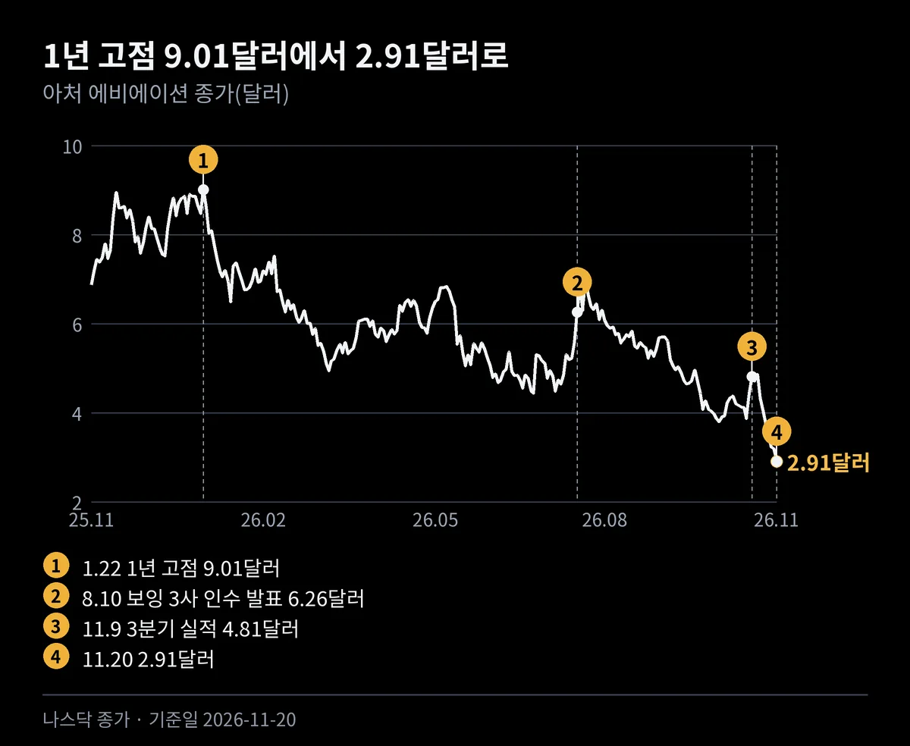
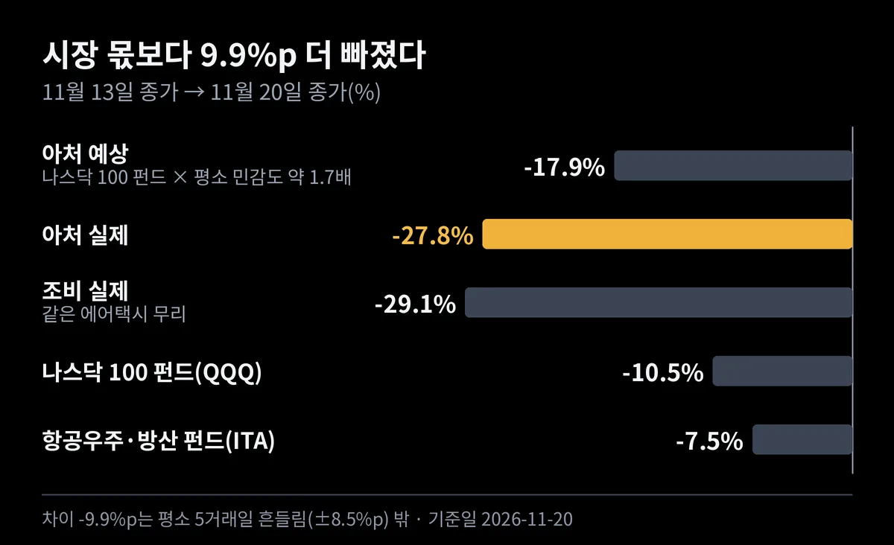
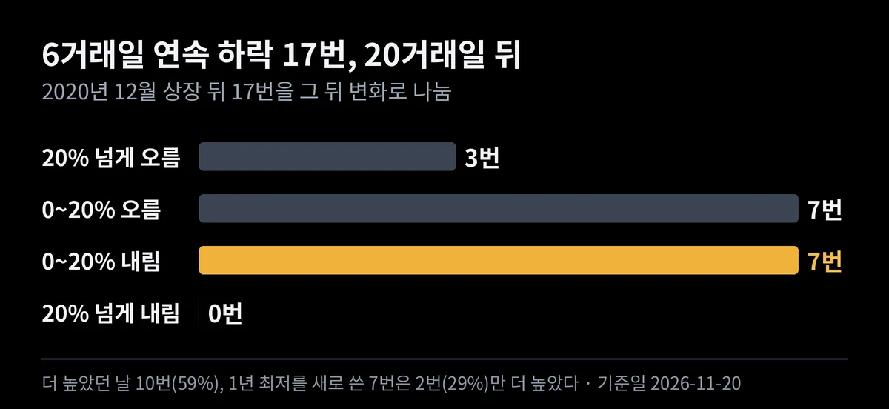
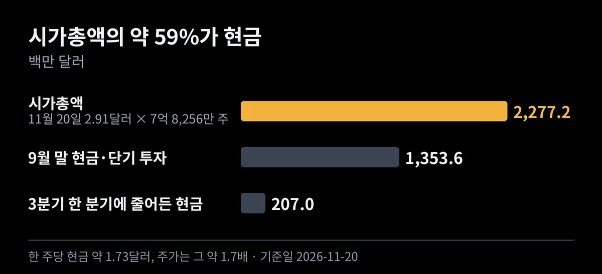
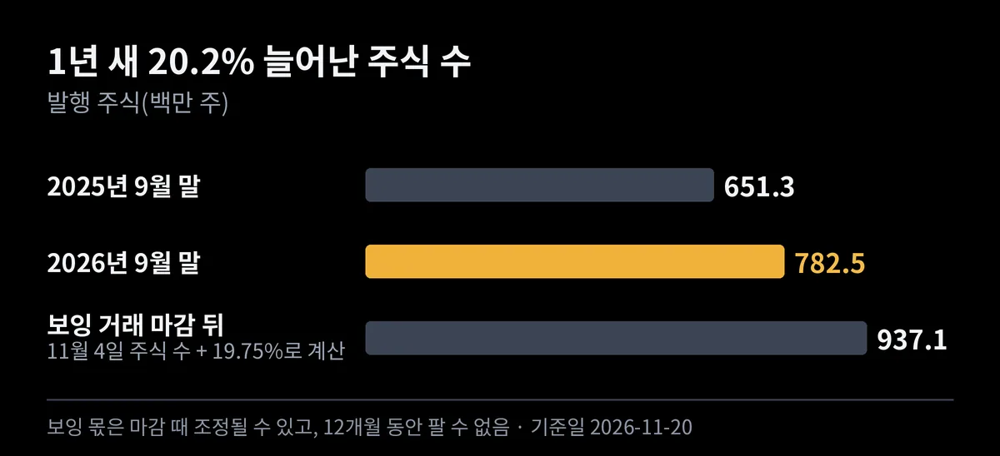
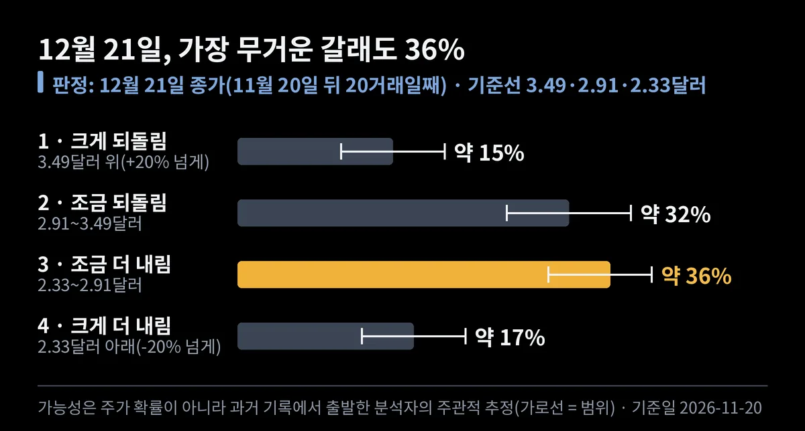

아처 에비에이션 지금 사도 될까? 11월 20일, 이 회사 주가는 2.91달러로 마감했습니다. 11월 11일 4.86달러 뒤 하루도 쉬지 않고 7거래일 연속 내려, 그 사이 40.1%가 빠졌습니다. 그런데 이 회사의 9월 말 현금은 시가총액의 약 59%입니다. 현금이 이만큼 있는 회사가 왜 7거래일 만에 이렇게 빠졌을까요. 이 글은 사라, 팔라를 말하지 않습니다. 대신 이 질문에 답하는 데 필요한 근거를 끝까지 꺼내 보겠습니다.

> **유의사항** 저자는 금융·투자 자문가가 아닙니다. 이 글은 공개 공시와 시세를 정리한 교육용 분석이며 특정 종목의 매수·매도를 권하지 않습니다. 과거 패턴은 미래 수익을 보장하지 않고, 아처 에비에이션은 최근 20거래일 가운데 10일이 하루 5% 넘게 움직인 종목입니다. 실제 투자 전에는 최신 공시를 직접 확인하세요.

김박사 월드가 아처 에비에이션을 다루는 것은 이번이 처음입니다. 핵심 종목 가운데 주말 사이 새 공시가 나온 종목이 없어, 같은 무리에서 새 사건이 확인된 종목을 골랐습니다. 아처는 [조비 에비에이션](/r/joby-2026-11-4/)과 같은 에어택시 무리입니다. 첫 리포트라 채점할 지난 예측은 없습니다. 판정할 예측은 이 글 끝에 새로 적습니다.

회사부터 보겠습니다. 아처가 만드는 것은 '미드나이트'라는 전기 수직이착륙기입니다. 헬리콥터처럼 제자리에서 뜨고 내리지만, 배터리와 전기 모터로 날고 소음이 작습니다. 회사는 도심에서 공항이나 경기장까지 몇 분 만에 사람을 나르는 에어택시를 계획합니다. 첫 무대는 로스앤젤레스이고, 2028년 로스앤젤레스 올림픽의 공식 에어택시 회사로 뽑혔습니다.

아직 돈을 버는 단계는 아닙니다. 3분기 매출은 510만 달러였습니다. 이 분기에 방산 협력사 안두릴에 첫 엔진을 넘기기도 했습니다. 같은 분기 순손실은 2억 7,460만 달러였습니다. 대신 9월 말 현금과 단기 투자가 13억 5,360만 달러 있습니다. 회사는 분기 보고서에 이 돈이 '현재 운영 계획에 최소 12개월 동안 자금을 대기에 충분하다'고 적었습니다.

11월 9일 실적 발표에는 좋은 소식이 여럿 있었습니다. 미드나이트가 미국 연방항공청(FAA)에서 시장조사용 특별 감항증명을 받았습니다. 로스앤젤레스에서 시범 운항을 시작할 수 있게 해 주는 서류입니다. 보잉에서 위스크·인시투·스카이그리드 세 회사를 사는 거래도 정부와 제3자 승인 약 20개 가운데 하나만 남았다고 회사는 밝혔습니다. 그날 종가는 4.81달러였습니다.

그런데 주가는 그 뒤로 반대로 갔습니다. 11월 11일 4.86달러에서 7거래일 동안 하루도 오르지 못하고 2.91달러까지 내렸습니다. 약 2년 2개월 만의 최저 종가입니다. 마지막 날 거래량도 평소보다 많았고, 하루씩의 숫자는 부록 표에 있습니다.

이 기간 회사가 낸 새 서류는 있었을까요? SEC 제출 목록에는 11월 17일 임원 네 명의 주식 매도 신고뿐입니다. 원문은 '제한조건부 주식이 지급될 때 생긴 세금을 내려고 판 것'이라고 적었습니다. 네 사람 합계 12만 2,248주, 가중 평균 3.694달러였습니다. 발행 주식 7억 8,256만 주의 약 0.016%입니다.

그렇다면 이 하락에서 시장이 함께 움직인 부분은 얼마일까요? 이것을 재는 방법이 평소 민감도입니다. 시장이 1% 움직일 때 이 종목이 평균 몇 % 움직였는지를 지난 250거래일 기록으로 계산한 값입니다. 아처는 나스닥 100 펀드 기준 약 1.7배였습니다. 시장이 1% 빠지면 평균 1.7% 빠지는 종목이라는 뜻입니다.

11월 13일부터 20일까지 아처는 27.8% 내렸습니다. 같은 기간 나스닥 100 펀드(QQQ)는 10.5% 내렸으니, 평소 민감도대로라면 17.9%쯤 빠졌어야 합니다. 실제로는 그보다 9.9%p 더 빠졌고, 이 차이는 평소 흔들림 범위 밖입니다. 실제 하락의 약 3분의 2(64%)는 시장 탓이었지만, 나머지는 시장만으로 설명되지 않는다는 뜻입니다.

더 빠진 부분은 회사 하나만의 일이었을까요? 같은 5거래일, 같은 에어택시 회사 조비는 -29.1%였습니다. 조비의 평소 민감도로 예상한 움직임은 -17.2%여서, 차이가 -11.9%p였습니다. 두 회사가 나란히 시장보다 10%p 안팎 더 빠졌습니다. 다만 무리 전체를 끌어내린 공시나 발표는 확인되지 않았습니다. 그래서 이 글은 원인을 단정하지 않고, '같은 기간 에어택시 무리가 함께 더 빠졌다'까지만 적습니다.

시장 쪽 배경도 적어 둡니다. 시장이 앞으로 크게 흔들릴 것으로 보는 정도를 나타내는 변동성 지수(VIX)는 11월 20일 35.89로, 5거래일 전보다 16.59포인트 높았습니다. 20 안팎인 평소보다 꽤 불안한 수준입니다. 같은 기간 미국 10년 국채 금리는 오히려 내렸습니다(부록 표). 다음 큰 일정은 11월 25일 개인소비지출(PCE) 물가 발표와 12월 9일 연준 금리 회의(FOMC)입니다. 정책 쪽은 FAA 인증과, 백악관이 만든 에어택시 시범 사업(eIPP, 형식 인증 전에 미국 도시에서 시범 운항을 허용하는 프로그램)처럼 회사 보고서가 직접 적은 조건만 있고, 이번 하락과 직접 연결된 새 정책은 확인되지 않았습니다.

같은 5거래일, 김박사 월드 핵심 종목 8개 가운데 7개는 평소 시장 민감도로 예상한 범위 안에서 움직였습니다. 예외가 조비 하나였고, 아처도 그 쪽에 섰습니다. 이번 주 소형 성장주 대부분이 시장을 따라 내렸다면, 에어택시 두 종목은 거기에 무언가가 더 얹힌 셈입니다. 종목별 숫자는 부록 표에 있습니다.

이 질문의 첫 번째 열쇠는 과거 비슷한 순간입니다. 2020년 12월 상장 뒤 아처가 6거래일 이상 연속으로 내린 때를 모두 찾았습니다. 20거래일 뒤 결과를 아는 경우는 17번이었습니다. 그 가운데 20거래일 뒤 더 높았던 경우는 10번, 59%였습니다. 가운데 값(중앙값)은 +7.0%였습니다.

그런데 조건을 하나 더 붙이면 모양이 바뀝니다. 연속 하락이 1년 최저 종가를 새로 쓴 경우만 보면 기록이 7번인데, 20거래일 뒤 더 높았던 경우는 2번(29%)뿐이었습니다. 가운데 값도 -0.4%였습니다. 이번 11월 20일이 바로 그런 날입니다. 지난 예측을 채점해 모아 둔 김박사 월드 장부에서도, 판정선이나 새 최저를 깨는 쪽 예측은 4번 모두 맞았고 '지킨다' 쪽은 4번 모두 빗나갔습니다. 다만 4번뿐인 작은 기록입니다. 이제 사는 쪽 근거와 사지 않는 쪽 근거를 셋씩 나란히 놓겠습니다.

사는 쪽 근거 첫째는 현금입니다. 지금 종가로 계산한 시가총액은 약 22억 7,700만 달러입니다. 9월 말 현금과 단기 투자 13억 5,360만 달러는 그 약 59%입니다. 이 현금을 발행 주식 수로 나누면 한 주당 약 1.73달러입니다. 주가 2.91달러는 그 한 주당 현금의 약 1.7배입니다.

두 번째로 볼 것은 진척입니다. 미드나이트는 FAA 형식 인증의 네 번째이자 마지막 단계에 있다고 회사는 적었습니다. 이번 시장조사용 감항증명으로 로스앤젤레스 시범 운항 길이 열렸습니다. 보잉 거래가 마감되면 무인기 회사 인시투가 들어옵니다. 회사는 주주 서한에서 인시투가 흑자 회사이고 연 매출이 2억 달러를 넘는다고 밝혔습니다(인시투의 현재 재무와 추정 기준). 이 매출은 마감 뒤에야 아처 실적에 들어올 수 있고, 들어오는 시점과 방식은 아직 공시되지 않았습니다.

사는 쪽 마지막 근거는 하락의 성격입니다. 5거래일 하락 -27.8% 가운데 -17.9%는 평소 민감도로 설명되는 시장 움직임이었습니다. 11월 20일 하루만 떼어 보면 예상 -9.9%, 실제 -9.1%로 평소 흔들림 안이었습니다. 회사가 낸 서류는 세금용 매도 신고뿐이었습니다. 회사 고유의 나쁜 소식이 새로 붙었다는 기록은 아직 없습니다.

이번엔 사지 않는 쪽 근거입니다. 첫째는 돈이 나가는 속도입니다. 3분기 한 분기에 현금과 단기 투자가 2억 700만 달러 줄었습니다. 회사는 4분기에도 비슷한 크기의 손실을 내다봤습니다. 13억 5,360만 달러를 3분기 감소액으로 단순히 나누면 약 6분기 반 치입니다. 회사가 밝힌 '최소 12개월'과는 다른, 이 글의 단순 계산입니다. 사는 쪽 첫째 근거인 현금이 줄어드는 시계이기도 합니다.

둘째는 늘어나는 주식 수입니다. 발행 주식은 1년 사이 20.2% 늘었습니다. 협력사 대금 일부도 현금 대신 주식으로 치렀습니다. 그리고 보잉 거래가 마감되면 직전 발행 주식의 19.75%를 보잉에 줍니다. 지금 주식 수로 계산하면 약 1억 5,456만 주입니다. 보잉은 12개월 동안 이 주식을 팔 수 없지만, 한 주에 돌아가는 회사 지분은 그만큼 얇아집니다.

셋째는 평소 흔들림을 넘은 하락입니다. 5거래일 차이 -9.9%p는 평소 흔들림 ±8.5%p 밖이었고, 같은 무리 조비도 같은 쪽이었습니다. 앞에서 본 대로 1년 최저를 새로 쓴 뒤 20거래일은 7번 중 5번이 더 낮았습니다. 최근 20거래일 가운데 하루 5% 넘게 움직인 날도 10일이었습니다. 김박사 월드 예측 기록 가운데 두 건(BTQ·실스크)에서도 소형주는 업종 하락은 함께 맞고, 반등은 따라가지 못했습니다.

같은 모양은 핵심 종목에서도 보였습니다. 조비 리포트에서도 조비가 1년 최저를 새로 쓴 네 번이 모두 20거래일 뒤 더 낮았다는 기록을 적었습니다. 현금 쪽 비교로는 [뉴스케일](/r/smr-2026-11-4/)이 있습니다. 뉴스케일은 주가가 한 주당 현금의 약 0.77배였고, 아처는 약 1.7배입니다. 같은 '현금 많은 성장주'라도 시장이 매기는 값은 이렇게 다릅니다.

그럼 무엇을 보면 판단이 바뀔까요? 신호와 날짜를 정해 두겠습니다. 첫 신호는 보잉 인수 마감 공시입니다. 그때 실제로 늘어난 주식 수와 인시투 실적이 처음 숫자로 나옵니다. 둘째는 회사가 연말까지 끝내겠다고 한 조종사 탑승 천이 비행입니다. 수직으로 뜬 뒤 날개 비행으로 넘어가는 시험으로, 일정대로 발표되는지가 신호입니다.

기준 날짜는 12월 21일 종가로, 11월 20일 뒤 20번째 거래일입니다. 이날 11월 20일보다 20% 높은 3.49달러 위에 있으면 사는 쪽 근거가 강해집니다. 20% 낮은 2.33달러 아래면 사지 않는 쪽 근거가 강해집니다. 그 사이 12월 9일 연준 금리 회의 뒤 시장이 되돌릴 때, 아처가 평소 민감도만큼 따라 오르는지도 함께 봅니다.

사려는 사람이 먼저 볼 것은 두 가지입니다. 하나는 최신 10-Q에서 현금과 한 분기에 줄어든 돈을 직접 확인하는 것입니다. 10-Q는 미국 상장사가 분기마다 SEC에 내는 보고서입니다. 다른 하나는 보잉 마감 뒤 늘어날 주식 수를 넣고 한 주당 현금을 다시 계산해 보는 것입니다. 인증 진척, 다음 거시 일정, 판정 날짜까지 다섯 가지 확인표는 글 끝 부록에 있습니다.

마지막으로 12월 21일 종가를 네 갈래로 나눴습니다. 출발점은 6거래일 연속 하락 17번과 1년 최저 경신 7번의 기록을 평균한 값입니다. 여기에 장부의 '이탈 쪽을 낮게 보지 말라'는 규칙을 반영해 크게 더 내리는 칸을 올렸습니다. 근거가 4번뿐이라 올린 폭은 10%p로 묶었습니다. 시장이 크게 흔들리는 때라 크게 되돌리는 칸도 조금 올렸습니다.

2.33~2.91달러, 조금 더 내리는 갈래를 약 36%로 가장 무겁게 봤습니다. 2.91~3.49달러로 조금 되돌리는 갈래는 약 32%입니다. 2.33달러 아래로 크게 더 내리는 갈래는 약 17%, 3.49달러 위로 크게 되돌리는 갈래는 약 15%입니다. 이 숫자는 주가가 오를 확률이 아니라, 과거 빈도에서 출발한 분석자의 주관적 추정입니다.

이 판단이 틀릴 수 있는 곳도 적어 둡니다. 평소 민감도가 약 1.7배라서, 시장이 12월 9일 뒤 10% 되돌리면 아처는 약 17% 움직여 위쪽 칸으로 넘어갈 수 있습니다. 보잉 마감이나 천이 비행 완료 같은 회사 소식이 그 사이 나오면 무리와 다른 방향이 생길 수도 있습니다. 1년 최저 경신 기록이 7번뿐이라는 점도 한계입니다.

지금 아처 에비에이션은 현금이 시가총액의 약 59%인데, 그 현금이 한 분기에 2억 달러 넘게 줄고 주식 수는 늘어나는 회사입니다. 최근 하락의 약 3분의 2는 시장 탓이었지만, 나머지는 같은 무리 조비와 함께 시장보다 더 빠진 부분이었습니다. 12월 21일 종가가 3.49달러 위로 돌아오고 보잉 마감과 천이 비행이 일정대로 나온다면 사는 쪽 근거가 강해집니다. 2.33달러 아래이거나 새 주식 판매, 일정 지연이 이어지면 사지 않는 쪽 근거가 강해집니다. 결정은 각자의 몫이며, 이 영상과 리포트는 판단 근거를 정리한 교육용 자료입니다.

## 숫자로 다시 보기

### 최근 하루씩

| 날짜 · 종가 | 하루 변화 · 거래량 | 메모 |
| --- | --- | --- |
| **11월 9일** 4.81달러 | +8.3% · 약 3,942만 주 | 3분기 실적 |
| **11월 11일** 4.86달러 | +3.2% · 약 2,738만 주 | 연속 하락 직전 |
| **11월 13일** 4.03달러 | -6.9% · 약 1,998만 주 | 5거래일 비교 출발 |
| **11월 18일** 3.23달러 | -8.2% · 약 3,825만 주 | - |
| **11월 19일** 3.20달러 | -0.9% · 약 3,161만 주 | - |
| **11월 20일** 2.91달러 | -9.1% · 약 3,674만 주 | 7거래일 연속 하락, 1년 최저 |

11월 20일 거래량은 직전 20거래일 평균의 1.39배입니다. 11월 11일 → 20일 -40.1%, 11월 9일 → 20일 -39.5%(조비 -41.7%)입니다. 보잉 3사 인수를 발표한 8월 10일 종가는 6.26달러(+12.0%)였습니다.

### 사는 쪽 근거와 사지 않는 쪽 근거

| 사는 쪽 · 숫자 | 사지 않는 쪽 · 숫자 |
| --- | --- |
| **시가총액의 약 59%인 현금** 9월 말 현금·단기 투자 13억 5,360만 달러, 한 주당 약 1.73달러, 주가는 그 약 1.7배 | **돈이 나가는 속도** 3분기 현금 2억 700만 달러 감소, 4분기 조정 EBITDA(이자·세금·감가상각·주식 보상을 뺀 회사 기준 손익) 손실 전망 1억 8,500만~2억 500만 달러 |
| **인증과 인수의 진척** FAA 시장조사 감항증명, 형식 인증 마지막 단계, 보잉 인수 승인 약 20개 중 하나 남음(회사 발표) | **늘어나는 주식 수** 1년 새 +20.2%, 보잉 마감 때 직전 발행 주식의 19.75% 추가 |
| **하락의 약 3분의 2는 시장 탓** 5거래일 예상 -17.9% · 실제 -27.8%, 11월 20일 하루는 평소 흔들림 안 | **평소 흔들림을 넘은 하락** 5거래일 차이 -9.9%p(±8.5%p 밖), 1년 최저 경신 뒤 20거래일 더 높음 2/7 |

### 6거래일 연속 하락, 20거래일 뒤

**한눈에:** 2020년 12월 18일 상장 뒤 6거래일 이상 연속 하락 중 20거래일 뒤를 아는 경우 **17번** · 더 높음 **10번(59%)** · 가운데 값 **+7.0%**

| 20거래일 뒤 칸 | 6거래일 연속 하락(17번) | 1년 최저 경신(7번) |
| --- | --- | --- |
| 20% 넘게 오름(3.49달러 위에 해당) | 3번 | 0번 |
| 0~20% 오름 | 7번 | 2번 |
| 0~20% 내림 | 7번 | 4번 |
| 20% 넘게 내림(2.33달러 아래에 해당) | 0번 | 1번 |

1년 최저 경신은 20거래일 만에 처음 새로 쓴 날만 셌습니다. 더 높음 2번(29%), 가운데 값 -0.4%입니다. 두 기록은 날짜가 일부 겹칩니다.

| 1년 최저 경신 날 · 종가 | 20거래일 뒤 |
| --- | --- |
| **2022년 1월 6일** 5.04달러 | -39.9% |
| **2022년 9월 26일** 2.74달러 | -0.4% |
| **2022년 11월 9일** 2.49달러 | -13.7% |
| **2024년 9월 25일** 2.91달러 | +7.2% |
| **2026년 3월 12일** 6.15달러 | -12.2% |
| **2026년 6월 25일** 4.79달러 | -0.4% |
| **2026년 10월 14일** 4.07달러 | +19.4% |
| **이번 11월 20일** 2.91달러 | 12월 21일 판정 |

### 시장·거시·정책 배경

| 대상 · 11월 20일 종가 | 하루 | 11월 13일 → 20일 |
| --- | --- | --- |
| **아처 에비에이션** 2.91달러 | -9.1% | -27.8% |
| **조비 에비에이션** 3.60달러 | -8.4% | -29.1% |
| **항공우주·방산 펀드(ITA)** 66.17달러 | -3.0% | -7.5% |
| **나스닥 100 펀드(QQQ)** 608.45달러 | -5.7% | -10.5% |
| **소형주 펀드(IWM)** 256.61달러 | -2.9% | -7.5% |
| **S&P 500 펀드(SPY)** 689.81달러 | -3.6% | -8.6% |

| 기준 · 평소 민감도 | 예상 · 실제 | 판정 |
| --- | --- | --- |
| **QQQ 기준** 11월 13일 → 20일 약 1.7배 | -17.9% · -27.8% | 차이 -9.9%p, 평소 흔들림(±8.5%p) 밖 |
| **ITA 기준** 11월 13일 → 20일 약 1.4배 | -10.0% · -27.8% | 차이 -17.8%p, 평소 흔들림(±8.9%p) 밖 |
| **QQQ 기준** 11월 20일 하루 약 1.7배 | -9.9% · -9.1% | 평소 흔들림(±3.8%p) 안 |

평소 민감도는 11월 13일 전 250거래일의 하루 수익률을 회귀해 구했습니다(나스닥 종가). 같은 구간 조비는 예상 -17.2%, 실제 -29.1%로 차이 -11.9%p였습니다.

| 지표 | 값(날짜) | 출처 |
| --- | --- | --- |
| 변동성 지수(VIX) | 35.89(11월 20일), 5거래일 전보다 +16.59포인트 | Cboe |
| 미국 10년 국채 금리 | 4.92%(11월 20일), 5회 전보다 -0.23%포인트 | 미 재무부 |
| 미국 2년 국채 금리 | 4.63%(11월 20일) | 미 재무부 |

| 다음 거시 일정 | 날짜 |
| --- | --- |
| 개인소비지출(PCE) 물가, 10월분 | 11월 25일 |
| 연준 금리 회의(FOMC) 결정 | 12월 9일 |
| 개인소비지출(PCE) 물가, 11월분 | 12월 23일 |
| 소비자물가(CPI)·고용 보고서 | 확인 안 됨(공식 일정 페이지 접근 막힘) |

정책 연결: 직접 연결 확인 안 됨. 10-K 위험 요인은 FAA 인증(certification 32회 언급)과 관세·수출 통제를 사업 조건으로 적었고, 10-Q는 백악관 에어택시 시범 사업(eIPP)을 상용화 경로로 적었습니다. 11월 13~20일 하락과 직접 연결된 새 규칙이나 발표는 확인되지 않았습니다.

같은 5거래일 핵심 종목 8개 가운데 7개가 평소 시장 민감도로 예상한 범위 안에서 움직였습니다.

| 핵심 종목 | 실제 | 평소 민감도로 예상 |
| --- | --- | --- |
| 조비 | -29.1% | -17.2% |
| 뉴스케일 | -27.9% | -24.8% |
| 실스크 | -23.0% | -21.6% |

리포트: [조비 에비에이션](/r/joby-2026-11-4/) · [뉴스케일](/r/smr-2026-11-4/) · [실스크](/r/laes-2026-11-5/)

### 지금의 크기(11월 20일 기준)

| 항목 | 값 · 근거 |
| --- | --- |
| 종가 | **2.91달러** 하루 -9.1%, 7거래일 연속 하락 |
| 1년 고점 대비 | **-67.7%** 2026년 1월 22일 9.01달러 |
| 상장 뒤 최고가 대비 | **-83.0%** 2021년 2월 18일 17.14달러 |
| 시가총액 | **약 22억 7,700만 달러** 발행 주식 7억 8,255만 7,115주(11월 4일) 기준 |
| 9월 말 현금·단기 투자 | **13억 5,360만 달러** 제한 현금 1,840만 달러 별도 |
| 한 주당 현금 | **약 1.73달러** 주가는 그 약 1.7배(1.68배) |
| 3분기 매출 · 순손실 | **510만 달러 · 2억 7,460만 달러** |
| 3분기 현금 감소 | **2억 700만 달러** 영업 1억 6,460만 · 시설 3,170만 · 비상장 투자 1,000만 |
| 4분기 전망 | **매출 500만~600만 달러** 조정 EBITDA 손실 1억 8,500만~2억 500만 달러 |
| 발행 주식 1년 증가 | **+20.2%** 6억 5,129만 7,219주 → 7억 8,253만 6,036주(9월 말) |
| 보잉에 줄 주식 | **직전 발행 주식의 19.75%** 11월 4일 기준 약 1억 5,456만 주, 12개월 매각 제한 |
| 협력사 주식 지급 | **1,935만 5,170주** 올해 9개월, 1억 2,280만 달러어치 |
| 1년 최저 종가 | **2.91달러** 2024년 9월 25일과 같은 값 |
| 그림용 숫자 | 시가총액 2,277.2 · 현금·단기 투자 1,353.6 · 3분기 현금 감소 207.0(백만 달러) 3분기 매출 5.1 · 순손실 274.6(백만 달러) 발행 주식 651.3 → 782.5 → 보잉 마감 뒤 계산 937.1(백만 주) |
| 보잉 워런트 | **1억 달러씩 두 장** 행사가 13.00달러 · 17.88달러 |
| 평소 민감도 | **약 1.7배** 나스닥 100 펀드 기준 |

### 사기 전에 확인할 것

| 확인할 것 | 어디서 · 언제 |
| --- | --- |
| **현금과 한 분기에 줄어든 돈** 13억 5,360만 달러 · 2억 700만 달러 | 10-Q · 다음 분기 보고서 |
| **보잉 마감 뒤 주식 수와 한 주당 현금** 19.75% 추가 | 8-K · 마감 공시 때 |
| **조종사 탑승 천이 비행 완료** 회사 목표 연말 | 회사 발표 · 12월 |
| **12월 9일 FOMC 뒤 시장을 평소만큼 따라가는지** 평소 민감도 약 1.7배 | 나스닥 종가 · 12월 9~10일 |
| **판정 날짜 메모** 3.49 · 2.33달러 | 12월 21일 |

### 앞으로 일어날 수 있는 일

과거 빈도는 위 '6거래일 연속 하락' 표와 같습니다. 두 기록 모두 '조금 더 내림' 칸이 가장 많거나 공동 1위였습니다.

과거 빈도로는 6거래일 연속 하락 17번 중 10번이 20거래일 뒤 더 높았지만, 1년 최저 경신 7번 중에는 2번이었습니다. 아래 가능성은 주가 상승·하락 확률이 아니라, 12월 21일 종가의 자리에 대한 분석자의 주관적 추정입니다. 네 갈래는 겹치지 않아 더하면 100%이고, 괄호 안 범위는 더하지 않습니다.

| 시나리오(판정 12월 21일) | 종가 | 가능성(추정) |
| --- | --- | --- |
| 1 · 크게 되돌림 | 3.49달러 위 | 낮음 약 15% (10~20%) |
| 2 · 조금 되돌림 | 2.91~3.49달러 | 중간 약 32% (26~38%) |
| **3 · 조금 더 내림** | 2.33~2.91달러 | 중간 약 36% (30~40%) |
| 4 · 크게 더 내림 | 2.33달러 아래 | 낮음 약 17% (12~22%) |

### 핵심 확인 세 가지

| 순위 · 확인할 것 | 판정 날짜 |
| --- | --- |
| **1순위** 12월 21일 종가가 3.49달러 위인가, 2.33달러 아래인가 | 12월 21일 |
| **2순위** 보잉 3사 인수 마감 공시와 늘어난 주식 수 | 12월 21일까지 |
| **3순위** 조종사 탑승 천이 비행 완료 발표 | 12월 31일까지 |

공시는 [아처 에비에이션 SEC 공시 목록](https://www.sec.gov/cgi-bin/browse-edgar?action=getcompany&CIK=0001824502&type=&dateb=&owner=include&count=40)에서 직접 확인할 수 있습니다.

## 함께 읽기

- [조비 에비에이션 리포트](/r/joby-2026-11-4/) · [영상](https://youtu.be/m2eALHEvv8c): 같은 에어택시 무리, 3년 반 만에 4달러 아래(11월 19일 기준).
- [뉴스케일 리포트](/r/smr-2026-11-4/) · [영상](https://youtu.be/LtzNialqBF8): 현금 많은 성장주, 주가가 한 주당 현금의 약 0.77배(11월 20일 기준).
- [블룸 에너지 리포트](/r/be-2026-11/) · [영상](https://youtu.be/VdSWc4jMjzI): 같은 주 시장 급락, 평소 민감도 약 3.0배(11월 20일 기준).
