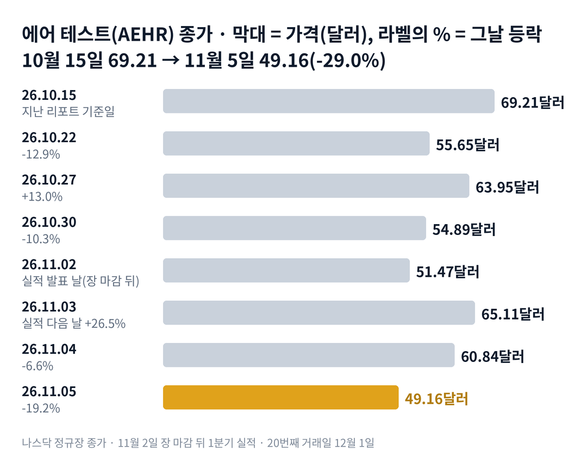

## 짧은 답

에어 테스트 시스템즈는 11월 2일 장 마감 뒤 1년 전의 3배인 분기 매출을 발표했습니다. 다음 날 주가는 26.5% 올랐습니다. 그런데 3거래일 뒤인 11월 5일 종가는 발표 날보다 4.5% 낮았습니다. 좋은 실적의 상승분은 왜 이렇게 빨리 사라졌을까요?

시청자 요청 종목이고, 요청하신 분은 수주를 중심으로 실적을 비교해 달라고 하셨습니다. 이번 분기 수주는 4,670만 달러로, 사상 최대였던 직전 분기 6,070만 달러보다 줄었습니다.

그렇다고 수주 감소가 하락의 이유라고 단정할 수는 없습니다. 수주는 매출보다 많아 수주잔고는 더 늘었고, 회사는 연간 매출 전망을 올렸기 때문입니다.

과거에도 실적 다음 날 15% 넘게 오른 때가 일곱 번 있었습니다. 그 일곱 번은 모두 3거래일째에도 발표 날보다 높았습니다. 이번처럼 다 내준 것은 처음인데, 한 달 뒤는 어땠을까요?

## 지난 리포트 이후

[10월 15일 기준 리포트](/r/aehr-2026-10/)는 지금을 '기대 조정기'로 봤고, 10월 15일 69.21달러에서 11월 5일 49.16달러(-29.0%)로 이 진단은 맞았습니다. '전망을 올리면 다음 날 오른다'는 기록도 11월 3일 +26.5%로 맞았습니다. '실행 확인기'로 넘어갈 조건이던 매출 증가와 전망 유지는 숫자로는 채웠지만, 주가가 차분해진다는 신호는 나오지 않았습니다. 지난 예측 성적은 적중 2 · 부분 적중 1이고, 항목별 채점표는 6부 끝에 있습니다.

## 1부. 에어 테스트는 어떤 회사이고, 무엇으로 돈을 버는가

> **핵심:** 에어 테스트는 반도체 시험 장비를 파는 회사이고, 주문이 먼저 들어오고 몇 분기 뒤에 매출이 됩니다.

에어 테스트 시스템즈는 미국 캘리포니아의 반도체 장비 회사입니다. 칩이 출하 전에 고장 나지 않는지 높은 열과 전압을 걸어 미리 시험하는 장비(번인 장비)를 만듭니다. 전기차용 탄화규소(SiC) 칩에서 시작해, 지금은 AI 프로세서용 장비가 성장의 중심입니다.

돈을 버는 방식은 장비와 소모품 판매입니다. 웨이퍼 한 장을 통째로 시험하는 폭스(FOX, 웨이퍼를 통째로 시험하는 번인 장비) 장비와, 포장된 칩을 시험하는 소노마(Sonoma) 장비를 팝니다. 장비에 끼워 쓰는 시험판(WaferPak 등) 같은 소모품도 다시 팝니다.

수주가 중요한 이유는 매출의 순서 때문입니다. 고객이 장비를 주문하면 수주가 잡히고, 회사가 장비를 만들어 넘기면 그때 매출이 됩니다. 그래서 오늘의 수주는 몇 분기 뒤의 매출을 미리 보여 주는 숫자입니다.

지금 몸값은 시가총액 약 16억 1,000만 달러입니다. 회사가 올린 연간 매출 전망 1억 5,000만 달러의 약 10.7배입니다. 시장이 앞으로의 주문까지 미리 값에 넣고 있다는 뜻입니다.

### 숫자로 본 지금의 크기(11월 5일 기준)

| 항목 | 값 · 계산 근거 |
| --- | --- |
| 종가 | **49.16달러** 11월 5일 하루 -19.2% |
| 1분기 매출 | **3,300만 달러** 1년 전 1,100만 달러의 3배(9월 25일까지 석 달) |
| 1분기 수주 | **4,670만 달러** 직전 분기 6,070만 달러(사상 최대) |
| 유효 수주잔고 | **1억 930만 달러** 11월 1일 기준, 분기 뒤 주문 포함 |
| 연간 매출 전망 | **1억 5,000만 달러** 기존 1억 3,000만~1억 5,000만 달러에서 상향 |
| 현금 | **1억 510만 달러** 9월 25일 기준, 직전 분기 1억 1,650만 달러 |

유효 수주잔고 1억 930만 달러는 연간 전망을 채우는 데 남은 약 1억 1,700만 달러의 약 93%입니다. 그렇다면 숫자가 이렇게 좋았는데, 실적 뒤 일주일 동안 무슨 일이 겹쳤을까요?

## 2부. 실적 뒤 일주일, 세 가지 일

> **핵심:** 실적 숫자는 좋았지만, 증권사 목표가 하향과 원인이 밝혀지지 않은 급락이 이어졌습니다.

실적 발표 날 종가 51.47달러는 지난 리포트 기준일인 10월 15일 69.21달러보다 이미 25.6% 낮았습니다. 첫 번째는 실적 숫자 자체입니다. 매출은 1년 전보다 200% 늘었고, 시장 예상(약 2,680만~2,750만 달러)보다 많았습니다. 수주잔고가 늘고 전망이 오르면 앞으로 들어올 매출이 늘어나므로, 다음 날 주가는 26.5% 올랐습니다.

### 분기별 수주와 매출(백만 달러)

| 분기 · 끝난 날 | 매출 · 수주 | 분기 말 수주잔고 |
| --- | --- | --- |
| **2027 회계연도 1분기** 2026.09.25 | **33.0 · 46.7** | **100.9** |
| 2026 회계연도 4분기 2026.05.29 | 18.8 · 60.7 | 80.6 |
| 2026 회계연도 3분기 2026.02.27 | 10.3 · 37.2 | 38.7 |
| 2026 회계연도 2분기 2025.11.28 | 9.9 · 6.2 | 11.8 |
| 2026 회계연도 1분기 2025.08.29 | 11.0 · 11.4 | 15.5 |

표에서 보듯 수주는 세 분기 연속 매출보다 많았고, 그만큼 수주잔고가 쌓였습니다. 이번 분기 수주는 직전 분기보다 23% 줄었지만, 1년 전의 약 4.1배입니다.

두 번째는 증권사의 눈높이 조정입니다. 실적 다음 날 제프리스는 목표가를 175달러에서 140달러로, 레이크 스트리트는 110달러에서 90달러로 낮췄습니다. 둘 다 매수 의견은 유지했습니다. 레이크 스트리트는 반도체 장비주 전체의 몸값 배수가 낮아진 것을 이유로 들었습니다. 같은 실적에 매기는 배수가 낮아지면, 회사 숫자가 그대로여도 적정 주가는 내려갑니다.

세 번째는 원인이 밝혀지지 않은 급락입니다. 11월 5일 주가는 하루 19.2% 내렸고, 장중에는 47.01달러까지 내려갔습니다. 그날 회사의 새 공시는 없었고, 직접 원인을 밝힌 기사도 확인하지 못했습니다.

세 가지를 나란히 놓으면 공통점이 하나 보입니다. 모두 회사의 주문 취소나 전망 하향에서 비롯된 일은 아니라는 점입니다. 결국 이번 일주일은 좋은 숫자를 낮아진 배수로 다시 매긴 과정이었습니다. 그렇다면 과거 실적 다음 날 크게 오른 뒤에는 어떻게 움직였을까요?

## 3부. 다음 날 15% 넘게 오른 실적 7번, 3거래일째와 20거래일 뒤

> **핵심:** 일곱 번 모두 3거래일째에도 발표 날보다 높았고, 20거래일 뒤에는 5번이 더 높았습니다.

이 기록을 보는 이유는 지금과 비슷한 조건이기 때문입니다. 2023년 3월 이후 실적 15번 가운데, 발표 다음 날 15% 넘게 오른 일곱 번만 골랐습니다.

표의 세 칸은 세 가지 질문에 답합니다. 첫 칸은 그때 무엇이 나왔는가, 둘째 칸은 3거래일째에도 상승이 남았는가, 셋째 칸은 한 달 뒤에도 발표 날보다 높았는가입니다.

모든 실적은 장 마감 뒤에 나왔습니다. 그래서 발표 날 종가를 기준으로, 다음 날을 첫날로 센 3번째와 20번째 거래일 종가를 비교했습니다.

예를 들어 2026년 7월 14일 실적은 발표 날 종가가 72.01달러였습니다. 3거래일째는 +12.6%였고, 20번째 거래일인 8월 11일 117.18달러로 +62.7%였습니다.

### 다음 날 15% 넘게 오른 실적 7번

| 이벤트일 · 그날 나온 내용 | 3거래일째 | 20거래일 뒤 |
| --- | --- | --- |
| 2023.07.13 분기 말 수주잔고 2,450만 달러 | +22.1% | +17.6% |
| **2024.07.16** 수주 400만 달러 | +13.0% | **-18.3%** |
| **2024.10.10** 수주 1,680만 달러 | +9.4% | **-9.8%** |
| 2025.04.08 수주 2,410만 달러, 전망 철회 | +25.6% | +23.3% |
| 2026.01.08 수주 620만 달러, 전망 다시 냄 | +18.1% | +16.3% |
| 2026.04.07 수주 3,720만 달러 | +40.2% | +81.5% |
| 2026.07.14 수주 6,070만 달러(최대) | +12.6% | +62.7% |

굵게 쓴 두 줄이 20거래일 뒤 발표 날보다 낮았던 경우입니다.

> **이번(미확정):** 2026.11.02 · 수주 4,670만 달러, 연간 전망 상향 · 다음 날 +26.5%, 3거래일째 -4.5% · 20거래일 뒤는 12월 1일 판정

일곱 번 전체로 보면 3거래일째는 모두 발표 날보다 높았고, 가장 작은 상승이 +9.4%였습니다. 20거래일 뒤에는 7번 중 5번이 더 높았습니다.

최근 네 번(2025년 4월 이후)은 20거래일 뒤 모두 더 높았습니다. 기록이 보여 주는 것은 여기까지입니다. 이번 -4.5%는 과거 기록의 범위 밖입니다. 그렇다면 이번 3거래일은 무엇이 달랐을까요?

## 4부. 과거와 이번이 달랐던 점

> **핵심:** 과거에는 수주가 늘어난 분기에 상승이 오래 남았고, 이번은 수주가 줄어든 분기에 업종 배수까지 낮아졌습니다.

두 시점은 묻는 질문이 다릅니다. 다음 날의 질문은 '이번 숫자가 예상보다 나은가'입니다. 이번 매출과 이익은 예상을 넘었고, 그래서 첫날은 크게 올랐습니다. 20거래일 뒤의 질문은 '다음 분기 주문이 계속 늘어날 것인가'입니다.

수주 방향으로 나누면 차이가 보입니다. 수주가 직전 분기보다 늘어난 발표 여섯 번은 20거래일 뒤 평균 +22.9%였습니다. 줄어든 발표 다섯 번은 평균 -9.4%였습니다. 표본이 작지만, 한 달 뒤는 수주의 방향을 따라간 적이 많았습니다.

이번에는 출발점이 세 가지 다릅니다. 첫째, 수주가 사상 최대였던 직전 분기보다 줄었습니다. 둘째, 증권사들이 반도체 장비주 전체의 배수를 낮췄습니다. 셋째, 분기가 끝난 뒤 5주 동안 들어온 주문이 약 840만 달러로, 직전 분기의 같은 기간 약 2,000만 달러보다 적었습니다.

반대로 좋아진 점도 있습니다. 대형 AI 칩 공급사가 폭스 장비 한 세트를 사기로 했고, 2027년 초 대만 공장에 설치됩니다. 큰 주문 가능성이 있는 고객도 12곳이 넘는다고 회사는 밝혔습니다. 또 리드 하이퍼스케일러(대형 클라우드 회사)는 첫 AI 프로세서 양산을 위해 소노마 장비를 한 달에 12대 넘게 들여놓고 있습니다.

결국 앞으로 확인할 것은 두 가지입니다. 하나는 12월 1일 종가가 발표 날 종가 51.47달러 위에 있는가, 다른 하나는 그 사이 새 주문 발표가 나오는가입니다. 이 두 조건으로 다음 한 달을 나누면 어떤 갈림길이 나올까요?

## 5부. 실적 뒤 한 달, 네 가지 시나리오

> **핵심:** 지금은 숫자는 좋아졌지만 주가가 흔들리는 기대 조정기이고, 새 주문 발표와 12월 1일의 자리가 다음 단계를 가릅니다.

> **국면 정의(에어 테스트 시리즈 공통):** 수주 랠리 — 새 고객 이름이나 사상 최대 주문이 나오고 업종과 함께 오르는 때. 기대 조정기 — 최고가에서 30% 넘게 내려와 하루 10% 넘는 등락이 잦은 때. 실행 확인기 — 매출이 수주잔고를 따라 늘고 하루 등락이 대체로 5% 안에서 끝나는 때.

**2026년 11월 5일 진단: 기대 조정기 유지(지난 리포트 진단 유지).** 매출과 전망은 실행 확인기의 조건을 채웠습니다. 그러나 11월 3일 +26.5%, 11월 5일 -19.2%처럼 하루 등락이 여전히 큽니다. 실행 확인기로 넘어가는 주가 신호는 아직 나오지 않았습니다.

**판정 기준 두 가지:** 첫째, 새 주문 발표입니다. 12월 1일까지 회사가 새 주문을 보도자료나 공시로 발표하면 '수주 있음'으로 봅니다. 둘째, 한 달 뒤의 자리입니다. 실적 다음 날을 첫날로 센 20번째 거래일인 12월 1일 종가가 발표 날 종가 51.47달러보다 높은지를 봅니다.

### 앞으로 일어날 수 있는 일

과거 다음 날 15% 넘게 오른 실적은 7번 중 5번이 20거래일 뒤 더 높았지만, 수주가 줄어든 발표는 5번 중 2번만 더 높았습니다.

**확인된 사실:** 11월 5일 종가는 발표 날보다 4.5% 낮고, 수주는 직전 분기보다 23% 줄었습니다. **과거 기록:** 한 달 뒤는 수주의 방향을 따라간 적이 많았습니다(4부). **추정:** 아래 가능성은 분석자가 주관적으로 매긴 값이며, 주가가 오를 확률이 아닙니다. 네 경우는 겹치지 않아 '약 N%'를 더해서 100%가 되게 맞췄고, 괄호 안 구간은 흔들림의 폭이라 서로 더하지 않습니다.

| 시나리오(판정 12월 1일) | 새 주문·자리 | 가능성(추정) |
| --- | --- | --- |
| 1 · 새 주문으로 회복 | 있음 · 51.47달러 위 | 낮음 약 25% (20~30%) |
| 2 · 주문에도 배수 부담 | 있음 · 51.47달러 아래 | 낮음 약 20% (15~25%) |
| 3 · 주문 없이 업종 회복 | 없음 · 51.47달러 위 | 낮음 약 15% (10~20%) |
| **4 · 조정이 이어짐** | 없음 · 51.47달러 아래 | 중간 약 40% (35~45%) |

새 주문과 한 달 뒤는 따로 읽어야 합니다. 새 주문이 나오는 경우는 1과 2를 더한 약 45%로 봤습니다. 그러나 12월 1일에 51.47달러 위에 있는 경우는 1과 3을 더한 약 40%입니다.

4부에서 본 차이가 시나리오를 가르는 축입니다. 시나리오 4를 가장 높게 본 이유는 수주가 줄어든 발표 다섯 번 가운데 세 번이 한 달 뒤 낮았고, 이번에는 3거래일 만에 발표 날 아래로 내려왔기 때문입니다. 이 값은 과거 빈도와 지금 신호에서 나온 추정이지, 주가가 더 내릴 것이라는 판단이 아닙니다.

시나리오 1을 받치는 근거는 늘어난 수주잔고, 올라간 연간 전망, 새 AI 칩 고객입니다. 하지만 같은 무게로 반대쪽 요인도 있습니다. 분기 뒤 5주 동안의 새 주문이 직전 분기보다 적었고, 증권사들은 장비주 전체의 배수를 낮췄습니다. 그렇다면 이 진단을 가장 빨리 뒤집을 수 있는 위험은 무엇일까요?

## 6부. 세 갈래 위험과 체크리스트

> **핵심:** 위험은 사업 실행, 자금 조달, 외부 환경 세 갈래이고, 가장 빨리 판을 바꿀 수 있는 것은 큰 고객의 주문 일정입니다.

먼저 이 분석의 한계입니다. 3부 표는 '크게 오르면 한 달 뒤에도 높다'는 규칙이 아닙니다. 일곱 번은 작은 표본이고, 2023년과 지금은 회사의 매출 규모와 고객이 전혀 다릅니다. 이번 분기는 회계연도 마감일을 바꾼 첫 분기라, 직전 분기와 기간이 정확히 같지 않습니다.

첫째 갈래는 사업 실행입니다. 대형 AI 칩 공급사의 장비는 2027년 초에 설치되고, 양산 결정은 그 뒤 몇 달 안에 나옵니다. 회사는 고객의 전망이 구속력이 없고 주문이 미뤄지거나 취소될 수 있다고 밝혔습니다.

둘째 갈래는 자금 조달입니다. 회사는 2026년 4월 시장에서 새 주식을 팔아 약 6,000만 달러를 모았습니다. 지금 현금 1억 510만 달러로 당장 조달이 필요해 보이지는 않습니다. 다만 다시 주식을 팔면 희석이 생깁니다. 희석은 주식 수가 늘어 기존 주주 한 주가 회사에서 차지하는 비율이 작아지는 것입니다.

셋째 갈래는 외부 환경입니다. 반도체 장비주 전체의 배수, AI 투자 흐름, 대만과 동남아의 지정학 위험이 함께 주가를 움직입니다. 11월 5일처럼 회사 소식 없이 하루 19% 넘게 내리는 날도 있었습니다.

11월 5일 하락의 배경과 실적 발표 뒤 시간 외 거래는 이 글의 숫자에 넣지 않았습니다. 증권사 목표가는 회사 공시가 아니라 보도로 확인했습니다.

**핵심 확인 세 가지:**

- ☐ 12월 1일 종가가 발표 날 종가 51.47달러 위인가
- ☐ 12월 1일까지 새 주문을 알리는 보도자료나 공시가 나오는가
- ☐ 12월 1일까지 새 주식 판매 계약이나 증자 설명서가 나오는가

**보조 확인:**

- ☐ 11월 16일(10번째 거래일) 종가가 11월 5일 종가 49.16달러 위인가
- ☐ 2026년 2월 무렵 다음 실적에서 분기 수주가 4,670만 달러보다 많은가

**기억할 판단 기준 세 가지:** 첫째, 이번 분기는 매출과 전망이 좋아졌지만 수주는 사상 최대였던 직전 분기보다 줄었습니다. 둘째, 다음 날 크게 오른 실적이 3거래일 만에 발표 날 아래로 내려온 것은 처음입니다. 셋째, 과거 한 달 뒤의 방향은 수주의 방향을 따라간 적이 많았습니다.

다음 갱신은 12월 1일 20번째 거래일과 새 주문 소식을 본 뒤에 합니다.

### 지난 예측 채점표

10월 15일 리포트의 진단과 패턴을 11월 5일 기준으로 채점한 결과입니다.

| 지난 점검 항목 · 당시 기준 | 판정 및 실제 결과(11월 5일) |
| --- | --- |
| **진단: 기대 조정기** 최고가 대비 52.5% 낮음 | **[적중]** 10월 15일 69.21달러 → 11월 5일 49.16달러 |
| **패턴: 전망 상향 다음 날 상승** 과거 모두 올랐음 | **[적중]** 11월 3일 +26.5% |
| **조건: 실행 확인기로 넘어가려면** 매출 증가·전망 유지 | **[부분 적중]** 숫자 조건은 충족, 하루 등락 5% 안 신호는 없음 |
