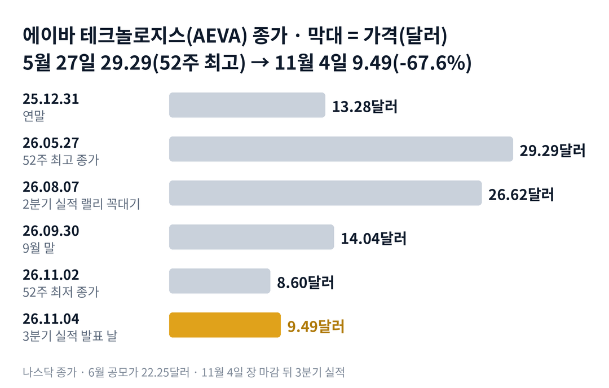

## 짧은 답

> **핵심:** 에이바의 현금은 한 주당 2.12달러로 주가의 약 22%이고, 나머지 몸값은 아직 들어오지 않은 미래 매출에 매겨져 있습니다. 그 기대를 키운 큰 호재들은 대부분 한 달 안에 값을 되돌려 놓았습니다.

현금이 많고 기술도 좋다는 회사인데, 주가는 다섯 달 만에 3분의 1이 됐습니다. 그렇다면 지금 주가에서 현금은 얼마이고, 나머지는 무엇에 매긴 값일까요?

에이바 주가는 5월 27일 종가 29.29달러에서 11월 4일 종가 9.49달러로 67.6% 내렸습니다. 6월에 새 주식을 판 공모가 22.25달러보다도 57.3% 낮습니다. 회사는 11월 4일 장 마감 뒤 3분기 실적을 냈고, 분기 매출 667만 달러로 사상 최대였습니다.

시청자 질문은 둘이었습니다. 왜 이렇게 내려왔는지, 그리고 현금 대비 몸값이 어느 정도인지입니다. 두 번째 질문의 답부터 하면, 11월 4일 시가총액은 9월 말 현금의 4.48배입니다. 첫 번째 질문은 숫자 하나로 답하기 어려워, 회사의 큰 발표가 주가를 어떻게 움직였는지 기록으로 따라갑니다.

> **유의사항** 저자는 금융·투자 자문가가 아닙니다. 이 글은 공개 공시와 시세를 정리한 교육용 분석이며 특정 매매를 권하지 않습니다. 과거의 주가 반응이 미래에 반복된다는 보장은 없고, 에이바는 하루 10% 넘게 움직이는 날이 잦은 종목입니다. 이 글은 3분기 실적의 첫 정규장 반응 전에 썼습니다. 실제 투자 전에는 최신 가격과 공시를 직접 확인하세요.

## 1부. 에이바는 어떤 회사이고, 현금은 얼마인가

> **핵심:** 에이바는 자동차와 산업용 4D 라이다를 만드는 회사이고, 현금은 1년 남짓 쓸 만큼 있지만 몸값의 대부분은 2027년 이후의 매출 기대에 매겨져 있습니다.

에이바는 미국 캘리포니아주 마운틴뷰에 본사를 둔 라이다 회사입니다. 라이다는 빛을 쏘아 주변 사물까지의 거리를 재는 센서이고, 자율주행차의 '눈' 역할을 합니다. 에이바의 4D 라이다는 빛의 주파수 변화를 읽어 거리와 함께 속도까지 한 번에 잽니다. 2021년 3월 기업인수목적회사(상장만을 위해 만든 회사)와 합병하는 방식으로 상장했습니다.

손님은 세 갈래입니다. 다임러 트럭의 장거리 트럭, 유럽 완성차 회사의 레벨 3(조건부 자율주행) 플랫폼, 그리고 2026년 8월 발표한 대형 클라우드 회사용 데이터센터 광연결 부품입니다. 회사가 밝힌 일정은 다임러 양산이 2026년, 데이터센터 첫 배치가 2027년 하반기, 유럽 완성차 양산이 2028년입니다.

### 숫자로 본 현금과 몸값(11월 4일 기준)

| 항목 | 값 | 계산 · 근거 |
| --- | --- | --- |
| 시가총액 | 약 6억 6,150만 달러 | 9.49달러 × 6,971만 주(7월 30일 기준) |
| 현금·유가증권 | 1억 4,750만 달러 | 9월 말, 한 주당 2.12달러 |
| 시가총액 ÷ 현금 | 4.48배 | 현금은 주가의 약 22% |
| 전환사채 뺀 현금 | 4,750만 달러 | 2032년 만기 1억 달러 차감, 한 주당 0.68달러 |
| 분기 현금 소진 | 약 2,910만 달러 | 올해 9개월 영업현금흐름 -8,740만 달러 ÷ 3 |
| 2026년 매출 전망 | 3,000만~3,600만 달러 | 2월 26일 제시, 9개월 누적 1,907만 달러 |

표의 전환사채는 나중에 주식으로 바꿀 수 있는 회사채이고, 전환 가격은 약 15.86달러입니다. 현금 소진은 회사를 운영하며 한 분기에 빠져나간 현금입니다. 이 말은 곧 지금 현금으로 약 5분기를 버틸 수 있고, 주가 9.49달러 가운데 7달러 넘는 부분은 앞으로 들어올 매출에 대한 기대값이라는 뜻입니다.

한 가지 더 볼 숫자가 있습니다. 최대주주인 사일브라(지분 29.3%)가 회사 요청에 따라 최대 1억 2,500만 달러어치 우선주를 사 주기로 한 약정이 있는데, 요청 기한이 11월 8일입니다. 회사가 밝힌 '가용 유동성 2억 7,250만 달러'에는 이 약정이 들어 있습니다.

위 그림처럼 에이바는 5월 말 52주 최고 종가를 찍었고, 8월 2분기 실적 뒤 다시 26달러대로 올랐다가 그 뒤 석 달 동안 내렸습니다. 그렇다면 8월 이후의 하락에는 어떤 소식이 있었을까요?

## 2부. 8월 7일부터 11월 4일까지, 소식 없는 하락

> **핵심:** 8월 7일 이후의 하락은 회사 공시가 거의 없는 날들에 쌓였고, 같은 기간 라이다 업종도 함께 내렸습니다.

2분기 실적 다음 날인 8월 6일, 에이바는 하루 28.8% 올랐습니다. 대형 클라우드 회사와 데이터센터용 광연결 부품을 함께 개발하는 계약을 발표했기 때문입니다. 같은 날 최고재무책임자의 사임도 함께 공시됐습니다. 지금 최고재무책임자는 임시 체제입니다.

그 뒤의 하락은 큰 공시 없이 이어졌습니다. 8월 7일 종가 26.62달러에서 9월 30일 14.04달러가 됐고, 10월에는 회사 공시가 없는 날 하루 10% 넘게 내린 날이 두 번 있었습니다. 10월 9일부터 16일까지 한 주 동안 에이바는 26.6% 내렸고, 같은 주 라이다 회사 아우스터도 28.7% 내렸습니다.

### 같은 기간, 에이바와 라이다 업종

| 구간 · 기준 | 에이바 | 아우스터 · 이노비즈 |
| --- | --- | --- |
| **5월 27일 → 11월 4일** 에이바 52주 최고 종가부터 | -67.6% | -24.2% · -70.1% |
| **8월 7일 → 11월 4일** 2분기 실적 랠리 꼭대기부터 | -64.4% | -22.7% · -44.4% |
| **9월 30일 → 11월 4일** 10월 한 달 | -32.4% | -16.9% · -40.6% |

이 말은 곧 업종 전체가 내린 것은 맞지만, 에이바의 낙폭은 같은 업종 가운데서도 큰 편이었다는 뜻입니다. 하락의 이유로 볼 만한 사실은 네 가지입니다. 분기 매출이 600만 달러대에 머물렀고, 데이터센터 매출은 2027년 하반기 이후로 잡혀 있으며, 6월에는 주가가 높을 때 새 주식을 팔았고, 최고재무책임자가 떠났습니다. 그렇다면 과거에도 큰 호재 뒤에 이렇게 값을 되돌린 적이 있었을까요?

## 3부. 회사 발표로 하루 20% 넘게 오른 5번

> **핵심:** 회사 발표로 하루 20% 넘게 오른 5번 가운데 4번은 20거래일 뒤 그날 종가보다 낮았습니다. 한 달을 넘겨 더 오른 것은 2025년 3월 한 번뿐입니다.

이번 하락과 비슷한 조건을 고른 기준은 이렇습니다. 상장 뒤 하루 20% 넘게 오른 날 가운데, 그날 회사가 계약이나 실적을 발표한 날만 남겼습니다. 공시 없이 오른 날은 원인을 알 수 없기 때문에 뺐습니다. '20거래일 뒤'는 급등한 날 종가와 비교했습니다. 2024년 3월 이전 가격은 1대 5 주식 병합을 반영한 값입니다.

### 급등한 날과 20거래일 뒤

| 날짜 · 그날 나온 발표 | 그날 | 20거래일 뒤 |
| --- | --- | --- |
| **2024.01.03** 글로벌 완성차 1차 양산 공급사 선정 | +38.4% | -18.1% |
| **2025.03.20** 2024년 4분기 실적 완성차 개발 계약 | +34.7% | +74.0% |
| **2025.12.03** 유럽 완성차 레벨 3 독점 공급사 | +25.7% | -6.9% |
| **2026.01.06** 엔비디아 자율주행 참조 라이다 선정 | +34.4% | -28.5% |
| **2026.08.06** 2분기 실적 데이터센터 개발 계약 | +28.8% | -39.6% |

여기서 기억할 사실은 하나입니다. 큰 호재가 나온 날의 급등은 대부분 한 달 안에 일부 또는 전부를 되돌렸습니다. 가장 최근인 8월 급등은 20거래일 뒤 39.6% 낮았고, 지금은 그날 종가보다 62.4% 낮습니다.

유일한 예외인 2025년 3월은 출발점이 달랐습니다. 그때 주가는 3달러대였고, 현금 걱정이 컸던 시기에 첫 개발 계약이 나왔습니다. 이후 석 달 동안 랠리가 이어졌습니다.

이 말은 곧 '좋은 계약이 나오면 오른다'까지는 맞지만, 그 계약이 매출이 되기까지 몇 년이 남은 동안 주가가 그 값을 지키지 못했다는 뜻입니다. 그렇다면 호재가 값을 지키지 못한 이유는 무엇이었을까요?

## 4부. 호재가 값을 지키지 못한 세 가지 이유

> **핵심:** 계약은 먼 미래의 매출이었고, 호재 뒤에는 새 주식이나 부채가 따라왔으며, 주가가 실적보다 테마에 따라 움직였습니다.

첫째, 계약과 매출 사이의 시간입니다. 유럽 완성차 양산은 2028년, 데이터센터 배치는 2027년 하반기입니다. 그 사이 분기 매출은 270만~670만 달러 사이를 오갔습니다. 계약의 크기에 비해 지금 들어오는 돈이 작아, 기대가 식으면 받칠 숫자가 적었습니다.

둘째, 호재 뒤의 조달입니다. 에이바가 새 주식이나 전환사채를 발표한 날 4번 가운데 3번은 내렸습니다. 2026년 6월에는 주당 22.25달러에 1억 1,500만 달러어치 새 주식을 팔았고, 6월 5일 종가는 발표 전날인 6월 2일 종가보다 약 17% 낮았습니다. 회사로서는 값이 높을 때 돈을 마련한 것이지만, 기존 주주에게는 지분이 나뉘는 일이었습니다.

셋째, 테마에 따른 움직임입니다. 엔비디아 참조 라이다 선정, 데이터센터 계약처럼 인공지능 테마와 닿은 소식에 크게 올랐고, 같은 테마가 식을 때 함께 내렸습니다. 8월 이후의 하락 동안 회사 공시는 거의 없었습니다.

과거 기록이 알려 주는 것은 분명합니다. 에이바의 큰 호재는 그날 값을 크게 올렸지만, 매출이 따라오기 전까지는 그 값을 오래 지키지 못했습니다. 결국 앞으로 확인할 것은 두 가지입니다. 하나는 4분기 매출이 연간 전망을 채울 만큼 늘어나는가, 다른 하나는 11월 8일 약정 기한 뒤 새 주식 발행 없이 현금을 지키는가입니다. 이 두 조건으로 다음 한 달을 나누면 어떤 갈림길이 나올까요?

## 5부. 실적 뒤 한 달, 네 가지 시나리오

> **핵심:** 지금은 기대가 걷히고 현금 가치 쪽으로 내려오는 단계이고, 3분기 실적의 첫 반응과 11월 8일 약정 기한 뒤의 조달 여부가 다음 단계를 가릅니다.

> **국면 정의(에이바 시리즈 공통):** 국면 A(테마 급등) — 계약·테마 소식에 하루 20% 넘게 오르는 때. 국면 B(기대 소화) — 공시 없이 업종과 함께 내리며 급등분을 되돌리는 때. 국면 C(실행 확인) — 분기 매출이 전망대로 늘고 새 주식 발행 없이 버티는 때.

**2026년 11월 4일 진단: 국면 B(기대 소화) 후반.** 8월 급등분을 모두 되돌리고 11월 2일 52주 최저 종가 8.60달러를 찍었습니다. 3분기 매출은 사상 최대였지만, 연간 전망을 채우려면 4분기에 1,090만~1,690만 달러가 필요합니다. 3분기 매출의 1.6~2.5배입니다.

### 앞으로 일어날 수 있는 일

**확인된 사실:** 3분기 매출은 사상 최대였고, 현금은 1부 표와 같으며, 최대주주 지분 매입 약정의 요청 기한은 11월 8일입니다. **과거 기록:** 3부 기록표의 큰 호재는 대부분 한 달 안에 값을 되돌렸고, 실적 다음 날에는 오른 날보다 내린 날이 조금 더 많았습니다(22번 중 12번). **추정:** 아래 가능성은 '회사와 시장에서 이 일이 일어날' 확률을 분석자가 주관적으로 매긴 값입니다. 주가가 오를 확률이 아닙니다. 네 경우는 서로 겹치지 않으므로 표에 적은 '약 N%'는 더해서 100%가 되도록 맞췄습니다. 괄호 안 구간은 그 값이 얼마나 흔들릴 수 있는지를 보여 주는 폭이라, 구간끼리 더해서 읽지 않습니다.

| 시나리오(판정 12월 3일) | 첫날 · 3일 | 가능성(추정) |
| --- | --- | --- |
| 1 · 실적 안도가 이어짐 | 상승 · 9.49달러 위 | 중간 약 25% (20~30%) |
| 2 · 첫날만 반등 | 상승 · 9.49달러 아래 | 중간 약 25% (20~30%) |
| **3 · 저점 근처 추가 하락** | 하락 · 조달 없음 | 높음 약 35% (30~40%) |
| 4 · 새 주식과 함께 하락 | 새 주식·우선주 발행 | 낮음 약 15% (10~20%) |

'첫날'은 11월 5일 종가를 11월 4일 종가와 비교한 값이고, '9.49달러 위'는 12월 3일 종가가 11월 4일 종가보다 높은 경우입니다. 12월 3일은 실적 발표 날 뒤 20번째 거래일입니다. 시나리오 4는 날짜와 상관없이 11월 안에 새 주식이나 우선주 발행이 알려지면 해당합니다.

시나리오 3을 가장 높게 본 이유는 실적 다음 날 반응이 22번 중 12번 내렸고, 연간 전망 달성에 필요한 4분기 매출이 3분기의 1.6배 이상이기 때문입니다. 여기서 둘을 나눠 봐야 합니다. 이 값은 과거 빈도와 숫자의 거리에서 나온 추정이지, 회사의 기술이 나쁘다는 판단이 아닙니다.

시나리오 1과 2를 같게 둔 근거는 11월 4일 실적 발표 전 정규장에서 이미 6.2% 올랐다는 점입니다. 첫날 오르더라도 그 상승이 한 달을 가는지는 3부 기록처럼 따로 봐야 합니다. 그렇다면 이 진단이 틀릴 수 있는 지점은 어디일까요?

## 6부. 조심할 점과 체크리스트

> **핵심:** 급등 기록은 5번뿐인 작은 표본이고, 3분기 10-Q(분기 보고서)가 아직 나오지 않아 주식 수와 약정 처리는 확인 전입니다.

3부 표는 '호재가 나오면 팔린다'는 규칙이 아닙니다. 5번은 작은 표본이고, 2025년 3월처럼 한 달 뒤 크게 오른 예외도 있었습니다. 엔비디아 관련 날짜는 회사 보도자료의 선정 사실과 보도 날짜를 함께 써서 정했습니다.

회사 쪽 위험도 세 가지입니다. 첫째, 4분기 매출이 연간 전망에 못 미치면 전망을 낮출 수 있습니다. 둘째, 최대주주 약정이 끝나면 새 자금은 시장에서 구해야 할 수 있습니다. 셋째, 전환사채 이자는 주식으로 낼 수 있어, 11월 15일 이자 지급 때 주식 수가 조금 늘 수 있습니다.

시가총액은 7월 30일 주식 수로 계산했습니다. 3분기 10-Q의 주식 수가 나오면 숫자가 조금 바뀔 수 있습니다. 11월 4일 시간 외 거래와 11월 5일 반응은 이 글에 넣지 않았습니다.

- ☐ 11월 5일 첫 반응이 11월 4일 종가 9.49달러보다 높은가
- ☐ 11월 8일 최대주주 지분 매입 약정이 연장되거나 쓰였는가
- ☐ 11월 중 3분기 10-Q의 현금이 1억 4,750만 달러와 같은가
- ☐ 11월 30일까지 새 주식·우선주 발행 발표가 0건인가
- ☐ 12월 3일 종가가 11월 4일 종가 9.49달러보다 높은가
- ☐ 2027년 2월 4분기 실적에서 연간 매출이 3,000만 달러를 넘었는가

**기억할 판단 기준 세 가지:** 첫째, 주가 9.49달러 가운데 현금은 2.12달러이고, 전환사채를 빼면 0.68달러입니다. 둘째, 큰 호재의 급등은 5번 중 4번 한 달 안에 값을 되돌렸습니다. 셋째, 4분기 매출과 11월 조달 여부가 '현금이 많다'는 말이 맞는지를 가장 빨리 보여 줍니다.

다음 갱신은 2027년 2월 4분기 실적을 본 뒤에 합니다.
