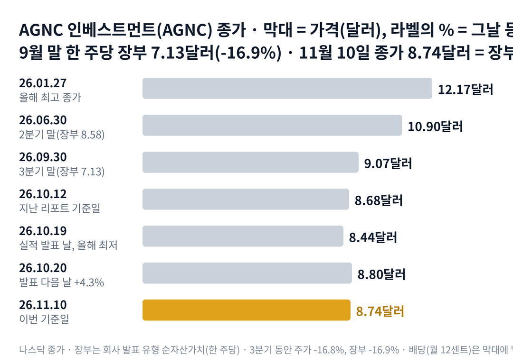

## 짧은 답

> **핵심:** 지난 리포트가 '사라졌다'고 본 웃돈은 사라지지 않았고, 그 사이 장부가 먼저 줄어 있었습니다.

10월 19일 발표에서 9월 말 한 주당 장부는 16.9% 줄었습니다. 그런데 다음 날 주가는 4.3% 올랐습니다. 나쁜 숫자에 주가가 오른 이유는 무엇이었을까요?

답의 절반은 지난 리포트의 계산에 있었습니다. 10월 12일 주가를 6월 말 장부(한 주당 순자산)로 나누면 1.01배였습니다. 그런데 9월 말 장부로 다시 나누면 1.22배입니다. 주가는 3분기 내내 장부와 거의 같은 비율로 내려왔고, 발표 날에는 이미 줄어든 장부를 반영하고 있었습니다. 나머지 절반은 업종입니다. 발표 다음 날 다른 모기지 리츠도 3~4% 함께 올랐습니다. **2026.11.10 진단: 국면 A(웃돈 판매기, 주가가 장부보다 비싸 회사가 새 주식을 파는 단계) 유지 — 근거는 5부.**

1.23배라는 지금의 웃돈이 얼마나 단단한지는 과거 기록과 견줘 볼 수 있습니다. 장부가 크게 줄었던 네 번의 첫날 방향을 가른 조건은 3부 '장부가 10% 넘게 줄어든 발표 네 번' 표에 있습니다.

> **유의사항** 저자는 금융·투자 자문가가 아닙니다. 이 글은 공개 공시와 시세를 정리한 교육용 분석이며 특정 종목의 매수·매도를 권하지 않습니다. 과거 패턴은 미래 수익을 보장하지 않고, 이 회사의 장부는 한 분기에 20% 넘게 줄어든 적이 있습니다. 실제 투자 전에는 최신 공시를 직접 확인하세요.

이 리포트는 시청자 반응이 컸던 종목의 업데이트입니다.

## 지난 리포트 이후

[10월 13일 리포트](/r/agnc-2026-10/)는 주가가 장부의 1.01배까지 내려와 웃돈이 한 주 10센트만 남았다고 봤습니다. 지난 예측 성적: 5개 중 적중 0 · 부분 적중 1 · 빗나감 3 · 확인 전 1입니다. 그 진단은 아직 발표 전이던 6월 말 장부로 잰 것이라, 9월 말 장부가 나오자 틀린 것으로 드러났습니다. 그동안 주가는 거의 제자리였고, 그 사이 월 배당 한 번이 나갔습니다. 항목별 채점은 6부 끝 채점표에 있습니다.

## 1부. AGNC 인베스트먼트는 어떤 회사이고, 3분기에 무엇이 바뀌었나

> **핵심:** 빌린 돈으로 정부 보증 주택담보대출 증권을 사서 이자 차이를 버는 회사이고, 3분기에는 그 증권값이 크게 떨어졌습니다.

AGNC 인베스트먼트는 미국 메릴랜드주 베세즈다에 있는 모기지 리츠입니다. 리츠는 이익 대부분을 배당으로 나눠 주는 대신 법인세를 덜 내는 회사 형태입니다. 이 회사는 배당을 매달 줍니다.

돈을 버는 방식은 이렇습니다. 패니메이·프레디맥 같은 정부 지원 기관이 원리금을 보증한 주택담보대출 증권을 삽니다. 이 증권을 에이전시 MBS(정부 지원 기관이 보증한 주택담보대출 증권)라고 부릅니다. 사는 돈의 대부분은 그 증권을 맡기고 며칠짜리로 빌린 돈, 곧 레포(환매조건부 차입)입니다. 증권에서 받는 이자가 빌린 돈의 이자보다 높으면, 그 차이가 이익이 됩니다. 9월 말 레포의 평균 남은 기간은 10일이었습니다.

이 구조에서 가장 중요한 숫자는 한 주당 유형 장부가치입니다. 가진 증권과 헤지(금리 변동 손실을 줄이려는 반대 거래)를 그날 값으로 매기고 부채를 뺀 뒤, 영업권을 빼고 주식 수로 나눈 값입니다. 이 글에서는 줄여서 '장부'라고 부릅니다. 주가를 장부로 나눈 값은 '배수'라고 부르겠습니다. 배수가 1배보다 크면 시장이 장부 위에 웃돈을 얹어 주고 있다는 뜻입니다.

빌린 돈이 자기 돈의 7.9배라서, 증권값이 조금만 흔들려도 장부는 크게 움직입니다. 3분기가 그런 분기였습니다. 회사는 10년 국채 금리가 석 달 사이 0.82%p 올랐다고 적었습니다. 지난 30년 동안 이번 말고는 네 번뿐이었던 상승폭입니다.

### 숫자로 본 지금의 크기(11월 10일 기준)

| 항목 | 값 · 계산 근거 |
| --- | --- |
| 종가 | **8.74달러** 지난 리포트 기준일(10월 12일) 8.68달러 |
| 한 주당 유형 장부 | **7.13달러** 9월 30일, 6월 말 8.58달러보다 16.9% 감소 |
| 배수(주가 ÷ 장부) | **1.23배** 8.74 ÷ 7.13, 6월 말과 9월 말은 둘 다 1.27배 |
| 3분기 경제적 수익률 | **-12.7%** 배당 0.36달러와 장부 감소 1.45달러를 6월 말 장부로 나눔 |
| 3분기 순스프레드 이익 | **한 주 0.37달러** 같은 분기 배당 0.36달러, 2분기 0.40달러 |
| 투자 자산 | **944억 달러** 9월 말, 30년 고정금리 증권 비중 94% |
| 위험 기준 레버리지 | **7.9배** 유형 자기자본 대비, 6월 말 7.4배 |
| 시가총액 | **약 111억 달러** 8.74달러 × 12억 7,381만 주(10월 28일, 잠정 계산) |

순스프레드 이익은 회사가 배당 재원으로 내세우는 비공식 지표입니다. 증권 이자에서 빌린 돈의 이자와 헤지 비용을 뺀 값이고, 회계상 평가손익은 넣지 않습니다. 3분기에는 이 값이 배당보다 1센트 많았습니다. 배당은 아직 이자 차이로 덮이지만, 장부는 그와 따로 크게 줄었습니다. 이자 차이가 멀쩡한데 장부는 왜 그렇게 많이 줄었을까요?

## 2부. 3분기에 장부와 주가는 함께 내려왔다

> **핵심:** 장부를 깎은 것은 업종 전체를 덮친 금리 충격이었고, 주가는 그 분기 동안 장부와 거의 같은 비율로 내려왔습니다.

먼저 업종 요인입니다. 3분기 10년 국채 금리는 6월 말보다 0.82%p 올라 9월 말 5.29%가 됐습니다. 그중 0.54%p가 9월 한 달에 몰렸습니다. 회사 설명으로는 에이전시 MBS가 미국 종합 채권 지수 안에서 가장 나쁜 분야였습니다. 금리가 오르면 주택담보대출 증권값이 내리고, 이 회사처럼 빌린 돈을 많이 쓰는 회사는 그 손실이 장부에 몇 배로 남습니다.

같은 분기 주가는 6월 30일 10.90달러에서 9월 30일 9.07달러로 16.8% 내렸습니다. 장부 감소폭 16.9%와 거의 같습니다. 그래서 9월 말 배수는 6월 말과 똑같은 1.27배였습니다. 시장은 발표를 기다리지 않고 매일의 채권값으로 장부를 어림해 주가에 넣고 있었던 셈입니다.

아래 표는 같은 날짜 종가끼리 비교한 것입니다. 기준일은 3분기 시작 전날(6월 30일)과 지난 리포트 기준일(10월 12일)이고, 배당은 넣지 않았습니다.

### 모기지 리츠와 모기지 채권 상장지수펀드(ETF), 종가 기준

| 종목 · 성격 | 3분기 시작 뒤(6.30 → 11.10) | 지난 리포트 뒤(10.12 → 11.10) |
| --- | --- | --- |
| **AGNC** 에이전시 MBS 리츠 | **-19.8%** | **+0.7%** |
| 애널리(NLY) 모기지 리츠 | -16.3% | +2.4% |
| 아머 레지덴셜(ARR) 에이전시 MBS 리츠 | -29.0% | -9.9% |
| 다이넥스 캐피털(DX) 에이전시 MBS 리츠 | -18.9% | -2.5% |
| 모기지 채권 ETF(MBB) | -3.5% | +1.6% |

이 말은 곧 하락의 큰 줄기가 AGNC만의 일이 아니었다는 뜻입니다. 빌린 돈을 쓰지 않는 채권 ETF는 3.5% 내렸고, 같은 증권을 빌린 돈으로 든 리츠들은 16~29% 내렸습니다.

다음은 회사 요인입니다. 9월 4일 S&P 다우존스 지수는 AGNC를 중형주 지수인 S&P 미드캡 400에 넣는다고 발표했습니다. 편입 앞뒤로 거래가 크게 늘었고, 회사는 그 틈에 시장에서 주식 9,760만 주를 팔아 9억 9,200만 달러를 모았습니다. 평균 판매가는 수수료를 뺀 10.17달러로, 새 장부 7.13달러의 1.43배입니다.

웃돈이 있을 때 새 주식을 팔면, 장부보다 비싸게 판 차이만큼 기존 주주의 한 주당 장부가 늘어납니다. 회사가 '장부에 이로울 때만 판다'고 적어 온 이유입니다. 10월에도 주식 수는 10월 28일까지 약 1,200만 주 더 늘었습니다. 공시는 이 증가분이 모두 판매였는지 따로 밝히지 않았습니다.

두 사건을 나란히 놓으면 공통점이 하나 보입니다. 금리 충격은 장부를 깎았지만, 시장은 그 장부 위에 같은 크기의 웃돈을 계속 얹어 주었다는 점입니다. 장부가 이렇게 크게 줄어든 발표 날, 주가는 과거에 어떻게 움직였을까요?

## 3부. 장부가 10% 넘게 줄어든 발표 네 번

> **핵심:** 과거 네 번은 주가가 이미 새 장부보다 쌀 때만 첫날 올랐는데, 이번에는 장부의 1.18배에서 올랐습니다.

이 표는 2021년 뒤 분기 장부가 10% 넘게 줄었다고 발표한 날만 골랐습니다. 장부 감소폭이 지금과 비슷한 조건이기 때문입니다. 네 번 모두 장 마감 뒤나 장 시작 전에 나왔습니다. 그래서 발표 직전 종가를 기준으로, 반응한 첫날 종가와 그날을 첫날로 센 20번째 거래일 종가를 비교했습니다.

첫 칸의 배수는 발표 직전 종가를 그날 새로 나온 장부로 나눈 값입니다. 이 값이 1배보다 작으면, 시장이 발표 전에 이미 장부보다 더 나쁜 결과를 값에 넣고 있었다는 뜻입니다. 예를 들어 2022년 10월 11일에는 직전 종가가 새 장부 추정치의 0.81배였고, 그날 주가는 크게 올랐습니다.

**한눈에:** **2/4** 첫날 상승 · **2/2** 직전 배수 1배 아래일 때 첫날 상승 · **3/4** 20거래일 뒤 발표 전보다 높음. 직전 배수가 1배 이상이던 두 번은 첫날 모두 내렸습니다.

### 장부가 10% 넘게 줄어든 발표 네 번

| 발표일 · 그날 나온 내용 | 첫날 | 20거래일 뒤 |
| --- | --- | --- |
| **2022.05.02** 1분기 장부 -16.7% 직전 배수 0.85배 | **+7.1%** | **+9.2%** |
| 2022.07.25 2분기 장부 -12.9% 직전 배수 1.07배 | -1.2% | -0.4% |
| **2022.10.11** 3분기 장부 추정 -20.6% (장 시작 전 예비 발표) 직전 배수 0.81배 | **+10.9%** | **+14.5%** |
| 2023.10.23 3분기 장부 -14.0% 직전 배수 1.00배 | -7.0% | +8.1% |

굵게 쓴 두 줄은 직전 배수가 1배 아래였던 경우입니다. 두 번 모두 첫날 크게 올랐고, 한 달 뒤에도 발표 전보다 높았습니다. 직전 배수가 1배 이상이던 두 번은 첫날 내렸습니다. 다만 2023년 10월은 첫날 7.0% 내렸다가 20번째 거래일에는 8.1% 위로 돌아섰습니다.

> **이번 사례(20거래일 결과 미확정):** 2026.10.19 장 마감 뒤 · 3분기 장부 -16.9% · 직전 배수 1.18배 · 첫날(10월 20일) 8.80달러, +4.3% · 20거래일째는 11월 16일 판정

이번은 직전 배수가 다섯 번 가운데 가장 높았는데도 첫날 올랐습니다. 과거 네 번의 갈림길로 보면 예외입니다.

이 기록의 한계도 분명합니다. 네 번은 아주 작은 표본이라, 배수 1배 아래였던 두 번 가운데 한 번만 달랐어도 결론은 반반이 됩니다. 2022년에는 회사가 장부보다 싸게 거래되던 시기였고, 주식 수도 지금의 절반 아래였습니다. 그래서 이 표는 규칙이 아니라 첫날 반응을 읽는 참고 자료입니다. 과거의 갈림길과 어긋난 이번 첫날은 무엇이 밀어 올렸을까요?

## 4부. 이번 첫날을 올린 두 가지

> **핵심:** 주가는 발표 전에 이미 장부 감소를 값에 넣었고, 발표 다음 날 오른 폭의 대부분은 업종 전체와 같은 방향이었습니다.

첫째는 발표 전에 이미 끝난 하락입니다. 2부에서 봤듯이 3분기 동안 주가는 장부와 같은 비율로 내렸습니다. 10월 들어서도 9월 30일 9.07달러에서 발표 당일 8.44달러로 6.9% 더 내렸고, 이 값은 올해 가장 낮은 종가였습니다. 발표 숫자가 시장의 어림과 크게 다르지 않았다면, 새로 실망할 거리는 적었던 셈입니다.

과거와 비교하면 차이가 보입니다. 2023년 3분기는 분기 동안 주가가 6.8% 내리는 사이 장부는 14.0% 줄었습니다. 주가가 장부를 덜 따라간 채 발표를 맞았고, 첫날 7.0% 내렸습니다. 이번에는 분기 동안의 주가 하락이 장부 감소와 거의 같았습니다.

둘째는 같은 날 업종 전체의 반등입니다. 10월 20일 애널리는 3.2%, 아머 레지덴셜은 3.3%, 다이넥스는 3.8% 올랐습니다. AGNC의 4.3%는 이들보다 0.5~1.1%p 높았을 뿐입니다. 그날 10년 국채 금리는 5.15%에서 5.12%로 조금 내렸습니다.

회사가 내놓은 문장도 반응을 거들었을 수 있습니다. 대표는 모기지 증권의 금리 차이가 몇 년 사이 넓은 쪽 끝에 가까워 앞으로의 수익 구조가 나아졌다고 말했습니다. 금리가 오른 만큼 조기 상환 걱정도 줄었다고 했습니다. 다만 이 문장이 주가를 얼마나 움직였는지는 숫자로 가를 수 없습니다.

발표 뒤 경영진 매도도 있었습니다. 피터 페데리코 대표는 10월 23일부터 3거래일 동안 모두 20만 3,382주를 팔았습니다. 미리 정해 둔 10b5-1 매매 계획에 따른 매도였고, 2025년 4월과 10월, 2026년 4월에도 실적 뒤 비슷한 매도가 있었습니다. 매도 뒤에도 약 177만 8천 주를 갖고 있습니다.

과거 네 번과 이번을 나란히 보면, 다음 판정에서 확인할 조건은 두 가지입니다. 첫째는 4분기 장부가 9월 말보다 다시 늘어나는가이고, 둘째는 그때도 주가가 장부의 1.1배 위에 남아 있는가입니다. 이 두 갈림길은 각각 얼마나 열려 있을까요?

## 5부. 장부 회복과 웃돈 유지, 네 가지 시나리오

> **핵심:** 지금은 국면 A(웃돈 판매기)에 머물러 있고, 다음 판정은 4분기 장부의 방향과 그때의 배수가 가릅니다.

> **국면 정의(AGNC 시리즈 공통):** 국면 A 웃돈 판매기 — 주가가 장부의 1.1배 이상이고 회사가 새 주식을 판다. 국면 B 장부 시험기 — 장부 급감 뒤 배수가 1배 근처로 좁혀진다. 국면 C 할인기 — 주가가 장부 아래이고 회사가 자사주 매입을 검토한다.

**2026년 11월 10일 진단: 국면 A(웃돈 판매기) 유지.** 배수는 1.23배이고, 10월에도 주식 수가 약 1,200만 주 늘었습니다. 2023년 9월 말 뒤 분기 말 배수는 13번 중 12번 1.1배 이상이었고, 가장 낮았던 때도 1.1배에 조금 못 미쳤습니다. 국면 B로 넘어가는 신호는 배수가 1.1배 아래로 내려와 주식 판매가 멈추는 것입니다.

**돈의 성격별로 본 지금의 자리(9월 말 기준, 서로 더하지 않음)**

| 항목 | 값 · 계산 근거 |
| --- | --- |
| 무담보 현금과 에이전시 MBS(실제 보유) | **63억 달러** 9월 말, 유형 자기자본의 57%(6월 말 75억·62%) |
| 3분기 주식 판매(실제 유입) | **9억 9,200만 달러** 9,760만 주, 평균 10.17달러 |
| 주식 판매 남은 한도 | **11억 달러** 9월 말, 2027년 말까지 |
| 자사주 매입 한도(실행 0) | **10억 달러** 10월 새로 승인, 2028년 말까지 |
| 금리 민감도(회사 추정) | **-0.25%p면 장부 +2.1%** -0.50%p면 +3.7%, +0.50%p면 -4.9% |

표의 돈은 성격이 달라 서로 더하지 않습니다. 63억 달러는 9월 말 실제로 담보에 묶이지 않은 자산이고, 레포 담보를 더 내야 할 때 쓰는 완충재입니다. 주식 판매와 자사주 매입은 쓸 수 있는 한도일 뿐입니다. 회사는 장부 이하 가격에서만 자사주를 사겠다고 적었고, 지금 주가는 장부 위입니다.

금리 민감도 표는 금리가 한꺼번에 평행 이동하고 모기지 금리 차이는 그대로라는 가정입니다. 10년 금리는 9월 말보다 0.31%p 내려 11월 10일 4.98%입니다. 같은 기간 모기지 채권 ETF는 1.8% 올랐습니다. 금리만 보면 4분기 장부에 유리한 출발이지만, 금리 차이가 다시 벌어지면 이 계산은 바로 틀어집니다.

**판정 기준 두 가지:** 첫째, 장부 회복입니다. 12월 31일 기준 장부가 9월 말 7.13달러보다 높으면 '회복'으로 봅니다. 둘째, 웃돈 유지입니다. 4분기 발표 직전 종가가 새 장부의 1.1배 이상이면 '유지'로 봅니다. 4분기 실적은 2025년 1월 27일, 2026년 1월 26일처럼 1월 마지막 주 월요일 장 마감 뒤에 나왔습니다.

### 앞으로 일어날 수 있는 일

**확인된 사실:** 9월 말 이후 10년 금리는 내렸고, 회사는 헤지 비율을 82%에서 97%로 올렸습니다. 회사는 지금 금리에서는 보유 증권의 만기 늘어남이 거의 끝나 금리가 더 올라도 덜 민감하다고 적었습니다.

**과거 기록:** 장부가 10% 넘게 줄어든 분기 다음 분기에 장부가 늘어난 것은 4번 중 2번이었습니다. 2022년 4분기와 2023년 4분기입니다. 분기 말 배수 1.1배 이상은 최근 13번 중 12번이었습니다.

**추정:** 아래 확률은 주가 상승·하락 가능성이 아니라, 4분기 장부 회복 여부와 웃돈 유지 여부에 대한 분석자의 주관적 추정입니다. 분모는 겹치지 않는 네 경우 전체라 '약 N%'를 더하면 100%이고, 괄호 안 구간은 흔들림의 폭이라 더하지 않습니다.

| 시나리오(판정 2027년 1월 29일) | 장부 · 배수 | 가능성(추정) |
| --- | --- | --- |
| **1 · 장부 회복, 웃돈 유지** | 7.13달러 위 · 1.1배 이상 | 높음 약 40% (35~45%) |
| 2 · 장부 회복, 웃돈 축소 | 7.13달러 위 · 1.1배 아래 | 중간 약 20% (15~25%) |
| 3 · 장부 추가 감소, 웃돈 유지 | 7.13달러 아래 · 1.1배 이상 | 중간 약 20% (15~25%) |
| 4 · 장부 추가 감소, 웃돈 축소 | 7.13달러 아래 · 1.1배 아래 | 중간 약 20% (15~25%) |

**한눈에:** 장부 회복 약 60%(1+2) · 웃돈 유지 약 60%(1+3) — 위 표를 더한 주관적 추정입니다.

- **시나리오 1이면:** 지금의 국면 A가 이어집니다. 다음에 확인할 것은 4분기 주식 판매량과 그 평균 판매가의 배수입니다.
- **시나리오 2이면:** 장부는 회복했는데 시장이 웃돈을 덜 줍니다. 주식 판매가 줄었는지, 순스프레드 이익이 배당을 계속 덮는지 봐야 합니다.
- **시나리오 3이면:** 이번 분기처럼 장부가 줄어도 주가가 버티는 경우입니다. 레버리지가 8배를 넘었는지 확인할 차례입니다.
- **시나리오 4이면:** 국면 B로 넘어가는 조합입니다. 주가가 장부 아래로 내려가면 새 자사주 매입 한도를 실제로 쓰는지 봅니다.

장부 회복 쪽을 반반보다 높게 둔 근거는 과거 4번 중 2번이라는 기록에, 9월 말 뒤 금리가 내린 신호를 더한 것입니다. 웃돈 유지 쪽은 13번 중 12번이라는 기록에서, 이번 첫날이 업종 반등에 크게 기댔다는 점을 깎았습니다.

하지만 같은 무게로 반대쪽 요인도 있습니다. 3분기 같은 금리 급등은 30년 동안 다섯 번뿐이었지만, 9월 말 레버리지는 7.9배로 6월 말보다 높습니다. 같은 충격이 한 번 더 오면 장부는 다시 크게 줄 수 있습니다. 그런 충격은 어디서 올 수 있을까요?

## 6부. 세 갈래 위험과 체크리스트

> **핵심:** 장부를 흔드는 것은 외부 금리이고, 웃돈을 흔드는 것은 회사가 내놓는 주식의 양입니다.

먼저 이 분석의 한계입니다. 3부 표는 네 번뿐이라 패턴이라 부르기 어렵습니다. 발표 다음 날 업종 반등과 회사 고유 요인이 각각 얼마였는지도 가를 수 없습니다. 회사는 분기 장부나 이익 전망을 내지 않고, 4분기에 대한 시장 예상치는 이번에 확인하지 못했습니다. 4분기 실적 날짜도 아직 공지되지 않았습니다.

사업 실행 쪽 위험은 이자 차이입니다. 레포는 평균 10일 남짓마다 다시 빌려야 해서, 단기 금리가 오르면 이자 차이가 바로 좁아집니다. 3분기 순 이자 차이도 2분기보다 0.14%p 좁아진 연 1.86%였습니다. 이 차이가 더 좁아지면 배당을 덮는 순스프레드 이익부터 흔들립니다.

자금 조달 쪽 위험은 주식 공급입니다. 회사는 웃돈이 있을 때마다 주식을 팔아 왔고, 9월 말에도 11억 달러 한도가 남아 있습니다. 판매가 늘면 기존 주주의 장부에는 이롭지만, 시장에 나오는 주식이 많아져 배수가 눌릴 수 있습니다. 지난 리포트 때 10억 달러였던 자사주 매입 한도는 이번에 기간만 2028년 말로 늘었습니다.

외부 환경 쪽 위험은 금리와 모기지 금리 차이입니다. 회사 추정표대로라면 금리가 0.50%p만 더 올라도 장부는 약 4.9% 줄어듭니다. 이 계산에는 모기지 금리 차이가 벌어지는 경우가 빠져 있어, 3분기처럼 두 가지가 겹치면 손실은 더 커집니다.

**핵심 확인 세 가지:** 위에서부터 판정을 바꾸는 힘이 큰 순서입니다.

- ☐ 1순위 · 2027년 1월 말 4분기 실적에서 12월 말 장부가 7.13달러보다 높은가
- ☐ 2순위 · 2027년 1월 말 4분기 발표 직전 종가가 새 장부의 1.1배 이상인가
- ☐ 3순위 · 11월 16일(20거래일째) 종가가 발표 직전 8.44달러보다 높은가

**보조 확인:** 월 배당 공지가 같은 금액으로 이어지는지, 4분기 순스프레드 이익이 분기 배당을 덮는지, 위험 기준 레버리지가 8배를 넘는지입니다.

**기억할 판단 기준 세 가지:** 첫째, 이 회사의 배수는 발표된 장부가 아니라 그날 채권값으로 어림한 장부로 재야 합니다. 둘째, 장부가 크게 줄어든 발표 첫날은 직전 배수와 업종 흐름을 함께 봐야 읽힙니다. 셋째, 웃돈이 있는 동안 회사는 주식을 팔고, 웃돈이 사라져야 자사주 매입 이야기가 나옵니다.

### 지난 예측 채점표

10월 13일 리포트(10월 12일 기준)의 진단과 시나리오를 11월 10일 기준으로 채점한 결과입니다. 지난 리포트에는 시나리오별 가능성 숫자가 없었습니다.

| 지난 점검 항목 · 당시 기준 | 판정 및 실제 결과(11월 10일) |
| --- | --- |
| **진단: 웃돈 한 주 10센트** 10월 12일 주가 ÷ 6월 말 장부 1.01배 | **[빗나감]** 9월 말 장부로 다시 재면 1.22배, 웃돈 1.55달러 |
| **시나리오 1: 장부 방어와 웃돈 회복** 장부 감소 작음, 10년 금리 5% 아래 | **[부분 적중]** 장부 -16.9%, 금리 4.98%·배수 1.23배·주식 판매는 맞음 |
| **시나리오 2: 장부 아래 거래와 자사주 매입** 주가가 새 장부보다 싸짐 | **[빗나감]** 최저 배수 1.18배, 매입 0, 한도만 2028년 말로 연장 |
| **시나리오 3: 금리 추가 상승과 배당 시험** 장부와 배수가 함께 감소 | **[빗나감]** 10년 금리 5.21% → 4.98%, 순스프레드 이익 0.37 ≥ 배당 0.36 |
| **시나리오 4: 정부 지원 기관 이슈 재부상** 연방주택금융청 발표 | **[확인 전]** 이번 조사에서 관련 발표를 확인하지 못함 |

가장 큰 빗나감은 진단 자체였습니다. 아직 발표되지 않은 9월 말 장부 대신 6월 말 장부를 분모로 썼기 때문입니다. 이번 리포트부터는 분기 말이 지났는데 장부가 발표 전이면, 그 사이 채권값 변화를 함께 적고 배수를 '잠정'으로 표시합니다.

다음 갱신은 11월 16일 20거래일째 반응과 4분기 실적 일정 공지를 본 뒤에 합니다. 지난 진단의 원문은 [10월 13일 리포트](/r/agnc-2026-10/)에 있고, 공시는 [AGNC 인베스트먼트 SEC 공시 목록](https://www.sec.gov/cgi-bin/browse-edgar?action=getcompany&CIK=0001423689&type=&dateb=&owner=include&count=40)에서 확인할 수 있습니다.
