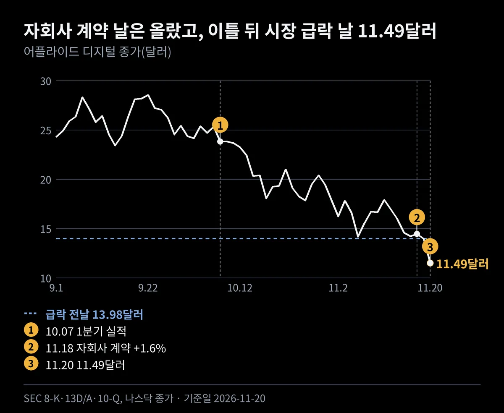
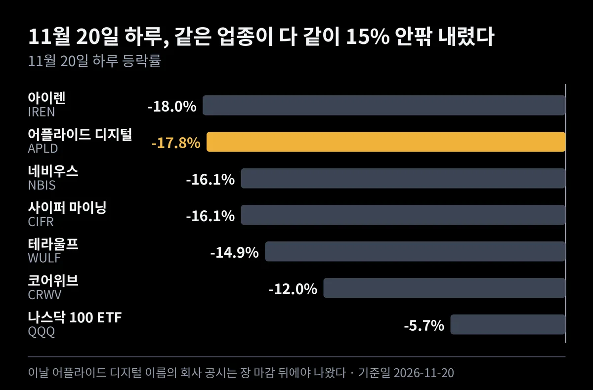
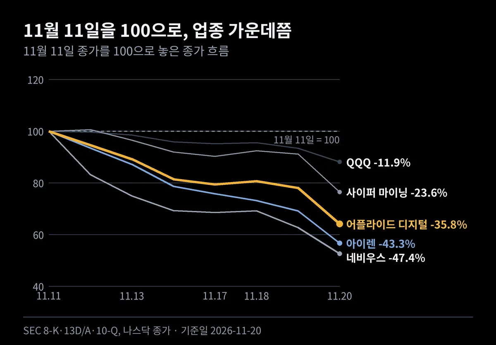
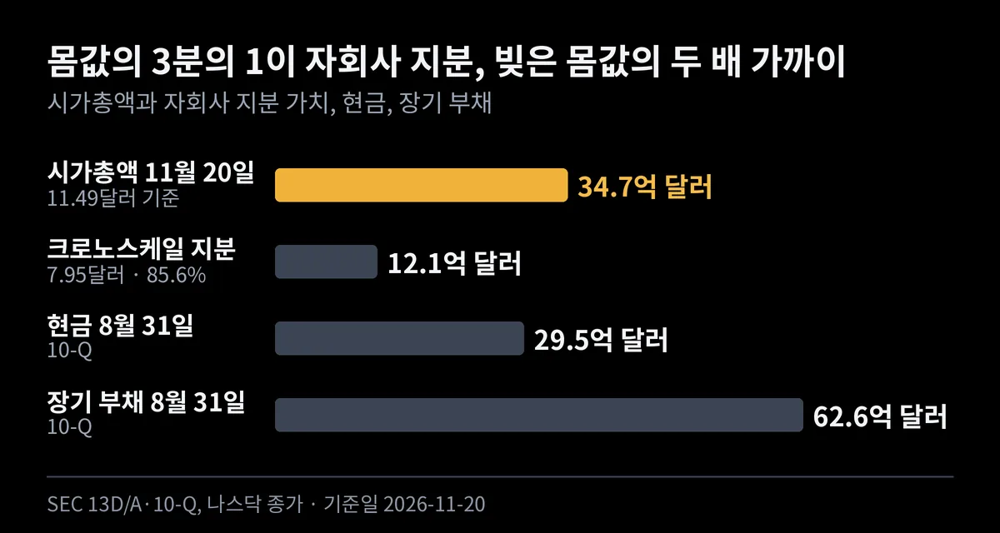
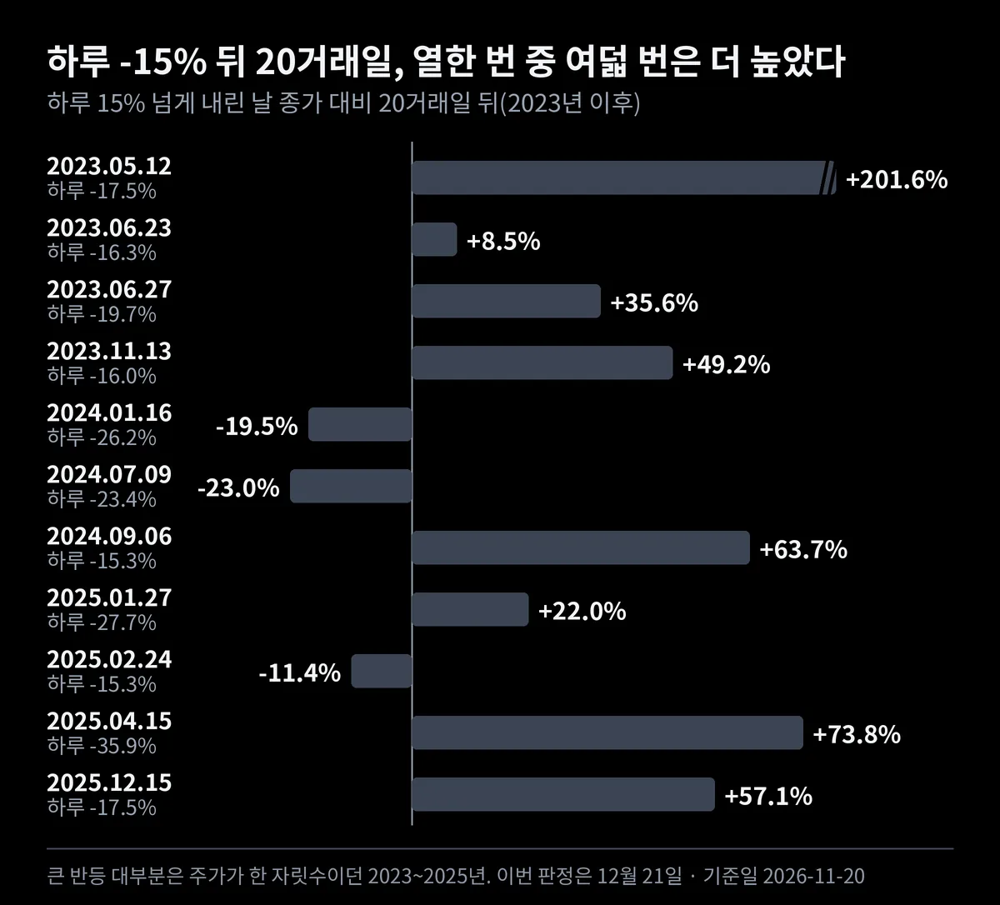
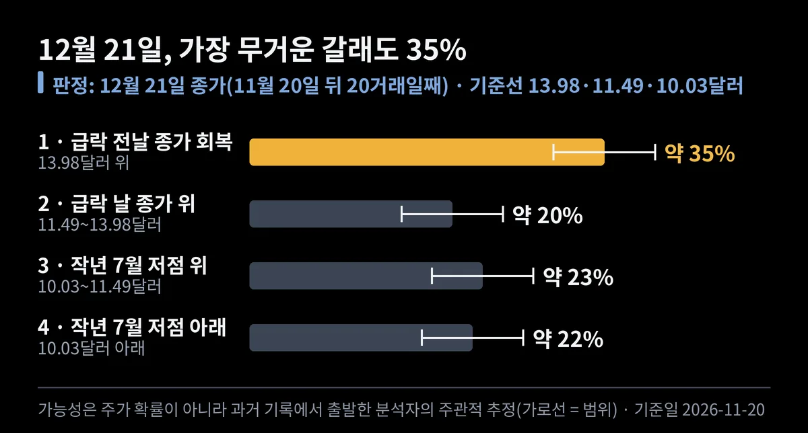

11월 18일 아침, 어플라이드 디지털의 자회사가 큰 계약을 발표했습니다. 텍사스 오데사에 AI 데이터센터를 짓고, 첫 단계로만 6년 동안 최대 75억 달러를 받는 계약입니다. 어플라이드 디지털도 그 사업에 9,700만 달러를 넣었습니다.

그런데 그 주 주가는 11월 17일 종가 대비 3거래일 동안 19.2% 내렸습니다. 11월 17일 14.22달러였던 주가가 20일 11.49달러로 마감했습니다. 2025년 7월 뒤 가장 낮은 종가입니다. 회사는 큰 계약을 발표했는데, 주가는 왜 거꾸로 갔을까요?

> **유의사항** 저자는 금융·투자 자문가가 아닙니다. 이 글은 공개 공시와 시세를 정리한 교육용 분석이며 특정 종목의 매수·매도를 권하지 않습니다. 과거 패턴은 미래 수익을 보장하지 않고, 어플라이드 디지털은 하루에 30% 넘게 내린 적이 있는 종목입니다. 실제 투자 전에는 최신 공시를 직접 확인하세요.

김박사 월드가 어플라이드 디지털을 다루는 것은 이번이 처음입니다. 그래서 채점할 지난 예측은 없습니다. 이번 글은 한 가지를 나눠서 봅니다. 회사에 일이 생긴 날과, 시장 전체가 무너진 날입니다. 두 날을 섞으면 이번 하락의 이유를 잘못 읽게 됩니다.

어플라이드 디지털은 AI용 데이터센터를 지어 빌려주는 미국 회사입니다. 본사는 텍사스 댈러스에 있고, 큰 단지는 노스다코타에 있습니다. 돈을 버는 방식은 건물과 전력을 갖춘 데이터센터를 큰 기술 회사에 10~15년씩 임대하는 것입니다. 8월 31일 기준 임대 계약은 약 1.41기가와트(GW)였습니다. 기가와트는 데이터센터가 쓰는 전력 규모로, 계약의 크기를 재는 단위입니다. 회사는 이 계약의 기본 기간 매출을 약 360억 달러로 적었습니다.

첫 단지 폴라리스 포지 1의 임차인은 GPU(그래픽 처리 장치) 클라우드 회사 코어위브입니다. 10월 1일 이 단지에서 250메가와트(MW)가 가동됐습니다. 8월 31일까지 석 달 매출은 1년 전보다 322% 늘었습니다. 하지만 같은 석 달 순손실도 2억 2,100만 달러였습니다.

짓는 돈은 대부분 차입으로 마련합니다. 8월 31일 현금은 29억 5,000만 달러, 장기 부채는 62억 6,000만 달러였습니다.

이 회사에는 상장된 자회사가 하나 있습니다. 크로노스케일입니다. 어플라이드 디지털이 2026년 5월 클라우드 사업을 떼어 내 만든 회사로, GPU 서버를 직접 운영해 빌려줍니다. 8월 31일 어플라이드 디지털은 크로노스케일 주식의 약 96%를 가졌습니다.

이제 사건을 날짜순으로 보겠습니다. 11월 18일 오전 8시 15분(미국 동부), 크로노스케일이 8-K를 냈습니다. 8-K는 중요한 일이 생기면 내는 수시 공시입니다. 내용은 세 가지였습니다.

오데사 계약부터 보면, 데이터센터 개발사 STN(STN One 계열)과 오데사 단지를 반씩 갖는 파트너십을 만듭니다. 고객은 회사가 '선도 AI 연구소'라고만 밝힌 곳입니다. 첫 단계는 6년 동안 최대 75억 달러 계약이고, 첫 65MW는 2027년 상반기에 배치합니다.

돈 모으는 방법도 함께 나왔습니다. 보통주를 1주에 8.00달러씩 팔아 2억 5,000만 달러를 마련합니다. 이 가운데 9,700만 달러는 어플라이드 디지털이 냈습니다. 바로 주식을 받지 않고, 이자 없는 전환사채로 받았습니다. 전환사채는 나중에 주식으로 바뀌는 부채입니다. 주주 승인이 효력을 내면 1,212.5만 주로 자동으로 바뀌고, 그러지 않으면 12월 31일이 만기입니다.

여기에 최대 5억 달러어치 전환우선주를 4년에 걸쳐 나눠 팔 수 있는 약정도 맺었습니다. 처음 1,000만 달러는 발표 날 바로 썼습니다.

여기 숨은 숫자가 하나 있습니다. 사모 값 8.00달러는 크로노스케일의 전날 종가 9.74달러보다 17.9% 낮았습니다. 사모는 정해진 투자자에게만 새 주식을 파는 방식입니다. 시장 값보다 싸게 판 셈입니다. 그날 크로노스케일은 장중 8.18달러까지 내려갔다가 1.7% 내린 9.57달러로 마감했습니다.

어플라이드 디지털 주가는 이날 1.6% 올라 14.45달러로 마감했습니다. 회사 사건에 대한 첫날 반응은 크지 않았습니다. 나스닥 100 지수를 따르는 QQQ(상장지수펀드, ETF)도 이날 0.4% 올랐습니다.

11월 19일에는 어플라이드 디지털이 3.3% 내렸습니다. 같은 날 QQQ는 2.2% 내렸습니다. 크로노스케일은 11.1% 내려 8.51달러가 됐습니다.

그리고 11월 20일입니다. 어플라이드 디지털은 17.8% 내려 11.49달러로 마감했습니다. 거래량은 직전 20거래일 평균의 1.66배였습니다. 이날 어플라이드 디지털 이름의 공시는 장이 끝난 뒤에야 나왔습니다.

장 마감 뒤 나온 서류는 Form 4와 13D/A 두 건입니다. 둘 다 2거래일 전 산 전환사채를 보고한 서류입니다. 그날 주가를 움직일 새 소식은 아니었습니다.

같은 날 시장을 보면 그림이 바뀝니다. QQQ는 5.7% 내렸습니다. 같은 업종의 아이렌은 18.0%, 네비우스와 사이퍼 마이닝은 16.1%, 테라울프는 14.9% 내렸습니다. 어플라이드 디지털의 하루 하락은 이 무리와 거의 같은 크기였습니다. 공개 자료로 보면 20일 하락은 회사 일이 아니라 시장과 업종이 함께 내린 날의 반응입니다.

조금 넓혀 봐도 같습니다. 11월 11일부터 20일까지 어플라이드 디지털은 35.8% 내렸습니다. 같은 기간 네비우스는 47.4%, 아이렌은 43.3%, 코어위브는 35.0% 내렸습니다. 업종 가운데쯤입니다. 다른 회사보다 유난히 많이 내린 것은 아닙니다.

이번 장면에 이름을 붙이면 '좋은 소식 뒤에 온 시장 급락'입니다. 회사 사건은 18일에 있었고, 큰 하락은 2거래일 뒤 시장 전체가 무너진 날에 왔습니다. 김박사 월드가 꾸준히 다루는 핵심 종목 아이렌도 같은 날 회사 소식 없이 18.0% 내렸습니다([아이렌 11월 20일 리포트](/r/iren-2026-11-5/)). 예측을 적어 두는 김박사 월드 장부에는, 아이렌이 업종과 같은 방향으로 움직인 기록이 세 번 중 세 번입니다. 김박사 월드는 이렇게 종목을 가로질러 반복되는 모양을 모아 셉니다.

그렇다고 회사 사건이 주가와 무관하다는 뜻은 아닙니다. 지금 주가에 돈을 대 보면 크로노스케일 지분이 차지하는 비중이 큽니다. 11월 20일 크로노스케일 종가는 7.95달러로, 2거래일 전 사모 값 8.00달러 아래입니다. 어플라이드 디지털이 가진 151,653,227주를 이 값으로 곱하면 약 12억 1,000만 달러입니다.

어플라이드 디지털의 시가총액은 10월 6일 주식 수로 약 34억 7,000만 달러입니다. 그 약 3분의 1이 크로노스케일 지분입니다. 크로노스케일 주가가 움직이면 어플라이드 디지털 몸값도 그만큼 흔들린다는 뜻입니다. 지분율은 사모로 약 96%에서 85.6%로 줄었습니다. 새 주식이 늘어난 만큼 기존 주주 지분율이 줄어든 것입니다.

부채도 함께 봐야 합니다. 8월 31일 장기 부채 62억 6,000만 달러는 지금 시가총액의 약 1.8배입니다. 현금 29억 5,000만 달러는 대부분 데이터센터 건설에 쓰일 돈입니다. 회사는 임대 계약을 담보로 돈을 빌려 건물을 짓습니다. 금리가 오르거나 시장이 AI 투자에 겁을 내면, 이런 회사가 먼저 흔들리는 구조입니다.

이번 하락이 이 종목에 드문 일인지도 셌습니다. 2023년 이후 하루 15% 넘게 내린 날은 이번을 빼고 11번이었습니다. 그 11번 가운데 8번은 20거래일 뒤 주가가 더 높았습니다. 2022년 이전 기록은 주식 수 조정이 섞였을 수 있어 뺐습니다.

다만 이 기록은 그대로 믿기 어렵습니다. 20% 넘게 오른 일곱 번 가운데 여섯 번은 주가가 3~9달러이던 때였습니다. 그때 회사는 지금보다 훨씬 작았고, 부채도 적었습니다. 지금 어플라이드 디지털은 장기 부채가 60억 달러를 넘는 회사입니다.

판정일은 예측이 맞았는지 종가로 채점하기로 정해 둔 날입니다. 이번 판정일은 11월 20일에서 20거래일째인 12월 21일입니다. 그날 종가로 네 갈래를 나눴습니다. 기준선은 급락 전날 종가 13.98달러, 급락 날 종가 11.49달러, 그리고 2025년 7월 30일 종가 10.03달러입니다. 10.03달러는 11.49달러 아래로 내려간 마지막 종가입니다.

출발점은 두 기록을 합친 14번입니다. 어플라이드 디지털 11번에, 같은 무리 아이렌이 하루 15% 넘게 내린 3번을 더했습니다. 각 기록의 20거래일 뒤 변화율을 11.49달러에 곱해 네 칸에 나눴습니다.

14번 중 7번이 13.98달러 위로 갔습니다. 11.49~13.98달러 칸은 1번뿐이었고, 나머지 6번은 11.49달러 아래였습니다. 아이렌의 3번은 모두 11.49달러 아래 칸이었습니다.

여기에 지금 사정을 15%포인트 안에서 얹었습니다. 13.98달러 위 칸은 50%에서 약 35%로 낮췄습니다. 반등 기록 대부분이 회사가 작던 때였고, 11월 핵심 종목에서 기준선을 깨고 내려간다는 쪽 예측은 네 번 모두 맞았기 때문입니다. 11.49~13.98달러 칸은 표본이 작아 한 번만 잡힌 칸이라 약 20%로 올렸습니다. 아래 두 칸은 약 23%와 약 22%로 조금씩 올렸습니다.

이 숫자는 주가가 오를 확률이 아니라, 과거 빈도에서 출발해 분석자가 주관적으로 매긴 추정입니다. 11.49달러 아래 두 칸을 합치면 약 45%입니다. 크로노스케일 전환사채가 주식으로 바뀌는지, 재판매 등록 서류가 나오는지는 갈래에 섞지 않고 따로 확인합니다. 회사 일이 생기는 것과 주가가 오르는 것은 다른 문제이기 때문입니다.

이 추정이 틀릴 이유도 적어 둡니다. 13.98달러까지 가려면 21.7%가 올라야 합니다. 2025년 1월처럼 22.0% 올라 경계에 걸친 기록도 있어, 조금 차이로 비껴갈 수 있습니다. 반대로 11.49달러는 2025년 7월 뒤 가장 낮은 종가라, 내려가는 흐름이 이어지면 아래 두 칸으로 갑니다. 그래서 가장 무거운 칸도 40% 아래에 묶었습니다.

위험도 짚겠습니다. 가장 큰 한계는 20일 급락의 이유를 밝힌 자료가 없다는 점입니다. 업종 전체가 함께 내린 것은 숫자로 확인되지만, 왜 그날이었는지는 공개 자료로 알 수 없습니다. 크로노스케일은 12월 10일까지 사모 주식의 재판매 등록 서류를 내야 합니다. 등록되면 8.00달러에 산 투자자들이 시장에 팔 수 있게 됩니다. 또 오데사 파트너십은 프로젝트 대출이 잡히기 전까지 크로노스케일이 건설비를 한도 없이 대야 하는 구조입니다.

자회사의 큰 계약은 주가를 받쳐 주지 못했습니다. 다만 계약 날의 반응은 1.6% 상승이었고, 큰 하락은 시장 전체가 무너진 날에 왔습니다. 그래서 다음 열쇠는 계약 그 자체보다, 12월 21일 종가가 업종과 함께 다시 오르느냐입니다. 그 전에 크로노스케일 재판매 등록이나 새 조달 공시가 나오면 갱신을 앞당깁니다.

## 숫자로 다시 보기

### 사건과 반응, 날짜별

| 날짜 · 장면 | 어플라이드 디지털 | 같은 날 |
| --- | --- | --- |
| 11.17 사건 전날 | 14.22달러 | 크로노스케일 9.74달러 |
| **11.18 자회사 8-K 08:15 ET** | **14.45달러(+1.6%)** | 크로노스케일 9.57달러(-1.7%) QQQ +0.4% |
| 11.19 | 13.98달러(-3.3%) | 크로노스케일 8.51달러(-11.1%) QQQ -2.2% |
| **11.20 시장 급락 · 공시는 장 마감 뒤** | **11.49달러(-17.8%)** | 크로노스케일 7.95달러(-6.6%) QQQ -5.7% |

11월 20일 종가 11.49달러는 2025년 7월 30일(10.03달러) 뒤 가장 낮은 종가입니다. 2026년 5월 28일 최고 종가 49.65달러보다 76.9% 낮습니다. 3거래일 하락은 14.22달러 대비 19.2%입니다.

### 크로노스케일 11월 18일 발표

| 항목 | 내용 |
| --- | --- |
| 오데사 파트너십 | STN과 50/50, 각자 3억 9,000만 달러 가치 출자 |
| 첫 단계 계약 | 6년 최대 75억 달러 첫 65MW 2027년 상반기 |
| 보통주 사모 | 1주 8.00달러, 2억 5,000만 달러 외부 약 1,910만 주 1억 5,300만 달러 |
| 어플라이드 디지털 투자분 | 무이자 전환사채 9,700만 달러 1,212.5만 주, 12월 31일 만기 |
| 전환우선주 약정 | 최대 5억 달러, 4년 첫 1,000만 달러 |
| 사모 값과 시세 | 전날 종가 9.74달러보다 17.9% 낮음 11월 20일 종가 7.95달러 |

### 11월 20일 하루와 11월 11일부터

| 종목 | 11.20 하루 | 11.11→11.20 |
| --- | --- | --- |
| 아이렌(IREN) | -18.0% | -43.3% |
| **어플라이드 디지털(APLD)** | **-17.8%** | **-35.8%** |
| 네비우스(NBIS) | -16.1% | -47.4% |
| 사이퍼 마이닝(CIFR) | -16.1% | -23.6% |
| 테라울프(WULF) | -14.9% | -26.3% |
| 코어위브(CRWV) | -12.0% | -35.0% |
| 나스닥 100 ETF(QQQ) | -5.7% | -11.9% |

### 돈과 주식으로 본 지금

| 항목 | 값 · 근거 |
| --- | --- |
| 시가총액 | **약 34억 7,000만 달러** 11.49달러 × 302,387,140주(10월 6일) |
| 크로노스케일 지분 가치 | **약 12억 1,000만 달러** 7.95달러 × 151,653,227주(85.6%) |
| 현금 | 29억 4,991만 달러 8월 31일 |
| 장기 부채 | 62억 6,395만 달러 8월 31일, 총부채 79억 685만 달러 |
| 1분기 매출 | 3억 4,190만 달러(+322%) 8월 31일까지 석 달 |
| 임대 계약 | 약 1.41GW 기본 기간 약 360억 달러 |

크로노스케일 지분은 전환사채가 주식으로 바뀐다고 친 숫자입니다. 그림에서는 억 달러로 줄여 시가총액 34.7억, 지분 12.1억, 현금 29.5억, 장기 부채 62.6억 달러로 적었습니다.

### 하루 15% 넘게 내린 날(2023년 이후)

| 날짜 · 하루 | 그날 종가 | 20거래일 뒤 |
| --- | --- | --- |
| 2023.05.12 -17.5% | 2.88달러 | +201.6% |
| 2023.06.23 -16.3% | 8.09달러 | +8.5% |
| 2023.06.27 -19.7% | 7.375달러 | +35.6% |
| 2023.11.13 -16.0% | 3.94달러 | +49.2% |
| 2024.01.16 -26.2% | 5.53달러 | -19.5% |
| 2024.07.09 -23.4% | 5.47달러 | -23.0% |
| 2024.09.06 -15.3% | 4.55달러 | +63.7% |
| 2025.01.27 -27.7% | 6.475달러 | +22.0% |
| 2025.02.24 -15.3% | 9.02달러 | -11.4% |
| 2025.04.15 -35.9% | 3.44달러 | +73.8% |
| 2025.12.15 -17.5% | 22.98달러 | +57.1% |
| **2026.11.20 -17.8%** | **11.49달러** | **12월 21일 판정** |

같은 무리 아이렌이 하루 15% 넘게 내린 2025년 1월 27일(-24.2%), 12월 2일(-15.2%), 2026년 2월 4일(-17.4%)은 20거래일 뒤 각각 -13.0%, -8.1%, -10.7%였습니다.

### 앞으로 일어날 수 있는 일

과거 14번 중 7번이 13.98달러 위였습니다. 출발점은 이 14번의 20거래일 뒤 변화율을 11.49달러에 곱한 값입니다. 아래 가능성은 분석자가 주관적으로 매긴 추정이며, 주가가 오를 확률이 아닙니다. 네 갈래는 겹치지 않아 더하면 100%입니다.

| 갈래(판정 12월 21일) | 판정 조건 | 가능성(추정) |
| --- | --- | --- |
| **1 · 급락 전날 종가 회복** | 12월 21일 종가 13.98달러 위 과거 14번 중 7번 | 중간 약 35% (30~40%) |
| 2 · 급락 날 종가 위 | 12월 21일 종가 11.49~13.98달러 과거 14번 중 1번 | 낮음 약 20% (15~25%) |
| 3 · 작년 7월 저점 위 | 12월 21일 종가 10.03~11.49달러 과거 14번 중 3번 | 낮음 약 23% (18~28%) |
| 4 · 작년 7월 저점 아래 | 12월 21일 종가 10.03달러 아래 과거 14번 중 3번 | 낮음 약 22% (17~27%) |

### 핵심 확인 세 가지

| 순위 · 확인할 것 | 판정 날짜 |
| --- | --- |
| **1순위** 종가가 13.98·11.49·10.03달러 중 어디에 있는가 | 12월 21일 |
| **2순위** 크로노스케일 사모 주식 재판매 등록 서류가 나왔는가 | 12월 10일 |
| **3순위** 어플라이드 디지털 전환사채가 주식으로 바뀌었는가 | 12월 31일 |

공시는 [어플라이드 디지털 SEC 공시 목록](https://www.sec.gov/cgi-bin/browse-edgar?action=getcompany&CIK=0001144879&type=&dateb=&owner=include&count=40)과 [크로노스케일 SEC 공시 목록](https://www.sec.gov/cgi-bin/browse-edgar?action=getcompany&CIK=0001549084&type=&dateb=&owner=include&count=40)에서 확인할 수 있습니다.

## 함께 읽기

- [아이렌 11월 20일 리포트](/r/iren-2026-11-5/) · [쇼츠](https://youtu.be/uyQzyqq33_s): 같은 AI 데이터센터 무리, 같은 날 회사 소식 없이 -18.0%(11월 20일 기준).
- [코어위브 리포트](/r/crwv-2026-10/): 어플라이드 디지털 폴라리스 포지 1의 임차인.
