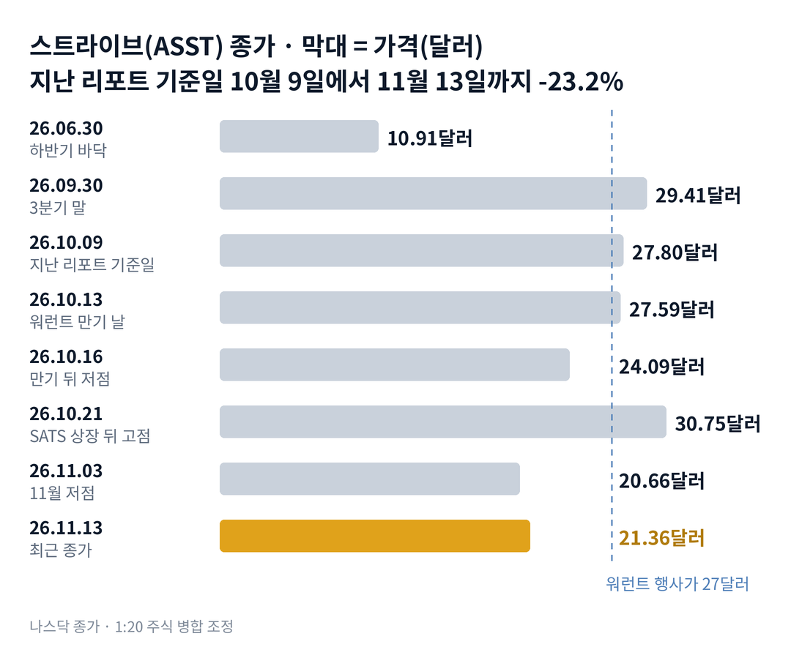

## 짧은 답

> **핵심:** 지난 일주일 주가는 비트코인보다 훨씬 덜 내렸지만, 2026년에 같은 모양이 나온 세 번은 모두 한 달 뒤 주가가 더 낮았습니다.

비트코인이 일주일 내내 미끄러졌는데, 이 비트코인 회사의 주가는 왜 제자리였을까요? 11월 6일부터 13일까지 비트코인은 9.9% 내렸습니다. 같은 기간 스트라이브 주가는 21.45달러에서 21.36달러로 0.4%만 내렸습니다. 더 큰 비트코인 회사 스트래티지(MSTR)는 13.4% 내렸습니다.

한 달 전체로 보면 그림이 다릅니다. 지난 리포트 기준일 10월 9일 뒤 회사는 비트코인을 약 1만 개 더 샀습니다. 그런데 주가는 23.2% 내렸고, 10월 21일 고점 30.75달러와 비교하면 30.5% 낮습니다.

**2026.11.13 진단: 지난 리포트의 '공급 국면 진입 직전'을 지나, 지금은 시가총액이 보유 비트코인 가치보다 낮은 할인 국면입니다 — 근거는 5부.** 주가가 비트코인보다 덜 내린 날 뒤 한 달이 어땠는지는 3부 '비트코인 급락일 21번' 기록표에 있습니다.

> **유의사항** 저자는 금융·투자 자문가가 아닙니다. 이 글은 공개 공시와 시세를 정리한 교육용 분석이며 특정 종목의 매수·매도를 권하지 않습니다. 과거 패턴은 미래 수익을 보장하지 않고, 이 종목은 하루 10% 넘게 움직인 적이 여러 번 있습니다. 실제 투자 전에는 최신 공시를 직접 확인하세요.

이 리포트는 시청자 반응이 컸던 종목의 업데이트입니다.

## 지난 리포트 이후

[10월 11일 리포트](/r/asst-2026-10/)는 10월 13일 워런트 만기를 앞두고 '순환 국면 후반, 공급 국면 진입 직전'이라고 진단했습니다. 지난 예측 성적은 적중 셋, 빗나감 하나, 확인 전 하나입니다. 만기 뒤 약세와 할인 국면 복귀는 맞았고, 비트코인이 평균 매입가를 넘는다는 순환 지속 시나리오는 빗나갔습니다. 항목별 채점은 6부 끝 채점표에 있습니다.

## 1부. 한 달 사이 회사에 생긴 일

> **핵심:** 워런트 행사와 새 우선주로 비트코인을 1만 개 넘게 늘렸지만, 10월 마지막 주부터 매입은 거의 멈췄습니다.

스트라이브는 비트코인을 회사 금고에 쌓는 것이 주된 사업인 회사입니다. 2025년 디스코드 커뮤니티 회사 애셋 엔티티스와 합쳐 지금 이름이 됐고, 2026년에는 의료기기 회사 셈러 사이언티픽도 합쳤습니다.

돈을 버는 방식은 단순합니다. 주식과 우선주를 팔아 비트코인을 사고, 한 주에 담긴 비트코인을 늘리는 것입니다. 우선주는 보통주보다 먼저 정해진 배당을 받는 주식입니다. 자산 운용과 의료기기 매출은 3분기 270만 달러로 아주 작습니다.

그래서 이 회사의 몸값은 비트코인 값과 '한 주당 비트코인'이 좌우합니다. 3분기 순이익은 5억 900만 달러였습니다. 그 대부분이 비트코인 평가 이익 5억 3,370만 달러였습니다. 비트코인이 내리면 같은 방식으로 손실이 됩니다.

지금 몸값은 11월 13일 종가 기준 시가총액 약 27억 1,980만 달러입니다. 11월 6일 공시한 보통주 1억 2,733만 주로 계산했습니다. 같은 날 보유 비트코인 가치는 약 29억 4,460만 달러(계산)로, 시가총액보다 큽니다.

### 숫자로 본 한 달(10월 9일 → 11월 6일, 회사 주간 공시)

| 항목 | 10월 9일 → 11월 6일 |
| --- | --- |
| 비트코인 보유 | **3만 2,773개 → 4만 3,153개** 약 1만 380개 늘어남 |
| 보통주(A·B 합계) | **1억 1,039만 주 → 1억 2,733만 주** 약 15.3% 늘어남 |
| 주당 비트코인 | **1,000주당 0.297개 → 0.339개** 약 14.1% 늘어남(계산) |
| 현금 | **3억 1,030만 → 4억 8,760만 달러** 배당 준비금 포함 |
| 주가(종가) | **27.80달러 → 21.36달러(11월 13일)** 약 23.2% 내림 |

비트코인을 늘린 돈은 두 곳에서 왔습니다. 첫째는 워런트입니다. 워런트는 정해진 값에 새 주식을 살 수 있는 권리로, 행사가는 27달러였습니다. 만기 직전 10월 12일과 13일에 1,367만 주 분량이 행사됐습니다. 그 대금 3억 6,920만 달러가 들어왔습니다.

둘째는 새 우선주 SATS(연 15% 고정 배당 우선주)입니다. 10월 15일 700만 주를 주당 90달러에 팔았습니다. 모은 돈은 약 6억 3,000만 달러입니다. 배당은 액면 100달러 기준이라, 90달러에 산 사람에게는 연 약 16.7%(계산)입니다.

주간 매입량은 10월 셋째 주 6,182개가 정점이었습니다. 그 뒤 124개, 29개로 줄었습니다. 현금은 오히려 4억 8,760만 달러로 늘었습니다. 주가는 같은 기간 어떻게 움직였을까요?

## 2부. 비트코인은 늘었는데 주가는 왜 내렸나

> **핵심:** 주당 비트코인은 14.1% 늘었지만, 비트코인 값이 17.3% 내리고 시장이 붙여 주던 웃돈이 할인으로 바뀌어 주가는 23.2% 내렸습니다.

주가는 세 가지의 곱으로 볼 수 있습니다. 한 주에 담긴 비트코인, 비트코인 값, 그리고 시장이 매기는 배수입니다. 배수는 시가총액을 보유 비트코인 가치로 나눈 값입니다. 지난 리포트와 같은 방식으로 계산했습니다.

10월 9일 배수는 약 1.13배였습니다. 비트코인 1달러어치를 1.13달러에 사 주던 셈입니다. 11월 13일에는 약 0.92배로 내려왔습니다. 이제는 1달러어치가 92센트에 거래됩니다.

### 주가 -23.2%를 세 조각으로 나누면(계산)

| 조각 | 10월 9일 → 11월 13일 |
| --- | --- |
| 주당 비트코인 | **+14.1%** 워런트·우선주로 더 산 비트코인 |
| 비트코인 값 | **-17.3%** 8만 2,545달러 → 6만 8,237달러 |
| 배수(시가총액 ÷ 비트코인 가치) | **약 1.13배 → 약 0.92배** 약 -18.5% |
| 세 조각을 곱한 결과 | **약 -23.1%** 실제 주가 -23.2% |

회사가 잘해 낸 것은 첫 줄입니다. 한 주에 담긴 비트코인은 한 달 만에 14% 넘게 늘었습니다. 하지만 나머지 두 줄이 그보다 컸습니다. 비트코인 값 하락과 배수 하락이 함께 주가를 끌어내렸습니다.

배수가 내린 시점도 눈여겨볼 만합니다. 10월 21일 주가는 13.6% 올라 30.75달러가 됐습니다. 새 우선주 SATS 공모가 끝난 다음 날이었습니다. 그 뒤 비트코인은 18.8% 내렸고, 주가는 30.5% 내렸습니다.

비트코인 평균 매입가도 멀어졌습니다. 9월 말 평균은 9만 170달러였습니다. 10월에 산 비트코인까지 더하면 약 8만 7,760달러(계산)입니다. 11월 13일 비트코인 값은 그보다 약 22.2% 낮습니다. 세 조각을 나란히 놓으면 공통점이 하나 보입니다. 주가를 끌어내린 두 힘 모두 회사 밖, 비트코인 시장에서 왔다는 점입니다. 그런데 지난 일주일, 주가는 왜 비트코인을 따라 내리지 않았을까요?

## 3부. 비트코인 급락일 21번, 그날과 20거래일 뒤

> **핵심:** 비트코인이 하루 3% 넘게 내린 21일 가운데 17일은 주가가 더 크게 내렸고, 덜 내린 세 번은 모두 20거래일 뒤 주가가 그날보다 낮았습니다.

기준은 이렇습니다. 2026년 1월부터 11월 13일까지, 비트코인 하루 종가(UTC 기준)가 전날보다 3% 이상 내린 날을 하나도 빼지 않았습니다. 그날 스트라이브 종가가 비트코인보다 더 내렸는지, 덜 내렸는지를 나눴습니다. 이번 주가 바로 비트코인 급락 속에 덜 내린 주이기 때문입니다.

비교 기준은 급락한 날의 스트라이브 종가입니다. 예를 들어 1월 20일 종가 기준으로 20거래일 뒤 주가가 54.5% 낮았다면 표에 -54.5%로 적었습니다.

**한눈에:** **17/21** 주가가 비트코인보다 더 내림 · **약 1.5배** 그날 낙폭 배율 가운데 값(중앙값) · **0/3** 덜 내린 날 20거래일 뒤 그날 종가보다 위.

### 비트코인 급락일에 주가가 덜 내린 날과 20거래일 뒤

| 날짜 · 비트코인 | 스트라이브 그날 | 20거래일 뒤(비트코인) |
| --- | --- | --- |
| 2026.01.20 -7.5% | -6.6% | -54.5% (-24.8%) |
| 2026.01.29 -5.2% | -1.9% | -49.4% (-22.1%) |
| 2026.06.02 -6.5% | -6.3% | -25.4% (-10.0%) |

덜 내린 세 날은 모두 그 뒤 비트코인이 10% 넘게 더 내렸습니다. 주가는 그보다 두 배 넘게 빠졌습니다. 그날 버틴 것이 바닥 신호가 되지 못한 셈입니다. 1월 두 날은 9일 차이라 측정 기간이 겹칩니다.

바로 전날 11월 12일은 비트코인 -3.5%, 주가 -4.1%로 거의 함께 움직였습니다. 급락일 21일 전체에서 20거래일 결과가 나온 16번을 보면, 주가가 그날보다 높았던 것은 7번이었습니다. 중앙값은 -9.9%입니다.

> **이번 사례(20거래일 결과 미확정):** 2026.11.13 비트코인 -4.4% · 스트라이브 -4.0% · 기준은 11월 13일 종가 21.36달러 · 20거래일째 12월 14일 판정

이 기록의 한계도 분명합니다. 덜 내린 날은 세 번뿐이고, 비트코인 종가는 미국 장 마감보다 몇 시간 늦은 UTC 기준입니다. 2026년 회귀로 본 민감도(베타)는 약 1.7로, 비트코인이 1% 움직일 때 주가는 평균 1.7% 움직였습니다. 그렇다면 회사가 쥔 4억 8,760만 달러는 주가를 받쳐 줄 수 있을까요?

## 4부. 현금 4억 8,760만 달러의 정체

> **핵심:** 현금의 대부분은 우선주 배당 18개월 치를 따로 쌓은 준비금이라, 비트코인을 더 사는 데 바로 쓰기 어렵습니다.

회사는 분기 보고서(10-Q)에서 배당 준비금을 설명합니다. 우선주를 팔 때마다 그 우선주의 배당 18개월 치를 별도 계좌에 넣어 둔다는 내용입니다. 10월 SATS를 팔 때도 한 주에 22.50달러씩, 18개월 치를 더 넣었습니다.

지금 배당 부담을 계산하면 아래 표와 같습니다. SATA(연 13% 변동 배당 우선주)는 12월부터 배당률이 13.25%로 오릅니다. 두 우선주의 배당은 모두 액면 100달러 기준입니다.

**우선주 배당 부담(11월 6일 주식 수, 계산)**

| 우선주 | 1년 배당 |
| --- | --- |
| SATA 1,403만 주 | **약 1억 8,590만 달러** 연 13.25%(12월부터) |
| SATS 704만 주 | **약 1억 555만 달러** 연 15% |
| 합계 | **약 2억 9,140만 달러** 18개월 치 약 4억 3,720만 달러 |

표의 18개월 치는 11월 6일 현금과 거의 같은 크기입니다. 이 말은 곧, 현금 대부분이 이미 배당에 묶여 있다는 뜻입니다. 한 분기 배당(약 7,290만 달러, 계산)은 3분기 매출의 약 27배입니다.

배당률도 올라갔습니다. 회사는 11월 12일 SATA 배당률을 12월부터 연 13.00%에서 13.25%로 올렸습니다. 회사는 SATA 배당률을 매달 조정할 수 있다고 공시해 왔습니다. 11월 13일 SATA 종가는 97.73달러, SATS 종가는 96.92달러였습니다.

보통주 판매도 사실상 멈췄습니다. 보통주 수는 10월 30일 이후 1억 2,733만 주에서 늘지 않았습니다. 배수가 1배 아래에서 보통주를 팔면, 받은 돈으로 사는 비트코인이 새 주식에 나눠 주는 비트코인보다 적어 한 주당 비트코인이 줄어듭니다. 대신 SATS 시장 판매(ATM) 계약을 최대 10억 달러로 맺었지만, 11월 6일까지 팔린 것은 3만 6,559주뿐입니다.

과거 기록은 덜 내린 날 세 번 모두 비트코인이 더 내리며 주가도 더 내렸다는 것까지 알려 줍니다. 다만 표본이 셋이라 참고 자료입니다. 그래서 앞으로 확인할 조건은 두 가지입니다. 하나는 12월 14일 주가가 21.36달러를 지키는가, 다른 하나는 비트코인이 같은 날 6만 8,237달러 위에 있는가입니다. 이 두 조건으로 나누면 어떤 갈림길이 나올까요?

## 5부. 할인 국면의 네 가지 시나리오

> **핵심:** 지금은 할인 국면이고, 12월 14일 주가와 비트코인 값이 시나리오를 가릅니다.

> **국면 정의(스트라이브 시리즈 공통, 10월 11일 리포트 5.1):** 순환 국면 — 배수가 1배 위에 있어 주식을 팔아 비트코인을 사고 한 주당 비트코인이 느는 단계. 공급 국면 — 워런트 만기·대규모 판매처럼 새 주식이 한꺼번에 나와 재료가 소멸하는 단계. 할인 국면 — 시가총액이 보유 비트코인 가치보다 낮아지고 우선주와 보통주가 함께 밀리는 단계.

**2026년 11월 13일 진단: 할인 국면.** 할인 국면 신호 다섯 개가 모두 켜졌습니다. 배수 약 0.92배, 비트코인 값이 평균 매입가보다 약 22% 낮음, 우선주 두 종목 모두 액면 아래입니다. 11월 2일 매입 공시 날 주가는 6.3% 내렸고, 새 자금은 보통주 대신 우선주로 모읍니다.

**판정 기준 두 가지:** 모두 12월 14일(11월 13일부터 20번째 거래일) 기준입니다. 하나는 그날 종가가 11월 13일 종가 21.36달러보다 높은가입니다. 다른 하나는 그날 비트코인 종가가 11월 13일 6만 8,237달러보다 높은가입니다.

### 앞으로 일어날 수 있는 일

**확인된 사실:** 11월 13일 배수는 약 0.92배이고, 주간 비트코인 매입은 29개로 줄었습니다. SATA 배당률 인상은 12월 1일부터 적용됩니다.

**과거 기록:** 3부 표에서 비트코인 급락일에 덜 내린 날은 3번 중 3번 모두 20거래일 뒤 주가가 더 낮았고, 그때 비트코인도 함께 내렸습니다. 급락일 16번 전체로는 7번이 20거래일 뒤 그날보다 높았습니다.

**추정:** 아래 가능성은 주가가 오를 확률이 아니라, 12월 14일에 두 판정 기준이 어느 칸에 들어갈지에 대한 분석자의 주관적 추정입니다. 네 경우는 겹치지 않아 '약 N%'를 더하면 100%이고, 괄호 안 구간은 흔들림의 폭이라 서로 더하지 않습니다.

| 시나리오(판정 2026년 12월 14일) | 주가·비트코인 | 가능성(추정) |
| --- | --- | --- |
| **1 · 함께 하락** | 아래 · 아래 | 높음 약 40% (35~45%) |
| 2 · 함께 반등 | 위 · 위 | 높음 약 35% (30~45%) |
| 3 · 비트코인만 반등 | 아래 · 위 | 낮음 약 15% (10~20%) |
| 4 · 주가만 버팀 | 위 · 아래 | 낮음 약 10% (5~15%) |

시나리오 1이면 SATA 값이 95달러 아래로 내려가 배당률이 또 오르는지 봅니다. 시나리오 2면 배수가 1배 위로 돌아와 보통주 판매가 다시 시작되는지 봅니다. 시나리오 3이면 SATS 판매로 우선주가 늘었는지, 시나리오 4면 매입 없이 주가를 받친 힘이 무엇인지 봅니다.

1번에 가장 큰 무게를 둔 것은 3부의 세 번이 모두 그 방향이었기 때문입니다. 다만 세 번 가운데 둘은 1월에 붙어 있어, 2번과의 차이를 5%만 두었습니다. 3번과 4번은 2026년 민감도 약 1.7을 보면 주가와 비트코인이 반대로 갈 일이 드물어 낮게 두었습니다.

반대쪽 요인도 같은 무게로 있습니다. 배수가 1배 아래라 보통주가 새로 나올 압력은 줄었고, 지난 일주일 주가는 실제로 비트코인보다 잘 버텼습니다. 이 진단을 가장 빨리 뒤집을 수 있는 위험은 무엇일까요?

## 6부. 위험과 체크리스트

> **핵심:** 판을 가장 빨리 바꿀 수 있는 것은 비트코인 값이고, 그다음이 우선주 값과 그에 따라 오르는 배당 부담입니다.

먼저 이 분석의 한계입니다. 3부 표의 덜 내린 날은 세 번뿐이고, 비트코인 종가와 주식 종가의 시각이 몇 시간 어긋납니다. 배수는 우선주를 빼지 않은 단순 계산이라, 우선주 액면을 빼고 보면 보통주에 남는 값은 크게 달라집니다.

사업 실행 쪽 위험이 가장 큽니다. 비트코인 값이 평균 매입가 약 8만 7,760달러(계산)보다 22% 낮아, 보유 비트코인 평가 손실이 약 8억 4,240만 달러(계산)입니다. 이 손실은 4분기 실적에 그대로 반영될 수 있습니다.

자금 조달 쪽에서는 배당 부담이 커지고 있습니다. 연 배당은 약 2억 9,140만 달러(계산)이고, SATA 값이 액면 아래로 내려갈수록 회사는 배당률을 올려 왔습니다. 준비금 18개월 치가 바닥나기 전에 새 우선주나 보통주로 돈을 모아야 하는 구조입니다.

외부 환경 쪽에서는 비트코인 시세가 전부입니다. 같은 구조의 스트래티지가 지난 일주일 13.4% 내린 것처럼, 업종 전체가 비트코인 값에 묶여 있습니다. 공동 창업자 비벡 라마스와미 쪽이 B주의 약 72%를 가진 지배 구조도 그대로입니다(지난 리포트 6.2).

**핵심 확인 세 가지:** 위에서부터 판정을 바꾸는 힘이 큰 순서입니다.

- ☐ 1순위 · 12월 14일(20거래일째) 비트코인 종가가 6만 8,237달러보다 높은가
- ☐ 2순위 · 12월 14일 스트라이브 종가가 21.36달러보다 높은가
- ☐ 3순위 · 12월 14일까지 SATA 종가가 95달러 아래로 내려간 날이 1일 이상 있었나

**보조 확인:** 매주 월요일 8-K(수시 공시)의 주간 매입량이 1,000개를 넘는 주가 다시 나오는지 봅니다.

**기억할 판단 기준:** 이 종목은 비트코인보다 평균 1.7배 크게 움직입니다. 비트코인 급락 속에 덜 내린 날도 2026년 세 번 모두 바닥이 아니었습니다. 비트코인 방향을 먼저 봅니다.

### 지난 예측 채점표

10월 11일 리포트(10월 9일 기준)의 진단과 시나리오를 11월 13일 기준으로 채점한 결과입니다. 지난 리포트에는 시나리오별 가능성 숫자가 없었습니다.

| 지난 점검 항목 · 당시 기준 | 판정 및 실제 결과(11월 13일) |
| --- | --- |
| **진단: 공급 국면 진입 직전** 10월 13일 워런트 만기 | **[적중]** 워런트 행사 다음 날 10월 14일 -10.5% |
| **시나리오 1: 순환 지속** 비트코인이 9만 170달러를 넘는다 | **[빗나감]** 비트코인 6만 8,237달러, 배수 1배 아래 |
| **시나리오 2: 재료 소멸** 만기 뒤 며칠 약세 | **[적중]** 10월 13일 → 16일 -12.7% |
| **시나리오 3: 할인 국면 복귀** 배수 1배 아래 | **[적중]** 11월 13일 약 0.92배 |
| **시나리오 4: 배당 조정** 배당률을 바꾼다 | **[진행 중]** SATA 13.25% 인상 발표, 12월 1일 적용 |

가장 큰 빗나감은 비트코인 방향이었습니다. 워런트는 예상대로 모두 행사됐지만, 비트코인은 평균 매입가를 넘지 못하고 더 내렸습니다. 이번 리포트부터는 비트코인 판정선을 시나리오 축에 직접 넣었습니다.

같은 비트코인 업종의 흐름은 [아이렌 리포트](/r/iren-2026-11-2/)에서 함께 볼 수 있습니다. 다음 갱신은 12월 14일 20거래일째 반응이나 4분기 실적을 본 뒤에 합니다. 공시는 [스트라이브 SEC 공시 목록](https://www.sec.gov/cgi-bin/browse-edgar?action=getcompany&CIK=0001920406)에서 확인할 수 있습니다.
