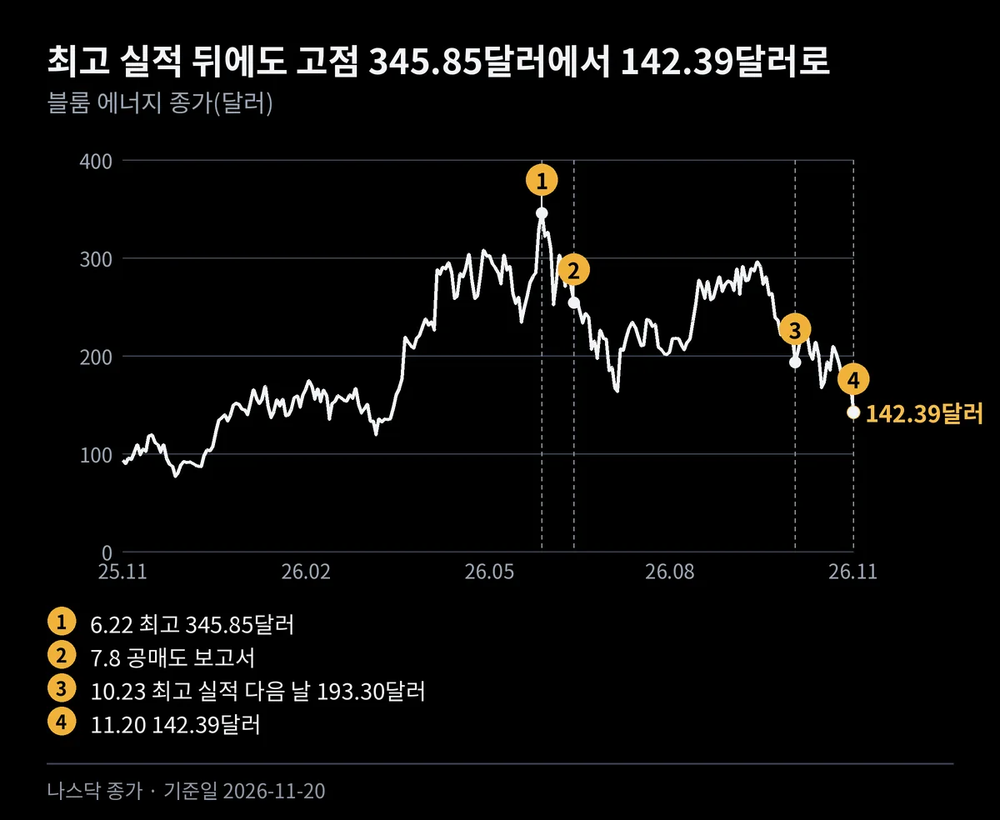
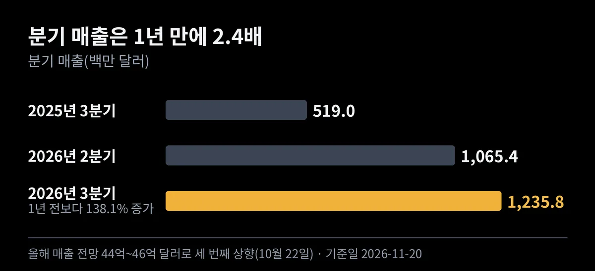
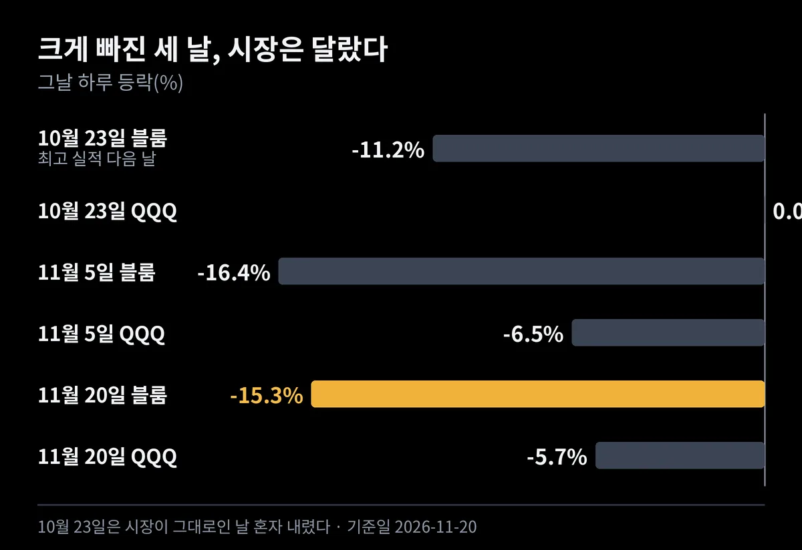
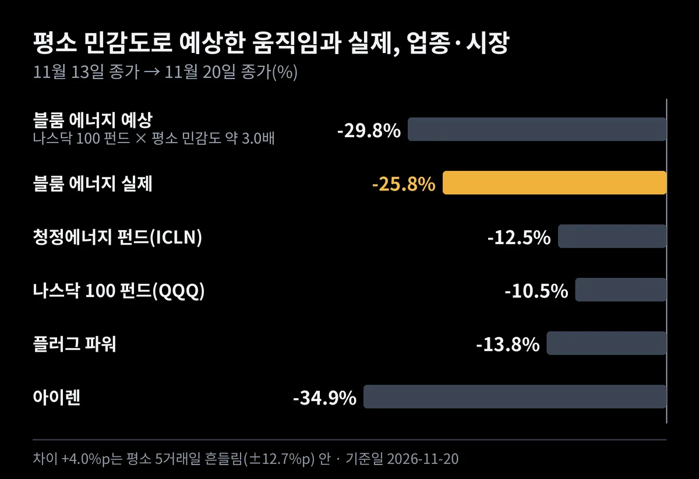
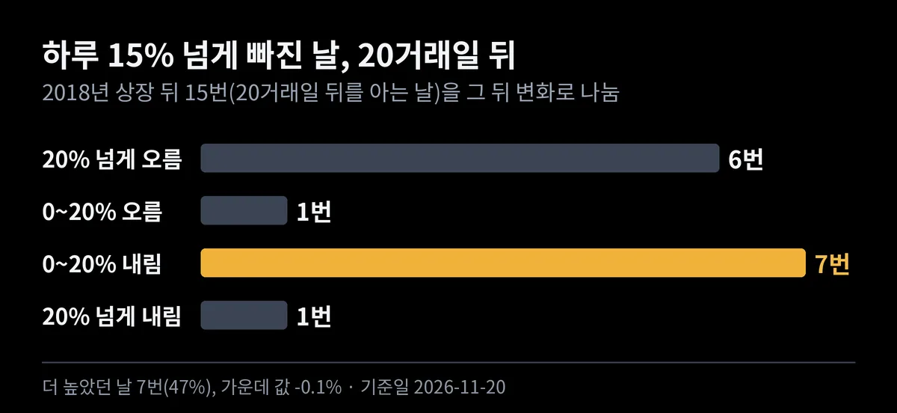
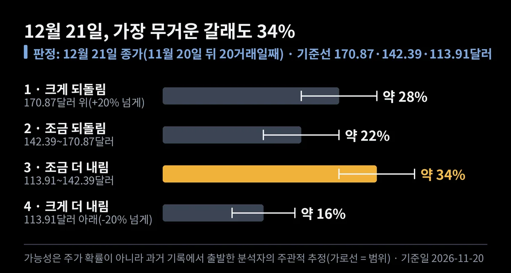

블룸 에너지 지금 사도 될까? 11월 20일, 이 회사 주가는 하루에 15.3% 내려 142.39달러로 마감했습니다. 6월 22일 최고 종가 345.85달러와 견주면 58.8% 아래입니다. 그런데 딱 한 달 전, 이 회사는 사상 최고 분기 실적을 발표했습니다. 실적은 최고인데 주가는 반 토막 아래. 이 글은 사라, 팔라를 말하지 않습니다. 대신 이 질문에 답하는 데 필요한 근거를 끝까지 꺼내 보겠습니다.

> **유의사항** 저자는 금융·투자 자문가가 아닙니다. 이 글은 공개 공시와 시세를 정리한 교육용 분석이며 특정 종목의 매수·매도를 권하지 않습니다. 과거 패턴은 미래 수익을 보장하지 않고, 블룸 에너지는 최근 20거래일 가운데 10일이 하루 5% 넘게 움직인 종목입니다. 실제 투자 전에는 최신 공시를 직접 확인하세요.

김박사 월드가 블룸 에너지를 다루는 것은 이번이 처음입니다. 핵심 종목 가운데 주말 사이 새 공시가 나온 종목이 없어, 같은 무리에서 새 사건이 확인된 종목을 골랐습니다. 블룸 에너지는 [플러그 파워](/r/plug-2026-11-4/)와 같은 연료전지 무리이고, [아이렌](/r/iren-2026-11-5/)처럼 AI 데이터센터 전력 이야기로 움직이는 종목입니다. 그래서 첫 리포트이지만 지난 예측 성적은 없습니다. 판정할 예측은 이 글 끝에 새로 적습니다.

회사부터 보겠습니다. 블룸 에너지가 돈을 버는 방식은 연료전지 발전 설비를 팔고 설치·관리해 주는 것입니다. 연료전지는 천연가스나 수소를 태우지 않고 화학 반응으로 바로 전기를 뽑는 장치입니다. 이 설비를 공장이나 데이터센터 옆에 놓으면, 전력망 연결을 몇 년씩 기다리지 않고 그 자리에서 전기를 쓸 수 있습니다. AI 데이터센터가 전기를 구하지 못해 줄을 서면서, 이 회사가 그 대안으로 주목받았습니다.

숫자로 보면 그 주목은 실적으로 이어졌습니다. 10월 22일 발표한 3분기 매출은 12억 3,580만 달러로, 1년 전보다 138.1% 늘었습니다. 1년 만에 두 배를 훌쩍 넘긴 셈입니다. 영업이익도 적자 언저리에서 2억 달러 넘는 흑자로 올라섰습니다. 회사는 올해 매출 전망을 올해 들어 세 번째로 올렸고, 같은 보도자료에서 S&P 500 지수 편입도 알렸습니다.

그런데 주가는 반대로 갔습니다. 실적 발표 다음 날인 10월 23일, 주가는 217.77달러에서 193.30달러로 11.2% 내렸습니다. 그날 나스닥 100 펀드(QQQ)는 거의 그대로였습니다. 시장 탓으로 돌릴 수 없는, 이 회사만의 하락이었습니다. 김박사 월드 장부의 통찰 가운데 '알려진 좋은 소식은 이미 가격에 있다'는 기록이 있는데, 이 날이 그 모양이었습니다.

그 뒤 큰 하락이 두 번 더 왔습니다. 11월 5일 -16.4%, 그리고 11월 20일 -15.3%입니다. 이 두 날은 10월 23일과 성격이 달랐습니다. 11월 5일 나스닥 100 펀드는 6.5%, 11월 20일에는 5.7% 내렸습니다. 시장 전체가 크게 빠진 날입니다. 11월 20일 거래량은 약 2,869만 주로, 직전 20거래일 평균의 1.58배였습니다.

11월 20일에 회사가 낸 새 소식은 있었을까요? SEC 제출 목록을 보면 없습니다. 11월 16~17일에 임원 세 명의 주식 매도 신고가 있었지만, 원문은 '제한조건부 주식이 지급될 때 생긴 세금을 내려고 판 것'이라고 적었습니다. 세 사람 합계 1만 489주, 평균 약 178달러였습니다. 발행 주식 2억 9,566만 주와 견주면 아주 작은 양입니다.

그렇다면 이 하락에서 시장이 함께 움직인 부분은 얼마일까요? 이것을 재는 방법이 평소 민감도입니다. 시장이 1% 움직일 때 이 종목이 평균 몇 % 움직였는지를 지난 250거래일 기록으로 계산한 값입니다. 블룸 에너지는 나스닥 100 펀드 기준 약 3.0배였습니다. 시장이 1% 빠지면 평균 3% 빠지는 종목이라는 뜻입니다.

11월 13일 종가 대비 20일까지 5거래일 동안 블룸 에너지는 -25.8%였습니다. 같은 기간 나스닥 100 펀드(QQQ)는 -10.5%였습니다. 평소 민감도(약 3.0배)로 예상한 움직임은 -29.8%였습니다. 차이는 +4.0%p로, 평소 5거래일 흔들림(±12.7%p) 안입니다. 청정에너지 펀드(ICLN)를 기준으로 해도 같은 판정이었습니다. 이번 하락은 회사 사건보다 시장과 함께 움직인 쪽에 가깝습니다.

시장 쪽 배경도 적어 둡니다. 11월 20일 변동성 지수(VIX)는 35.89로, 5거래일 전보다 16.59포인트 높았습니다. 같은 날 미국 10년 국채 금리는 4.92%로 5거래일 사이 0.23%포인트 내렸습니다. 다음 큰 일정은 11월 25일 개인소비지출(PCE) 물가 발표와 12월 9일 연준 금리 회의(FOMC)입니다. 블룸 에너지처럼 민감도가 큰 종목은 이 일정 뒤 시장이 움직이는 폭의 약 세 배로 흔들릴 수 있습니다.

정책 쪽은 회사가 3분기 보고서에 직접 적은 것만 옮깁니다. 하나는 관세입니다. 보고서는 7월 말부터 약 60개 경제권 수입품에 10~12.5% 관세가 붙었고, 원자재 원가에 영향을 줄 수 있다고 적었습니다. 다른 하나는 데이터센터 반대입니다. 7월 뉴욕주가 대형 데이터센터 신규 인허가를 최대 1년 멈추는 행정명령을 냈고, 비슷한 움직임이 다른 주로 번지고 있다고 적었습니다. 두 가지 모두 11월 20일 하락의 원인으로 확인된 것은 아닙니다.

같은 5거래일, 김박사 월드 핵심 종목 8개 가운데 7개도 평소 시장 민감도로 예상한 범위 안에서 움직였습니다. 같은 연료전지 무리인 [플러그 파워](/r/plug-2026-11-4/)는 예상과 비슷하게 내렸습니다. AI 데이터센터 무리인 [아이렌](/r/iren-2026-11-5/)은 예상보다 조금 더 내렸습니다. 회사마다 사정은 달라도, 이번 주는 시장 한 방향이 거의 모든 종목을 끌고 갔습니다. 종목별 숫자는 부록 표에 있습니다.

이 질문의 첫 번째 열쇠는 과거 비슷한 순간입니다. 2018년 상장 뒤 블룸 에너지가 하루 15% 넘게 빠진 날을 모두 찾았습니다. 20거래일 뒤 결과를 아는 날은 15번이었습니다. 그 가운데 20거래일 뒤 더 높았던 날은 7번, 47%였습니다. 가운데 값(중앙값)은 -0.1%로 거의 제자리였습니다.

흥미로운 것은 갈린 모양입니다. 20% 넘게 오른 경우가 6번, 조금 더 내린 경우가 7번으로 양쪽에 몰렸습니다. 그 사이 칸과 큰 추가 하락 칸은 한 번씩뿐이었습니다. 다만 크게 오른 6번 가운데 3번은 2020년 3월 코로나 급락 한 묶음에서 나왔습니다. 그래서 이 기록은 '크게 되돌리거나, 조금 더 내리거나로 갈리는 종목'이라는 정도로 읽습니다. 이제 사는 쪽 근거와 사지 않는 쪽 근거를 셋씩 나란히 놓겠습니다.

사는 쪽 근거 첫째는 실적입니다. 분기 매출은 1년 만에 2.4배가 됐고, 회사는 올해 전망을 세 번 올렸습니다. 올해 비일반회계 주당순이익 전망은 3.10~3.40달러입니다. 비일반회계는 주식 보상 같은 항목을 뺀 회사 자체 기준입니다. 전망 가운데 값 3.25달러로 계산하면 지금 주가는 그 이익의 약 44배입니다. 6월 최고가 때는 같은 계산으로 약 106배였습니다.

두 번째로 볼 것은 하락의 성격입니다. 앞에서 본 대로 11월 13~20일 하락은 평소 민감도로 예상한 범위 안이었습니다. 11월 20일 하루만 떼어 봐도 예상 -17.3%, 실제 -15.3%였습니다. 이 기간 회사가 낸 서류는 세금용 매도 신고뿐이었습니다. 회사 고유의 나쁜 소식이 새로 붙은 것은 아니라는 기록입니다.

사는 쪽 마지막 근거는 돈의 크기입니다. 9월 말 현금은 24억 8,670만 달러였습니다. 차입금은 대부분 2030년 11월 만기 전환사채 25억 달러로, 이자가 0%입니다. 분기 영업이익이 2억 달러를 넘는 회사라, 당장 새 주식을 팔아 버텨야 하는 처지는 아닙니다. 이 점이 같은 연료전지 무리의 플러그 파워와 가장 다른 자리입니다.

이번엔 사지 않는 쪽 근거입니다. 첫째는 좋은 소식에도 내린 주가입니다. 최고 실적과 전망 상향이 나온 다음 날, 시장은 그대로인데 주가는 11.2% 내렸습니다. 이미 기대가 그보다 높게 가격에 들어가 있었다는 뜻으로 읽힙니다. 지금 약 44배라는 숫자도, 이익이 계속 빠르게 늘어난다는 기대를 전제로 한 값입니다.

둘째는 흔들림의 크기입니다. 평소 민감도 약 3.0배는 양쪽으로 작동합니다. 시장이 되돌리면 크게 오르지만, 시장이 한 번 더 7% 빠지면 블룸 에너지는 평소대로라면 약 20% 빠질 수 있습니다. 최근 20거래일 가운데 하루 5% 넘게 움직인 날이 10일, 10% 넘게 움직인 날이 4일이었습니다. 회사가 좋아도 주가는 시장 날씨를 세 배로 탑니다.

셋째는 매출이 몰린 곳입니다. 3분기 매출의 43%와 26%가 두 고객에게서 나왔습니다. 그리고 회사는 보고서에 데이터센터 쪽 위험을 길게 적었습니다. 데이터센터 반대 움직임, 대형 기술 기업들이 차입금으로 투자하면서 어려워진 자금 조달, 대기 배출 인허가 지연입니다. 7월 8일에는 공급망을 문제 삼은 공매도 보고서도 나왔습니다. 그날 종가는 254.29달러로 하루 5.7% 내렸고, 회사는 그 결론을 반박했습니다.

같은 모양은 같은 무리에서도 보입니다. 같은 5거래일 연료전지 회사 퓨얼셀 에너지는 -30.9%, 데이터센터 전력 설비 회사 버티브는 -17.7%였습니다. 김박사 월드 장부의 통찰 하나는 '첫날과 20거래일 뒤는 다른 게임'이라는 것입니다. 하루 급락이 곧 바닥인지, 아니면 다음 하락의 시작인지는 첫날만으로 가려지지 않았습니다. 이 무리를 계속 보는 이유입니다.

그럼 무엇을 보면 판단이 바뀔까요? 신호와 날짜를 정해 두겠습니다. 먼저 12월 9일 연준 금리 회의 뒤의 시장입니다. 시장이 되돌릴 때 블룸 에너지가 평소처럼 약 세 배로 따라 오르는지, 덜 따라가는지를 봅니다. 덜 따라간다면 시장 말고 다른 무게가 생겼다는 신호입니다.

기준 날짜는 12월 21일 종가로, 11월 20일 뒤 20번째 거래일입니다. 이날 11월 20일보다 20% 높은 170.87달러 위에 있으면 사는 쪽 근거가 강해집니다. 20% 낮은 113.91달러 아래면 사지 않는 쪽 근거가 강해집니다. 공시도 신호입니다. 새 대형 공급 계약은 사는 쪽, 전망 하향이나 큰 조달은 사지 않는 쪽입니다.

사려는 사람이 먼저 볼 것은 두 가지입니다. 하나는 최신 10-Q에서 두 고객 매출 비중과 데이터센터 위험 문구를 직접 읽는 것입니다. 10-Q는 미국 상장사가 분기마다 SEC에 내는 보고서입니다. 다른 하나는 평소 민감도 약 3.0배를 스스로 견딜 수 있는지 따져 보는 것입니다. 이익 대비 주가 수준, 다음 거시 일정, 판정 날짜까지 다섯 가지 확인표는 글 끝 부록에 있습니다.

마지막으로 12월 21일 종가를 네 갈래로 나눴습니다. 출발점은 하루 15% 넘게 빠진 15번 중 7번이 더 높았던 기록입니다. 52주 고점보다 55% 넘게 내려간 아홉 번의 시작점도 함께 봤습니다. 두 기록을 평균한 뒤, 2020년 3월 한 묶음이 섞인 크게 오름 칸은 조금 줄였습니다.

113.91~142.39달러, 조금 더 내리는 갈래를 약 34%로 가장 무겁게 봤습니다. 170.87달러 위로 크게 되돌리는 갈래는 약 28%입니다. 조금 되돌리는 갈래는 약 22%, 크게 더 내리는 갈래는 약 16%입니다. 이 숫자는 주가가 오를 확률이 아니라, 과거 빈도에서 출발한 분석자의 주관적 추정입니다.

이 판단이 틀릴 수 있는 곳도 적어 둡니다. 평소 민감도 약 3.0배라서, 시장이 12월 9일 뒤 7% 되돌리면 블룸 에너지는 약 20% 움직여 맨 위 칸으로 넘어갈 수 있습니다. 하루 5% 넘게 움직이는 날이 20거래일 중 10일인 종목이라, 20% 폭의 칸은 큰 날 두 번이면 비껴갑니다. 하루 15% 넘게 빠진 날 기록도 15번뿐이고, 그중 세 번은 같은 달입니다.

지금 블룸 에너지는 실적이 최고인데 주가는 최고가의 절반 아래에 있는 회사입니다. 최근 하락은 회사 소식보다 시장과 함께 움직인 쪽이었지만, 좋은 소식에도 내린 날이 있었습니다. 12월 21일 종가가 170.87달러 위로 돌아오고 시장 반등을 평소만큼 따라간다면 사는 쪽 근거가 강해집니다. 113.91달러 아래이거나 전망 하향, 데이터센터 고객 쪽 나쁜 소식이 이어지면 사지 않는 쪽 근거가 강해집니다. 결정은 각자의 몫이며, 이 영상과 리포트는 판단 근거를 정리한 교육용 자료입니다.

## 숫자로 다시 보기

### 최근 하루씩

| 날짜 · 종가 | 하루 변화 · 거래량 | QQQ 하루 변화 |
| --- | --- | --- |
| **10월 23일** 193.30달러 | -11.2% · 약 3,602만 주 | 0.0% |
| **11월 5일** 167.52달러 | -16.4% · 약 3,763만 주 | -6.5% |
| **11월 13일** 191.99달러 | -4.9% · 약 1,603만 주 | - |
| **11월 19일** 168.11달러 | -1.7% · 약 1,662만 주 | - |
| **11월 20일** 142.39달러 | -15.3% · 약 2,869만 주 | -5.7% |

11월 20일 거래량은 직전 20거래일 평균의 1.58배입니다. 11월 13일 → 20일 블룸 에너지 -25.8%, 퓨얼셀 에너지 -30.9%, 버티브 -17.7%, 플러그 파워 -13.8%, 청정에너지 펀드(ICLN) -12.5%, QQQ -10.5%입니다.

### 사는 쪽 근거와 사지 않는 쪽 근거

| 사는 쪽 · 숫자 | 사지 않는 쪽 · 숫자 |
| --- | --- |
| **최고 실적과 세 번 올린 전망** 3분기 매출 12억 3,580만 달러(+138.1%), 올해 전망 44억~46억 달러 | **좋은 소식에도 내린 주가** 실적 다음 날 -11.2%(QQQ 0.0%), 전망 가운데 값 기준 이익의 약 44배 |
| **시장과 함께 움직인 하락** 5거래일 예상 -29.8% · 실제 -25.8%, 회사 서류는 세금용 매도 신고뿐 | **시장의 약 세 배로 흔들림** 평소 민감도 약 3.0배, 최근 20거래일 하루 5% 넘는 날 10일 |
| **흑자와 넉넉한 현금** 3분기 영업이익 2억 2,540만 달러, 9월 말 현금 24억 8,670만 달러 | **몰린 매출과 데이터센터 위험** 두 고객 매출 43% · 26%, 보고서의 데이터센터 반대·자금 조달·인허가 위험 |

### 하루 15% 넘게 빠진 날, 20거래일 뒤

**한눈에:** 2018년 7월 25일 상장 뒤 하루 -15% 넘는 날 중 20거래일 뒤를 아는 날 **15번** · 더 높음 **7번(47%)** · 가운데 값 **-0.1%**

| 날짜 · 종가 | 20거래일 뒤 |
| --- | --- |
| **2020년 3월 17일** 4.08달러 | +60.5% |
| **2020년 3월 18일** 3.07달러 | +111.1% |
| **2022년 5월 6일** 15.13달러 | +24.8% |
| **2025년 11월 13일** 103.55달러 | -8.3% |
| **2026년 3월 6일** 135.19달러 | -0.1% |
| **2026년 6월 26일** 252.02달러 | -25.3% |
| **이번 11월 20일** 142.39달러 | 12월 21일 판정 |

| 20거래일 뒤 칸 | 횟수 |
| --- | --- |
| 20% 넘게 오름(170.87달러 위에 해당) | 6번 |
| 0~20% 오름 | 1번 |
| 0~20% 내림 | 7번 |
| 20% 넘게 내림(113.91달러 아래에 해당) | 1번 |

20% 넘게 오른 6번 가운데 3번은 2020년 3월 한 달에 몰려 있습니다. 2026년 11월 5일은 아직 20거래일이 지나지 않아 넣지 않았습니다.

### 시장·거시·정책 배경

| 대상 · 11월 20일 종가 | 하루 | 11월 13일 → 20일 |
| --- | --- | --- |
| **블룸 에너지** 142.39달러 | -15.3% | -25.8% |
| **청정에너지 펀드(ICLN)** 13.84달러 | -4.5% | -12.5% |
| **나스닥 100 펀드(QQQ)** 608.45달러 | -5.7% | -10.5% |
| **소형주 펀드(IWM)** 256.61달러 | -2.9% | -7.5% |
| **S&P 500 펀드(SPY)** 689.81달러 | -3.6% | -8.6% |

| 기준 · 평소 민감도 | 예상 · 실제 | 판정 |
| --- | --- | --- |
| **QQQ 기준** 11월 13일 → 20일 약 3.0배 | -29.8% · -25.8% | 평소 흔들림(±12.7%p) 안 |
| **ICLN 기준** 11월 13일 → 20일 약 2.8배 | -31.4% · -25.8% | 평소 흔들림(±10.3%p) 안 |
| **QQQ 기준** 11월 20일 하루 약 3.0배 | -17.3% · -15.3% | 평소 흔들림(±5.7%p) 안 |

평소 민감도는 11월 13일 전 250거래일의 하루 수익률을 회귀해 구했습니다(나스닥 종가).

| 지표 | 값(날짜) | 출처 |
| --- | --- | --- |
| 변동성 지수(VIX) | 35.89(11월 20일), 5거래일 전보다 +16.59포인트 | Cboe |
| 미국 10년 국채 금리 | 4.92%(11월 20일), 5회 전보다 -0.23%포인트 | 미 재무부 |
| 미국 2년 국채 금리 | 4.63%(11월 20일) | 미 재무부 |

| 다음 거시 일정 | 날짜 |
| --- | --- |
| 개인소비지출(PCE) 물가, 10월분 | 11월 25일 |
| 연준 금리 회의(FOMC) 결정 | 12월 9일 |
| 개인소비지출(PCE) 물가, 11월분 | 12월 23일 |
| 소비자물가(CPI)·고용 보고서 | 확인 안 됨(공식 일정 페이지 접근 막힘) |

정책 연결(회사 10-Q가 직접 적은 것만): 2026년 7월 말 약 60개 경제권 수입품 10~12.5% 관세 · 연결 고리: 10-Q '관세 현황' 항목, 에너지 서버 원자재 원가. 2026년 7월 뉴욕주 대형 데이터센터 신규 인허가 최대 1년 유예 행정명령 · 연결 고리: 10-Q '데이터센터 개발 반대 확대' 항목. 둘 다 11월 20일 하락의 직접 원인으로 확인되지는 않았습니다.

같은 5거래일 핵심 종목 8개 가운데 7개가 평소 시장 민감도로 예상한 범위 안에서 움직였습니다.

| 핵심 종목 | 실제 | 평소 민감도로 예상 |
| --- | --- | --- |
| 플러그 파워 | -13.8% | -15.6% |
| 아이렌 | -34.9% | -28.8% |
| 솔리드파워 | -23.3% | -16.3% |

리포트: [플러그 파워](/r/plug-2026-11-4/) · [아이렌](/r/iren-2026-11-5/) · [솔리드파워](/r/sldp-2026-11-4/)

### 지금의 크기(11월 20일 기준)

| 항목 | 값 · 근거 |
| --- | --- |
| 종가 | **142.39달러** 하루 -15.3% |
| 최고가 대비 | **-58.8%** 2026년 6월 22일 345.85달러 |
| 1년 최저 대비 | **+85.0%** 2025년 12월 17일 76.97달러 |
| 시가총액 | **약 421억 달러** 발행 주식 2억 9,565만 6,689주(10월 19일) 기준 |
| 올해 이익 전망 대비 | **약 44배** 비일반회계 주당순이익 전망 3.10~3.40달러의 가운데 값 3.25달러 |
| 분기 매출(백만 달러) | **1,235.8** 2026년 2분기 1,065.4 · 2025년 3분기 519.0 |
| 3분기 영업이익 | **2억 2,540만 달러** 1년 전 780만 달러 |
| 9월 말 현금 | **24억 8,670만 달러** |
| 차입금 | **0% 전환사채 25억 달러** 2030년 11월 만기, 전환가 194.97달러 |
| 두 고객 매출 비중 | **43% · 26%** 3분기 |
| 미국 매출 비중 | **97%** 3분기, 10-Q 지역 위험 |
| 평소 민감도 | **약 3.0배** 나스닥 100 펀드 기준 |

### 사기 전에 확인할 것

| 확인할 것 | 어디서 · 언제 |
| --- | --- |
| **두 고객 매출 비중과 데이터센터 위험 문구** 43% · 26%, 반대·자금 조달·인허가 | 10-Q · 다음 분기 보고서 |
| **이익 대비 주가 수준** 전망 가운데 값 기준 약 44배 | 실적 발표 · 전망 변경 때 |
| **12월 9일 FOMC 뒤 시장과 같은 폭으로 움직이는지** 평소 민감도 약 3.0배 | 나스닥 종가 · 12월 9~10일 |
| **하루 10% 넘는 날을 견딜 수 있나** 최근 20거래일 중 4일 | 스스로 · 사기 전 |
| **판정 날짜 메모** 170.87 · 113.91달러 | 12월 21일 |

### 앞으로 일어날 수 있는 일

과거 빈도는 위 '하루 15% 넘게 빠진 날' 표와 같습니다. 52주 고점보다 55% 넘게 내려간 아홉 번의 시작점에서는 20거래일 뒤 크게 오름, 조금 오름, 조금 내림, 크게 내림이 2번, 3번, 2번, 2번으로 고르게 갈렸습니다.

과거 빈도로는 하루 15% 넘게 빠진 15번 중 7번이 20거래일 뒤 더 높았습니다. 아래 가능성은 주가 상승·하락 확률이 아니라, 12월 21일 종가의 자리에 대한 분석자의 주관적 추정입니다. 네 갈래는 겹치지 않아 더하면 100%이고, 괄호 안 범위는 더하지 않습니다.

| 시나리오(판정 12월 21일) | 종가 | 가능성(추정) |
| --- | --- | --- |
| 1 · 크게 되돌림 | 170.87달러 위 | 중간 약 28% (22~34%) |
| 2 · 조금 되돌림 | 142.39~170.87달러 | 중간 약 22% (16~28%) |
| **3 · 조금 더 내림** | 113.91~142.39달러 | 중간 약 34% (28~40%) |
| 4 · 크게 더 내림 | 113.91달러 아래 | 낮음 약 16% (11~21%) |

### 핵심 확인 세 가지

| 순위 · 확인할 것 | 판정 날짜 |
| --- | --- |
| **1순위** 12월 21일 종가가 170.87달러 위인가, 113.91달러 아래인가 | 12월 21일 |
| **2순위** 12월 9일 FOMC 뒤 시장 반등·하락을 평소 민감도만큼 따라가는가 | 12월 10일 |
| **3순위** 전망 변경이나 대형 공급 계약 공시가 나오는가 | 12월 21일까지 |

공시는 [블룸 에너지 SEC 공시 목록](https://www.sec.gov/cgi-bin/browse-edgar?action=getcompany&CIK=0001664703&type=&dateb=&owner=include&count=40)에서 직접 확인할 수 있습니다.

## 함께 읽기

- [플러그 파워 리포트](/r/plug-2026-11-4/) · [영상](https://youtu.be/G4LwNPV5bB8): 같은 연료전지 무리, 흑자 목표를 반복한 날 내린 주가(11월 19일 기준).
- [어플라이드 디지털 리포트](/r/apld-2026-11/) · [영상](https://youtu.be/1TKhp0NOkYU): AI 데이터센터 무리, 75억 달러 계약 뒤 시장 급락일(11월 20일 기준).
- [아이렌 리포트](/r/iren-2026-11-5/): AI 데이터센터 무리, 회사 소식 없이 하루 -18.0%(11월 20일 기준).
