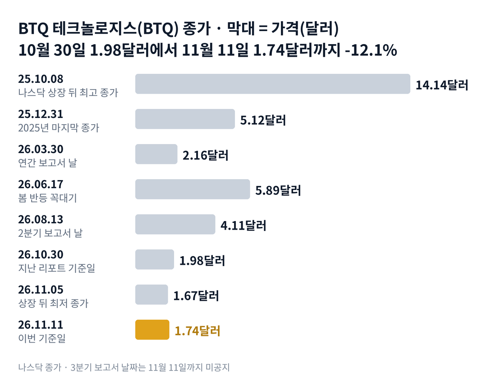

## 짧은 답

> **핵심:** 내리는 날은 업종과 함께였지만, 오르는 날은 처음으로 업종을 절반만 따라갔습니다.

양자컴퓨터 업종 대표 아이온큐는 10월 30일 종가 대비 여덟 거래일 동안 13.4% 올랐습니다. 그런데 BTQ 테크놀로지스는 왜 같은 기간 12.1% 내렸을까요? 11월 11일 종가는 1.74달러입니다. 2025년 9월 나스닥 상장 뒤, 여덟 거래일 동안 아이온큐가 10% 넘게 오르고 BTQ가 10% 넘게 내린 것은 이번이 처음입니다.

이 기간 회사가 미국 증권거래위원회(SEC)에 낸 서류는 없었습니다. 대신 곧 나올 3분기 보고서가 기다리고 있습니다. 6월 말 현금은 1년 전의 4분의 1 수준이었고, 회사는 6월부터 시장에서 새 주식을 팔아 왔습니다.

**2026.11.11 진단: 국면 B(반등의 꼭대기가 계속 낮아지는 단계)가 이어지는 가운데, 업종 반등에서 떨어져 나온 첫 신호 — 근거는 5부.** 지난 보고서 네 번 뒤 20거래일의 기록은 3부 표에 있습니다.

> **유의사항** 저자는 금융·투자 자문가가 아닙니다. 이 글은 공개 공시와 시세를 정리한 교육용 분석이며 특정 종목의 매수·매도를 권하지 않습니다. 과거 패턴은 미래 수익을 보장하지 않고, BTQ는 하루에 20% 넘게 움직인 적이 여러 번 있는 종목입니다. 실제 투자 전에는 최신 공시를 직접 확인하세요.

## 지난 리포트 이후

[지난 리포트](/r/btq-2026-11/)는 10월 30일 종가 1.98달러를 기준으로 나왔습니다. 그 리포트는 매출 없이 주식 판매가 이어지며 1.98달러 아래로 내려가는 시나리오를 가장 높게(35~45%) 봤습니다.

**지난 예측 성적(11월 2일 리포트): 적중 2 · 빗나감 1(판정 전) · 확인 전 2** — '1.98달러 아래 새 최저'는 11월 5일 1.67달러로 맞았습니다.

항목별 채점표는 6부 끝에 있습니다. 11월 5일 종가 1.67달러로 가격 쪽 예측은 맞았지만, 업종을 따라 회복할 것이라는 시나리오는 지금까지 반대로 가고 있습니다.

이번 회차가 새로 답하는 질문은 하나입니다. 업종이 반등하는데 BTQ만 내려간 여덟 거래일, 보고서 앞에서 무엇을 확인해야 할까요?

## 1부. BTQ 테크놀로지스는 어떤 회사인가

> **핵심:** 양자컴퓨터 시대의 보안 기술을 파는 회사를 지향하지만, 올해 상반기 매출은 0이었습니다.

BTQ 테크놀로지스는 캐나다 밴쿠버에 본사를 둔 회사입니다. 2025년 9월 26일 나스닥에 상장했고, 캐나다 거래소(Cboe Canada)에서도 거래됩니다. 양자컴퓨터가 지금의 암호를 풀 수 있게 되는 때를 대비한 보안 기술이 주력입니다.

사업은 크게 세 갈래입니다. 한국 보안 반도체 회사 ICTK(아이씨티케이)와 함께 개발하는 보안 칩이 하나입니다. 블록체인과 결제망에 쓰는 보안 네트워크가 둘째입니다. 셋째는 7월에 완전히 인수한 프랑스 회사 QPerfect(큐퍼펙트)의 양자 에뮬레이터로, 일반 컴퓨터에서 양자컴퓨터를 흉내 내는 프로그램입니다.

돈을 버는 방식은 아직 계약 단계입니다. 9월 30일 카이아 재단과 맺은 3년 계약에서 회사는 블록체인 거래 수수료의 일부를 받기로 했고, 첫해 매출을 '여섯 자리 미국 달러'로 예상했습니다. 칩과 에뮬레이터는 판매 계약과 시범 사용 소식이 대부분입니다.

그래서 이 회사 주가를 움직이는 변수는 매출보다 현금입니다. 매출이 없는 동안 회사는 가진 현금과 새 주식 판매 대금으로 연구와 영업을 이어 갑니다. 현금이 얼마나 남았는지가 주식 수를 얼마나 늘릴지를 정하기 때문입니다.

지금 몸값은 상장 직후의 8분의 1 수준입니다. 11월 11일 시가총액은 약 2억 5,200만 달러로, 상장 뒤 최고 종가 때보다 87.7% 낮습니다.

### 숫자로 본 지금의 크기(11월 11일 기준)

| 항목 | 값 · 계산 근거 |
| --- | --- |
| 종가 | **1.74달러** 상장 뒤 최저 종가 1.67달러(11.05)보다 4.2% 위 |
| 시가총액 | **약 2억 5,200만 달러** 8월 13일 무렵 주식 수 약 1억 4,488만 주 기준 |
| 연초 대비 | **-66.0%** 2025년 마지막 종가 5.12달러 |
| 상장 뒤 최고 종가 대비 | **-87.7%** 2025년 10월 8일 14.14달러 |
| 2026년 상반기 매출 | **0** 1년 전 상반기 31만 5,497캐나다달러 |
| 2026년 상반기 순손실 | **3,667만 캐나다달러** 주식 보상 비용 1,936만 캐나다달러 포함 |

주식 보상 비용은 직원·자문가에게 현금 대신 주식으로 준 대가를 비용으로 잡은 것입니다. 현금이 나가지는 않지만, 주식 수를 늘립니다. 시가총액은 8월 이후 판 주식을 넣지 않은 값이라 실제로는 조금 더 클 수 있습니다.

위 그림처럼 주가는 3월 30일 2.16달러 근처에서 한 번 크게 반등해 6월 17일 5.89달러까지 갔습니다. 그 뒤 반등의 꼭대기는 계속 낮아졌고, 11월 5일 상장 뒤 최저 종가를 새로 썼습니다. 이렇게 업종과 함께 내려온 주가가, 최근 여덟 거래일에는 어떻게 업종과 갈라졌을까요?

## 2부. 여덟 거래일, 업종과 갈라진 BTQ

> **핵심:** 11월 5일 급락은 업종과 같았지만, 11월 6일과 9일 반등에서 BTQ는 아이온큐의 절반도 따라가지 못했습니다.

11월 5일 양자 관련주는 한꺼번에 내렸습니다. BTQ는 13.9% 내려 1.67달러가 됐고, 아이온큐는 10.5% 내렸습니다. 그날 장 마감 뒤 아이온큐가 3분기 실적을 냈고, 다음 날 업종은 크게 반등했습니다.

아래 표는 같은 날짜 종가끼리 비교했습니다. 기준일 10월 30일은 지난 리포트의 기준일이라, 각 종목의 고점이나 저점과는 관계가 없습니다.

### 10월 30일부터 11월 11일까지, 양자주 일곱 종목

| 종목 · 성격 | 10.30 → 11.11 | 11.06 하루 |
| --- | --- | --- |
| **BTQ** · 보안 칩, 매출 없음 | **-12.1%** | **+11.7%** |
| 큐시(QUBT) · 광자 양자 | -6.5% | +12.4% |
| 실스크(LAES) · 보안 반도체 | -3.4% | +7.3% |
| 리게티(RGTI) · 초전도 양자 | -1.2% | +19.3% |
| 아르킷(ARQQ) · 양자 암호 | -0.9% | +30.0% |
| 디웨이브(QBTS) 양자 어닐링 | 0.0% | +18.0% |
| 아이온큐(IONQ) · 업종 대표 | +13.4% | +23.4% |

11월 5일 하루에는 일곱 종목이 모두 10% 넘게 내렸습니다(-10.5%에서 -14.0% 사이). BTQ의 낙폭은 아이온큐의 1.3배로, 지난 리포트가 적어 둔 '업종보다 크게 흔들리는 종목'의 모습 그대로였습니다.

차이는 반등에서 났습니다. 11월 6일 BTQ의 상승률은 아이온큐의 절반이었습니다. 11월 9일에는 아이온큐가 8.3% 오를 때 BTQ는 0.8% 올랐습니다. 그 뒤 두 거래일 동안 BTQ는 다시 내려 1.74달러가 됐습니다.

거래량은 그 두 거래일 동안 하루 167만~168만 주로, 11월 11일까지 30거래일 평균 약 174만 주와 비슷했습니다. 많은 주식이 한꺼번에 쏟아진 날은 아니었다는 뜻입니다.

나스닥 상장 뒤 모든 여덟 거래일 구간을 훑으면, 아이온큐가 10% 넘게 오르고 BTQ가 10% 넘게 내린 구간은 10월 29일과 30일에 시작한 두 구간뿐입니다. 둘 다 이번 기간입니다.

급락한 날과 반등한 날을 나란히 놓으면 공통점이 하나 보입니다. 급락은 업종 전체의 일이었고, 반등을 놓친 것은 BTQ만의 일이었습니다. 그런데 이 회사 주가는 보고서가 나온 뒤에는 어떻게 움직여 왔을까요?

## 3부. 분기 보고서 네 번, 첫날과 20거래일 뒤

> **핵심:** 지난 보고서 네 번 가운데 세 번은 20거래일 뒤 보고서 전보다 높았지만, 가장 최근인 8월에는 31.1% 낮았습니다.

BTQ는 나스닥 상장 뒤 분기·연간 보고서를 네 번 냈습니다. 이번 3분기 보고서와 같은 조건, 곧 회사가 정기적으로 숫자를 내놓은 날이기 때문에 이 네 번만 골랐습니다. 기준은 보고서 공개 직전 종가입니다. 첫날은 공개 뒤 처음 온전히 거래된 날의 종가, 20거래일 뒤는 기준일에서 20거래일을 넘긴 날의 종가로 비교했습니다.

공개 시각은 SEC 접수 기록과 회사 공지로 확인했습니다. 네 번 가운데 세 번은 장 마감 뒤였습니다. 2026년 1분기 재무제표는 5월 18일 장 마감 30분 전에 접수돼, 기준을 5월 15일 종가로 두고 첫날을 5월 19일로 셌습니다.

예를 들어 8월 2분기 보고서는 8월 13일 장 마감 뒤에 나왔습니다. 그날 종가 4.11달러가 기준이고, 다음 날 4.06달러로 -1.2%, 20번째 거래일인 9월 11일에는 2.83달러로 -31.1%였습니다.

**한눈에:** **3/4** 20거래일 뒤 보고서 전보다 위 · **2/4** 첫날 상승 · **-31.1%** 가장 최근(8월) 20거래일 뒤. 오른 세 번 가운데 두 번은 아이온큐도 함께 올랐습니다.

### 분기 보고서 네 번, 첫날과 20거래일 뒤

| 발표일 · 내용 | 첫날 | 20거래일 뒤 |
| --- | --- | --- |
| 2025.11.14 2025년 3분기 현금 3,939만 캐나다달러 아이온큐 20거래일 -2.4% | +7.9% | +16.1% |
| 2026.03.30 2025년 연간 현금 2,094만 캐나다달러 아이온큐 20거래일 +62.0% | +23.6% | +32.4% |
| 2026.05.18 2026년 1분기 현금 1,213만 캐나다달러 아이온큐 20거래일 +17.8% | -6.8% | +82.6% |
| **2026.08.13** 2026년 2분기, 매출 0 현금 973만 캐나다달러 아이온큐 20거래일 -18.3% | **-1.2%** | **-31.1%** |

첫날 반응은 두 번 오르고 두 번 내렸습니다. 가장 크게 오른 날은 3월 31일 +23.6%로, 전날 종가 2.16달러는 올해 바닥 근처였습니다.

20거래일 뒤는 업종의 방향과 대체로 같았습니다. 네 번 가운데 세 번은 BTQ와 아이온큐가 같은 쪽으로 움직였습니다. 달랐던 한 번은 2025년 3분기입니다. 그때 회사는 큐퍼펙트 인수 선택권 행사를 막 발표했고, 현금은 지금 알려진 마지막 숫자의 네 배가 넘었습니다.

8월 2분기 보고서는 반기 매출 0과, 분기 뒤 판 주식 227만 2,768주를 처음 숫자로 보여 줬습니다. 첫날은 1.2%만 내렸지만, 5거래일째에는 15.3% 낮았습니다. 8월 13일 종가 대비 같은 20거래일 동안 아이온큐도 18.3% 내렸으니, 업종의 하락도 컸습니다.

> **이번 사례(공개일·첫날·20거래일 결과 미확정):** 2026년 3분기 보고서 · 11월 11일까지 날짜 공지 없음 · 지금 기준선은 11월 11일 종가 1.74달러 · 공개 뒤 첫날과 20거래일째를 위 표와 같은 방식으로 채점

이 기록의 한계도 분명합니다. 표본은 네 번뿐이라, 한 번만 달랐어도 '4번 중 3번'은 '4번 중 2번'이 됩니다. 세 번은 업종이 함께 움직인 구간이라, 보고서 내용만의 반응으로 떼어 읽기 어렵습니다. 이번에는 보고서 전부터 업종과 갈라져 있는데, 반등을 놓친 이유는 무엇일까요?

## 4부. 보고서에서 갈릴 숫자 두 개

> **핵심:** 반등을 놓친 이유로는 '판매 물량'과 '숫자의 공백' 두 가설이 있고, 둘을 가를 숫자는 9월 말 현금과 8월 중순 뒤 판 주식 수입니다.

먼저 확인된 사실입니다. 회사의 현금은 네 분기 연속 줄었습니다. 2025년 9월 말 회사는 그 현금으로 '여러 해를 버틸 수 있다'고 적었습니다. 2026년 6월 말 현금은 그때의 약 4분의 1이었습니다.

2분기 재무제표에는 계속기업 불확실성 문구도 있습니다. 원문은 추가 자금 조달과 매출이 영업을 이어 가는 조건이며, 이것이 계속기업으로서의 능력에 '중대한 불확실성'을 남긴다고 적었습니다. 회사 경영진은 외부 조달로 운전 자금을 마련할 수 있다고 봤습니다.

첫 번째 가설은 판매 물량입니다. 회사는 6월 18일 캔터 피츠제럴드와 최대 1억 5,000만 캐나다달러의 시장 판매 계약을 맺었습니다. 다음 거래일 주가는 21.8% 내렸습니다. 공시된 판매액은 그 한도의 일부라, 업종이 오르는 날 회사가 주식을 팔 수 있는 여지는 크게 남아 있습니다.

투자자가 이 물량을 먼저 떠올렸다면, 반등을 절반만 따라간 움직임과 들어맞습니다. 다만 그 두 거래일 거래량은 평소 수준이었습니다. 실제로 회사가 그 날 주식을 팔았는지는 보고서가 나와야 알 수 있습니다.

두 번째 가설은 숫자의 공백입니다. 마지막 공식 현금 숫자는 다섯 달 가까이 지난 6월 말 기준입니다. 9월 30일 발표한 카이아 재단 3년 계약은 첫해 매출을 '여섯 자리 미국 달러'로 예상했지만, 발표일이 3분기 마지막 날이었습니다. 숫자를 기다리는 동안 주가를 끌어올릴 새 재료가 없었던 셈입니다.

반론도 있습니다. 11월 5일처럼 업종 전체가 빠진 날에는 BTQ가 여전히 업종과 같이 움직였습니다. 갈라짐은 여덟 거래일짜리 기록이고, 작년 3분기처럼 업종과 반대로 오른 때도 있었습니다.

과거 기록은 보고서 뒤 주가가 업종과 함께 움직였다는 것까지 보여 줍니다. 그래서 앞으로 확인할 조건은 두 가지입니다. 하나는 9월 말 현금이 6월 말보다 많은지, 다른 하나는 7월 1일 뒤 판 주식이 8월 13일까지의 227만 2,768주보다 많은지입니다. 이 두 조건을 엮으면 어떤 갈림길이 나올까요?

## 5부. 지금 어느 단계이고, 네 가지 시나리오

> **핵심:** 지금은 국면 B(반등의 꼭대기가 계속 낮아지는 단계)가 이어지는 가운데 업종 반등에서 떨어져 나온 상태이고, 3분기 보고서의 현금과 판매 주식 수가 다음 국면을 가를 축입니다.

> **국면 정의(BTQ 시리즈 공통):** 국면 A 헤드라인 급등 — 업종 소식·회사 발표에 하루 20% 넘게 오르는 때. 국면 B 반등이 낮아지는 단계 — 반등 꼭대기가 낮아지고 발표에도 주가가 오르지 않는 때. 국면 C 바닥 다지기 — 직전 바닥 근처에서 더 내려가지 않고 거래량이 줄며 주식 판매가 멈추는 때.

**2026년 11월 11일 진단: 국면 B(반등이 낮아지는 단계)의 연장, 업종과의 갈라짐이 새로 붙음.** 11월 5일 상장 뒤 최저 종가를 새로 썼고, 반등은 업종의 절반에 그쳤습니다. 국면 C로 보려면 1.67달러 위에서 버티면서 거래량이 줄고, 보고서에서 주식 판매가 멈춘 것이 확인돼야 합니다.

돈의 흐름으로 본 지금의 자리는 아래 표와 같습니다. 아래 값은 성격과 시점이 달라 서로 더하지 않습니다.

| 항목 | 값 · 계산 근거 |
| --- | --- |
| 보유 현금(6월 말) | **972만 9,250캐나다달러** 3월 말 1,213만 캐나다달러에서 감소 |
| 상반기 영업 현금 유출 | **1,391만 캐나다달러** 한 분기 평균 약 696만 캐나다달러 |
| 분기 뒤 실제 판매 대금 | **1,263만 캐나다달러(순)** 7월 1일~8월 13일 227만 2,768주 |
| 시장 판매 계약 한도 | **최대 1억 5,000만 캐나다달러** 판매한 만큼만 들어오는 상한, 들어온 돈 아님 |
| 첫 반복 매출 계약 | **첫해 여섯 자리 미국 달러(회사 예상)** 카이아 재단, 9월 30일 발표 |

판매 계약 한도는 팔 수 있는 최대치일 뿐, 회사에 들어온 돈이 아닙니다. 분기 뒤 판매 대금은 실제로 들어온 돈이지만, 그 뒤 얼마를 썼는지는 3분기 보고서에서 확인합니다.

**판정 기준 두 가지:** 첫째는 현금입니다. 3분기 보고서의 9월 말 현금이 6월 말 972만 9,250캐나다달러보다 많으면 '증가'로 봅니다. 둘째는 추가 판매입니다. 보고서에 적힌 7월 1일 뒤 시장 판매 주식 수(보고서 날까지의 후속 사건 포함)가 227만 2,768주보다 많으면 '추가 판매'로 봅니다.

### 앞으로 일어날 수 있는 일

**확인된 사실:** 6월 말 현금 972만 캐나다달러, 상반기 한 분기 평균 영업 현금 유출 약 696만 캐나다달러, 7월 1일~8월 13일 실제 판매 대금 1,263만 캐나다달러입니다.

**과거 기록:** 지난 네 번의 보고서에서 현금은 4번 중 4번 줄었습니다. 판매 계약을 맺은 6월 뒤에는 한 달 반 만에 227만 주를 팔았습니다.

**추정:** 아래 확률은 주가 상승·하락 가능성이 아니라, 3분기 보고서의 '현금 증가 여부'와 '추가 판매 여부' 조합에 대한 분석자의 주관적 추정입니다. 네 경우는 겹치지 않아 '약 N%'를 더하면 100%이고, 괄호 안 구간은 흔들림의 폭이라 서로 더하지 않습니다.

| 시나리오(판정 2026년 12월 10일) | 현금·판매 | 가능성(추정) |
| --- | --- | --- |
| 1 · 현금 증가, 판매 멈춤 | 증가 · 없음 | 중간 약 25% (15~35%) |
| **2 · 현금 증가, 판매로 메움** | 증가 · 있음 | 높음 약 45% (35~55%) |
| 3 · 현금 감소, 판매 멈춤 | 감소 · 없음 | 낮음 약 10% (5~15%) |
| 4 · 현금 감소, 판매도 이어짐 | 감소 · 있음 | 낮음 약 20% (10~30%) |

시나리오 1이면 다음에 확인할 것은 4분기 영업 현금 유출이 줄었는지입니다. 시나리오 2면 판 주식 수와 평균 판매 가격을 봅니다. 시나리오 3이면 다음 자금 조달 방식, 시나리오 4면 계속기업 문구가 바뀌었는지를 봅니다. 12월 10일까지 보고서가 나오지 않으면 그 사실을 따로 기록합니다.

현금 증가 쪽을 합쳐 약 70%로 본 이유는 숫자입니다. 3분기 안에 1,263만 캐나다달러가 들어왔고, 상반기 속도라면 한 분기 유출은 약 696만 캐나다달러입니다. 추가 판매를 약 65%로 본 이유는 현금이 들어온 뒤에도 유출 속도가 그대로였고, 판매 계약의 한도가 크게 남았기 때문입니다.

하지만 같은 무게로 반대쪽 요인도 있습니다. 주가가 8월보다 절반 넘게 낮아져, 같은 돈을 구하려면 더 많은 주식을 팔아야 합니다. 회사가 판매를 줄였다면 시나리오 1이나 3의 비중이 커집니다.

주가 방향은 다른 질문이라 따로 적습니다. 3부 기록으로는 20거래일 뒤가 업종 방향과 같은 때가 많았습니다. 하지만 이번에는 보고서 전부터 업종과 갈라져 있었고, 표본은 네 번뿐입니다. 이 진단을 가장 빨리 뒤집을 수 있는 위험은 무엇일까요?

## 6부. 위험과 체크리스트

> **핵심:** 가장 빨리 판을 바꿀 것은 3분기 보고서의 현금과 판매 주식 수이고, 그다음이 업종 반등을 다시 따라가는지입니다.

먼저 이 분석의 한계입니다. 3부 표는 네 번뿐이고, 그중 세 번은 업종이 크게 움직인 구간이었습니다. 2부의 갈라짐은 여덟 거래일짜리 기록이라 추세로 단정할 수 없습니다. 8월 13일 뒤 회사가 판 주식 수는 아직 공개되지 않았습니다.

첫째 갈래는 자금 조달입니다. 시장 판매는 들어오는 돈만큼 주식 수를 늘립니다. 주가가 낮을수록 같은 돈에 더 많은 주식이 필요해, 기존 주주 한 주의 비중이 작아지는 희석이 커집니다.

둘째 갈래는 사업 실행, 곧 매출입니다. 카이아 계약의 첫해 매출은 회사 예상으로도 여섯 자리 미국 달러입니다. 한 분기 영업 현금 유출 약 696만 캐나다달러와 견주면 아직 작은 크기입니다.

셋째 갈래는 외부 환경, 곧 업종 흐름입니다. 이 종목은 업종이 급락하는 날 더 크게 내려 왔습니다. 업종이 다시 크게 빠지면 보고서 내용과 관계없이 1.67달러 아래가 시험받을 수 있습니다.

**핵심 확인 세 가지:**

- ☐ 1순위 · 12월 10일까지 나온 3분기 보고서의 9월 말 현금이 6월 말 972만 9,250캐나다달러보다 많은가
- ☐ 2순위 · 12월 10일까지 나온 3분기 보고서의 7월 1일 뒤 판매 주식이 227만 2,768주보다 많은가
- ☐ 3순위 · 12월 10일(11월 11일 뒤 20거래일째) 종가가 11월 11일 1.74달러 위인가

**보조 확인:** 11월 18일은 10월 22일 급락의 20거래일째로, 지난 리포트가 2.25달러를 기준선으로 적은 날입니다. 12월 3일은 11월 5일 급락의 20거래일째입니다. 아이온큐가 하루 8% 넘게 오르는 날 BTQ가 그 절반 넘게 따라가는지도 봅니다.

**기억할 판단 기준 세 가지:** BTQ는 내리는 날 업종과 함께 움직였고, 이번에는 처음으로 반등에서만 뒤처졌습니다. 그 차이를 설명할 숫자는 3분기 보고서의 현금과 판매 주식 수입니다. 보고서 뒤 20거래일은 지난 네 번 중 세 번 업종 방향을 따랐습니다.

같은 업종 흐름은 [아이온큐 리포트](/r/ionq-2026-11/)와 [실스크 리포트](/r/laes-2026-11-2/)에서 함께 볼 수 있습니다. 다음 갱신은 3분기 보고서가 나온 뒤에 합니다. 공시는 [BTQ SEC 공시 목록](https://www.sec.gov/cgi-bin/browse-edgar?action=getcompany&CIK=0001821866&type=6-K&dateb=&owner=include&count=40)에서 확인할 수 있습니다.

### 지난 예측 채점표

**지난 리포트 점검(따로 판정):** 아래는 11월 2일 리포트의 예측을 채점한 것이고, 이번 회차의 시나리오 판정과는 따로 셉니다.

| 지난 점검 항목 · 당시 기준 | 판정 및 실제 결과(11월 11일) |
| --- | --- |
| **진단: 국면 B 연장** 1.98달러 근처에서 멈춰야 국면 C | **[적중]** 11.05 종가 1.67, 상장 뒤 최저 |
| **시나리오 4 · 매출 없이 판매** 1.98달러 아래 새 최저 | **[가격 적중]** 매출·판매 숫자는 3분기 보고서 뒤 |
| **시나리오 3 · 업종 따라 회복** 양자주 반등에 함께 회복 시도 | **[빗나가는 중]** 아이온큐 +13.4%, BTQ -12.1% (판정 12.31) |
| **시나리오 1·2 · 첫 외부 매출** 3분기 보고서의 카이아 매출 | **[확인 전]** 3분기 보고서 날짜 미공지 |
| **보조 체크 · 업종 급락 날** BTQ 낙폭이 아이온큐의 2배 아래 | **[예]** 11.05 아이온큐 -10.5%, BTQ -13.9%(1.3배) |
