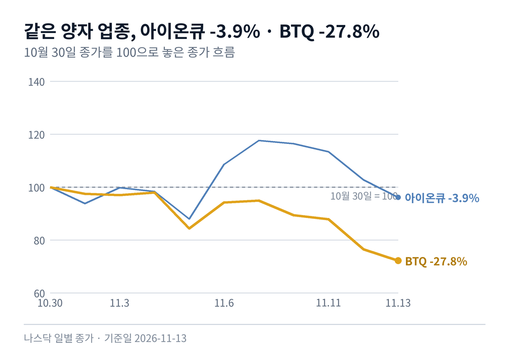
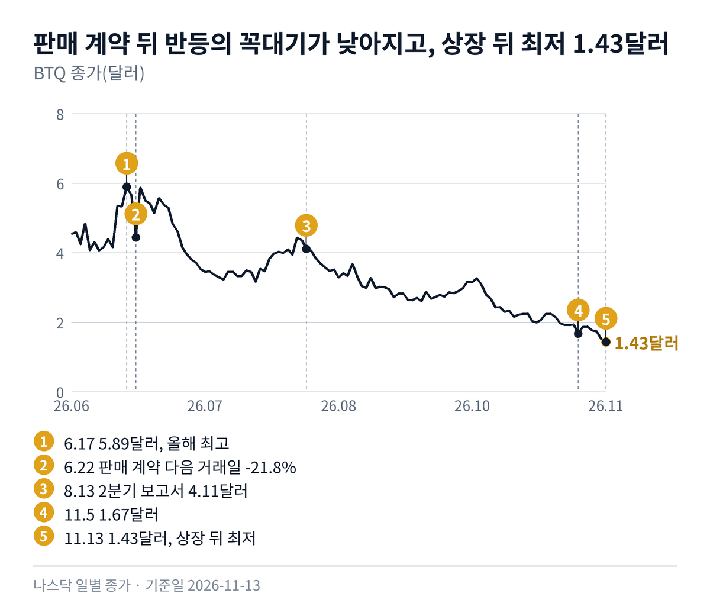
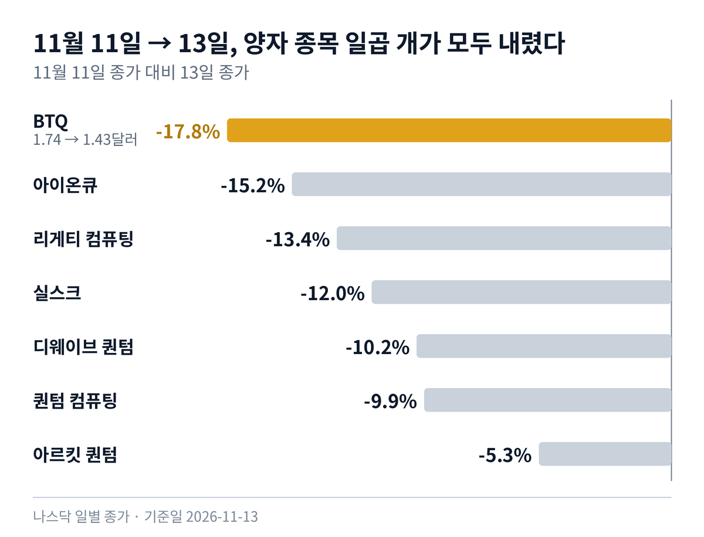
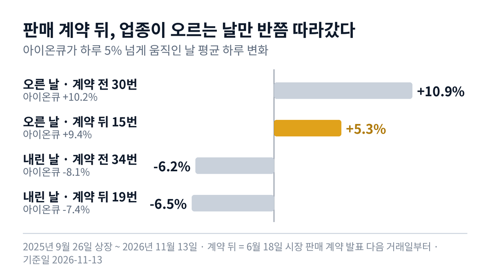
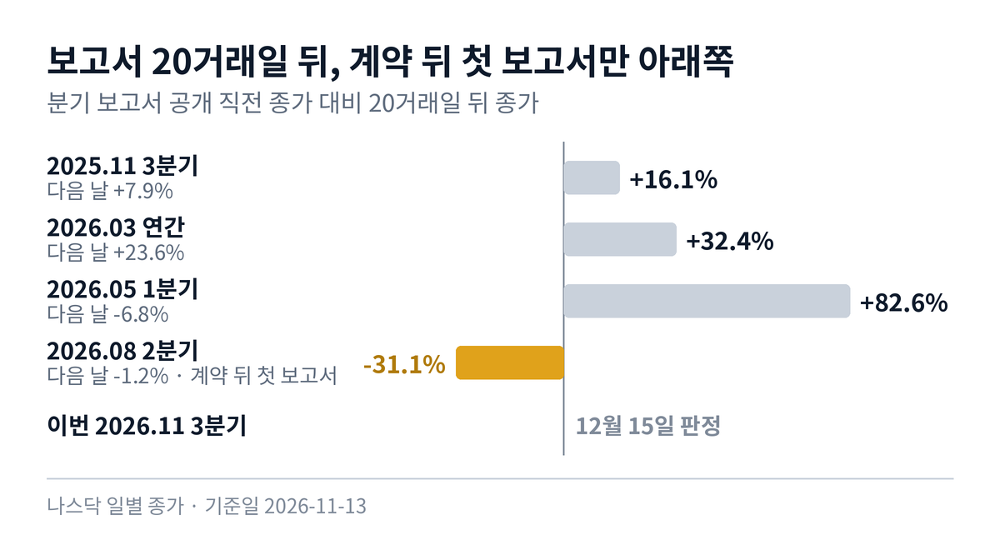
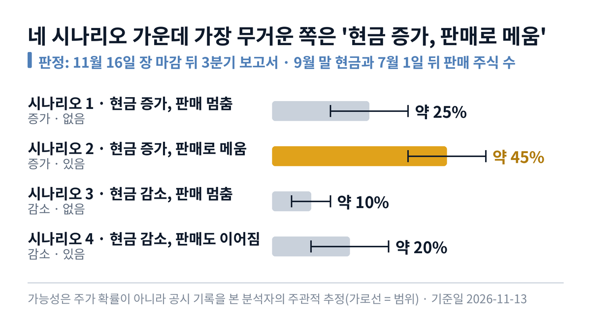

11월 11일 1.74달러였던 BTQ 테크놀로지스 주가는 2거래일 뒤 1.43달러가 됐습니다. 12일에 12.9%, 13일에 5.6%가 빠져 2거래일 합계 17.8%입니다. 2025년 9월 나스닥 상장 뒤 가장 낮은 종가입니다. 이번에는 혼자가 아니었습니다. 같은 2거래일 업종 대표 아이온큐도 15.2% 내렸습니다. 내리는 날 BTQ는 업종을 거의 그대로 따라갑니다. 그런데 업종이 크게 오르는 날에는 반쯤만 따라갑니다. 이 엇갈린 모양은 언제부터, 왜 생겼을까요?

> **유의사항** 저자는 금융·투자 자문가가 아닙니다. 이 글은 공개 공시와 시세를 정리한 교육용 분석이며 특정 종목의 매수·매도를 권하지 않습니다. 과거 패턴은 미래 수익을 보장하지 않고, BTQ는 하루에 20% 넘게 움직인 적이 여러 번 있는 종목입니다. 실제 투자 전에는 최신 공시를 직접 확인하세요.

이 글은 [11월 11일 기준 리포트](/r/btq-2026-11-2/)의 후속편입니다. 그 리포트는 업종이 반등하는 여덟 거래일 동안 BTQ만 내려간 장면을 다뤘습니다. 그리고 업종이 다시 크게 빠지면 11월 5일의 상장 뒤 최저 1.67달러 아래가 시험받을 수 있다고 적었습니다. 그 갈래가 2거래일 만에 왔습니다. 지난 예측 성적은 적중 하나, 빗나감 없음, 진행 중 둘입니다.

진행 중인 둘 가운데 하나는 불리하게 가고 있습니다. 지난 리포트는 12월 10일 종가가 1.74달러 위인지를 보자고 했는데, 지금은 그보다 17.8% 아래입니다. 다른 하나는 3분기 보고서로 가르는 네 시나리오입니다. 회사는 11월 13일 장 마감 뒤 공지에서 16일 장 마감 뒤 재무제표를 내겠다고 밝혔습니다. 판정할 숫자가 오늘 밤 나옵니다.

BTQ 테크놀로지스는 캐나다 밴쿠버에 본사를 둔 회사입니다. 양자컴퓨터가 지금의 암호를 풀 수 있게 되는 때를 대비한 보안 기술을 팝니다. 한국 보안 반도체 회사 ICTK(아이씨티케이)와 함께 만드는 보안 칩, 블록체인용 보안 네트워크, 양자컴퓨터를 일반 컴퓨터에서 흉내 내는 프로그램이 세 갈래입니다. 돈을 버는 방식은 아직 계약 단계입니다. 9월 30일 카이아 재단과 맺은 3년 계약에서 블록체인 거래 수수료의 일부를 받기로 했습니다. 올해 상반기 매출은 0이었습니다. 그래서 이 회사는 가진 현금과 새 주식을 판 돈으로 연구와 영업을 이어 갑니다. 2분기 재무제표에는 계속기업 불확실성 문구도 있었습니다. 추가 자금 조달과 매출이 영업을 이어 가는 조건이라는 뜻입니다. 6월 말 현금은 972만 9,250캐나다달러였습니다.

2거래일을 하루씩 보면 이렇습니다. 12일에는 아이온큐가 9.4% 내릴 때 BTQ가 12.9% 내렸습니다. 거래량은 평소의 1.4배쯤으로 늘었습니다. 13일에는 아이온큐 -6.4%, BTQ -5.6%로 비슷했습니다. 2거래일 동안 회사가 SEC에 낸 서류는 없었습니다. 보고서 날짜를 알린 6-K는 13일 장이 끝난 뒤에 나왔습니다.

업종을 나란히 놓으면 2거래일의 성격이 보입니다. 11월 11일 종가 대비 13일까지 리게티 컴퓨팅은 13.4%, 실스크는 12.0%, 디웨이브 퀀텀은 10.2% 내렸습니다. 퀀텀 컴퓨팅은 9.9%, 아르킷 퀀텀은 5.3% 내렸습니다. 양자 종목 일곱 개가 모두 내렸고, BTQ의 낙폭이 가장 컸지만 아이온큐와의 차이는 2.6%포인트였습니다. 내리는 2거래일은 업종 이야기로 대부분 설명됩니다.

이상한 쪽은 반대 방향입니다. 10월 30일 종가를 기준으로 하면 아이온큐는 11월 13일까지 3.9% 내렸고, BTQ는 27.8% 내렸습니다. 같은 업종인데 차이가 이만큼 벌어진 이유는 오른 날에 있습니다. 11월 6일 아이온큐가 23.4% 오를 때 BTQ는 11.7% 올랐습니다. 9일에는 아이온큐 +8.3%, BTQ +0.8%였습니다. 내린 날은 함께 내렸고, 오른 날은 덜 올랐습니다. 차이는 그렇게 쌓였습니다.

이 모양이 원래 이 종목의 성격인지 확인하려고 상장 뒤 기록을 모두 꺼냈습니다. 2025년 9월 26일 상장부터 11월 13일까지, 아이온큐가 하루 5% 넘게 오른 날과 내린 날을 골랐습니다. 그리고 6월 18일 캔터 피츠제럴드와 맺은 시장 판매 계약을 경계로 둘로 나눴습니다. 시장 판매는 회사가 증권사에 맡겨 증시에서 새 주식을 조금씩 나눠 파는 방식입니다. 한도는 최대 1억 5,000만 캐나다달러였고, 발표 다음 거래일 주가는 21.8% 내렸습니다.

결과는 선명했습니다. 계약 전 30번은 BTQ가 평균 10.9% 올라, 아이온큐 평균 10.2%와 비슷했습니다. 계약 뒤 15번은 평균 5.3%로, 아이온큐 평균 9.4%의 6할에 못 미쳤습니다. 업종 반등을 반쯤만 따라가는 종목이 된 것입니다.

내리는 날은 달라지지 않았습니다. 아이온큐가 5% 넘게 내린 날 BTQ는 계약 전 평균 -6.2%, 계약 뒤 평균 -6.5%였습니다. 날짜별 숫자는 끝의 '판매 계약 전후' 표에 있습니다.

가장 최근 다섯 번도 같은 모양입니다. 10월 15일 아이온큐 +9.3%에 BTQ는 +1.7%, 11월 3일 아이온큐 +6.5%에 BTQ는 -0.5%였습니다. 다섯 번 가운데 BTQ가 더 오른 날은 10월 27일 한 번입니다.

오르는 날에만 덜 오르는 모양은 판매 물량 이야기와 맞습니다. 회사가 주식을 팔 수 있는 창구가 열려 있으면, 값이 오를 때 새 주식이 나올 수 있다고 생각하는 사람이 많아집니다. 실제로 8월 13일 2분기 보고서에는 7월 1일부터 8월 13일까지 227만 2,768주를 팔아 1,263만 캐나다달러를 받았다고 적혀 있었습니다. 6월 말 현금보다 큰 돈을 한 달 반 만에 판매로 모은 것입니다.

다만 이것으로 매일의 판매를 증명할 수는 없습니다. 회사가 어느 날 몇 주를 팔았는지는 분기 보고서에 묶음으로만 나옵니다. 계약 뒤 오른 15번 가운데 7월 30일과 8월 3일, 8월 27일, 10월 27일에는 BTQ가 아이온큐보다 더 올랐습니다. 업종 반등에 덜 오르는 이유가 판매 말고도 있을 수 있습니다. 6월 17일 5.89달러였던 고점 뒤로 사려는 사람의 기대가 꺾였을 수도 있습니다. 숫자로 판정할 수 있는 것은 오늘 밤 나올 보고서의 판매 주식 수입니다.

과거 보고서 네 번의 기록도 함께 봅니다. 2025년 3분기부터 2026년 2분기까지 보고서가 나온 다음 날, BTQ는 두 번 오르고 두 번 내렸습니다. 20거래일 뒤에는 세 번 보고서 전보다 높았고, 가장 최근인 8월에는 31.1% 낮았습니다. 그 8월이 판매 계약 뒤 처음 나온 보고서였습니다. 네 번뿐인 표본이라 방향을 말하기는 어렵습니다. 그래도 계약 뒤 보고서 한 번은 아래쪽이었다는 점은 기억해 둡니다.

지금 BTQ의 몸값은 약 2억 700만 달러입니다. 8월 13일 무렵 주식 수 약 1억 4,488만 주에 1.43달러를 곱한 값이고, 그 뒤 판 주식은 넣지 않았습니다. 상장 뒤 최고 종가였던 2025년 10월 8일 14.14달러보다 89.9% 낮습니다. 주가가 낮아질수록 같은 돈을 모으는 데 필요한 주식이 많아집니다. 같은 1,263만 캐나다달러를 지금 가격에 모으려면, 8월에 판 주식보다 훨씬 많은 주식이 필요합니다.

지난 리포트는 지금을 반등의 꼭대기가 계속 낮아지는 단계라고 불렀습니다. 2거래일 동안의 새 최저는 그 설명 안에 있습니다. 바닥을 다지는 단계로 넘어가려면, 직전 바닥 근처에서 더 내려가지 않으면서 거래량이 줄고 보고서에서 판매가 멈춘 것이 확인돼야 합니다. 이 셋 가운데 아직 확인된 것은 없습니다.

오늘 밤 보고서는 두 질문에 답합니다. 9월 말 현금이 6월 말보다 많은지, 그리고 7월 1일 뒤 판 주식이 8월에 밝힌 수보다 많은지입니다. 두 질문을 엮은 네 시나리오의 가능성은 지난 리포트의 추정을 그대로 둡니다. 2거래일의 하락은 주가를 바꿨지만, 두 질문의 답은 아직 나오지 않았기 때문입니다.

현금이 늘었을 쪽을 더 무겁게 보는 이유는 3분기 안에 들어온 판매 대금입니다. 그 돈이 상반기 한 분기 평균 영업 현금 유출 약 696만 캐나다달러보다 컸습니다. 반대쪽 기록도 있습니다. 지난 보고서에서 현금은 4번 중 4번 줄었습니다. 이번에 그 흐름이 끊기는지가 첫 확인입니다. 판매가 이어졌을 쪽을 더 무겁게 보는 이유는 이번 글의 기록입니다. 계약 뒤 오르는 날만 덜 오른 모양이 지금까지 이어졌습니다.

그래서 '현금 증가, 판매로 메움'을 약 45%로 가장 무겁게 봅니다. '현금 증가, 판매 멈춤'은 약 25%, '현금 감소, 판매도 이어짐'은 약 20%, '현금 감소, 판매 멈춤'은 약 10%입니다. 이 숫자는 주가가 오를 확률이 아니라 공시 기록을 보고 분석자가 주관적으로 매긴 추정입니다.

주가 쪽 질문은 따로 하나 둡니다. 11월 13일 뒤 20거래일째인 12월 14일 종가가 1.43달러 위인지입니다. 업종이 반등해도 절반만 따라온 기록을 보면, 위일 가능성은 절반보다 조금 낮게 봅니다. 보고서에서 판매가 멈췄다면 이 판단은 바뀝니다. 그때는 오르는 날을 다시 따라가는지부터 봅니다.

이 분석에는 한계가 있습니다. 오른 날 15번은 작은 표본이고, 계약 뒤 기간은 업종이 크게 흔들린 때와 겹칩니다. 판매가 언제 얼마나 있었는지는 분기 묶음으로만 공개됩니다. 가장 빨리 판을 바꿀 수 있는 것은 자금 조달 소식입니다. 판매 계약 말고 공모나 다른 방식의 조달이 나오면 지금의 하락보다 더 큰 신호가 됩니다. 사업 쪽에서는 카이아 재단과 맺은 3년 계약이 매출로 처음 잡히는지가 첫 확인입니다. 회사는 첫해 매출을 '여섯 자리 미국 달러'로 예상했습니다.

BTQ는 2거래일 동안 업종과 함께 내려 상장 뒤 최저인 1.43달러에 닿았습니다. 내리는 날만 보면 이상한 점이 없습니다. 눈여겨볼 곳은 오른 날입니다. 6월 판매 계약 뒤 업종 반등을 절반 남짓만 따라간 기록이 이 종목과 아이온큐 사이의 거리를 만들었습니다. 오늘 밤 3분기 보고서의 판매 주식 수가 그 기록의 이유를 숫자로 보여 줄 수 있습니다. 다음 갱신은 보고서와 11월 17일 첫 반응을 본 뒤에 합니다.

## 숫자로 다시 보기

### 2거래일 동안의 양자 종목(11월 11일 → 13일)

| 종목 | 11.11 → 11.13 |
| --- | --- |
| **BTQ 테크놀로지스** | **-17.8%** 1.74 → 1.43달러 |
| 아이온큐 | -15.2% |
| 리게티 컴퓨팅 | -13.4% |
| 실스크 | -12.0% |
| 디웨이브 퀀텀 | -10.2% |
| 퀀텀 컴퓨팅 | -9.9% |
| 아르킷 퀀텀 | -5.3% |

| 날짜 | BTQ · 아이온큐 하루 변화 | BTQ 거래량 |
| --- | --- | --- |
| 11.12 | -12.9% · -9.4% | 약 233만 주(직전 20거래일 평균 약 167만 주의 1.4배) |
| 11.13 | -5.6% · -6.4% | 약 148만 주 |

10월 30일 종가 대비 11월 13일은 BTQ -27.8%(1.98 → 1.43달러), 아이온큐 -3.9%입니다.

| 날짜 | BTQ 종가 · 하루 변화 | 아이온큐 하루 변화 |
| --- | --- | --- |
| 10.30 | 1.98달러 · 지난달 리포트 기준 | - |
| 11.05 | 1.67달러 · -13.9% | -10.5% |
| 11.06 | 1.865달러 · +11.7% | +23.4% |
| 11.09 | 1.88달러 · +0.8% | +8.3% |
| 11.11 | 1.74달러 · -1.7% | -2.7% |
| 11.12 | 1.515달러 · -12.9% | -9.4% |
| 11.13 | 1.43달러 · -5.6% | -6.4% |

### 판매 계약 전후, 업종이 크게 움직인 날

2025년 9월 26일 상장부터 2026년 11월 13일까지 아이온큐가 하루 5% 넘게 움직인 날입니다. '계약 뒤'는 6월 18일 시장 판매 계약 발표 다음 거래일(6월 22일)부터입니다.

| 구분 | BTQ 평균 · 아이온큐 평균 | 절반 넘게 따라간 날 |
| --- | --- | --- |
| 오른 날 · 계약 전 | +10.9% · +10.2% | 30번 중 20번 |
| **오른 날 · 계약 뒤** | **+5.3% · +9.4%** | **15번 중 7번** |
| 내린 날 · 계약 전 | -6.2% · -8.1% | 34번 중 25번 |
| 내린 날 · 계약 뒤 | -6.5% · -7.4% | 19번 중 14번 |

### 계약 뒤 아이온큐가 5% 넘게 오른 15번

| 날짜 | BTQ · 아이온큐 |
| --- | --- |
| 2026.06.29 | +8.4% · +9.3% |
| 2026.07.27 | +4.8% · +9.4% |
| 2026.07.30 | +12.0% · +11.8% |
| 2026.08.03 | +10.4% · +6.6% |
| 2026.08.04 | +3.9% · +7.4% |
| 2026.08.07 | +2.5% · +11.9% |
| 2026.08.21 | +1.1% · +8.0% |
| 2026.08.27 | +10.2% · +6.1% |
| 2026.09.17 | +2.7% · +9.5% |
| 2026.09.24 | +2.2% · +5.7% |
| 2026.10.15 | +1.7% · +9.3% |
| 2026.10.27 | +8.2% · +7.1% |
| 2026.11.03 | -0.5% · +6.5% |
| 2026.11.06 | +11.7% · +23.4% |
| 2026.11.09 | +0.8% · +8.3% |

### 분기 보고서 네 번, 다음 날과 20거래일 뒤

| 발표일 · 내용 | 다음 날 | 20거래일 뒤 |
| --- | --- | --- |
| 2025.11.14 2025년 3분기 | +7.9% | +16.1% |
| 2026.03.30 2025년 연간 | +23.6% | +32.4% |
| 2026.05.18 2026년 1분기 | -6.8% | +82.6% |
| **2026.08.13 2026년 2분기 계약 뒤 첫 보고서** | **-1.2%** | **-31.1%** |
| 이번 2026.11.16 2026년 3분기 | 11월 17일 | 12월 15일 |

8월 보고서 뒤 5거래일째 종가는 보고서 전보다 15.3% 낮았고, 같은 20거래일 동안 아이온큐도 18.3% 내렸습니다. 기준은 보고서 공개 직전 종가입니다. 2026년 1분기는 장 마감 30분 전에 접수돼 5월 15일 종가를 기준으로 했습니다.

### 지금의 크기(11월 13일 기준)

| 항목 | 값 · 근거 |
| --- | --- |
| 종가 | **1.43달러** 상장 뒤 최저 종가 |
| 시가총액 | **약 2억 700만 달러** 8월 13일 무렵 주식 수 약 1억 4,488만 주 기준 |
| 상장 뒤 최고 종가 대비 | **-89.9%** 2025년 10월 8일 14.14달러 |
| 6월 말 현금 | **972만 9,250캐나다달러** 2분기 재무제표 |
| 7월 1일~8월 13일 판매 | **227만 2,768주** 순 대금 1,263만 캐나다달러 |
| 시장 판매 계약 한도 | **최대 1억 5,000만 캐나다달러** 판매한 만큼만 들어오는 상한 |

판매 계약 한도는 팔 수 있는 최대치이고 들어온 돈이 아닙니다. 서로 더하지 않았습니다.

### 지난 예측 채점표

| 지난 점검 항목 · 당시 기준(11월 11일) | 판정과 실제 결과(11월 13일) |
| --- | --- |
| **업종이 다시 크게 빠지면 1.67달러 아래 시험** 위험 갈래로 적음 | **[적중]** 11.12 1.515달러 · 11.13 1.43달러 |
| **12월 10일 종가 1.74달러 위** 3순위 확인 | **[진행 중]** 지금 1.43달러, 1.74달러보다 -17.8% |
| **3분기 보고서 네 시나리오** 현금 증가 · 판매로 메움 약 45% | **[진행 중]** 11월 16일 장 마감 뒤 보고서로 판정 |

보조로 본 '아이온큐가 하루 8% 넘게 오르는 날 절반 넘게 따라가는지'는 11월 9일 아이온큐 +8.3%, BTQ +0.8%로 따라가지 못했습니다.

### 앞으로 일어날 수 있는 일

과거 기록: 지난 보고서에서 현금은 4번 중 4번 줄었습니다. 판매 계약 뒤 한 달 반 동안 227만 2,768주를 팔았고, 계약 뒤 오르는 날의 따라가는 정도는 계약 전의 절반 남짓이었습니다.

아래 가능성은 주가 상승·하락 확률이 아니라, 3분기 보고서의 '현금 증가 여부'와 '추가 판매 여부' 조합에 대한 분석자의 주관적 추정입니다. 네 시나리오는 겹치지 않아 더하면 100%이고, 괄호 안 범위는 더하지 않습니다.

| 시나리오(판정 3분기 보고서, 늦어도 12월 10일) | 현금 · 판매 | 가능성(추정) |
| --- | --- | --- |
| 시나리오 1 · 현금 증가, 판매 멈춤 | 증가 · 없음 | 중간 약 25% (15~35%) |
| **시나리오 2 · 현금 증가, 판매로 메움** | 증가 · 있음 | 높음 약 45% (35~55%) |
| 시나리오 3 · 현금 감소, 판매 멈춤 | 감소 · 없음 | 낮음 약 10% (5~15%) |
| 시나리오 4 · 현금 감소, 판매도 이어짐 | 감소 · 있음 | 낮음 약 20% (10~30%) |

'현금 증가'는 9월 말 현금이 6월 말 972만 9,250캐나다달러보다 많은 경우, '판매'는 7월 1일 뒤 판 주식(보고서 날까지의 후속 사건 포함)이 227만 2,768주보다 많은 경우입니다. 주가 쪽 질문인 '12월 14일 종가가 1.43달러 위'는 절반보다 조금 낮게 봅니다.

### 핵심 확인 세 가지

| 순위 · 확인할 것 | 판정 날짜 |
| --- | --- |
| **1순위** 7월 1일 뒤 판 주식이 227만 2,768주보다 많은가 | 11월 16일 장 마감 뒤 보고서 |
| **2순위** 9월 말 현금이 972만 9,250캐나다달러보다 많은가 | 11월 16일 장 마감 뒤 보고서 |
| **3순위** 12월 14일 종가가 1.43달러 위인가 | 12월 14일 |
