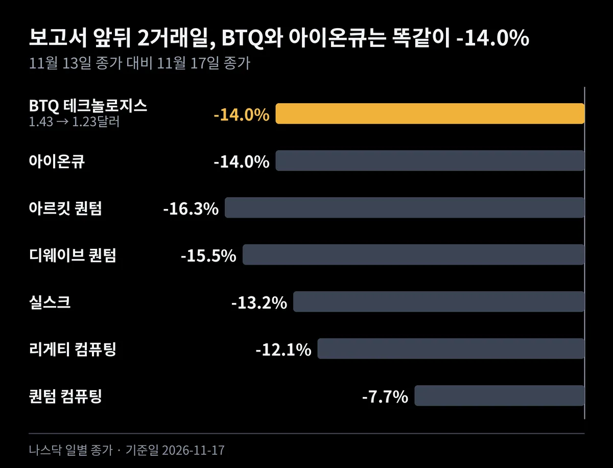
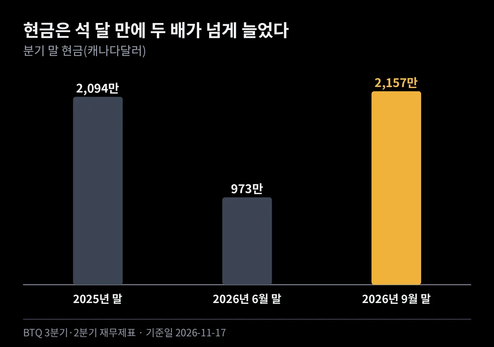
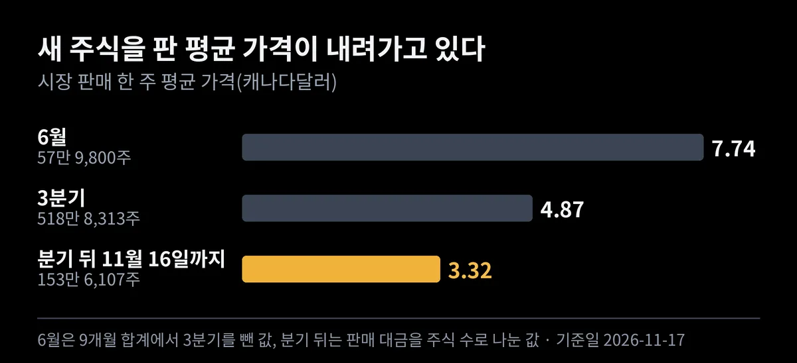
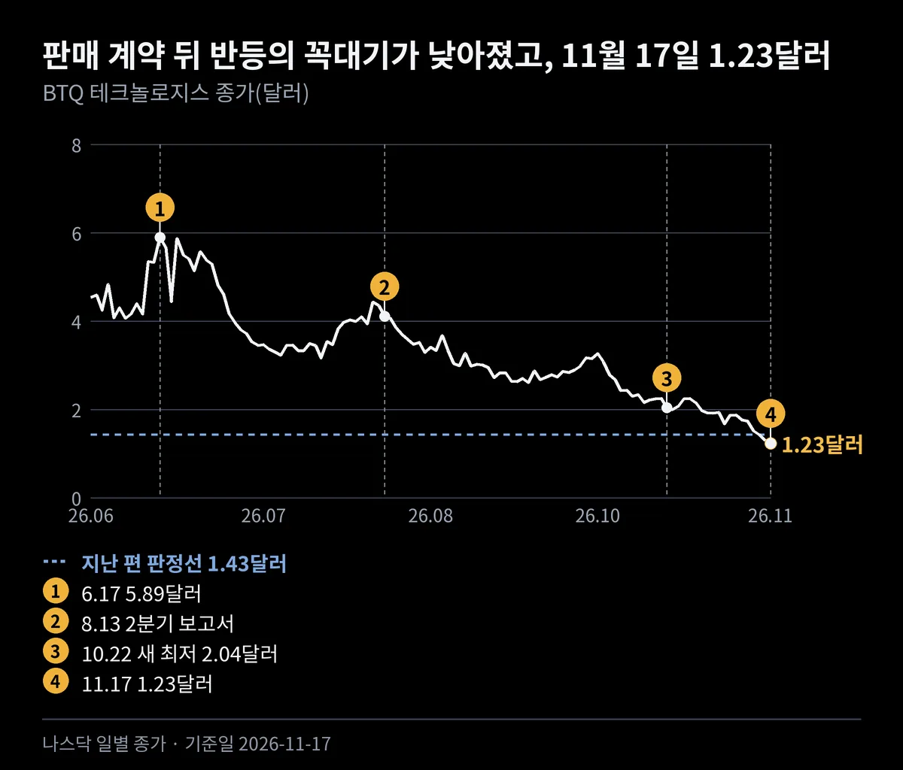
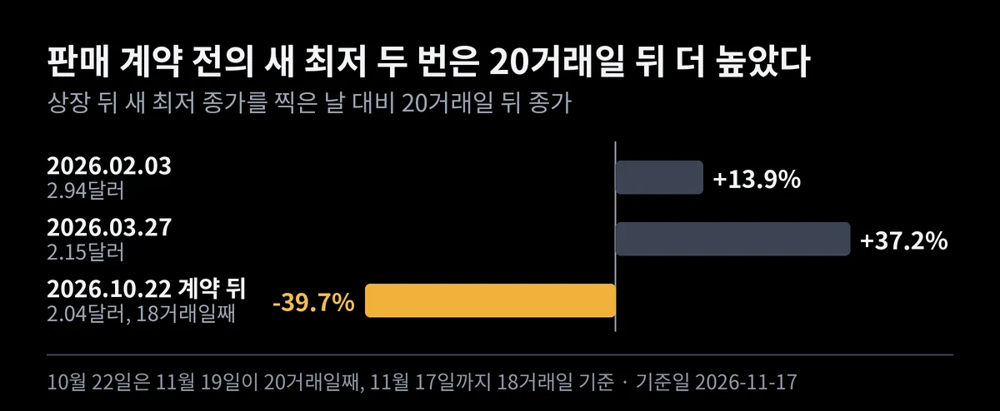
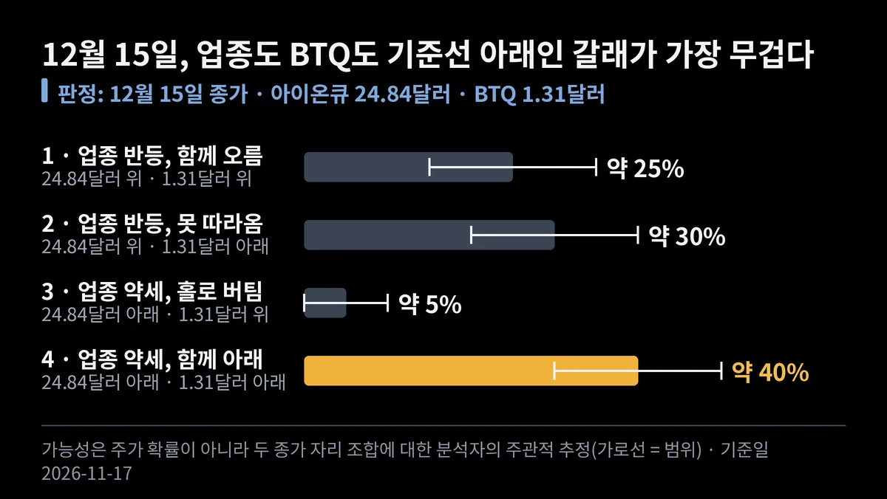

BTQ 테크놀로지스가 기다리던 3분기 보고서를 냈습니다. 9월 말 현금은 2,157만 캐나다달러로, 6월 말의 두 배가 넘었습니다. 그런데 보고서 앞뒤 2거래일 동안 주가는 1.43달러에서 1.23달러로 14.0% 내렸습니다. 2025년 9월 나스닥 상장 뒤 가장 낮은 종가입니다. 더 이상한 것은 내린 폭입니다. 같은 2거래일 업종 대표 아이온큐도 14.0% 내렸습니다. 하루씩 떼어 봐도 두 종목은 같은 폭으로 움직였습니다. 현금이 두 배가 된 회사가 왜 업종과 한 치도 다르지 않게 내렸을까요?

> **유의사항** 저자는 금융·투자 자문가가 아닙니다. 이 글은 공개 공시와 시세를 정리한 교육용 분석이며 특정 종목의 매수·매도를 권하지 않습니다. 과거 패턴은 미래 수익을 보장하지 않고, BTQ는 하루에 20% 넘게 움직인 적이 여러 번 있는 종목입니다. 실제 투자 전에는 최신 공시를 직접 확인하세요.

이 글은 [11월 13일 기준 리포트](/r/btq-2026-11-3/)의 후속편입니다. 그 리포트는 판매 계약 뒤 BTQ가 업종이 오르는 날엔 절반만, 내리는 날엔 거의 다 따라간다는 기록을 다뤘습니다. 그리고 보고서로 확인할 것 두 가지를 적었습니다. 7월 1일 뒤 판 주식이 227만 2,768주보다 많은지, 9월 말 현금이 972만 9,250캐나다달러보다 많은지입니다. 답은 둘 다 '그렇다'였습니다. 두 질문을 엮은 네 시나리오 가운데 가장 무겁게 본 '현금 증가, 판매로 메움'(약 45%)이 맞았습니다. 지난 예측 성적은 적중 둘, 빗나감 없음, 진행 중 하나입니다.

진행 중인 하나는 불리하게 가고 있습니다. 지난 리포트는 12월 14일 종가가 1.43달러 위인지를 보자고 했습니다. 지금은 그보다 14.0% 아래인 1.23달러입니다.

BTQ 테크놀로지스는 캐나다 밴쿠버에 본사를 둔 회사입니다. 양자컴퓨터가 지금의 암호를 풀 수 있게 되는 때를 대비한 보안 기술을 만듭니다. 한국 보안 반도체 회사 ICTK(아이씨티케이)와 함께 만드는 보안 칩, 블록체인용 보안 네트워크, 양자컴퓨터를 일반 컴퓨터에서 흉내 내는 프로그램이 큰 갈래입니다. 아직 돈을 버는 단계는 아닙니다. 올해 9개월 매출은 0이었습니다. 그래서 연구와 영업에 드는 돈은 가진 현금과 새 주식을 판 돈으로 메웁니다. 이번 재무제표에도 회사가 영업을 계속 이어 갈 수 있을지에 '중대한 불확실성'이 있다는 문구가 그대로 있었습니다. 원문은 추가 자금 조달과 비용을 감당할 만한 매출을 영업을 이어 가는 조건으로 적었습니다.

보고서는 약속한 날에 나왔습니다. 회사는 11월 13일 공지에서 16일 장 마감 뒤 재무제표를 내겠다고 밝혔습니다. SEC 접수 시각은 16일 밤 9시 45분(미 동부)이었고, 공개 목록에는 17일 날짜로 올라왔습니다. 17일 아침에는 사업 현황 보도자료가 따로 나왔습니다. 보안 칩 설계를 마쳤고, 비트코인 퀀텀이라는 자체 블록체인을 2027년 상반기에 열겠다는 내용이었습니다.

보고서 숫자부터 보겠습니다. 9월 말 현금은 2,157만 3,717캐나다달러였습니다. 6월 말 972만 9,250캐나다달러의 두 배가 넘고, 2025년 말 2,094만 캐나다달러보다도 조금 많습니다. 지난 보고서 네 번 내내 줄던 현금이 이번에 처음 늘었습니다.

늘어난 돈이 어디서 왔는지는 분명합니다. 회사는 3분기에 캔터 피츠제럴드에 맡겨 증시에서 새 주식 518만 8,313주를 팔았습니다. 시장 판매는 회사가 증권사에 맡겨 새 주식을 조금씩 나눠 파는 방식입니다. 이 판매로 수수료를 빼고 약 2,478만 캐나다달러를 받았습니다. 판매는 분기가 끝난 뒤에도 이어졌습니다. 7월 1일 뒤로 판 주식은 모두 약 672만 주로, 지난 보고서가 밝힌 수의 세 배쯤입니다.

쓰는 돈도 커졌습니다. 3분기 한 분기 동안 영업으로 나간 현금은 약 1,168만 캐나다달러입니다. 상반기 한 분기 평균보다 68% 많습니다. 7월 7일 프랑스 회사 큐퍼펙트를 사들여 직원과 사업이 늘어난 것도 한 이유입니다. 아직 치르지 않은 비용도 9개월 사이 약 686만 캐나다달러 늘었습니다. 지금 현금을 3분기 속도로 쓰면 두 분기를 조금 못 채우는 크기입니다.

이 말은 곧, 현금이 두 배가 된 것은 회사가 돈을 벌어서가 아니라 주식을 더 팔아서라는 뜻입니다. 지난 리포트가 세운 가설, 즉 판매 창구가 열려 있으면 오르는 날 새 주식이 나올 수 있다는 생각은 이번 숫자로 더 단단해졌습니다. 회사가 밝힌 남은 판매 한도는 11월 16일 기준 약 1억 1,500만 캐나다달러입니다. 실제 판매액이 아니라 앞으로 더 팔 수 있는 최대치입니다.

판매 가격의 흐름도 보입니다. 판매 계약을 맺은 6월에는 한 주 평균 약 7.74캐나다달러에 팔았습니다. 3분기 평균은 4.87캐나다달러였고, 분기 뒤에는 약 3.32캐나다달러로 내려왔습니다. 계산 방법은 끝의 표 아래에 적었습니다. 같은 돈을 모으는 데 필요한 주식 수는 가격이 낮을수록 많아집니다. 3분기에 쓴 영업 현금만큼을 분기 뒤 가격으로 모으려면 350만 주가 넘게 필요합니다.

이제 2거래일을 하루씩 보겠습니다. 보고서가 나오기 전인 16일 낮, BTQ는 8.4% 내린 1.31달러로 마감했습니다. 거래량은 직전 20거래일 평균의 2.1배였습니다. 보고서를 앞두고 거래가 몰렸지만, 아이온큐도 그날 8.4% 내렸습니다. 보고서를 본 첫날인 17일에는 BTQ와 아이온큐가 모두 6.1% 내렸습니다. 이날 BTQ 거래량은 평소보다 적었습니다.

양자 종목을 나란히 놓으면 이번 2거래일의 성격이 드러납니다. 11월 13일 종가 대비 17일까지 아르킷 퀀텀은 16.3%, 디웨이브 퀀텀은 15.5%, 실스크는 13.2% 내렸습니다. 리게티 컴퓨팅은 12.1%, 퀀텀 컴퓨팅은 7.7% 내렸습니다. 일곱 종목이 모두 내렸고, BTQ는 그 가운데 정확히 아이온큐 자리에 있었습니다. 보고서는 이미 예상된 답을 확인해 줬을 뿐, 업종의 흐름에 무엇을 더하지도 빼지도 않은 셈입니다.

조금 멀리서 보면 숫자가 더 무겁습니다. 판매 계약 직전인 6월 17일 종가는 5.89달러였습니다. 그 뒤 반등의 꼭대기가 한 번씩 낮아졌고, 10월 22일 2.04달러로 상장 뒤 새 최저를 찍었습니다. 11월 17일 종가는 10월 22일 종가 대비 18거래일 동안 39.7% 낮습니다. 10월 30일 종가 대비로는 BTQ가 37.9%, 아이온큐가 17.3% 내렸습니다. 2거래일은 업종과 같았지만, 한 달을 보면 BTQ가 두 배쯤 깊습니다.

그래서 과거에 새 최저를 찍은 날을 모두 꺼냈습니다. 나스닥 상장 뒤 새 최저 종가를 처음 찍은 날을 고르고, 10거래일 넘게 새 최저가 없다가 다시 찍은 날을 새 묶음으로 셌습니다. 그렇게 세면 세 번입니다.

2026년 2월 3일의 새 최저는 20거래일 뒤 13.9% 높았습니다. 3월 27일의 새 최저는 20거래일 뒤 37.2% 높았습니다. 다만 3월에는 다음 거래일에 연간 보고서가 나와 그 다음 날 크게 올랐습니다. 두 번 모두 판매 계약 전입니다. 판매 계약 뒤의 새 최저는 10월 22일 한 번인데, 반등 대신 더 빠졌습니다. 숨긴 답은 이것입니다. 계약 전의 새 최저는 바닥이 됐고, 계약 뒤의 새 최저는 아직 바닥이 되지 못했습니다. 표본이 세 번뿐이라 방향의 근거로는 약합니다. 그래도 지난 리포트가 본 '오르는 날만 덜 따라간다'는 모양과 같은 쪽을 가리킵니다. 10월 22일 뒤 20거래일째는 11월 19일입니다.

지금 BTQ의 몸값은 약 1억 8,670만 달러입니다. 보고서가 밝힌 발행 주식 수에 11월 17일 종가를 곱한 값입니다. 상장 뒤 최고 종가보다 91.3% 낮습니다. 1달러라는 선도 가까워졌습니다. 나스닥은 주가가 30영업일 연속 1달러 아래에 머물면 상장 기준 미달을 통지합니다. 지금 값은 그 선보다 23% 위입니다. 통지가 곧 상장 폐지는 아니지만, 회사가 주식을 팔아 돈을 모으는 길은 더 좁아집니다.

지난 리포트는 지금을 반등의 꼭대기가 계속 낮아지는 단계라고 불렀습니다. 이번 보고서는 그 이름을 바꿀 이유를 주지 않았습니다. 바닥을 다지는 단계로 넘어가려면 세 가지가 필요합니다. 직전 바닥 근처에서 더 내려가지 않을 것, 거래량이 줄 것, 그리고 판매가 멈출 것입니다. 17일 거래량이 평소보다 적었던 것 하나만 그쪽에 가깝습니다. 판매는 분기 뒤에도 이어졌습니다.

다음 판정은 12월 15일입니다. 보고서가 나온 11월 16일 뒤 20번째 거래일이고, 기준은 그날 BTQ 종가 1.31달러입니다. 업종의 방향도 함께 봅니다. 아이온큐가 11월 17일 종가 24.84달러보다 위인지입니다. 두 질문을 엮어 네 갈래로 나눴습니다. 가장 무겁게 보는 갈래는 둘 다 기준선 아래인 쪽으로 약 40%입니다. 업종은 반등했는데 BTQ가 못 따라오는 갈래가 약 30%, 둘 다 위인 갈래가 약 25%입니다. 업종이 약한데 BTQ만 버티는 갈래는 약 5%로 봅니다. 이 숫자는 주가가 오를 확률이 아니라 종가 자리에 대한 분석자의 주관적 추정입니다.

BTQ 아래쪽을 무겁게 보는 이유는 판매 계약 뒤의 기록입니다. 과거 보고서는 20거래일 결과를 아는 4번 중 3번이 보고서 전보다 높았습니다. 그러나 판매 계약 뒤 첫 보고서인 8월에는 31.1% 낮았습니다. 이번 보고서 날 값에서 같은 폭이면 1달러 아래입니다. 그래서 갈래와 따로, 12월 15일 종가가 1달러 아래일 가능성도 약 25%로 적어 둡니다. 업종이 반등해도 BTQ를 아래로 더 무겁게 두는 이유는 지난 리포트의 기록입니다. 계약 뒤 업종이 크게 오른 날 BTQ는 평균 절반 남짓만 따라갔습니다. 업종이 약한데 BTQ만 버틴 날은 이번 2거래일에도 없었습니다.

이 판단이 틀릴 수 있는 곳도 적어 둡니다. 가장 빨리 판을 바꿀 수 있는 것은 자금 조달 소식입니다. 판매 한도 안에서 조금씩 파는 것과 달리, 공모처럼 한 번에 큰 물량을 파는 소식이 나오면 지금보다 더 큰 신호가 됩니다. 반대로 판매가 멈췄다는 공시가 나오면 위쪽 갈래가 무거워집니다. 사업 쪽에서는 9월 30일 카이아 재단과 맺은 3년 계약이 첫 매출로 잡히는지가 확인할 숫자입니다. 회사는 첫해 매출을 '여섯 자리 미국 달러'로 예상했습니다. 업종 쪽에서는 아이온큐의 방향이 가장 큰 변수입니다. 이 분석에서 아이온큐가 크게 오른 날 BTQ가 따라간 정도는 15번의 평균이라 작은 표본입니다.

보고서는 지난 리포트의 질문에 답했고, 그 답은 예상한 쪽이었습니다. 현금은 늘었고, 그 돈은 새 주식에서 왔습니다. 그래서 주가가 업종과 똑같이 움직인 2거래일은 놀라운 일이라기보다, 회사 쪽에서 새로 보탤 이야기가 없었다는 뜻에 가깝습니다. 앞으로 BTQ가 업종과 다르게 움직이려면 판매가 멈추거나 매출이 처음 잡히는 일이 먼저 있어야 합니다. 그때까지는 11월 19일과 12월 14일, 12월 15일의 종가가 순서대로 이 해석을 확인해 줄 것입니다.

## 숫자로 다시 보기

### 3분기 보고서의 핵심 숫자(캐나다달러)

| 항목 | 값 · 근거 |
| --- | --- |
| 9월 말 현금 | **2,157만 3,717** 6월 말 972만 9,250(석 달 새 약 1,184만 증가) · 2025년 말 2,093만 9,224 |
| 3분기 시장 판매 | **518만 8,313주** 평균 4.87 · 순대금 2,477만 7,149 |
| 분기 뒤 판매(11월 16일까지) | **153만 6,107주** 대금 510만 4,980 · 한 주 약 3.32 |
| 3분기 영업 현금 유출 | **약 1,168만** 9개월 2,559만 3,408 − 상반기 1,391만 3,928 |
| 9개월 매출 · 순손실 | **0 · 5,615만 5,269** 3분기 순손실 1,948만 2,182 |
| 운전자본 | **1,304만 5,493** 2025년 말 2,023만 9,094 |
| 남은 시장 판매 한도 | **약 1억 1,500만** 11월 16일 기준, 팔 수 있는 최대치이며 들어온 돈과 다름 |

판매 한도는 앞으로 팔 수 있는 최대치이고, 현금과 더하지 않았습니다. 분기 뒤 한 주 가격은 대금을 주식 수로 나눈 값입니다. 6월 판매 57만 9,800주(한 주 약 7.74)는 9개월 합계 576만 8,113주·대금 3,003만 2,384에서 3분기를 뺀 값입니다.

### 보고서 앞뒤 2거래일

| 날짜 | BTQ 종가 · 하루 변화 | 아이온큐 하루 변화 |
| --- | --- | --- |
| 11.13 | 1.43달러 지난 리포트 기준 | - |
| 11.16 | 1.31달러 · -8.4% 거래량 약 364만 주(평균 약 170만 주의 2.1배) | -8.4% |
| 11.17 | 1.23달러 · -6.1% 거래량 약 124만 주 | -6.1% |

| 종목 | 11.13 → 11.17 |
| --- | --- |
| 아르킷 퀀텀 | -16.3% |
| 디웨이브 퀀텀 | -15.5% |
| **BTQ 테크놀로지스** | **-14.0%** 1.43 → 1.23달러 |
| 아이온큐 | -14.0% |
| 실스크 | -13.2% |
| 리게티 컴퓨팅 | -12.1% |
| 퀀텀 컴퓨팅 | -7.7% |

10월 30일 종가 대비 11월 17일은 BTQ -37.9%(1.98 → 1.23달러), 아이온큐 -17.3%입니다. 11월 11일 대비로는 BTQ -29.3%, 아이온큐 -27.1%입니다.

### 판매 계약 뒤 주요 종가(6월 17일 대비)

| 날짜 · 내용 | 종가 · 6월 17일 대비 |
| --- | --- |
| 2026.06.17 판매 계약 직전 | 5.89달러 |
| 2026.08.13 2분기 보고서 | 4.11달러 · -30.2% |
| 2026.10.22 상장 뒤 신저가 | 2.04달러 · -65.4% |
| 2026.11.17 3분기 보고서 첫 반응 | 1.23달러 · -79.1% |

### 상장 뒤 새 최저, 20거래일 뒤

| 새 최저를 찍은 날 · 종가 | 20거래일 뒤 |
| --- | --- |
| 2026.02.03 2.94달러 | +13.9% 3.35달러 |
| 2026.03.27 2.15달러 | +37.2% 2.95달러 |
| **2026.10.22 · 판매 계약 뒤 2.04달러** | **18거래일째 -39.7%** 11월 17일 1.23달러 · 20거래일째 11월 19일 |

10거래일 넘게 새 최저가 없다가 다시 찍은 날을 새 묶음으로 셌습니다. 3월 27일 묶음은 다음 거래일인 3월 30일 연간 보고서(다음 날 +23.6%)와 겹칩니다.

### 분기 보고서 다섯 번, 다음 날과 20거래일 뒤

| 발표일 · 내용 | 다음 날 | 20거래일 뒤 |
| --- | --- | --- |
| 2025.11.14 2025년 3분기 | +7.9% | +16.1% |
| 2026.03.30 2025년 연간 | +23.6% | +32.4% |
| 2026.05.18 2026년 1분기 | -6.8% | +82.6% |
| 2026.08.13 2026년 2분기 계약 뒤 첫 보고서 | -1.2% | -31.1% |
| **2026.11.16 2026년 3분기** | **-6.1%** 1.31 → 1.23달러 | **12월 15일 판정** |

기준은 보고서 공개 직전 종가입니다. 이번 3분기는 11월 16일 장 마감 뒤 접수돼 16일 종가 1.31달러가 기준입니다.

### 지금의 크기(11월 17일 기준)

| 항목 | 값 · 근거 |
| --- | --- |
| 종가 | **1.23달러** 상장 뒤 최저 종가 |
| 시가총액 | **약 1억 8,670만 달러** 발행 주식 1억 5,178만 2,329주 기준 |
| 상장 뒤 최고 종가 대비 | **-91.3%** 2025년 10월 8일 14.14달러 |
| 1달러 선까지 | **23% 위** 30영업일 연속 1달러 아래면 상장 기준 미달 통지 |

### 지난 예측 채점표

| 지난 점검 항목 · 당시 기준(11월 13일) | 판정과 실제 결과(11월 17일) |
| --- | --- |
| **1순위 · 7월 1일 뒤 판매 227만 2,768주보다 많음** 판매로 메움 쪽 | **[적중]** 3분기 518만 8,313주 + 분기 뒤 153만 6,107주 |
| **2순위 · 9월 말 현금 972만 9,250캐나다달러보다 많음** 현금 증가 쪽 | **[적중]** 2,157만 3,717캐나다달러 |
| **3순위 · 12월 14일 종가 1.43달러 위** 절반보다 조금 낮게 봄 | **[진행 중]** 지금 1.23달러, 1.43달러보다 -14.0% |

두 질문을 엮은 네 시나리오 가운데 가장 무겁게 본 '현금 증가, 판매로 메움'(약 45%)이 맞았습니다. 그 전 리포트(11월 11일 기준)의 '12월 10일 종가 1.74달러 위'도 진행 중이며, 지금은 1.74달러보다 29.3% 아래입니다.

### 앞으로 일어날 수 있는 일

과거 기록: 보고서 20거래일 뒤 결과를 아는 4번 중 3번은 더 높았지만, 판매 계약 뒤 첫 보고서는 -31.1%였습니다. 판매 계약 전 새 최저 2번 중 2번은 20거래일 뒤 더 높았고, 계약 뒤 10월 22일 새 최저는 18거래일째 -39.7%입니다.

아래 가능성은 주가 상승·하락 확률이 아니라, 12월 15일 BTQ 종가와 아이온큐 종가가 기준선 위인지의 조합에 대한 분석자의 주관적 추정입니다. 네 갈래는 겹치지 않아 더하면 100%이고, 괄호 안 범위는 더하지 않습니다.

| 시나리오(판정 12월 15일 종가) | 업종 · BTQ | 가능성(추정) |
| --- | --- | --- |
| 시나리오 1 업종 반등, 함께 오름 | 24.84달러 위 · 1.31달러 위 | 중간 약 25% (15~35%) |
| 시나리오 2 업종 반등, 못 따라옴 | 24.84달러 위 · 1.31달러 아래 | 중간 약 30% (20~40%) |
| 시나리오 3 업종 약세, 홀로 버팀 | 24.84달러 아래 · 1.31달러 위 | 낮음 약 5% (0~10%) |
| **시나리오 4 업종 약세, 함께 아래** | 24.84달러 아래 · 1.31달러 아래 | 높음 약 40% (30~50%) |

갈래와 따로 본 질문으로, 12월 15일 BTQ 종가가 1달러 아래일 가능성은 약 25%로 봅니다.

### 핵심 확인 세 가지

| 순위 · 확인할 것 | 판정 날짜 |
| --- | --- |
| **1순위** 12월 15일 BTQ 종가가 1.31달러 위인가 | 12월 15일 |
| **2순위** 판매 중단이나 한 번에 큰 물량을 파는 조달 공시가 나오는가 | 12월 15일까지 |
| **3순위** 12월 14일 종가가 1.43달러 위인가 | 12월 14일 |
