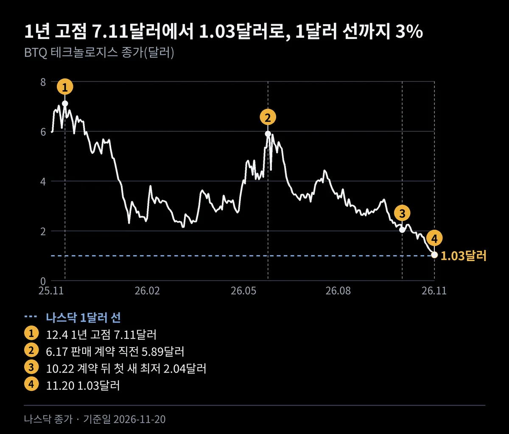
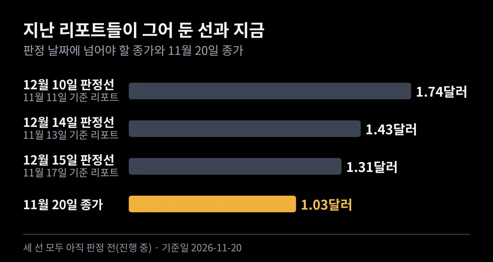
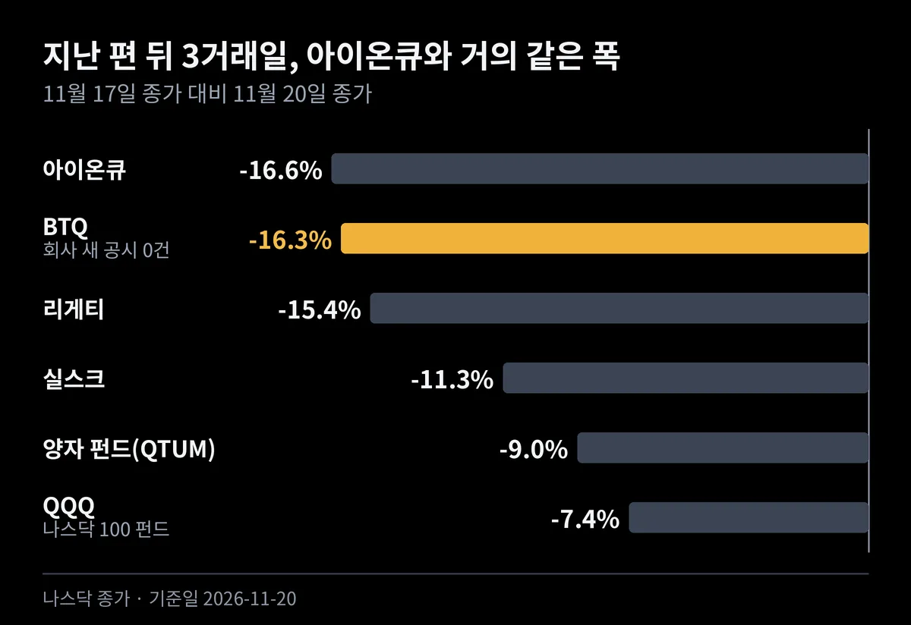
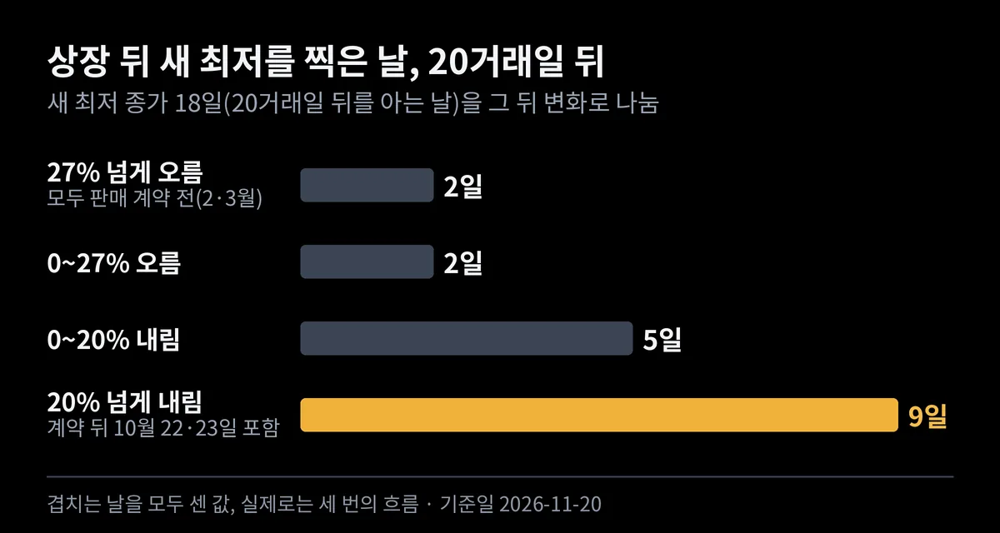
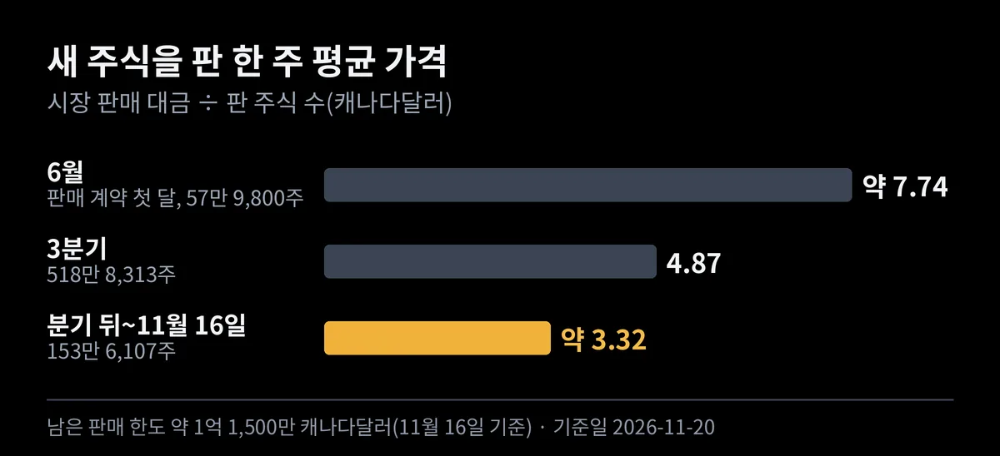
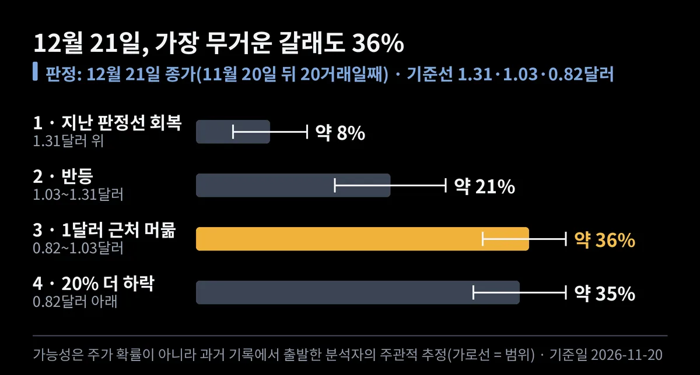

BTQ 테크놀로지스 지금 사도 될까? 요즘 이 종목 영상 댓글에 가장 자주 붙는 질문입니다. 11월 20일 종가는 1.03달러였습니다. 1년 사이 가장 낮은 종가이고, 2025년 9월 나스닥 상장 뒤로도 가장 낮습니다. 상장 뒤 최고 종가 14.14달러와 견주면 92.7% 아래입니다. 나스닥이 상장 기준으로 보는 1달러 선과는 이제 3% 차이입니다. 이 글은 사라, 팔라를 말하지 않습니다. 대신 이 질문에 답하는 데 필요한 근거를 끝까지 꺼내 보겠습니다.

> **유의사항** 저자는 금융·투자 자문가가 아닙니다. 이 글은 공개 공시와 시세를 정리한 교육용 분석이며 특정 종목의 매수·매도를 권하지 않습니다. 과거 패턴은 미래 수익을 보장하지 않고, BTQ는 최근 20거래일 가운데 10일이 하루 5% 넘게 움직인 종목입니다. 실제 투자 전에는 최신 공시를 직접 확인하세요.

이 글은 [11월 17일 기준 리포트](/r/btq-2026-11-4/)의 후속편입니다. 그 리포트는 3분기 보고서를 다뤘습니다. 현금은 두 배가 됐지만, 그 돈은 시장에서 판 새 주식에서 왔다는 내용이었습니다. 회사는 6월 증권사와 시장 판매 계약을 맺었습니다. 증권사에 맡겨 새 주식을 시장에서 조금씩 나눠 파는 계약입니다. 그 뒤 주가는 11월 17일 종가 대비 3거래일 만에 16.3% 더 내렸습니다. 회사가 미국 증권거래위원회(SEC)에 낸 서류는 3분기 보고서와 사업 현황 보도자료 뒤로 없었습니다.

먼저 지난 리포트가 '지켜볼 신호'로 적어 둔 것부터 확인하겠습니다. 김박사 월드는 리포트마다 판정 날짜와 그날 종가가 넘어야 할 값, 곧 판정선을 정해 두고 나중에 채점합니다. 첫째는 11월 19일이었습니다. 10월 22일 상장 뒤 새 최저 2.04달러를 찍고 20거래일째 되는 날입니다. 그날 종가는 1.14달러로, 2.04달러보다 44.1% 낮았습니다. 판매 계약 뒤의 새 최저는 반등 없이 더 내려갔다는 기록이 이렇게 하나 생겼습니다. 둘째, 판매 중단이나 한 번에 큰 물량을 파는 조달 공시는 나오지 않았습니다. 좋은 쪽으로도, 나쁜 쪽으로도 새 소식이 없었다는 뜻입니다.

나머지 신호는 날짜가 남아 있지만 방향은 불리합니다. 지난 리포트들이 12월 10일, 14일, 15일 판정선으로 그어 둔 세 값에서 지금 주가는 모두 20% 넘게 아래에 있습니다. 가장 가까운 12월 15일 선 1.31달러와도 21.4% 차이입니다. 지난 리포트 예측 일곱 개는 모두 12월 판정이라, 지난 예측 성적은 적중 0, 빗나감 0, 진행 중 7입니다. 그 리포트는 12월 15일 종가를 네 갈래로 나눴습니다. 가장 무겁게 본 '업종 약세, 함께 아래'(약 40%)는 아이온큐도 BTQ도 기준선 아래에 있는 경우이고, 지금 두 종목은 둘 다 그 자리에 있습니다. 1달러 아래 마감은 약 25%로 따로 적어 두었는데, 아직 그 선 위에 있습니다.

이번 3거래일은 업종 전체가 함께 내린 구간이었습니다. 11월 17일 종가 대비 20일까지 양자컴퓨터 대표 종목 아이온큐는 16.6% 내렸고, BTQ의 -16.3%는 그와 거의 같은 폭입니다. 같은 양자 업종인 리게티 컴퓨팅과 실스크, 양자 종목을 모은 펀드도 모두 내렸습니다. 나스닥 대형 기술주 100개를 따라가는 펀드(QQQ)마저 7.4% 빠진 시장이었습니다. 20일 거래량은 평소보다 조금 많은 정도였습니다. 새 공시 없이 업종과 같은 폭으로 내려, 업종 영향이 커 보입니다. 시장 판매 물량이 함께 영향을 줬는지는 공시로 확인할 수 없습니다.

회사도 짧게 보겠습니다. BTQ 테크놀로지스는 캐나다 밴쿠버에 본사를 둔 회사입니다. 양자컴퓨터가 지금의 암호를 풀 수 있게 되는 때를 대비한 보안 기술을 만듭니다. 큰 갈래는 한국 ICTK(아이씨티케이)와 함께 만드는 보안 칩, 블록체인용 보안 네트워크, 소프트웨어입니다. 아직 돈을 버는 단계는 아닙니다. 올해 9개월 매출은 0이었고, 같은 기간 순손실은 약 5,616만 캐나다달러였습니다. 연구와 영업에 드는 돈은 가진 현금과 새 주식을 판 돈으로 메웁니다.

이 질문의 첫 번째 열쇠는 지금 가격이 과거 비슷한 순간에서 어디쯤인가입니다. 나스닥 상장 뒤 종가가 새 최저를 쓴 날을 모두 찾았습니다. 20거래일 뒤 결과를 아는 날은 18일이었습니다. 그 가운데 20거래일 뒤 더 높았던 날은 4일, 22%뿐이었습니다. 반대로 20% 넘게 더 내린 날이 9일로 절반이었습니다. 더 높았던 4일은 모두 올해 2월과 3월, 판매 계약을 맺기 전이었습니다. 계약 뒤인 10월 22일과 23일은 20거래일 뒤 각각 44.1%, 48.5% 더 낮았습니다.

다만 18일은 서로 겹치는 날입니다. 9일 가운데 7일이 2026년 1월 한 번의 긴 미끄럼에서 나왔습니다. 실제로는 세 번의 흐름을 날짜로 나눠 센 것입니다. 그래서 이 기록은 방향을 정하는 근거라기보다, 새 최저 자리가 BTQ에서 쉽게 끝나지 않았다는 정도로 읽습니다. 이제 사는 쪽 근거와 사지 않는 쪽 근거를 셋씩 나란히 놓겠습니다.

사는 쪽 근거 첫째는 두 배가 된 현금입니다. 9월 말 현금은 2,157만 캐나다달러로, 6월 말의 두 배가 넘습니다. 분기가 끝난 뒤에도 11월 16일까지 새 주식을 팔아 약 510만 캐나다달러를 더 받았습니다. 3분기 한 분기 동안 영업으로 나간 현금은 약 1,168만 캐나다달러입니다. (2,157만 + 510만) ÷ 1,168만으로 단순 계산하면 약 2.3분기, 캐나다달러 기준 두 분기 남짓 쓸 크기입니다. 다만 분기 뒤 쓴 돈은 빠진 계산이라, 뒤에서 볼 계속기업 문구와 함께 읽어야 합니다.

최근 하락이 회사 탓이 아니라는 점도 사는 쪽에 놓을 수 있습니다. 지난 리포트 뒤 3거래일 -16.3%는 아이온큐 -16.6%와 거의 같았습니다. 그 전 보고서 앞뒤 2거래일에도 두 종목은 똑같이 14.0% 내렸습니다. 회사 고유의 나쁜 소식이 새로 붙은 것은 아니라는 기록입니다. 다만 업종이 오를 때 BTQ가 덜 따라간 기록도 있어, 반등까지 같은 폭일지는 따로 확인해야 합니다.

사는 쪽 마지막 근거는 사업의 진척입니다. 회사는 11월 17일 보도자료에서 보안 칩(QCIM) 설계를 마쳤다고 밝혔습니다. 9월 30일에는 카이아 재단과 3년 계약을 맺었고, 첫해 매출을 '여섯 자리 미국 달러'로 예상했습니다. 매출 0이던 회사에 첫 숫자가 찍힐 수 있는 자리입니다. 자체 블록체인인 비트코인 퀀텀은 2027년 상반기에 열겠다는 계획입니다. 지금 시가총액은 약 1억 5,634만 달러입니다. 발행 주식 1억 5,178만 2,329주에 11월 20일 종가를 곱한 값입니다. 상장 뒤 최고 때와 견주면 이 회사에 붙은 기대가 그만큼 줄어 있습니다.

이번엔 사지 않는 쪽 근거입니다. 첫째는 열려 있는 주식 판매 창구입니다. 사는 쪽 첫째로 본 현금은 거의 다 새 주식을 판 돈입니다. 그리고 그 판매는 지금도 이어지고 있습니다. 판매 계약 첫 달인 6월에는 57만 9,800주를 한 주 평균 약 7.74캐나다달러에 팔았습니다. 3분기 평균은 4.87캐나다달러, 분기 뒤에는 약 3.32캐나다달러로 6월보다 57% 낮았습니다. 가격이 낮을수록 같은 돈을 모으는 데 더 많은 주식이 나옵니다.

회사가 밝힌 남은 판매 한도는 11월 16일 기준 약 1억 1,500만 캐나다달러입니다. 앞으로 팔 수 있는 최대치이지 실제로 판 양은 아닙니다. 그래도 지금 시가총액과 같은 자릿수입니다. 지난 리포트들은 판매 계약 뒤 BTQ가 업종이 오르는 날 덜 따라가는 모양을 기록했습니다. 11월 11일 리포트 뒤에는 아이온큐가 13.4% 오를 때 BTQ는 12.1% 내렸습니다. 이 모양은 판매 때문일 수 있지만, 날짜별 판매량은 공시되지 않아 확인할 수는 없습니다.

사지 않는 쪽 둘째는 앞에서 본 짧은 기록입니다. 상장 뒤 새 최저 자리 18일 가운데 20거래일 뒤 더 높았던 날은 22%였습니다. 판매 계약 뒤의 새 최저 두 번은 둘 다 40% 넘게 더 내려갔습니다. 김박사 월드 예측 장부에서도 판정선을 지킨다는 쪽은 네 번 모두 빗나갔고, 판정선 이탈 뒤 20거래일 안에 회복한 경우는 여섯 번 중 한 번이었습니다. 1년 최저라는 사실이 곧 바닥이라는 뜻은 아니었습니다.

마지막은 1달러 선과 계속기업 불확실성입니다. 나스닥은 종가가 30영업일 연속 1달러 아래에 머물면 상장 기준 미달을 통지합니다. 통지가 곧 상장 폐지는 아니고 보통 회복 기간이 주어집니다. 그래도 주가가 낮을수록 같은 돈을 모으려면 더 많은 새 주식을 팔아야 합니다. 3분기 재무제표에도 회사가 영업을 계속 이어 갈 수 있을지 '중대한 불확실성'이 있다는 문구가 그대로 있었습니다. 원문은 추가 자금 조달과 비용을 감당할 매출을 그 조건으로 적었습니다.

같은 모양은 같은 양자 무리에서도 나왔습니다. [실스크](/r/laes-2026-11-5/)는 11월 20일 이미 1달러 아래에서 마감했습니다. [리게티 컴퓨팅](/r/rgti-2026-11/)은 9거래일 연속 내려 1년 최저에 있습니다. 세 종목 모두 업종이 내리는 날은 같이 내렸습니다. 김박사 월드 장부의 통찰 하나는 '소형주는 내릴 때만 업종을 따른다'입니다. 업종이 돌아설 때 BTQ가 이 기록을 깨는지가 이 종목의 다음 관전 포인트입니다.

그럼 무엇을 보면 판단이 바뀔까요? 신호와 날짜를 정해 두겠습니다. 기준 날짜는 12월 21일 종가로, 11월 20일 뒤 20번째 거래일입니다. 이날 지난 리포트의 판정선 1.31달러 위로 돌아와 있으면 사는 쪽 근거가 강해집니다. 11월 20일보다 약 20% 낮은 0.82달러 아래로 내려가 있으면 사지 않는 쪽 근거가 강해집니다. 지난 리포트들이 정한 12월 14일(1.43달러 위인가)과 12월 15일(1.31달러 위인가) 종가도 함께 봅니다.

공시도 신호입니다. 판매를 멈췄다는 공시가 나오면 사는 쪽이 무거워집니다. 공모처럼 한 번에 큰 물량을 파는 소식이 나오면 사지 않는 쪽이 무거워집니다. 종가가 1달러 아래로 내려가는 날이 나오면 그날부터 30영업일을 세 보셔야 합니다. 사업 쪽에서는 카이아 계약 매출이 처음 잡히는지가 확인할 숫자입니다. 연간 보고서는 지난해 일정으로 보면 3월 말 무렵입니다.

사려는 사람이 먼저 볼 것은 두 가지입니다. 최신 분기 6-K에서 현금과 분기 뒤 판 주식 수를 직접 확인하는 것입니다. 6-K는 외국 회사가 SEC에 내는 수시 공시이고, 분기 재무제표와 경영진 설명도 이 서류로 나옵니다. 다른 하나는 남은 판매 한도가 지금 시가총액과 견주어 얼마나 큰지 계산해 보는 것입니다. 1달러 선까지의 거리, 하루 10% 넘게 움직이는 날을 견딜 수 있는지, 판정 날짜까지 다섯 가지 확인표는 글 끝 부록에 있습니다.

마지막으로 12월 21일 종가를 네 갈래로 나눴습니다. 출발점은 상장 뒤 새 최저 18일의 20거래일 뒤 기록입니다. 그 기록에서는 18번 중 9번이 20% 넘게 더 내린 칸이었습니다. 하지만 그 9일 가운데 7일이 1월 한 번의 흐름이라 이 칸을 많이 줄였습니다. 대신 가격 수준이 이어진 장부 기록을 따라 지금 자리 근처 칸을 늘렸습니다. 11월 20일 하루 하락은 업종 급락일에 함께 난 것이라 반등 칸도 조금 늘렸습니다.

0.82~1.03달러, 1달러 근처에 머무는 갈래를 약 36%로 가장 무겁게 봤습니다. 20% 넘게 더 빠지는 갈래는 약 35%로 거의 같습니다. 반등하는 갈래는 약 21%, 지난 판정선 1.31달러 위로 돌아오는 갈래는 약 8%만 남겼습니다. 이 숫자는 주가가 오를 확률이 아니라, 과거 빈도에서 출발한 분석자의 주관적 추정입니다.

이 판단이 틀릴 수 있는 곳도 적어 둡니다. 최근 20거래일에 하루 5% 넘게 움직인 날이 10일, 10% 넘게 움직인 날이 3일이었습니다. 20% 폭의 칸은 큰 날 두 번이면 비껴갑니다. 업종이 11월 20일 급락을 되돌리면 판매가 이어져도 반등 칸이 됩니다. 반대로 판매 계약 뒤 새 최저 두 번처럼 40% 넘게 더 내려갈 수도 있습니다. 18일은 겹치는 날이라 실제로는 세 번의 흐름뿐이라는 점도 한계입니다.

지금 BTQ는 현금이 두 배가 됐지만 그 돈이 새 주식에서 왔고, 판매 창구가 아직 열려 있는 회사입니다. 최근 하락은 업종과 같은 폭이었지만, 판매 계약 뒤 새 최저 자리는 매번 더 깊어졌습니다. 12월 21일 종가가 1.31달러 위로 돌아오고 판매 중단 소식이 나온다면 사는 쪽 근거가 강해집니다. 0.82달러 아래이거나 큰 조달 공시, 1달러 아래 마감이 이어지면 사지 않는 쪽 근거가 강해집니다. 결정은 각자의 몫이며, 이 영상과 리포트는 판단 근거를 정리한 교육용 자료입니다.

## 숫자로 다시 보기

### 지난 리포트 뒤 하루씩

| 날짜 · 종가 | 하루 변화 · 거래량 | 아이온큐 하루 변화 |
| --- | --- | --- |
| **11월 17일** 1.23달러 | -6.1% · 약 124만 주 | -6.1% |
| **11월 18일** 1.17달러 | -4.9% · 약 213만 주 | -5.5% |
| **11월 19일** 1.14달러 | -2.6% · 약 162만 주 | -3.3% |
| **11월 20일** 1.03달러 | -9.6% · 약 232만 주 | -8.8% |

11월 17일 대비 20일은 BTQ -16.3%, 아이온큐 -16.6%, 리게티 -15.4%, 실스크 -11.3%, 양자 펀드(QTUM) -9.0%, QQQ -7.4%입니다. 20일 거래량은 직전 20거래일 평균(약 171만 주)의 1.36배입니다.

### 지난 리포트의 '지켜볼 신호' 판정

| 신호 · 당시 기준 | 11월 20일 현재 |
| --- | --- |
| **11월 19일, 10월 22일 새 최저 뒤 20거래일째** 2.04달러 | **1.14달러 · -44.1%** 계약 뒤 새 최저, 반등 없음 |
| **판매 중단·큰 조달 공시** 12월 15일까지 | **없음** 11월 17일 6-K 두 건 뒤 제출 0건 |
| **12월 14일 종가 1.43달러 위** 11월 13일 기준 리포트 | **[진행 중]** 지금 1.03달러, -28.0% |
| **12월 15일 종가 1.31달러 위** 보고서 날 종가 | **[진행 중]** 지금 1.03달러, -21.4% |
| **12월 15일 네 갈래** 업종 약세·함께 아래 약 40% | **[진행 중]** 아이온큐 20.72 < 24.84달러, BTQ 1.03 < 1.31달러 |
| **12월 15일 1달러 아래** 약 25% | **[진행 중]** 1.03달러, 1달러보다 3% 위 |

지난 예측 성적(11월 17일 기준 리포트): 적중 0 · 빗나감 0 · 진행 중 7. 그 전 리포트(11월 11일 기준)의 '12월 10일 종가 1.74달러 위'도 진행 중이며, 지금은 1.74달러보다 40.8% 아래입니다.

### 사는 쪽 근거와 사지 않는 쪽 근거

| 사는 쪽 · 숫자 | 사지 않는 쪽 · 숫자 |
| --- | --- |
| **두 배가 된 현금** 9월 말 2,157만 캐나다달러(6월 말 973만) + 분기 뒤 판매 약 510만 | **열려 있는 판매 창구** 한 주 판매가 약 7.74 · 4.87 · 약 3.32캐나다달러, 남은 한도 약 1억 1,500만 |
| **업종과 같은 폭의 하락** 3거래일 BTQ -16.3% · 아이온큐 -16.6%, 회사 공시 0건 | **새 최저 자리의 기록** 18일 중 20거래일 뒤 더 높음 4일(22%), 계약 뒤 두 번은 -44.1% · -48.5% |
| **사업 진척** QCIM 칩 설계 완료, 카이아 3년 계약 첫해 '여섯 자리 미국 달러' 매출 예상 | **1달러 선과 계속기업** 1.03달러(3% 위), 재무제표 '중대한 불확실성' 문구, 9개월 매출 0 |

### 상장 뒤 새 최저 종가, 20거래일 뒤

**한눈에:** 2025년 9월 26일 상장 뒤 새 최저 종가를 쓴 날 중 20거래일 뒤를 아는 날 **18일** · 더 높음 **4일(22%)** · 20% 넘게 더 낮음 **9일(50%)**

| 흐름 · 대표 날짜 | 20거래일 뒤 |
| --- | --- |
| **2026년 1월 미끄럼** 1월 21일 4.93달러 · 1월 29일 3.82달러 | -47.9% · -12.8% 같은 흐름 안 날짜마다 다름 |
| **2026년 2월 초 바닥** 2월 3일 2.94달러 · 2월 5일 2.30달러 | +13.9% · +37.0% |
| **2026년 3월 27일** 2.15달러 | +37.2% 다음 거래일 연간 보고서 |
| **판매 계약 뒤 10월 22일** 2.04달러 | **-44.1%** 11월 19일 1.14달러 |
| **이번 11월 20일** 1.03달러 | 12월 21일 판정 |

| 20거래일 뒤 칸 | 날수 |
| --- | --- |
| 27% 넘게 오름(1.31달러 위에 해당) | 2일 |
| 0~27% 오름 | 2일 |
| 0~20% 내림 | 5일 |
| 20% 넘게 내림(0.82달러 아래에 해당) | 9일 |

겹치는 날을 모두 센 값입니다. 2024년 장외 거래 시절 시세는 거래량이 하루 수만 주로 작아 넣지 않았습니다.

### 지금의 크기(11월 20일 기준)

| 항목 | 값 · 근거 |
| --- | --- |
| 종가 | **1.03달러** 1년 최저, 상장 뒤 최저 |
| 1년 고점 · 상장 뒤 최고 대비 | **-85.5% · -92.7%** 2025년 12월 4일 7.11달러 · 2025년 10월 8일 14.14달러 |
| 판매 계약 직전 대비 | **-82.5%** 2026년 6월 17일 5.89달러 |
| 시가총액 | **약 1억 5,634만 달러** 발행 주식 1억 5,178만 2,329주(11월 16일) 기준 |
| 9월 말 현금 | **2,157만 3,717캐나다달러** 6월 말 972만 9,250 |
| 분기 뒤 판매(11월 16일까지) | **153만 6,107주 · 510만 4,980캐나다달러** 한 주 약 3.32 |
| 3분기 영업 현금 유출 | **약 1,168만 캐나다달러** 9개월 2,559만 − 상반기 1,391만 |
| 남은 시장 판매 한도 | **약 1억 1,500만 캐나다달러** 팔 수 있는 최대치, 들어온 돈과 다름 |
| 1달러 선까지 | **3% 위** 30영업일 연속 1달러 아래면 상장 기준 미달 통지 |

현금과 판매 한도는 캐나다달러, 주가와 시가총액은 미국 달러입니다. 환율을 곱해 더하지 않았습니다.

### 사기 전에 확인할 것

| 확인할 것 | 어디서 · 언제 |
| --- | --- |
| **현금과 분기 뒤 판 주식 수** 9월 말 2,157만 캐나다달러, 분기 뒤 153만 6,107주 | 6-K · 다음 분기 보고서 |
| **남은 판매 한도와 시가총액 비교** 약 1억 1,500만 캐나다달러 vs 약 1억 5,634만 달러 | 6-K 경영진 설명 · 수시 |
| **1달러 선까지 거리** 1.03달러, 30영업일 규칙 | 나스닥 종가 · 매일 |
| **하루 10% 넘는 날을 견딜 수 있나** 최근 20거래일 중 3일 | 스스로 · 사기 전 |
| **판정 날짜 메모** 1.43 · 1.31 · 0.82달러 | 12월 14일 · 15일 · 21일 |

### 앞으로 일어날 수 있는 일

과거 빈도: 상장 뒤 새 최저 18번 중 20거래일 뒤 1.31달러 위에 해당하는 상승(+27% 넘게)은 2번, 0.82달러 아래에 해당하는 하락(-20% 넘게)은 9번이었습니다.

판정선을 지킨다는 쪽은 장부에서 네 번 모두 빗나갔고, 판매 계약 뒤 새 최저 두 번은 둘 다 40% 넘게 더 내렸습니다. 아래 가능성은 주가 상승·하락 확률이 아니라, 12월 21일 종가의 자리에 대한 분석자의 주관적 추정입니다. 네 갈래는 겹치지 않아 더하면 100%이고, 괄호 안 범위는 더하지 않습니다.

| 시나리오(판정 12월 21일) | 종가 | 가능성(추정) |
| --- | --- | --- |
| 1 · 지난 판정선 회복 | 1.31달러 위 | 낮음 약 8% (4~12%) |
| 2 · 반등 | 1.03~1.31달러 | 중간 약 21% (15~27%) |
| **3 · 1달러 근처 머묾** | 0.82~1.03달러 | 중간 약 36% (31~40%) |
| 4 · 20% 더 하락 | 0.82달러 아래 | 중간 약 35% (30~40%) |

### 핵심 확인 세 가지

| 순위 · 확인할 것 | 판정 날짜 |
| --- | --- |
| **1순위** 12월 21일 종가가 1.31달러 위인가, 0.82달러 아래인가 | 12월 21일 |
| **2순위** 판매 중단이나 한 번에 큰 물량을 파는 조달 공시가 나오는가 | 12월 21일까지 |
| **3순위** 종가가 1달러 아래로 마감하는 날이 나오는가 | 12월 21일까지 |

공시는 [BTQ 테크놀로지스 SEC 공시 목록](https://www.sec.gov/cgi-bin/browse-edgar?action=getcompany&CIK=0001821866&type=&dateb=&owner=include&count=40)에서 직접 확인할 수 있습니다.

## 함께 읽기

- [BTQ 3분기 보고서 리포트](/r/btq-2026-11-4/) · [영상](https://youtu.be/usFP6dPpDX8): 현금은 두 배, 그 돈은 새 주식에서(11월 17일 기준).
- [실스크 리포트](/r/laes-2026-11-5/) · [영상](https://youtu.be/2LuMR4kBlmA): 같은 양자 무리, 11월 20일 이미 1달러 아래.
- [리게티 컴퓨팅 리포트](/r/rgti-2026-11/) · [영상](https://youtu.be/c-8RHgUfHv8): 9거래일 연속 하락과 임원 의무 매도(11월 20일 기준).
