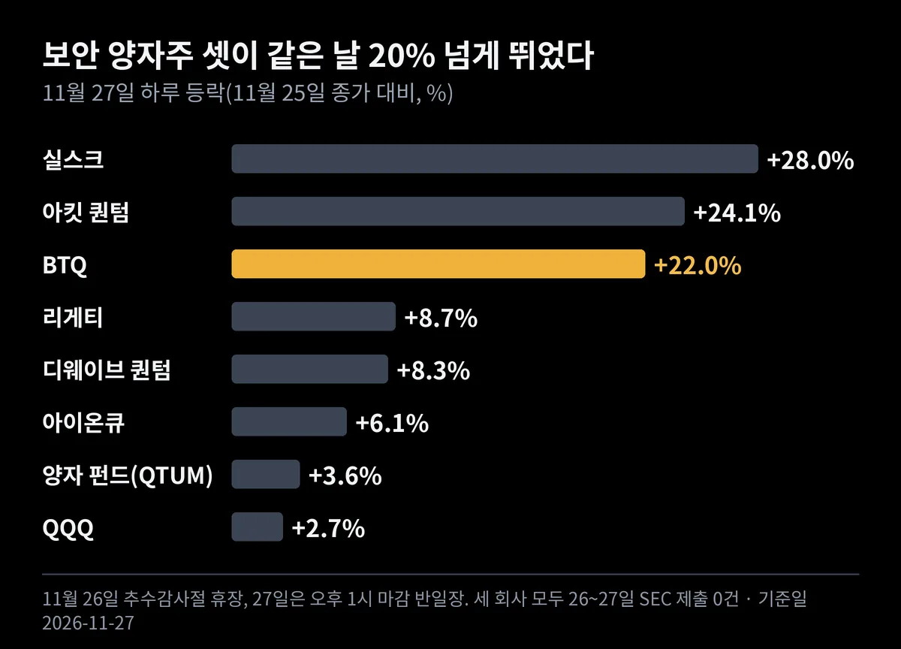
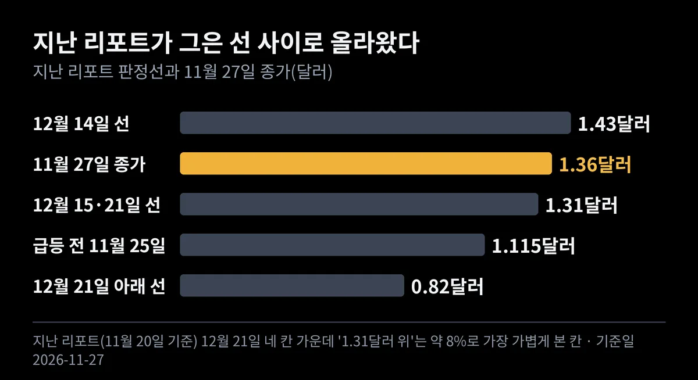
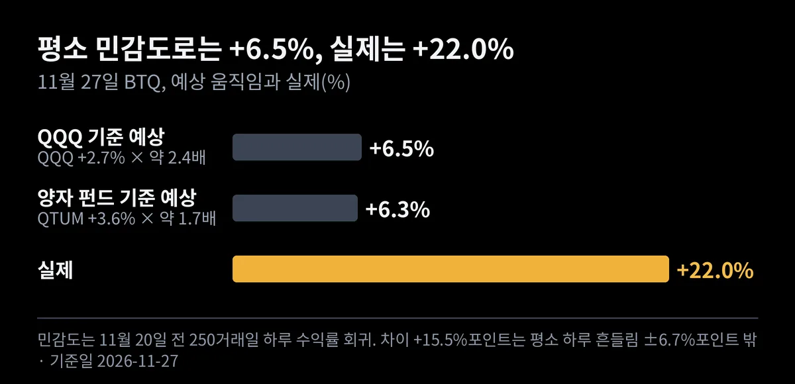
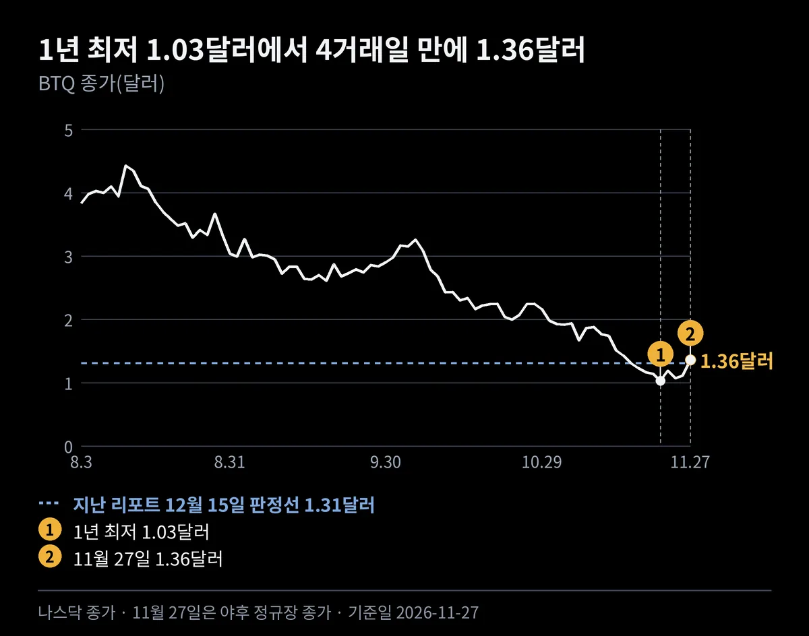
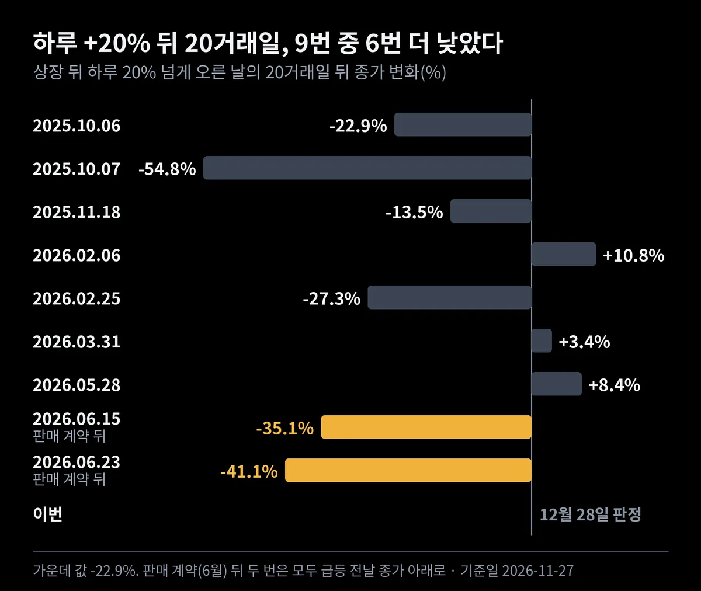
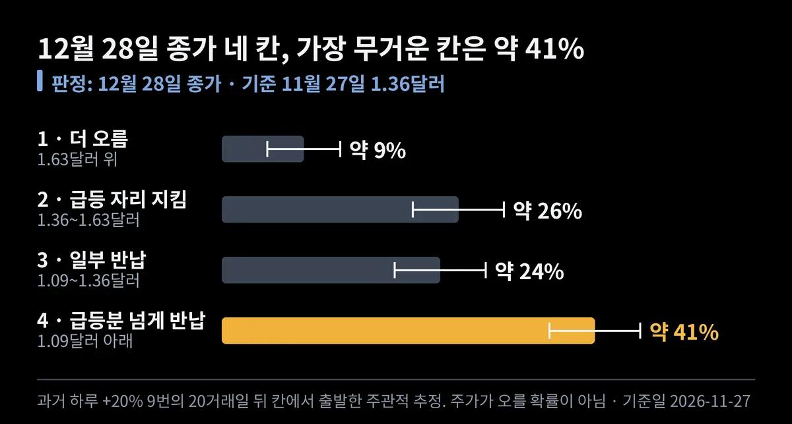

BTQ 급등 다음 날, 따라 사도 될까? 11월 27일 금요일, BTQ 테크놀로지스 주가는 하루 22.0% 올라 1.36달러로 마감했습니다. 추수감사절 다음 날이라 오후 1시에 끝난 짧은 장이었습니다. 1주일 전인 11월 20일에는 1년 사이 가장 낮은 1.03달러였습니다. 그런데 이날 회사가 미국 증권거래위원회(SEC)에 낸 서류는 없었습니다. 이 글은 사라, 팔라를 말하지 않습니다. 대신 이 질문에 답하는 데 필요한 근거를 끝까지 꺼내 보겠습니다.

> **유의사항** 저자는 금융·투자 자문가가 아닙니다. 이 글은 공개 공시와 시세를 정리한 교육용 분석이며 특정 종목의 매수·매도를 권하지 않습니다. 과거 패턴은 미래 수익을 보장하지 않고, BTQ는 최근 20거래일 가운데 12일이 하루 5% 넘게 움직인 종목입니다. 실제 투자 전에는 최신 공시를 직접 확인하세요.

이 글은 [11월 20일 기준 리포트](/r/btq-2026-11-5/)의 후속편입니다. 그 리포트는 '지금 사도 될까?'를 물었습니다. 주가는 1년 최저였고, 나스닥 1달러 선까지 3%가 남아 있었습니다. 회사는 6월 증권사와 시장 판매 계약을 맺었습니다. 증권사에 맡겨 새 주식을 시장에서 조금씩 나눠 파는 계약입니다. 그 리포트는 현금이 두 배가 됐지만 그 돈이 새 주식을 판 돈이라는 점을 짚었습니다. 그 뒤 4거래일 동안 주가는 11월 20일 종가 대비 32.0% 올랐습니다.

먼저 지난 리포트가 그어 둔 선부터 보겠습니다. 김박사 월드는 리포트마다 판정 날짜와 그날 종가가 넘어야 할 값, 곧 판정선을 정해 두고 나중에 채점합니다. 지난 리포트는 12월 21일 종가를 네 칸으로 나눴습니다. 가장 무겁게 본 칸은 '1달러 근처에 머묾'(약 36%)이었습니다. 가장 가볍게 본 칸은 '1.31달러 위로 돌아옴'(약 8%)이었습니다. 지금 1.36달러는 바로 그 가장 가벼운 칸에 있습니다. 판정일이 오지 않아 지난 예측 성적은 적중 0, 빗나감 0, 진행 중 7입니다.

다른 선도 있습니다. 그보다 앞선 리포트들이 12월 14일에는 1.43달러, 12월 15일에는 1.31달러를 판정선으로 정했습니다. 1.36달러는 1.31달러보다 3.8% 위, 1.43달러보다 4.9% 아래입니다. 2주 전까지 멀어지기만 하던 선 사이로 다시 들어온 셈입니다. 이제 질문은 이 급등을 따라가도 되느냐입니다. 그 전에 이날 무슨 일이 있었는지부터 보겠습니다.

회사도 짧게 보겠습니다. BTQ 테크놀로지스는 캐나다 밴쿠버에 본사를 둔 회사입니다. 양자컴퓨터가 지금의 암호를 풀 수 있게 되는 때를 대비한 보안 기술을 만듭니다. 한국 ICTK(아이씨티케이)와 함께 만드는 보안 칩, 블록체인용 보안 네트워크, 소프트웨어가 큰 갈래입니다. 돈을 버는 방식은 이 칩과 보안 네트워크를 기업에 공급하는 것이지만, 올해 9개월 매출은 아직 0이었습니다. 연구와 영업에 드는 돈은 현금과 새 주식을 판 돈으로 메웁니다.

11월 27일 BTQ는 장 초반 오히려 밀렸습니다. 오전 10시까지는 1.14달러 근처에 머물렀습니다. 그 뒤로는 한 번도 크게 꺾이지 않고 꾸준히 올라, 마감 직전 그날 가장 높은 자리 근처에서 끝났습니다. 시각별 가격은 글 끝 부록 표에 있습니다. 3시간 반짜리 장인데도 거래량은 직전 20거래일 하루 평균보다 많았습니다.

이 질문의 첫 번째 열쇠는 이 급등이 회사 소식에서 왔느냐입니다. 답은 '확인되지 않음'입니다. BTQ가 SEC에 낸 마지막 서류는 11월 17일 3분기 사업 현황 두 건입니다. 11월 18일부터 27일까지 새 제출은 없었습니다. 급등의 이유를 회사가 직접 적은 자료는 지금 없습니다.

그런데 같은 날 BTQ만 뛴 것이 아니었습니다. 스위스의 보안 반도체 회사 [실스크](/r/laes-2026-11-7/)는 28.0%, 영국의 양자 보안 회사 아킷 퀀텀은 24.1% 올랐습니다. 셋 다 '양자컴퓨터로도 풀기 어려운 암호'를 앞세운 회사입니다. 반면 양자컴퓨터를 직접 만드는 아이온큐·리게티 컴퓨팅·디웨이브 퀀텀은 6~9% 오르는 데 그쳤습니다. 양자 종목을 모은 펀드(QTUM)와 나스닥 대형 기술주 100개를 따라가는 펀드(QQQ)는 그보다 덜 올랐습니다. 종목별 숫자는 부록 표에 있습니다.

실스크와 아킷 퀀텀도 26일과 27일 SEC에 낸 서류가 없었습니다. 두 회사의 마지막 제출은 11월 25일입니다. 실스크는 파리 증권시장 2차 상장 승인을, 아킷 퀀텀은 11월 24일 'SEC 조사가 제재 권고 없이 끝났다'는 보도자료를 냈습니다. 둘 다 휴장일 전 마지막 거래일에 나온 소식입니다. 그래서 지금 말할 수 있는 것은 하나입니다. 양자 보안 무리 셋이 같은 날, 양자컴퓨터를 만드는 회사들보다 두세 배 더 뛰었다는 사실입니다.

시장과 견주면 이 급등이 얼마나 컸는지 보입니다. BTQ는 지난 1년 동안 QQQ가 1% 움직일 때 평균 약 2.4% 움직였습니다. 이 민감도로 계산하면 11월 27일 예상 움직임은 +6.5%입니다. 실제는 +22.0%였고, 차이 15.5%포인트는 BTQ의 평소 하루 흔들림(±6.7%포인트) 밖입니다. 양자 펀드를 기준으로 해도 예상 +6.3%, 차이 15.7%포인트로 같습니다. 시장과 업종만으로는 설명되지 않는 부분이 컸습니다.

여기서 지난 기록 하나를 떠올려야 합니다. 김박사 월드 장부의 통찰 가운데 '소형주는 내릴 때만 업종을 따른다'가 있습니다. BTQ가 대표 사례였습니다. 11월 11일 리포트 뒤 아이온큐가 13.4% 오를 때 BTQ는 12.1% 내렸습니다. 이번에는 달랐습니다. 11월 20일 종가 대비 27일까지 BTQ는 32.0% 올라 아이온큐 20.5%, 양자 펀드 7.9%보다 더 올랐습니다. 업종이 돌아설 때 BTQ가 이 기록을 깨는지가 다음 관전 포인트라고 적었는데, 이번 4거래일은 깨는 쪽이었습니다.

두 번째 열쇠는 과거 비슷한 순간입니다. 2025년 9월 나스닥 상장 뒤 BTQ가 하루 20% 넘게 오른 날은 이번 전까지 9번이었습니다. 질문이 '다음 날 따라 사도 될까'이니 다음 거래일부터 보겠습니다. 다음 거래일에 더 오른 날은 4번, 내린 날은 5번이었습니다. 반반에 가깝습니다.

20거래일 뒤를 보면 그림이 기웁니다. 9번 가운데 20거래일 뒤 종가가 급등일보다 높았던 날은 3번이었습니다. 6번은 더 낮았고, 변화의 가운데 값(중앙값)은 -22.9%였습니다. 4번은 20거래일째 종가가 급등 전날 종가보다도 낮았습니다. 오른 만큼을 다 돌려주고 더 내려간 경우입니다.

특히 눈여겨볼 것은 6월 판매 계약 뒤입니다. 계약을 맺은 6월에 BTQ는 15일 28.6%, 23일 32.2% 두 번 크게 올랐습니다. 20거래일 뒤 두 번 모두 35.1%, 41.1% 낮았고, 둘 다 급등 전날 종가 아래였습니다. 계약 뒤의 급등은 지금까지 두 번 모두 오래가지 못했습니다. 다만 두 번뿐이고, 그때는 BTQ 혼자의 급등이었습니다. 이번처럼 양자 보안 무리 셋이 함께 뛴 날은 이 9번 가운데 없었습니다.

같은 모양은 다른 핵심 종목에서도 나왔습니다. 김박사 월드 장부에서 하루 급등 뒤 20거래일째가 더 낮았던 경우는 리커전 14번 가운데 12번이었습니다. 급등을 다 돌려주고 출발 종가 아래로 내려간 뒤 20거래일째가 더 낮았던 경우는 실스크·뉴스케일·조비 21번 가운데 13번이었습니다. 첫날의 크기와 20거래일 뒤 자리는 다른 게임이라는 것이 장부가 남긴 교훈입니다.

이제 사는 쪽 근거와 사지 않는 쪽 근거를 셋씩 나란히 놓겠습니다. 사는 쪽 첫째는 습관이 바뀐 모습입니다. 판매 계약 뒤 BTQ는 업종이 오르는 날 덜 따라갔습니다. 이번 4거래일에는 아이온큐보다 11.5%포인트 더 올랐습니다. 같은 보안 무리 실스크·아킷 퀀텀과 함께 오른 것이라, 혼자 튄 급등보다는 무리의 흐름에 가깝습니다.

사는 쪽 둘째는 지난 판정선입니다. 1.31달러는 12월 15일과 21일 판정에 쓰는 선입니다. 지금 그 위에 있고, 12월 14일 선 1.43달러와는 4.9% 차이입니다. 2주 전 판정선마다 20% 넘게 아래에 있던 때와 비교하면 자리가 달라졌습니다. 셋째는 거래량입니다. 반일장에 210만 8,300주로, 20거래일 하루 평균의 1.13배였습니다. 짧은 장에도 평소보다 많은 손이 오갔습니다.

이번엔 사지 않는 쪽 근거입니다. 첫째, 이유를 적은 서류가 없습니다. 회사 소식이 없는 급등은 이유가 확인되지 않은 급등이기도 합니다. 셋이 함께 뛴 이유가 무리 밖의 소식이라면, 그 소식이 식을 때 함께 내려올 수 있습니다. 둘째, 앞에서 본 기록입니다. 하루 20% 넘게 오른 9번 중 6번은 20거래일 뒤 더 낮았고, 판매 계약 뒤 두 번은 모두 급등분을 넘게 반납했습니다.

셋째는 열려 있는 주식 판매 창구입니다. 회사가 밝힌 남은 판매 한도는 11월 16일 기준 약 1억 1,500만 캐나다달러로, 지금 시가총액 약 2억 642만 달러의 절반이 넘는 크기입니다. 주가가 오르면 회사는 같은 돈을 더 적은 주식으로 모을 수 있어, 판매가 늘어날 수 있는 자리이기도 합니다. 분기가 끝난 뒤에도 회사는 새 주식을 팔아 510만 캐나다달러를 받았습니다. 3분기 재무제표에는 회사가 영업을 계속 이어 갈 수 있을지 '중대한 불확실성'이 있다는 문구도 그대로 있었습니다.

시장도 같이 보겠습니다. 11월 25일 기준 변동성 지수(VIX)는 28.29로, 20거래일 전보다 11.38 높았습니다. 미 국채 10년 금리는 4.85%로 5거래일 사이 0.22%포인트 내렸습니다. BTQ는 시장보다 약 2.4배 흔들리는 종목이라, 다음 거시 일정인 12월 9일 연준 금리 회의(FOMC) 뒤 시장이 흔들리면 그보다 크게 흔들릴 수 있습니다. 정책 쪽은 BTQ 연차 보고서 위험 요인과 직접 이어지는 발표를 찾지 못했습니다.

그럼 무엇을 보면 판단이 바뀔까요? 첫 신호는 12월 1일 월요일, 급등 뒤 첫 거래일입니다. 1.36달러를 지키는지, 급등 전 종가 1.115달러 아래로 내려가는지를 봅니다. 다음은 12월 4일, 급등 뒤 5거래일째입니다. 그리고 지난 리포트들이 정한 12월 14일 1.43달러, 12월 15일 1.31달러 판정선입니다. 이 선들 위에서 버티면 사는 쪽 근거가 강해집니다. 1.115달러 아래로 내려가면 사지 않는 쪽 근거가 강해집니다.

공시도 신호입니다. 새 주식 판매가 늘었다는 기록이나, 공모처럼 한 번에 큰 물량을 파는 소식이 나오면 사지 않는 쪽이 무거워집니다. 반대로 판매를 멈췄다는 공시나 첫 매출이 잡혔다는 소식은 사는 쪽에 놓입니다. 실스크와 아킷 퀀텀이 이번 급등 뒤 어떤 서류를 내는지도 함께 보시면 좋습니다. 무리가 함께 뛴 날의 이유가 거기서 나올 수 있습니다.

이미 오른 뒤에 사려는 사람이 먼저 볼 것은 세 가지입니다. 하나는 하루 평균 7.4%씩 움직이는 종목을 감당할 수 있는지입니다. 최근 20거래일 가운데 6일은 하루 10% 넘게 움직였습니다. 다른 하나는 판단의 기준을 어디에 둘지입니다. 급등 전 종가 1.115달러는 이번 급등이 모두 사라지는 자리입니다. 마지막은 최신 6-K에서 판매한 주식 수와 남은 한도를 직접 확인하는 것입니다. 다섯 가지 확인표는 글 끝 부록에 있습니다.

마지막으로 12월 28일 종가를 네 칸으로 나눴습니다. 11월 27일 뒤 20번째 거래일입니다. 출발점은 하루 20% 넘게 오른 9번의 20거래일 뒤 자리입니다. 그 기록에서는 9번 중 5번이 20% 넘게 더 내린 칸이었습니다. 다만 그 가운데 2번은 상장 직후인 2025년 10월의 과열이라 이 칸을 조금 줄였습니다. 대신 이번에는 무리가 함께 올랐다는 점을 반영해 '일부 반납' 칸을 늘렸습니다.

1.09달러 아래, 급등분을 넘게 반납하는 칸을 약 41%로 가장 무겁게 봤습니다. 1.36~1.63달러, 급등 자리를 지키는 칸은 약 26%입니다. 1.09~1.36달러, 일부 반납 칸은 약 24%입니다. 20% 넘게 더 오르는 1.63달러 위 칸은 약 9%만 남겼습니다. 이 숫자는 주가가 오를 확률이 아니라, 과거 빈도에서 출발한 분석자의 주관적 추정입니다.

이 판단이 틀릴 수 있는 곳도 적어 둡니다. 과거 9번은 대부분 BTQ 혼자의 급등이었습니다. 이번처럼 보안 무리 셋이 함께 뛴 흐름이 이어지면, 가장 무거운 칸 대신 '급등 자리 지킴' 칸이 될 수 있습니다. 9번은 적은 표본이고, 그 가운데 3번은 상장 직후 두 달에 몰려 있습니다. 시장 민감도가 2.4배라 12월 9일 금리 회의 뒤 시장 방향도 크게 작용할 수 있습니다.

지금 BTQ는 11월 20일 1년 최저 종가 대비 4거래일 만에 32.0% 올라, 지난 리포트가 가장 가볍게 본 칸에 서 있습니다. 이유를 적은 서류는 없고, 같은 날 양자 보안 무리 셋이 함께 뛰었습니다. 12월 첫 주에 1.36달러를 지키고 판정선 1.31달러 위에서 버틴다면 사는 쪽 근거가 강해집니다. 급등 전 종가 1.115달러 아래로 내려가거나 판매 확대 공시가 나오면 사지 않는 쪽 근거가 강해집니다. 결정은 각자의 몫이며, 이 영상과 리포트는 판단 근거를 정리한 교육용 자료입니다.

## 숫자로 다시 보기

### 11월 27일 하루

| 시각(동부) · 장면 | BTQ 가격 | 11월 25일 종가 대비 |
| --- | --- | --- |
| 09:30 시작 무렵 | 1.135달러 | +1.8% |
| 장중 저가 | 1.125달러 | +0.9% |
| 10:00 | 1.14달러 | +2.2% |
| 10:30 | 1.205달러 | +8.1% |
| 11:00 | 1.27달러 | +13.9% |
| 11:30 | 1.315달러 | +17.9% |
| 12:30 | 1.365달러 | +22.4% |
| **13:00 반일장 종가** | **1.36달러** | **+22.0%** |

시각별 값은 5분봉 종가입니다. 시가는 1.18달러, 장중 고가는 1.38달러였습니다. 11월 26일은 추수감사절 휴장, 27일은 오후 1시에 끝난 반일장입니다. 27일 종가는 나스닥 일별 시세에 아직 올라오지 않아 야후 파이낸스 정규장 종가를 썼습니다.

### 11월 27일 하루와 지난 리포트 뒤

| 종목 | 11월 27일 하루 | 11월 20일 대비 |
| --- | --- | --- |
| 실스크 | +28.0% | +42.4% |
| 아킷 퀀텀 | +24.1% | +25.5% |
| **BTQ** | **+22.0%** | **+32.0%** |
| 리게티 컴퓨팅 | +8.7% | +19.1% |
| 디웨이브 퀀텀 | +8.3% | +16.3% |
| 아이온큐 | +6.1% | +20.5% |
| 양자 펀드(QTUM) | +3.6% | +7.9% |
| QQQ | +2.7% | +7.0% |

**한눈에:** 하루 **+22.0%** · 거래량 20거래일 평균의 **1.13배**(반일장) · 시장 예상과 차이 **+15.5%포인트**.

### 상장 뒤 하루 +20% 9번

2025년 9월 26일 나스닥 상장 뒤 종가 기준으로 하루 20% 넘게 오른 날입니다.

| 날짜 | 그날 하루 · 다음 거래일 | 20거래일 뒤 종가 |
| --- | --- | --- |
| 2025.10.06 | +31.1% 다음 날 +51.5% | -22.9% |
| 2025.10.07 | +51.5% 다음 날 +2.5% | -54.8% |
| 2025.11.18 | +24.8% 다음 날 -6.0% | -13.5% |
| 2026.02.06 | +22.8% 다음 날 +12.2% | +10.8% |
| 2026.02.25 | +29.4% 다음 날 +16.9% | -27.3% |
| 2026.03.31 | +23.6% 다음 날 -3.0% | +3.4% |
| 2026.05.28 | +21.9% 다음 날 +1.7% | +8.4% |
| **2026.06.15 판매 계약 뒤** | +28.6% 다음 날 -0.4% | **-35.1%** |
| **2026.06.23 판매 계약 뒤** | +32.2% 다음 날 -6.2% | **-41.1%** |

**한눈에:** 다음 거래일 오름 **4/9** · 20거래일 뒤 더 높음 **3/9** · 20거래일 뒤 가운데 값 **-22.9%** · 급등 전날 종가 아래 **4/9**.

### 사는 쪽 근거와 사지 않는 쪽 근거

| 쪽 · 근거 | 숫자와 출처 |
| --- | --- |
| **사는 쪽** 업종을 따라 오름 | 11월 20일 대비 BTQ +32.0%, 아이온큐 +20.5% 11월 11일 리포트 뒤에는 아이온큐 +13.4% 때 BTQ -12.1% |
| **사는 쪽** 판정선 위로 | 12월 15일 선 1.31달러보다 3.8% 위 12월 14일 선 1.43달러까지 4.9% |
| **사는 쪽** 거래량 | 반일장 210만 8,300주 20거래일 하루 평균의 1.13배 |
| **사지 않는 쪽** 이유를 적은 서류 없음 | 11월 17일 6-K 두 건 뒤 SEC 제출 0건 실스크·아킷 퀀텀도 26~27일 0건 |
| **사지 않는 쪽** 급등 뒤 기록 | 20거래일 뒤 더 낮음 6/9 판매 계약 뒤 2/2 급등 전날 종가 아래 |
| **사지 않는 쪽** 판매 창구 | 남은 한도 약 1억 1,500만 캐나다달러 분기 뒤 153만 6,107주 판매 · 계속기업 불확실성 문구 |

### 시장·거시·정책 배경

| 항목 | 값 · 기준 |
| --- | --- |
| QQQ 하루 | **+2.7%** 11월 27일 반일장 |
| 평소 민감도(QQQ 기준) | **약 2.4배** 11월 20일 전 250거래일 하루 수익률 회귀 |
| BTQ 예상 vs 실제 | **약 +6.5% vs +22.0%** 차이 +15.5%포인트, 평소 하루 흔들림 ±6.7%포인트 밖 |
| 양자 펀드 기준 | **예상 +6.3% vs +22.0%** 차이 +15.7%포인트 |
| 11월 20일→25일 3거래일 | **예상 +9.5% vs 실제 +8.3%** 이때는 평소 흔들림 안(시장 동반 쪽) |
| 변동성 지수(VIX) | **28.29** 11월 25일, 20거래일 전보다 +11.38 |
| 미 국채 10년 금리 | **4.85%** 11월 25일, 5거래일 전보다 -0.22%포인트 |
| 다음 거시 일정 | **12월 9일 FOMC · 12월 23일 PCE 물가** 연준·미 상무부 공식 일정 |

같은 구간(11월 20일→25일) 핵심 종목 7개 가운데 6개는 평소 시장 민감도로 예상한 범위 안에서 움직였습니다. 같은 날 28.0% 오른 핵심 종목 이야기는 [실스크](/r/laes-2026-11-7/) 리포트에 있습니다.

정책: 직접 연결 확인 안 됨(BTQ 연차 보고서 위험 요인과 이어지는 11월 정책 발표를 찾지 못함).

### 사기 전에 확인할 것

| 순서 · 확인할 것 | 볼 곳 |
| --- | --- |
| **1** 하루 평균 7.4%씩 움직이는 종목을 감당할 수 있는가(최근 20거래일 10% 넘는 날 6일) | BTQ 종가 |
| **2** 12월 1일 첫 거래일에 1.36달러를 지키는가, 1.115달러 아래로 가는가 | 나스닥 종가 |
| **3** 판정선 1.31달러(12월 15일)·1.43달러(12월 14일) 위인가 | 나스닥 종가 |
| **4** 새 6-K에서 판매한 주식 수와 남은 판매 한도 | SEC 제출 목록 |
| **5** 12월 9일 FOMC 뒤 약 2.4배 흔들림을 감당할 수 있는가 | BTQ·QQQ 종가 |

### 지금의 크기(11월 27일 기준)

| 항목 | 값 · 근거 |
| --- | --- |
| 종가 | **1.36달러** 1년 최저 1.03달러(11월 20일)보다 32.0% 위 |
| 상장 뒤 최고 대비 | **-90.4%** 최고 종가 14.14달러(2025년 10월 8일) |
| 시가총액 | **약 2억 642만 달러** 1.36달러 × 11월 16일 기준 1억 5,178만 2,329주 |
| 9월 말 현금 | **2,157만 캐나다달러** 분기 뒤 판매 510만 캐나다달러 별도 |
| 남은 판매 한도 | **약 1억 1,500만 캐나다달러** 11월 16일 기준 |
| 거래량 | **210만 8,300주** 반일장, 20거래일 평균 187만 주의 1.13배 |

### 지난 예측 채점표

| 지난 점검 항목 · 당시 기준 | 판정과 지금 자리(11월 27일) |
| --- | --- |
| **12월 21일 1.31달러 위(약 8%)** 11월 20일 리포트 갈래 1 | **[진행 중]** 지금 이 칸, 3.8% 위 |
| **12월 21일 1.03~1.31달러(약 21%)** | **[진행 중]** 지금 3.8% 위 |
| **12월 21일 0.82~1.03달러(약 36%)** 가장 무거운 갈래 | **[진행 중]** 지금 32.0% 위 |
| **12월 21일 0.82달러 아래(약 35%)** | **[진행 중]** 지금 65.9% 위 |
| **12월 21일 종가가 1.31달러 위인가, 0.82달러 아래인가** | **[진행 중]** 12월 21일 |
| **판매 중단이나 큰 조달 공시가 나오는가** | **[진행 중]** 11월 27일까지 0건 |
| **종가가 1달러 아래로 마감하는 날이 나오는가** | **[진행 중]** 11월 27일까지 0일 |

지난 예측 성적은 적중 0 · 빗나감 0 · 진행 중 7입니다.

### 앞으로 일어날 수 있는 일

상장 뒤 하루 20% 넘게 오른 9번의 20거래일 뒤 자리에서 출발했습니다. 아래 가능성은 그 기록에서 출발해 분석자가 주관적으로 매긴 추정이며, 주가가 오를 확률이 아닙니다. 네 갈래는 겹치지 않아 더하면 100%입니다.

| 갈래(판정 12월 28일) | 판정 조건 | 가능성(추정) |
| --- | --- | --- |
| 1 · 더 오름 | 12월 28일 종가 1.63달러 위 | 낮음 약 9% (5~13%) |
| 2 · 급등 자리 지킴 | 12월 28일 종가 1.36~1.63달러 | 낮음 약 26% (21~31%) |
| 3 · 일부 반납 | 12월 28일 종가 1.09~1.36달러 | 낮음 약 24% (19~29%) |
| **4 · 급등분 넘게 반납** | 12월 28일 종가 1.09달러 아래 | 중간 약 41% (36~46%) |

### 핵심 확인 세 가지

| 순위 · 확인할 것 | 판정 날짜 |
| --- | --- |
| **1순위** 12월 28일 종가가 1.63달러·1.36달러·1.09달러 가운데 어디인가 | 12월 28일 |
| **2순위** 급등 뒤 첫 거래일 종가가 1.36달러 위인가, 1.115달러 아래인가 | 12월 1일 |
| **3순위** 새 주식 판매 확대나 큰 조달 공시가 나오는가 | 12월 28일 |

공시는 [BTQ SEC 공시 목록](https://www.sec.gov/cgi-bin/browse-edgar?action=getcompany&CIK=0001821866&type=&dateb=&owner=include&count=40)에서 확인할 수 있습니다.

## 함께 읽기

- [BTQ 지난 리포트](/r/btq-2026-11-5/) · [영상](https://youtu.be/oIrfim1wfyY): 1년 최저 1.03달러와 열려 있는 판매 창구, '지금 사도 될까?'(11월 20일 기준).
- [실스크 리포트](/r/laes-2026-11-7/) · [영상](https://youtu.be/Y9LNWkLxV3Y): 같은 양자 보안 무리, 장중 -9.6%에서 +9.9%로 뒤집힌 '반등 신호일까?'(11월 25일 기준).
- [플러그 파워 리포트](/r/plug-2026-11-6/) · [영상](https://youtu.be/0OAr1e2zr8s): 회사 소식 없이 하루 +14.3%, 1달러를 되찾은 핵심 종목의 '반만 팔까?'(11월 25일 기준).
