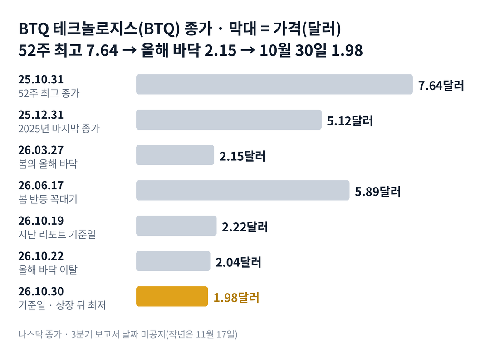

## 짧은 답

> **핵심:** 11일 동안의 하락은 회사 소식이 아니라 양자주 전체가 빠진 날에 더 크게 빠진 결과였고, 그 사이 올해 바닥 2.15달러가 깨졌습니다.

BTQ 테크놀로지스의 10월 30일 종가는 1.98달러입니다. 지난 리포트가 '올해 바닥 바로 위'라고 짚은 2.15달러는 10월 22일에 깨졌습니다. 그 뒤 2.00달러, 1.98달러로 올해 최저 종가를 세 번 새로 썼습니다.

> **국면 정의(BTQ 시리즈 공통):** 국면 A 헤드라인 급등 — 업종 소식·회사 발표에 하루 20% 넘게 오르는 때. 국면 B 반등이 낮아지는 단계 — 반등 꼭대기가 낮아지고 발표에도 주가가 오르지 않는 때. 국면 C 바닥 다지기 — 직전 바닥 근처에서 더 내려가지 않고 거래량이 줄며 주식 판매가 멈추는 때.

**지금 진단: 지난 리포트의 국면 B가 바닥 아래로 이어지고 있습니다.** 근거는 5부에, 업종과 나란히 본 하락은 2부 표에, 발표 없는 급락 뒤 스무 거래일의 기록은 3부 표에 있습니다.

> **유의사항** 저자는 금융·투자 자문가가 아닙니다. 이 글은 공개 공시와 시세를 정리한 교육용 분석이며 특정 종목의 매수·매도를 권하지 않습니다. 과거 패턴은 미래 수익을 보장하지 않습니다. 실제 투자 전에는 최신 공시를 직접 확인하세요.

## 지난 리포트 이후

[지난 리포트](/r/btq-2026-10-2/)는 2026년 10월 19일 종가 2.22달러를 기준으로 나왔습니다. 그 리포트는 지금을 국면 B의 후반으로 보고, 2.15달러 아래로 내려가면 다음 국면을 살피자고 적었습니다. 지난 예측 성적은 적중 하나, 부분 적중 둘, 빗나감 하나, 진행 중 하나입니다.

| 지난 점검 항목 · 당시 기준 | 실제 결과(10월 30일) | 판정 |
| --- | --- | --- |
| 진단: 국면 B 후반 2.15달러 아래면 다음 국면 확인 | 10.22 종가 2.04로 이탈, 바닥 신호는 아직 없음 | 적중 |
| 시나리오 2 · 판매와 희석 2026년 최저 2.15달러 아래로 | 2.15 아래는 맞음, 주식 판매 공시는 없음 | 부분 적중(다른 계기) |
| 시나리오 3 · 업종의 새 파도 대형 기술 기업의 양자 발표 | 인텔의 클래시크 인수 계획, 반등은 하루 | 부분 적중 |
| 시나리오 4 · 소송과 지배구조 전 최고운영책임자 소송 공시 | 새 공시 없음 | 빗나감 |
| 시나리오 1 · 첫 외부 매출 3분기 실적의 카이아 매출 | 3분기 보고서 날짜 미공지 | 진행 중(보고서 뒤 판정) |

이번 회차가 새로 답하는 질문은 하나입니다. 회사 발표 없이 하루 8% 넘게 빠진 뒤, 과거의 BTQ는 스무 거래일 안에 그 자리를 되찾았을까요?

## 1부. BTQ 테크놀로지스는 어떤 회사인가

> **핵심:** 양자컴퓨터 시대의 보안 칩과 소프트웨어를 내세우지만 주력 제품 매출은 아직 없고, 그래서 주가는 업종 분위기와 자금 조달에 크게 흔들려 왔습니다.

BTQ 테크놀로지스는 캐나다 브리티시컬럼비아주에 등록된 회사입니다. 2025년 9월 26일 나스닥에 상장했습니다. 회사는 한국 보안 반도체 설계 회사 ICTK(아이씨티케이)와 양자 공격에도 안전한 보안 칩을 개발하고 있습니다.

2026년 7월에는 프랑스 양자 소프트웨어 회사 QPerfect를 완전히 인수했습니다. 10월 29일에는 그 회사의 양자 에뮬레이터를 개발자 3만 5,000여 명이 쓰는 플랫폼 qBraid에 올렸다고 발표했습니다. 에뮬레이터는 일반 컴퓨터에서 양자컴퓨터를 흉내 내는 프로그램입니다. 발표에 금액이나 매출 이야기는 없었습니다.

### 숫자로 본 지금의 크기(10월 30일 기준)

| 항목 | 값 · 근거 |
| --- | --- |
| 종가 | **1.98달러** 나스닥 상장 뒤 가장 낮은 종가 |
| 시가총액 | **약 2억 9,100만 달러** 지난 리포트의 8월 13일 주식 수 기준 |
| 연초 대비 | **-61.3%** 2025년 말 종가 5.12달러 |
| 52주 최고 종가 대비 | **-74.1%** 2025년 10월 31일 7.64달러 |
| 6월 말 현금 | **973만 캐나다달러** 그 뒤 분기 보고서는 아직 없음 |
| 직전 30거래일 평균 거래량 | **약 207만 주** 9월 8일~10월 19일 |

이 말은 곧 주가는 1년 사이 4분의 1 수준이 됐고, 현금은 6월 말 이후 새 숫자가 없다는 뜻입니다. 시가총액은 8월 이후 판 주식을 넣지 않은 값이라 실제로는 조금 더 클 수 있습니다.

위 그림처럼 3월 27일 2.15달러가 올해 바닥이었고, 봄 반등은 6월 17일 5.89달러까지 갔습니다. 그 뒤 반등의 꼭대기는 계속 낮아졌습니다.

## 2부. 10월 20~30일, 업종과 나란히

> **핵심:** 하루 8% 넘게 움직인 세 날 모두 양자주 전체가 같은 방향이었고, BTQ는 그 흐름을 대형 양자주보다 크게 탔습니다.

10월 22일 BTQ는 9.3% 내려 2.04달러로 마감했습니다. 이날 회사 공시는 없었습니다. 램리서치 실적 뒤 기술주가 함께 밀린 날로 보도됐고, 아이온큐는 3.5%, 리게티는 4.7% 내렸습니다. 거래량은 약 523만 주로 평소의 약 2.5배였습니다.

10월 27일에는 8.2% 올랐습니다. 이날도 회사 공시는 없었고, 양자주가 함께 올랐습니다. 비슷한 시기 인텔은 양자 소프트웨어 회사 클래시크를 약 23억 달러에 인수할 계획을 밝혔습니다. 다만 이날 거래량은 평소의 절반에 못 미쳤습니다.

10월 29일 회사는 에뮬레이터 배포 소식을 냈지만 주가는 4.0% 내렸습니다. 다음 날 인텔과 아마존 실적 뒤 기술주가 다시 밀렸고, BTQ는 8.3% 내려 1.98달러가 됐습니다.

### 같은 11일, 양자주 성적

| 종목 · 성격 | 10.19 → 10.30 | 10.30 하루 |
| --- | --- | --- |
| **BTQ** · 보안 칩, 매출 없음 | -10.8% | -8.3% |
| 디웨이브(QBTS) · 양자 어닐링 | -10.0% | -7.9% |
| 실스크(LAES) · 보안 반도체 | -12.0% | -6.4% |
| 리게티(RGTI) · 초전도 양자 | -3.6% | -6.7% |
| 아이온큐(IONQ) · 업종 대표 | -2.4% | -5.3% |

이 말은 곧 BTQ만 따로 빠진 것이 아니라, 업종이 흔들린 날 더 크게 흔들렸다는 뜻입니다. 세 날 모두 BTQ의 움직임은 아이온큐의 1.2~2.7배였습니다. 지난 기간에는 아이온큐가 22.8% 내려 BTQ보다 더 빠졌는데, 이번에는 반대가 됐습니다.

## 3부. 발표 없는 급락 뒤의 기록

> **핵심:** 나스닥 상장 뒤 회사 발표 없이 하루 8% 넘게 내린 22번 가운데, 스무 거래일 뒤 그 전날 종가보다 높았던 경우는 4번뿐이었습니다.

회사 공시나 보도자료가 없는 날 하루 8% 넘게 내린 경우를 모두 모았습니다. 2025년 9월 상장부터 2026년 9월까지 22번입니다. 반응은 사건 전날 종가 대비이고, 스무 거래일 뒤는 사건일을 첫날로 센 스무 번째 거래일 종가입니다.

2025년의 9번은 스무 거래일 뒤 모두 더 낮았습니다. 아래 표는 2026년의 13번입니다.

### 2026년 발표 없는 -8% 하락 13번, 스무 거래일 뒤는?

| 이벤트일 · 공시 내용 | 당일 | 20거래일 뒤 |
| --- | --- | --- |
| **2026.01.30** 공시 없음, 상장 뒤 최저 종가 | -12.4% | -12.8% |
| **2026.02.03** 공시 없음, 상장 뒤 최저 종가 | -8.4% | -3.4% |
| **2026.02.05** 공시 없음, 그해 최저 종가 2.30달러 | -16.7% | +19.2% |
| **2026.02.17** 공시 없음 | -8.5% | +4.0% |
| **2026.02.27** 공시 없음 | -12.6% | -38.3% |
| **2026.03.27** 공시 없음, 그해 최저 종가 2.15달러 | -8.5% | +31.5% |
| **2026.05.15** 공시 없음 | -9.3% | +28.8% |
| **2026.06.05** 공시 없음 | -15.7% | -4.3% |
| **2026.07.07** 공시 없음 | -9.7% | -17.1% |
| **2026.07.29** 공시 없음 | -8.4% | -1.2% |
| **2026.08.28** 공시 없음 | -9.3% | -25.3% |
| **2026.08.31** 공시 없음 | -8.7% | -14.1% |
| **2026.09.03** 공시 없음 | -8.9% | -8.9% |

이 말은 곧 더 높았던 네 번이 모두 2026년 2~5월에 몰려 있다는 뜻입니다. 그중 두 번(2월 5일, 3월 27일)은 그날 종가가 그해 가장 낮은 값이었습니다. 6월 이후 다섯 번은 스무 거래일 뒤 모두 더 낮았습니다.

10월 22일 하락도 공시 없는 -9.3%였고, 그날 종가가 그해 최저였습니다. 이 하락의 스무 번째 거래일은 11월 18일입니다. 10월 30일 하락은 전날 회사 보도자료가 있어 표의 기준에서 뺐습니다.

## 4부. 되풀이된 이야기

> **핵심:** 매출이 없는 동안 BTQ는 업종이 오르는 날보다 빠지는 날에 더 민감했고, 회사 발표는 주가를 떠받치지 못했습니다.

첫째, 업종 민감도입니다. 이번 세 날처럼 양자주가 함께 움직인 날 BTQ는 대개 더 크게 움직였습니다. 지난 리포트의 기록에서도 2025년 이후 아이온큐가 하루 8% 넘게 빠진 30번 뒤, 스무 거래일째 BTQ가 더 높았던 날은 8번이었습니다.

둘째, 발표의 힘이 약해졌습니다. 9월 30일 첫 반복 매출 계약 뒤에도 주가는 내렸고, 10월 29일 에뮬레이터 배포 소식 날에도 내렸습니다. 숫자가 없는 발표에는 시장이 반응하지 않는 흐름입니다.

셋째, 주식 판매의 그림자입니다. 회사는 2026년 6월 시장가 주식 판매 계약을 맺었고, 그 발표 다음 거래일 주가는 21.8% 내렸습니다. 10월에 주식을 얼마나 팔았는지는 3분기 보고서에서야 알 수 있습니다.

## 5부. 지금 어느 단계이고, 무엇을 볼까

> **핵심:** 바닥 아래로 내려왔지만 바닥을 다지는 신호는 아직 없고, 3분기 보고서의 외부 매출과 주식 판매 숫자가 다음 국면을 가를 것입니다.

**2026년 10월 30일 진단: 국면 B(반등이 낮아지는 단계)의 연장.** 근거는 세 가지입니다. 올해 최저 종가를 열흘 안에 세 번 새로 썼고, 10월 27일 반등은 거래량이 평소의 절반 이하였으며, 회사 발표에도 주가가 오르지 않았습니다. 국면 C(바닥 다지기)로 보려면 1.98달러 근처에서 더 내려가지 않고 거래량이 줄어야 합니다.

### 앞으로 일어날 수 있는 일

과거 기록부터 보겠습니다. 나스닥 상장 뒤 회사 발표 없는 -8% 하락 뒤 스무 거래일은 22번 중 4번만 더 높았고, 상장 뒤 최저 종가를 새로 쓴 날 뒤로는 16번 중 3번이었습니다. 아래 가능성은 이 빈도와 지금 신호를 함께 본 추정입니다.

| 시나리오 · 예상 반응(판정 12월 31일) | 매출 · 판매 멈춤 | 가능성(추정) |
| --- | --- | --- |
| 1 · 첫 매출이 바닥을 만든다 보고서 뒤 1.98달러 위 유지 | ○ / ○ | 낮음 (10~20%) |
| 2 · 매출은 나오지만 판매가 누른다 반등 짧고 2달러 근처 | ○ / × | 중간 (20~30%) |
| 3 · 업종 따라 출렁인다 양자주 반등에 함께 회복 시도 | × / ○ | 중간 (20~30%) |
| **4 · 매출 없이 판매가 이어진다** 1.98달러 아래 새 최저 | × / × | 높음 (35~45%) |

표의 '매출'은 3분기 보고서에 카이아 등 외부 고객 매출이 처음 잡히는 경우, '판매 멈춤'은 7~9월에 시장가 주식 판매가 크게 줄어든 경우입니다. 3분기 보고서 날짜는 아직 공지되지 않았고, 작년에는 11월 17일에 나왔습니다.

시나리오 4를 가장 높게 본 이유는 기록과 습관입니다. 6월 이후 발표 없는 급락 다섯 번은 스무 거래일 뒤 모두 더 낮았습니다. 회사는 6월 말 현금 973만 캐나다달러로 시장가 판매에 기대 왔습니다.

시나리오 1의 근거는 카이아 재단과 맺은 3년 계약입니다. 회사는 첫해 매출을 수십만 달러 수준으로 예상했고, 그것이 처음 숫자로 잡히는 자리가 3분기 보고서입니다.

## 6부. 조심할 점과 체크리스트

> **핵심:** 기록표는 22번의 작은 표본이고, 10월 주식 판매량과 3분기 숫자는 아직 공개되지 않았습니다.

3부 표는 '발표 없는 급락 뒤 반드시 더 내린다'는 규칙이 아닙니다. 22번은 작은 표본이고, 더 높았던 네 번은 모두 양자주 전체가 반등한 2026년 봄에 몰려 있습니다. 업종 흐름이 바뀌면 같은 숫자도 다르게 읽힙니다.

이 기간 일부 기사 사이트는 열람할 수 없어, 업종 하락의 배경 설명은 보도 제목 수준으로만 썼습니다. 인텔의 클래시크 인수 발표 날짜는 확인하지 못했습니다. 시가총액은 8월 13일 주식 수로 계산했습니다.

- □ 11월 3분기 보고서에 외부 고객 매출이 0보다 큰가
- □ 11월 3분기 보고서의 9월 말 현금이 6월 말 973만 캐나다달러보다 늘었나
- □ 11월 3분기 보고서에 7~9월 시장가 판매 주식 수가 나오는가
- □ 11월 18일(10월 22일 하락의 20거래일째) 종가가 2.25달러 위인가
- □ 12월 31일까지 1.98달러 아래 새 최저 종가가 나오는가
- □ 12월 31일까지 아이온큐가 8% 넘게 빠진 날 BTQ 낙폭이 2배 아래로 줄어드는가

다음 갱신은 3분기 보고서가 나온 뒤에 합니다.
