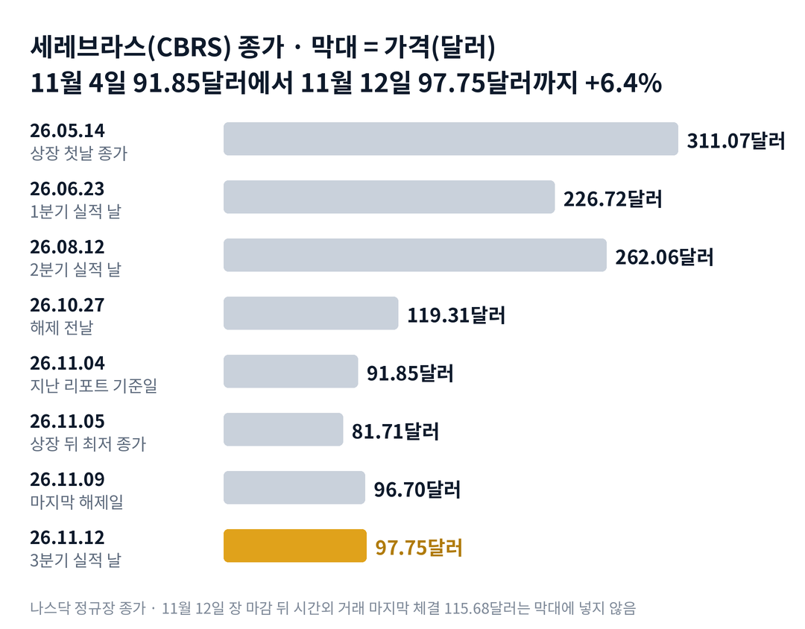

## 짧은 답

> **핵심:** 매출이 전망을 넘긴 것은 세 번 모두 같았고, 다른 것은 다음 분기 이익률 전망의 방향이었습니다.

세레브라스의 실적은 상장 뒤 세 번 모두 회사 전망을 넘었습니다. 그런데 왜 앞선 두 번은 다음 날 급락했고, 이번에는 시간외 거래에서 18.3% 올랐을까요?

11월 12일 장 마감 뒤 나온 3분기 핵심 매출은 2억 3,090만 달러였습니다. 8월에 내건 전망 2억 1,400만~2억 1,600만 달러를 넘었습니다. 주가는 정규장이 끝난 뒤 시간외 거래에서 115.68달러에 마지막으로 거래됐습니다.

앞선 두 번도 매출은 전망을 넘겼습니다. 그래도 다음 날 주가는 6월에 19.6%, 8월에 11.8% 내렸습니다.

세 번을 나란히 놓으면 한 줄이 다릅니다. 앞선 두 번은 다음 분기 매출총이익률 전망이 직전 분기보다 낮았고, 이번에는 6~8%포인트 높았습니다.

**2026.11.12 진단: 국면 C(실적 확인)의 첫날 — 락업 해제 일정이 끝나고 실적이 주가를 정하는 단계, 근거는 5부.** 다만 시간외 거래는 거래량이 적은 시간의 값이라, 첫 반응의 판정은 11월 13일 정규장 종가로 합니다.

> **유의사항** 저자는 금융·투자 자문가가 아닙니다. 이 글은 공개 공시와 시세를 정리한 교육용 분석이며 특정 종목의 매수·매도를 권하지 않습니다. 실적 기록은 세 번뿐이고, 시간외 가격은 정규장에서 크게 달라질 수 있습니다. 실제 투자 전에는 최신 가격과 공시를 직접 확인하세요.

## 지난 리포트 이후

[지난 리포트](/r/cbrs-2026-11/)는 11월 4일 종가 91.85달러를 기준으로 나왔습니다. 그 리포트는 11월 9일 마지막 락업 해제(상장 전 주주가 일정 기간 주식을 팔지 않기로 한 약속이 풀리는 날)와 11월 12일 실적이 이어서 주가를 끌어내리는 시나리오를 가장 높게(약 35%) 봤습니다.

**지난 예측 성적(11월 5일 리포트): 적중 2 · 빗나감 3 · 확인 전 1** — 해제 날 하락을 가장 크게 본 시나리오는 11월 9일 +7.8%로 빗나갔습니다.

빗나간 이유는 업종입니다. 11월 9일에는 반도체 상장지수펀드(ETF) SOXX(미국 반도체 대표 종목 묶음)도 7.5% 올랐습니다. 지난 리포트는 해제 물량을 중심에 두고, 업종이 크게 반등하는 날과 해제가 겹칠 경우를 따로 보지 않았습니다. 항목별 채점표는 6부 끝에 있습니다.

## 1부. 세레브라스는 무엇으로 돈을 벌고, 3분기에 무엇이 나왔나

> **핵심:** 세레브라스는 웨이퍼 한 장짜리 칩으로 인공지능 답을 빠르게 계산해 주고 돈을 법니다. 3분기에는 매출과 이익률이 모두 전망을 넘었고, 4분기 전망은 그보다 더 높게 나왔습니다.

세레브라스는 미국 캘리포니아주 서니베일의 인공지능 반도체 회사입니다. 반도체 원판(웨이퍼) 한 장을 통째로 칩 하나로 쓰는 것이 특징입니다. 2026년 5월 공모가 185달러로 나스닥에 상장했습니다.

돈을 버는 방식은 두 가지입니다. 칩을 넣은 장비를 파는 것, 그리고 그 장비로 인공지능 답을 계산해 주는 클라우드 서비스입니다. 3분기 핵심 매출 2억 3,090만 달러 가운데 클라우드와 서비스가 1억 4,490만 달러였습니다. 1년 전보다 272% 늘어난 값입니다.

이 글에서 '핵심 매출'은 회사가 따로 내는 기준입니다. 고객에게 준 주식 매입권(워런트)의 비용 처리와 데이터센터 통과 매출 같은 항목을 뺀 값입니다. 회계 기준 매출은 2억 1,080만 달러로, 1년 전보다 55% 늘었습니다.

매출총이익률은 매출에서 만드는 데 든 비용을 빼고 남은 돈의 비율입니다. 같은 매출이라도 이 비율이 높을수록 회사에 남는 돈이 많습니다. 세레브라스처럼 데이터센터를 늘리는 회사는 이 비율이 언제 오르기 시작하는지가 중요합니다.

아래 표의 잔여수행의무는 이미 계약했지만 아직 매출로 잡지 않은 금액이고, 이익률은 모두 회사가 내는 핵심 기준입니다.

### 숫자로 본 지금의 크기(3분기 실적 기준)

| 항목 | 값 · 비교 대상 |
| --- | --- |
| 3분기 핵심 매출 | **2억 3,090만 달러** 전망 2억 1,400만~2억 1,600만 달러 |
| 3분기 핵심 매출총이익률 | **41%** 전망 38~40% |
| 4분기 핵심 매출 전망 | **3억 1,000만~3억 3,000만 달러** 3분기보다 약 39% 많음(범위의 중앙값) |
| 4분기 핵심 매출총이익률 전망 | **47~49%** 3분기 41%보다 높음 |
| 올해 핵심 매출 전망 | **9억 4,000만~9억 6,000만 달러** 8월 전망 8억 8,000만~8억 9,000만 달러 |
| 쌓인 일감(잔여수행의무) | **261억 달러** 6월 말 254억 달러 |

회사는 잔여수행의무의 약 33%를 2028년 9월까지 24개월 동안 매출로 잡을 것으로 봤습니다. 고객 소식도 있었습니다. 회사는 3대 초대형 클라우드 회사 가운데 한 곳과 클라우드 계약을 맺었다고 밝혔고, 오라클 클라우드에서는 2027년부터 쓸 수 있게 된다고 했습니다. 최고경영자는 2027년 매출을 세 배로 늘릴 것으로 본다고 다시 밝혔습니다.

위 그림처럼 주가는 5월 상장 첫날 종가 311.07달러에서 11월 5일 81.71달러까지 내려왔습니다. 상장 뒤 가장 낮은 종가입니다. 그 뒤 실적 날까지 다섯 거래일 동안 19.6% 올라 97.75달러가 됐습니다. 이 반등은 회사 소식 덕이었을까요, 업종 덕이었을까요?

## 2부. 실적 앞 여섯 거래일, 해제와 업종 반등이 겹친 날

> **핵심:** 마지막 해제 날 주가는 올랐지만, 같은 날 반도체 업종도 비슷하게 올랐습니다. 이 기간 세레브라스는 업종과 같은 쪽으로 움직였습니다.

지난 리포트 뒤 첫 큰 일은 11월 5일이었습니다. 그날 아침 최고경영자가 칩 수명을 문제 삼은 공매도 보고서에 반박하는 글을 냈습니다. 그런데 그날 반도체 업종이 급락했습니다. SOXX는 12.1%, 세레브라스는 11.0% 내렸습니다.

11월 9일은 락업의 마지막 해제일이었습니다. 지난 리포트는 이날 하락이 과거 가운데 값(중앙값, -5.2%)보다 큰지를 봤습니다. 실제로는 7.8% 올랐습니다.

### 실적 앞 여섯 거래일, 세레브라스와 반도체 ETF

| 날짜 · 그날 있던 일 | **세레브라스** | SOXX |
| --- | --- | --- |
| **2026.11.05** 최고경영자 반박 글 · 업종 급락 | **-11.0%** | -12.1% |
| **2026.11.06** 다음 날 반등 | **+9.8%** | +3.5% |
| **2026.11.09** 마지막 락업 해제일 | **+7.8%** | +7.5% |
| **2026.11.10** 해제 다음 날 | **-3.1%** | -0.1% |
| **2026.11.11** 업종 반등 | **+7.9%** | +6.0% |
| **2026.11.12** 실적 날(장 마감 뒤 발표) | **-3.3%** | -0.3% |

여섯 거래일 가운데 다섯 번은 세레브라스와 SOXX가 같은 쪽으로 움직였습니다. 해제 날 상승도 업종 반등과 크기가 거의 같았습니다. SOXX와의 차이는 0.3%포인트뿐입니다. 그래서 이날의 +7.8%를 '해제 물량을 무난히 소화했다'는 뜻으로만 읽기는 어렵습니다.

그래도 하나는 분명해졌습니다. 정해진 날짜의 락업 해제는 이제 끝났습니다. 11월 9일 뒤 종가는 가장 낮은 날이 93.66달러로, 지난 리포트 기준 91.85달러 위에 머물렀습니다. 임원 매도 계획이나 직원 주식 보상으로 나오는 주식은 남지만, 날짜가 정해진 큰 물량은 더 없습니다. 그래서 다음 재료는 실적이 될 가능성이 커 보입니다.

여섯 거래일을 나란히 놓으면 공통점이 하나 보입니다. 해제 날을 포함해 큰 움직임은 모두 업종과 같은 날, 같은 쪽이었다는 점입니다. 업종 바깥의 회사 숫자, 곧 실적에는 주가가 어떻게 반응해 왔을까요?

## 3부. 실적 세 번, 첫날과 20거래일 뒤

> **핵심:** 세 번 모두 매출은 전망을 넘겼습니다. 다음 날 주가를 가른 것은 함께 나온 다음 분기 매출총이익률 전망이 직전 분기보다 낮은지 높은지였습니다.

세레브라스는 상장 뒤 실적을 세 번 냈고, 세 번 모두 장 마감 뒤였습니다. 세 번 모두 이번과 같은 조건, 곧 분기 숫자와 다음 분기 전망을 함께 낸 날이기 때문에 빠짐없이 골랐습니다. 기준은 발표 날 정규장 종가입니다. 첫날은 다음 거래일 종가, 20거래일 뒤는 기준일에서 20거래일을 넘긴 날의 종가로 비교했습니다.

예를 들어 8월 2분기 실적은 8월 12일 장 마감 뒤에 나왔습니다. 그날 종가 262.06달러가 기준이고, 다음 날 231.01달러로 -11.8%였습니다. 다섯 번째 거래일인 8월 19일에는 215.69달러로 -17.7%였습니다.

6월 첫 실적은 6월 23일 종가 226.72달러가 기준이고, 다음 날 182.26달러, 20번째 거래일인 7월 22일 209.80달러였습니다. 20번째 거래일인 9월 10일에는 191.34달러로 -27.0%였습니다.

**한눈에:** **3/3** 핵심 매출이 전망 이상 · **2/2** 이익률 전망이 낮아진 날 다음 날 하락 · **+18.3%** 이번 시간외 마지막 체결. 첫날과 20거래일 숫자는 정규장 종가만 씁니다.

### 실적 세 번, 첫날과 20거래일 뒤

| 발표일 · 그날 나온 내용 | 첫날 | 20거래일 뒤 |
| --- | --- | --- |
| 2026.06.23 1분기 · 첫 실적 2분기 이익률 전망 36~38% (1분기 회계 기준 45%) SOXX 20거래일 -7.9% | -19.6% | -7.5% |
| 2026.08.12 2분기 핵심 매출 전망보다 8.2% 많음 3분기 이익률 전망 38~40% (2분기 41%) SOXX 20거래일 -5.3% | -11.8% | -27.0% |
| **2026.11.12** 3분기 핵심 매출 전망보다 7.4% 많음 4분기 이익률 전망 47~49% (3분기 41%) | **미확정** | **미확정** |

> **이번 사례(첫날·20거래일 결과 미확정):** 시간외 마지막 체결 115.68달러(오후 8시 ET) · 첫날 판정은 11월 13일 정규장 종가 · 20거래일째는 12월 11일

매출만 보면 세 번은 비슷했습니다. 2분기와 3분기 모두 핵심 매출이 전망 가운데 값(중앙값)보다 7~8% 많았고, 둘 다 연간 전망을 올렸습니다. 실적 앞 다섯 거래일 동안의 상승도 8월 +22.3%, 이번 +19.6%로 비슷했습니다.

다른 줄은 다음 분기 이익률 전망이었습니다. 6월과 8월에는 그 전망이 방금 끝난 분기보다 낮았습니다. 이번 4분기 전망은 처음으로 직전 분기보다 높습니다. 1분기는 핵심 기준 이익률이 공개되지 않아 표에서 회계 기준으로 비교했습니다.

이 기록의 한계는 큽니다. 실적은 세 번뿐이고, 그중 결과가 나온 것은 두 번입니다. 6월 첫날은 1분기 숫자를 처음 본 날이기도 합니다. 두 번의 하락이 이익률 전망 때문만이라고 단정할 수는 없습니다. 그렇다면 투자자는 왜 매출보다 이익률 전망에 더 크게 반응했을까요?

## 4부. 왜 이익률 전망이 다음 날을 정했나

> **핵심:** 세레브라스는 데이터센터를 먼저 늘리고 매출을 나중에 거두는 구조라, 투자자는 '늘어난 매출이 언제 이익으로 남는가'를 이익률 전망으로 확인해 왔습니다.

먼저 확인된 사실입니다. 3분기 회계 기준 매출총이익률은 20%였고, 핵심 기준으로는 41%였습니다. 차이가 큰 것은 고객 워런트 비용 처리와 주식 보상 비용 때문입니다. 회사가 전망을 내는 숫자는 핵심 기준입니다.

데이터센터는 짓는 동안 비용이 먼저 나갑니다. 장비를 들이고 전기를 계약하는 비용은 매출보다 앞서 잡힙니다. 그래서 매출이 빨리 늘어도 이익률이 떨어지는 분기가 생길 수 있습니다. 6월과 8월의 전망이 바로 그런 모습이었습니다.

이번 4분기 전망은 그 순서가 바뀌는 첫 숫자입니다. 핵심 영업이익률 전망은 -1%~+1%로, 3분기 -14%에서 거의 손익이 맞는 수준까지 올라옵니다. 회사는 4분기에 손익이 거의 맞는 수준을 예상한다는 뜻입니다. 매출이 이익으로 남기 시작하는 때에 대한 회사의 첫 전망 숫자이고, 실제 결과는 아닙니다.

반론도 있습니다. 시간외 거래는 거래량이 적어 값이 크게 흔들립니다. 실제로 11월 12일 시간외 거래는 오후 4시 5분 93.19달러까지 내렸다가 오후 4시 33분 117.11달러까지 올랐습니다. 전망은 회사의 예상일 뿐이라, 4분기 실제 이익률은 2027년 초 실적에서 확인됩니다.

과거 기록이 보여 주는 것은 다음 날 반응까지입니다. 20거래일 뒤의 방향은 두 번 모두 업종과 같은 쪽이었습니다. 그래서 앞으로 확인할 조건은 두 가지입니다. 하나는 20거래일째 종가가 실적 날 종가 위에 남는지, 다른 하나는 그동안 업종이 오르는지입니다. 이 두 조건을 엮으면 어떤 갈림길이 나올까요?

## 5부. 지금 어느 단계이고, 네 가지 시나리오

> **핵심:** 해제 일정이 끝나 국면 C(실적이 주가를 정하는 단계)의 첫날에 들어섰고, 12월 11일까지 실적 효과가 남는지와 업종 방향이 다음 갈림길입니다.

> **국면 정의(세레브라스 시리즈 공통):** 국면 A(상장 기대) — 상장 직후 기대로 거래가 몰리는 때. 국면 B(공급 소화) — 락업 해제로 풀리는 주식을 시장이 받아 내느라 반등이 짧고 고점이 낮아지는 때. 국면 C(실적 확인) — 해제가 끝나고 실적과 고객 소식이 주가를 정하는 때.

**2026년 11월 12일 진단: 국면 C(실적 확인)의 첫날.** 11월 9일 마지막 해제가 지났고, 그 뒤 종가는 91.85달러 위에 머물렀습니다. 국면 C가 이어지는지는 실적 뒤 반등의 꼭대기가 높아지는지로 봅니다.

돈의 자리는 아래 표와 같습니다. 성격과 시점이 달라 서로 더하지 않습니다.

| 항목 | 값 · 계산 근거 |
| --- | --- |
| 시가총액(11월 12일 종가) | **약 237억 5,000만 달러** 97.75달러 × 약 2억 4,300만 주(11월 5일) |
| 현금·단기 투자(9월 말) | **78억 달러** 6월 말 86억 달러 |
| 오픈에이아이 운전자금 대출 잔액 | **8억 2,910만 달러** 9월 말, 연 6.0% |
| 대출 한도(쓰지 않은 약정) | **8억 5,000만 달러** 꺼내 쓴 돈이 아니라 상한 |
| 현금을 뺀 회사 가치(기업가치, EV) ÷ 올해 핵심 매출 전망 | **약 18배** (237억 5,000만 − 78억 + 8억 3,000만) ÷ 9억 5,000만 달러 |

지난 리포트 때 같은 계산은 약 16배였습니다. 주가가 6.4% 오르고 현금이 줄었지만, 연간 전망도 올라 배수는 조금만 높아졌습니다.

**판정 기준 두 가지(12월 11일, 20거래일째):** 첫째, 세레브라스 종가가 11월 12일 97.75달러 위면 '실적 효과 유지'로 봅니다. 둘째, SOXX 종가가 11월 12일 154.99달러 위면 '업종 상승'으로 봅니다.

### 앞으로 일어날 수 있는 일

**확인된 사실:** 3분기 핵심 매출과 이익률이 모두 전망을 넘었고, 4분기 이익률 전망은 3분기보다 높습니다. 시간외 거래는 정규장 종가보다 18.3% 높게 끝났습니다.

**과거 기록:** 표본은 2번뿐입니다. 앞선 실적 2번 중 2번은 20거래일 뒤 발표 날 종가보다 낮았고, 2번 중 2번 모두 SOXX와 같은 쪽이었습니다.

**추정:** 아래 확률은 주가 상승·하락 가능성이 아니라, '12월 11일에 실적 효과가 남는지'와 '업종 방향' 조합에 대한 분석자의 주관적 추정입니다. 네 경우는 겹치지 않아 '약 N%'를 더하면 100%이고, 괄호 안 구간은 흔들림의 폭이라 서로 더하지 않습니다.

| 시나리오(판정 2026년 12월 11일) | 회사 · 업종 | 가능성(추정) |
| --- | --- | --- |
| **1 · 실적과 업종이 함께 받침** | 유지 · 상승 | 중간 약 35% (25~45%) |
| 2 · 업종은 밀려도 실적이 받침 | 유지 · 하락 | 낮음 약 20% (10~30%) |
| 3 · 업종은 오르는데 8월처럼 밀림 | 하락 · 상승 | 낮음 약 15% (10~20%) |
| 4 · 업종과 함께 다시 밀림 | 하락 · 하락 | 중간 약 30% (20~40%) |

시나리오 1과 4를 합쳐 약 65%로 본 이유는 3부 기록입니다. 앞선 두 번의 20거래일 뒤는 모두 업종과 같은 쪽이었고, 2부의 여섯 거래일에도 다섯 번 같은 쪽이었습니다.

1을 4보다 5%포인트 높게 둔 근거는 하나입니다. 다음 분기 이익률 전망이 처음으로 직전 분기보다 높아졌고, 시간외 반응도 앞선 두 번과 반대였습니다. 5%포인트라는 차이는 분석자의 주관적 판단입니다. 다만 8월에도 실적 앞 다섯 거래일 동안 22.3% 오른 뒤였다는 점은 같습니다. 하지만 같은 무게로 반대쪽 요인도 있습니다. 현금은 석 달 새 8억 달러 줄었고, 새 클라우드 회사 계약은 이름과 크기가 아직 나오지 않았습니다. 그래서 차이를 크게 두지 않았습니다.

시나리오 1이면 다음에 볼 것은 12월 9일 바클레이스 기술 콘퍼런스에서 고객 이름이 더 나오는지입니다. 3이면 실적 앞 상승분을 되돌린 것인지, 4면 업종 급락 날 낙폭이 업종보다 큰지를 봅니다. 그렇다면 이 진단을 가장 빨리 뒤집을 위험은 무엇일까요?

## 6부. 위험과 체크리스트

> **핵심:** 가장 가까운 위험은 시간외 상승이 정규장에서 줄어드는 것이고, 그다음은 고객 집중과 업종의 큰 흔들림입니다.

먼저 이 분석의 한계입니다. 실적 기록은 세 번뿐이고 결과가 나온 것은 두 번입니다. 시간외 가격은 정규장 첫 반응이 아닙니다. 이 글은 11월 13일 장이 열리기 전에 썼습니다.

사업 실행 쪽 위험부터 보면, 9월 말 매출채권의 80%가 두 고객에게서 나왔습니다. 새 클라우드 회사 계약은 이름과 크기가 내년에 공개된다고 했습니다. 큰 고객 하나의 주문 변화가 분기 숫자를 크게 흔들 수 있습니다.

자금 조달 쪽에서는 현금이 줄고 있습니다. 현금은 6월 말보다 8억 달러 줄었습니다. 해제 일정은 끝났지만 임원 매도 계획이나 직원 주식 보상으로 나오는 주식은 남아 있습니다.

외부 환경은 반도체 업종의 흔들림입니다. 11월 5일처럼 반도체 업종이 하루 12% 넘게 빠진 날에는 회사 소식과 관계없이 함께 내렸습니다.

**핵심 확인 세 가지:**

- ☐ 1순위 · 11월 13일 정규장 종가가 11월 12일 97.75달러 위인가
- ☐ 2순위 · 11월 19일(5거래일째) 종가가 97.75달러 위인가
- ☐ 3순위 · 12월 11일(20거래일째) 종가와 SOXX 154.99달러, 어느 시나리오인가

**보조 확인:** 11월 17일 투모로우X 서밋과 12월 9일 바클레이스 기술 콘퍼런스에서 새 클라우드 회사의 이름이나 계약 크기가 나오는지 봅니다.

**기억할 판단 기준 세 가지:** 매출이 전망을 넘긴 것은 세 번 모두 같았습니다. 다음 날을 가른 것은 다음 분기 이익률 전망의 방향이었습니다. 20거래일 뒤의 방향은 지금까지 업종과 같았습니다.

지난 해제일 기록은 [10월 리포트](/r/cbrs-2026-10-3/)에 있습니다. 다음 갱신은 12월 11일 20거래일째 결과를 본 뒤에 합니다. 공시는 [세레브라스 SEC 공시 목록](https://www.sec.gov/cgi-bin/browse-edgar?action=getcompany&CIK=0002021728&type=&dateb=&owner=include&count=40)에서 확인할 수 있습니다.

### 지난 예측 채점표

**지난 리포트 점검(따로 판정):** 아래는 11월 5일 리포트의 예측을 채점한 것이고, 이번 회차의 시나리오 판정과는 따로 셉니다.

| 지난 점검 항목 · 당시 기준 | 판정 및 실제 결과(11월 12일) |
| --- | --- |
| **진단: 국면 B 끝자락** 해제 뒤 최저 종가를 지키면 국면 C | **[적중]** 11.09 뒤 최저 종가 93.66달러 |
| **체크: 해제 날 -5.2%보다 작은 하락** 11월 9일 | **[적중]** +7.8%, 같은 날 SOXX +7.5% |
| **시나리오 4 · 해제와 실적이 이어진 하락** 가장 높게 본 약 35% | **[빗나감]** 해제 날 상승 |
| **시나리오 3 · 해제에 밀리고 실적에 반등** 약 15% | **[빗나감]** 해제 날 상승 |
| **체크: 3분기 핵심 매출 전망 범위 안** 2억 1,400만~2억 1,600만 달러 | **[빗나감·위쪽]** 2억 3,090만 달러 |
| **시나리오 1·2 · 실적 첫 반응** 11월 13일 종가 | **[확인 전]** 시간외 +18.3%, 정규장 판정 대기 |
