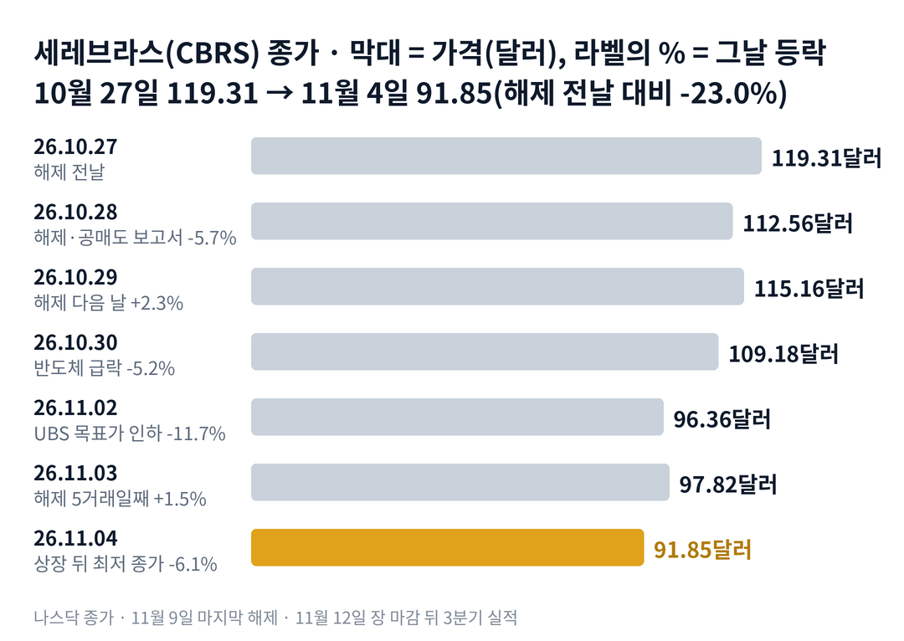

## 짧은 답

> **핵심:** 세레브라스는 10월 28일 해제 뒤 다섯 거래일 만에 해제 전날 종가 대비 18.0% 내려 상장 뒤 최저 종가를 찍었습니다. 해제일 아홉 번 가운데 다섯 거래일 뒤 더 낮았던 것은 여섯 번이고, 남은 해제는 11월 9일 한 번입니다.

풀리는 주식은 정해진 날에 정해진 만큼 나옵니다. 그런데 왜 이번에는 해제 뒤 일주일 만에 5분의 1 가까이 빠졌을까요?

세레브라스 주가는 해제 전날인 10월 27일 종가 119.31달러에서 11월 4일 종가 91.85달러로 내려왔습니다. 11월 4일 종가는 상장 뒤 가장 낮고, 5월 공모가의 절반 아래입니다.

이번에는 해제 물량 하나만이 아니었습니다. 해제일 당일 공매도 업체가 칩 수명을 문제 삼는 보고서를 냈습니다. 그 뒤 반도체 업종이 크게 흔들렸고, 증권사 목표가 인하가 이어졌습니다.

이 글은 지난 해제일 아홉 번을 '당일'과 '다섯 거래일 뒤'로 나란히 놓습니다. 그리고 11월 9일 마지막 해제와 11월 12일 실적을 무엇으로 판정할지 정리합니다.

> **유의사항** 저자는 금융·투자 자문가가 아닙니다. 이 글은 공개 공시와 시세를 정리한 교육용 분석이며 특정 매매를 권하지 않습니다. 과거의 주가 반응이 미래에 반복된다는 보장은 없고, 세레브라스는 상장한 지 여섯 달이 안 된 종목이라 기록이 짧습니다. 11월 5일 장중 가격은 이 글의 숫자에 넣지 않았습니다. 실제 투자 전에는 최신 가격과 공시를 직접 확인하세요.

## 지난 리포트 이후

[지난 리포트](/r/cbrs-2026-10-3/)는 10월 28일 종가 112.56달러를 기준으로 썼습니다. 예측 성적은 적중 2 · 부분 적중 1 · 빗나감 2 · 진행 중 3입니다.

| 지난 점검 항목 · 당시 기준 | 판정 및 실제 결과(11월 4일) |
| --- | --- |
| **진단: 공급을 소화하는 단계의 끝자락** 반등 고점이 낮아지는 흐름 | **[적중]** 10월 29일 115.16달러가 반등 고점, 그 뒤 최저 종가 갱신 |
| **점검: 임원 매도 예정 6만 주** 매도 보고서로 확인되는가 | **[적중]** 최고기술책임자 6만 주 매도 보고(10월 27일 거래) |
| **점검: 11월 3일 종가** 해제 전날 119.31달러 회복 | **[빗나감]** 97.82달러, 해제 전날 대비 -18.0% |
| **점검: 108.37달러 방어** 10월 26일 최저 종가 | **[빗나감]** 11월 2일 96.36달러로 깨짐 |
| **시나리오 3: 고객 이탈 우려** 하루 9~11% 움직임 | **[부분 적중]** 11월 2일 -11.7%, 계기는 공식 확인이 아니라 목표가 인하 |
| **시나리오 1·2·4** 마지막 해제와 실적 | **[진행 중]** 11월 13일 판정 |

빗나간 부분은 크기입니다. 지난 리포트는 해제일 하락이 하루로 끝나지 않을 수 있다고 봤지만, 108.37달러 아래까지 내려갈 것으로는 보지 않았습니다. 지난 리포트가 놓친 사실도 하나 있습니다. 10월 28일에는 해제와 함께 공매도 보고서가 나왔습니다.

## 1부. 세레브라스는 어떤 회사이고, 무엇으로 돈을 버는가

> **핵심:** 세레브라스는 반도체 원판 한 장을 칩 하나로 쓰는 회사입니다. 그 칩의 연산을 빌려주고 팔아서 돈을 벌고, 상장 뒤 가장 큰 주가 변수는 풀리는 주식이었습니다.

세레브라스는 미국 캘리포니아주 서니베일에 있는 인공지능 반도체 회사입니다. 주력 칩인 웨이퍼 규모 엔진(WSE-3)은 반도체 원판(웨이퍼) 한 장을 통째로 칩 하나로 씁니다. 2026년 5월 공모가 185달러로 나스닥에 상장했고, 첫날 종가는 311.07달러였습니다.

돈을 버는 방식은 두 가지입니다. 하나는 칩을 넣은 장비를 파는 것이고, 다른 하나는 그 장비로 인공지능 답을 계산해 주는 클라우드 서비스입니다. 2026년 2분기 매출 1억 8,010만 달러 가운데 클라우드와 서비스가 1억 2,600만 달러였습니다. 매출의 약 75%가 오픈에이아이로 보이는 고객과 아랍에미리트의 두 기관에서 나왔습니다.

칩 수명이 중요한 이유는 이 사업이 장비를 오래 돌려야 돈이 되기 때문입니다. 클라우드 회사는 장비를 사서 몇 년에 걸쳐 빌려주고 그 사용료로 장비값을 갚습니다. 그런데 칩이 예상보다 빨리 닳는다면 같은 장비로 벌 수 있는 돈이 줄어듭니다. 10월 28일 공매도 보고서가 겨눈 곳이 바로 이 부분입니다.

지금 몸값은 회사가 내건 숫자에 비해 많이 내려왔습니다. 시가총액은 약 218억 달러로, 6월 말 쌓인 일감(잔여수행의무·수주 잔고: 이미 계약했지만 아직 매출로 잡지 않은 금액) 254억 달러보다 작아졌습니다. 다만 그 일감은 대부분 몇 년에 걸쳐 들어오는 돈이고, 고객이 몇 곳에 몰려 있습니다.

### 숫자로 본 지금의 크기(11월 4일 기준)

| 항목 | 값 · 계산 근거 |
| --- | --- |
| 11월 4일 종가 | **91.85달러** 상장 뒤 최저 종가, 장중 최저 90.28달러 |
| 시가총액 | **약 218억 달러** 91.85달러 × 2억 3,756만 주(8월 5일 기준) |
| 현금을 뺀 회사 가치(기업가치 EV) | **약 141억 달러** 시가총액 − 현금 86억 달러 + 오픈에이아이 대출 약 9억 달러 |
| 올해 핵심 매출 전망 대비 | **약 16배** 회사 가치 ÷ 전망 중간값 8억 8,500만 달러 |
| 쌓인 일감 대비 시가총액 | **약 0.86배** 6월 30일 잔여수행의무 254억 달러 |

현금을 뺀 회사 가치(EV)를 올해 매출 전망으로 나누면 약 16배입니다. 지난 리포트 때 약 21배였습니다. 회사가 내건 숫자는 그대로인데 값만 내려온 셈입니다.

위 그림처럼 해제 다음 날 하루 반등한 뒤, 다섯 거래일 가운데 세 번 내렸습니다. 11월 4일 종가는 해제 전날 종가보다 23.0% 낮습니다. 그렇다면 그 다섯 거래일 동안 값을 끌어내린 것은 정확히 무엇이었을까요?

## 2부. 해제 뒤 다섯 거래일에 겹친 세 가지 사건

> **핵심:** 이번 하락에는 성격이 다른 세 가지 사건이 겹쳤습니다. 회사의 칩을 겨눈 공매도 보고서, 반도체 업종 전체의 매도, 증권사 목표가 인하입니다.

첫 번째는 회사의 기술을 겨눈 사건입니다. 10월 28일 해제일, 공매도 업체 컬퍼 리서치가 세레브라스 주식을 빌려 팔았다고 밝히며 보고서를 냈습니다. 공매도 보고서는 주가가 내릴 것이라는 쪽에 건 투자자가 그 근거를 공개하는 글입니다. 보고서는 웨이퍼 칩이 약 2년 만에 닳는다고 주장했습니다.

회사는 11월 5일 아침 최고경영자 글로 반박했습니다. 2년이라는 숫자는 틀렸고, 보고서가 지목한 소재는 쓴 적이 없다는 내용입니다. 이 반박에 대한 주가 반응은 아직 이 글의 숫자에 없습니다.

두 번째는 업종 전체의 매도입니다. 10월 30일 반도체 상장지수펀드(ETF) SOXX(미국 반도체 대표 종목 묶음)는 하루 8.2% 내렸고, 세레브라스는 5.2% 내렸습니다. 10월 28일 종가부터 11월 4일 종가까지로 보면 SOXX는 13.7%, 같은 업종 AMD(미국 반도체 회사)는 15.5% 내렸습니다.

세 번째는 증권사의 눈높이 조정입니다. 11월 2일 UBS(스위스 투자은행)가 목표가를 330달러에서 250달러로 낮췄습니다. 매수 의견은 그대로였지만, 그날 세레브라스는 11.7% 내렸습니다. SOXX는 같은 날 3.8% 내렸습니다.

### 다섯 거래일, 세레브라스와 반도체 ETF

| 날짜 · 그날 함께 있던 일 | **세레브라스** | SOXX |
| --- | --- | --- |
| **2026.10.29** 해제 다음 날 | **+2.3%** | -1.6% |
| **2026.10.30** 반도체 업종 급락 | **-5.2%** | -8.2% |
| **2026.11.02** UBS 목표가 330→250달러 | **-11.7%** | -3.8% |
| **2026.11.03** 해제 5거래일째 | **+1.5%** | +2.5% |
| **2026.11.04** 상장 뒤 최저 종가 | **-6.1%** | -3.1% |

10월 28일 종가에서 11월 4일 종가까지 세레브라스는 18.4%, SOXX는 13.7% 내렸습니다. 업종이 크게 빠진 날에는 함께 빠졌고, 회사 이야기가 나온 날에는 업종보다 더 빠졌습니다.

세 사건을 나란히 놓으면 공통점이 하나 보입니다. 모두 회사의 새로운 실적 악화나 계약 취소에서 비롯된 것은 아니라는 점입니다. 그렇다면 해제일 뒤 이렇게 오래 빠진 적이 전에도 있었을까요?

## 3부. 해제일 아홉 번, 당일과 다섯 거래일 뒤

> **핵심:** 해제일 아홉 번 가운데 일곱 번은 당일 내렸고, 다섯 거래일 뒤 해제 전보다 낮았던 것은 여섯 번입니다. 이번 -18.0%는 10월 14일 다음으로 큰 낙폭입니다.

이 기록을 보는 이유는 11월 9일에 마지막 해제가 남아 있기 때문입니다. 과거 해제일 뒤 주가가 어떻게 움직였는지 보면, 마지막 해제를 읽을 출발점이 생깁니다.

고른 기준은 하나입니다. 투자설명서에 적힌 조기 해제일 가운데 이미 지난 아홉 번 전부입니다. 세레브라스의 락업(상장 전 주주가 일정 기간 주식을 팔지 않기로 한 약속)은 한 번에 풀리지 않고 열 번에 나뉘어 풀립니다.

'당일'은 해제일 종가를 전날 종가와 비교한 값입니다. '다섯 거래일 뒤'는 해제일을 첫날로 센 다섯 번째 거래일 종가를 해제 전날 종가와 비교한 값입니다. 예를 들어 이번에는 11월 3일 종가 97.82달러를 해제 전날인 10월 27일 종가 119.31달러와 비교해 -18.0%가 나옵니다.

### 락업 해제일 아홉 번, 당일과 그 뒤

| 이벤트일 · 풀린 주식(약) | 당일 | 5거래일 뒤 |
| --- | --- | --- |
| 2026.05.15 250만 주 · 상장 다음 날 | -10.1% | -9.4% |
| 2026.06.25 2,770만 주 · 실적 다음 날 | -7.5% | +21.4% |
| 2026.08.14 3,640만 주 · 실적 다음 날 | -5.2% | -9.2% |
| 2026.08.19 1,460만 주 | -2.0% | -16.4% |
| 2026.09.02 1,460만 주 | +6.9% | +13.7% |
| 2026.09.16 1,460만 주 | +3.5% | +15.4% |
| **2026.09.30** 1,940만 주 · 고객 보도 | **-8.9%** | **-9.2%** |
| **2026.10.14** 1,940만 주 · 경쟁 칩 보도 | **-5.1%** | **-20.7%** |
| **2026.10.28** 1,940만 주 · 공매도 보고서 | **-5.7%** | **-18.0%** |

굵게 쓴 세 줄이 최근 세 번이고, 모두 1,940만 주씩 풀렸습니다. 세 번 모두 그날 회사에 관한 다른 소식이 함께 나왔습니다.

> **이번(미확정):** 2026.11.09 마지막 해제 · 물량은 아직 확인되지 않음 · 당일은 11월 9일, 다섯 거래일 뒤는 11월 13일 판정

여기서 기억할 사실은 두 가지입니다. 당일만 보면 아홉 번 가운데 일곱 번 내렸고, 가운데 값(중앙값)은 -5.2%였습니다. 다섯 거래일 뒤에도 아홉 번 가운데 여섯 번이 해제 전보다 낮았습니다.

오른 두 번(9월 2일, 9월 16일)은 조건이 달랐습니다. 둘 다 해제 전에 이미 6~8% 내려 있었고, 풀린 물량은 1,460만 주로 최근보다 작았습니다. 그날 함께 나온 회사 소식도 확인되지 않았습니다.

기록이 보여 주는 것은 여기까지입니다. 해제일 하락은 하루로 끝나지 않은 경우가 많았고, 최근 세 번은 회사 소식과 겹치며 더 깊어졌습니다. 그렇다면 왜 당일보다 다섯 거래일 뒤가 더 크게 갈렸을까요?

## 4부. 당일과 다섯 거래일 뒤가 달랐던 이유

> **핵심:** 당일은 풀린 물량의 크기에 반응했고, 다섯 거래일 뒤는 그 사이에 나온 소식, 특히 회사에 대한 의심과 업종 분위기가 방향을 정했습니다.

두 시점은 묻는 질문이 다릅니다. 당일의 질문은 '오늘 시장에 얼마나 많은 주식이 새로 나올 수 있는가'입니다. 다섯 거래일 뒤의 질문은 '그 주식을 받아 줄 사람이 있는가'입니다. 받아 줄 사람은 회사에 대한 믿음과 업종 분위기에 따라 늘거나 줄어듭니다.

당일 하락폭이 비슷했던 것은 물량이 비슷했기 때문입니다. 최근 세 번은 모두 1,940만 주씩 풀렸고, 당일 하락도 -5.1%에서 -8.9% 사이였습니다. 평소 하루 거래량의 두 배 안팎이 한꺼번에 팔 수 있는 상태가 된 날이었습니다.

다섯 거래일 뒤가 크게 갈린 것은 그 사이의 소식이었습니다. 9월에 오른 두 번은 해제 뒤 큰 회사 소식이 없었습니다. 반대로 10월 14일과 10월 28일에는 경쟁 칩 보도, 공매도 보고서처럼 회사의 경쟁력을 의심하게 하는 소식이 해제와 겹쳤습니다. 받아 줄 사람이 줄어든 상태에서 물량이 나온 셈입니다.

이번에는 출발점도 다릅니다. 11월 9일은 마지막 해제이고, 3거래일 뒤인 11월 12일에 3분기 실적이 나옵니다. 공매도 보고서에 대한 답을 회사가 숫자로 보여 줄 첫 자리가 바로 그 실적입니다.

과거 기록이 알려 주는 것은 분명합니다. 해제일 당일은 물량이 정했지만, 다섯 거래일 뒤 방향은 그 사이 회사에 대한 믿음이 정했습니다. 결국 앞으로 확인할 것은 두 가지입니다. 하나는 11월 9일 마지막 해제 날 하락이 과거 가운데 값 -5.2%보다 작은가, 다른 하나는 11월 13일 실적 첫 반응이 오르는가입니다. 이 두 조건으로 다음 일주일을 나누면 어떤 갈림길이 나올까요?

## 5부. 마지막 해제와 실적, 네 가지 시나리오

> **핵심:** 지금은 풀리는 주식을 소화하는 단계의 끝이고, 11월 9일 해제 당일과 11월 13일 실적 첫 반응이 다음 단계를 가릅니다.

> **국면 정의(세레브라스 시리즈 공통):** 국면 A(상장 기대) — 상장 직후 기대로 거래가 몰리는 때. 국면 B(공급 소화) — 락업 해제로 풀리는 주식을 시장이 받아 내느라 반등이 짧고 고점이 낮아지는 때. 국면 C(실적 확인) — 해제가 끝나고 실적과 고객 소식이 주가를 정하는 때.

**2026년 11월 4일 진단: 국면 B(풀리는 주식을 소화하는 단계)의 끝자락 유지(지난 리포트 진단 유지).** 반등 고점은 10월 27일 119.31달러, 10월 29일 115.16달러로 계속 낮아졌습니다. 최저 종가도 108.37달러에서 91.85달러로 내려왔습니다. 국면 C로 넘어갈 첫 신호는 마지막 해제 뒤 최저 종가를 지키는지입니다.

**판정 기준 두 가지:** 첫째, 11월 9일 해제 당일입니다. 그날 종가가 전날 종가보다 5.2% 넘게 내리지 않으면 '무난'으로 봅니다. 둘째, 11월 13일 실적 첫 반응입니다. 11월 13일 종가가 11월 12일 종가보다 높으면 '상승'으로 봅니다. 11월 13일은 마지막 해제의 다섯 번째 거래일이기도 합니다.

### 앞으로 일어날 수 있는 일

과거 해제일은 9번 중 7번 당일 내렸고, 9번 중 6번은 5거래일 뒤에도 해제 전보다 낮았습니다.

**확인된 사실:** 11월 4일 종가는 상장 뒤 최저이고, 해제 뒤 다섯 거래일 동안 회사의 새 공시는 임원 매도 보고 하나뿐이었습니다. **과거 기록:** 3부 기록표에서 해제일 아홉 번 가운데 일곱 번은 당일 내렸고, 여섯 번은 다섯 거래일 뒤에도 낮았습니다. **추정:** 아래 가능성은 '회사와 시장에서 이 일이 일어날' 확률을 분석자가 주관적으로 매긴 값입니다. 주가가 오를 확률이 아닙니다. 네 경우는 서로 겹치지 않으므로 표에 적은 '약 N%'는 더해서 100%가 되도록 맞췄습니다. 괄호 안 구간은 그 값이 얼마나 흔들릴 수 있는지를 보여 주는 폭이라, 구간끼리 더해서 읽지 않습니다.

| 시나리오(판정 11월 9일·13일) | 해제 · 실적 | 가능성(추정) |
| --- | --- | --- |
| 1 · 공급 종료 뒤 재평가 | 무난 · 상승 | 낮음 약 25% (20~30%) |
| 2 · 해제는 넘기고 실적에 실망 | 무난 · 하락 | 낮음 약 25% (20~30%) |
| 3 · 해제에 밀리고 실적에 반등 | 급락 · 상승 | 낮음 약 15% (10~20%) |
| **4 · 해제와 실적이 이어진 하락** | 급락 · 하락 | 중간 약 35% (30~40%) |

해제 날과 실적 날은 따로 읽어야 합니다. 해제 날 '무난'은 1과 2를 더한 약 50%로 봤습니다. 아홉 번 가운데 당일 하락폭이 가운데 값보다 작았던 것이 절반 안팎이었기 때문입니다. 실적 첫 반응이 오르는 경우는 1과 3을 더한 약 40%입니다.

시나리오 4를 가장 높게 본 이유는 최근 세 번의 해제가 모두 회사 소식과 겹치며 다섯 거래일 뒤 9~21% 낮았기 때문입니다. 공매도 보고서에 대한 답이 실적에서 충분히 나오지 않으면 같은 흐름이 이어질 수 있습니다. 이 값은 과거 빈도와 지금 신호에서 나온 추정이지, 실적이 나쁠 것이라는 판단이 아닙니다.

시나리오 1을 그다음으로 둔 근거는 마지막 해제라는 점입니다. 해제가 끝나면 정해진 날에 풀리는 물량이 더는 없습니다. 실적에서 핵심 매출이 회사 전망 2억 1,400만~2억 1,600만 달러 안에 들고 칩 수명에 대한 설명이 나오면, 국면 C로 넘어갈 수 있습니다. 그렇다면 이 진단이 틀릴 수 있는 지점은 어디일까요?

## 6부. 세 갈래 위험과 체크리스트

> **핵심:** 위험은 사업 실행, 자금 조달, 외부 환경 세 갈래입니다. 해제일 아홉 번은 작은 표본이고, 세레브라스는 상장한 지 여섯 달이 안 됐습니다.

먼저 이 분석의 한계입니다. 3부 표는 '해제일 뒤에는 내린다'는 규칙이 아닙니다. 아홉 번은 작은 표본이고, 그중 세 번은 실적 발표나 상장 직후와 겹쳐 다른 날과 똑같이 비교하기 어렵습니다. 11월 9일 마지막 해제 물량은 아직 확인하지 못했습니다.

첫째 갈래는 사업 실행입니다. 매출의 약 75%가 몇 곳의 고객에서 나오기 때문에, 큰 고객 하나가 다른 칩을 더 쓰면 매출이 크게 흔들립니다. 칩 수명 논란도 여기에 들어갑니다. 회사는 반박했지만, 공매도 보고서의 주장과 회사 설명 가운데 어느 쪽이 맞는지는 이 글에서 판단하지 않습니다.

둘째 갈래는 자금 조달과 주식 공급입니다. 락업이 풀린 주식은 언제든 시장에 나올 수 있습니다. 임원이 미리 정한 계획에 따라 파는 주식도 있습니다. 6월 말 현금 86억 달러가 있어 당장 새 주식을 찍을 이유는 크지 않지만, 공급은 해제가 끝난 뒤에도 남습니다.

셋째 갈래는 외부 환경입니다. 반도체 업종 전체의 분위기, 경쟁사 칩의 발표, 증권사 의견이 여기에 들어갑니다. 10월 30일처럼 업종이 하루 8% 넘게 빠지는 날에는 회사 소식과 상관없이 함께 내렸습니다.

공매도 보고서의 내용과 업종 급락의 배경은 회사 공시가 아니라 보도로 확인했습니다. '최대 고객이 떠났다'는 이야기는 확인되지 않은 소문이라 이 글의 근거로 쓰지 않았습니다.

- ☐ 11월 9일 마지막 해제 당일 하락이 -5.2%보다 작은가
- ☐ 11월 9일 뒤 11월 4일 최저 종가 91.85달러를 지키는가
- ☐ 11월 12일 실적의 3분기 핵심 매출이 회사 전망 2억 1,400만~2억 1,600만 달러 안인가
- ☐ 11월 12일 실적에서 칩 수명과 감가상각 기간에 대한 설명이 나오는가
- ☐ 11월 13일 실적 첫 반응이 오르는가
- ☐ 11월 13일까지 SOXX가 하루 3% 넘게 빠진 날 세레브라스가 그보다 더 빠지는가

**기억할 판단 기준 세 가지:** 첫째, 이번 하락은 해제 물량에 공매도 보고서와 업종 급락이 겹친 결과였습니다. 둘째, 해제일 뒤 방향은 물량보다 그 사이 회사에 대한 믿음이 정했습니다. 셋째, 11월 9일이 마지막 해제라 그 뒤로는 실적과 고객 소식이 주가를 정할 차례입니다.

다음 갱신은 11월 12일 실적과 11월 13일 첫 반응을 본 뒤에 합니다.
