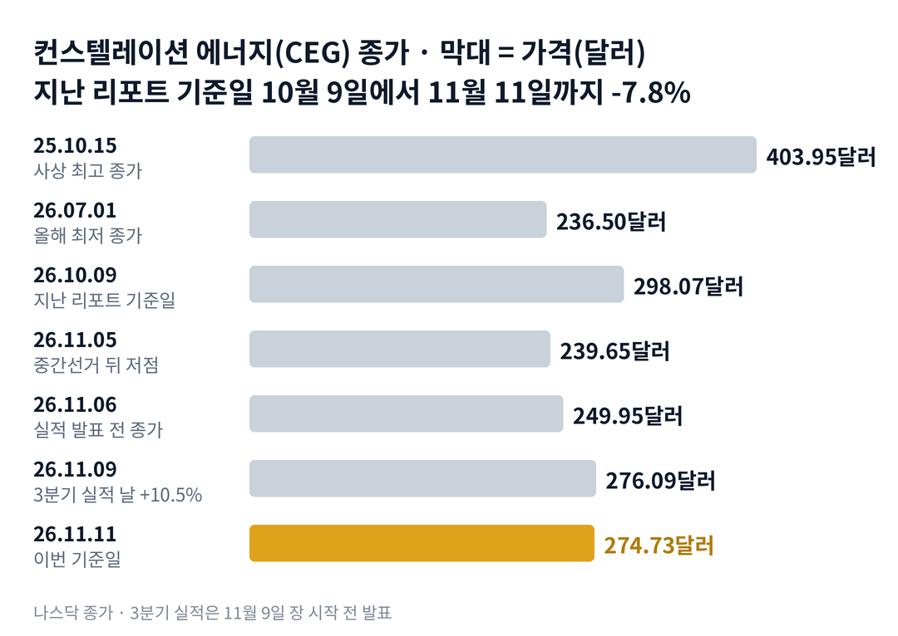

## 짧은 답

> **핵심:** 3분기 이익은 지난 리포트가 걸어 둔 기준을 넘었지만, 이번 한 달 주가를 움직인 것은 실적보다 업종 전체의 흐름이었습니다.

분기 이익이 1년 전보다 66% 늘었는데, 주가는 왜 아직 한 달 전보다 낮을까요? 컨스텔레이션 에너지는 11월 9일 아침 3분기 실적을 냈고, 연간 전망도 올해 두 번째로 올렸습니다. 주가는 그날 10.5% 올랐습니다.

그런데 같은 날 NRG(텍사스 비중이 큰 발전·전기 소매 회사)도 10.3% 올랐습니다. 그보다 세 거래일 앞선 11월 4일, 중간선거 다음 날에는 같은 업종 회사들이 함께 크게 내렸습니다. 이번 반등에서 회사 실적이 보탠 상승분은 같은 날 업종 평균을 넘은 약 2%포인트로 보는 편이 숫자에 맞습니다.

11월 11일 종가 274.73달러는 지난 리포트 기준일보다 7.8% 낮습니다. **2026.11.11 진단: 국면 B(정치와 대주주 물량이 주가를 누르는 단계) 안에서 실적이 바닥을 받치는 자리 — 근거는 5부.**

실적 날 첫날 5% 넘게 오른 뒤 한 달이 어땠는지는 3부 '실적 18번, 첫날과 20거래일 뒤' 기록표에 있습니다.

> **유의사항** 저자는 금융·투자 자문가가 아닙니다. 이 글은 공개 공시와 시세를 정리한 교육용 분석이며 특정 종목의 매수·매도를 권하지 않습니다. 과거 패턴은 미래 수익을 보장하지 않고, 이 종목은 정책 소식 하나로 하루 10% 넘게 움직인 적이 여러 번 있습니다. 실제 투자 전에는 최신 공시를 직접 확인하세요.

이 리포트는 시청자 반응이 컸던 종목의 업데이트입니다.

## 지난 리포트 이후

[10월 11일 리포트](/r/ceg-2026-10/)는 3분기 실적에서 하반기 이익 경로가 확인되는지를 첫 시험대로 꼽았고, 이 부분은 맞았습니다. 지난 예측 성적은 여섯 항목 가운데 적중 하나, 부분 적중 하나, 빗나감 셋, 확인 전 하나입니다. 국면 A(계약 랠리)로 넘어가는 경계라는 진단과 '실적이 좋아도 그날 내린다'는 패턴은 빗나갔습니다. 항목별 채점은 6부 끝 채점표에 있습니다.

## 1부. 3분기에 무엇이 나왔나

> **핵심:** 칼파인 인수가 처음 온전히 반영된 3분기에 주당 이익은 66% 늘었고, 연간 전망의 가운데 값(중앙값)은 12.00달러에서 12.65달러로 올랐습니다.

컨스텔레이션 에너지는 미국에서 원자력 발전을 가장 많이 하는 회사입니다. 2022년 2월 엑셀론에서 떨어져 나와 상장했습니다. 2026년 1월에는 가스 발전 회사 칼파인을 인수해 발전 설비가 55기가와트(GW)로 커졌습니다.

돈을 버는 방식은 전기를 만들어 파는 것입니다. 도매 전력 시장에 팔기도 하고, 기업과 가정에 직접 팔기도 합니다. 최근에는 데이터센터를 짓는 빅테크와 20년짜리 장기 계약을 맺어 전기값을 미리 정해 두는 일이 늘었습니다.

그래서 이 회사의 이익은 전기값, 그리고 전기값을 정하는 규칙에 크게 기댑니다. 미국 동부 전력망의 용량 경매 가격이 대표적입니다. 정치가 전기 요금을 누르려 하면 회사 실적과 상관없이 주가가 흔들리는 이유입니다.

이 회사가 실적의 기준으로 쓰는 숫자는 주당 조정 영업이익입니다. 시세 변동에 따른 평가 손익과 인수 비용 같은 일회성 항목을 뺀, 회사가 정한 기준의 이익입니다. 이 글에서는 '주당 조정 이익'으로 줄여 부릅니다. 지금 주가를 올해 전망 가운데 값으로 나누면 약 21.7배입니다.

### 숫자로 본 3분기(11월 9일 장 시작 전 발표)

| 항목 | 값 · 계산 근거 |
| --- | --- |
| 주당 조정 이익 | **5.06달러** 1년 전 3.04달러보다 66% 많음 |
| 회계 기준 주당 순이익 | **5.19달러** 1년 전 2.97달러 |
| 매출 | **95억 5,000만 달러** 1년 전 65억 7,000만 달러보다 45% 많음 |
| 평균 주식 수(희석) | **3억 5,400만 주** 1년 전 3억 1,300만 주, 칼파인 인수 대가 주식 포함 |
| 연간 전망(주당 조정 이익) | **12.50~12.80달러** 8월 11.50~12.50달러, 연초 11.00~12.00달러 |
| 3분기 자사주 매입 | **약 380만 주, 약 10억 달러** 남은 한도 약 20억 달러 |
| 11월 11일 종가 | **274.73달러** 사상 최고 종가 403.95달러(2025.10.15)보다 32% 낮음 |

시장 예상과는 따로 봐야 합니다. 언론 집계(스톡트윗 기사)로는 3분기 주당 이익 예상이 약 3.89달러였습니다. 실제 이익은 그보다 약 30% 많습니다. 회사는 그 이유로 유리한 시장·발전 조건과 칼파인 편입을 들었습니다.

이익 증가율이 주식 수 증가율보다 훨씬 컸다는 점도 눈에 띕니다. 조정 이익 총액은 1년 전보다 88% 늘었고, 평균 주식 수는 13% 늘었습니다. 이렇게 좋은 숫자가 나왔는데, 주가는 지난 한 달 동안 어디까지 내려가 있었을까요?

## 2부. 리포트 뒤 한 달, 업종과 함께 내리고 함께 올랐다

> **핵심:** 지난 리포트 뒤 19.6%까지 내렸지만 비스트라와 NRG는 더 내렸고, 실적 날 반등도 업종 전체가 함께였습니다.

위 차트에서 보듯 주가는 지난 리포트 기준일 298.07달러에서 11월 5일 239.65달러까지 내려갔습니다. 올해 최저 종가인 7월 1일 236.50달러와 큰 차이가 없는 자리입니다.

큰 하락은 세 번 있었습니다. 10월 14일, 10월 22일, 11월 4일에 각각 5% 넘게 내렸습니다. 세 날 모두 비스트라·탈렌·NRG도 5% 넘게 함께 내렸습니다. 같은 날 전력 유틸리티 상장지수펀드(XLU, 요금이 규제되는 전력 회사 묶음)는 오르거나 거의 움직이지 않았습니다.

### 같은 날짜 종가로 본 독립 발전 회사들

아래 표의 기준일은 지난 리포트 기준일(10월 9일)과 이번 기준일(11월 11일)이라, 각 종목의 고점 대비 낙폭이 아닙니다.

| 종목 · 성격 | 하루 11.04 / 11.09 | 기간 10.09→11.05 / →11.11 |
| --- | --- | --- |
| **컨스텔레이션(CEG)** 원전 · 가스 | **-6.7% / +10.5%** | **-19.6% / -7.8%** |
| 비스트라(VST) 원전 · 가스, 텍사스 비중 큼 | -13.8% / +7.3% | -30.1% / -17.4% |
| NRG 에너지(NRG) 가스 · 소매, 텍사스 비중 큼 | -13.5% / +10.3% | -25.4% / -9.7% |
| 탈렌 에너지(TLN) 원전 · 가스 | -8.5% / +7.2% | -16.5% / 0.0% |
| 전력 유틸리티 ETF(XLU) | +0.4% / +1.5% | +4.6% / +5.8% |
| S&P 500 ETF(SPY) | +1.7% / +2.4% | -5.9% / -2.4% |

11월 4일 하락의 계기는 전날 치러진 중간선거였습니다. 다우존스 기사에 따르면 레이먼드 제임스는 민주당 압승을 '상당한 정책 충격'이라고 불렀습니다. 투자자들은 규제 강화와 데이터센터 건설 속도 둔화를 걱정했습니다. 텍사스 주지사 선거 결과 때문에 텍사스 비중이 큰 비스트라와 NRG가 가장 많이 내렸습니다.

컨스텔레이션은 내릴 때 덜 내리고, 오를 때 비슷하게 올랐습니다. 11월 5일 저점에서 11일까지 네 거래일 동안 컨스텔레이션은 14.6% 올랐습니다. 같은 기간 비스트라는 18.2%, NRG는 21.0% 올랐습니다.

세 번의 하락과 실적 날 반등을 나란히 놓으면 공통점이 하나 보입니다. 모두 컨스텔레이션 한 회사의 소식이 아니라 업종 전체가 같은 방향으로 움직인 날이었습니다. 실적 날 하루만 보면 컨스텔레이션은 비스트라보다 3.2%포인트 더 올랐고, NRG와는 거의 같았습니다. 이 종목은 과거 실적 날마다 첫날 반응을 한 달 동안 지켰을까요?

## 3부. 실적 19번, 첫날과 20거래일 뒤

> **핵심:** 첫날 5% 넘게 오른 6번 가운데 5번은 20거래일 뒤에도 발표 전보다 높았고, 5% 아래였던 12번은 5번만 높았습니다.

컨스텔레이션은 2022년 5월부터 실적을 19번 발표했습니다. 모두 같은 조건, 곧 장 시작 전에 나온 정기 분기 발표라 이번 사례와 나란히 비교할 수 있기 때문에 하나도 빼지 않았습니다. SEC 접수 시각은 모두 미국 동부 시각 오전 6~7시였습니다.

비교 기준은 발표 전날 종가입니다. 발표 당일 종가(첫날)와, 그날을 첫날로 센 20번째 거래일 종가를 그 기준과 견줬습니다. 예를 들어 이번에는 11월 6일 종가 249.95달러가 기준이고, 11월 9일 종가 276.09달러가 첫날 +10.5%입니다.

**한눈에:** **5/6** 첫날 5% 넘게 오른 날 한 달 뒤 위 · **5/12** 첫날 5% 아래인 날 한 달 뒤 위 · **+2.0%** 20거래일 뒤 가운데 값(중앙값). 결과가 나온 18번만 셌습니다.

### 실적 18번, 첫날과 20거래일 뒤

| 발표일 · 그날 나온 내용 | 첫날 | 20거래일 뒤 |
| --- | --- | --- |
| 2022.05.12 1분기, 전망 유지 | -6.8% | +6.7% |
| 2022.08.04 전망 유지, 기후 법안 논의 | +0.4% | +21.5% |
| 2022.11.08 전망 범위 좁힘 | -6.4% | -2.9% |
| 2023.02.16 2023년 전망 첫 발표 | -0.4% | -8.8% |
| 2023.05.04 전망 위쪽 절반 예상 | +2.7% | +16.2% |
| **2023.08.03** 연간 전망 상향 | **+5.9%** | **+10.7%** |
| **2023.11.06** 연간 전망 상향 | **+6.5%** | **+1.6%** |
| **2024.02.27** 2024년 전망 첫 발표 | **+16.9%** | **+40.6%** |
| 2024.05.09 전망 유지 | +3.8% | -2.6% |
| **2024.08.06** 연간 전망 상향 | **+6.5%** | **+4.6%** |
| 2024.11.04 가운데 값 상향 탈렌·아마존 계약 거부 | -12.5% | -3.3% |
| 2025.02.18 2025년 전망 유지 | +2.6% | -31.1% |
| **2025.05.06** 전망 유지, 칼파인 순항 | **+10.3%** | **+26.1%** |
| 2025.08.07 메타와 20년 계약 | -0.6% | -8.7% |
| 2025.11.07 전망 범위 좁힘 | +2.0% | +2.4% |
| **2026.02.24** 칼파인 인수 뒤 첫 실적 | **+6.4%** | **-1.4%** |
| 2026.05.11 전망 유지 | -1.3% | -17.4% |
| 2026.08.06 연간 전망 상향 | -1.5% | +9.4% |

굵게 쓴 여섯 줄이 첫날 5% 넘게 오른 날입니다. 그중 2026년 2월만 20거래일 뒤 발표 전보다 낮았습니다. 첫날 10% 넘게 오른 2024년 2월과 2025년 5월은 한 달 뒤 상승 폭이 더 커졌습니다.

연간 전망을 올린 날만 따로 보면 다섯 번 가운데 네 번이 20거래일 뒤 발표 전보다 높았습니다. 예외인 2024년 11월은 같은 주말 FERC(연방에너지규제위원회)가 탈렌과 아마존의 원전 공동 입지 계약을 거부한 소식이 겹친 날이었습니다.

> **이번 사례(20거래일 결과 미확정):** 2026.11.09 장 시작 전 · 주당 조정 이익 5.06달러, 연간 전망 두 번째 상향 · 기준은 11월 6일 종가 249.95달러 · 첫날 +10.5% · 5거래일째 11월 13일, 20거래일째 12월 7일 판정

이 기록의 한계도 분명합니다. 첫날 5% 넘게 오른 날은 여섯 번뿐이라, 한 번만 달랐어도 6번 중 5번은 6번 중 4번이 됩니다. 과거 여섯 번에 이번처럼 업종 전체가 7~10% 함께 오른 날이 있었는지는 따로 확인하지 못했습니다. 그렇다면 이번 자료에는 한 달을 버틸 만한 숫자가 들어 있었을까요?

## 4부. 이번 자료에서 숫자로 확인할 것

> **핵심:** 새 연간 전망의 가운데 값대로라면 4분기 이익은 1년 전과 같고, 2027년 6월 풀리는 주식 약 2,500만 주는 남은 자사주 한도보다 큽니다.

새 전망을 분기로 나눠 보면 그림이 조금 달라집니다. 1~3분기 주당 조정 이익을 더하면 10.35달러입니다. 연간 전망에서 이 값을 빼면 4분기 이익은 2.15~2.45달러가 됩니다. 가운데 값 2.30달러는 1년 전 4분기 실적과 같은 값입니다.

올해 두 번의 상향은 대부분 이미 지나간 3분기에서 나왔다는 흔적입니다. 지난 리포트가 하반기에 필요하다고 본 이익은 넘어섰습니다. 다만 4분기만 놓고 보면 1년 전과 같은 숫자입니다.

주식 수 쪽 일정도 그대로입니다. 칼파인 인수 대가 5,000만 주 가운데 절반은 2026년 6월 30일 풀렸고, 6월에 1,100만 주가 공모로 팔렸습니다. 나머지 약 2,500만 주는 2027년 6월 30일 매도 제한이 풀립니다.

회사는 3분기에 약 380만 주를 약 10억 달러에 사들였습니다. 남은 매입 한도 약 20억 달러로 11월 11일 종가에 살 수 있는 주식은 약 730만 주입니다. 2027년 해제 물량의 약 29%로, 지난 리포트 때의 약 40%보다 낮아졌습니다.

새로 나온 소식은 세 가지입니다. 로드아일랜드의 609메가와트(MW) 가스 발전소를 7억 1,500만 달러에 사기로 했습니다. 기존 원전 전기 270메가와트를 2028년부터 20년 파는 'Peak+' 첫 계약도 맺었습니다. 미국 에너지부와는 원전 출력 증강에 쓸 최대 50억 달러 대출 보증의 조건부 약정에 서명했습니다.

과거 기록은 첫날 5% 넘게 오른 날이 한 달을 버틴 경우가 많았다는 것까지 알려 줍니다. 그래서 앞으로 확인할 조건은 두 가지입니다. 하나는 주가가 발표 전 가격을 한 달 동안 지키는가, 다른 하나는 그 움직임이 업종보다 강한가입니다. 이 두 조건으로 나누면 어떤 갈림길이 나올까요?

## 5부. 실적과 업종, 네 가지 시나리오

> **핵심:** 지금은 국면 B(정치와 대주주 물량이 주가를 누르는 단계) 안에서 실적이 바닥을 받치는 자리이고, 12월 7일 종가가 시나리오를 가릅니다.

> **국면 정의(컨스텔레이션 시리즈 공통, 10월 11일 리포트 5.1):** 국면 A 계약 랠리 — 새 전기를 만드는 대형 계약에 주가가 오르는 단계. 국면 B 정책·물량 압박 — 정치·규제 개입과 대주주 물량이 주가를 누르는 단계. 국면 C 실적 확인 박스권 — 큰 소식 없이 실적과 자사주 매입으로 버티는 단계.

**2026년 11월 11일 진단: 국면 B 안에서 실적이 바닥을 받치는 자리.** 선거 뒤 규제 우려로 업종이 함께 내렸고, 주가는 200일 평균 278.47달러 아래에 있습니다. 2027년 6월 해제 물량도 남아 있습니다. 반대로 실적 날 반응은 국면 B의 신호('실적이 좋아도 그날 내린다')와 달랐습니다. 국면 A로 넘어가려면 새 전기를 만드는 대형 계약과 업종 동반 상승이 함께 나와야 합니다.

**판정 기준 두 가지:** 모두 12월 7일(20번째 거래일) 종가로 봅니다. 하나는 컨스텔레이션 종가가 발표 전 249.95달러보다 높은가입니다. 다른 하나는 11월 6일 종가 대비 등락률이 비스트라와 NRG 평균보다 높은가입니다.

### 앞으로 일어날 수 있는 일

**확인된 사실:** 11월 11일 종가는 기준 249.95달러보다 9.9% 높습니다. 11월 6일 이후 세 거래일 동안 컨스텔레이션은 9.9%, 비스트라는 6.9%, NRG는 10.4% 올랐습니다.

**과거 기록:** 과거 빈도로 보면 첫날 5% 넘게 오른 실적 날은 6번 중 5번, 20거래일 뒤에도 발표 전보다 높았습니다. 2부 표에서 보듯 컨스텔레이션은 업종이 오를 때 덜 오르고, 내릴 때 덜 내리는 편이었습니다.

**추정:** 아래 가능성은 주가가 오를 확률이 아니라, 12월 7일 종가가 두 판정 기준의 어느 칸에 들어갈지에 대한 분석자의 주관적 추정입니다. 네 경우는 겹치지 않아 '약 N%'를 더하면 100%이고, 괄호 안 구간은 흔들림의 폭이라 서로 더하지 않습니다.

| 시나리오(판정 2026년 12월 7일) | 가격·업종 | 가능성(추정) |
| --- | --- | --- |
| **1 · 업종을 따라간 회복** | 위 · 덜 오름 | 높음 약 40% (30~50%) |
| 2 · 실적이 이끈 회복 | 위 · 더 오름 | 중간 약 30% (20~40%) |
| 3 · 덜 빠진 되돌림 | 아래 · 덜 내림 | 낮음 약 15% (10~20%) |
| 4 · 선거 충격 재연 | 아래 · 함께 내림 | 낮음 약 15% (10~20%) |

시나리오 1이면 다음에 확인할 것은 12월 9일 용량 경매 결과가 가격 상한에 다시 걸리는지입니다. 시나리오 2면 4분기 실적에서 내년 전망이 3분기 속도를 이어 가는지 봅니다. 시나리오 3이면 자사주 매입 속도를, 시나리오 4면 주 정부의 데이터센터 규제가 실제 법안으로 나오는지를 봅니다.

발표 전 가격 위쪽 두 칸에 70%를 준 것은 과거 6번 중 5번이라는 빈도에서 업종 동반 하락 위험을 깎은 값입니다. 그 안에서 시나리오 1을 더 높게 둔 것은, 업종이 회복할 때 텍사스 비중이 큰 회사들이 더 크게 되돌아왔기 때문입니다.

하지만 같은 무게로 반대쪽 요인도 있습니다. 4분기 이익 전망은 1년 전과 같고, 선거 뒤 규제 논의는 아직 시작 단계입니다. 주가 방향은 다른 질문이라 따로 적지 않았습니다. 이 진단을 가장 빨리 뒤집을 수 있는 위험은 무엇일까요?

## 6부. 위험과 체크리스트

> **핵심:** 가장 빨리 판을 바꿀 수 있는 것은 12월 용량 경매와 주 정부의 데이터센터 규제이고, 그다음이 2027년 6월 주식 해제입니다.

먼저 이 분석의 한계입니다. 3부 표는 18번이지만 칼파인 인수 뒤 같은 모습으로 낸 실적은 세 번뿐입니다. 2부의 업종 비교는 하루 단위라, 실적과 업종의 영향을 정확히 가르는 계산은 아닙니다.

외부 환경, 곧 정책 쪽 위험이 가장 큽니다. PJM(미국 동부 전력망 운영 기관)은 2028/29년과 2029/30년 용량 경매에 가격 상하한을 두기로 했고, FERC는 4월 이를 받아들였습니다. 상하한은 메가와트·하루당 약 175~325달러입니다. 2029/30년 기본 경매는 12월 9일로 잡혀 있고, 비상 조달은 2027년 5월 10일 결과를 내는 안이 제출됐습니다.

자금 조달과 주식 수 쪽에는 2027년 6월 30일 약 2,500만 주 해제가 남아 있습니다. 4부 계산대로 남은 자사주 한도로는 그 약 29%만 받아 줄 수 있습니다. 에너지부 대출 보증도 아직 조건부 약정이라, 실제 계약이 되기 전까지는 출력 증강 자금의 일부로만 봐야 합니다.

사업 실행 쪽에는 가스 발전과 텍사스 시장의 비중이 커졌다는 점이 있습니다. 이번 선거에서 텍사스 비중이 큰 회사들이 가장 크게 내렸고, 컨스텔레이션도 칼파인 인수로 텍사스 노출이 생겼습니다. 구글 계약의 첫 출력 증강은 2028년 예정이라 그전까지는 일정 위험이 남습니다.

**핵심 확인 세 가지:** 위에서부터 판정을 바꾸는 힘이 큰 순서입니다.

- ☐ 1순위 · 12월 7일(20거래일째) 종가가 발표 전 249.95달러보다 높은가
- ☐ 2순위 · 11월 6일 대비 12월 7일 등락률이 비스트라·NRG 평균보다 높은가
- ☐ 3순위 · 12월 9일 PJM 2029/30년 용량 경매 가격이 상한에 다시 걸렸나

**보조 확인:** 11월 13일(5거래일째) 종가가 첫날 종가보다 높은지 봅니다. 4분기 자사주 매입이 3분기 속도와 비슷한지, 에너지부 대출 보증이 실제 계약으로 바뀌는지도 확인합니다.

**기억할 판단 기준:** 이 종목의 한 달 방향은 실적보다 업종과 정책을 따라갈 때가 많았습니다. 다만 첫날 5% 넘게 오른 실적 날은 한 달 뒤에도 발표 전 가격 위에 있던 경우가 많았습니다.

### 지난 예측 채점표

10월 11일 리포트(10월 9일 기준)의 진단·패턴·시나리오를 11월 11일 기준으로 채점한 결과입니다. 지난 리포트에는 시나리오별 가능성 숫자가 없었습니다.

| 지난 점검 항목 · 당시 기준 | 판정 및 실제 결과(11월 11일) |
| --- | --- |
| **진단: 국면 B(정치·물량이 주가를 누르는 단계)에서 A(계약에 오르는 단계)로 넘어가는 경계** 구글 계약, 50일·200일 평균 위 | **[빗나감]** 새 대형 계약 없음, 11월 5일 -19.6%, 200일 평균 아래 |
| **첫 시험대: 하반기 6.21~7.21달러 경로** 11월 9일 3분기 실적 | **[적중]** 3분기 5.06달러, 새 전망 기준 하반기 7.21~7.51달러 |
| **패턴: 실적이 좋아도 그날 내린다** 실적 상회 네 번 중 세 번 하락 | **[빗나감]** 11월 9일 +10.5%, 다만 업종도 7~10% 함께 상승 |
| **시나리오 1: 새 전기 계약의 연속** 재가동·출력 증강 대형 계약 추가 | **[빗나감]** 새 출력 계약 없음, Peak+ 270MW는 기존 원전 전기 |
| **시나리오 2: 불리한 정책 확정** 12월 경매·비상 경매 규칙 | **[확인 전]** 12월 9일 경매 전, 비상 조달 결과 2027년 5월 |
| **시나리오 4: 인공지능 투자 둔화** 하루 5~20% 급락 | **[부분 적중(다른 계기)]** 중간선거 뒤 규제·건설 속도 우려로 11월 4일 -6.7% |

시나리오 3(실적은 좋지만 물량에 눌린 박스권)은 판정 시점이 2027년 6월이라 표에서 뺐습니다. 가장 큰 빗나감은 진단이었습니다. 계약 하나와 이동평균선만 보고 국면 A(계약에 오르는 단계)를 점쳤는데, 업종 전체를 흔드는 정치 일정을 신호에 넣지 않았습니다. 이번 리포트부터는 업종 비교를 판정 기준에 함께 둡니다.

같은 원자력 업종의 흐름은 [뉴스케일 파워 리포트](/r/smr-2026-11/)에서 함께 볼 수 있습니다. 다음 갱신은 12월 7일 20거래일째 반응과 12월 경매 결과를 본 뒤에 합니다. 공시는 [컨스텔레이션 에너지 SEC 공시 목록](https://www.sec.gov/cgi-bin/browse-edgar?action=getcompany&CIK=0001868275&type=8-K&dateb=&owner=include&count=40)에서 확인할 수 있습니다.
