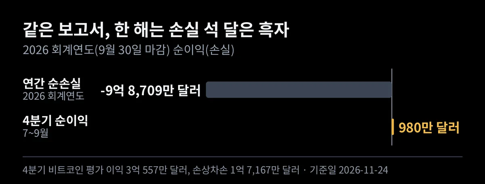
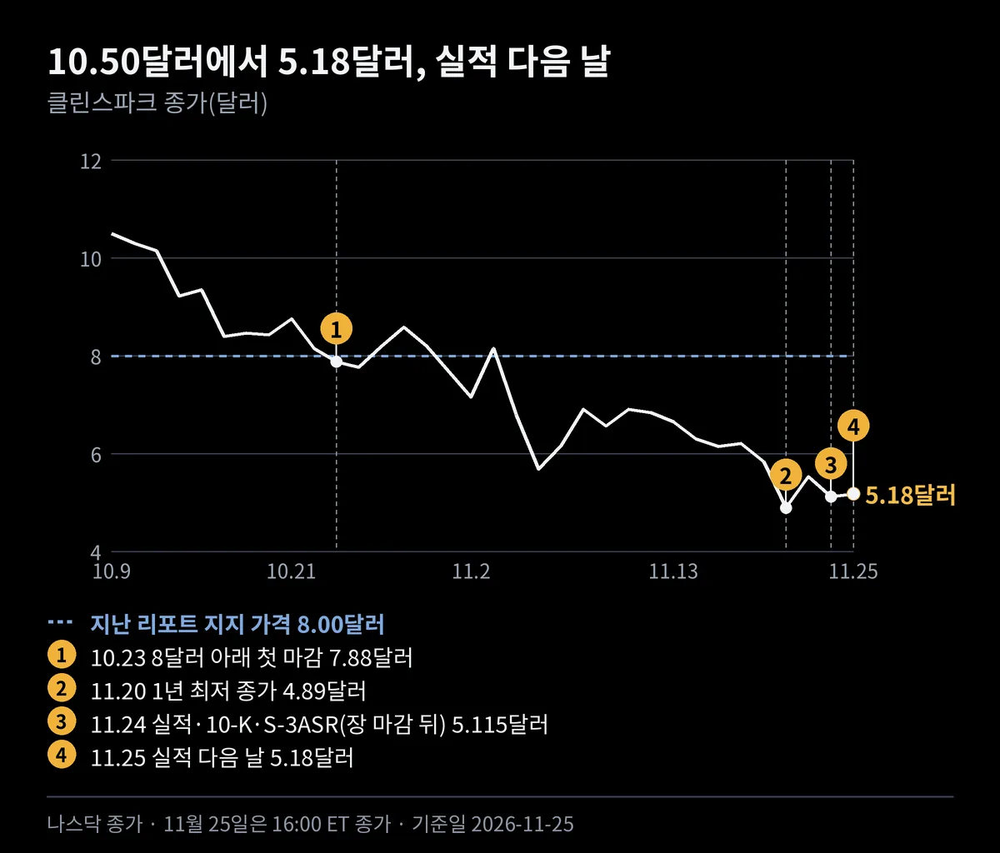
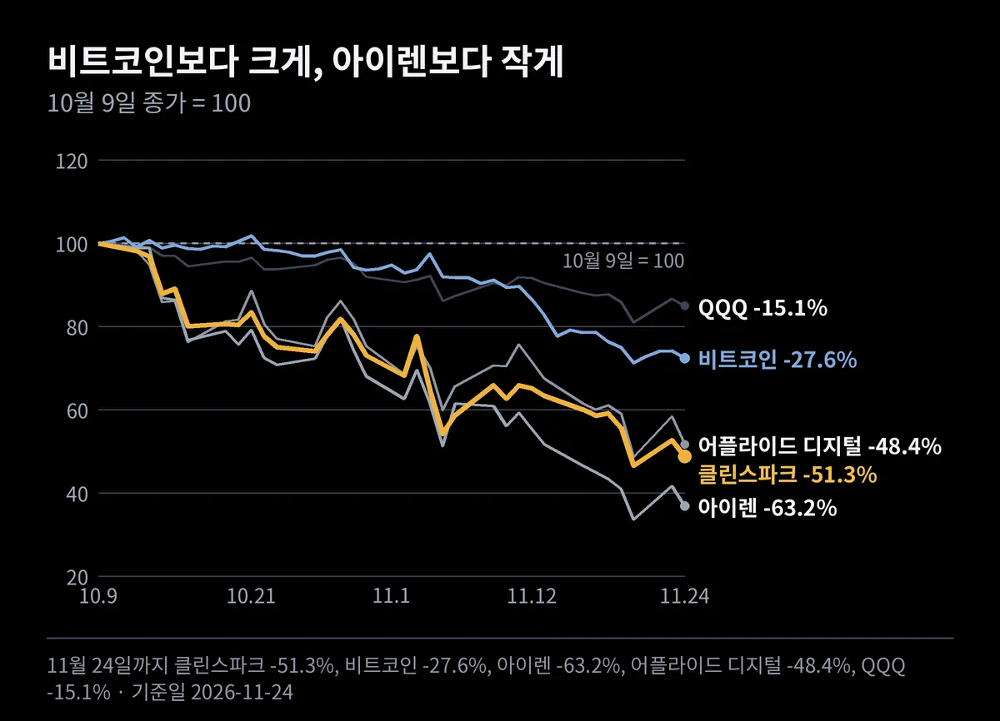
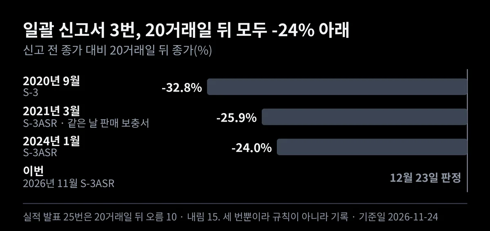
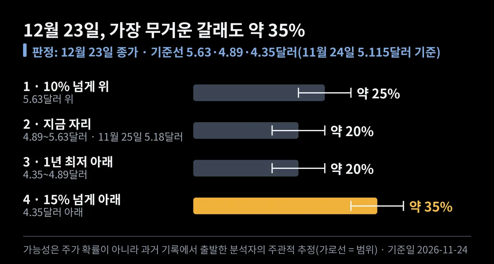
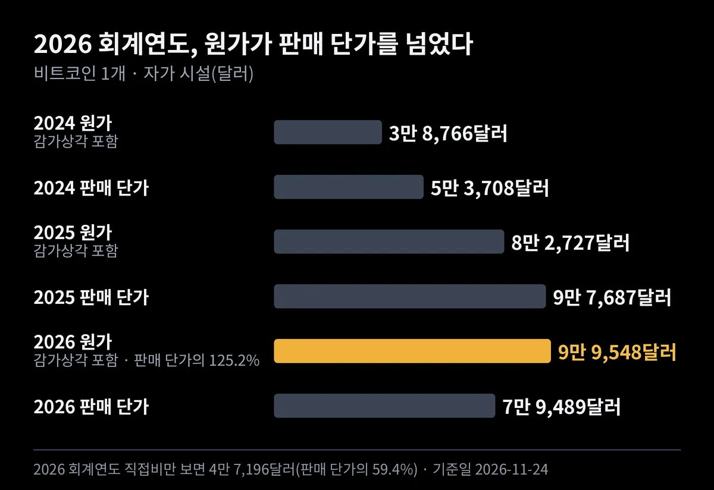

> **유의사항** 이 글은 공시와 시세 기록을 정리한 교육용 자료이며, 특정 종목의 매수·매도를 권하지 않습니다. 가능성 숫자는 과거 기록에 조건을 더한 주관적 추정입니다.

11월 24일 장이 끝난 뒤, 클린스파크는 2026 회계연도(9월 30일 마감) 실적을 냈습니다. 한 해 순손실은 약 9억 9,000만 달러였는데, 마지막 석 달만 떼어 보면 980만 달러 흑자였습니다. 그리고 한 시간 뒤, 금액을 정하지 않고 주식과 채권을 팔 수 있는 창구를 여는 서류를 냈습니다. 다음 날 주가는 전날보다 1.3% 오른 5.18달러로 마감했습니다. 이 주식을 들고 있다면, 지금 팔아야 할까요?

이 글은 시청자 요청으로 썼습니다. 요청하신 분은 실적과 데이터센터 전환을 궁금해하셨습니다. 그래서 '처음 산 이유가 아직 맞는가'를 연간 보고서 원문으로 하나씩 확인하겠습니다.

[지난 리포트](/r/clsk-2026-10/)는 10월 9일 종가 10.50달러를 기준으로 썼고, 11월 24일 종가는 그보다 51.3% 낮습니다. 지난 예측 성적은 적중 셋, 빗나감 셋, 확인 전 하나입니다. 실적 날짜와 4분기 비트코인 평가 이익은 맞았고, 비트코인이 다시 크게 내려가면 하루 급락이 나온다는 갈래도 맞았습니다. 가장 크게 빗나간 것은 '8.00달러가 다음 지지 가격'이라는 문장입니다. 10월 하순 그 아래에서 마감했고, 네 갈래가 모두 그 가격 위에서 그려져 있었습니다. 바닥의 깊이를 작게 본 셈입니다.

클린스파크가 돈을 버는 방식은 비트코인 채굴입니다. 싼 전기로 채굴기를 돌려 비트코인을 받고, 일부를 팔아 운영비를 냅니다. 이번 회계연도 매출 5억 7,653만 달러는 전부 채굴에서 나왔습니다. 회사는 이제 스스로를 데이터센터 개발 회사라고 부르고, 채굴용으로 확보한 전력과 땅을 인공지능 컴퓨터용 건물로 바꿔 빌려주려 합니다. 11월 24일 종가로 센 회사 몸값(시가총액)은 약 13억 3,000만 달러입니다(계산, 11월 20일 주식 수 기준). 지난 리포트 때는 약 27억 달러였습니다.

실적부터 보겠습니다. 매출은 1년 전보다 25% 줄었습니다. 더 눈에 띄는 것은 연간 보고서의 채굴 원가 표입니다. 채굴기 감가상각까지 더한 비트코인 한 개 원가가 약 10만 달러로, 평균 판매 단가 약 8만 달러보다 높았습니다. 1년 전에는 원가가 판매 단가보다 낮았습니다. 전기료 같은 직접비만 보면 아직 남지만, 감가상각을 포함한 회계상 원가는 판매 단가보다 높았다는 뜻입니다. 채굴량도 8% 줄었습니다.

4분기 흑자의 속을 보면 이유가 보입니다. 9월 말 비트코인 값이 6월 말보다 높아 생긴 평가 이익이 3억 557만 달러였습니다. 같은 석 달에 손상차손이 1억 7,167만 달러 잡혔습니다. 연간 보고서는 그 대부분이 조지아 샌더스빌 채굴 설비라고 적었습니다. 데이터센터 임대 때문에 그곳 채굴을 2028년 2월까지 멈추기로 했다는 설명입니다.

이제 요청하신 데이터센터 전환입니다. 샌더스빌 임대는 2026년 7월 10일 맺은 20년 계약이고, 핵심 IT 부하 175메가와트 규모입니다. 세입자가 유지·보수와 설비 갱신 비용까지 내는 '트리플 넷' 방식이며, 회사는 총액 66억 달러라고 밝혔습니다. 보도자료는 주요 인허가를 모두 받았고, 총액을 미리 정한 턴키 시공 계약을 맺었고, 첫 데이터홀은 2027년 11월 목표로 일정대로라고 했습니다. 연간 보고서도 임대 시작을 2027년 11월로 예상합니다. 다만 데이터센터 부문 매출은 이번 회계연도에도, 지난 회계연도에도 0이었습니다.

공사비는 9월에 마련했습니다. 샌더스빌 자회사가 22억 7,600만 달러의 담보채를 냈고, 그 돈 대부분이 공사용으로 묶인 현금으로 잡혀 있습니다. 회사는 완공까지 자금이 확보됐다고 말합니다. 그런데 연간 보고서 위험 요인에는 이 담보채 계약이 자회사의 배당과 현금 이전을 막는다고 적혀 있습니다. 연간 보고서는 그래서 샌더스빌 현금 흐름을 본사의 다른 차입금이나 운영에 쓰지 못할 수 있다고 적었습니다. 본사에는 전환사채(정해진 가격에 주식으로 바꿀 수 있는 채권) 18억 달러가 따로 있습니다.

텍사스 이야기는 결이 다릅니다. 회사는 실리 285메가와트와 브라조리아 300메가와트에 텍사스 전력망 운영자(ERCOT)의 '배치 제로' 조건부 지정을 받았습니다. 그런데 보도자료에 두 곳의 독점 협상 기간이 '일시적 규제 불확실성 기간 중' 끝났다는 문장이 있습니다. 지난 리포트가 세 번째 갈래의 계기로 꼽은 바로 그 일입니다. 회사는 샌더스빌 세입자와 다른 회사들과 상업화를 이어 간다고 했지만, 새 임대 계약 공시는 없습니다. 연간 보고서는 75메가와트 이상 부하의 연결 절차를 바꾼 텍사스 법과 ERCOT의 묶음 심사를 공급 지연 위험으로 적었습니다.

그리고 17시 10분, 자동 효력 일괄신고서 S-3ASR(큰 회사가 내면 바로 효력이 생기는 일괄 신고서)이 접수됐습니다. 앞으로 보통주·채권 같은 증권을 여러 번 나눠 팔 수 있는 창구를 미리 열어 두는 서류입니다. 금액은 정하지 않았고, 실제로 팔 때마다 투자설명서 보충서(424B)를 따로 내야 합니다. 11월 24일까지 그런 판매 서류는 없었습니다. 쓰임은 '앞으로의 개발과 전략적 인수 등 일반 회사 목적'입니다. 연간 보고서에는 '확장을 끝내려면 비슷한 공모로 추가 자금을 모아야 할 것으로 예상한다'는 문장도 있습니다.

시장도 함께 봐야 합니다. 같은 기간 나스닥 100 펀드(QQQ)도 15.1% 내렸습니다. 클린스파크는 평소 시장보다 약 2.5배 크게 움직였는데(평소 민감도), 그 민감도로 예상한 움직임과 실제 하락의 차이는 평소 흔들림 안이었습니다. 비트코인은 27.6%, 아이렌은 63.2% 내렸고 어플라이드 디지털도 크게 내렸습니다. 같은 데이터센터 무리가 함께 내린 구간이었습니다.

이런 날이 처음은 아닙니다. 2020년부터 클린스파크 실적 발표 25번을 셌습니다. 발표 다음 날은 16번 올랐고, 이번 11월 25일도 1.3% 올랐습니다. 그런데 발표 전 종가에서 20거래일 뒤를 보면 10번 오르고 15번 내렸습니다. 첫날 결과와 한 달 뒤 결과는 따로 봐야 한다는 뜻입니다. 일괄 신고서는 2020년 9월, 2021년 3월, 2024년 1월 세 번 있었고, 20거래일 뒤 종가는 세 번 모두 신고 전보다 24% 넘게 낮았습니다. 2021년에는 같은 날, 2024년에는 약 두 달 반 뒤 실제 판매 보충서가 나왔습니다. 세 번뿐이라 규칙이 아니라 기록입니다.

그러면 파는 쪽과 버티는 쪽 근거를 나란히 놓아 보겠습니다. 파는 쪽에는 감가상각까지 친 채굴 원가가 판매 단가보다 높다는 점이 있습니다. 판매 창구가 열렸고, 세 번뿐인 기록이지만 지난 세 번은 한 달 뒤 모두 낮았습니다. 텍사스 독점 협상이 끝나 두 번째 계약의 시점도 흐려졌습니다. 버티는 쪽에는 샌더스빌의 인허가·시공 계약·자금이 서류로 묶여 있다는 점이 있습니다. 9월 말 현금과 비트코인이 회사 표현으로 약 13억 달러라는 점도 있습니다. 실적 다음 날 오른 경우가 25번 중 16번이었다는 점도 있습니다. 다만 9월 말 뒤 비트코인은 더 내렸고, 부채는 44억 6,394만 달러여서 현금이 주가 바닥을 정해 주지는 않습니다.

그래서 들고 계신 분의 질문에는 이렇게 답할 수 있습니다. 데이터센터 전환이라는 처음 이유는 샌더스빌 한 곳에서는 서류로 확인됩니다. 흔들린 것은 두 번째 계약의 시점과 돈을 더 모을 가능성입니다. 이 판단의 무게를 숫자로 나누려고 12월 23일 종가(11월 24일에서 20거래일째)에 네 갈래를 걸었습니다. 기준은 발표 전 종가 5.115달러입니다. 11월 25일 종가 5.18달러는 1년 최저 종가 4.89달러와 5.63달러 사이, 두 번째 갈래 '지금 자리'에 있습니다.

가능성은 주가 확률이 아니라, 과거 기록에 이번 조건을 더한 주관적 추정입니다. 가장 무거운 갈래는 4.35달러 아래(약 35%)입니다. 과거 세 가지 기록을 합친 40번 가운데 20거래일 뒤 그 자리는 13번이었고, 여기서 출발했습니다. 김박사 월드가 지난 리포트들에서 '어떤 가격선을 지킨다'고 본 예측 네 번이 모두 빗나간 기록도 반영했습니다. 이 추정이 틀린다면 가장 큰 이유는 비트코인 반등입니다. 이 종목은 비트코인이 크게 움직인 날 그 몇 배로 움직여 왔습니다.

가장 큰 위험은 둘입니다. 하나는 돈입니다. 판매 창구가 열려 있고, 연간 보고서도 비슷한 공모로 돈을 더 모아야 할 것으로 예상했기 때문입니다. 다른 하나는 비트코인 가격입니다. 채굴 매출이 전부라서, 12월 9일 FOMC(미국 연방공개시장위원회, 금리 회의) 뒤 위험자산 흐름에 따라 크게 흔들릴 수 있습니다. 텍사스 연결 절차와 샌더스빌 공사 일정도 남아 있고, 일괄 신고서 기록은 세 번뿐입니다.

정리하면 클린스파크는 샌더스빌 한 곳의 계약과 자금은 서류로 확인되지만, 채굴은 감가상각까지 치면 손해이고, 판매 창구가 막 열린 회사입니다. 과거 기록은 한 달 뒤 더 낮은 쪽이 많았지만 실적 첫날만 보면 오른 쪽이 많았기 때문에, 판단은 첫날보다 12월 23일까지 나오는 서류에 더 기대게 됩니다. 결정은 각자의 몫이며, 이 영상과 리포트는 판단 근거를 정리한 교육용 자료입니다. 다음 갱신은 판매 보충서나 텍사스 계약 공시가 나올 때, 늦어도 12월 23일 판정 뒤입니다.

## 숫자로 다시 보기

### 11월 24일 서류 세 건
| 서류 | 접수(미국 동부) | 담긴 것 |
|---|---|---|
| 8-K 보도자료 | 16:10 | 4분기·연간 실적, 샌더스빌·텍사스 진행 |
| 10-K 연간 보고서 | 17:00 | 사업 부문·위험 요인·채굴 원가·손상 |
| S-3ASR 일괄 신고서 | 17:10 | 증권 판매 창구, 금액 미정 |

### 2026 회계연도 실적(9월 30일 마감)
| 항목 | 4분기 | 연간 |
|---|---|---|
| 매출(전부 채굴) | 1억 2,094만 달러(-46%) | 5억 7,653만 달러(-25%) |
| 순이익(손실) | 980만 달러 | -9억 8,709만 달러 |
| 비트코인 평가손익 | +3억 557만 달러 | -2억 8,162만 달러 |
| 손상차손 | 1억 7,167만 달러 | 1억 7,707만 달러 |
| 조정 EBITDA(회사 기준) | 3억 4,536만 달러 | -3억 422만 달러 |

### 비트코인 1개 채굴 원가(자가 시설, 연간 보고서)
| 회계연도 | 감가상각 포함 원가 | 평균 판매 단가 |
|---|---|---|
| 2024 | 3만 8,766달러 | 5만 3,708달러 |
| 2025 | 8만 2,727달러 | 9만 7,687달러 |
| 2026 | 9만 9,548달러 | 7만 9,489달러 |
| 2026 직접비만 | 4만 7,196달러 | 판매 단가의 59.4% |

- 2026 회계연도 감가상각 포함 원가는 판매 단가의 125.2%

### 데이터센터 전환 진행(10-K·보도자료 원문)
| 부지 | 지금 | 남은 것 |
|---|---|---|
| 샌더스빌(조지아) | 20년 임대·175메가와트·인허가 완료 | 첫 데이터홀 2027년 11월 |
| 텍사스 두 곳 | 585메가와트 조건부 지정 | 독점 협상 끝남, 새 계약 없음 |
| 워싱턴(조지아) | 86메가와트 가동 | 500메가와트 선로 연구 |
- 데이터센터 부문 매출은 2026·2025 회계연도 모두 0
- 전체 계약 전력 약 1,818메가와트, 승인 중인 텍사스 추가분을 넣으면 약 2.1기가와트

### 돈과 부채(9월 30일)
| 항목 | 금액 | 메모 |
|---|---|---|
| 현금 | 2억 476만 달러 | 제한 없음 |
| 비트코인 | 13,530개 | 담보 포함, 회사 평가 약 11억 3,050만 달러 |
| 샌더스빌 묶인 현금 | 20억 4,698만 달러 | 담보채 조달금 |
| 부채 총계 | 44억 6,394만 달러 | 전년 10억 850만 달러 |
| 전환사채 | 18억 달러 | 전환가 약 14.80·19.16달러 |
| 샌더스빌 담보채 | 22억 7,600만 달러 | 연 7.875%, 2031년 만기 |
| 유통 주식 | 2억 6,050만 9,745주 | 11월 20일 |
| 자사주 매입 | 4억 6,000만 달러 | 2026 회계연도 |

### 일괄 신고서(S-3ASR) 요점
| 항목 | 내용 |
|---|---|
| 팔 수 있는 것 | 보통주·우선주·채권·워런트·청약권·유닛 |
| 금액 | 정하지 않음(수수료는 팔 때마다) |
| 실제 판매 | 투자설명서 보충서(424B) 필요, 11월 24일까지 없음 |

### 실적 발표 25번과 일괄 신고서 3번 뒤(발표 전 종가 대비)
| 사건 | 다음 날 | 20거래일 뒤 |
|---|---|---|
| 실적 발표 25번 | 오름 16 · 내림 9 | 오름 10 · 내림 15 |
| 일괄 신고서 3번 | -14.0% · -22.7% · +5.0% | -32.8% · -25.9% · -24.0% |
| 1년 최저 종가 12번 | — | +10% 이상 4 · -4.4% 아래 6 |

### 시장·거시·정책 배경
| 대상 | 10월 9일→11월 24일 | 11월 24일 하루 |
|---|---|---|
| 클린스파크 | -51.3% | -7.5% |
| 비트코인 | -27.6% | — |
| 아이렌 | -63.2% | -11.5% |
| 어플라이드 디지털 | -48.4% | -11.6% |
| 코어 사이언티픽 | -28.7% | -11.1% |
| QQQ | -15.1% | -2.0% |
| IWM | -4.2% | +0.5% |

| 예상 vs 실제(QQQ 기준) | 값 | 메모 |
| --- | --- | --- |
| 평소 민감도 | 약 2.5배 | 구간 전 250거래일 |
| 예상 | -35.6% | 민감도 × QQQ |
| 실제 | -51.3% | 차이 -15.7%p |
| 평소 흔들림 | ±28.2%p | 차이는 이 안 |
| 미 국채 10년 | 4.91% | 11월 24일 |
| VIX(시장 변동성 지수) | 26.36 | 11월 24일 |

- 다음 거시 일정: 12월 9일 FOMC · 12월 23일 PCE(개인소비지출 물가, 11월분). 소비자물가(CPI)·고용 일정은 확인 안 됨
정책: 직접 연결 확인 안 됨(텍사스 대형 부하 연결 절차는 10-K 위험 요인에 있으나 시행 날짜는 미확인).
- 통섭: 같은 32거래일 동안 핵심 종목 8개 가운데 8개가 평소 시장 민감도로 예상한 범위 안에서 움직였습니다([아이렌](/r/iren-2026-11-6/) · [플러그 파워](/r/plug-2026-11-5/))

### 판단 전에 확인할 것

| 순서 · 확인할 것 | 볼 곳 |
| --- | --- |
| **1** 처음 산 이유가 샌더스빌(2027년 11월 임대 시작)이었나, 텍사스 두 번째 계약이었나 | 10-K·보도자료 |
| **2** 12월 23일까지 판매 보충서(424B)가 나오나 | SEC 제출 목록 |
| **3** 12월 23일까지 종가가 4.89달러(1년 최저 종가) 아래로 내려가나 | 나스닥 종가 |
| **4** 12월 9일 FOMC 뒤에도 시장의 약 2.5배로 흔들리나 | 클린스파크·QQQ 종가 |
| **5** 비트코인이 6만 달러 위로 돌아오나 | 비트코인 시세 |

### 지난 예측 채점표

지난 예측 성적: 적중 3 · 빗나감 3 · 확인 전 1

| 지난 점검 항목 · 당시 기준 | 판정과 지금 자리(11월 24일) |
| --- | --- |
| **실적 발표 날짜** 11월 24일 장 마감 뒤로 추정 | **[적중]** 11월 24일 16:10 ET 발표 |
| **4분기 평가 이익** 가능성이 크다(추정) | **[적중]** 평가 이익 3억 557만 달러 |
| **시나리오 1** 텍사스 본계약, 비트코인 9만 달러 위 | **[빗나감]** 독점 협상 끝남, 비트코인 약 5만 9,748달러 |
| **시나리오 2** 비트코인 6만 달러 근처면 하루 20% 가까운 하락 | **[적중]** 하루 -16.6%·-16.5%·-16.3% |
| **다음 지지 가격** 52주 최저 8.00달러 | **[빗나감]** 10월 23일 7.88달러로 이탈 |
| **시나리오 3** 독점 협상이 연장 없이 끝나면 5거래일 20% 안팎 하락 | **[확인 전]** 계기 켜짐(11월 24일 공개), 12월 2일 종가로 판정 |
| **시나리오 4** 8~15달러 횡보 | **[빗나감]** 11월 24일 5.115달러 |

### 앞으로 일어날 수 있는 일

세 가지 과거 기록(실적 발표·1년 최저 종가·일괄 신고서)의 20거래일 뒤 자리에서 출발했습니다. 아래 가능성은 그 기록에서 출발해 분석자가 주관적으로 매긴 추정이며, 주가가 오를 확률이 아닙니다. 네 갈래는 겹치지 않아 더하면 100%입니다(기준 11월 24일 종가 5.115달러).

| 갈래(판정 12월 23일) | 판정 조건 | 가능성(추정) |
| --- | --- | --- |
| 1 · 10% 넘게 위 | 12월 23일 종가 5.63달러 위 | 중간 약 25% (20~30%) |
| 2 · 지금 자리 | 12월 23일 종가 4.89~5.63달러 | 낮음 약 20% (15~25%) |
| 3 · 1년 최저 아래 | 12월 23일 종가 4.35~4.89달러 | 낮음 약 20% (15~25%) |
| **4 · 15% 넘게 아래** | 12월 23일 종가 4.35달러 아래 | 높음 약 35% (30~40%) |

### 핵심 확인 세 가지
- 1순위: 판매 보충서(424B) — 12월 23일까지 나오는지
- 2순위: 텍사스 새 임대 계약 8-K — 12월 23일까지 나오는지
- 3순위: 지난 리포트 시나리오 3 — 12월 2일 종가가 11월 24일보다 20% 안팎 낮은지(4.09달러 근처, 계산)

## 함께 읽기
- [클린스파크, 메타 66억 달러 계약에도 계약 전보다 낮은 주가(10월 9일 기준)](/r/clsk-2026-10/)
- [아이렌 급등 다음 날, 따라 사도 될까?(11월 23일 기준)](/r/iren-2026-11-6/)
- [어플라이드 디지털, 75억 달러 계약 주에 3거래일 -19.2%(11월 20일 기준)](/r/apld-2026-11/)
