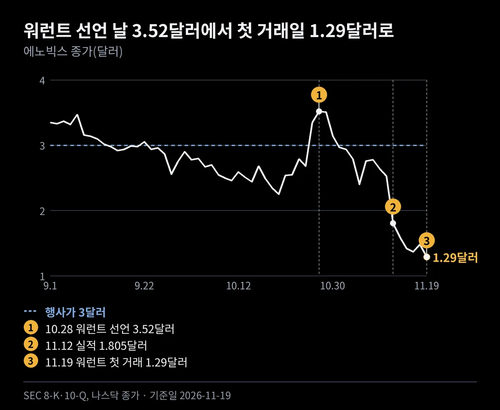
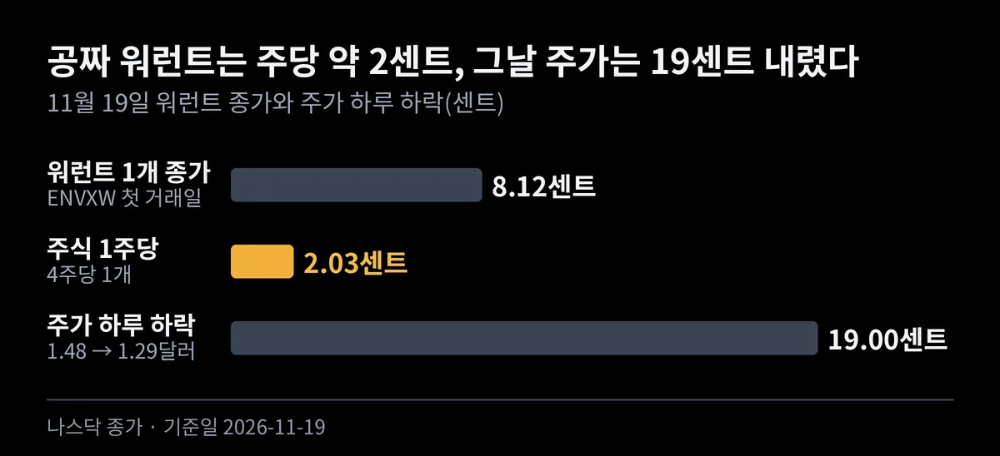
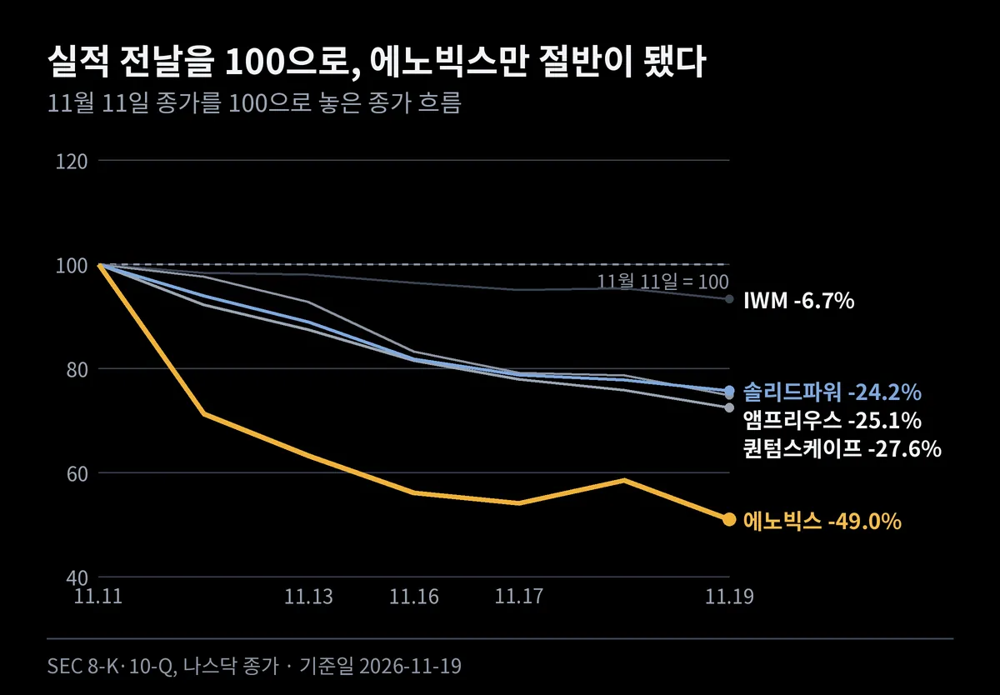
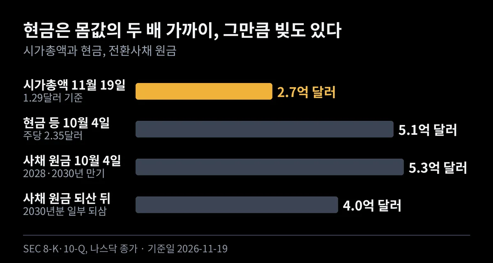
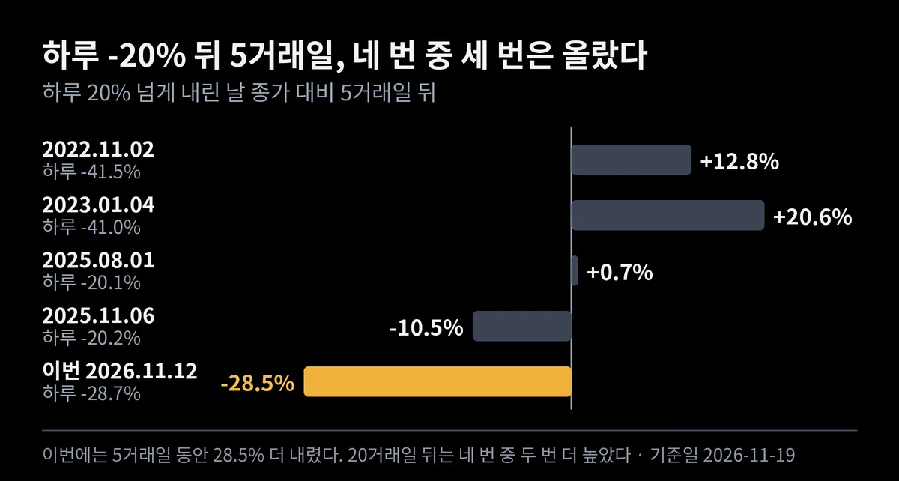
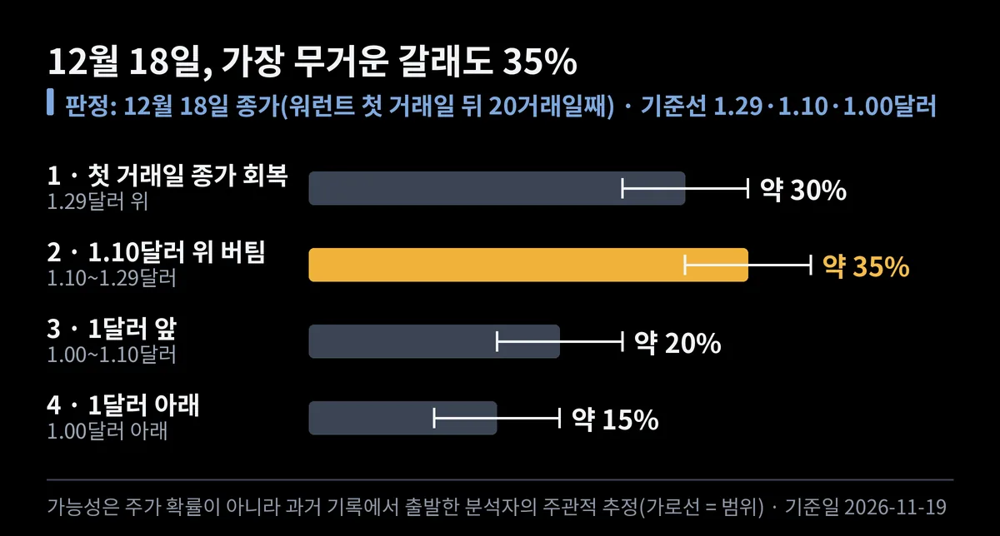

11월 18일, 에노빅스는 주주들에게 선물을 보냈습니다. 주식 4주마다 워런트 1개를 공짜로 준 것입니다. 워런트는 정해진 값에 새 주식을 살 수 있는 권리이고, 이번 값은 1주에 3달러입니다.

그 워런트가 처음 거래된 11월 19일, 주가는 12.8% 내려 1.29달러로 마감했습니다. 2021년 상장 뒤 가장 낮은 종가입니다. 워런트 값은 주식 1주당 약 2센트였는데, 주가는 그날 19센트 내렸습니다. 그런데 주가는 왜 공짜 선물을 받은 다음 날 그 아홉 배를 내렸을까요?

> **유의사항** 저자는 금융·투자 자문가가 아닙니다. 이 글은 공개 공시와 시세를 정리한 교육용 분석이며 특정 종목의 매수·매도를 권하지 않습니다. 과거 패턴은 미래 수익을 보장하지 않고, 에노빅스는 하루에 40% 넘게 내린 적이 있는 종목입니다. 실제 투자 전에는 최신 공시를 직접 확인하세요.

김박사 월드가 에노빅스를 다루는 것은 이번이 처음입니다. 그래서 채점할 지난 예측은 없습니다. 대신 이 회사가 1년 4개월 전에 똑같은 공짜 워런트를 나눠 준 기록이 있습니다. 그때와 지금을 나란히 놓으면 이번 장면이 조금 더 또렷해집니다.

에노빅스는 실리콘을 넣은 리튬이온 배터리를 만드는 미국 회사입니다. 배터리 음극에 흑연 대신 실리콘을 쓰면 같은 크기에 전기를 더 많이 담을 수 있습니다. 본사는 캘리포니아에 있고, 공장은 한국과 말레이시아에 있습니다. 3분기 매출은 1,104만 달러였습니다. 1년 전보다 38% 늘었습니다. 매출의 약 70%는 드론과 방산 고객에서 나왔습니다. 돈을 버는 방식은 배터리 셀과 묶음을 만들어 기기 회사에 파는 것입니다. 다만 비용이 매출보다 훨씬 커서, 3분기 영업손실은 3,929만 달러였습니다.

이 회사의 큰 이야기는 오랫동안 스마트폰이었습니다. 2025년 7월, 회사는 스마트폰용 배터리 AI-1을 발표했습니다. 같은 날 첫 공짜 워런트도 선언했습니다. 주가는 그날 14.4% 올랐습니다.

올해 10월 21일, 한 매체 기사에 회사 임원의 말이 실렸습니다. 2027년 매출이 약 1억 달러이고, 대부분 스마트폰 고객에서 나온다는 내용이었습니다. 주가는 그날 12.9% 올랐습니다. 회사는 다음 날 8-K로 바로잡았습니다. 회사가 승인한 전망이 아니고, 기사 속 5만 개 출하도 스마트폰이 아니라 스마트 안경 고객이라고 했습니다.

10월 27일 주가는 회사 공시 없이 25.0% 올랐습니다. 다음 날 아침 회사는 두 번째 공짜 워런트를 선언했습니다. 행사가는 3달러로, 그날 종가 3.52달러보다 낮았습니다. 같은 날 2030년 만기 사채 1억 달러어치를 약 6,310만 달러에 되샀다고도 밝혔습니다. 주가는 3.52달러로 올라, 이 그림에서 가장 높은 자리가 됐습니다.

그 뒤로는 내리막이었습니다. 10월 30일에는 최고법무책임자가 회사를 떠났습니다. 11월 5일에는 직원과 계약 인력 946명 중 약 220명을 줄인다고 발표했고, 그날 14.0% 내렸습니다. 실적 전날인 11월 11일 종가는 2.53달러였습니다.

11월 12일 아침 3분기 실적이 나왔습니다. 매출은 예비치대로 늘었습니다. 그런데 스마트폰 쪽 소식이 달랐습니다. 회사는 AI-1 배터리가 내부 인증은 통과했지만, 최신 목표 에너지 밀도에 못 미쳤다고 밝혔습니다. 그래서 스마트폰 현장 시험을 하지 않고, 실리콘 배터리 개발을 스마트 안경에 모으겠다고 했습니다.

전망도 기대보다 낮았습니다. 4분기 매출 전망은 1년 전 4분기보다 12~20% 낮게 잡혔습니다. 2027년 매출 전망은 6,500만~8,500만 달러로, 기사 속 1억 달러에 못 미쳤습니다.

그날 주가는 28.7% 내려 1.805달러가 됐습니다. 거래량은 직전 20거래일 평균의 2.37배였습니다. 많은 사람이 한꺼번에 판 날이었습니다.

다음 날인 11월 13일은 워런트를 받을 권리가 떨어진 첫 거래일이었습니다. 주가는 11.4% 내렸습니다. 16일과 17일에도 내려 1.37달러가 됐습니다. 워런트를 실제로 나눠 준 18일에는 8.0% 올랐습니다. 그리고 워런트가 처음 거래된 19일, 다시 12.8% 내려 1.29달러가 됐습니다. 이날 거래량은 평균의 0.70배로, 실적 날보다 훨씬 적었습니다.

워런트 값만으로는 그날 하락을 설명할 수 없습니다. 주식 1주에 붙은 값이 2센트였기 때문입니다. 워런트는 첫날 장중 0.3848달러까지 갔다가 0.0812달러로 끝났습니다. 장중 고가에서 79% 밀린 값입니다. 워런트 값이 작은 것은 행사가 3달러가 지금 주가의 약 2.3배라서로 보입니다. 첫 거래일 하락의 이유를 밝힌 회사 자료는 없습니다. 공개 자료로 확인되는 것은 실적 날의 스마트폰 소식과 업종 하락까지입니다.

같은 날 업종도 약했습니다. 솔리드파워는 2.6%, 퀀텀스케이프는 4.4%, 앰프리우스는 4.9% 내렸습니다. 소형주 펀드(IWM)도 2.2% 내렸습니다.

그런데 실적 전날부터 재면 차이가 커집니다. 11월 11일부터 19일까지 에노빅스는 49.0% 내렸습니다. 같은 기간 차세대 배터리 세 종목은 24~28% 내렸습니다. 업종도 4분의 1이 빠졌지만, 에노빅스는 그 두 배를 내렸습니다.

2025년 첫 워런트 때는 어땠을까요. 그때 행사가는 8.75달러였습니다. 회사는 직전 60일 평균 주가보다 약 12% 높은 값이라고 설명했습니다. 7주마다 1개씩 나눴고, 7월 21일 배분 날 종가 14.43달러는 행사가보다 높았습니다.

그 뒤 주가는 내렸습니다. 20거래일 뒤인 8월 18일 종가는 10.17달러로 29.5% 낮았습니다. 그래도 주가가 행사가 위에 머물러 조기 만료 조건이 채워졌습니다. 약 2,650만 개가 행사돼 회사에 약 2억 3,210만 달러가 들어왔습니다.

이번은 순서가 거꾸로입니다. 선언할 때는 행사가가 주가보다 낮았고, 배분할 때는 주가가 행사가의 절반 아래였습니다. 조기 만료 조건은 20거래일 동안 3.30달러 이상입니다. 지금 주가의 약 2.6배입니다. 회사는 이번 워런트를 현금 대신 2028년 만기 사채로도 행사할 수 있게 했습니다. 사채 1,000달러어치로 워런트 333개를 행사합니다. 회사 발표문에 따르면 이 길로 낸 사채는 없어져 부채가 줄지만, 회사에 들어오는 현금은 현금으로 행사된 만큼뿐입니다.

이번 장면에 이름을 붙이면 '행사가 아래로 떨어진 공짜 워런트'입니다. 회사가 정한 3달러라는 선을 주가가 크게 깨고 내려간 모양입니다. 김박사 월드가 지켜보는 다른 종목에도 비슷한 선이 있었습니다. 솔리드파워는 한 주당 현금 1.73달러 아래로 처음 내려간 뒤 계속 그 아래에 머물렀습니다([솔리드파워 현금선 리포트](/r/sldp-2026-11-3/)). 김박사 월드가 꾸준히 다루는 핵심 종목에서 11월에 '기준선을 깨고 내려간다' 쪽 예측은 네 번 모두 맞았고, '지킨다' 쪽은 네 번 모두 빗나갔습니다. 예측을 적어 두는 김박사 월드 장부의 11월 18일 기준입니다. 김박사 월드는 종목마다 따로 보지 않고, 이렇게 반복되는 모양을 모아 함께 셉니다. 다만 표본이 아직 작아 통계라기보다 관찰입니다.

같은 무리에서 하나 더 볼 것이 있습니다. 에노빅스가 꼽은 드론 고객 후보에는 전기 수직이착륙기, 즉 에어택시도 들어 있습니다. 에어택시 회사 조비도 같은 주에 회사 소식 없이 3년 반 만에 4달러 아래로 내려갔습니다([조비 4달러 리포트](/r/joby-2026-11-4/)).

지금 주가에 돈을 대 보면 이렇습니다. 11월 19일 종가로 시가총액은 약 2억 7,375만 달러입니다. 10월 4일 현금과 투자 자산은 5억 1,220만 달러로, 회사는 주당 2.35달러라고 적었습니다. 주가의 약 1.8배입니다. 하지만 같은 날 전환사채 원금도 5억 3,250만 달러였습니다. 전환사채는 나중에 주식으로 바꿀 수 있는 부채입니다.

회사는 10~11월 2030년 사채 1억 2,800만 달러어치를 약 8,140만 달러에 되샀습니다. 남은 사채 원금은 4억 450만 달러입니다. 10월에는 자사주도 1,550만 달러어치 샀습니다. 되사는 데 쓴 돈만큼 현금도 줄었습니다. 그래서 '현금이 몸값의 두 배'라는 말은 부채를 빼면 맞지 않습니다. 2028년 사채 1억 7,250만 달러의 만기는 2028년 5월 1일입니다. 워런트 만기보다 3일 늦어, 이 사채를 워런트 행사에 낼 수 있는 기간이 만기 바로 앞까지라는 뜻입니다.

이번 하락이 유난히 빠른지도 셌습니다. 2021년 상장 뒤 하루 20% 넘게 내린 날은 이번을 빼고 네 번이었습니다. 그 네 번은 5거래일 뒤 세 번 더 높았습니다. 이번에는 실적 날 종가에서 5거래일 뒤 28.5% 더 내렸습니다. 20거래일 뒤를 보면 네 번 중 두 번 더 높았습니다. 2022년 11월과 2023년 1월은 20% 안팎 올랐고, 2025년 8월과 11월은 더 낮았습니다.

1년 최저 종가를 새로 쓴 날도 셌습니다. 직전 1년 가운데 가장 낮은 종가를 깬 날이고, 같은 흐름이 겹치지 않게 10거래일 넘게 떨어진 경우만 세니, 결과가 나온 것이 여덟 번입니다. 20거래일 뒤 세 번은 더 높았고, 다섯 번은 더 낮았습니다. 다만 그 다섯 번의 하락 폭은 0.8~20.6%였고, 22.5% 넘게 더 내린 적은 없었습니다. 1.29달러에서 22.5%를 빼면 약 1달러입니다.

판정일은 예측이 맞았는지 종가로 채점하기로 정해 둔 날입니다. 이번 판정일은 워런트 첫 거래일에서 20거래일째인 12월 18일입니다. 그날 종가로 네 갈래를 나눴습니다. 기준선은 첫 거래일 종가 1.29달러, 1.10달러, 그리고 1달러입니다.

출발점은 두 기록을 합친 11번입니다. 겹치는 2023년 1월은 한 번만 셌습니다. 각 기록의 20거래일 뒤 변화율을 지금 종가에 곱해 네 칸에 나눴습니다.

11번 중 4번이 1.29달러 위, 5번이 1.10~1.29달러에 들어갔습니다. 2번은 1.00~1.10달러였고, 1달러 아래는 없었습니다.

여기에 지금 사정을 15%포인트 안에서 얹었습니다. 1.29달러 위 칸은 약 30%로 낮췄습니다. 같은 기간 업종도 4분의 1이 빠졌기 때문입니다.

장부에는 작은 회사가 업종 반등을 못 따라간 사례도 있습니다. 양자 보안 회사 BTQ(BTQ 테크놀로지스)는 아이온큐가 13.4% 오르는 동안 12.1% 내렸습니다.

가장 많았던 1.10~1.29달러 칸도 약 35%로 낮췄습니다. 이번 하락 속도가 표본 어느 때보다 빨랐습니다. 1달러 아래 칸은 표본에 없었지만 약 15%를 줬습니다. 과거에 그만큼 더 내린 적이 없었을 뿐, 막혀 있는 길은 아니기 때문입니다.

칸마다 움직인 폭을 적으면, 위 두 칸은 6%포인트와 10%포인트 낮췄습니다. 1.00~1.10달러 칸은 2%포인트, 1달러 아래 칸은 15%포인트 올렸습니다. 핵심 종목 기준선 기록 네 번은 표본이 작아 방향을 정하는 참고로만 썼습니다.

이 숫자는 주가가 오를 확률이 아니라, 과거 빈도에서 출발해 분석자가 주관적으로 매긴 추정입니다. 1.10달러 아래 두 칸을 합치면 약 35%입니다. 워런트가 얼마나 행사되는지와 2028년 사채가 얼마나 회수되는지는 갈래에 섞지 않고 따로 확인합니다. 행사할 수 있다는 것과 실제로 행사한다는 것은 다르기 때문입니다.

이 추정이 틀릴 이유도 적어 둡니다. 11월 핵심 종목에서 기준선을 깨고 내려간다는 쪽 예측은 네 번 모두 맞았습니다. 1.29달러는 상장 뒤 가장 낮은 종가라, 그 흐름이 이어지면 아래 두 칸으로 갑니다. 반대로 2022년 11월처럼 큰 하락 뒤 20% 가까이 오른 적도 있습니다. 그래서 가장 무거운 칸도 40% 아래에 묶었습니다.

위험도 짚겠습니다. 가장 큰 한계는 표본입니다. 하루 20% 하락은 네 번, 1년 최저 기록은 여덟 번뿐입니다. 워런트 첫날 하락의 이유를 밝힌 회사 자료나 보도는 찾지 못했습니다. 사업 쪽에서는 드론 고객의 첫 대량 주문 10만 개가 2027년 상반기 인도로 잡혀 있습니다. 그 전까지는 4분기 매출이 1년 전보다 줄어든다는 전망이 숫자로 남아 있습니다. 11월 20일 장중에는 1.18달러 안팎에서 거래됐지만, 확정 종가가 아니라 이 글의 숫자에는 넣지 않았습니다.

공짜 워런트는 주가를 지탱하지 못했습니다. 행사가 3달러가 주가보다 낮던 날 선언됐지만, 그 사이 스마트폰이라는 큰 이야기가 접히면서 가격이 행사가의 절반 아래로 내려갔습니다. 2025년에는 주가가 행사가 위에 있어 워런트가 회사 돈이 됐지만, 이번에는 그 조건과 멀리 떨어져 있습니다. 다음 갱신은 12월 11일과 12월 18일 종가를 본 뒤에 하고, 그 전에 워런트 행사 규모나 새 조달 공시가 나오면 앞당깁니다.

## 숫자로 다시 보기

### 워런트 선언부터 첫 거래일까지

| 날짜 · 장면 | 에노빅스 종가 | 하루 |
| --- | --- | --- |
| **10.28 두 번째 워런트 선언** | **3.52달러** | +5.1% |
| 10.30 최고법무책임자 퇴사 | 3.15달러 | -10.3% |
| 11.05 약 220명 감축 발표 | 2.40달러 | -14.0% |
| 11.11 실적 전날 | 2.53달러 | -4.2% |
| **11.12 3분기 실적** | **1.805달러** | **-28.7%** |
| 11.13 워런트 권리 없는 첫날 | 1.60달러 | -11.4% |
| 11.17 | 1.37달러 | -3.5% |
| 11.18 워런트 배분 | 1.48달러 | +8.0% |
| **11.19 워런트 첫 거래** | **1.29달러** | **-12.8%** |

11월 19일 종가 1.29달러는 2021년 7월 뒤 가장 낮은 종가입니다. 실적 전날 2.53달러보다 49.0%, 워런트 선언 날 3.52달러보다 63.4% 낮습니다.

### 두 번의 공짜 워런트

| 항목 | 2025년 첫 배당 | 2026년 두 번째 |
| --- | --- | --- |
| 나눈 비율 | 7주당 1개 | 4주당 1개 |
| 행사가 | 8.75달러 60일 평균보다 약 12% 높게 | **3.00달러** 선언 날 종가보다 낮게 |
| 배분 날 종가 | 14.43달러 행사가 위 | **1.48달러** 행사가의 절반 아래 |
| 20거래일 뒤 | 10.17달러(-29.5%) | 12월 18일 판정 |
| 결과 | 약 2,650만 개 행사 약 2억 3,210만 달러 | 진행 중 |
| 행사 방법 | 현금만 | 현금 또는 2028년 사채 |

워런트 1개 종가는 8.12센트, 주식 1주당 약 2.03센트였습니다. 워런트는 62,329,657개로 11월 발행주식 212,206,365주의 약 29.4%입니다. 기준일 주식 수로 모두 행사되면 주식은 274,808,695주가 됩니다.

### 같은 기간 업종 성적

| 종목 · 11.11→11.19 | 11.12 하루 | 11.19 하루 |
| --- | --- | --- |
| **에노빅스(ENVX) -49.0%** | **-28.7%** | **-12.8%** |
| 솔리드파워(SLDP) -24.2% | -6.1% | -2.6% |
| 퀀텀스케이프(QS) -27.6% | -7.8% | -4.4% |
| 앰프리우스(AMPX) -25.1% | -2.3% | -4.9% |
| 소형주 펀드(IWM) -6.7% | -1.6% | -2.2% |

### 돈과 주식으로 본 지금

| 항목 | 값 · 근거 |
| --- | --- |
| 시가총액 | **약 2억 7,375만 달러** 1.29달러 × 212,206,365주 |
| 현금과 투자 자산 | **5억 1,220만 달러** 10월 4일 · 회사 계산 주당 2.35달러 |
| 전환사채 원금(10월 4일) | **5억 3,250만 달러** 2028년 1억 7,250만 · 2030년 3억 6,000만 |
| 2030년 사채 되사기 뒤 | **4억 450만 달러** 1억 2,800만 달러를 약 8,140만 달러에 |
| 4분기 매출 전망 | 900만~1,000만 달러 1년 전 1,130만 달러 |
| 2027년 매출 전망 | 6,500만~8,500만 달러 기사 속 '약 1억 달러'는 회사 승인 아님 |

현금은 10월 4일 숫자라 그 뒤 사채·자사주를 사는 데 쓴 돈이 빠지지 않았습니다. 그림에서는 억 달러로 줄여 시가총액 약 2.7억, 현금 약 5.1억, 사채 원금 약 5.3억, 되사기 뒤 약 4.0억 달러로 적었습니다.

### 하루 20% 넘게 내린 날

| 날짜 · 하루 | 5거래일 뒤 | 20거래일 뒤 |
| --- | --- | --- |
| 2022.11.02 -41.5% | +12.8% | +16.6% |
| 2023.01.04 -41.0% | +20.6% | +22.8% |
| 2025.08.01 -20.1% | +0.7% | -10.1% |
| 2025.11.06 -20.2% | -10.5% | -0.8% |
| **2026.11.12 -28.7%** | **-28.5%** | **12월 11일 판정** |

### 1년 최저 종가를 새로 쓴 날

직전 252거래일의 가장 낮은 종가를 깬 날이며, 앞선 경신에서 10거래일 넘게 떨어진 경우만 셌습니다.

| 날짜 · 그날 종가 | 20거래일 뒤 |
| --- | --- |
| 2023.01.04 · 7.15달러 | +22.8% |
| 2024.03.13 · 7.93달러 | -7.4% |
| 2024.04.10 · 7.14달러 | +27.2% |
| 2025.04.08 · 5.46달러 | +13.2% |
| 2026.02.27 · 5.27달러 | -0.8% |
| 2026.07.16 · 4.70달러 | -5.7% |
| 2026.08.17 · 3.595달러 | -17.1% |
| 2026.09.11 · 3.10달러 | -20.6% |
| **2026.11.12 · 1.805달러** | **12월 11일 판정** |

### 앞으로 일어날 수 있는 일

출발점은 두 기록 열한 번의 20거래일 뒤 변화율을 1.29달러에 곱한 값입니다. 아래 가능성은 분석자가 주관적으로 매긴 추정이며, 주가가 오를 확률이 아닙니다. 네 갈래는 겹치지 않아 더하면 100%입니다.

| 갈래(판정 12월 18일) | 판정 조건 | 가능성(추정) |
| --- | --- | --- |
| 1 · 첫 거래일 종가 회복 | 12월 18일 종가 1.29달러 위 과거 11번 중 4번 | 중간 약 30% (25~35%) |
| **2 · 1.10달러 위 버팀** | 12월 18일 종가 1.10~1.29달러 과거 11번 중 5번 | 중간 약 35% (30~40%) |
| 3 · 1달러 앞 | 12월 18일 종가 1.00~1.10달러 과거 11번 중 2번 | 낮음 약 20% (15~25%) |
| 4 · 1달러 아래 | 12월 18일 종가 1.00달러 아래 과거 11번 중 0번 | 낮음 약 15% (10~20%) |

### 핵심 확인 세 가지

| 순위 · 확인할 것 | 판정 날짜 |
| --- | --- |
| **1순위** 종가가 1.29달러 위로 돌아왔는가 | 12월 18일 |
| **2순위** 실적 날 1.805달러 대비 20거래일째 종가 | 12월 11일 |
| **3순위** 워런트 행사·2028년 사채 회수 규모 공시가 나왔는가 | 12월 18일까지 |

공시는 [에노빅스 SEC 공시 목록](https://www.sec.gov/cgi-bin/browse-edgar?action=getcompany&CIK=0001828318&type=&dateb=&owner=include&count=40)에서 확인할 수 있습니다.

## 함께 읽기

- [솔리드파워 현금선 리포트](/r/sldp-2026-11-3/) · [영상](https://youtu.be/K6zvU0sUeak): 같은 차세대 배터리 무리, 한 주당 현금 1.73달러 아래로 처음 내려간 장면(11월 17일 기준).
- [조비 4달러 리포트](/r/joby-2026-11-4/) · [영상](https://youtu.be/m2eALHEvv8c): 에노빅스 드론 고객 후보에 든 에어택시 회사, 같은 주 회사 소식 없이 4달러 아래(11월 19일 기준).
