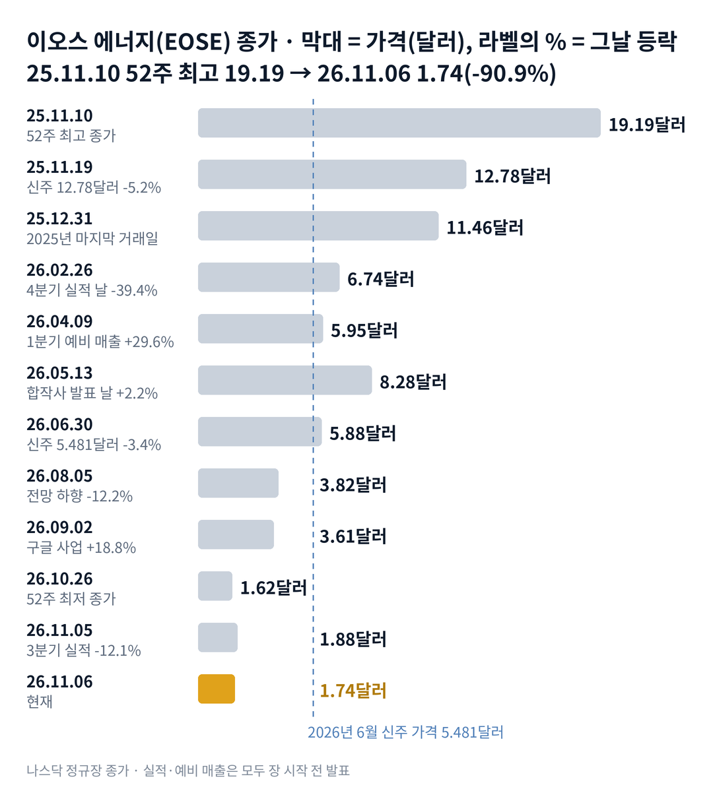

## 짧은 답

> **핵심:** 늘어난 매출의 대부분이 회사가 돈을 넣은 합작사에서 나왔고, 그 사이 새 주식 가격과 연간 전망이 함께 낮아졌습니다.

매출은 1년 전보다 171% 늘어 회사 역사상 가장 컸습니다. 그런데 이오스 에너지 주가는 왜 52주 최고 종가의 10분의 1 아래로 내려왔을까요?

결론부터 말하면, 시장은 매출의 크기보다 매출의 주인과 돈의 흐름을 먼저 봤습니다. 3분기 매출의 대부분은 이오스가 지분 36%를 가진 합작사가 산 것이었고, 그 합작사에 넣은 돈은 주주에게 새 주식을 팔아 마련했습니다. 그 사이 회사는 연간 매출 전망을 두 번 낮췄습니다. **2026.11.06 진단: 국면 B(숫자 검증기) 후반 — 근거는 5부.**

그렇다고 지금 주가가 바닥이라는 뜻은 아닙니다. 현금은 아홉 달 동안 약 2억 8,050만 달러 줄었고, 시장은 다음 분기 숫자와 다음 조달 가능성까지 값에 넣습니다. 그렇다면 과거에는 어땠을까요? 올해 매출 숫자를 낸 7번 가운데 첫날 내린 것은 4번이었습니다. 20거래일 뒤 더 높았던 단 한 번은 3부 '매출을 낸 날 7번, 20거래일 뒤 기록' 표에 있습니다.

> **유의사항** 저자는 금융·투자 자문가가 아닙니다. 이 글은 공개 공시와 시세를 정리한 교육용 분석이며 특정 종목의 매수·매도를 권하지 않습니다. 과거 패턴은 미래 수익을 보장하지 않고, 이오스 에너지는 실적 날 하루에 두 자릿수로 움직인 적이 많은 종목입니다. 실제 투자 전에는 최신 공시를 직접 확인하세요.

이 리포트는 김박사 월드 사이트에서 '이오스에너지'를 찾았지만 결과가 없던 검색에서 시작했습니다.

## 1부. 이오스 에너지는 어떤 회사이고, 무엇으로 돈을 버는가

> **핵심:** 이오스 에너지는 아연 배터리를 만들어 파는 회사이고, 지금 매출의 대부분은 자기가 투자한 합작사에서 나옵니다.

이오스 에너지는 미국 펜실베이니아에서 아연 배터리를 만드는 나스닥 상장 회사입니다. 리튬 대신 아연을 써서 불이 잘 붙지 않고, 전기를 열 시간 가까이 길게 내보내는 장주기 에너지 저장(LDES) 장치를 팝니다. 태양광 발전소나 데이터센터가 낮에 만든 전기를 밤까지 쓰게 해 주는 설비입니다. 2020년 11월 기업인수목적회사(스팩, 상장만을 위해 만든 회사)와 합쳐 10달러 근처에서 거래를 시작했습니다.

돈을 버는 방식은 배터리 묶음(큐브)을 만들어 발전 사업자에게 넘기는 것입니다. 주문을 받으면 → 공장에서 배터리를 만들고 → 현장으로 보내 넘기는 순간 매출이 잡힙니다. 그래서 공장이 얼마나 빨리 돌아가는지가 곧 매출의 속도입니다. 회사는 터틀크릭 공장의 1번 라인과 쏜힐 공장의 2번 라인을 운영하고, 지금 1번 라인을 쏜힐로 옮기고 있습니다.

고객이 중요한 이유는 한 곳에 몰려 있기 때문입니다. 3분기 매출 가운데 82.7%가 관계사 매출이었습니다. 관계사는 이오스가 지분 36%를 가진 합작사 프론티어 파워입니다. 바깥 고객에게 판 매출은 1,428만 달러로, 1년 전 3,051만 달러보다 53% 줄었습니다. 이 흔적은 늘어난 매출이 바깥 수요보다 회사와 이어진 고객에게서 나왔다는 것을 보여 줍니다.

지금 몸값은 약 6억 3,750만 달러입니다. 시가총액에서 현금을 뺀 단순 차감값은 약 2억 9,340만 달러입니다. 이 비교가 주가의 하한선은 아닙니다. 장부에 적힌 장기 차입과 관계사 차입이 약 6억 5,576만 달러로 현금보다 많기 때문입니다. 그렇다고 이 현금이 주가의 바닥을 보장하지는 않습니다. 현금은 매 분기 줄고, 시장은 앞으로의 손실과 희석까지 값에 넣기 때문입니다.

### 숫자로 본 지금의 크기(11월 6일 기준)

| 항목 | 값 · 계산 근거 |
| --- | --- |
| 종가 | **1.74달러** 52주 최고 종가 19.19달러(2025.11.10)보다 90.9% 낮음 |
| 시가총액 | **약 6억 3,750만 달러** 1.74달러 × 3억 6,636만 주(11월 3일) |
| 3분기 매출 | **8,273만 달러** 1년 전보다 171% 증가, 사상 최대 |
| 관계사 매출 비중 | **82.7%** 3분기 6,845만 달러, 9개월 59.2% |
| 바깥 고객 매출 | **1,428만 달러** 1년 전 3,051만 달러보다 53% 감소 |
| 현금(제한 포함) | **3억 4,410만 달러** 9월 말, 2025년 말 6억 2,460만 달러 |
| 장부상 차입 | **약 6억 5,576만 달러** 장기 차입 5억 4,655만 + 관계사 차입 1억 921만 |
| 주식 수 | **1.62배** 2025.02 2억 2,660만 주 → 2026.11 3억 6,636만 주 |
| 4분기 최소 매출(전망 기준) | **약 9,153만 달러** 전망 하단 3억 달러 − 9개월 매출 2억 847만 |

4분기 최소 매출은 올해 전망 '3억~3억 5천만 달러의 아래쪽 절반'의 바닥을 지키는 데 필요한 값입니다. 3분기보다 10.6% 많아야 합니다. 그런데 회사는 10월 말부터 1번 라인을 뜯어 옮기고 있어, 4분기 생산 능력이 잠시 줄어든다고 밝혔습니다. 그렇다면 주가는 언제부터, 어떤 사건에서 꺾였을까요?

## 2부. 1년 사이 주가를 끌어내린 세 가지 사건

> **핵심:** 기대보다 작은 실적, 자기 돈이 들어간 매출, 갈수록 싸진 새 주식이 1년 동안 차례로 겹쳤습니다.

위 차트에서 본 것처럼, 주가는 2024년 5월 바닥 0.64달러에서 2025년 11월 19.19달러까지 약 30배가 됐습니다. 그 뒤 1년 만에 1.74달러로 돌아왔습니다.

첫 번째는 기대와 숫자의 차이라는 실적 사건입니다. 2026년 2월 26일 장 시작 전, 회사는 4분기 매출 5,800만 달러를 발표했습니다. 회사 역사상 가장 큰 분기 매출이었지만, 보도된 시장 예상은 약 9,370만 달러였습니다. 올해 매출 전망도 시장 예상에 못 미쳤습니다. 회사는 3억~4억 달러를 내놓았고, 시장은 약 4억 7,130만 달러를 기대했습니다.

그날 주가는 11.13달러에서 6.74달러로 39.4% 내렸습니다. 거래량은 직전 20거래일 평균의 약 8.5배였습니다. 예상보다 작은 매출 → 흑자 시점이 늦어짐 → 같은 미래에 더 낮은 값이라는 순서입니다.

전망을 지키지 못한 것도 처음이 아니었습니다. 2025년 11월 회사는 그해 매출을 1억 5천만~1억 6천만 달러로 내다봤습니다. 실제 매출은 1억 1,420만 달러였습니다.

2026년 전망은 8월 5일 3억~3억 5천만 달러로 좁혀졌습니다. 그날 주가는 12.2% 내렸습니다. 10월 19일에는 그 범위의 아래쪽 절반이라고 다시 낮췄습니다.

두 번째는 자기 돈이 들어간 매출이라는 구조 사건입니다. 2026년 5월 13일 회사는 사모펀드 서버러스(Cerberus)와 합작사 프론티어 파워를 만든다고 발표했습니다. 서버러스가 1억 달러, 헤지펀드 허드슨 베이가 5천만 달러를 넣었습니다. 이오스는 현금 1억 1,264만 달러를 넣고 지분 36%를 받았습니다. 합작사는 이오스 배터리 2GWh(기가와트시) 생산 능력을 미리 예약했습니다. 회사가 주주에게 모은 돈을 합작사에 넣고 → 합작사가 이오스 배터리를 사고 → 그것이 이오스 매출로 잡히는 순서입니다. 이 구조는 분기 보고서에 관계사 매출로 따로 적혀 있습니다.

세 번째는 갈수록 싸진 새 주식이라는 자금 사건입니다. 2025년 11월 회사는 연 1.75% 이자의 6억 달러 전환사채(나중에 주식으로 바꿀 수 있는 채권)를 팔았습니다. 전환가는 약 16.29달러였습니다. 같은 때 새 주식 3,586만 주는 12.78달러에 팔았습니다. 7개월 뒤인 2026년 6월 30일, 합작사 출자금을 위한 새 주식은 5.481달러였습니다.

기존 주주에게 같은 가격으로 살 권리를 준 권리 공모(주주에게 새 주식을 살 권리를 나눠 주는 방식)에는 배정 2,737만 단위 가운데 689만 단위, 25.2%만 들어왔습니다. 들어온 주식이 얼마나 큰지 세 분모로 보겠습니다.

권리 공모의 새 주식 689만 주는 8월 3일 주식 수 3억 6,417만 주의 약 1.9%입니다. 결과 발표 전 5거래일 평균 거래량(약 2,457만 주)과 견주면 약 0.3일치입니다. 유통 주식 수는 따로 공시되지 않아 전체 주식 수를 분모로 썼고, 실제 유통 주식 대비 비율은 이보다 조금 클 수 있습니다.

### 저장 장치 주식과 청정에너지 상장지수펀드(ETF)

| 종목 · 성격 | 올해(12.31 → 11.06) | 3분기 말 뒤(9.30 → 11.06) |
| --- | --- | --- |
| **이오스 에너지(EOSE)** 아연 장주기 저장 | **-84.8%** | **-43.2%** |
| 플루언스(FLNC) 리튬 저장 시스템 | -73.4% | -31.4% |
| 이노빅스(ENVX) 배터리 셀 | -62.2% | -4.8% |
| 청정에너지 ETF(ICLN) | +0.1% | -3.2% |

같은 저장 장치 회사인 플루언스도 올해 73.4% 내렸습니다. 반면 청정에너지 전체를 담은 ETF는 제자리였습니다. 업종 가운데 저장 장치 무리가 함께 약했고, 이오스는 그 무리 안에서도 가장 많이 내린 편이었습니다. 11월 4일 중간선거 뒤 청정에너지 주식이 함께 오른 날 이오스도 12.6% 올랐지만, 다음 날 3분기 실적에 12.1% 내렸고, 그다음 날 7.4% 더 내려 1.74달러가 됐습니다. 9월 2일 구글 데이터센터 사업에 이오스 배터리가 들어간다는 소식에는 하루 18.8% 올랐지만 오래가지 않았습니다. 10월 14일(-15.9%)과 16일(-15.7%)에는 회사 발표나 보도를 찾지 못했습니다.

세 사건을 나란히 놓으면 공통점이 하나 보입니다. 매출은 매번 늘었지만, 그 매출을 만드는 데 들어간 돈이 더 빨리 늘었다는 점입니다. 결국 이번 하락은 기대에 못 미친 실적 위에, 자기 돈이 들어간 매출과 싸진 새 주식이 겹친 결과였습니다. 그렇다면 올해 매출 숫자가 나온 날마다 주가는 실제로 어떻게 움직였을까요?

## 3부. 올해 매출 숫자를 낸 7번, 첫날과 20거래일 뒤

> **핵심:** 올해 매출을 낸 7번 중 첫날 내린 것은 4번이고, 20거래일 결과가 나온 5번 중 4번은 발표 전보다 낮았습니다.

이 기록을 보는 이유는 이번 하락이 '사상 최대 매출을 낸 날'에 나왔기 때문입니다. 회사는 2026년에 본 실적 넷과 예비 매출 셋을 냈고, 일곱 번 모두 장 시작 전에 나왔습니다. 그래서 발표 전날 종가를 기준으로 발표일 종가와, 발표일을 첫날로 센 20번째 거래일 종가를 비교했습니다.

표의 세 칸은 세 질문에 답합니다. 첫 칸은 그날 무엇이 나왔나, 둘째 칸은 첫날 어떻게 반응했나, 셋째 칸은 한 달 동안 유지됐나입니다. 예를 들어 2월 26일은 전날 종가 11.13달러가 그날 6.74달러로 -39.4%였습니다. 20번째 거래일인 3월 25일에는 발표 전보다 54.2% 낮았습니다.

**한눈에:** 첫날 상승 3번 · 20거래일 뒤 상승 1번 · 20거래일 뒤 가운데 값(중앙값) -25.1%. 첫날 오른 세 번 가운데 한 달 뒤까지 위에 남은 것은 한 번이었습니다.

### 매출을 낸 날 7번, 20거래일 뒤 기록

| 발표일 · 그날 나온 내용 | 첫날 | 20거래일 뒤 |
| --- | --- | --- |
| **2026.02.26** 4분기 5,800만 달러 올해 전망 3억~4억 | **-39.4%** | **-54.2%** |
| 2026.04.09 1분기 예비 매출 출하 사상 최대 | +29.6% | +42.5% |
| 2026.05.13 1분기 5,700만 달러 합작사 발표 | +2.2% | -25.1% |
| 2026.07.15 2분기 예비 매출 수주잔고 8억 700만 | +1.9% | -1.2% |
| **2026.08.05** 2분기 6,880만 달러 전망 3억~3억 5천만 | **-12.2%** | **-30.1%** |
| **2026.10.19** 3분기 예비 매출 전망 아래쪽 절반 | **-0.5%** | — |

굵게 쓴 세 줄이 첫날 내린 경우입니다. 10월 19일의 20번째 거래일은 11월 13일이라 아직 결과가 없습니다. 7월 15일과 8월 5일, 10월 19일과 11월 5일은 20거래일 측정 기간이 서로 겹칩니다. 그래서 이 표는 독립된 일곱 번이 아니고, 그때와 지금은 주가 수준과 자금 상황도 다르므로 참고 자료로 봅니다.

> **이번(미확정):** 2026.11.05 · 3분기 8,273만 달러, 관계사 82.7% · 전날 종가 2.14달러 · 첫날 -12.1% · 5거래일째 11월 11일, 20거래일째 12월 3일 판정

여기서 기억할 사실은 하나입니다. 다섯 번 가운데 한 달 뒤 발표 전 종가를 넘은 것은 4월 9일 예비 매출 한 번뿐이었고, 그때는 출하가 사상 최대라는 숫자와 바닥 근처의 낮은 기대가 함께 있었습니다. 그렇다고 이것이 이번 결과를 정해 주는 규칙은 아닙니다. 그렇다면 같은 '사상 최대'에 4월과 11월은 왜 정반대였을까요?

## 4부. 같은 사상 최대, 4월과 11월이 달랐던 이유

> **핵심:** 4월은 '공장이 돌아가는가'를, 11월은 '누가 사고 누가 돈을 대는가'를 물었습니다.

두 번의 발표는 묻는 질문이 달랐습니다. 4월의 질문은 '공장이 계획대로 돌아가는가'였습니다. 2월 폭락 뒤 주가는 4.59달러까지 내려와 기대가 낮았습니다. 그때 출하와 생산이 모두 사상 최대라는 숫자가 나오자, 시장은 생산 문제가 풀린다는 안도를 값에 크게 넣었습니다.

11월의 질문은 '이 매출을 누가 사고, 그 돈은 어디서 오는가'였습니다. 5월 합작사 발표 뒤 매출에서 관계사 비중이 커졌고, 3분기에는 대부분이 됐습니다. 같은 사상 최대 매출이라도 바깥 고객이 늘린 매출과 자기 돈이 들어간 합작사가 산 매출은 시장이 다르게 읽었습니다. 수주잔고 7억 6,500만 달러 가운데 합작사 주문은 약 43%입니다. 재무책임자는 4분기에 관계사 비중이 줄어 이 구성에 가까워질 것이라고 말했습니다.

출발점도 달랐습니다. 4월에는 회사가 쓸 현금이 넉넉했고 신주 가격도 아직 정해지지 않았습니다. 11월에는 현금이 1부 표에서 본 수준으로 줄었습니다. 이미 5.481달러 신주의 권리 공모가 4분의 1만 채워진 뒤였습니다. 같은 숫자라도 다음 조달 걱정이 있는 회사의 숫자는 할인돼 읽혔습니다.

거꾸로 된 순이익도 혼란을 키웠습니다. 3분기 순이익 1억 2,500만 달러는 배터리를 팔아 남긴 돈이 아니었습니다. 주가가 내리면서 회사가 발행한 워런트(정해진 가격에 주식을 살 권리)와 부채의 평가액이 줄었고, 그 차이가 이익으로 잡혔습니다. 같은 분기 영업손실은 7,932만 달러였습니다.

과거 기록이 알려 주는 것은 첫날의 방향이 한 달 뒤를 정하지 않았다는 점입니다. 결국 앞으로 확인할 것은 두 가지입니다. 하나는 4분기 매출이 연간 전망 하단 3억 달러를 채우는가입니다. 다른 하나는 내년 3월 말까지 새 주식을 더 내지 않고 버티는가입니다. 이 두 가지로 다음 다섯 달을 나누면 어떤 갈림길이 나올까요?

## 5부. 매출 달성과 신주 발행, 네 가지 시나리오

> **핵심:** 지금은 국면 B(숫자 검증기) 후반이고, 4부에서 본 두 가지가 시나리오를 가르는 축입니다.

> **국면 정의(이오스 에너지 시리즈 공통):** 국면 A 기대 확장기 — 대출·대형 투자·계약 소식에 급등. 국면 B 숫자 검증기 — 실적마다 전망 하향과 신주 발행. 국면 C 재무 회복기 — 매출총이익 흑자 전환과 조달 없는 분기.

**2026년 11월 6일 진단: 국면 B(숫자 검증기) 후반.** 올해 2월 뒤 실적이 나올 때마다 전망이 낮아졌고, 그 사이 5.481달러 신주와 권리 공모가 있었습니다. 국면 C(재무 회복기)로 넘어가는 신호는 '매출총이익 흑자'와 '조달 없이 한 분기'인데, 3분기 매출총이익률은 1년 전보다 58%포인트 좋아졌지만 여전히 -53%였습니다. 회사는 4분기 조정 매출총이익률을 -25%에서 -20%로 내다봤습니다.

**판정 기준 두 가지:** 첫째, 매출 달성입니다. 4분기 실적에서 2026년 매출이 3억 달러 이상인지를 봅니다(1부 표의 4분기 최소 매출). 둘째, 신주 발행입니다. 11월 7일부터 2027년 3월 31일까지 새 주식이나 주식으로 바뀌는 증권을 발행한다는 공시가 있으면 '발행'으로 봅니다.

### 앞으로 일어날 수 있는 일

**확인된 사실:** 회사는 4분기 생산 능력이 잠시 줄어든다고 밝혔고, 재무책임자는 지금 현금에 에너지부 대출 잔여분, 주 정부 보조금, 생산 세액공제(약 3,900만 달러)를 더해 흑자까지 갈 수 있다고 말했습니다. **과거 기록:** 회사가 연간 매출 전망을 낸 2번 중 2번 모두 낮아지거나 지켜지지 않았습니다. 연간 매출 전망은 2025년 11월에 낸 것을 지키지 못했고(1억 1,420만 달러), 2026년 전망은 두 번 낮아졌습니다. 신주·주식 연계 발행은 지난 18개월 동안 2025년 5월, 2025년 11월, 2026년 6~7월 세 번 있었습니다. **추정:** 아래 가능성은 분석자의 주관적 추정이며, 주가가 오를 확률이 아니라 회사 숫자 조합의 가능성입니다. 네 경우는 겹치지 않아 '약 N%'를 더하면 100%이고, 괄호 안 구간은 흔들림의 폭이라 서로 더하지 않습니다.

| 시나리오(판정 2027년 3월 31일) | 달성 · 무발행 | 가능성(추정) |
| --- | --- | --- |
| 1 · 매출 달성, 새 주식 없음 | ○ · ○ | 중간 약 25% (20~30%) |
| 2 · 매출 달성, 새 주식 발행 | ○ · × | 중간 약 25% (20~30%) |
| 3 · 매출 미달, 새 주식 없음 | × · ○ | 낮음 약 15% (10~20%) |
| **4 · 매출 미달, 새 주식 발행** | × · × | 높음 약 35% (35~45%) |

**한눈에:** 매출 3억 달러 달성 약 50%(1+2) · 새 주식 없이 3월 말 통과 약 40%(1+3). 분석자의 주관적 추정을 더한 값이며, 실제 확률이나 통계 예측값은 아닙니다. 회사 숫자가 맞아도 주가 방향은 따로 읽어야 합니다.

시나리오 4를 가장 높게 본 이유는 두 가지입니다. 4분기 문턱이 3분기보다 높은데 1번 라인이 멈춰 있고, 지난 18개월 동안 새 주식이 세 번 나왔기 때문입니다. 4분기 문턱은 1부 표에서 본 최소 매출입니다.

하지만 같은 무게로 반대쪽 요인도 있습니다. 회사는 4분기 판매 가격이 상반기 수준으로 돌아간다고 했고, 2번 라인의 수율이 3개월 만에 1번 라인을 따라잡았습니다.

시나리오 1이 되면 '숫자 검증기'의 끝이 보이기 시작합니다. 시나리오 4는 2025년의 전망 미달이 반복되고 희석이 이어진다는 뜻입니다. 이 값은 과거 빈도와 지금 신호에서 나온 추정이지, 주가가 오르거나 내린다는 판단이 아닙니다. 그렇다면 이 진단을 가장 빨리 뒤집을 수 있는 위험은 무엇일까요?

## 6부. 세 갈래 위험과 체크리스트

> **핵심:** 위험은 사업 실행, 자금 조달, 외부 환경 세 갈래이고, 가장 빨리 판을 바꿀 수 있는 것은 다음 예비 매출입니다.

먼저 이 분석의 한계입니다. 3부 표는 결과가 나온 다섯 번뿐인 작은 표본이고, 측정 기간이 겹치는 줄도 있습니다. 10월 14일과 16일 하락의 이유, 합작사가 산 배터리가 실제 발전소에 언제 들어가는지는 확인하지 못했습니다. 2월 시장 예상은 보도 집계라 회사가 낸 숫자가 아닙니다.

첫째 갈래는 사업 실행입니다. 1번 라인이 1분기 말에 다시 돌지 못하면, 4분기에 이어 1분기 생산도 2번 라인 하나에 기댑니다. 경영진은 마무리 단계 사업 3.5GWh 가운데 절반 넘게가 아직 자금 조달을 기다린다고 했습니다.

둘째 갈래는 자금 조달입니다. 9개월 동안 영업에서 2억 6,159만 달러가 나갔습니다. 공장 투자와 합작사 출자에도 2억 달러 넘게 썼습니다. 다음 조달이 새 주식이라면 주식 수가 늘어 기존 주주 한 주가 차지하는 비율이 작아지는 희석이 생깁니다. 에너지부 대출의 매출·이익 약정(EBITDA, 이자·세금·감가상각 전 이익 기준)은 2027년 3월 말 분기부터 다시 적용됩니다.

셋째 갈래는 외부 환경입니다. 11월 4일처럼 정치 소식에 청정에너지 주식이 함께 움직이는 날에는 회사 숫자와 상관없이 크게 흔들렸습니다. 같은 저장 장치 무리가 올해 함께 약했던 것도 2부 표에서 보았습니다.

**핵심 확인 세 가지:**

- ☐ 다음 실적 전 예비 매출(날짜 미정)에서 4분기 매출이 약 9,153만 달러를 넘었나
- ☐ 2027년 3월 31일까지 새 주식·전환사채 발행 공시가 없는가
- ☐ 실적(4분기)에서 관계사 매출 비중이 3분기의 80%대보다 내려왔나

**보조 확인:**

- ☐ 11월 11일 종가가 발표 전날 종가 2.14달러보다 높은가(5거래일째)
- ☐ 12월 3일 종가가 2.14달러보다 높은가(3부 20거래일째)
- ☐ 12월 3일까지 주가가 10월 26일 52주 최저 종가 1.62달러 위에 머무는가

**기억할 판단 기준 세 가지:** 첫째, 이번 실적의 매출 크기는 사상 최대였습니다. 둘째, 시장은 매출의 크기보다 그 매출을 산 곳과 돈을 댄 곳을 먼저 봤습니다. 셋째, 올해 매출을 낸 뒤 한 달 안에 발표 전 가격을 되찾은 경우는 한 번뿐이었습니다.

다음 갱신은 4분기 예비 매출이 나온 뒤에 합니다. 공시는 [이오스 에너지 SEC 공시 목록](https://www.sec.gov/cgi-bin/browse-edgar?action=getcompany&CIK=0001805077&type=&dateb=&owner=include&count=40)에서 확인할 수 있습니다.
