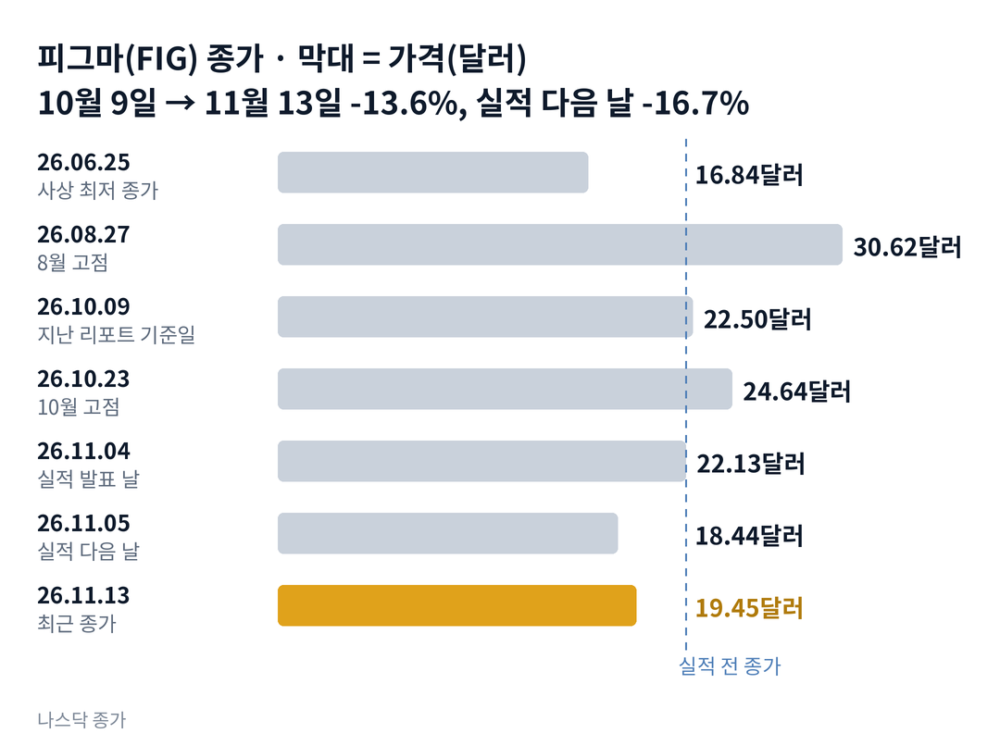

## 짧은 답

> **핵심:** 매출은 기대보다 컸지만, 회사가 올린 연간 이익 전망을 거꾸로 풀면 4분기 영업이익률이 약 6%로 반토막 납니다. 같은 날 시장도 크게 내렸고, 시장보다 더 빠진 부분을 설명할 회사 숫자로는 이것이 가장 큽니다.

매출은 자기 전망보다 1,640만 달러 더 나왔는데, 주가는 왜 하루에 16.7% 빠졌을까요? 피그마는 11월 4일 장 마감 뒤 3분기 매출 3억 9,140만 달러를 발표했습니다. 1년 전보다 43% 늘었고, 시장 예상 3억 7,580만 달러도 넘었습니다.

회사는 연간 매출 전망과 연간 영업이익 전망을 함께 올렸습니다. 그런데 다음 날 주가는 18달러대로 내렸습니다. 같은 날 나스닥100 지수를 따르는 상장지수펀드(ETF) QQQ(인베스코 QQQ 트러스트)도 크게 내렸으니, 하락의 일부는 시장 전체 탓입니다.

나머지는 회사 숫자 안에 있습니다. 올린 연간 영업이익 전망에서 지금까지 번 이익을 빼 보면, 마지막 분기에 남는 영업이익률은 직전 분기의 절반 수준입니다. 회사가 직접 낸 숫자가 아니라 전망으로 거꾸로 계산한 값입니다. 매출에서 원가를 뺀 비율인 매출총이익률도 1년 전보다 내려왔습니다. 두 숫자는 1부와 2부 표에 있습니다.

**2026.11.13 진단: 매출 성장은 이미 확인됐고 시장의 관심이 이익률로 옮겨 간 단계가 실적 뒤에도 이어집니다. 실적 뒤 종가는 18~20달러 사이입니다 — 근거는 5부.** 실적 다음 날 종가를 기준으로 20거래일(약 한 달) 뒤를 비교한 기록은 3부 '실적 반응 여섯 번' 표에 있습니다.

> **유의사항** 저자는 금융·투자 자문가가 아닙니다. 이 글은 공개 공시와 시세를 정리한 교육용 분석이며 특정 종목의 매수·매도를 권하지 않습니다. 과거 패턴은 미래 수익을 보장하지 않고, 이 종목은 하루 15% 넘게 움직인 적이 여러 번 있습니다. 실제 투자 전에는 최신 공시를 직접 확인하세요.

이 리포트는 시청자 반응이 컸던 종목의 업데이트입니다.

## 지난 리포트 이후

지난 예측 성적: 5개 중 적중 1 · 부분 적중 2 · 빗나감 2.

[10월 11일 리포트](/r/fig-2026-10/)는 3분기 실적의 매출총이익률과 영업이익률이 다음 방향을 정할 것이라고 봤습니다. 매출 추정은 맞았습니다. 그러나 영업이익 전망이 오르면 주가도 오른다는 시나리오는 정반대로 끝났습니다. 항목별 채점은 6부 끝 채점표에 있습니다.

기준일 종가는 10월 9일 22.50달러에서 11월 13일 19.45달러로 13.6% 내렸습니다. 실적 날짜는 지난 리포트가 추정한 대로 11월 4일 장 마감 뒤였습니다. 이번 리포트가 새로 답하는 질문은 하나입니다. 좋은 실적 뒤 하락은 이 종목에서 얼마나 오래 이어졌을까요?

## 1부. 실적 날 회사가 내놓은 숫자

> **핵심:** 매출, 고객 수, 현금은 모두 좋았습니다. 내려간 숫자는 매출총이익률 하나였고, 4분기 전망은 시장 예상보다 높았습니다.

피그마는 웹 브라우저에서 여러 사람이 동시에 화면을 그리는 디자인 도구를 만드는 회사입니다. 앱과 웹사이트의 화면 설계를 이 도구로 하는 회사가 많습니다. 2025년 7월 31일 공모가 33달러로 뉴욕증권거래소에 상장했고, 첫날 115.50달러에 마쳤습니다.

돈을 버는 방식은 사용자 한 명마다 받는 구독료입니다. 최근에는 인공지능 기능을 쓸 때 소모되는 크레딧을 따로 팝니다. 이 크레딧을 처리하는 연산 비용이 원가로 잡힙니다. 그래서 인공지능 사용이 늘수록 매출과 원가가 함께 늘어납니다.

이 구조 때문에 실적 날 가장 중요한 숫자는 매출보다 이익률입니다. 매출 성장은 상장 뒤 매번 시장 예상을 넘어 이미 익숙한 소식이 됐습니다. 시장은 인공지능 원가가 늘어도 지금 같은 이익을 남길 수 있는지를 봅니다.

지금 몸값은 11월 13일 종가 기준 약 104억 달러입니다(3분기 평균 주식 수로 계산). 종가 19.45달러는 공모가의 약 59%입니다. 사상 최저 종가 16.84달러(2026년 6월 25일)보다는 15.5% 높습니다.

아래 표의 비일반회계는 주식으로 준 보상처럼 현금이 나가지 않는 비용을 뺀 회사 기준 숫자입니다. 매출총이익률은 매출에서 원가를 뺀 비율입니다.

### 3분기 숫자(1년 전 대비, 회사 발표)

| 항목 | 2026년 3분기 |
| --- | --- |
| 매출 | **3억 9,140만 달러** +43%, 시장 예상 3억 7,580만 달러 |
| 비일반회계 매출총이익률 | **82%** 1년 전 86% |
| 비일반회계 영업이익 | **4,700만 달러** 이익률 12%, 1년 전도 12% |
| 순매출 유지율 | **131%** 1년 전과 같음 |
| 현금·유가증권 | **17억 달러** 9월 30일 |

순매출 유지율 131%는 기존 고객이 1년 전보다 31% 더 많은 돈을 냈다는 뜻입니다. 큰 고객(연간 1만 달러 넘게 내는 곳)은 1년 사이 28% 늘었습니다.

인공지능 사용도 빨랐습니다. 회사에 따르면 10월 31일 기준 이 큰 고객 가운데 65%가 매주 '피그마 에이전트'를 썼습니다. 외부 인공지능 도구와 피그마를 잇는 MCP(모델 컨텍스트 프로토콜, 인공지능이 다른 프로그램을 쓰게 해 주는 연결 규격) 서버 사용량은 한 분기 만에 세 배가 됐습니다.

4분기 매출 전망은 1년 전보다 약 33% 많은 수준입니다. 시장이 예상한 약 28%보다 높았습니다. 연간 매출 전망도 중간값 기준 3,300만 달러 올렸습니다. 매출도 전망도 올랐는데 왜 주가는 내렸을까요?

## 2부. 올린 전망 속에 숨은 4분기

> **핵심:** 연간 영업이익 전망을 올렸지만, 이미 번 1~3분기를 빼면 4분기 영업이익률은 약 6%만 남습니다. 지난 리포트가 하반기 이익률을 역산한 방식 그대로입니다.

회사는 연간 비일반회계 영업이익 전망을 범위 중간값 기준 약 1억 6,050만 달러로 올렸습니다. 전에는 약 1억 3,000만 달러였습니다. 숫자만 보면 좋은 소식입니다. 그런데 지금까지 세 분기 동안 이미 번 영업이익이 1억 3,523만 달러입니다.

**4분기에 남는 숫자(회사 연간 전망 기준, 계산)**

| 항목 | 4분기 |
| --- | --- |
| 비일반회계 영업이익 | **2,277만~2,777만 달러** 3분기 4,700만 달러의 약 절반 |
| 영업이익률 | **약 5.7~6.9%** 3분기 12%, 2분기 10% |

이 계산은 회사가 앞으로 전망을 넘어설 가능성을 넣지 않은 값입니다. 피그마는 상장 뒤 매번 자기 전망을 넘었습니다. 그래도 회사가 직접 내놓은 4분기 그림이 이익률 반토막이라는 점은 바뀌지 않습니다.

원가 쪽도 같은 방향입니다. 비일반회계 매출원가는 약 7,029만 달러로, 1년 전 3,731만 달러보다 약 88% 늘었습니다(계산). 같은 기간 매출은 43% 늘었습니다. 10-Q는 늘어난 원가의 주된 이유로 인공지능 관련 호스팅·인프라 비용을 들었습니다.

회사는 가격도 내렸습니다. 8월 25일부터 유료 크레딧 추가 상품은 같은 값에 크레딧을 프로페셔널 요금제 두 배, 조직·엔터프라이즈 요금제 1.6배로 줍니다. 최고재무책임자는 실적 뒤 인터뷰에서 단기 매출을 일부 양보하고 고객에게 투자하는 선택일 수 있다는 취지로 말했습니다.

미리 받은 돈도 눈에 띕니다. 회사가 먼저 받고 아직 매출로 잡지 않은 이연 매출은 3분기에 21만 달러 줄었습니다. 1년 전 3분기에는 4,042만 달러 늘었습니다. 한 분기 숫자라 계절 차이일 수 있지만, 이번에는 늘지 않았습니다.

4분기 이익률, 원가, 크레딧 가격, 이연 매출은 따로 나온 숫자지만 한 방향으로 겹쳤습니다. 필자는 이 넷을 같은 방향으로 읽습니다. 고객의 인공지능 사용이 늘 때 그 비용이 회사 이익률에 먼저 잡힌다는 방향입니다. 다만 이연 매출은 한 분기 변동이라 계절 차이일 수 있습니다. 이런 실적 반응이 이 종목에서 처음이었을까요?

## 3부. 실적 반응 여섯 번

> **핵심:** 상장 뒤 실적 다음 날 세 번 오르고 세 번 내렸습니다. 결과가 나온 다섯 번 가운데 네 번은 20거래일 뒤 종가가 반응 날 종가보다 낮았습니다.

기준은 이렇습니다. 상장 뒤 모든 실적 발표의 다음 거래일 종가를 '반응 날'로 잡았습니다. 그날 종가를 10거래일 뒤, 20거래일 뒤 종가와 비교했습니다. 이번 하락이 실적 다음 날 한 번에 나왔기 때문에 이 기준을 골랐습니다.

예를 들어 2026년 8월 6일 반응 날 종가는 23.97달러였습니다. 20거래일 뒤 9월 3일 종가는 25.22달러로 5.2% 높았습니다.

**한눈에:** **3/6** 실적 다음 날 하락 · **4/5** 10거래일 뒤 반응 날보다 높음 · **4/5** 20거래일 뒤 반응 날보다 낮음.

### 실적 다음 날과 그 뒤

| 반응 날 · 다음 날 변화 | 10거래일 뒤 | 20거래일 뒤 |
| --- | --- | --- |
| 2025.09.04 **-19.9%** · 54.56달러 | +7.1% | -4.9% |
| 2025.11.06 +4.5% · 45.98달러 | -27.0% | -17.4% |
| 2026.02.19 +6.9% · 25.86달러 | +17.2% | -6.3% |
| 2026.05.15 +13.2% · 22.92달러 | +18.3% | -19.2% |
| 2026.08.06 **-14.8%** · 23.97달러 | +13.9% | +5.2% |

표에서 두 가지가 보입니다. 10거래일 뒤에는 다섯 번 중 네 번 반응 날보다 높았습니다. 20거래일 뒤에는 다섯 번 중 네 번 낮았습니다. 10거래일 뒤 높았다가 20거래일 뒤 낮아진 경우는 세 번(2025년 9월, 2026년 2월, 5월)이었습니다. 표본이 작아 이번에도 같으리라는 근거는 아닙니다.

크게 내린 두 번만 보면 결과가 갈립니다. 2025년 9월은 20거래일 뒤 4.9% 낮았고, 2026년 8월은 5.2% 높았습니다. 이번에는 11월 5일 종가 18.44달러 대비 6거래일 뒤 11월 13일 종가가 19.45달러로 이미 5.5% 높습니다.

> **이번 사례(결과 미확정):** 2026.11.05 다음 날 -16.7%, 반응 날 종가 18.44달러 · 11월 19일(10거래일째)과 12월 4일(20거래일째) 종가가 18.44달러보다 높은지 확인

이 기록의 한계도 분명합니다. 결과가 나온 표본은 다섯 번뿐이고, 상장 첫해라 매도 제한 해제 같은 다른 재료가 겹친 때가 많았습니다. 그런데 이번에는 지난 리포트가 세운 실적 규칙부터 맞지 않았습니다. 무엇이 어긋났을까요?

## 4부. 지난 리포트의 규칙이 틀린 날

> **핵심:** 지난 리포트는 '영업이익률이 오르면 실적 다음 날 오른다'고 정리했습니다. 이번에는 영업이익률이 올랐는데 16.7% 내렸고, 그 차이를 설명할 후보로는 다음 분기 이익률과 시장 급락이 보입니다.

지난 리포트 4부의 실적 패턴은 이랬습니다. 영업이익률이 오른 2026년 5월에는 다음 날 13.2% 올랐습니다. 내린 8월에는 14.8% 내렸습니다. 그래서 이번에도 영업이익률 방향을 먼저 보라고 적었습니다.

이번 3분기 영업이익률은 12%로 2분기 10%보다 올랐습니다. 규칙대로라면 오를 차례였습니다. 실제 결과를 가른 것은 두 가지로 보입니다.

하나는 앞을 보는 숫자입니다. 3분기 영업이익률은 올랐지만, 회사 전망 속 4분기는 약 6%였습니다. 이번 한 번의 사례로는, 주가가 지난 분기보다 다음 분기 전망 쪽에 더 민감했던 것으로 보입니다. 매출총이익률도 1년 사이 4%포인트 내려가 원가 부담이 계속된다는 신호를 줬습니다.

다른 하나는 시장입니다. 11월 5일 QQQ는 하루 6.5% 내렸습니다. 같은 디자인 소프트웨어 회사 어도비(ADBE)는 0.8% 내렸습니다. 피그마의 하락 16.7%는 어도비보다 훨씬 컸습니다.

한 달 전체로 보면 이렇습니다. 10월 9일부터 11월 13일까지 피그마는 13.6% 내렸고, QQQ는 9.5% 내렸고, 어도비는 0.3% 올랐습니다. 2026년 들어서는 피그마 -48.0%, QQQ +10.7%, 어도비 -30.5%입니다.

대주주 쪽 매도는 작았습니다. 11월 12일 인덱스 벤처스 계열이 1만 2,475주(약 23만 달러) 매도 예정을 신고했습니다. 그레이록과 세쿼이아의 9월 말 지분은 각각 6.3%, 3.9%로 공시됐습니다. 이번 하락을 설명할 크기는 아닙니다.

그래서 이번 리포트부터 실적 규칙을 고칩니다. 지난 분기 영업이익률이 아니라, 회사 전망에서 역산한 다음 분기 영업이익률을 먼저 봅니다.

과거 기록이 알려 주는 것은 반응 날 뒤 20거래일의 방향까지입니다. 그래서 앞으로 확인할 조건은 두 가지입니다. 하나는 12월 4일 종가가 18.44달러를 지키는가, 다른 하나는 그 사이 사상 최저 종가 16.84달러가 깨지는가입니다. 이 두 조건으로 나누면 어떤 갈림길이 나올까요?

## 5부. 국면 진단과 네 가지 시나리오

> **핵심:** 지금은 이익률 검증 구간이 이어지면서 가격 범위만 한 칸 내려온 단계이고, 12월 4일 종가와 그 사이 사상 최저 종가 경신 여부가 시나리오를 가릅니다.

> **국면 정의(피그마 시리즈 공통, 10월 11일 리포트 5.2):** 국면 A(인공지능 공포 하락, 대형 인공지능 회사의 디자인 도구 출시 뒤 하락이 이어지는 단계). 국면 B(공매도 바닥 반등, 공매도가 많이 쌓인 뒤 급등이 잦은 단계). 국면 C(이익률 검증 구간, 매출 성장은 확인됐고 시장의 질문이 이익률로 옮겨 간 단계).

**2026년 11월 13일 진단: 국면 C(이익률 검증 구간)가 이어지는 중.** 실적 날 하락의 계기는 경쟁 도구가 아니라 회사 자신의 이익률 전망이었습니다. 실적 전 9월부터 11월 4일까지 종가는 대체로 20~25달러 사이였습니다(최저 20.25달러, 최고 24.64달러). 실적 뒤 6거래일 종가는 18.44~19.45달러 사이였습니다. 50일 평균 21.84달러와 200일 평균 22.64달러 모두 아래입니다.

**판정 기준 두 가지:** 하나는 12월 4일(11월 5일부터 20번째 거래일) 종가가 반응 날 종가 18.44달러보다 높은가입니다. 다른 하나는 그때까지 사상 최저 종가 16.84달러보다 낮게 마감한 날이 하루라도 있는가입니다.

### 앞으로 일어날 수 있는 일

**확인된 사실:** 4분기 매출 전망은 4억 200만~4억 400만 달러이고, 역산한 4분기 영업이익률은 약 6%입니다. 딜런 필드 대표의 사전 매도 계획은 11월 30일까지입니다(지난 리포트 5.5).

**과거 기록:** 3부 표에서 반응 날 뒤 20거래일 종가는 다섯 번 중 네 번 반응 날보다 낮았습니다. 같은 표에서 10거래일 뒤는 다섯 번 중 네 번 높았습니다.

**추정:** 출발점은 반응 날 뒤 20거래일 종가가 5번 중 4번 낮았다는 기록입니다. 아래 가능성은 주가가 오를 확률이 아니라, 12월 4일에 두 판정 기준이 어느 칸에 들어갈지에 대한 분석자의 주관적 추정입니다. 네 경우는 겹치지 않아 '약 N%'를 더하면 100%이고, 괄호 안 구간은 흔들림의 폭이라 서로 더하지 않습니다.

| 시나리오(판정 2026년 12월 4일) | 종가·최저 | 가능성(추정) |
| --- | --- | --- |
| **1 · 반등 뒤 되밀림** | 18.44 아래 · 없음 | 높음 약 40% (35~45%) |
| **2 · 반등 유지** | 18.44 위 · 없음 | 높음 약 40% (35~45%) |
| 3 · 사상 최저 경신 | 18.44 아래 · 있음 | 낮음 약 15% (10~20%) |
| 4 · 경신 뒤 회복 | 18.44 위 · 있음 | 낮음 약 5% (3~8%) |

1번과 2번에 같은 무게를 둔 데는 이유가 있습니다. 과거 기록은 1번 쪽(다섯 번 중 네 번)이지만, 이번에는 이미 반응 날보다 5.5% 위에서 출발합니다. 시장도 11월 5일 뒤 5.1% 되돌렸습니다.

기록만 따르면 1번 쪽이 5번 중 4번이지만, 표본이 다섯이고 출발점이 이미 위라는 점을 반영해 1번의 무게 일부를 2번으로 옮겼습니다. 괄호 구간은 이 판단이 틀릴 수 있는 폭을 앞뒤 5%포인트로 둔 것입니다.

3번을 15%로 둔 것은 16.84달러가 지금 종가보다 13.4% 아래에 있기 때문입니다. 이 종목은 하루 15% 넘게 내린 날이 상장 뒤 세 번 있었으니, 한 번의 큰 하락이면 닿는 거리입니다. 4번은 그런 하락 뒤 곧바로 되돌리는 경우라 가장 낮게 뒀습니다.

시나리오 1이면 12월 4일 전에 대표 매도 계획이 연장되는지 봅니다. 시나리오 2면 50일 평균 21.84달러 위로 돌아오는지 봅니다. 시나리오 3이면 국면 A로 바뀌었는지, 즉 대형 인공지능 회사의 새 디자인 도구가 계기였는지 확인합니다.

반대쪽 요인도 같은 무게로 있습니다. 2부에서 본 대로 4분기 영업이익률은 약 6%로 반토막이고, 이연 매출은 3분기에 늘지 않았습니다. 주가는 50일·200일 평균 아래에 있습니다. 이 진단을 가장 빨리 뒤집을 수 있는 위험은 무엇일까요?

## 6부. 위험과 체크리스트

> **핵심:** 판을 가장 빨리 바꿀 수 있는 것은 인공지능 원가가 이익률을 얼마나 더 누르느냐이고, 그다음이 시장 전체의 급락과 대주주 물량입니다.

먼저 이 분석의 한계입니다. 3부 표의 결과가 나온 표본은 다섯 번이고, 20거래일이라는 기간은 비교를 위해 정한 기준입니다. 4분기 영업이익률 약 6%는 회사 전망을 그대로 뺀 계산이라, 회사가 전망을 넘으면 더 높아집니다.

사업 실행 쪽 위험이 가장 큽니다. 크레딧을 같은 값에 더 많이 주는 결정은 사용을 늘리지만, 원가도 함께 늘립니다. 10-Q는 경쟁 때문에 인공지능 기능을 낮거나 마이너스인 이익률로 운영할 수 있다고 위험 요인에 적었습니다.

외부 환경 쪽에서는 경쟁이 그대로입니다. 지난 리포트가 정리한 대로 2026년 대형 인공지능 회사들의 디자인 도구 발표 때마다 주가는 3거래일에 14~17% 내렸습니다. 이런 발표가 다시 나오면 진단이 국면 A(인공지능 공포 하락)로 바뀔 수 있습니다. 11월 5일처럼 시장 전체가 하루 6.5% 빠지는 날도 같은 쪽 위험입니다.

자금 조달 쪽에서는 회사가 새 돈을 구할 필요는 작습니다. 현금·유가증권이 17억 달러이고, 3분기 잉여현금흐름도 4,150만 달러 플러스였습니다. 대신 기존 주주의 물량이 남아 있습니다. 그레이록 6.3%, 세쿼이아 3.9%이고, 대표의 사전 매도 계획은 11월 30일에 끝납니다. 새 계획을 세우면 공시로 나옵니다.

**핵심 확인 세 가지:** 위에서부터 판정을 바꾸는 힘이 큰 순서입니다.

- ☐ 1순위 · 12월 4일(20거래일째) 종가가 18.44달러보다 높은가
- ☐ 2순위 · 12월 4일까지 종가가 16.84달러 아래인 날이 1일 이상 있었나
- ☐ 3순위 · 11월 19일(10거래일째) 종가가 18.44달러보다 높은가

**보조 확인:** 11월 30일 뒤 대표의 새 매도 계획 공시와, 대형 인공지능 회사의 디자인 도구 발표가 있는지 봅니다.

**기억할 판단 기준:** 이 종목의 실적 날에는 지난 분기 이익률보다 회사 전망에서 역산한 다음 분기 이익률이 먼저 움직였습니다(이번 한 번의 기록, 참고용).

### 지난 예측 채점표

10월 11일 리포트(10월 9일 기준)의 예측을 11월 13일 기준으로 채점한 결과입니다. 지난 리포트에는 시나리오별 가능성 숫자가 없었습니다.

| 지난 점검 항목 · 당시 기준 | 판정 및 실제 결과(11월 13일) |
| --- | --- |
| **3분기 매출 추정** 전망을 평균만큼 넘으면 약 3억 8,900만 달러 | **[적중]** 3억 9,140만 달러, +43% |
| **진단: 이익률이 방향을 정함** 국면 C, 3분기 매출총이익률·영업이익률 | **[부분 적중]** 매출총이익률 82%로 하락, 다음 날 -16.7%. 영업이익률은 12%로 오름 |
| **시나리오 1: 이익률 바닥 확인** 영업이익 전망 상향이면 두 자릿수 상승 | **[빗나감]** 전망은 올랐지만 다음 날 -16.7% |
| **시나리오 2: 성장 둔화·이익률 하락** 두 자릿수 하락, 20달러 부근 지지 | **[부분 적중]** 하락은 맞았지만 성장률은 43%로 둔화 아님. 18.44달러까지 내림 |
| **시나리오 4: 넓은 범위 횡보** 20~30달러 | **[빗나감]** 11월 5일 뒤 종가 18.44~19.45달러 |

시나리오 3(새 인공지능 경쟁 도구 충격)은 켜지지 않았습니다. 가장 큰 빗나감은 기준으로 삼은 숫자였습니다. 지난 분기 영업이익률이 아니라 다음 분기 전망이 주가를 움직였습니다. 이번 리포트부터는 판정 기준을 반응 날 종가와 사상 최저 종가에 직접 두었습니다.

같은 AI 소프트웨어 업종의 흐름은 [템퍼스 AI 리포트](/r/tem-2026-11/)에서 함께 볼 수 있습니다. 다음 갱신은 12월 4일 20거래일째 결과나 4분기 실적을 본 뒤에 합니다. 공시는 [피그마 투자자 관계 페이지](https://investor.figma.com)와 [SEC 공시 목록](https://www.sec.gov/cgi-bin/browse-edgar?action=getcompany&CIK=0001579878)에서 확인할 수 있습니다.
