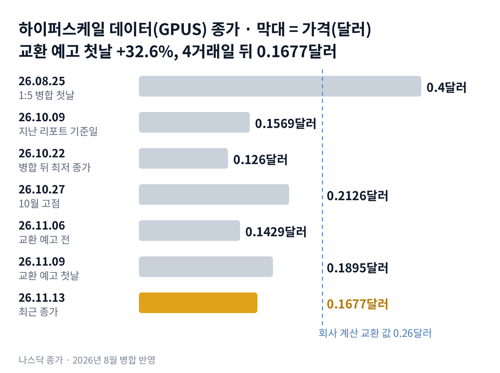

## 짧은 답

> **핵심:** 회사가 말한 0.26달러는 새 우선주를 액면 그대로 쳐 준 값입니다. 같은 회사의 기존 우선주가 시장에서 액면의 69%에 팔리는 점을 넣으면, 제안의 값은 지금 주가와 거의 같습니다.

회사가 주당 0.26달러를 쳐 주겠다는데, 주가는 왜 0.17달러에 머물까요? 하이퍼스케일 데이터는 11월 9일 보통주 100주를 현금 2달러와 새 우선주 1주로 바꿔 주겠다고 예고했습니다. 회사는 이 값을 주당 0.26달러로 계산했습니다.

발표 전 거래일인 11월 6일 종가는 0.1429달러였습니다. 회사 계산대로라면 82% 높은 값입니다. 첫날 주가는 32.6% 올라 0.1895달러가 됐습니다. 그러나 4거래일 내리 밀려 11월 13일 0.1677달러로 마쳤습니다.

답은 우선주의 시장 가격에 있습니다. 0.26달러 가운데 현금은 0.02달러뿐이고, 나머지 0.24달러는 우선주 액면입니다. 이 회사의 기존 우선주는 액면 25달러짜리가 17달러대에 거래됩니다. 같은 비율로 새 우선주를 재면 제안의 값은 주당 약 0.17~0.19달러로 내려옵니다.

같은 주에는 다른 소식도 둘 나왔습니다. 회사는 11월 6일 시세보다 싸게 주식으로 바꿀 수 있는 전환사채를 팔았고, 11월 13일에는 다섯 번째 액면 병합 안건을 냈습니다. 한쪽에서는 주식을 사들이겠다고 하고, 다른 쪽에서는 새 주식이 나올 길을 열었습니다.

**2026.11.13 진단: 지난 리포트의 '희석 진행' 국면이 이어지고, 그 안에서 하루 급등이 한 번 더 나왔습니다 — 근거는 5부.** 하루 20% 넘게 오른 날 뒤 20거래일(약 한 달)의 기록은 3부 '급등 17번' 표에 있습니다.

> **유의사항** 저자는 금융·투자 자문가가 아닙니다. 이 글은 공개 공시와 시세를 정리한 교육용 분석이며 특정 종목의 매수·매도를 권하지 않습니다. 과거 패턴은 미래 수익을 보장하지 않고, 이 종목은 하루 30% 넘게 움직인 적이 여러 번 있습니다. 실제 투자 전에는 최신 공시를 직접 확인하세요.

이 리포트는 시청자 반응이 컸던 종목의 업데이트입니다.

## 지난 리포트 이후

지난 예측 성적: 4개 중 적중 2 · 빗나감 1 · 확인 전 1.

[10월 11일 리포트](/r/gpus-2026-10/)는 이 주식을 움직이는 근본 동인을 '보통주 한 주가 회사에서 차지하는 크기가 커지는가, 작아지는가'로 봤습니다. 그리고 판매 창구가 열려 있는 한 희석과 또 한 번의 병합이 이어질 가능성이 크다고 적었습니다. 병합 안건은 한 달 만에 나왔습니다. 항목별 채점은 6부 끝 채점표에 있습니다.

기준일 종가는 10월 9일 0.1569달러에서 11월 13일 0.1677달러로 6.9% 올랐습니다. 그 사이 보통주(Class A)는 지난 리포트가 적은 약 1억 7,000만 주에서 11월 5일 2억 3,600만 주로 약 39% 늘었습니다. 이번 리포트가 새로 답하는 질문은 하나입니다. 회사가 제시한 값과 시장이 매긴 값의 차이는 어디서 오는가입니다.

## 1부. 한 주에 나온 세 가지 발표

> **핵심:** 11월 6일부터 13일까지 회사는 돈을 빌리는 계약, 주식을 사들이는 제안, 주식을 합치는 안건을 차례로 냈습니다. 세 발표는 서로 반대 방향으로 주식 수를 움직입니다.

하이퍼스케일 데이터는 미시간에 데이터센터를 가진 회사입니다. 이 데이터센터에서 비트코인을 캐고, 인공지능 회사에 서버 자리와 전력을 빌려줍니다. 자회사 올트 캐피털 그룹은 크레인 임대, 방산 전자, 호텔 같은 사업을 하고, 회사는 이 자회사를 2027년에 떼어 낼 예정입니다.

돈을 버는 방식은 아직 작습니다. 그래서 회사는 사업에 필요한 돈 대부분을 새 주식과 우선주, 전환사채로 마련해 왔습니다. 6월 18일 시작한 보통주 판매 창구로만 10월 12일까지 1억 2,183만 주를 팔아 4,978만 달러를 모았습니다.

이 구조 때문에 이 회사에서는 실적보다 주식 수가 먼저 주가를 움직였습니다. 지난 5년 동안 병합만 네 번 있었습니다. 주식이 늘어 값이 내려가면 여러 주를 한 주로 합치는 일이 되풀이됐습니다.

지금 몸값은 11월 13일 종가 기준 약 3,960만 달러입니다(Class A 2억 3,600만 주로 계산). 지난 리포트가 적은 10월 4일 기준 비트코인과 현금 약 5,640만 달러보다 작습니다. 다만 그 뒤에는 1년 안에 갚을 부채와 우선주가 먼저 줄을 서 있습니다.

### 숫자로 본 지금의 크기

| 항목 | 2026년 11월 기준 |
| --- | --- |
| 보통주(Class A) | **2억 3,600만 주** 11월 5일, 10월 10일 약 1억 7,000만 주 |
| 시가총액 | **약 3,960만 달러** 11월 13일 종가 0.1677달러 |
| 11월 13일 종가 | **0.1677달러** 병합 뒤 최저 종가 0.126달러(10월 22일) |
| 기존 시리즈 D 우선주 | **17.335달러** 액면 25달러의 69.3%, 연 13% 배당 |

세 발표는 날짜순으로 이렇습니다. 11월 6일 기관 투자자 한 곳과 전환사채 계약을 맺었습니다. 11월 9일 교환 공개매수를 예고했습니다. 11월 13일 액면 병합과 전환사채 전환 승인을 묻는 주주총회 예비 위임장을 냈습니다.

전환사채는 나중에 주식으로 바꿀 수 있는 회사채입니다. 교환 공개매수는 회사가 주주에게서 주식을 사들이면서 그 값을 현금 대신 다른 증권으로 주는 방식입니다. 세 발표 가운데 주가를 가장 크게 움직인 것은 교환 공개매수였고, 그 조건부터 정확히 보는 것이 이 리포트의 출발점입니다.

## 2부. 0.26달러를 시장 가격으로 다시 재면

> **핵심:** 0.26달러는 새 우선주를 액면 24달러로 쳐 준 계산입니다. 기존 우선주의 시세로 바꾸면 주당 약 0.17~0.19달러이고, 11월 13일 주가 0.1677달러는 그 아래쪽 끝에 붙어 있습니다.

교환 조건은 이렇습니다. 보통주 100주를 내면 현금 2달러와 새 우선주 1주를 받습니다. 새 우선주의 액면은 24달러이고, 해마다 액면의 12%를 배당으로 줍니다. 회사는 최대 1억 9,231만 주를 받을 수 있고, 최소 1억 주가 모여야 거래가 성립합니다.

회사는 이 조건을 '주당 0.26달러, 발표 전 종가보다 82% 높은 값'이라고 소개했습니다. 현금과 우선주 액면을 더한 26달러를 100주로 나눈 값입니다. 문제는 우선주가 시장에서 액면대로 팔리지 않는다는 점입니다.

비교할 기준이 회사 안에 이미 있습니다. 이 회사가 먼저 낸 13% 시리즈 D 우선주입니다. 액면 25달러에 해마다 13%를 매달 나눠 주는데, 11월 13일 종가는 17.335달러였습니다. 이 말은 곧 시장이 이 회사의 우선주를 액면의 약 69%로 본다는 뜻입니다.

**교환 제안의 값(보통주 한 주 기준, 계산)**

| 재는 방법 | 한 주의 값 |
| --- | --- |
| 회사 계산(우선주 액면 그대로) | **0.26달러** 발표 전 종가 0.1429달러의 1.82배 |
| 기존 우선주의 액면 대비 가격(69.3%) | **약 0.186달러** 11월 13일 기준 |
| 기존 우선주의 배당률(가격 대비 18.7%) | **약 0.174달러** 새 우선주 배당 12%를 같은 배당률로 환산 |
| 11월 13일 보통주 종가 | **0.1677달러** |

두 가지 환산 모두 새 우선주가 기존 우선주처럼 거래된다고 가정한 값입니다. 새 우선주는 아직 상장되지 않았고, 회사는 상장을 신청하겠다고만 했습니다. 상장이 안 되면 받은 우선주를 팔기가 더 어려워집니다.

같은 주의 전환사채는 반대쪽 숫자를 줍니다. 회사는 액면 합계 2,703만 달러짜리 전환사채를 최대 2,500만 달러에 팝니다. 이자는 연 8%이고, 주식으로 바꾸는 값은 0.30달러와 '직전 5거래일 가장 낮은 하루 평균 거래가의 90%' 가운데 낮은 쪽입니다. 바닥은 0.1025달러입니다.

이 바닥까지 내려가 모두 바꾸면 새 주식은 약 2억 6,368만 주입니다(계산). 교환으로 사들일 수 있는 최대 1억 9,231만 주보다 많습니다. 다만 2,703만 달러 가운데 1,081만 달러는 회사와 투자자가 합의해야 파는 추가분이고, 4,718만 주를 넘는 전환에는 주주총회 승인이 필요합니다.

교환 제안의 우선주 가격, 전환사채의 전환가, 병합 안건을 묶어 보면 질문은 하나로 모입니다. 보통주 한 주가 회사에서 차지하는 크기가 앞으로 커지는가, 작아지는가입니다. 시장은 11월 9일 하루 32.6%를 올렸다가 4거래일 만에 그 오름폭의 절반 가까이를 되돌렸는데, 이런 급등은 이 종목에서 처음이었을까요?

## 3부. 급등 17번과 그 뒤 20거래일

> **핵심:** 2025년 1월부터 2026년 6월까지 하루 20% 넘게 오른 날은 17번 있었고, 그중 16번은 20거래일 뒤 종가가 급등 날 종가보다 낮았습니다.

기준은 이렇습니다. 나스닥 일별 종가(2026년 8월 병합 반영)에서 전날보다 20% 넘게 오른 날을 모두 골랐습니다. 그날 종가를 5거래일 뒤, 20거래일 뒤 종가와 비교했습니다. 이번 11월 9일 급등이 하루에 나왔기 때문에 '하루 상승폭'을 기준으로 잡았습니다.

예를 들어 2026년 1월 2일에는 하루 48.7% 올랐습니다. 5거래일 뒤에는 27.5% 더 높았지만, 20거래일 뒤 2월 2일 종가는 급등 날보다 23.4% 낮았습니다.

**한눈에:** **16/17** 20거래일 뒤 급등 날 종가보다 낮음 · **11/17** 급등 전날 종가보다도 낮음 · **-35.1%** 20거래일 뒤 변화의 중앙값.

### 하루 20% 넘게 오른 날과 그 뒤(일부, 전체 17번)

| 급등 날 · 하루 변화 | 5거래일 뒤 | 20거래일 뒤 |
| --- | --- | --- |
| 2025.09.15 +22.4% · 비트코인 전략 | +1.2% | -5.0% |
| 2025.10.20 +24.2% | +25.3% | **-40.1%** |
| 2026.01.02 +48.7% | +27.5% | -23.4% |
| 2026.04.09 +31.3% | -21.7% | -35.1% |
| 2026.06.02 +30.6% · 공개매수 기간 중 | -28.1% | -33.7% |
| 2026.06.15 +75.5% | -5.8% | **-52.8%** |

표에 없는 11번도 같은 방향이었습니다. 17번 가운데 20거래일 뒤 급등 날보다 높았던 경우는 2025년 4월 8일 한 번뿐입니다. 5거래일 뒤를 보면 17번 중 13번 낮았으니, 되돌림은 대개 첫 주 안에 시작됐습니다.

2026년 6월은 이번과 닮은 점이 있습니다. 회사는 5월 26일 최대 500만 달러어치 보통주를 사들이는 공개매수를 시작했습니다. 병합 반영 가격으로 1.05달러, 당시 종가보다 22% 높은 값이었습니다. 6월 10일 끝났을 때 실제로 산 것은 873만 주(병합 전), 183만 달러로 목표의 37%였습니다.

그리고 8일 뒤인 6월 18일 3억 달러짜리 보통주 판매 창구가 열렸습니다. 공개매수가 끝난 6월 10일의 종가는 20거래일 뒤 7월 10일에 20.9% 낮아져 있었습니다. 사들이는 발표와 파는 창구가 한 달 안에 함께 나온 것은 이번이 두 번째입니다.

> **이번 사례(결과 미확정):** 2026.11.09 하루 +32.6%, 급등 날 종가 0.1895달러 · 4거래일 뒤 11월 13일 0.1677달러(-11.5%) · 12월 8일(20거래일째) 종가가 0.1895달러, 그리고 발표 전 종가 0.1429달러보다 높은지 확인

이 기록의 한계도 분명합니다. 17번 가운데 여러 날이 며칠 간격으로 붙어 있어 서로 독립된 사례가 아니고, 그 사이 회사 이름과 사업 구성도 바뀌었습니다. 그래도 하루 급등 뒤 20거래일 안에 급등 날 종가를 지킨 일이 한 번뿐이었다는 기록은 이번 판단의 출발점으로 쓸 만합니다.

## 4부. 이번에는 무엇이 다를 수 있나

> **핵심:** 지난 급등들과 달리 이번에는 회사가 직접 사들이겠다는 가격과 날짜가 있습니다. 반대로 같은 주의 전환사채는 주가가 내려갈수록 더 많은 주식이 나오는 구조입니다.

지난 급등 대부분은 큰 숫자를 담은 사업 발표에서 나왔습니다. 인공지능 데이터센터 계약, 부지 가치, 비트코인 전략 같은 소식이었습니다. 이번 급등은 회사가 자기 주식을 사들이겠다는 제안에서 나왔다는 점이 다릅니다.

회사가 실제로 사들이면 보통주가 줄어듭니다. 최대 1억 9,231만 주가 모이면 지금 Class A의 약 81.5%입니다. 회장은 발표문에서 회사의 가치와 주가 사이에 큰 괴리가 있다고 봤고, 이 교환이 그 수준에서 자기 주식을 사는 길이라고 말했습니다.

대가도 있습니다. 최대로 교환되면 새 우선주 액면은 약 4,615만 달러이고, 연 12% 배당이면 해마다 약 554만 달러입니다. 보통주는 배당 의무가 없지만, 우선주는 배당이 앞섭니다. 주식은 줄지만 해마다 먼저 나가야 할 돈이 생기는 거래입니다.

전환사채는 반대쪽에서 작동합니다. 전환가가 '직전 5거래일 가장 낮은 하루 평균 거래가의 90%'로 정해지니, 주가가 내려가면 같은 금액으로 더 많은 주식이 나옵니다. 11월 13일 종가의 90%(약 0.151달러)라면 2,703만 달러 전부에서 약 1억 7,900만 주입니다(추정).

시장이 지금 고른 숫자는 2부의 환산값 쪽입니다. 11월 13일 종가 0.1677달러는 배당률로 환산한 약 0.174달러보다 조금 낮습니다. 교환에 응해도 응하지 않아도 비슷하다는 계산을 시장이 이미 해 둔 모습입니다.

그래서 앞으로 확인할 조건은 두 가지입니다. 하나는 교환 공개매수가 11월 17일 무렵 예고대로 실제로 시작되는가입니다. 다른 하나는 12월 8일 종가가 발표 전 종가 0.1429달러를 지키는가입니다. 이 두 조건을 겹치면 어떤 갈림길이 나올까요?

## 5부. 국면 진단과 네 가지 시나리오

> **핵심:** 지금은 '희석 진행' 국면이 이어지는 가운데 하루 급등이 한 번 더 나온 단계이고, 교환 공개매수의 실제 개시와 12월 8일 종가가 시나리오를 가릅니다.

> **국면 정의(하이퍼스케일 데이터 시리즈 공통, 10월 11일 리포트 5부):** 국면 A(희석 진행, 판매 창구와 전환으로 보통주가 계속 늘어나는 단계). 국면 B(이야기 급등, 큰 숫자를 담은 발표로 하루 수십 % 오르는 단계). 국면 C(희석 멈춤, 분기 보고서에서 주식 수 증가가 멈춘 것이 확인되는 단계).

**2026년 11월 13일 진단: 국면 A(희석 진행)가 이어지는 중.** 보통주는 한 달 남짓 사이 약 39% 늘었고, 새 전환사채로 더 늘어날 길이 열렸습니다. 11월 9일 하루 32.6% 상승은 국면 B의 모습이었지만, 4거래일 뒤 오름폭의 절반 가까이가 사라졌습니다. 국면 C로 넘어가려면 분기 보고서에서 주식 수가 멈춘 것이 보여야 합니다.

**판정 기준 두 가지:** 하나는 12월 8일까지 교환 공개매수가 실제로 시작됐는가입니다(공개매수 신고서 제출). 다른 하나는 12월 8일(11월 9일부터 20번째 거래일) 종가가 발표 전 종가 0.1429달러보다 높은가입니다.

### 앞으로 일어날 수 있는 일

**확인된 사실:** 회사는 11월 17일 무렵 교환을 시작할 예정이라고 했고, 이사회·규제 승인과 통상적인 조건을 달았습니다. 두 번째 전환사채(액면 541만 달러)는 11월 16일 무렵 팔 예정입니다. 주주총회 날짜는 아직 정해지지 않았습니다.

**과거 기록:** 3부 표에서 하루 20% 넘게 오른 17번 가운데 11번은 20거래일 뒤 급등 전날 종가보다도 낮았습니다. 2026년 5월 공개매수는 목표의 37%만 채웠고, 끝난 뒤 8일 만에 판매 창구가 열렸습니다.

**추정:** 출발점은 급등 전날 종가 아래로 돌아간 17번 중 11번(약 65%)이라는 기록입니다. 아래 가능성은 주가가 오를 확률이 아니라, 12월 8일에 두 판정 기준이 어느 칸에 들어갈지에 대한 분석자의 주관적 추정입니다. 네 경우는 겹치지 않아 '약 N%'를 더하면 100%이고, 괄호 안 구간은 흔들림의 폭이라 서로 더하지 않습니다.

| 시나리오(판정 2026년 12월 8일) | 개시 · 종가 | 가능성(추정) |
| --- | --- | --- |
| **1 · 교환이 바닥을 받침** | 개시 · 0.1429 위 | 높음 약 35% (28~42%) |
| **2 · 전환 물량이 이김** | 개시 · 0.1429 아래 | 높음 약 35% (28~42%) |
| 3 · 연기 뒤 되돌림 | 미개시 · 0.1429 아래 | 중간 약 20% (15~25%) |
| 4 · 연기에도 버팀 | 미개시 · 0.1429 위 | 낮음 약 10% (5~15%) |

과거 기록만 따르면 아래쪽(2번·3번)이 약 65%입니다. 여기서 아래쪽 무게를 55%로 낮춘 이유는 하나입니다. 이번에는 회사가 사들이겠다는 가격과 날짜가 공시돼 있고, 시장이 이미 그 값을 우선주 시세로 계산해 주가에 넣어 둔 상태에서 출발하기 때문입니다.

반대쪽 요인도 같은 무게로 있습니다. 전환사채는 주가가 내릴수록 더 많은 주식으로 바뀌고, 보통주는 한 달 남짓 사이 39% 늘었으며, 판매 창구 한도도 남아 있습니다.

교환이 시작될 가능성은 약 70%로 봤습니다. 예고문에 날짜가 있고 회장이 직접 알렸지만, 이사회 승인과 규제 승인이 아직 조건으로 남아 있습니다. 2026년 5월에는 예고한 공개매수가 실제로 진행됐습니다.

시나리오 1이면 받은 우선주의 상장 여부와 실제로 모인 주식 수를 봅니다. 시나리오 2면 전환사채의 전환 공시와 주식 수 증가를 봅니다. 시나리오 3이면 교환 연기 사유와 판매 창구 사용을 확인합니다. 어느 쪽이든 국면 C로 넘어가는 신호는 분기 보고서의 주식 수가 멈추는 것 하나입니다.

## 6부. 위험과 체크리스트

> **핵심:** 판을 가장 빨리 바꿀 수 있는 것은 보통주가 다시 늘어나는 속도이고, 그다음이 비트코인 가격과 부채 일정입니다.

먼저 이 분석의 한계입니다. 2부의 환산값은 새 우선주가 기존 우선주처럼 거래된다는 가정 위에 있습니다. 3부 기록의 17번은 서로 겹친 날이 많고, 20거래일이라는 기간은 비교를 위해 정한 기준입니다. 3분기 보고서가 아직 나오지 않아 9월 말 현금과 부채는 이번 리포트에 넣지 못했습니다.

사업 실행 쪽 위험부터 봅니다. 미시간 부지 매각이나 대형 데이터센터 계약 같은 큰 이야기는 아직 대금으로 확인되지 않았습니다. 교환이 최대로 이뤄지면 해마다 약 554만 달러의 우선주 배당이 새로 생깁니다. 사업이 이 돈을 벌지 못하면 다시 주식이나 사채로 마련해야 합니다.

외부 환경 쪽에서는 비트코인 가격이 큽니다. 회사가 가진 자산의 상당 부분이 비트코인이고, 2025년 9월 비트코인 전략 발표 때 주가가 크게 뛴 것처럼 개인 투자자의 관심도 이 가격을 따라 움직였습니다. 비트코인이 크게 내리면 0.26달러 제안의 바탕인 '회사 가치가 주가보다 크다'는 주장도 약해집니다.

자금 조달 쪽 위험이 가장 직접적입니다. 전환사채 만기는 2027년 2월 5일(주주 승인 뒤 5월 5일)이고, 연체하면 이자가 18%로 오릅니다. 위임장은 전환 승인 안건이 부결되면 덜 유리한 조건으로 갚아야 할 수 있다고 적었습니다. 판매 창구도 한도 1억 달러로 아직 열려 있습니다.

**핵심 확인 세 가지:** 위에서부터 판정을 바꾸는 힘이 큰 순서입니다.

- ☐ 1순위 · 12월 8일(20거래일째) 종가가 0.1429달러보다 높은가
- ☐ 2순위 · 12월 8일까지 교환 공개매수 신고서가 제출됐나
- ☐ 3순위 · 11월 16일 마감 3분기 보고서의 Class A 주식 수가 2억 3,600만 주보다 많은가

**보조 확인:** 주주총회 날짜와 병합 비율, 두 번째 전환사채 판매 공시, 새 우선주 상장 승인을 봅니다.

**기억할 판단 기준:** 이 종목에서 하루 급등의 크기보다 그 뒤 주식 수가 늘었는지가 20거래일 뒤를 더 잘 설명했습니다(17번 기록, 참고용).

### 지난 예측 채점표

10월 11일 리포트(10월 9일 기준)의 예측을 11월 13일 기준으로 채점한 결과입니다. 지난 리포트에는 시나리오별 가능성 숫자가 없었습니다.

| 지난 점검 항목 · 당시 기준 | 판정 및 실제 결과(11월 13일) |
| --- | --- |
| **시나리오 1: 부지 매각과 희석 멈춤** 매각 대금으로 부채 상환, 판매 창구 닫음 | **[빗나감]** 매각 공시 없음, 11월 6일 새 전환사채 |
| **시나리오 2: 희석 지속과 또 한 번의 병합** 보통주 계속 증가, 새 병합 안건 | **[적중]** 보통주 약 39% 증가, 11월 13일 병합 안건 |
| **시나리오 3: 발표 급등의 반복** 하루 수십 % 급등 뒤 며칠 안에 되돌림 | **[적중]** 11월 9일 +32.6% 뒤 4거래일 -11.5% |
| **시나리오 4: 유동성 위기** 3분기 현금·부채·계속기업 문구 | **[확인 전]** 3분기 보고서 아직 없음 |

가장 큰 빗나감은 부지 매각이었습니다. 지난 리포트는 11월 12일 투자자의 날에 매각 소식이 나올 수 있다고 봤지만, 그 주에 나온 공시는 전환사채와 교환 공개매수, 병합 안건이었습니다. 이번 리포트부터는 판정 기준을 공시된 날짜(교환 개시)와 종가에 직접 두었습니다.

같은 비트코인·AI 데이터센터 업종의 흐름은 [아이렌 리포트](/r/iren-2026-11-2/)에서 함께 볼 수 있습니다. 다음 갱신은 3분기 보고서와 교환 공개매수 서류를 본 뒤에 합니다. 공시는 [SEC 공시 목록](https://www.sec.gov/cgi-bin/browse-edgar?action=getcompany&CIK=0000896493)에서 확인할 수 있습니다.
