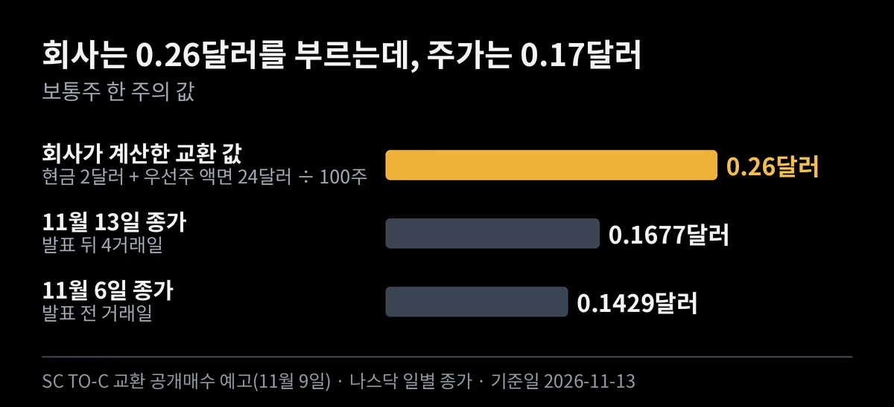
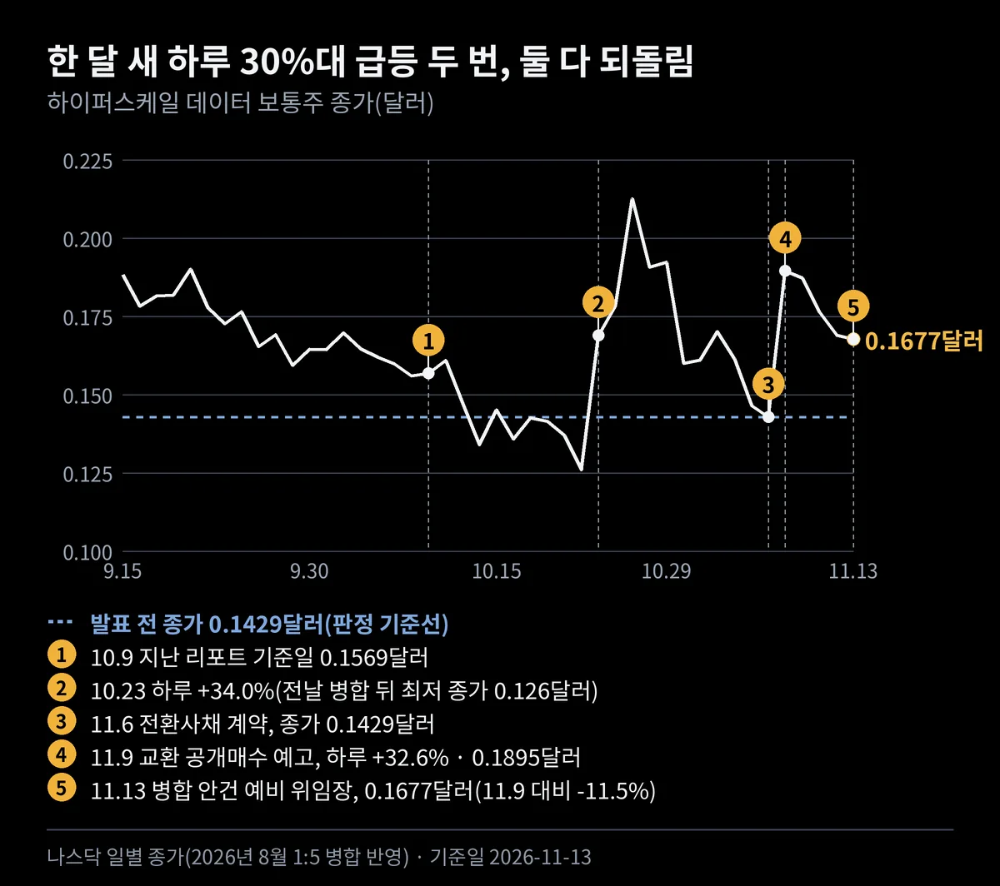
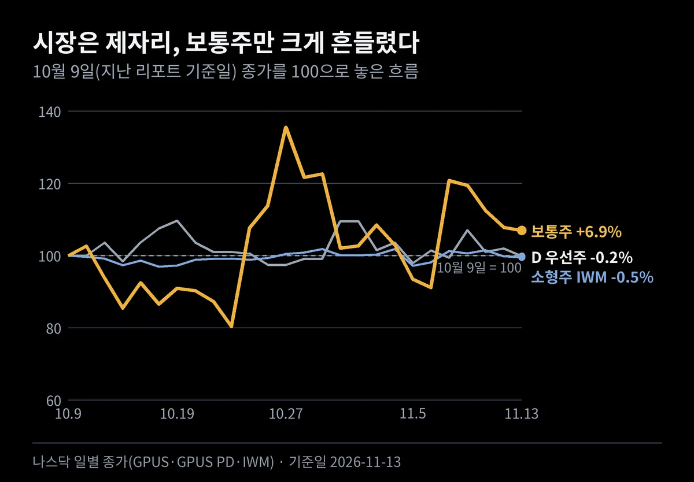
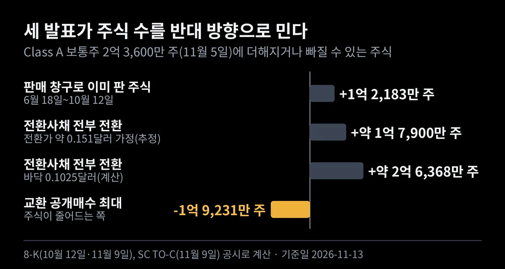
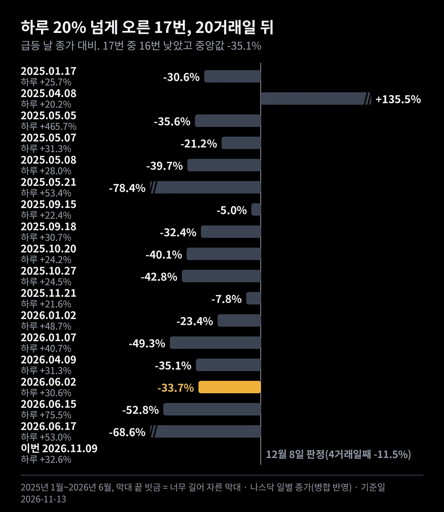
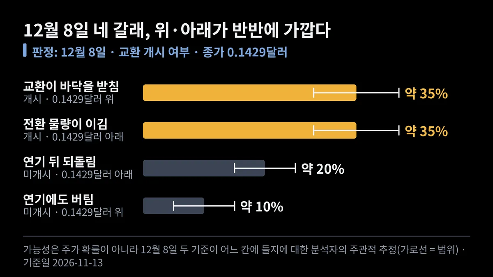

회사가 주당 0.26달러를 쳐 주겠다는데, 주가는 왜 0.17달러에 머물까요? 하이퍼스케일 데이터는 11월 9일 보통주 100주를 현금 2달러와 새 우선주 1주로 바꿔 주겠다고 예고했습니다. 회사는 이 값을 주당 0.26달러로 계산했고, 발표 전 거래일인 11월 6일 종가 0.1429달러보다 82% 높다고 소개했습니다.

시장의 첫 반응은 뜨거웠습니다. 첫날 주가는 32.6% 올라 0.1895달러가 됐습니다. 그런데 그 뒤 4거래일 내리 밀려 11월 13일 0.1677달러로 마쳤습니다. 회사가 부른 값과 시장이 매긴 값 사이에 꽤 큰 틈이 그대로 남은 셈입니다.

> **유의사항** 저자는 금융·투자 자문가가 아닙니다. 이 글은 공개 공시와 시세를 정리한 교육용 분석이며 특정 종목의 매수·매도를 권하지 않습니다. 과거 패턴은 미래 수익을 보장하지 않고, 이 종목은 하루 30% 넘게 움직인 적이 여러 번 있습니다. 실제 투자 전에는 최신 공시를 직접 확인하세요.

이 이야기는 시청자 반응이 컸던 종목의 업데이트입니다. [10월 11일 리포트](/r/gpus-2026-10/)는 '보통주 한 주가 회사에서 차지하는 크기가 커지는가, 작아지는가'를 이 주식의 근본 동인으로 봤습니다. 그리고 판매 창구가 열려 있는 한 희석과 또 한 번의 병합이 이어질 가능성이 크다고 적었는데, 병합 안건은 한 달 만에 나왔습니다. 네 가지 예측 가운데 둘은 맞았고, 하나는 빗나갔으며, 하나는 아직 확인 전입니다.

가장 크게 빗나간 것은 부지 매각이었습니다. 지난 리포트는 11월 12일 투자자의 날에 매각 소식이 나올 수 있다고 봤습니다. 하지만 그 주에 나온 공시는 전환사채와 교환 공개매수, 병합 안건이었습니다. 그래서 이번에는 판정 기준을 공시된 날짜와 종가에 직접 두었습니다.

그 사이 숫자도 움직였습니다. 기준일 종가는 10월 9일 0.1569달러에서 11월 13일 0.1677달러로 6.9% 올랐습니다. 보통주(Class A)는 11월 5일 2억 3,600만 주가 됐습니다. 지난 리포트가 적은 약 1억 7,000만 주보다 약 39% 늘어난 수입니다.

같은 기간 소형주 펀드(IWM)는 0.5% 내렸고, 회사가 먼저 낸 우선주도 0.2% 내려 제자리였습니다. 시장이 조용한 동안 보통주만 회사 발표에 따라 두 번 튀어 오르고 두 번 되돌린 셈입니다.

하이퍼스케일 데이터가 어떤 회사인지부터 짚고 가겠습니다. 이 회사는 미시간에 데이터센터를 갖고 있습니다. 그곳에서 비트코인을 캐고, 인공지능 회사에 서버 자리와 전력을 빌려줍니다. 자회사 올트 캐피털 그룹은 크레인 임대, 방산 전자, 호텔 같은 사업을 하고, 회사는 이 자회사를 2027년에 떼어 낼 예정입니다.

돈을 버는 방식은 아직 작습니다. 그래서 회사는 사업에 필요한 돈 대부분을 새 주식과 우선주, 전환사채로 마련해 왔습니다. 6월 18일 시작한 보통주 판매 창구로만 10월 12일까지 1억 2,183만 주를 팔아 4,978만 달러를 모았습니다. 이런 구조라 이 회사에서는 실적보다 주식 수가 먼저 주가를 움직였고, 지난 5년 동안 병합만 네 번 있었습니다.

지금 몸값은 11월 13일 종가 기준 약 3,960만 달러입니다(Class A 2억 3,600만 주로 계산). 지난 리포트가 적은 10월 4일 기준 비트코인과 현금 약 5,640만 달러보다 작습니다. 다만 그 앞에는 1년 안에 갚을 부채와 우선주가 먼저 줄을 서 있습니다. 그래서 이 차이를 곧바로 싸다는 뜻으로 읽기는 어렵습니다.

사건은 한 주 안에 세 번 이어졌습니다. 먼저 11월 6일, 회사는 기관 투자자 한 곳과 전환사채 계약을 맺었습니다. 전환사채는 나중에 주식으로 바꿀 수 있는 회사채입니다. 회사는 액면 합계 2,703만 달러짜리 전환사채를 최대 2,500만 달러에 팔고, 이자는 연 8%를 줍니다.

주식으로 바꾸는 값은 0.30달러와 '직전 5거래일 가장 낮은 하루 평균 거래가의 90%' 가운데 낮은 쪽입니다. 바닥은 0.1025달러입니다. 주가가 내려갈수록 같은 금액으로 더 많은 주식이 나오는 구조입니다. 이 바닥까지 내려가 모두 바꾸면 새 주식은 약 2억 6,368만 주입니다(계산). 다만 그 가운데 1,081만 달러는 회사와 투자자가 합의해야 파는 추가분이고, 4,718만 주를 넘는 전환에는 주주총회 승인이 필요합니다.

이어서 11월 9일, 주가를 가장 크게 움직인 교환 공개매수 예고가 나왔습니다. 교환 공개매수는 회사가 주주에게서 주식을 사들이면서 그 값을 현금 대신 다른 증권으로 주는 방식입니다. 이번에 줄 새 우선주는 액면이 24달러이고, 해마다 액면의 12%를 배당으로 줍니다. 회사는 최대 1억 9,231만 주를 받을 수 있고, 최소 1억 주가 모여야 거래가 성립합니다.

회장은 발표문에서 회사의 가치와 주가 사이에 큰 괴리가 있다고 봤습니다. 이 교환이 그 수준에서 자기 주식을 사는 길이라는 설명입니다. 실제로 최대 1억 9,231만 주가 모이면 지금 Class A의 약 81.5%에 해당합니다. 대신 새 우선주 액면은 약 4,615만 달러가 되고, 연 12% 배당이면 해마다 약 554만 달러가 나갑니다. 주식은 줄지만 해마다 먼저 나가야 할 돈이 생기는 거래인 셈입니다.

마지막으로 11월 13일에는 주주총회 예비 위임장이 나왔습니다. 안건은 1:2~1:10 사이의 액면 병합과, 전환사채의 19.99% 초과 전환을 승인하는 일입니다. 이번이 다섯 번째 병합 안건입니다. 한쪽에서는 주식을 사들이겠다고 하고, 다른 쪽에서는 새 주식이 나올 길을 열고, 또 주식을 합치겠다고 합니다. 세 발표가 서로 반대 방향으로 주식 수를 움직이는 셈입니다.

그렇다면 0.26달러와 0.17달러 사이의 틈은 어디서 왔을까요? 답은 우선주의 시장 가격에 있습니다. 0.26달러는 현금과 우선주 액면을 더한 26달러를 100주로 나눈 값입니다. 그 가운데 현금은 0.02달러뿐이고, 나머지 0.24달러는 우선주 액면입니다. 문제는 우선주가 시장에서 액면대로 팔리지 않는다는 점입니다.

비교할 기준은 회사 안에 이미 있습니다. 이 회사가 먼저 낸 13% 시리즈 D 우선주입니다. 액면 25달러에 해마다 13%를 매달 나눠 주는데, 11월 13일 종가는 17.335달러였습니다. 10월 20일에도 11월 10일 지급분 배당이 공지됐습니다. 배당이 나가는데도 값이 이렇다는 것은 시장이 이 회사의 우선주를 액면의 약 69%로 본다는 뜻입니다.

이 비율로 새 우선주를 재면 보통주 한 주의 값은 약 0.186달러로 내려옵니다. 기존 우선주의 가격 대비 배당률 18.7%로 새 우선주의 12% 배당을 환산하면 약 0.174달러입니다. 두 방법 모두 새 우선주가 기존 우선주처럼 거래된다고 가정한 값입니다. 새 우선주는 아직 상장되지 않았고, 회사는 상장을 신청하겠다고만 했습니다. 상장이 안 되면 받은 우선주를 팔기가 더 어려워집니다.

이렇게 놓고 보면 11월 13일 종가 0.1677달러는 배당률로 잰 약 0.174달러보다 조금 낮은 자리에 있습니다. 교환에 응해도 응하지 않아도 비슷하다는 계산을 시장이 이미 해 둔 모습입니다. 같은 주 전환사채의 바닥이 0.1025달러라는 점까지 더하면, 시장이 회사의 0.26달러를 그대로 받아들이지 않은 이유가 보입니다.

이런 하루 급등은 이 종목에서 처음이 아니었습니다. 나스닥 일별 종가(2026년 8월 병합 반영)에서 2025년 1월부터 2026년 6월까지 전날보다 20% 넘게 오른 날을 모두 골라 보니 17번이었습니다. 이번 급등이 하루에 나왔기 때문에 '하루 상승폭'을 기준으로 잡았습니다. 그리고 그날 종가를 5거래일 뒤와 20거래일 뒤 종가에 견줬습니다.

그림처럼 결과는 한쪽으로 쏠립니다. 20거래일 뒤 종가가 급등 날보다 높았던 경우는 2025년 4월 8일 한 번뿐이었습니다. 17번 중 16번은 낮았고, 그중 11번은 급등 전날 종가보다도 낮았습니다.

예를 들어 2026년 1월 2일에는 하루 48.7% 올랐고, 5거래일 뒤에는 27.5% 더 높았습니다. 그러나 20거래일 뒤인 2월 2일 종가는 급등 날보다 23.4% 낮았습니다. 첫 주의 상승이 한 달을 버티지 못한 것입니다.

2026년 6월은 이번과 특히 닮았습니다. 회사는 5월 26일 최대 500만 달러어치 보통주를 사들이는 공개매수를 시작했습니다. 병합 반영 가격으로 1.05달러, 당시 종가보다 22% 높은 값이었습니다. 6월 10일 끝났을 때 실제로 산 것은 873만 주(병합 전), 183만 달러로 목표의 37%였습니다.

그리고 8일 뒤인 6월 18일 3억 달러짜리 보통주 판매 창구가 열렸습니다. 공개매수가 끝난 6월 10일의 종가는 20거래일 뒤 7월 10일에 20.9% 낮아져 있었습니다. 사들이는 발표와 파는 창구가 한 달 안에 함께 나온 것은 이번이 두 번째입니다.

이 기록에는 한계도 있습니다. 17번 가운데 여러 날이 며칠 간격으로 붙어 있어 측정 기간이 서로 겹치고, 그래서 독립된 사례로 보기는 어렵습니다. 그 사이 회사 이름과 사업 구성도 바뀌었습니다. 그래도 하루 급등 뒤 20거래일 안에 급등 날 종가를 지킨 일이 한 번뿐이었다는 기록은 이번 판단의 출발점으로 쓸 만합니다.

물론 이번이 다를 수 있는 점도 있습니다. 지난 급등 대부분은 인공지능 데이터센터 계약, 부지 가치, 비트코인 전략처럼 큰 숫자를 담은 사업 발표에서 나왔습니다. 이번에는 회사가 직접 사들이겠다는 가격과 날짜가 있습니다. 반대로 같은 주의 전환사채는 주가가 내려갈수록 더 많은 주식이 나오는 구조입니다. 전환가가 11월 13일 종가의 90%인 약 0.151달러라고 해 보겠습니다. 그러면 2,703만 달러 전부에서 약 1억 7,900만 주가 나옵니다(추정).

그래서 지금은 어디쯤일까요? 지난 리포트가 붙인 이름으로 말하면 '희석 진행' 국면이 이어지는 가운데 하루 급등이 한 번 더 나온 단계입니다. 희석 진행은 판매 창구와 전환으로 보통주가 계속 늘어나는 단계를 말합니다. 보통주는 한 달 남짓 사이 약 39% 늘었고, 새 전환사채로 더 늘어날 길이 열렸습니다. 11월 9일의 급등은 큰 발표로 하루 수십 % 오르는 '이야기 급등'의 모습이었지만, 4거래일 뒤 오름폭의 절반 가까이가 사라졌습니다. 다음 단계인 '희석 멈춤'으로 넘어가려면 분기 보고서에서 주식 수 증가가 멈춘 것이 보여야 합니다.

앞으로 길을 가를 기준은 두 가지입니다. 하나는 12월 8일까지 교환 공개매수가 실제로 시작되는가입니다. 회사는 11월 17일 무렵 시작하겠다고 했지만, 이사회와 규제 승인을 조건으로 달았습니다. 다른 하나는 11월 9일부터 20번째 거래일인 12월 8일의 종가가 발표 전 종가 0.1429달러보다 높은가입니다.

두 기준을 겹치면 갈림길은 네 갈래입니다. 교환이 시작되고 종가가 0.1429달러 위라면 교환이 바닥을 받친 경우이고, 그 아래라면 전환 물량이 이긴 경우입니다. 교환이 미뤄진 쪽은 연기 뒤 되돌림과 연기에도 버팀으로 나눴습니다.

교환이 시작되는 두 갈래를 약 35%씩으로 가장 무겁게 봤습니다. 이 숫자는 주가가 오를 확률이 아니라 12월 8일에 두 기준이 어느 칸에 들어갈지에 대한 제 주관적 추정입니다.

과거 기록만 따르면 아래쪽 두 갈래는 17번 중 11번, 약 65%입니다. 여기서 아래쪽 무게를 55%로 낮춘 이유는 하나입니다. 이번에는 회사가 사들이겠다는 가격과 날짜가 공시돼 있고, 시장이 그 값을 우선주 시세로 계산해 주가에 넣어 둔 상태에서 출발하기 때문입니다. 반대쪽 요인도 같은 무게로 있습니다. 전환사채는 주가가 내릴수록 더 많은 주식으로 바뀌고, 판매 창구 한도도 남아 있습니다.

교환이 실제로 시작될 가능성은 약 70%로 봤습니다. 예고문에 날짜가 있고 회장이 직접 알렸으며, 2026년 5월에도 예고한 공개매수가 실제로 진행됐습니다. 그래도 이사회 승인과 규제 승인이 아직 조건으로 남아 있습니다. 교환이 바닥을 받치는 쪽이라면 우선주 상장 여부와 실제로 모인 주식 수를 보게 됩니다. 전환 물량이 이기는 쪽이라면 전환 공시와 주식 수 증가가 먼저 보일 것입니다.

위험도 짚어 두겠습니다. 먼저 이 분석의 한계입니다. 우선주로 다시 잰 값은 새 우선주가 기존 우선주처럼 거래된다는 가정 위에 있고, 급등 17번의 기록은 겹친 날이 많습니다. 3분기 보고서가 아직 나오지 않아 9월 말 현금과 부채도 이번 이야기에 넣지 못했습니다.

사업 쪽에서는 미시간 부지 매각이나 대형 데이터센터 계약 같은 큰 이야기가 아직 대금으로 확인되지 않았습니다. 교환이 최대로 이뤄지면 해마다 약 554만 달러의 우선주 배당이 새로 생깁니다. 사업이 이 돈을 벌지 못하면 다시 주식이나 사채로 마련해야 합니다.

바깥에서는 비트코인 가격이 큽니다. 회사가 가진 자산의 상당 부분이 비트코인이고, 개인 투자자의 관심도 이 가격을 따라 움직였습니다. 2025년 9월 비트코인 전략 발표 때 주가가 크게 뛴 것이 그 예입니다. 비트코인이 크게 내리면 '회사 가치가 주가보다 크다'는 0.26달러 제안의 바탕도 약해집니다.

가장 직접적인 위험은 자금 조달입니다. 전환사채 만기는 2027년 2월 5일(주주 승인 뒤 5월 5일)이고, 연체하면 이자가 18%로 오릅니다. 위임장은 전환 승인 안건이 부결되면 덜 유리한 조건으로 갚아야 할 수 있다고 적었습니다. 판매 창구도 한도 1억 달러로 아직 열려 있습니다. 두 번째 전환사채(액면 541만 달러)는 11월 16일 무렵 팔 예정이고, 주주총회 날짜는 아직 정해지지 않았습니다.

정리하면 회사가 부른 0.26달러는 우선주를 액면대로 쳐 준 값입니다. 시장은 그 우선주를 기존 시세대로 깎아서 지금 주가를 매겼습니다. 이 종목에서는 하루 급등의 크기보다 그 뒤 주식 수가 늘었는지가 20거래일 뒤를 더 잘 설명해 왔습니다(17번 기록, 참고용). 그래서 12월 8일에는 교환이 실제로 시작됐는지와 그날 종가가 0.1429달러 위인지가 판정을 가릅니다. 다음 갱신은 3분기 보고서와 교환 공개매수 서류를 본 뒤에 하겠습니다. 같은 업종의 흐름은 [아이렌 리포트](/r/iren-2026-11-2/)에서, 공시는 [SEC 공시 목록](https://www.sec.gov/cgi-bin/browse-edgar?action=getcompany&CIK=0000896493)에서 확인할 수 있습니다.

## 숫자로 다시 보기

본문에 나온 숫자를 찾아보기 쉽게 표로 모았습니다. 영상 설명과 고정 댓글이 가리킨 2부, 3부, 5부의 표는 아래에 같은 제목으로 있습니다.

### 숫자로 본 지금의 크기

| 항목 | 2026년 11월 기준 |
| --- | --- |
| 보통주(Class A) | **2억 3,600만 주** 11월 5일, 10월 10일 약 1억 7,000만 주 |
| 시가총액 | **약 3,960만 달러** 11월 13일 종가 0.1677달러 |
| 11월 13일 종가 | **0.1677달러** 병합 뒤 최저 종가 0.126달러(10월 22일) |
| 기존 시리즈 D 우선주 | **17.335달러** 액면 25달러의 69.3%, 연 13% 배당 |

### 2부 표 · 교환 제안의 값

보통주 한 주 기준으로 계산한 값입니다.

| 재는 방법 | 한 주의 값 |
| --- | --- |
| 회사 계산(우선주 액면 그대로) | **0.26달러** 발표 전 종가 0.1429달러의 1.82배 |
| 기존 우선주의 액면 대비 가격(69.3%) | **약 0.186달러** 11월 13일 기준 |
| 기존 우선주의 배당률(가격 대비 18.7%) | **약 0.174달러** 새 우선주 배당 12%를 같은 배당률로 환산 |
| 11월 13일 보통주 종가 | **0.1677달러** |

### 3부 기록표 · 하루 20% 넘게 오른 날과 그 뒤

2025년 1월부터 2026년 6월까지 17번 가운데 일부입니다. 비교 기준은 급등 날 종가입니다.

**한눈에:** **16/17** 20거래일 뒤 급등 날 종가보다 낮음 · **11/17** 급등 전날 종가보다도 낮음 · **-35.1%** 20거래일 뒤 변화의 중앙값.

| 급등 날 · 하루 변화 | 5거래일 뒤 | 20거래일 뒤 |
| --- | --- | --- |
| 2025.09.15 +22.4% · 비트코인 전략 | +1.2% | -5.0% |
| 2025.10.20 +24.2% | +25.3% | **-40.1%** |
| 2026.01.02 +48.7% | +27.5% | -23.4% |
| 2026.04.09 +31.3% | -21.7% | -35.1% |
| 2026.06.02 +30.6% · 공개매수 기간 중 | -28.1% | -33.7% |
| 2026.06.15 +75.5% | -5.8% | **-52.8%** |

**이번 사례(20거래일 결과 미확정):** 2026.11.09 하루 +32.6%, 급등 날 종가 0.1895달러. 4거래일 뒤 11월 13일 0.1677달러(-11.5%). 12월 8일(20거래일째) 종가가 0.1895달러, 그리고 발표 전 종가 0.1429달러보다 높은지 확인합니다.

### 5부 표 · 앞으로 일어날 수 있는 일

아래 가능성은 주가가 오를 확률이 아니라, 12월 8일에 두 판정 기준이 어느 칸에 들어갈지에 대한 분석자의 주관적 추정입니다. 네 경우는 겹치지 않아 '약 N%'를 더하면 100%이고, 괄호 안 구간은 흔들림의 폭이라 서로 더하지 않습니다.

| 시나리오(판정 2026년 12월 8일) | 개시 · 종가 | 가능성(추정) |
| --- | --- | --- |
| **1 · 교환이 바닥을 받침** | 개시 · 0.1429 위 | 높음 약 35% (28~42%) |
| **2 · 전환 물량이 이김** | 개시 · 0.1429 아래 | 높음 약 35% (28~42%) |
| 3 · 연기 뒤 되돌림 | 미개시 · 0.1429 아래 | 중간 약 20% (15~25%) |
| 4 · 연기에도 버팀 | 미개시 · 0.1429 위 | 낮음 약 10% (5~15%) |

### 핵심 확인 세 가지

위에서부터 판정을 바꾸는 힘이 큰 순서입니다.

- ☐ 1순위 · 12월 8일(20거래일째) 종가가 0.1429달러보다 높은가
- ☐ 2순위 · 12월 8일까지 교환 공개매수 신고서가 제출됐나
- ☐ 3순위 · 11월 16일 마감 3분기 보고서의 Class A 주식 수가 2억 3,600만 주보다 많은가

**보조 확인:** 주주총회 날짜와 병합 비율, 두 번째 전환사채 판매 공시, 새 우선주 상장 승인을 봅니다.

### 지난 예측 채점표

10월 11일 리포트(10월 9일 기준)의 예측을 11월 13일 기준으로 채점한 결과입니다. 지난 리포트에는 시나리오별 가능성 숫자가 없었습니다.

| 지난 점검 항목 · 당시 기준 | 판정 및 실제 결과(11월 13일) |
| --- | --- |
| **시나리오 1: 부지 매각과 희석 멈춤** 매각 대금으로 부채 상환, 판매 창구 닫음 | **[빗나감]** 매각 공시 없음, 11월 6일 새 전환사채 |
| **시나리오 2: 희석 지속과 또 한 번의 병합** 보통주 계속 증가, 새 병합 안건 | **[적중]** 보통주 약 39% 증가, 11월 13일 병합 안건 |
| **시나리오 3: 발표 급등의 반복** 하루 수십 % 급등 뒤 며칠 안에 되돌림 | **[적중]** 11월 9일 +32.6% 뒤 4거래일 -11.5% |
| **시나리오 4: 유동성 위기** 3분기 현금·부채·계속기업 문구 | **[확인 전]** 3분기 보고서 아직 없음 |
