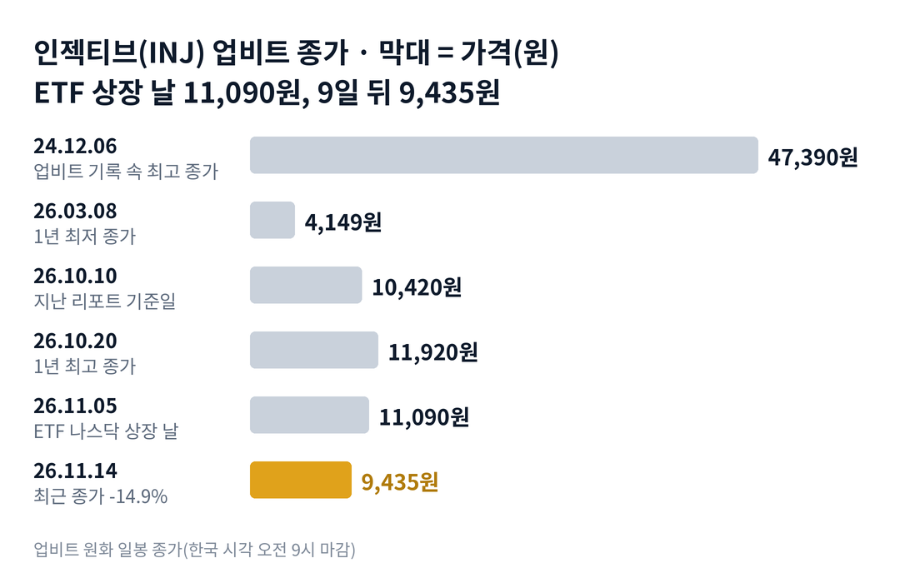

인젝티브 코인을 담은 첫 미국 상장지수펀드(ETF)가 나스닥에 상장됐는데, 왜 시세는 9일 만에 상장 날보다 15% 가까이 낮아졌을까요? 11월 5일 업비트 종가는 11,090원이었습니다. 11월 14일 종가는 9,435원으로, 상장 날보다 14.9% 낮습니다.

몇 년 동안 기다려 온 소식이 현실이 된 날이었습니다. 상장 전날인 11월 4일에는 하루 9.5% 오르기도 했습니다. 그런데 ETF 서류를 들여다보면 더 이상한 숫자가 하나 나옵니다. 첫 두 거래일 동안 이 ETF에 새로 만들어진 주식은 한 주도 없었습니다.

> **유의사항** 저자는 금융·투자 자문가가 아닙니다. 이 글은 공개 서류와 시세를 정리한 교육용 분석이며 특정 코인의 매수·매도를 권하지 않습니다. 과거 패턴은 미래 수익을 보장하지 않고, 이 코인은 하루 10% 넘게 움직이는 날이 잦습니다. 가격은 업비트 원화 종가(한국 시각 오전 9시 마감) 기준입니다.

이 이야기는 시청자 반응이 컸던 종목의 업데이트입니다. [10월 11일 리포트](/r/inj-2026-10/)는 이 코인 가격을 움직여 온 힘을 사용량보다 '그때그때의 큰 이야기'로 봤습니다. 그리고 이야기가 현실이 되는 날이 대부분 하락의 출발점이었다고 적었습니다. 그때 기준가는 10월 10일 종가 10,420원이었습니다.

지난 예측 성적부터 적겠습니다. 지난 리포트는 앞으로 일어날 수 있는 일을 시나리오 네 개로 나눴습니다. 그 가운데 'ETF가 상장됐지만 자금 유입이 작아 약세가 온다'는 시나리오 2가 그대로 나왔습니다. 적중입니다. 반대로 'ETF 상장과 함께 의미 있는 자금이 들어온다'는 시나리오 1은 빗나갔습니다. 업계 자료를 따라 10월 15일 무렵으로 본 상장 시점도 실제로는 3주 늦은 11월 5일이었습니다. 실사용이 늘어 소각이 몇 달 연속 커진다는 시나리오 4는 아직 확인 전입니다. 채점표는 리포트 끝 숫자로 다시 보기에 있습니다.

이제 10월 10일부터 11월 14일까지 가격을 비트코인과 나란히 보겠습니다. 지난 기준일부터 11월 14일까지 인젝티브는 10,420원에서 9,435원으로 9.5% 내렸습니다. 같은 기간 업비트 비트코인은 1억 1,308만 원에서 8,886만 원으로 21.4% 내렸습니다. 코인 시장 전체가 크게 밀린 다섯 주 동안, 인젝티브는 비트코인보다 12%포인트 가까이 덜 빠진 셈입니다.

처음 보시는 분을 위해 인젝티브가 무엇인지부터 짧게 적겠습니다. 인젝티브는 주식처럼 사고파는 거래와 금융 상품을 돌리는 데 맞춰 만든 블록체인입니다. 블록체인은 여러 컴퓨터가 같은 거래 장부를 나눠 들고 함께 고쳐 쓰는 장치입니다. 2018년 바이낸스의 창업 지원을 받아 시작했고, INJ는 이 장부를 쓰는 데 필요한 코인입니다.

이 코인 쪽에서 돈을 버는 방식은 장부 사용료입니다. 장부를 쓸 때 내는 수수료가 INJ로 걷힙니다. 코인을 맡겨 장부 검증을 돕는 스테이킹을 하면 새로 발행되는 코인을 보상으로 받고, 그만큼 코인 수가 늘어납니다. 반대로 한 달에 한 번 수수료 수익으로 코인을 되사서 없애는 커뮤니티 바이백은 코인 수를 줄입니다. 코인을 없애는 일을 소각이라고 부릅니다.

다만 늘어나는 쪽이 줄어드는 쪽보다 큽니다. ETF 서류에 따르면 9월 15일 새 코인 발행률은 연 4.40%였고, 전체 코인 가운데 47.2%가 스테이킹돼 있었습니다. 이 두 숫자로 계산하면 전체 코인은 약 1억 2,300만 개, 한 해 새로 생기는 코인은 약 541만 개입니다. 인젝티브 쪽은 10월 22일까지 누적 727만 개 넘게 소각했다고 밝혔지만, 그 숫자는 몇 해 동안 쌓인 합계입니다.

이번 사건은 11월 5일 아침에 시작됐습니다. 캐너리 캐피털의 '스테이킹 INJ ETF'가 나스닥에서 INJC(이 ETF의 거래 기호)라는 이름으로 거래를 시작했습니다. ETF는 거래소에서 주식처럼 사고파는 펀드입니다. 이 ETF는 인젝티브 코인을 직접 들고, 그 가운데 90% 이상을 스테이킹해 받은 보상을 펀드 가치에 더합니다. 보수는 한 해 1.10%입니다.

시장은 이 소식을 하루 앞서 샀습니다. 상장 전날 11월 4일 인젝티브는 9,770원에서 10,700원으로 9.5% 올랐습니다. 상장 날에는 11,090원, 다음 날에는 11,330원까지 더 올랐습니다. 여기까지만 보면 기다리던 소식이 제값을 받은 것처럼 보였습니다.

그런데 ETF 안을 들여다보면 그림이 달라집니다. 서류에는 인젝티브 재단이 '최대' 1,500만 달러어치 ETF 주식을 한 주 25달러에 사겠다고 적혀 있습니다. 운용사 공시를 옮긴 기사에 따르면 펀드는 11월 4일 순자산 1,500만 달러, 주식 60만 주로 출발했습니다. 순자산은 펀드가 가진 자산을 시가로 더한 값입니다. 첫 두 거래일이 끝난 뒤 순자산은 1,612만 달러였지만, 주식 수는 60만 주 그대로였습니다. 순자산이 늘어난 건 새 돈이 들어와서가 아니라 들고 있던 코인 값이 올라서였습니다.

ETF 주식 수가 중요한 이유는 이렇습니다. 누군가 ETF를 새로 사려는 돈이 몰리면 운용사는 주식을 새로 찍고 그만큼 코인을 시장에서 사 옵니다. 주식 수가 그대로였으니, 그 두 거래일 동안 ETF가 시장에서 새로 사들인 코인도 없었던 것으로 보입니다. 출발 금액이 서류의 재단 한도와 같아, 출발 자금도 바깥 투자자보다 재단 쪽에서 나왔을 가능성이 큽니다. 실제 투입 주체는 운용사 공시로 다시 확인해야 합니다.

거래 규모도 작았습니다. 나스닥에서 INJC는 첫날 2,937주, 약 7만 7천 달러어치가 거래됐습니다. 원화로 1억 원 남짓입니다. 같은 날 업비트 한 곳에서만 인젝티브가 약 24억 9천만 원어치 거래됐습니다. 상장 뒤 7거래일을 다 더해도 ETF 거래액은 약 96만 달러였습니다.

그 뒤 가격은 천천히 미끄러져 11월 12일 10,120원까지 내려왔습니다. 11월 13일에는 하루 8.8% 올랐지만, 다음 날 14.3% 내려 9,435원으로 마쳤습니다. 이 2거래일을 설명하는 인젝티브만의 공시나 발표는 찾지 못했습니다. 비트코인은 11월 12일 종가 대비 13일 3.5%, 14일 4.7% 내렸습니다.

그러면 상장 뒤 하락은 인젝티브만의 일이었을까요? 상장 날부터 11월 14일까지 업비트 비트코인은 1억 326만 원에서 8,886만 원으로 13.9% 내렸습니다. 인젝티브는 14.9% 내렸으니, 차이는 1%포인트 정도입니다. ETF가 가격을 끌어내린 게 아니라, ETF가 시장 전체의 하락을 막아 주지 못한 쪽에 가깝습니다.

이런 장면은 이 코인에서 처음이 아니었습니다. 업비트 원화 종가가 남아 있는 2024년 10월 이후, 오래 기다린 큰 소식이 현실이 된 날은 네 번이었습니다. 2025년 2월 니바라 업그레이드와 2025년 11월 EVM(이더리움 방식 프로그램 실행 환경) 메인넷이 앞의 두 번입니다. 나머지는 2026년 9월 메리디언 업그레이드와 이번 ETF 상장입니다. 네 번 모두 10거래일쯤 뒤 종가가 그날 종가보다 낮았습니다.

기준을 '그날 종가'로 잡은 이유가 있습니다. 소식을 미리 산 사람들이 현실이 된 뒤 얼마나 버텼는지를 보려면, 기대가 가장 크게 반영된 그날 값이 출발점이어야 하기 때문입니다. 가장 크게 내린 때는 2025년 11월 11일 EVM 메인넷이었습니다. 이더리움 방식의 프로그램을 돌릴 수 있게 된 큰 업그레이드였는데, 10거래일 뒤 종가는 그날보다 27.7% 낮았습니다.

하지만 네 번 모두를 이 코인 탓으로 돌리기는 어렵습니다. 같은 10거래일 동안 비트코인과 비교하면 인젝티브가 더 내린 건 두 번뿐이었습니다. 니바라 때는 비트코인이 13.4% 내리는 동안 인젝티브는 6.0%만 내렸습니다. 이번 ETF 상장도 비트코인과 거의 같은 폭이었습니다. 표본이 네 번뿐이라 경향일 뿐 규칙은 아닙니다.

이번 ETF 상장은 그 기록의 네 번째 줄이고, 지금 인젝티브는 '기대가 현실이 된 뒤' 구간에 있습니다. 그런데 이번에는 하나가 다릅니다. 업그레이드는 적용되면 끝이지만, ETF는 상장 뒤에도 새 돈이 들어오는지 날마다 숫자로 드러납니다. 그 숫자가 바로 ETF 주식 수입니다.

길을 가를 날, 곧 판정일은 12월 3일입니다. 나스닥 상장 날부터 세어 20번째 거래일입니다. 한 달쯤 거래가 쌓이면 상장 초기의 들뜬 거래가 빠지고, ETF에 돈이 들어오는지가 드러나기 때문에 이날로 잡았습니다. 그날 보는 것은 두 가지입니다. ETF 주식 수가 출발 때 60만 주를 넘었는지, 그리고 그날 인젝티브 종가가 상장 전날 종가 10,700원 위인지입니다. 과거 현실이 된 날은 4번 중 4번 모두 10거래일 뒤 가격이 낮았고, 비트코인보다 더 내린 건 4번 중 2번이었습니다. 이 두 기준으로 네 갈래를 나눈 시나리오 표가 리포트 끝 숫자로 다시 보기에 있습니다.

네 갈래의 가능성은 가격이 오를 확률이 아닙니다. 12월 3일에 두 기준이 어느 칸에 들어갈지에 대한 분석자의 주관적 추정입니다. 가장 큰 갈래는 'ETF 주식 수는 그대로이고 종가도 10,700원 아래'로, 약 40%로 봅니다. 첫 두 거래일 새 주식이 0주였고, 과거 네 번 모두 10거래일 뒤 가격이 낮았기 때문입니다. 다만 그 네 번 중 두 번은 비트코인보다 덜 내렸고, 주식 수 자료도 두 거래일치라 이 숫자는 주관적 추정입니다. ETF에 새 돈이 들어오고 가격도 10,700원 위로 돌아오는 갈래는 약 20%로 봅니다.

위험도 적어 두겠습니다. 먼저 분석의 한계입니다. 현실이 된 날 기록은 네 번뿐이고, 업비트 원화 일봉이 남은 2024년 10월 이후만 셌습니다. ETF 순자산과 주식 수는 운용사 공시를 옮긴 기사에서 가져왔고, 첫 두 거래일 뒤의 숫자는 아직 확인하지 못했습니다.

코인 자체의 위험은 공급입니다. 한 해 새로 생기는 약 541만 개가 소각보다 훨씬 많아, 소각만으로는 전체 코인 수가 줄지 않습니다. 바깥에서는 비트코인이 가장 큰 변수입니다. 이번 다섯 주처럼 비트코인이 20% 넘게 밀리면 ETF 소식도 그 흐름을 이기지 못했습니다. 21셰어스와 렉스-오스프리의 ETF 신청이 남아 있지만, 상장 날짜는 정해지지 않았습니다.

인젝티브 ETF는 상장이라는 목표를 이뤘지만, 첫 두 거래일 동안 새 돈을 끌어오지는 못했습니다. 주식 수는 출발 때 60만 주에서 움직이지 않았습니다. 상장 뒤 14.9% 하락은 비트코인의 13.9%와 거의 같았으니, 하락의 대부분은 시장 전체에서 왔다고 봅니다. ETF는 그 하락을 받쳐 줄 새 돈을 아직 보여 주지 못했다는 정도가 지금 숫자로 말할 수 있는 범위입니다. 12월 3일의 ETF 주식 수가 새 돈이 들어왔는지 확인해 줄 첫 숫자이고, 다음 갱신은 그 숫자를 본 뒤에 하겠습니다. 같은 코인 업종의 흐름은 [스택스 리포트](/r/stx-2026-11/)에서 볼 수 있습니다.

## 숫자로 다시 보기

본문에 나온 숫자를 찾아보기 쉽게 표로 모았습니다. 가격은 모두 업비트 원화 종가입니다.

### 숫자로 본 지금의 크기

| 항목 | 2026년 11월 기준 |
| --- | --- |
| 11월 14일 종가 | **9,435원** 크라켄 달러 종가 6.812달러 |
| 1년 최고·최저 종가 | **11,920원 · 4,149원** 10월 20일 · 3월 8일 |
| 업비트 기록 속 최고 종가 | **47,390원** 2024년 12월 6일, 지금보다 80% 높음 |
| 전체 코인 수(계산) | **약 1억 2,300만 개** 9월 15일, 스테이킹 47.2% |
| 한 해 새 발행(계산) | **약 541만 개** 발행률 연 4.40% |

### ETF 표 · 상장 첫 주

| 항목 | 숫자 |
| --- | --- |
| 이름 · 상장일 | **캐너리 스테이킹 INJ ETF(INJC)** 2026년 11월 5일, 나스닥 |
| 보수 · 스테이킹 | **연 1.10%** 가진 코인의 90% 이상 스테이킹 |
| 출발 자금 · 주식 수 | **1,500만 달러 · 60만 주** 11월 4일, 서류상 재단 한도 최대 1,500만 달러 |
| 첫 두 거래일 뒤 | **순자산 1,612만 달러** 주식 수 60만 주 그대로 |
| 첫날 거래 | **2,937주 · 약 7만 7천 달러** 같은 날 업비트 약 24억 9천만 원 |
| 첫 7거래일 거래 | **3만 6,909주 · 약 96만 달러** 11월 13일까지 |

### 상장 앞뒤 가격과 비트코인

| 구간 | 인젝티브 · 비트코인 |
| --- | --- |
| 지난 기준일 10.10 → 11.14 | **-9.5%** · -21.4% 10,420원 → 9,435원 |
| 상장 전날 11.04 하루 | **+9.5%** · +3.8% 9,770원 → 10,700원 |
| 상장 날 11.05 → 11.14 | **-14.9%** · -13.9% 11,090원 → 9,435원 |
| 11.13 하루 · 11.14 하루 | **+8.8% · -14.3%** 비트코인 -3.5% · -4.7% |

### 현실이 된 날 기록표

오래 기다린 큰 소식이 현실이 된 날의 종가를 기준으로, 10거래일 뒤 종가를 비교했습니다.

**한눈에:** **4/4** 10거래일 뒤 종가가 그날보다 낮음 · **2/4** 같은 기간 비트코인보다 더 내림.

| 현실이 된 날 · 그날 종가 | 10거래일 뒤 인젝티브 | 같은 기간 비트코인 |
| --- | --- | --- |
| 2025.02.18 니바라 · 20,900원 | -6.0% | -13.4% |
| 2025.11.11 EVM 메인넷 · 11,310원 | **-27.7%** | -17.0% |
| 2026.09.24 메리디언 · 10,960원 | -5.6% | +1.5% |
| 2026.11.05 ETF 상장 · 11,090원 | -14.9%(9거래일) | -13.9% |

**이번 사례(20거래일 결과 미확정):** 12월 3일(나스닥 20거래일째) 종가가 상장 전날 10,700원보다 높은지 확인합니다.

### 시나리오 표 · 앞으로 일어날 수 있는 일

과거 현실이 된 날 4번 중 4번은 10거래일 뒤 종가가 그날보다 낮았고, 4번 중 2번은 비트코인보다 더 내렸습니다. 아래 가능성은 가격이 오를 확률이 아니라, 12월 3일에 두 기준이 어느 칸에 들어갈지에 대한 분석자의 주관적 추정입니다. 네 경우는 겹치지 않아 '약 N%'를 더하면 100%이고, 괄호 안 구간은 흔들림의 폭이라 서로 더하지 않습니다.

| 시나리오(판정 2026년 12월 3일) | 주식 수·종가 | 가능성(추정) |
| --- | --- | --- |
| **1 · 새 돈이 받침** | 60만 주 초과 · 10,700원 위 | 낮음 약 20% (15~25%) |
| 2 · 새 돈에도 시장이 누름 | 60만 주 초과 · 10,700원 아래 | 낮음 약 15% (10~20%) |
| 3 · 시장 따라 반등 | 60만 주 그대로 · 10,700원 위 | 중간 약 25% (20~30%) |
| **4 · 받쳐 줄 돈 없음** | 60만 주 그대로 · 10,700원 아래 | 높음 약 40% (32~48%) |

### 핵심 확인 세 가지

위에서부터 판정을 바꾸는 힘이 큰 순서입니다.

- ☐ 1순위 · 12월 3일 INJC 주식 수가 60만 주보다 많은가
- ☐ 2순위 · 12월 3일 인젝티브 종가가 10,700원보다 높은가
- ☐ 3순위 · 12월 3일 상장 날 대비 인젝티브 하락폭이 비트코인보다 작은가

**보조 확인:** 11월 커뮤니티 바이백 소각량, 21셰어스·렉스-오스프리 ETF 상장 공지를 봅니다.

### 지난 예측 채점표

10월 11일 리포트(10월 10일 기준)의 예측을 11월 14일 기준으로 채점한 결과입니다. 지난 리포트에는 시나리오별 가능성 숫자가 없었습니다.

| 지난 점검 항목 · 당시 기준 | 판정 및 실제 결과(11월 14일) |
| --- | --- |
| **시나리오 1: ETF 상장과 자금 유입** 상장 뒤 의미 있는 순유입 | **[빗나감]** 상장은 11월 5일, 첫 두 거래일 새 주식 0주 |
| **시나리오 2: 상장일 재료 소멸** 상장 뒤 일주일~한 달 약세 | **[적중]** 상장 날 11,090원 → 11월 14일 9,435원 |
| **상장 시점: 10월 15일 무렵** 업계 자료의 일반 상장 기준 | **[빗나감]** 실제 상장 11월 5일, 3주 늦음 |
| **시나리오 4: 실사용 증명** 월간 소각량 몇 달 연속 증가 | **[확인 전]** 11월 바이백 결과 전 |

시나리오 3(상장 지연과 규제 충격)은 상장이 이뤄져 해당하지 않았습니다.
