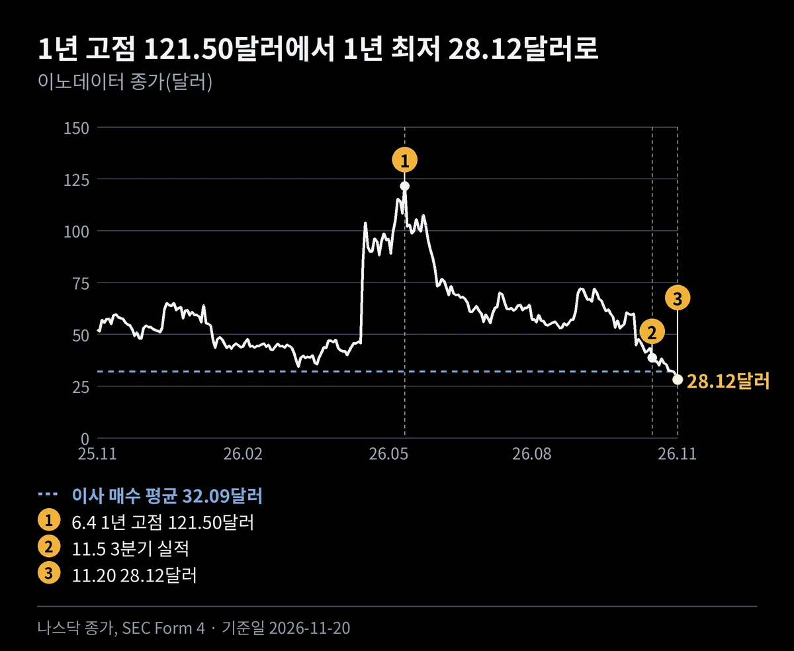
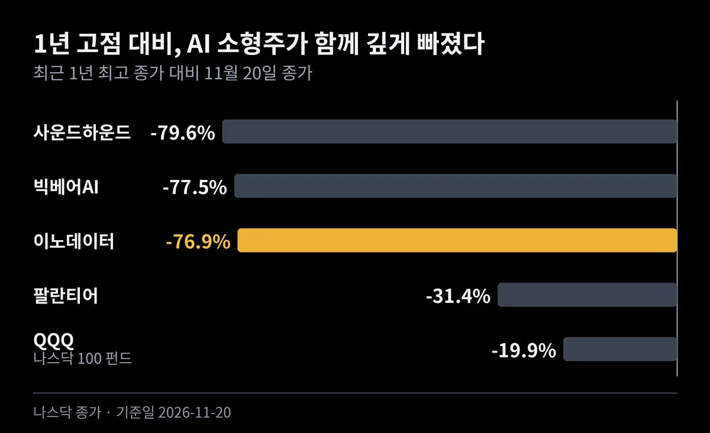
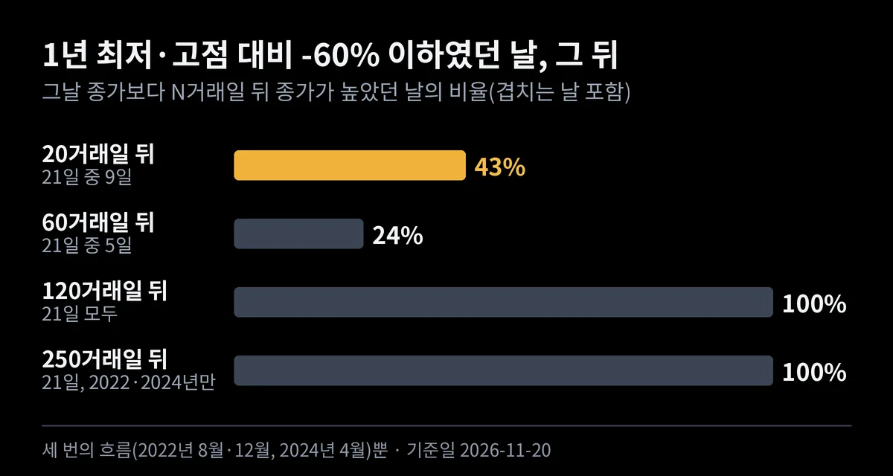
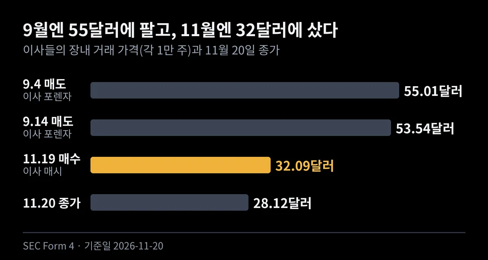
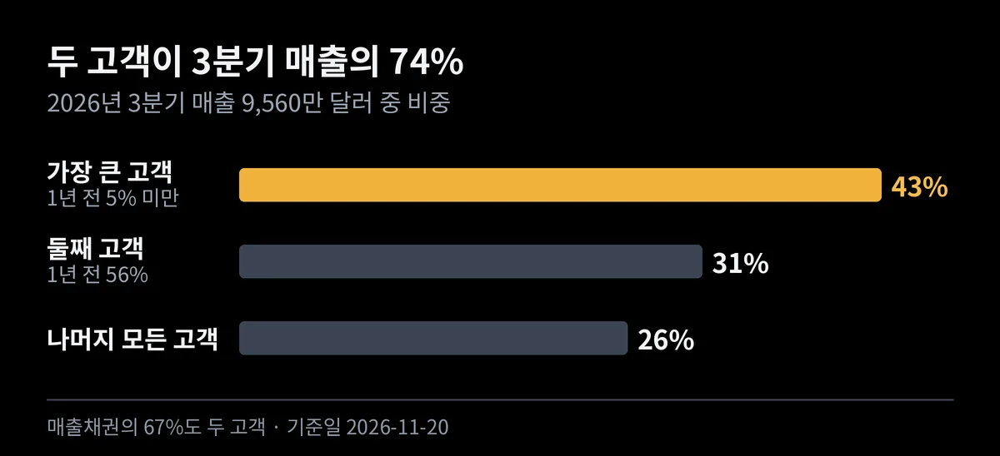
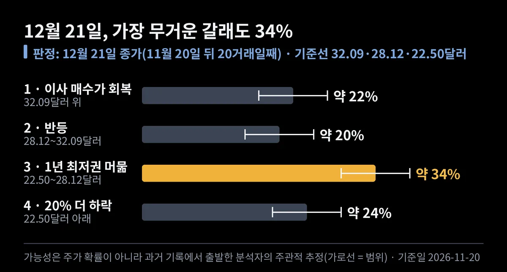

이노데이터 지금 사도 될까? 11월 20일 종가는 28.12달러였습니다. 1년 사이 가장 낮은 종가로, 6월 4일 고점 121.50달러보다 76.9% 아래입니다. 그런데 바로 하루 전, 이 회사 이사 한 명이 장에서 자기 돈으로 1만 주를 샀습니다. 평균 32.09달러였습니다. 이 글은 사라, 팔라를 말하지 않습니다. 대신 이 질문에 답하는 데 필요한 근거를 끝까지 꺼내 보겠습니다.

> **유의사항** 저자는 금융·투자 자문가가 아닙니다. 이 글은 공개 공시와 시세를 정리한 교육용 분석이며 특정 종목의 매수·매도를 권하지 않습니다. 과거 패턴은 미래 수익을 보장하지 않고, 이노데이터는 최근 20거래일 가운데 9일이 하루 5% 넘게 움직인 종목입니다. 실제 투자 전에는 최신 공시를 직접 확인하세요.

이 글은 [11월 6일 기준 리포트](/r/inod-2026-11/)의 후속편입니다. 그 리포트는 전망을 올린 다음 날 주가가 4.1% 내린 장면을 다뤘습니다. 그 뒤로도 주가는 거의 매일 내렸습니다. 11월 20일 종가는 11월 6일 종가보다 24.1% 낮습니다. 마지막 날 하루에만 8.9%가 빠졌고, 2024년 11월 뒤 가장 낮은 종가가 됐습니다.

그날은 AI 주식 전체가 크게 팔린 날이었습니다. 음성 AI 회사 사운드하운드는 10.3%, 국방 AI 회사 빅베어AI는 8.7%, 팔란티어는 6.6% 내렸습니다. 나스닥 대형 기술주 100개를 따라가는 펀드(QQQ)도 5.7% 내렸습니다. 1년 고점과 견주면 사운드하운드는 79.6%, 빅베어AI는 77.5% 아래입니다. 이노데이터만의 소식으로 내린 날이 아니라, 작은 AI 회사들이 함께 깊게 빠진 자리입니다.

김박사 월드는 리포트마다 정해 둔 날의 종가와 공시로 지난 예측을 채점합니다. 지난 예측 성적은 적중 0, 빗나감 0, 진행 중 4입니다. 11월 6일 기준 리포트의 네 갈래는 4분기 실적이 나오는 내년 2월 말에 판정합니다. 함께 적어 둔 확인 항목 '11월 12일 종가가 실적 발표일 38.62달러보다 높은가'는 36.29달러로 아니었습니다. 그보다 앞선 10월 리포트에서는 가장 높게 본 갈래(약 40%)가 빗나갔고, 약 30%로 본 갈래만 맞았습니다.

먼저 회사부터 짧게 보겠습니다. 이노데이터는 AI 모델을 가르치는 데 필요한 데이터를 사람과 프로그램으로 만들어 파는 회사입니다. 고객은 거대 AI 모델을 만드는 큰 기술 회사들입니다. 3분기 매출은 9,560만 달러로 1년 전보다 53% 늘었습니다. 순이익은 1,030만 달러로 흑자였습니다. 회사는 올해 매출이 지난해보다 42% 이상 늘어난다고 전망을 올렸습니다.

이 질문의 첫 번째 열쇠는 '지금 가격이 과거 비슷한 순간에서 어디쯤인가'입니다. 기준은 이렇게 잡았습니다. 그날 종가가 1년 사이 가장 낮고, 동시에 1년 고점보다 60% 넘게 아래인 날입니다. 2016년 뒤 10년 기록에서 그런 날은 이번 주를 빼면 2022년 8월, 2022년 12월, 2024년 4월에 몰려 있었습니다. 20거래일 뒤 결과를 알 수 있는 날은 21일이었습니다.

그 21일의 뒤는 기간에 따라 달랐습니다. 20거래일 뒤 더 높았던 날은 9일, 43%였습니다. 60거래일 뒤로 늘리면 5일, 24%로 더 낮아졌습니다. 그런데 120거래일 뒤와 250거래일 뒤에는 21일 모두 더 높았습니다. 다만 이 21일은 세 번의 흐름일 뿐입니다. 그때 주가는 3~6달러였고, 지금 회사는 매출 규모부터 다릅니다.

그래서 지금 자리는 이렇게 읽힙니다. 몇 주에서 몇 달 안에는 더 낮았던 경우가 절반을 넘었습니다. 반년 넘게는 세 번 모두 더 높았습니다. 같은 가격이라도 얼마나 기다릴 사람인지에 따라 과거 기록이 다른 답을 냅니다. 이제 사는 쪽 근거와 사지 않는 쪽 근거를 셋씩 나란히 놓겠습니다.

사는 쪽 근거 첫째는 이사의 장내 매수입니다. 11월 20일 미국 증권거래위원회(SEC)에 내부자 거래 보고서인 Form 4가 들어왔습니다. 이사 스튜어트 매시가 11월 19일 장에서 1만 주를 32.00~32.18달러에 여러 번 나눠 샀습니다. 가중평균 32.09달러, 약 32만 900달러입니다. 거래 부호는 장내 매수를 뜻하는 'P'이고, 산 주식은 개인 퇴직 계좌에 들어갔습니다.

같은 이사회 안에서도 9월에는 방향이 반대였습니다. 이사 루이즈 포렌자는 9월 4일 옵션을 행사한 뒤 1만 주를 55.01달러에 팔았습니다. 9월 14일에도 1만 주를 53.54달러에 팔았습니다. 보고서에는 은퇴 계획과 분산을 위한 매도라고 적혀 있습니다. 두 달 사이 내부자 거래 가격이 55달러대에서 32달러대로 내려온 셈입니다.

숫자로 확인되는 사업도 사는 쪽입니다. 9월 말 현금은 1억 6,400만 달러로, 연초의 두 배 가까이 됐습니다. 영업으로 번 현금이 그만큼 쌓였습니다. 8월에 맺은 3억 달러 주식 판매 계약은 3분기에 한 주도 쓰지 않았습니다. 회사 전체 값인 시가총액은 올해 전망 매출의 약 2.7배입니다. 자세한 숫자는 부록 '지금의 크기' 표에 있습니다.

사는 쪽 마지막 근거는 2024년 4월의 기록입니다. 2024년 4월 19일 이노데이터는 5.80달러로 1년 최저를 새로 썼습니다. 20거래일 뒤에는 그날보다 107.1%, 250거래일 뒤에는 411.7% 높았습니다. 2022년 12월 20일 2.86달러도 60거래일 뒤 145.8% 높았습니다. 다만 이것은 지난 두 번의 반등 기록이고, 같은 일이 반복된다는 근거는 아닙니다.

이번엔 사지 않는 쪽 근거입니다. 첫째는 방금 본 짧은 기록입니다. 1년 최저 자리에서 20거래일 뒤 더 높았던 날은 43%, 60거래일 뒤는 24%뿐이었습니다. 2022년 8월 묶음처럼 한 달 뒤 더 깊어진 적도 있습니다. 이번 흐름도 아직 끝나지 않았습니다. 11월 16일 종가 32.59달러 대비 4거래일 만에 13.7%가 더 빠졌습니다.

매출이 두 고객에게 몰려 있다는 점이 두 번째입니다. 10-Q에 따르면 3분기 매출의 43%와 31%가 두 고객에게서 나왔습니다. 받을 돈인 매출채권도 67%가 이 두 곳입니다. 1년 전 5%도 안 되던 고객이 가장 큰 고객이 됐다는 점은 다변화로 볼 수도 있습니다. 하지만 큰 고객 한 곳의 프로그램이 10월에 끝났고, 회사는 1분기 새 프로그램으로 채운다고 예상합니다.

마지막은 남은 주식 판매 한도와 업종입니다. 3억 달러 계약은 쓰지 않았을 뿐 그대로 남아 있습니다. 28.12달러로 다 채우려면 약 1,067만 주가 필요하고, 지금 유통 주식의 약 31%입니다. 한도는 쓸 수 있는 금액일 뿐 실제로 판 양은 아닙니다. 그리고 김박사 월드 예측 장부에서 소형주는 업종이 내릴 때는 같이 내렸고, 업종이 오를 때는 잘 따라가지 못했습니다.

같은 질문은 다른 종목에서도 나왔습니다. 원전 회사 뉴스케일 파워도 11월 20일 1년 최저 3.36달러에 있습니다. [11월 20일 기준 리포트](/r/smr-2026-11-4/)는 현금보다 싼 몸값과 계약에 붙은 지급 조건을 다뤘습니다. 두 회사의 차이는 돈을 버는지입니다. 뉴스케일의 3분기 매출은 28만 1,000달러였고, 이노데이터는 같은 분기에 1,030만 달러 이익을 냈습니다.

그럼 무엇을 보면 판단이 바뀔까요? 신호와 날짜를 정해 두겠습니다. 첫째는 12월 21일 종가로, 11월 20일 뒤 20번째 거래일입니다. 이날 이사 매수가 32.09달러 위로 돌아와 있으면 사는 쪽 근거가 강해집니다. 11월 20일보다 20% 낮은 22.50달러 아래로 내려가 있으면 사지 않는 쪽 근거가 강해집니다. 지난 리포트가 정한 12월 4일, 실적 뒤 20거래일째 종가도 함께 봅니다.

공시도 신호입니다. 회사는 연 500만 달러, 5년짜리 연방 계약을 구두로 따냈고 4분기 말까지 서명을 예상했습니다. 그 서명이 나오면 사는 쪽 근거가 강해집니다. 새 주식 판매를 알리는 공시나 다른 내부자의 매도가 나오면 사지 않는 쪽 근거가 강해집니다. 4분기 실적은 지난해 일정으로 보면 2월 말 무렵이고, 올해 전망을 지키려면 4분기 매출이 약 7,946만 달러 이상이어야 합니다.

사려는 사람이 먼저 볼 것은 두 가지입니다. 다음 분기 보고서에서 두 고객 비중이 줄었는지, 그리고 3억 달러 계약으로 주식을 팔았는지입니다. 하루 8.9% 내리는 날을 견딜 수 있는지, 판정 날짜까지 다섯 가지 확인표는 글 끝 부록에 있습니다.

마지막으로 12월 21일 종가를 네 갈래로 나눴습니다. 출발점은 1년 최저 자리 21일의 20거래일 뒤 기록입니다. 그 기록에서 가장 많았던 칸은 0~20% 더 빠진 칸으로, 21번 중 7번이었습니다. 이사 매수가 위 칸은 주가가 훨씬 낮던 2022·2024년 기록에서 나와 조금 줄였습니다. 가격 수준이 이어진 기록이 많아 지금 자리 바로 위 칸은 조금 늘렸습니다.

22.50~28.12달러, 1년 최저권에 머무는 갈래를 약 34%로 가장 무겁게 봤습니다. 20% 넘게 더 빠지는 갈래는 약 24%, 이사 매수가 위로 돌아오는 갈래는 약 22%입니다. 28.12~32.09달러로 반등하는 갈래는 약 20%입니다. 이 숫자는 주가가 오를 확률이 아니라, 과거 빈도에서 출발한 분석자의 주관적 추정입니다.

하루 5% 넘게 움직이는 날이 잦아, 칸 하나쯤은 한두 번의 큰 날로 비껴갈 수 있습니다. 2024년 4월처럼 20거래일 뒤 두 배가 된 반등도 있었습니다. 반대로 2022년 8월처럼 23.0% 더 내려간 적도 있습니다. 21일은 서로 겹치는 날이라 실제로는 세 번의 흐름입니다. 이사 매수는 근거 설명에만 쓰고 갈래 숫자를 올리는 데는 쓰지 않았습니다.

지금 이노데이터는 이익을 내고 현금이 늘어난 회사이고, 이사가 하루 전 자기 돈으로 샀습니다. 동시에 매출의 74%가 두 고객에게서 나오고, 3억 달러 판매 한도가 남아 있으며, AI 소형주와 함께 흔들립니다. 12월 21일 종가가 32.09달러 위로 돌아오고 연방 계약 서명이 나오면 사는 쪽 근거가 강해집니다. 22.50달러 아래이거나 판매 공시가 나오면 사지 않는 쪽 근거가 강해집니다. 결정은 각자의 몫이며, 이 영상과 리포트는 판단 근거를 정리한 교육용 자료입니다.

## 숫자로 다시 보기

### 지난 리포트 뒤 하루씩

| 날짜 · 종가 | 하루 변화 | 이사 매수가 32.09달러 대비 |
| --- | --- | --- |
| **11월 6일** 37.03달러 | -4.1% | +15.4% |
| **11월 13일** 35.46달러 | -2.3% | +10.5% |
| **11월 16일** 32.59달러 | -8.1% | +1.6% |
| **11월 18일** 32.18달러 | -0.7% | +0.3% |
| **11월 19일** 30.87달러 | -4.1% | -3.8% |
| **11월 20일** 28.12달러 | -8.9% | -12.4% |

11월 20일 28.12달러는 2024년 11월 7일 24.34달러 뒤 가장 낮은 종가입니다.

| 종목 | 1년 고점 대비 | 11월 6일 뒤 |
| --- | --- | --- |
| **이노데이터** | -76.9% | -24.1% |
| 사운드하운드 | -79.6% | -36.5% |
| 빅베어AI | -77.5% | -28.8% |
| 팔란티어 | -31.4% | -10.5% |
| QQQ | -19.9% | -7.3% |

### 사는 쪽 근거와 사지 않는 쪽 근거

| 사는 쪽 · 숫자 | 사지 않는 쪽 · 숫자 |
| --- | --- |
| **이사의 장내 매수** 11월 19일 1만 주, 평균 32.09달러(약 32만 900달러) | **짧은 기록** 1년 최저 자리 21일 중 20거래일 뒤 더 높음 43%, 60거래일 뒤 24% |
| **흑자와 늘어난 현금** 3분기 순이익 1,030만 달러, 현금 1억 6,400만 달러 | **두 고객에 몰린 매출** 3분기 매출의 43%·31%, 매출채권의 67% |
| **바닥 뒤 긴 기록** 2024년 4월 19일 5.80달러, 250거래일 뒤 +411.7% | **판매 한도와 업종** 3억 달러 = 28.12달러면 약 1,067만 주, AI 소형주 동반 하락 |

### 1년 최저 묶음의 첫날, 그 뒤

**한눈에:** 1년 최저이면서 고점 대비 -60% 아래였던 날 **21일** · 20거래일 뒤 더 높음 **9일(43%)** · 60거래일 뒤 더 높음 **5일(24%)** · 120·250거래일 뒤 더 높음 **21일 모두**

| 묶음 첫날 · 종가 | 20거래일 뒤 | 60거래일 뒤 · 250거래일 뒤 |
| --- | --- | --- |
| **2022.08.15** 4.47달러 | -23.0% | -32.0% · +218.3% |
| **2022.12.20** 2.86달러 | +16.8% | +145.8% · +207.0% |
| **2024.04.19** 5.80달러 | +107.1% | +238.3% · +411.7% |
| **이번 2026.11.16** 32.59달러 | 12월 15일 판정 | - |

묶음은 1년 최저 종가가 20거래일 넘게 끊겼다가 다시 나온 날로 나눴습니다. 겹치는 날을 모두 센 값이라 21일은 실제로 세 번의 흐름입니다.

### 지금의 크기(11월 20일 기준)

| 항목 | 값 · 근거 |
| --- | --- |
| 3분기 매출 | **9,560만 달러** 1년 전보다 +53%, 13분기 연속 성장 |
| 두 고객 비중 | **43% · 31%** 둘째 고객은 1년 전 3분기 56% |
| 3분기 순이익 | **1,030만 달러** 1~9월 3,960만 달러 |
| 9월 말 현금 | **1억 6,400만 달러** 고객 선수금 빼면 약 1억 5,370만 달러 |
| 1~9월 영업 현금 유입 | **8,050만 달러** 10-Q |
| 유통 주식 | **3,441만 주** 9월 30일 |
| 시가총액 | **약 9억 6,761만 달러** 28.12달러 기준, 계산 |
| 2026년 전망 매출 | **약 3억 5,736만 달러 이상** 2025년 2억 5,166만 × 1.42, 계산 |
| 4분기 문턱 | **약 7,946만 달러** 3분기보다 약 17% 낮음, 계산 |
| 주식 판매 계약 | **3억 달러** 3분기 판매 없음, 28.12달러면 약 1,067만 주(계산) |
| 이사 매시 보유 | **5만 1,686주** 퇴직 계좌 2만 1,000주 + 직접 3만 686주 |

### 사기 전에 확인할 것

| 확인할 것 | 어디서 · 언제 |
| --- | --- |
| **두 고객 비중이 줄었나** 3분기 43%·31% | 연간 보고서 · 2월 말 무렵 |
| **주식 판매 계약을 썼나** 한도 3억 달러 | SEC 제출 목록 · 수시 |
| **다른 내부자의 매수·매도** 11월 19일 매수 32.09달러 | Form 4 · 수시 |
| **하루 8.9%를 견딜 수 있나** 최근 20거래일 중 9일이 ±5% 넘음 | 스스로 · 사기 전 |
| **판정 날짜 메모** 32.09 · 22.50달러 | 12월 4일 · 21일 · 4분기 실적 |

### 지난 예측 채점표

| 지난 점검 항목 · 당시 기준 | 판정과 실제 결과(11월 20일) |
| --- | --- |
| **10월 28일 리포트: 고객 축소 확인, 다음 날 15~18% 하락** 약 40% | **[빗나감]** 고객 축소는 확인, 다음 날 -4.1% |
| **10월 28일 리포트: 엇갈린 숫자, 좁은 움직임** 약 30% | **[적중]** 다음 날 -4.1%로 ±10% 안 |
| **10월 28일 리포트: 회사 설명으로 되돌림** 약 30% | **[빗나감]** 11월 12일 36.29달러, 반등 없음 |
| **11월 8일 리포트: 11월 12일 종가 > 38.62달러** 확인 항목 | **[아님]** 36.29달러 |
| **11월 8일 리포트 네 갈래(계약 서명 · 전망 달성)** 4분기 실적 판정 | **[진행 중]** 2027년 2월 말 예상 |

### 앞으로 일어날 수 있는 일

과거 빈도: 1년 최저이면서 고점 대비 -60% 아래였던 21번 중 20거래일 뒤 32.09달러 위에 해당한 것은 6번, 22.50달러 아래는 5번이었습니다.

지지선을 지킨다는 쪽은 장부에서 4번 중 4번 빗나갔습니다. 아래 가능성은 주가 상승·하락 확률이 아니라, 12월 21일 종가의 자리에 대한 분석자의 주관적 추정입니다. 네 갈래는 겹치지 않아 더하면 100%이고, 괄호 안 범위는 더하지 않습니다.

| 시나리오(판정 12월 21일) | 종가 | 가능성(추정) |
| --- | --- | --- |
| 1 · 이사 매수가 회복 | 32.09달러 위 | 중간 약 22% (17~27%) |
| 2 · 반등 | 28.12~32.09달러 | 중간 약 20% (15~25%) |
| **3 · 1년 최저권 머묾** | 22.50~28.12달러 | 중간 약 34% (29~39%) |
| 4 · 20% 더 하락 | 22.50달러 아래 | 중간 약 24% (19~29%) |

### 핵심 확인 세 가지

| 순위 · 확인할 것 | 판정 날짜 |
| --- | --- |
| **1순위** 12월 21일 종가가 32.09달러 위인가, 22.50달러 아래인가 | 12월 21일 |
| **2순위** 연방 계약(연 500만 달러, 5년) 서명이 공시되는가 | 12월 31일까지 |
| **3순위** 주식 판매 공시나 다른 내부자 매도가 나오는가 | 12월 21일까지 |

공시는 [이노데이터 SEC 공시 목록](https://www.sec.gov/cgi-bin/browse-edgar?action=getcompany&CIK=0000903651&type=&dateb=&owner=include&count=40)에서 직접 확인할 수 있습니다.

## 함께 읽기

- [이노데이터 실적 리포트](/r/inod-2026-11/) · [영상](https://youtu.be/dKJa4FE723E): 전망을 올린 다음 날 -4.1%(11월 6일 기준).
- [뉴스케일 지금 사도 될까 리포트](/r/smr-2026-11-4/) · [영상](https://youtu.be/LtzNialqBF8): 같은 질문, 현금의 0.77배에 있는 원전 회사(11월 20일 기준).
- [솔리드파워 지금 사도 될까 리포트](/r/sldp-2026-11-4/) · [영상](https://youtu.be/JusnxXSiIVQ): 같은 질문, 현금의 0.78배에 있는 배터리 회사(11월 20일 기준).
