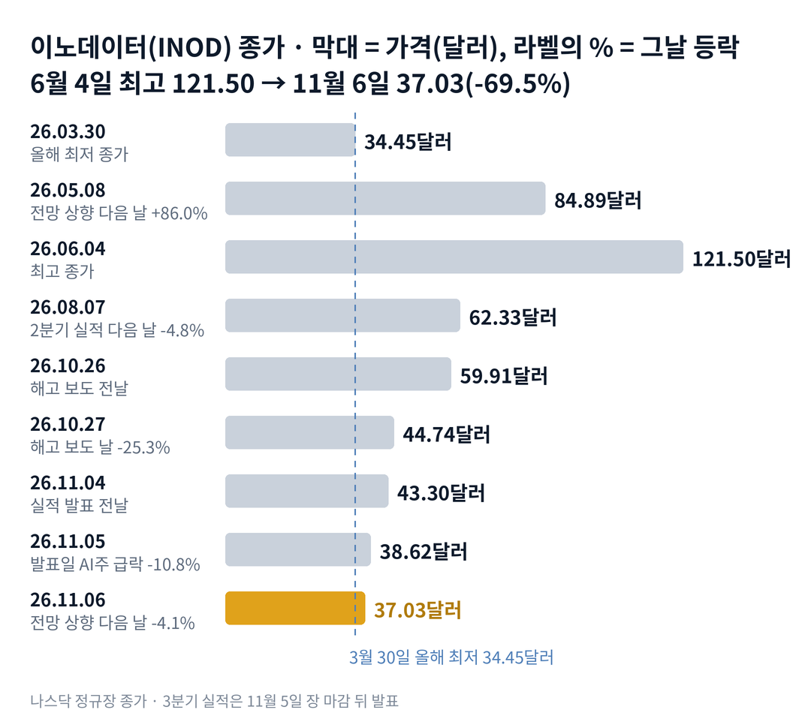

## 짧은 답

매출은 시장 예상보다 15% 많았고, 회사는 올해 성장 전망도 올렸습니다. 그런데 이노데이터 주가는 왜 다음 날 또 내렸을까요?

결론부터 말하면, 좋은 숫자와 걱정할 문장이 같은 날 나왔기 때문입니다. 하루 전 AI 주식 전체가 크게 팔린 데다, 실적 발표에는 오랫동안 가장 컸던 고객의 프로그램이 끝났다는 설명이 함께 있었습니다. 지난주와 달라진 점은 하락의 이유가 '보도'에서 '회사가 직접 밝힌 숫자'로 바뀌었다는 것입니다. **2026.11.06 진단: 국면 B(기대 소진기) 후반 지속 — 근거는 5부.**

같은 전망 상향에 2026년 5월에는 다음 날 86.0%가 올랐습니다. 그렇다면 과거에 실적 다음 날 내렸을 때, 한 달 뒤에는 어디에 있었을까요? 답은 3부 '실적 다음 날 내린 뒤, 20거래일 뒤는?' 표에 있습니다.

> **유의사항** 저자는 금융·투자 자문가가 아닙니다. 이 글은 공개 공시와 시세를 정리한 교육용 분석이며 특정 종목의 매수·매도를 권하지 않습니다. 과거 패턴은 미래 수익을 보장하지 않고, 이노데이터는 실적 날 하루에 두 자릿수로 움직인 적이 많은 종목입니다. 실제 투자 전에는 최신 공시를 직접 확인하세요.

## 지난 리포트 이후

[10월 27일 기준 리포트](/r/inod-2026-10-2/)는 인도 해고 보도 직후의 이노데이터를 '실적 전 불확실성' 단계로 봤습니다. 실적 다음 날 주가가 오르지 않으면 이 단계가 이어진다고 적었고, 실제로 주가는 실적 다음 날 내렸습니다. 지금 주가는 그때 종가보다 17.2% 낮습니다. 지난 예측 성적은 다섯 항목 가운데 적중과 빗나감이 하나씩이고, 부분 적중 둘, 진행 중 하나입니다. 항목별 채점표는 6부 끝에 있습니다. 이번 리포트가 새로 답할 질문은 '전망을 올리고도 내린 실적 다음 날, 그 뒤 한 달'입니다.

## 1부. 이노데이터는 어떤 회사이고, 무엇으로 돈을 버는가

> **핵심:** 이노데이터는 AI 학습용 데이터를 사람 손으로 만드는 회사이고, 매출의 74%가 두 고객에서 나옵니다.

이노데이터는 인공지능 회사들이 모델을 가르치고 시험하는 데 쓰는 데이터를 만드는 미국 회사입니다. 문서에 이름표를 붙이고, 모델이 낸 답을 사람이 평가하고, 안전성을 시험하는 일을 합니다. 직원 상당수가 인도와 필리핀에 있습니다.

돈을 버는 방식은 프로그램 단위의 일감입니다. 큰 고객이 '이런 데이터를 얼마만큼 만들어 달라'는 프로그램을 맡기면, 회사는 사람을 배치해 일하고 대가를 받습니다. 그래서 프로그램이 시작되면 매출과 인력이 함께 늘고, 끝나면 둘 다 줄어듭니다.

고객이 중요한 이유는 몇 곳에 몰려 있기 때문입니다. 3분기에는 한 고객이 매출의 43%, 다른 고객이 31%를 차지했습니다. 43% 고객은 1년 전 매출의 5%도 안 되던 곳입니다. 31% 고객은 1년 전 56%를 차지하던, 오랫동안 가장 컸던 고객입니다. 회사는 두 고객의 이름을 밝히지 않습니다.

지금 몸값은 약 12억 7,400만 달러입니다. 시가총액에서 현금을 뺀 단순 차감값은 약 11억 1,000만 달러이고, 최근 4개 분기 매출의 약 3.2배입니다. 이 비교가 주가의 하한선은 아닙니다. 현금은 고객 선수금을 빼면 약 1억 5,370만 달러로 시가총액의 약 12%이고, 부채는 없습니다. 그렇다고 이 현금이 주가의 바닥을 보장하지는 않습니다. 시장은 현금보다 앞으로 남길 이익에 값을 매기기 때문입니다.

### 숫자로 본 지금의 크기(11월 6일 기준)

| 항목 | 값 · 계산 근거 |
| --- | --- |
| 종가 | **37.03달러** 6월 4일 최고 종가 121.50달러보다 69.5% 낮음 |
| 시가총액 | **약 12억 7,400만 달러** 37.03달러 × 3,441만 2,692주(10월 30일) |
| 3분기 매출 | **9,560만 달러** 1년 전보다 53% 증가, 예상 약 8,330만 달러 |
| 4분기 최소 매출(전망 기준) | **약 7,950만 달러** 2025년 매출 2억 5,166만 × 1.42 − 9개월 매출 |
| 두 고객 비중 | **74%** 3분기 43% + 31%(2분기 71%) |
| 선수금 뺀 현금 | **약 1억 5,370만 달러** 9월 말, 2분기 약 1억 3,400만에서 증가 |

4분기 최소 매출은 올해 전망 '42% 이상'을 지키는 데 필요한 값입니다. 3분기보다 약 17% 적어도 됩니다. 회사가 말한 4분기 감소분 약 1,200만 달러를 3분기 매출에서 빼도 약 8,360만 달러라 이 선 위입니다. 그렇다면 이 정도 숫자에도 주가는 왜 두 거래일 연속 내렸을까요?

## 2부. 실적 전후 두 거래일에 겹친 세 가지

> **핵심:** 업종 전체의 매도, 큰 고객의 빈자리, 줄어든 이익률이 같은 두 거래일에 겹쳤습니다.

첫 번째는 업종 전체의 매도라는 시장 사건입니다. 실적이 나오기 전인 11월 5일 정규장에서 이노데이터는 10.8% 내렸습니다. 같은 날 나스닥 100 지수를 따르는 상장지수펀드인 QQQ(나스닥 100 ETF)는 6.5% 내렸습니다. IGV(소프트웨어 업종 ETF)도 4.4% 내렸습니다. 보도에 따르면 중간선거 뒤 데이터센터 건설이 늦어질 수 있다는 걱정이 AI 주식 전체로 번진 날이었습니다. 같은 보도로는 필라델피아 반도체 지수가 그날 9.2% 내렸습니다. 데이터센터가 늦어지면 → AI 회사의 투자 속도가 느려질 수 있고 → 학습용 데이터 주문도 덜 늘 수 있다는 걱정이 값에 먼저 들어갔습니다.

### 실적 전후, AI·소프트웨어 주식 성적

| 종목 · 성격 | 11.05 하루 | 11.06 하루 |
| --- | --- | --- |
| **이노데이터(INOD)** AI 데이터 | **-10.8%** | **-4.1%** |
| 나스닥 100 ETF(QQQ) | -6.5% | +1.4% |
| 소프트웨어 ETF(IGV) | -4.4% | -0.1% |
| 팔란티어(PLTR) AI 소프트웨어 | -9.7% | +3.5% |
| 빅베어에이아이(BBAI) AI 분석 | -13.3% | 0.0% |
| 씨쓰리에이아이(AI) 기업용 AI | -4.8% | +2.7% |

11월 5일은 이노데이터만의 날이 아니었습니다. 지난 리포트 기준일인 10월 27일부터 11월 6일까지로 넓혀도 소프트웨어 ETF가 -11.5%, 팔란티어가 -19.3%였고 이노데이터는 -17.2%였습니다. 그런데 11월 6일에는 시장이 숨을 돌렸고, 이노데이터만 다시 내렸습니다. 거래량은 두 날 모두 약 350만 주로 직전 20거래일 평균의 약 2.1배였습니다. 직전 5거래일 평균(약 141만 주)과 견주면 약 2.5배입니다.

두 번째는 큰 고객의 빈자리라는 사업 사건입니다. 실적 발표 통화에서 경영진은 오랫동안 가장 컸던 고객의 프로그램이 10월 중순 끝났고, 4분기 매출이 약 1,200만 달러 줄어든다고 설명했습니다. 프로그램이 끝나면 → 그 일을 하던 인력이 남고 → 새 프로그램이 오기 전까지 매출이 빈다는 순서입니다. 회사는 내년 1분기 새 프로그램이 그 자리를 채울 것으로 보지만, 아직 막바지 논의 중이라고 했습니다. 인도 해고 보도(10월 27일)와 시점이 겹치지만, 회사가 둘을 직접 연결해 말한 내용은 확인하지 못했습니다.

세 번째는 이익률 하락이라는 숫자의 질입니다. 매출은 크게 늘었지만, 영업이익은 1년 전보다 약 26% 줄어 870만 달러였습니다. 조정 매출총이익률(매출에서 직접 비용을 뺀 비율, 회사 기준)도 44%에서 40%로 내려왔습니다. 사람을 늘리고 영업을 넓히느라 판매·관리 비용이 약 96% 늘어 거의 두 배가 됐기 때문입니다. 순이익이 늘어난 데에는 연초 이후 약 12%로 낮았던 실효세율도 도움이 됐습니다. 회사는 40%가 목표 범위 안이라고 설명했습니다.

좋은 숫자도 분명했습니다. 1년 전 5% 미만이던 고객이 3분기 가장 큰 고객이 됐고, 그 고객과 4분기에 약 1,800만 달러 프로그램을 더 맺었습니다. 다른 대형 클라우드 회사(하이퍼스케일러)에서는 2027년 2,000만 달러 넘는 매출을 예상했습니다. 정규장 마감 뒤 시간 외 거래에서는 8.8% 올랐다는 보도도 있었습니다(Zacks 집계, 이 글의 계산에는 넣지 않음).

세 사건을 나란히 놓으면 공통점이 하나 보입니다. 회사의 매출 숫자가 기대를 밑돈 것은 아니었다는 점입니다. 결국 이번 하락은 업종의 매도 위에, 큰 고객 한 곳의 빈자리와 줄어든 이익률이 겹친 결과였습니다. 그렇다면 과거에 실적 다음 날 내렸을 때 한 달 뒤에는 어디에 있었을까요?

## 3부. 실적 다음 날과 20거래일 뒤, 2025년 이후 8번

> **핵심:** 2025년 이후 실적 다음 날 내린 것은 이번까지 8번 중 5번이고, 20거래일 뒤 발표 전보다 높았던 것은 7번 중 2번입니다.

이 기록을 보는 이유는 이번이 '실적 다음 날 하락'이기 때문입니다. 2025년부터는 주가가 이미 큰 성장을 미리 반영한 상태에서 실적을 맞았습니다. 그래서 2023~2024년(8번 중 다음 날 상승 7번)과 분위기가 다른 2025년 이후만 골랐습니다.

표의 세 칸은 세 질문에 답합니다. 첫 칸은 그날 무엇이 나왔나, 둘째 칸은 다음 날 어떻게 반응했나, 셋째 칸은 한 달 동안 유지됐나입니다. 실적은 모두 장 마감 뒤 나왔습니다. 그래서 발표일 종가를 기준으로 다음 거래일 종가와, 다음 날을 첫날로 센 20번째 거래일 종가를 비교했습니다.

예를 들어 2025년 5월 8일 발표일 종가는 41.11달러였습니다. 다음 날 34.62달러로 -15.8%였고, 20번째 거래일인 6월 6일에는 51.23달러로 +24.6%였습니다.

**한눈에:** 다음 날 상승 3번 · 20거래일 뒤 상승 2번 · 20거래일 뒤 가운데 값(중앙값) -13.8%. 첫날 오른 세 번 가운데 한 달 뒤까지 위에 남은 것은 한 번이었습니다.

### 실적 다음 날 내린 뒤, 20거래일 뒤는?

| 발표일 · 그날 나온 내용 | 다음 날 | 20거래일 뒤 |
| --- | --- | --- |
| 2025.02.20 4분기 실적 | +13.5% | -21.2% |
| **2025.05.08** 1분기 실적 | **-15.8%** | **+24.6%** |
| **2025.07.31** 2분기 실적 | **-18.1%** | **-28.0%** |
| 2025.11.06 3분기 실적 | +6.9% | -5.1% |
| **2026.02.26** 올해 성장 35% 이상 전망 | **-7.2%** | **-13.8%** |
| 2026.05.07 매출 +54%, 전망 40% 이상으로 상향 | +86.0% | +123.4% |
| **2026.08.06** 매출 +58%, 전망 40% 이상 유지 | **-4.8%** | **-15.9%** |

굵게 쓴 네 줄이 다음 날 내린 경우입니다. 2025년 실적 날에는 다음 해 전망이 나오기 전이라 '그날 나온 내용'을 분기 이름으로만 적었습니다. 일곱 번은 분기마다 한 번씩이라 20거래일 측정 기간이 서로 겹치지 않습니다. 다만 그때와 지금은 주가 수준과 고객 구성이 크게 다르므로, 이 표는 정밀한 확률이 아니라 과거 움직임의 참고 자료입니다.

이번 하락 폭은 기준에 따라 다르게 보입니다. 발표일 종가 38.62달러와 비교하면 다음 날 -4.1%이고, 실적 전날인 11월 4일 종가 43.30달러와 비교하면 두 거래일 동안 -14.5%입니다. 표는 발표일 종가를 기준으로 했습니다.

> **이번(미확정):** 2026.11.05 · 매출 +53%, 전망 42% 이상으로 상향 · 발표일 종가 38.62달러 · 다음 날 -4.1% · 5거래일째 11월 12일, 20거래일째 12월 4일 판정

여기서 기억할 사실은 하나입니다. 다음 날 내린 네 번 가운데 한 달 뒤 발표 전 종가를 넘은 것은 2025년 5월 한 번뿐이었습니다. 그렇다고 이것이 이번 결과를 정해 주는 규칙은 아닙니다. 그렇다면 같은 전망 상향에 5월과 11월은 왜 정반대였을까요?

## 4부. 같은 전망 상향, 5월과 11월이 달랐던 이유

> **핵심:** 숫자의 크기보다 출발점과 함께 나온 문장이 반응을 갈랐습니다.

두 번의 실적은 묻는 질문이 달랐습니다. 2026년 5월의 질문은 '성장이 계속되는가'였습니다. 주가는 3월 30일 올해 최저 34.45달러 근처에 있었고, 기대가 낮았습니다. 그때 매출 +54%와 전망 상향이 나오자, 시장은 성장이 꺾이지 않았다는 안도를 값에 크게 넣었습니다. 발표일 종가 45.64달러는 다음 날 84.89달러가 됐고, 5거래일 뒤에는 발표 전보다 97.5% 높았습니다.

11월의 질문은 '고객 한 곳이 흔들리면 얼마나 비는가'였습니다. 인도 해고 보도 뒤라, 시장은 이미 큰 고객의 일감을 걱정하고 있었습니다. 실적은 그 걱정을 숫자로 확인해 줬습니다. 프로그램 하나가 끝났고, 4분기 매출이 약 1,200만 달러 빕니다.

출발점도 달랐습니다. 5월에는 업종이 고르게 오르던 때였고, 11월에는 실적 전날 AI 주식 전체가 크게 팔렸습니다. 같은 '전망 상향'이라도 시장이 듣고 싶었던 답이 달랐던 셈입니다.

한 가지 더 있습니다. 5월에는 매출과 이익이 함께 늘었지만, 11월에는 매출이 늘고 영업이익은 줄었습니다. 고객이 바뀌는 과정에서 낮은 이익률의 일을 먼저 받았다는 회사 설명이 맞는다면, 이익률은 다음 분기에 다시 확인할 숫자입니다.

과거 기록이 알려 주는 것은 첫날의 방향이 한 달 뒤를 정하지 않았다는 점입니다. 결국 앞으로 확인할 것은 두 가지입니다. 하나는 회사가 말한 새 계약(연방 계약 서명, 옛 최대 고객의 새 프로그램)이 실제로 공시되는가입니다. 다른 하나는 4분기에 올해 전망 42% 이상을 지키는가입니다. 이 두 가지로 다음 몇 달을 나누면 어떤 갈림길이 나올까요?

## 5부. 계약 서명과 전망 달성, 네 가지 시나리오

> **핵심:** 지금은 지난 리포트의 국면 B(기대 소진기) 후반이 이어지는 단계이고, 4부에서 본 두 가지가 시나리오를 가르는 축입니다.

> **국면 정의(이노데이터 시리즈 공통):** 국면 A 서프라이즈 확장기 — 실적 다음 날 두 자릿수 상승과 전망 상향. 국면 B 기대 소진기 — 사상 최대 실적에도 다음 날 하락, 내부자 매도·자금 조달 계약. 국면 C 재평가 대기기 — 정점 대비 절반 안팎에서 새 경영진의 첫 실적을 기다리는 때.

**2026년 11월 6일 진단: 국면 B(기대 소진기) 후반 지속, 지난 리포트 진단 유지.** 지난 리포트는 국면 C(재평가 대기기)로 넘어가는 신호를 '실적 다음 날 상승'으로 정했습니다. 사상 최대 매출에도 다음 날 4.1% 내렸으니, 그 신호는 켜지지 않았습니다. 3억 달러 주식 판매 계약은 3분기에 쓰이지 않았습니다.

**판정 기준 두 가지:** 첫째, 계약 서명입니다. 회사가 말한 연방 계약(연 500만 달러, 5년)이나 옛 최대 고객의 새 프로그램이 4분기 실적 발표 전까지 공시·발표되면 '서명'으로 봅니다. 둘째, 전망 달성입니다. 4분기 실적에서 2026년 매출이 2025년보다 42% 이상(4분기 약 7,950만 달러 이상) 늘었는지를 봅니다.

### 앞으로 일어날 수 있는 일

3부 기록에서 2025년 이후 실적 다음 날 내린 4번 중 1번만 20거래일 뒤 발표 전보다 높았습니다. 반대로 회사가 내건 연간 전망은 2026년 들어 세 번 모두 유지되거나 올라갔습니다.

**확인된 사실:** 3분기 매출은 예상을 15% 웃돌았고, 회사는 큰 고객 프로그램 종료를 넣고도 전망을 올렸습니다. **과거 기록:** 실적 다음 날 내린 뒤 한 달 안에 되찾은 경우는 적었습니다(3부). **추정:** 아래 가능성은 분석자의 주관적 추정이며, 주가가 오를 확률이 아니라 회사 숫자 조합의 가능성입니다. 네 경우는 겹치지 않아 '약 N%'를 더하면 100%이고, 괄호 안 구간은 흔들림의 폭이라 서로 더하지 않습니다.

| 시나리오(판정 4분기 실적 발표, 2027년 2월 말 예상) | 서명 · 달성 | 가능성(추정) |
| --- | --- | --- |
| 1 · 계약과 전망 모두 확인 | ○ · ○ | 중간 약 30% (25~35%) |
| **2 · 전망만 달성** | × · ○ | 높음 약 40% (35~45%) |
| 3 · 계약은 나왔지만 전망 미달 | ○ · × | 낮음 약 10% (5~15%) |
| 4 · 둘 다 빗나감 | × · × | 중간 약 20% (15~25%) |

**한눈에:** 4분기 전망 달성 약 70%(1+2) · 계약 서명 확인 약 40%(1+3). 분석자의 주관적 추정을 더한 값이며, 실제 확률이나 통계 예측값은 아닙니다. 회사 숫자가 맞아도 주가 방향은 따로 읽어야 합니다.

시나리오 2를 가장 높게 본 이유는 4분기 문턱이 3분기보다 약 17% 낮기 때문입니다. 반면 연방 계약은 아직 구두 수주이고, 옛 최대 고객의 새 프로그램은 막바지 논의 단계라 서명 시점은 불확실합니다. 하지만 같은 무게로 반대쪽 요인도 있습니다. 두 고객이 매출의 74%라, 한 곳이 일을 더 줄이면 문턱도 흔들립니다.

시나리오 1이 되면 회사가 말한 '고객 다변화'가 숫자로 확인됩니다. 시나리오 4는 3분기 예상 상회가 일회성이었다는 뜻이 됩니다. 이 값은 과거 빈도와 지금 신호에서 나온 추정이지, 주가가 오르거나 내린다는 판단이 아닙니다. 그렇다면 이 진단을 가장 빨리 뒤집을 수 있는 위험은 무엇일까요?

## 6부. 세 갈래 위험과 체크리스트

> **핵심:** 위험은 사업 실행, 자금 조달, 외부 환경 세 갈래이고, 가장 빨리 판을 바꿀 수 있는 것은 큰 고객 두 곳의 다음 주문입니다.

먼저 이 분석의 한계입니다. 3부 표는 7번뿐인 작은 표본이고, 2026년 5월 한 번이 평균을 크게 흔듭니다. 회사가 밝히지 않은 고객 이름, 4분기 감소분의 정확한 크기, 해고와 프로그램 종료의 관계는 확인하지 못했습니다. 시간 외 거래 수치는 보도 집계라 계산에 넣지 않았습니다.

첫째 갈래는 사업 실행입니다. 옛 최대 고객의 새 프로그램이 1분기에 시작되지 않으면, 4분기에 빈 약 1,200만 달러가 다음 분기에도 이어질 수 있습니다. 새 최대 고객도 프로그램 단위로 일을 맡기므로, 한 프로그램이 끝나면 비슷한 공백이 다시 생길 수 있습니다.

둘째 갈래는 자금 조달입니다. 8월에 맺은 최대 3억 달러 시장 판매 계약(ATM: 회사가 시장에서 새 주식을 조금씩 파는 방식)은 3분기에 쓰이지 않았습니다. 지금 가격에 다 쓰면 약 810만 주, 지금 주식 수의 약 24%가 늘어나는 계산입니다(가정 계산). 주식 수가 늘면 기존 주주 한 주가 차지하는 비율이 작아지는 희석이 생깁니다. 실제 판매는 다음 분기 보고서에서 확인됩니다.

셋째 갈래는 외부 환경입니다. 11월 5일처럼 AI 주식 전체가 팔리는 날에는 회사 숫자와 상관없이 함께 내렸습니다. 데이터센터 투자 속도에 대한 걱정이 이어지면, AI 데이터 회사의 값도 함께 흔들릴 수 있습니다.

**핵심 확인 세 가지:**

- ☐ 11월 12일 종가가 발표일 종가 38.62달러보다 높은가
- ☐ 12월 31일까지 연방 계약(연 500만 달러) 서명이나 옛 최대 고객의 새 프로그램이 발표되는가
- ☐ 2027년 2월 말 4분기 실적에서 4분기 매출이 약 7,950만 달러를 넘었나

**보조 확인:**

- ☐ 12월 4일 종가가 38.62달러보다 높은가(3부 20거래일째)
- ☐ 12월 4일까지 주가가 3월 30일 최저 종가 34.45달러 위에 머무는가

**지난 리포트 점검(따로 판정):**

- ☐ 11월 12일 종가가 11월 5일 종가보다 높은가(지난 리포트 시나리오 1)

**기억할 판단 기준 세 가지:** 첫째, 이번 실적의 매출은 기대를 밑돌지 않았습니다. 둘째, 시장은 매출 크기보다 큰 고객 한 곳의 빈자리와 이익률을 먼저 봤습니다. 셋째, 과거에 다음 날 내린 뒤 한 달 안에 되찾은 경우는 드물었습니다.

다음 갱신은 11월 12일 다섯 번째 거래일 반응과 연말 계약 소식을 본 뒤에 합니다. 공시는 [이노데이터 SEC 공시 목록](https://www.sec.gov/cgi-bin/browse-edgar?action=getcompany&CIK=0000903651&type=&dateb=&owner=include&count=40)에서 확인할 수 있습니다.

### 지난 예측 채점표

10월 28일 리포트(10월 27일 기준)의 진단과 시나리오를 11월 6일 기준으로 채점한 결과입니다.

| 지난 점검 항목 · 당시 기준 | 판정 및 실제 결과(11월 6일) |
| --- | --- |
| **진단: 실적 전 불확실성(국면 B 후반)** C 전환은 실적 다음 날 상승으로 확인 | **[적중]** 실적 다음 날 -4.1%, C 전환 신호 없음 |
| **시나리오 1: 회사 설명으로 되돌림** 전망 유지·상향 · 가능성 약 30% | **[진행 중]** 전망 42% 이상으로 상향, 첫날 -4.1% (11월 12일 판정) |
| **시나리오 2: 고객 축소 확인** 다음 날 15~18% 추가 하락 · 약 40% | **[부분 적중]** 큰 고객 프로그램 종료 확인, 하락은 -4.1% |
| **시나리오 3: 엇갈린 숫자, 좁은 움직임** 다음 날 ±10% 안 · 약 30% | **[부분 적중]** 다음 날 -4.1%로 범위 안, 매출은 예상 상회(다른 계기) |
| **점검: 3억 달러 계약 판매** 3분기 보고서 · 약 50% | **[빗나감]** 3분기 판매 0주 |
