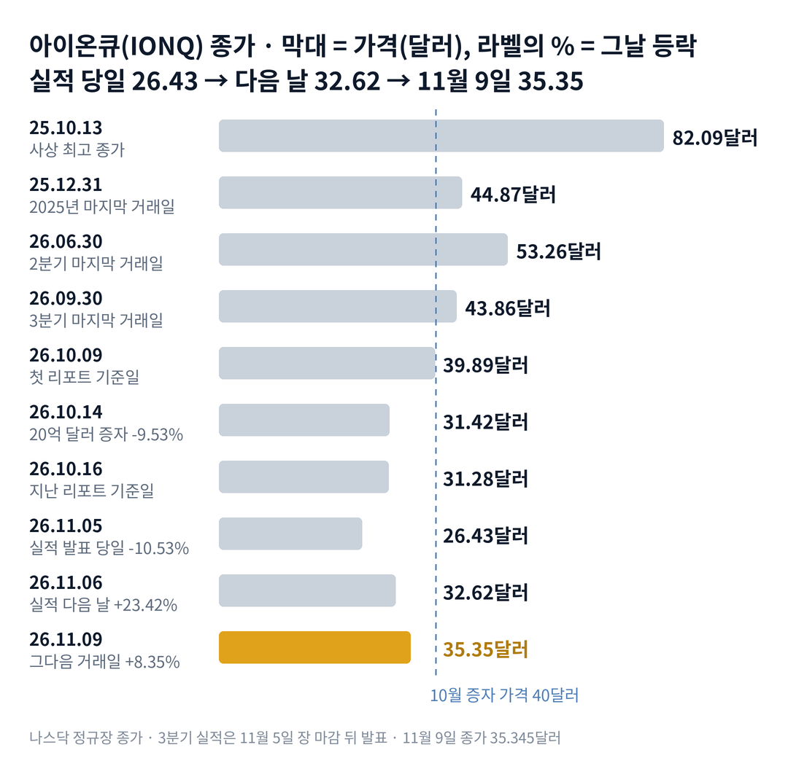

## 짧은 답

사상 최대 매출을 발표한 다음 날, 아이온큐 주가는 23.4% 올랐습니다. 그런데 같은 날 실적을 내지 않은 리게티와 디웨이브도 18~19% 올랐습니다. 이 급등은 아이온큐의 것이었을까요, 양자 업종 전체의 것이었을까요?

결론부터 말하면, 두 거래일 상승의 대부분은 업종 전체가 함께 만든 것이고 아이온큐만의 차이는 크지 않습니다. 시장은 아이온큐의 전망 상향을 양자 업종 전체의 신호로 읽었습니다. **2026.11.09 진단: 공급 단계에서 과열 단계 신호가 켜지는 경계 — 근거는 5부.**

회사의 현금과 투자 자산은 약 37억 달러입니다. 그렇다고 이 현금이 주가의 바닥을 보장하지는 않습니다. 주식은 두 해도 안 돼 두 배를 넘었고, 새 주식이 나올 길은 여전히 열려 있기 때문입니다. 그렇다면 과거에 실적 첫날 이렇게 급등했을 때, 그 가격은 한 달 뒤에도 남았을까요? 답은 3부 기록표('실적 첫날 15% 넘게 오른 6번, 20거래일 뒤는?')에 있습니다.

> **유의사항** 저자는 금융·투자 자문가가 아닙니다. 이 글은 공개 공시와 시세를 정리한 교육용 분석이며 특정 종목의 매수·매도를 권하지 않습니다. 과거의 주가 반응이 미래에 반복된다는 보장은 없고, 아이온큐는 실적 다음 날 하루에 두 자릿수로 움직인 적이 여러 번 있는 종목입니다. 실제 투자 전에는 최신 가격과 공시를 직접 확인하세요.

## 지난 리포트 이후

[10월 18일 리포트](/r/ionq-2026-10-2/)(10월 16일 기준)는 아이온큐를 '공급 단계', 즉 새 주식 공급이 주가를 누르는 단계로 진단했습니다. 그 뒤 주가는 실적 발표 당일까지 더 내려 1년 중 최저를 찍었다가, 11월 9일에는 지난 기준일 종가 31.28달러보다 13.0% 높아졌습니다. 지난 예측 성적: 적중 1 · 부분 적중 2 · 빗나감 2입니다. 진단은 맞았고, 주식을 쓰는 인수가 이어진다는 시나리오는 빗나갔습니다. 항목별 채점표는 6부 끝에 있습니다. 이번 리포트가 새로 답할 질문은 '실적 뒤 급등은 한 달 뒤에도 남는가'입니다.

## 1부. 아이온큐는 어떤 회사이고, 이번 실적에서 무엇이 바뀌었나

> **핵심:** 아이온큐는 양자컴퓨터 회사지만, 이번 분기 매출의 절반 가까이는 7월에 인수한 반도체 공장에서 나왔습니다.

아이온큐는 이온(전기를 띤 원자)을 전기장에 가둬 계산 단위로 쓰는 방식의 양자컴퓨터를 만드는 미국 회사입니다. 메릴랜드주 칼리지파크에 본사가 있고, 뉴욕증권거래소에 상장돼 있습니다. 최근 두 해 동안 양자 보안, 양자 센서, 위성 통신 회사를 잇달아 인수해 사업을 넓혔습니다. 2026년 7월 31일에는 미국 반도체 위탁 생산 회사 스카이워터 인수를 마무리했습니다.

돈을 버는 방식은 지금 두 갈래입니다. 하나는 양자컴퓨터·보안·센서를 파는 플랫폼 부문이고, 다른 하나는 스카이워터의 위탁 생산(파운드리) 부문입니다. 스카이워터는 아이온큐만이 아니라 다른 양자 회사들의 칩도 만들어 줍니다. 3분기 매출에는 스카이워터가 약 두 달 치 반영됐습니다.

이번 실적은 11월 5일 장 마감 뒤에 나왔습니다. 매출은 아래 표처럼 1년 전의 네 배를 넘었고, 보도된 시장 예상보다 19~23% 많았습니다. 회사는 올해 매출 전망도 올렸고, 양자컴퓨팅 매출의 성장률 전망을 110% 이상으로 높였습니다. 원래 성장률 목표는 100%였습니다.

다만 매출이 늘어난 만큼 손실도 커졌습니다. 영업손실은 1년 전의 두 배를 훌쩍 넘었습니다. 인수한 회사들의 원가와 무형자산 상각비가 함께 들어왔기 때문입니다. 아래 표는 사업과 실적 숫자만 모았고, 현금과 주식 수는 5부 표에서 따로 봅니다.

### 숫자로 본 지금의 크기(11월 9일 기준)

| 항목 | 값 · 근거 |
| --- | --- |
| 종가 | **35.35달러** 11월 9일, 2025년 마지막 거래일 44.87달러보다 21.2% 낮음 |
| 3분기 매출 | **1억 7,383만 달러** 1년 전 3,987만 달러보다 336% 증가 |
| 플랫폼 부문 매출 | **9,030만 달러** 양자컴퓨터·보안·센서, 1년 전보다 127% 증가 |
| 파운드리 부문 매출 | **8,350만 달러** 스카이워터, 전체 매출의 약 48% |
| 올해 매출 전망 | **5억 500만~5억 1,500만 달러** 종전 4억 5,000만~4억 6,000만 달러 |
| 수주 잔고 | **11억 6,800만 달러** 잔여수행의무(RPO), 약 50%가 12개월 안 매출 |
| 영업손실 | **4억 3,308만 달러** 조정 EBITDA 손실은 1억 3,360만 달러 |

※ 수주 잔고는 10-Q의 잔여수행의무 값이며, 보도자료는 '12억 달러'로 반올림했습니다. 시장 예상은 보도 집계 1억 4,120만~1억 4,600만 달러입니다.

이 표에서 가장 중요한 칸은 매출 구성입니다. '1년 전의 네 배'라는 숫자 가운데 상당 부분은 사서 붙인 매출이라는 뜻입니다. 그래도 플랫폼 부문만 봐도 1년 사이 두 배를 넘었습니다. 그렇다면 이런 숫자가 나온 앞뒤 세 거래일, 주가는 무엇에 반응했을까요?

## 2부. 실적 앞뒤 세 거래일에 겹친 세 가지

> **핵심:** 그날의 배경은 기술주 급락이었고, 다음 두 거래일의 급등은 업종 전체가 함께 만들었으며, 실적표의 흑자는 주가 하락이 만든 회계 이익이었습니다.

첫 번째는 그날의 배경, 기술주 급락입니다. 실적 발표 당일인 11월 5일, QQQ(나스닥 100 지수를 따르는 상장지수펀드, ETF)가 6.5% 빠졌습니다. 아이온큐도 10.53% 내린 26.43달러로 마쳤고, 장중에는 24.915달러까지 밀려 1년 중 최저를 찍었습니다. 이날 하락은 회사 숫자가 나오기 전의 일이라, 실적과는 따로 봐야 합니다. 아이온큐는 그 전 10월 한 달 동안 31.5% 내렸다고 집계됐습니다(S&P 글로벌 마켓 인텔리전스 집계, 보도).

### 실적 앞뒤, 양자 관련주 성적

| 종목 · 성격 | 11.05 하루 | 11.06~11.09 |
| --- | --- | --- |
| **아이온큐(IONQ)** 이온 방식, 실적 발표 | **-10.53%** | **+33.7%** |
| 리게티(RGTI) 초전도 방식, 11월 10일 실적 | -12.1% | +31.8% |
| 디웨이브(QBTS) 양자 어닐링, 11월 10일 실적 | -12.8% | +26.7% |
| 나스닥 100 ETF(QQQ) | -6.5% | +5.0% |

※ 오른쪽 칸은 11월 5일 종가에서 11월 9일 종가까지 두 거래일 합계입니다. 11월 6일 하루는 아이온큐 +23.42%, 리게티 +19.3%, 디웨이브 +18.0%였습니다.

두 번째는 업종이 함께 만든 급등입니다. 11월 6일 아이온큐 거래량은 4,292만 주로, 직전 20거래일 평균(2,325만 주)의 약 1.8배였습니다. 그런데 디웨이브는 그날 자기 소식 없이 18% 올랐고, 보도는 그 불씨를 아이온큐의 전망 상향으로 꼽았습니다. 두 거래일을 합치면 아이온큐가 리게티보다 더 오른 폭은 약 1.9%포인트뿐입니다. 전망이 오르면 → 양자 시장 전체의 수요가 커 보이고 → 같은 업종 주식 모두에 더 높은 값이 매겨집니다.

세 번째는 실적표 안의 회계 이익입니다. 3분기 순이익은 5억 6,396만 달러 흑자였지만, 그 대부분은 신주인수권 평가 이익 8억 9,616만 달러에서 나왔습니다. 신주인수권(정해진 가격에 새 주식을 살 수 있는 권리)은 회사 장부에 부채로 잡힙니다. 3분기에 주가가 53.26달러에서 43.86달러로 17.6% 내리자 그 부채의 값이 줄었고, 줄어든 만큼이 이익이 됐습니다. 거꾸로 주가가 다시 오르면 같은 항목이 손실로 돌아설 수 있습니다.

이 밖에도 실적 자료에는 엔비디아의 가속 양자 연구 센터에 아이온큐 양자컴퓨터 'Superion 256'이 처음으로 설치된다는 소식이 함께 실렸습니다. 실적 통화에서는 2027년 Superion 256 생산 물량이 모두 주문됐다는 설명이 나왔다고 보도됐습니다. 세 사건을 나란히 놓으면 공통점이 하나 보입니다. 모두 양자컴퓨터 사업의 새 계약에서 비롯된 것은 아니라는 점입니다. 결국 이번 급등은 회사 숫자가 불을 붙이고, 업종 전체가 그 불을 키운 모습입니다. 그렇다면 과거 실적 첫날 급등은 한 달 뒤 어떻게 됐을까요?

## 3부. 실적 첫날 15% 넘게 오른 여섯 번

> **핵심:** 실적 첫날 15% 넘게 오른 여섯 번 가운데 네 번은 20거래일 뒤 실적 전 종가 아래였고, 버틴 두 번에는 같은 공통점이 있었습니다.

이 기록을 보는 이유는 이번이 '실적 첫날의 두 자릿수 급등'이기 때문입니다. 같은 유형의 급등만 비교하려고 첫날 15% 넘게 오른 경우만 골랐습니다. 2021년 11월부터 이번까지 아이온큐의 분기 실적 발표는 21번이었습니다. 2023년 3월 6일 예비 수주 발표와 2026년 1월 26일 스카이워터 인수 발표는 실적 보고가 아니어서 뺐습니다.

표는 세 질문에 답합니다. 첫 칸은 그때 무엇이 나왔나, 둘째 칸은 첫날과 둘째 날 어떻게 움직였고 같은 날 동료 회사는 어땠나, 셋째 칸은 한 달 뒤까지 남았나입니다. 실적은 모두 장 마감 뒤 나와서 다음 거래일을 첫날로 셉니다. 20거래일 뒤는 실적 전 종가와 비교했습니다.

예를 들어 이번에는 11월 5일 실적 전 종가 26.43달러가 다음 날 32.62달러가 됐습니다. 20번째 거래일은 12월 4일입니다.

**한눈에:** 여섯 번 중 네 번은 20거래일 뒤 실적 전 종가 아래 · 가운데 값(중앙값) -5.0%. 오른 만큼을 돌려주고 더 내려간 경우가 더 많았다는 뜻입니다.

### 실적 첫날 15% 넘게 오른 6번, 20거래일 뒤는?

| 첫날 · 그날 나온 내용 | 첫날 · 동료 · 둘째 날 | 20거래일 뒤 |
| --- | --- | --- |
| **2021.11.16** 2021년 3분기 실적 수주 전망 상향 | **+33.1%** 리게티·디웨이브 상장 전 둘째 날 +17.5% | -18.8% |
| **2022.05.17** 2022년 1분기 실적 매출 200만 달러 | **+17.5%** 리게티 +2.9% 둘째 날 -4.6% | -5.1% |
| **2022.08.16** 2022년 2분기 실적 클라우드 성능 개선 | **+31.8%** 리게티 +8.5% · 디웨이브 -2.2% 둘째 날 -6.2% | -12.1% |
| **2023.03.31** 2022년 4분기 실적 연간 매출 1,110만 달러 | **+21.1%** 리게티 +20.6% · 디웨이브 +27.8% 둘째 날 0.0% | +8.5% |
| **2024.11.07** 2024년 3분기 실적 매출 1,240만 달러 연간 전망 상향 | **+34.4%** 리게티 +19.2% · 디웨이브 +29.2% 둘째 날 +12.1% | +118.5% |
| **2026.02.26** 2025년 4분기 실적 연간 매출 1억 3,000만 달러 | **+21.7%** 리게티 +5.7% · 디웨이브 +2.5% 둘째 날 -6.1% | -4.9% |

※ 동료는 같은 첫날 리게티(RGTI)·디웨이브(QBTS)의 하루 등락입니다. 리게티는 2022년 3월, 디웨이브는 2022년 8월 상장했습니다.

여섯 번은 분기마다 따로 일어나 20거래일 측정 기간이 서로 겹치지 않습니다. 다만 그때와 지금은 주가 수준, 주식 수, 사업 구성이 크게 다릅니다. 여섯 번은 확률을 말하기에 작은 표본이므로, 이 표는 과거 움직임의 참고 자료입니다.

> **이번 사례:** 2026.11.06 · 매출 예상 19~23% 상회, 연간 전망 상향, 순이익은 신주인수권 평가 이익 · 첫날 +23.42%(리게티 +19.3%, 디웨이브 +18.0%) · 둘째 날 +8.35% — 20거래일 결과 미확정(12월 4일 종가로 판정, 기준선은 실적 전 종가 26.43달러)

표에서 버틴 두 번, 2023년 3월과 2024년 11월에는 공통점이 두 가지 있습니다. 첫째, 같은 날 리게티와 디웨이브도 19~29% 함께 올랐습니다. 업종 전체가 움직인 날이었다는 뜻입니다. 둘째, 둘째 날 주가가 밀리지 않았습니다(0.0%, +12.1%). 돌려준 네 번은 동료 회사가 상장 전이었거나 9% 넘게 오르지 않았고, 그중 세 번은 둘째 날 내렸습니다.

이번은 두 조건을 모두 갖췄습니다. 같은 날 동료 회사가 18~19% 올랐고, 둘째 날도 8.35% 더 올랐습니다. 다만 버틴 사례는 두 번뿐이라, 이 공통점이 다음 한 달을 정한다고 말할 수는 없습니다. 그렇다면 그때와 지금은 무엇이 같고 무엇이 다를까요?

## 4부. 버틴 두 번과 지금, 무엇이 같고 다른가

> **핵심:** 업종이 함께 오른 점은 버틴 두 번과 같지만, 주식 수가 빠르게 늘고 있다는 점은 그때와 다릅니다.

**과거 vs 이번(같은 항목 비교)**

| 항목 | 버틴 2번(2023.03 · 2024.11) | 이번(2026.11) |
| --- | --- | --- |
| 동료 회사 같은 날 | +19.2~+29.2% | +18.0~+19.3% |
| 둘째 날 | 0.0% · +12.1% | +8.35% |
| 전망 | 확인 못 함 · 연간 전망 상향 | 연간 전망 상향 |
| 한 달 안 새 주식 공급 | 확인 못 함 | 임원 매도 제한 11월 13일 끝 |
| 매출 구성 | 자체 사업 | 약 48%가 인수한 공장 |

공통점은 분명합니다. 이번에도 업종 전체가 같은 날 크게 움직였고, 둘째 날 가격이 밀리지 않았습니다. 2024년 11월에는 실적 뒤 양자 테마 전체가 한 달 넘게 달아올랐고, 그 결과가 20거래일 뒤 +118.5%였습니다.

차이는 주식의 양입니다. 2024년 말 약 2억 2,192만 주였던 발행 주식은 10월 28일 4억 3,246만 주가 됐습니다. 11월 3일에는 엘리시티 인수 대가로 3,223만 주가 더 나가 약 4억 6,470만 주가 됐습니다. 두 해도 안 돼 두 배를 넘은 셈이고, 이번 상승은 그만큼 더 많은 주식을 떠받쳐야 합니다.

엘리시티 주식은 지난 리포트가 짚은 하한 가격 33.07달러가 걸리지 않은 결과입니다. 마감 대가 11억 5,000만 달러를 실제 주식 수로 나누면 주당 약 35.68달러입니다. 성과에 따라 2028년 1월까지 최대 426만 주가 더 나갈 수 있습니다. 이 주식을 받은 쪽에는 되팔 수 있게 등록해 주는 권리도 붙었습니다.

과거 기록이 알려 주는 것은 업종이 함께 오른 급등이 더 잘 버텼다는 점입니다. 결국 앞으로 확인할 것은 두 가지입니다. 하나는 새 주식이 다시 나오는가이고, 다른 하나는 회사가 올린 올해 전망을 지키는가입니다. 이 두 가지로 다음 몇 달을 나누면 어떤 갈림길이 나올까요?

## 5부. 공급과 전망, 네 갈래 시나리오

> **핵심:** 4부에서 본 차이, 즉 새 주식이 다시 나오는지와 회사가 올린 전망을 지키는지가 시나리오를 가르는 두 축입니다.

> **국면 정의(아이온큐 시리즈 공통):** 과열 단계 — 큰 이름의 양자 소식에 관련주가 함께 하루 10% 넘게 오르고, 증자를 발표해도 주가가 오를 때. 공급 단계 — 증자·주식 인수·신주인수권으로 주식이 늘고, 발표 날 주가가 5% 넘게 내릴 때. 재평가 단계 — 실적이 기대를 넘어도 반응이 약하고, 주가가 마지막 대규모 증자 가격의 절반 아래에 있을 때.

**2026년 11월 9일 진단: 공급 단계에서 과열 단계 신호가 켜지는 경계.** 관련주가 함께 하루 10% 넘게 오르고 거래량이 늘어난 것은 과열 단계의 신호입니다. 하지만 주식 수는 엘리시티 마감으로 다시 늘었고, 새 주식을 낼 길도 남아 있습니다.

**돈과 주식으로 본 지금(11월 9일 기준)**

| 항목 | 값 · 근거 |
| --- | --- |
| 시가총액 | **약 164억 달러** 35.35달러 × 약 4억 6,470만 주(엘리시티 반영) |
| 매출 배수 | **약 32배** 시가총액 ÷ 올해 매출 전망 가운데 값 5억 1,000만 달러 |
| 현금과 투자 자산 | **약 37억 달러(잠정)** 9월 말 17억 달러 + 10월 증자 순수취 약 19억 9,000만 달러 |
| 남은 신주인수권 | **1억 장** 행사 가격 69.46달러, 10월 증자 때 발행 |
| 매도·발행 제한 | **11월 13일 · 12월 13일 무렵** 임원·이사 30일, 회사 새 주식 60일(인수는 예외) |

※ 현금은 9월 말 값에 10월 증자를 더한 회사 기준 잠정 계산으로, 10월 이후 쓴 현금은 반영하지 않았습니다.

엘리시티 인수로 나간 3,223만 주를 세 분모로 보면 이렇습니다. 10월 28일 발행 주식 4억 3,246만 주의 약 7.5%입니다. 유통주식(거래되는 주식)은 회사가 따로 밝히지 않아 발행 주식을 대신 썼으므로, 실제 유통주식 대비 비율은 이보다 클 수 있습니다. 실적 전 20거래일 평균 거래량(약 2,325만 주)으로는 약 1.4거래일치입니다.

그렇다고 37억 달러가 지금 가격의 바닥을 보장하지는 않습니다. 회사는 3분기에 영업에서만 4억 달러 넘게 손실을 냈고, 인수에는 현금과 주식을 모두 써 왔습니다. 하이츠 캐피털이 10월 증자에서 낸 40달러보다 지금 주가는 11.6% 낮습니다.

### 앞으로 일어날 수 있는 일

시나리오를 나누기 전에 두 가지를 묻습니다. 회사는 4분기에 새 주식을 다시 내놓을까요? 그리고 올린 전망 5억 500만 달러를 지킬까요? 3부 기록에서 실적 첫날 급등 여섯 번 중 네 번은 한 달 뒤 실적 전 가격 아래였고, 아이온큐는 그동안 여러 인수의 대가를 주식으로 치렀습니다.

**판정 기준 두 가지:** 첫째, 공급입니다. 2027년 2월 말 4분기 실적 발표까지 새 증자, 주식을 쓰는 새 인수, 시장 판매 계약 가운데 하나가 나오면 '재개'로 봅니다. 둘째, 전망 달성입니다. 올해 매출이 5억 500만 달러 이상이면 '달성'으로 봅니다.

**확인된 사실:** 전망 하단을 지키려면 4분기에 약 1억 8,650만 달러가 필요합니다. 3분기 매출보다 약 7% 많은 수준입니다.

**과거 기록:** 실적 첫날 급등 6번 중 4번은 20거래일 뒤 실적 전 종가 아래였습니다(3부). 2025년 이후 엘리시티를 포함해 인수 대가로 주식을 낸 일도 여러 번 있었습니다.

**추정:** 아래 가능성은 분석자의 주관적 추정이며, 주가가 오를 확률이 아니라 자금 조달과 실적 조합의 가능성입니다. 네 경우는 겹치지 않아 '약 N%'를 더하면 100%이고, 괄호 구간은 서로 더하지 않습니다.

| 시나리오(판정 4분기 실적 발표) | 공급 · 달성 | 가능성(추정) |
| --- | --- | --- |
| 1 · 가장 좋은 경우: 공급 멈춤, 전망 달성 | 없음 · ○ | 중간 약 30% (20~30%) |
| **2 · 공급 재개, 전망 달성** | 있음 · ○ | 높음 약 40% (35~45%) |
| 3 · 공급 멈춤, 전망 미달 | 없음 · × | 낮음 약 10% (10~20%) |
| 4 · 가장 나쁜 경우: 공급 재개, 전망 미달 | 있음 · × | 낮음 약 20% (10~20%) |

※ '공급'은 2027년 2월 말 4분기 실적 발표까지 새 증자, 주식을 쓰는 새 인수, 시장 판매 계약 가운데 하나가 발표되는 경우입니다. '달성'은 올해 매출 5억 500만 달러 이상입니다.

**한눈에:** 전망 달성은 1과 2를 더한 약 70%, 공급 재개는 2와 4를 더한 약 60%입니다. 분석자의 주관적 추정을 더한 값이며, 실제 확률이나 통계 예측값은 아닙니다.

시나리오 2를 가장 높게 본 이유는 두 가지입니다. 4분기에 필요한 매출은 스카이워터가 석 달을 온전히 채우는 분기라 무리한 수준이 아닙니다. 반면 회사는 '전략적 인수'를 10월 증자의 쓰임새로 적었고, 회사의 새 주식 발행 제한도 인수는 예외입니다. 하지만 같은 무게로 반대쪽 요인도 있습니다. 현금이 넉넉해 당장 증자할 이유는 약하고, 12월 중순까지는 회사 스스로 새 주식 판매를 묶어 두었습니다. 그렇다면 이 판단을 가장 빨리 뒤집을 수 있는 위험은 무엇일까요?

## 6부. 위험과 체크리스트

> **핵심:** 이 판단을 가장 빨리 뒤집을 수 있는 것은 새 주식의 재등장과, 동료 회사 실적이 업종의 열기를 식히는 경우입니다.

먼저 이 분석의 한계입니다. 3부 표는 여섯 번뿐인 작은 표본이고, 버틴 사례는 두 번입니다. 시장 예상치는 보도 집계라 회사가 확인한 숫자가 아닙니다. 11월 6일 상승 가운데 회사 숫자와 업종 반등의 영향을 정확히 나누는 방법은 없습니다.

첫째 갈래는 사업 실행입니다. 올린 전망을 지키려면 4분기에 3분기보다 많은 매출이 필요하고, 스카이워터와 엘리시티를 함께 소화해야 합니다. 주가가 오르면 신주인수권 평가 손실이 생겨, 4분기 순이익은 큰 적자로 돌아설 수 있습니다.

둘째 갈래는 자금 조달입니다. 임원·이사의 매도 제한이 끝나면 내부자 매도 신고(Form 4)가 나올 수 있습니다. 엘리시티 주식도 되팔 수 있게 등록될 수 있고, 12월 중순 회사의 발행 제한이 끝나면 새 증자의 문도 다시 열립니다.

셋째 갈래는 외부 환경입니다. 이번 급등은 업종이 함께 만든 만큼, 11월 10일 디웨이브와 리게티의 실적이 실망스러우면 함께 식을 수 있습니다. 증권사 캔터는 11월 6일 목표가를 70달러에서 60달러로 낮췄습니다.

**핵심 확인 세 가지:**

- ☐ 12월 4일 종가가 실적 전 종가 26.43달러보다 높은가(3부 20거래일째)
- ☐ 12월 31일까지 새 증자·주식 인수·시장 판매 계약 발표가 없는가(5부 공급 축)
- ☐ 2027년 2월 4분기 실적에서 연간 매출이 5억 500만 달러 이상인가(5부 달성 축)

**보조 확인:**

- ☐ 11월 10일 디웨이브·리게티 실적 뒤 두 회사 종가가 11월 9일 종가를 지키는가
- ☐ 11월 13일 뒤 임원·이사의 내부자 매도 신고가 나오는가

**지난 리포트 점검(따로 판정):**

- ☐ 12월 31일까지 종가가 하이츠 캐피털 가격 40달러보다 높은 날이 있는가(지난 리포트 핵심 질문)

**기억할 판단 기준 세 가지:** 첫째, 이번 급등은 업종 전체가 함께 만든 것이라 아이온큐만의 상승분을 크게 보기 어렵습니다. 둘째, 실적표의 흑자는 주가 하락이 만든 회계 이익입니다. 셋째, 과거 실적 첫날 급등은 한 달 뒤 반납한 경우가 더 많았고, 버틴 두 번은 업종이 함께 오르고 둘째 날 밀리지 않은 때였습니다.

다음 갱신은 12월 4일 20거래일째 반응을 본 뒤에 합니다. 공시는 [아이온큐 SEC 공시 목록](https://www.sec.gov/cgi-bin/browse-edgar?action=getcompany&CIK=0001824920&type=&dateb=&owner=include&count=40)과 [아이온큐 뉴스룸](https://ionq.com/news)에서 확인할 수 있습니다.

### 지난 예측 채점표

10월 18일 리포트(10월 16일 기준)의 진단과 시나리오를 11월 9일 기준으로 채점한 결과입니다. 지난 리포트에는 시나리오별 가능성 숫자가 없었습니다.

| 지난 점검 항목 · 당시 기준 | 판정 및 실제 결과(11월 9일) |
| --- | --- |
| **진단: 공급 단계** 증자·주식 인수, 발표 날 5% 넘는 하락 | **[적중]** 실적 전까지 15.5% 더 내림, 엘리시티 3,223만 주 발행 |
| **시나리오 1: 자체 성장 확인과 인수 중단** 자체 성장률 100% 초과, 새 주식 인수 멈춤 | **[부분 적중]** 자체 성장률 별도 공개 없음, 양자컴퓨팅 전망 110% 이상, 다음 날 +23.42% |
| **시나리오 2: 주식 인수가 이어짐** 엘리시티 뒤 새 주식 인수 발표 | **[빗나감]** 11월 9일까지 새 인수 발표 없음 |
| **시나리오 3: 테마 재점화** 엔비디아·정부 같은 큰 외부 뉴스 | **[부분 적중(다른 계기)]** 업종 동반 급등, 계기는 아이온큐 자체 실적 |
| **시나리오 4: 매출의 질 의심 확대** 공매도 보고서·감사 문제 제기 | **[빗나감]** 새 보고서 없음 |

지난 리포트가 지켜보자고 한 엘리시티 하한 가격 33.07달러는 걸리지 않았습니다. 실제 발행은 3,223만 주로, 하한 때의 3,477만 주보다 적었습니다.
