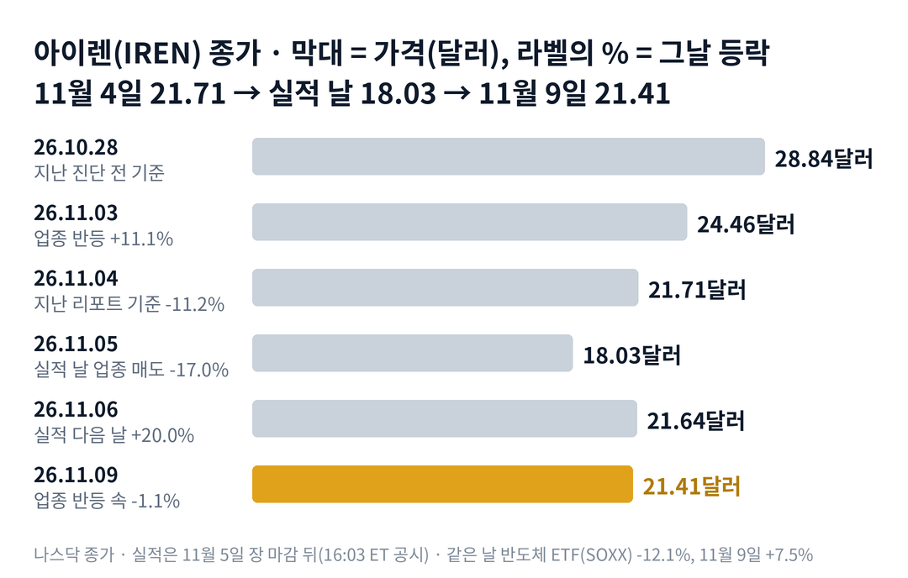

## 짧은 답

> **핵심:** 아이렌은 실적 다음 날 20.0% 올랐지만, 실적 날 종가부터 2거래일을 합치면 같은 업종과 비슷했습니다. 첫날 반등이 한 달 뒤까지 이어진 적은 과거 9번 가운데 4번입니다.

실적 다음 날 20% 오른 주식이, 바로 다음 거래일 업종이 모두 오를 때 혼자 내렸습니다. 이 20%는 실적이 만든 것이었을까요?

아이렌은 11월 5일 장 마감 뒤 1분기 실적을 냈습니다. 그날 정규장에서는 업종 매도에 17.0% 빠져, 지난 1년 가운데 가장 낮은 종가로 마감했습니다. 다음 날인 11월 6일에는 20.0% 올랐습니다. 2024년 8월 이후 실적 10번 가운데 다음 날 상승폭으로 두 번째입니다.

그런데 11월 9일에는 네비우스가 9.2%, 반도체 상장지수펀드(ETF, 여러 종목을 묶어 거래하는 펀드)가 7.5% 오를 때 아이렌은 1.1% 내렸습니다. 실적 날 종가부터 두 거래일을 합치면 아이렌은 18.7%, 네비우스는 17.5% 올랐습니다. 아이렌은 업종이 2거래일에 걸쳐 오른 만큼을 하루에 먼저 받은 셈입니다.

이 글은 실적 숫자, 같은 업종의 세 거래일, 과거 실적 10번의 기록을 차례로 봅니다. 그리고 12월 4일에 무엇으로 판정할지 정리합니다.

> **유의사항** 저자는 금융·투자 자문가가 아닙니다. 이 글은 공개 공시와 시세를 정리한 교육용 분석이며 특정 매매를 권하지 않습니다. 과거의 주가 반응이 미래에 반복된다는 보장은 없고, 아이렌은 하루 10% 넘게 움직이는 날이 잦은 종목입니다. 실제 투자 전에는 최신 가격과 공시를 직접 확인하세요.

## 지난 리포트 이후

[지난 리포트](/r/iren-2026-11/)는 11월 4일 종가 21.71달러를 기준으로, 실적 전에 썼습니다. 지난 예측 성적은 적중 2 · 빗나감 1 · 진행 중 1입니다. 첫날 상승 쪽(약 55%)은 맞았고, 실적 실망 하락 쪽은 빗나갔습니다. 항목별 채점표는 6부 끝에 있습니다.

지난 리포트가 가장 먼저 보자고 한 문장은 인도 일정이었습니다. 연환산 40억 달러 매출 목표는 연말에서 2027년 1월로 밀렸고, 2월 말까지 늘어질 수 있다고 회사가 적었습니다. 그런데도 첫날 값은 크게 올랐습니다.

## 1부. 아이렌은 어떤 회사이고, 이번 실적에서 무엇이 바뀌었나

> **핵심:** 아이렌은 그래픽 처리 장치 연산을 빌려주는 인공지능 클라우드로 옮겨 가는 회사입니다. 이번 분기 그 매출이 세 배 가까이 늘었지만, 큰 목표의 날짜는 한두 달 밀렸습니다.

아이렌은 오스트레일리아 시드니에 본사를 둔 데이터센터 회사입니다. 처음에는 비트코인 채굴로 돈을 벌었습니다. 지금은 같은 전력과 건물에 인공지능 연산 장비를 들여, 그 연산을 빌려주는 사업으로 옮겨 가고 있습니다.

돈을 버는 방식은 임대에 가깝습니다. 아이렌이 서버를 사서 데이터센터에 설치하면, 고객이 그 연산을 몇 년 단위로 빌려 쓰고 사용료를 냅니다. 마이크로소프트와는 5년 97억 달러, 엔비디아와는 5년 34억 달러 계약을 맺었습니다. 다만 용량을 지어 넘겨야(인도) 사용료가 매출로 들어옵니다.

이번 분기에 그 전환이 숫자로 보였습니다. 인공지능 클라우드 매출은 7,100만 달러에서 2억 달러로 182% 늘었습니다. 비트코인 채굴 매출은 6,700만 달러에서 2,800만 달러로 줄었습니다. 마이크로소프트용 첫 단계 데이터센터도 인도됐습니다.

매출이 채굴에서 임대로 넘어가는 속도가 빨라졌다는 흔적입니다. 대신 회사가 연말까지 돌리겠다던 연환산 40억 달러 매출 설비는 2027년 1월 목표로 바뀌었습니다. 고객의 설계 변경 요청과 부품 공급 시점 때문이라는 설명입니다.

### 숫자로 본 지금의 크기(11월 9일 기준)

| 항목 | 값 · 근거 |
| --- | --- |
| 종가 | **21.41달러** 11월 9일, 10월 28일 28.84달러보다 25.8% 낮음 |
| 시가총액 | **약 90억 9,000만 달러** 21.41달러 × 4억 2,436만 주(10월 30일) |
| 1분기 매출 | **2억 2,800만 달러** 직전 분기 1억 3,700만 달러보다 66% 증가 |
| 인공지능 클라우드 매출 | **2억 달러** 직전 분기 7,100만 달러, 부문 총이익률 86% |
| 순손실 | **2억 6,300만 달러** 직전 분기 6억 8,400만 달러 |
| 수주 잔고 | **203억 달러** 석 달 전보다 22% 증가, 약 3분의 2가 투자 등급 고객 |
| 연환산 매출 목표 | **40억 달러 이상** 연말 → 2027년 1월(2월 말까지 가능) |

시가총액은 연환산 매출 목표의 약 2.3배입니다. 다만 그 40억 달러는 설비가 돌아가야 들어오는 돈이고, 날짜가 이번에 한 번 밀렸습니다. 그렇다면 일정이 밀렸는데도 값이 20% 오른 날, 같은 업종은 어떻게 움직였을까요?

## 2부. 실적 앞뒤 세 거래일, 아이렌과 같은 업종

> **핵심:** 실적 날 하락도, 다음 날 반등도 업종 전체에서 함께 일어났습니다. 아이렌은 업종 반등을 하루 먼저 받았고, 2거래일을 합치면 업종과 비슷했습니다.

세 거래일은 하나의 흐름으로 묶입니다. 실적 날 업종 전체가 크게 빠졌고, 다음 2거래일 동안 함께 되돌렸습니다. 차이는 아이렌이 그 되돌림을 첫날에 몰아 받았다는 점입니다.

실적 날인 11월 5일, 발표 전 정규장에서 아이렌은 17.0% 내렸습니다. 같은 날 반도체 ETF(SOXX)는 12.1%, 네비우스는 14.9% 내렸습니다. 회사 공시는 장 마감 뒤인 16시 3분(동부 시간)에 나왔습니다. 그러니 이날 하락은 실적이 아니라 업종 매도였습니다.

비교 기준은 실적 날 종가입니다. 예를 들어 아이렌의 두 거래일 합계 18.7%는 11월 9일 종가 21.41달러를 11월 5일 종가 18.03달러와 비교한 값입니다.

### 실적 앞뒤, 아이렌과 같은 업종

| 종목 · 성격 | 11.05 하루 | 11.06 · 11.09 |
| --- | --- | --- |
| **아이렌(IREN)** 채굴 출신, 실적 발표 | **-17.0%** | **+20.0% · -1.1%** |
| 네비우스(NBIS) 인공지능 클라우드 | -14.9% | +7.6% · +9.2% |
| 코어위브(CRWV) 인공지능 클라우드 | -9.8% | +6.3% · +5.6% |
| 사이퍼 마이닝(CIFR) 채굴 출신, 실적 없음 | -14.6% | +17.9% · +4.0% |
| 테라울프(WULF) 채굴 출신, 실적 없음 | -13.8% | +12.8% · +8.9% |
| 반도체 ETF(SOXX) | -12.1% | +3.5% · +7.5% |

첫날만 보면 아이렌은 네비우스보다 12.4%p 더 올랐습니다. 그런데 2거래일을 합치면 그림이 달라집니다. 실적 날 종가부터 11월 9일까지 아이렌 +18.7%, 네비우스 +17.5%, 어플라이드 디지털 +18.0%였습니다. 사이퍼 마이닝은 +22.7%, 테라울프는 +22.8%로 오히려 아이렌보다 컸습니다. 같은 기간 비트코인은 약 1% 내렸습니다.

이 말은 곧, 실적이 업종보다 더 얹어 준 상승분은 2거래일 합계로는 거의 보이지 않는다는 뜻입니다. 첫날의 20%는 실적 뉴스와 업종 반등이 같은 날 겹친 결과로 읽힙니다. 그렇다면 과거에도 크게 빠진 채로 맞은 실적의 첫날 반등은 한 달 뒤까지 이어졌을까요?

## 3부. 과거 실적 10번, 첫날 반등은 한 달 뒤까지 갔나

> **핵심:** 떨어진 채로 맞은 실적은 이번까지 5번이고, 그중 4번은 다음 날 올랐습니다. 하지만 이번을 뺀 9번 가운데 20거래일 뒤 종가가 다음 날 종가보다 높았던 것은 4번뿐입니다.

이 기록을 보는 이유는 지금이 '첫날 크게 오른 직후'이기 때문입니다. 과거에 첫날 반등이 한 달 뒤까지 남았는지 보면, 지금 가격을 읽을 출발점이 생깁니다.

고른 기준은 지난 리포트와 같습니다. 아이렌이 미국 공시로 분기 실적을 낸 날 가운데, 시세를 이어서 확인할 수 있는 2024년 8월 이후 10번입니다. 10번 모두 장 마감 뒤에 나왔습니다. 그래서 발표 날 종가를 기준점으로 삼았습니다.

예를 들어 이번 '발표 전 5거래일'은 11월 5일 종가 18.03달러를 10월 29일 종가 26.25달러와 비교한 -31.3%입니다. '다음 날'은 다음 거래일 종가, '20거래일 뒤'는 20번째 거래일 종가를 발표 날 종가와 비교한 값입니다.

**한눈에:** 이번을 뺀 9번 · 다음 날 상승 6번 · 20거래일 뒤 상승 5번 · 다음 날 가운데 값(중앙값) +5.1%

### 아이렌 실적 10번, 발표 전 흐름과 그 뒤

| 발표일 · 발표 전 5거래일 | 다음 날 | 20거래일 뒤 |
| --- | --- | --- |
| **2024.08.28** 결산 발표 전 -14.5% | +14.8% | +23.0% |
| **2024.11.26** 1분기 발표 전 -8.2% | +29.7% | +18.6% |
| 2025.02.12 2분기 발표 전 +17.5% | +0.5% | -48.1% |
| 2025.05.14 3분기 발표 전 +21.3% | -2.8% | +27.6% |
| 2025.08.28 결산 발표 전 +17.6% | +14.9% | +81.7% |
| 2025.11.06 1분기 발표 전 +15.0% | -6.8% | -33.2% |
| **2026.02.05** 2분기 발표 전 -33.5% | +5.1% | -7.8% |
| 2026.05.07 3분기 발표 전 +24.9% | +7.7% | -4.4% |
| **2026.08.27** 결산 발표 전 -4.9% | -12.5% | +8.9% |

굵게 쓴 줄이 떨어진 채로 실적을 맞은 경우입니다. 분기 이름은 아이렌의 회계연도 기준이고, 회계연도는 7월에 시작합니다.

> **이번 회차:** 2026.11.05 2027 회계연도 1분기 · 발표 전 -31.3% · 다음 날 +20.0% · 20거래일 뒤는 12월 4일 종가로 판정

여기서 기억할 사실은 두 가지입니다. 이번 -31.3%는 10번 가운데 가장 크게 빠진 채로 맞은 실적입니다. 그리고 떨어진 채로 맞은 5번 가운데 4번이 다음 날 올랐습니다.

첫날 반등이 남았는지는 다른 질문입니다. 20거래일 뒤 종가가 다음 날 종가보다 높았던 것은 2024년 8월·2025년 5월·2025년 8월·2026년 8월의 4번입니다. 첫날 29.7% 오른 2024년 11월은 20거래일 뒤 발표 날보다 18.6% 높았지만, 다음 날 종가보다는 낮았습니다.

기록이 보여 주는 것은 여기까지입니다. 많이 빠진 채로 맞은 실적은 첫날 반등이 잦았지만, 첫날의 크기가 한 달 뒤를 정하지는 않았습니다. 그렇다면 한 달 뒤를 가른 것은 무엇이었을까요?

## 4부. 한 달 뒤를 정할 숫자: 남은 설비투자와 주식 수

> **핵심:** 회사는 이번 회계연도에 남은 설비투자 약 150억 달러 가운데 60억 달러를 앞으로 구해야 합니다. 주식 수는 넉 달 사이 11.6% 늘었습니다.

지난 리포트는 한 달 뒤 방향을 가장 자주 바꾼 것이 조달이라고 짚었습니다. 아이렌은 장비를 살 돈을 대출, 전환사채(나중에 주식으로 바꿀 수 있는 회사채), 새 주식으로 마련해 왔습니다. 이번 실적 자료에는 그 질문에 답하는 숫자가 들어 있었습니다.

회사는 9월 말 이후 이번 회계연도에 남은 설비투자를 약 150억 달러로 적었습니다. 그 가운데 90억 달러는 현금, 약정된 장비 대출, 고객 선수금으로 마련돼 있다고 밝혔습니다. 나머지 60억 달러는 앞으로 구할 목표이고, 시장 상황에 달려 있다고 적었습니다.

주식 수는 이미 늘고 있습니다. 6월 말 보통주는 3억 8,019만 주였고, 9월 말에는 4억 687만 주였습니다. 10월 30일에는 4억 2,436만 주로, 넉 달 사이 11.6% 늘었습니다. 다만 실적과 함께 새 주식이나 전환사채 발표는 없었고, 11월 10일까지 그런 공시도 없습니다.

현금도 줄었습니다. 현금과 현금성 자산은 6월 말 58억 9,600만 달러에서 9월 말 35억 2,200만 달러가 됐습니다. 데이터센터와 장비에 돈을 쓰는 단계라서입니다. 반대로 좋은 소식도 있었습니다. 분기 뒤 맺은 5년 계약은 고객이 장비 구입비의 90%를 미리 내는 조건이었습니다.

앞으로 몇 주의 방향은 실적 숫자보다 60억 달러를 어떤 방식으로 구하는지에 달려 있을 수 있다는 뜻입니다. 고객 선수금과 대출이 많으면 주식 수 부담이 작고, 새 주식이 많으면 부담이 큽니다. 결국 확인할 조건은 두 가지입니다. 12월 4일 종가가 실적 다음 날 종가 위인지, 그 사이 조달 발표가 있는지입니다. 이 두 조건으로 12월 4일까지를 나누면 어떤 갈림길이 나올까요?

## 5부. 실적 뒤 20거래일, 네 가지 시나리오

> **핵심:** 지금도 업종에 끌려 움직이는 단계입니다. 12월 4일 종가가 21.64달러 위인지, 18.03달러 아래인지가 다음 단계를 가릅니다.

> **국면 정의(아이렌 시리즈 공통):** 국면 A(재평가 확장) — 대형 계약과 인도가 이어지며 업종보다 크게 오르는 때. 국면 B(업종 매도) — 회사 소식보다 업종 매도와 조달 걱정에 끌려 움직이는 때. 국면 C(실행 확인) — 인도가 일정대로 나오고 석 달 넘게 대규모 조달이 없는 때.

**2026년 11월 9일 진단: 국면 B(업종에 끌려 움직이는 단계) 유지(지난 리포트 진단 유지).** 실적 날 하락과 다음 2거래일 반등 모두 업종과 같은 방향이었습니다. 국면 C로 가는 신호인 첫 단계 인도는 나왔지만, 큰 목표 날짜가 밀렸습니다.

**판정 기준 두 가지:** 첫째, 12월 4일 종가의 자리입니다. 실적 다음 날 종가 21.64달러보다 높은지, 실적 날 종가 18.03달러보다 낮은지를 봅니다. 둘째, 그때까지 새 주식·전환사채 발표가 있었는지입니다. 12월 4일은 실적 날 뒤 20번째 거래일입니다.

### 앞으로 일어날 수 있는 일

**확인된 사실:** 실적 날 종가는 52주 최저였고, 다음 날 크게 올랐지만 2거래일 합계는 업종과 비슷했습니다. **과거 기록:** 3부 기록표에서 첫날 반등이 20거래일 뒤까지 남은 것은 9번 중 4번입니다. **추정:** 아래 가능성은 '이 일이 일어날' 확률을 분석자가 주관적으로 매긴 값입니다. 주가가 오를 확률이 아닙니다. 네 경우는 서로 겹치지 않으므로 '약 N%'는 더해서 100%가 되도록 맞췄습니다. 괄호 안 구간은 흔들릴 수 있는 폭이라 더해서 읽지 않습니다.

| 시나리오(판정 12월 4일) | 종가·조달 | 가능성(추정) |
| --- | --- | --- |
| **1 · 반등 유지, 조달 없음** | 21.64달러 위 · 없음 | 중간 약 30% (25~35%) |
| 2 · 반등 유지, 조달 발표 | 21.64달러 위 · 있음 | 낮음 약 10% (5~15%) |
| **3 · 업종 따라 오르내림** | 18.03~21.64달러 | 중간 약 35% (30~40%) |
| 4 · 실적 날 바닥 아래 | 18.03달러 아래 | 낮음 약 25% (20~30%) |

**한눈에:** 12월 4일 21.64달러 위 약 40% · 18.03달러 아래 약 25% — 주관적 추정을 더한 값

21.64달러 위는 1과 2를 더한 값입니다. 과거 9번 가운데 20거래일 뒤가 다음 날보다 높았던 4번(약 44%)에서 출발한 값입니다. 첫날 상승분 가운데 업종 반등 효과가 커 보인다는 점을 반영해 조금 낮췄습니다.

시나리오 4를 약 25%로 둔 근거는 떨어진 채로 맞은 4번 가운데 1번이 20거래일 뒤 발표 날보다 낮았다는 기록입니다. 이 값은 과거 빈도에서 나온 추정이지, 주가 방향에 대한 판단이 아닙니다. 그렇다면 이 진단이 틀릴 수 있는 지점은 어디일까요?

## 6부. 위험과 체크리스트

> **핵심:** 이 판단을 가장 빨리 뒤집을 것은 60억 달러 조달의 방식, 1월 목표의 추가 지연, 업종 전체의 방향입니다.

먼저 이 분석의 한계입니다. 3부 표는 10번뿐인 작은 표본이고, 그중 마이크로소프트 계약 뒤 실적은 5번입니다. 2거래일 합계 비교는 아이렌 실적의 효과와 업종 반등을 완전히 나누지 못합니다. 시장 예상치는 보도 집계라 회사가 확인한 숫자가 아닙니다.

첫째 갈래는 사업 실행입니다. 연환산 40억 달러 목표는 1월로 밀렸고, 회사는 2월 말까지 늘어질 수 있다고 적었습니다. 마이크로소프트용 나머지 단계는 막바지 공사 중입니다. 한 번 더 밀리면 매출이 들어오는 시점도 함께 밀립니다.

둘째 갈래는 자금 조달입니다. 남은 60억 달러를 새 주식으로 많이 구하면 희석이 생깁니다. 희석은 주식 수가 늘어 기존 한 주가 회사에서 차지하는 비율이 작아지는 것입니다. 10월 한 달에도 주식 수는 4.3% 늘었습니다.

셋째 갈래는 외부 환경입니다. 이번 세 거래일이 보여 주듯 아이렌은 업종과 함께 크게 움직입니다. 인공지능 설비투자에 대한 시장 분위기가 바뀌면, 회사 숫자와 상관없이 값이 흔들릴 수 있습니다.

**핵심 확인 세 가지:**

- ☐ 12월 4일 종가가 실적 다음 날 종가 21.64달러보다 높은가(5부 판정)
- ☐ 12월 4일까지 새 주식·전환사채 발표가 없는가(4부 조달)
- ☐ 2027년 1월 31일까지 연환산 40억 달러 설비 가동을 회사가 확인하는가(1부 목표)

**보조 확인:**

- ☐ 11월 19일 종가가 11월 4일 종가 21.71달러보다 높은가(지난 리포트 점검)

**기억할 판단 기준 세 가지:** 첫째, 첫날 20%는 업종 반등과 겹쳐 아이렌만의 상승분을 크게 보기 어렵습니다. 둘째, 첫날 반등이 한 달 뒤까지 남은 적은 과거 9번 중 4번입니다. 셋째, 남은 60억 달러를 어떻게 구하는지가 한 달 방향을 가를 가장 빠른 신호입니다.

다음 갱신은 12월 4일 20거래일째 반응을 본 뒤에 합니다. 공시는 [아이렌 SEC 공시 목록](https://www.sec.gov/cgi-bin/browse-edgar?action=getcompany&CIK=0001878848&type=&dateb=&owner=include&count=40)에서 확인할 수 있습니다.

### 지난 예측 채점표

11월 5일 리포트(11월 4일 기준)의 진단과 시나리오를 11월 9일 기준으로 채점한 결과입니다.

| 지난 점검 항목 · 당시 기준 | 판정 및 실제 결과(11월 9일) |
| --- | --- |
| **진단: 국면 B 유지** 업종 매도에 끌려 내려가는 단계 | **[적중]** 실적 날 업종과 함께 -17.0%, 18.03달러 |
| **시나리오 1·2: 첫날 상승** 합계 약 55% | **[적중]** 11월 6일 +20.0% |
| **시나리오 3·4: 첫날 하락** 합계 약 45% | **[빗나감]** 실적 실망 하락 없음 |
| **시나리오 1 vs 2** 11월 19일 21.71달러 위인가 | **[진행 중]** 11월 9일 21.41달러, 1.4% 아래 |
