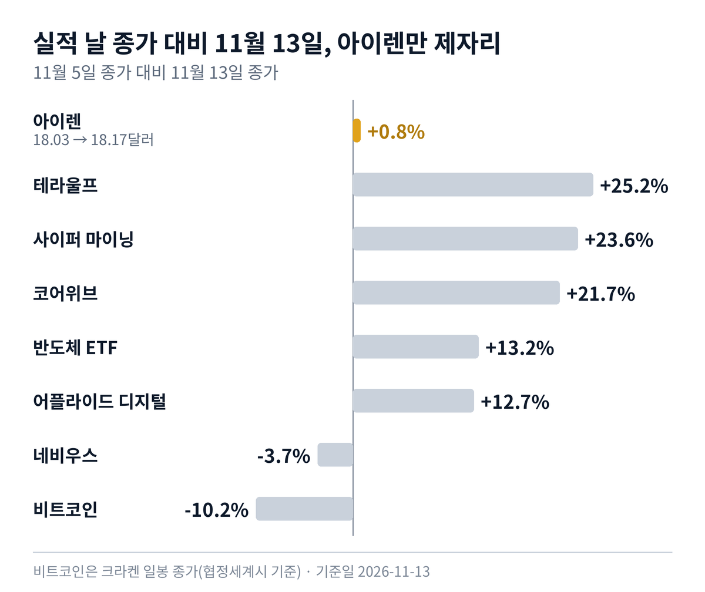
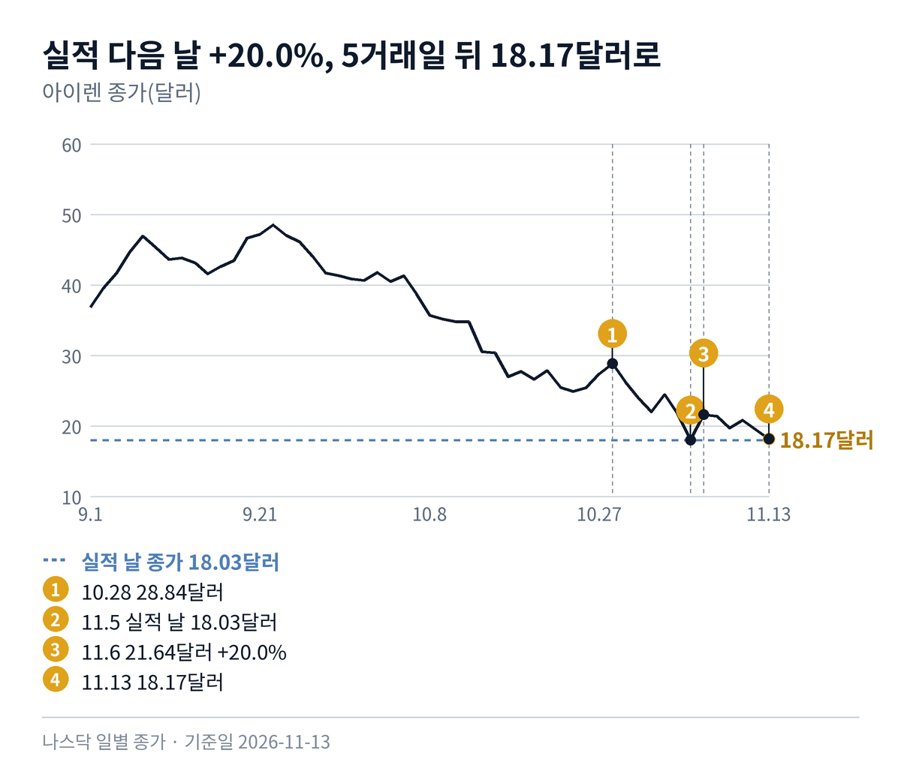
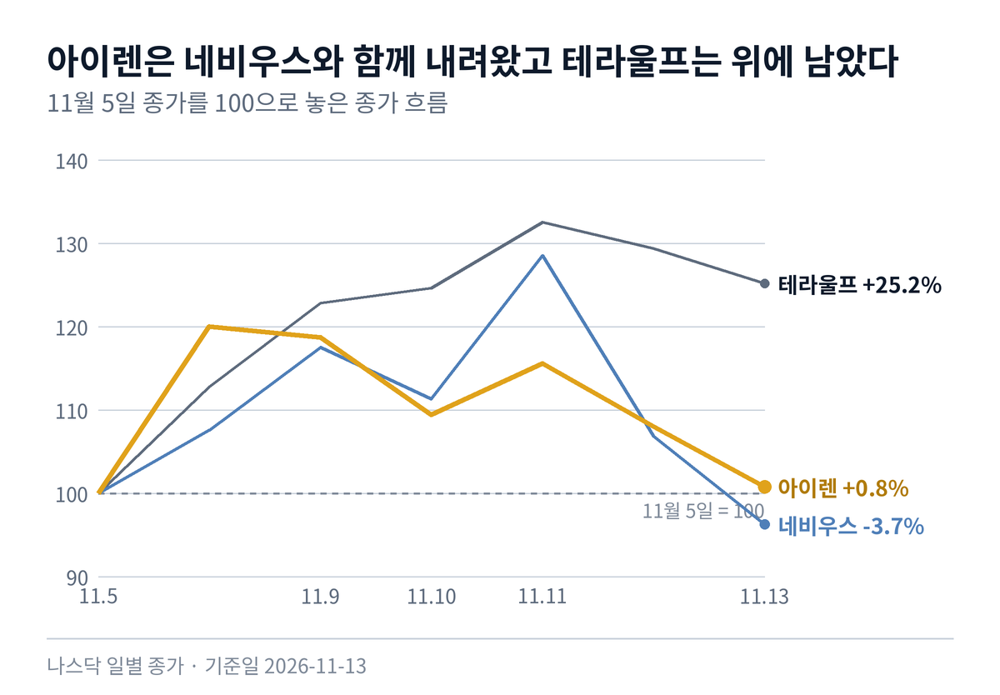
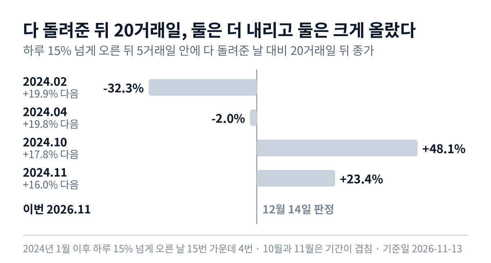
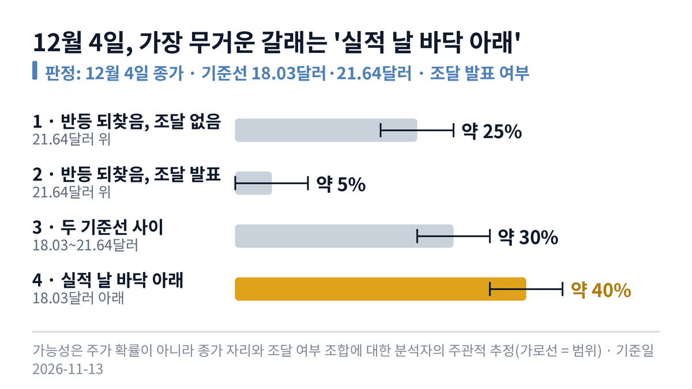

아이렌 주가는 11월 5일 실적 날 18.03달러로 1년 가운데 가장 낮게 마감했습니다. 다음 날 20.0% 올라 21.64달러가 됐습니다. 그리고 5거래일 뒤인 11월 13일, 18.17달러로 돌아왔습니다. 실적 날 종가와의 차이는 0.8%뿐입니다. 큰 반등을 거의 다 돌려준 셈입니다. 그런데 같은 날을 출발점으로 잡으면 테라울프는 같은 기간 25.2%, 사이퍼 마이닝은 23.6% 올랐습니다. 같은 업종으로 묶이는 회사들인데 왜 아이렌만 제자리로 돌아왔을까요?

> **유의사항** 저자는 금융·투자 자문가가 아닙니다. 이 글은 공개 공시와 시세를 정리한 교육용 분석이며 특정 종목의 매수·매도를 권하지 않습니다. 과거 패턴은 미래 수익을 보장하지 않고, 아이렌은 2024년 이후 하루에 15% 넘게 움직인 날이 20번인 종목입니다. 실제 투자 전에는 최신 공시를 직접 확인하세요.

이 글은 [11월 9일 기준 리포트](/r/iren-2026-11-2/)의 후속편입니다. 그 리포트는 실적 다음 날의 20%가 실적 덕이었는지 물었습니다. 실적 날부터 두 거래일을 합치면 같은 업종과 비슷했으니, 아이렌만의 상승분은 크지 않다고 봤습니다. 지금 보면 그 판단이 맞는 쪽으로 갔습니다. 업종이 계속 오를 때 아이렌은 그 상승분마저 내려놓았습니다. 지난 예측 성적은 적중 하나, 빗나감 없음, 진행 중 넷입니다.

진행 중인 넷 가운데 둘은 불리하게 가고 있습니다. 지난 리포트는 12월 4일 종가가 21.64달러 위인지를 첫째로 보자고 했는데, 지금은 그보다 16.0% 아래입니다. 11월 19일 종가가 21.71달러 위인지도 보조로 걸었는데, 3거래일을 남기고 16.3% 아래입니다. 나머지 둘은 새 주식 발표 여부와 2027년 1월 설비 목표인데, 아직 판정할 소식이 없습니다.

아이렌은 호주에서 시작한 회사로, 원래 비트코인을 캐던 데이터센터 회사입니다. 지금은 인공지능 클라우드로 옮겨 가는 중입니다. 그래픽 칩을 직접 사서 데이터센터에 설치하고, 돈을 버는 방식은 임대에 가깝습니다. 고객이 그 연산을 몇 년 단위로 빌려 쓰며 사용료를 냅니다. 마이크로소프트와 5년 97억 달러 계약을 맺은 것도 이 방식입니다. 1분기 매출 2억 2,800만 달러 가운데 인공지능 클라우드가 2억 달러였습니다. 비트코인 채굴은 2,800만 달러로 줄었습니다.

이 방식은 돈이 먼저 많이 듭니다. 10-Q는 데이터센터와 그래픽 칩 구매에 큰 설비투자가 계속 든다고 적었습니다. 회사는 이번 회계연도에 남은 설비투자를 약 150억 달러로 잡았습니다. 그 가운데 60억 달러는 앞으로 구해야 하고, 시장 상황에 달렸다고 밝혔습니다. 9월 말 현금은 35억 2,200만 달러, 쓰임이 정해진 제한된 현금이 22억 5,600만 달러였습니다.

실적 다음 날 뒤 5거래일을 하루씩 보면 이렇습니다. 11월 9일 1.1% 내린 데 이어 10일에 7.8% 내렸습니다. 11일에는 5.6% 올랐지만, 12일 6.5%, 13일 6.7%가 다시 빠졌습니다. 이 사이 회사가 SEC에 낸 서류는 11월 10일 골드만삭스의 지분 보고 하나였습니다. 9월 30일 기준 7.2%를 가졌다는 정기 보고입니다. 회사 쪽에서 나온 새 소식은 없었습니다.

같은 4거래일을 다른 종목과 나란히 놓으면 모양이 보입니다. 11월 9일 종가 대비 13일까지 아이렌은 15.1% 내렸습니다. 네비우스는 18.1% 내렸습니다. 비트코인도 9.3% 내렸습니다. 반면 테라울프는 1.9%, 사이퍼 마이닝은 0.7% 올랐습니다. 반도체 상장지수펀드(ETF, 여러 종목을 묶어 거래하는 펀드)도 1.7% 올랐습니다.

아이렌이 함께 움직인 쪽은 네비우스입니다. 네비우스도 그래픽 칩을 직접 사서 연산을 빌려주는 인공지능 클라우드 회사입니다. 12일에 네비우스가 16.8% 내릴 때 아이렌은 6.5% 내렸습니다. 11일에 네비우스가 15.4% 오를 때는 아이렌도 5.6% 올랐습니다. 방향은 4거래일 모두 같았습니다.

위에 남은 쪽은 사업 방식이 다릅니다. 테라울프는 10-Q에 플루이드스택에 고성능 연산용 시설 168메가와트(MW, 전력 단위)를 빌려주는 임대 계약을 적었습니다. 건물과 전력을 빌려주고, 칩은 들어오는 고객이 채웁니다. 같은 '채굴에서 인공지능으로' 무리라도, 칩값을 누가 내느냐가 다릅니다. 칩을 직접 사는 회사는 남은 돈을 구해야 하는 크기가 훨씬 큽니다.

비트코인도 한 축입니다. 실적 날부터 11월 13일까지 비트코인은 7만 5,980달러에서 6만 8,236달러로 10.2% 내렸습니다. 아이렌의 채굴 매출은 줄었지만 아직 남아 있습니다. 다만 같은 기간 비트코인을 캐는 테라울프와 사이퍼는 올랐으니, 비트코인만으로는 아이렌의 하락을 다 설명하지 못합니다. 남는 설명은 두 가지가 겹친 쪽입니다. 칩을 직접 사는 인공지능 클라우드에 대한 시장의 걱정과, 앞으로 구할 60억 달러입니다.

이 설명은 시세의 모양에서 나온 해석입니다. 시장이 무엇을 걱정했는지 회사가 밝힌 적은 없습니다. 4거래일은 짧고, 같은 방향으로 움직였다고 이유까지 같다고 말할 수는 없습니다. 판정할 수 있는 것은 앞으로 나올 조달 소식과 날짜별 종가입니다.

그렇다면 이렇게 큰 반등을 며칠 만에 다 돌려준 일이 처음일까요? 2024년 1월부터 11월 13일까지 시세를 모두 꺼냈습니다. 하루에 15% 넘게 오른 날은 이번을 빼고 15번이었습니다. 그중 5거래일 안에 오른 날 전 종가의 1% 안까지 돌아온 경우를 골랐습니다. 4번이었습니다. 이번이 다섯 번째입니다.

네 번의 20거래일 뒤는 둘로 갈렸습니다. 2024년 2월에는 돌려준 날 뒤 32.3% 더 내렸고, 4월에는 2.0% 내렸습니다. 같은 해 10월에는 48.1% 올랐습니다. 11월에도 23.4% 올랐습니다. 10월과 11월 두 번은 기간이 겹쳐, 사실상 한 번의 긴 상승에 가깝습니다.

눈여겨볼 점은 가운데가 없다는 것입니다. 지금 값에 이 네 결과를 대 보면, 둘은 18.03달러 아래로, 둘은 21.64달러 위로 갑니다. 18.03~21.64달러 사이에 머문 경우는 없습니다. 네 번뿐인 작은 표본이라 방향을 말할 근거는 못 됩니다. 다만 다 돌려준 뒤 한 달이 조용히 지나간 적은 없었다는 기록입니다.

지금 아이렌의 몸값은 약 77억 1,000만 달러입니다. 18.17달러에 10월 30일 주식 수 4억 2,436만 주를 곱한 값입니다. 10월 28일 28.84달러보다 37.0% 낮습니다. 앞으로 구할 60억 달러는 이 몸값의 약 78%에 해당합니다. 그 돈을 새 주식으로 많이 구하면 기존 한 주가 차지하는 비율이 작아지고, 장비 대출이나 고객 선수금으로 구하면 그 부담이 작습니다.

지난 리포트는 지금을 '업종에 끌려 움직이는 단계'로 불렀습니다. 4거래일 동안 네비우스와 같은 방향이었으니 그 진단은 유지됩니다. 다만 끌려가는 업종이 좁아졌습니다. 채굴 출신 무리 전체가 아니라, 칩을 직접 사는 인공지능 클라우드 쪽입니다.

12월 4일은 실적 날 뒤 20번째 거래일입니다. 지난 리포트의 네 갈래는 그대로 씁니다. 실적 다음 날 종가 위인지, 실적 날 종가 아래인지, 그 사이인지에 조달 발표 여부를 더한 갈래입니다. 바뀐 것은 무게입니다. 실적 날 바닥 아래로 가는 4번을 가장 무겁게 올렸고, 위쪽 두 갈래와 가운데는 조금씩 낮췄습니다. 갈래별 숫자와 지난 추정은 끝의 '앞으로 일어날 수 있는 일' 표에 있습니다.

4번을 가장 무겁게 본 이유는 셋입니다. 지금 값이 기준선 위 0.8%에 있어 작은 하락으로도 아래로 갑니다. 함께 움직인 네비우스와 비트코인이 아직 내리는 쪽입니다. 그리고 과거 4번 중 2번이 아래로 갔습니다. 3번을 낮춘 이유는 과거 네 번이 모두 가운데를 비켜 갔기 때문입니다. 위쪽 1번을 약 25%로 남긴 이유도 같은 기록입니다. 이 숫자는 주가가 오를 확률이 아니라, 12월 4일 종가 자리와 조달 여부 조합에 대한 분석자의 주관적 추정입니다.

이 판단이 틀릴 수 있는 곳도 분명합니다. 첫째는 조달의 방식입니다. 60억 달러 가운데 많은 부분이 장비 대출이나 고객 선수금으로 발표되면, 칩을 직접 사는 회사에 대한 걱정이 줄 수 있습니다. 반대로 새 주식이나 전환사채가 크게 나오면 4번 쪽이 더 무거워집니다. 둘째는 업종입니다. 네비우스가 방향을 바꾸면 아이렌도 따라 바뀔 가능성이 큽니다. 셋째는 사업 일정입니다. 연환산 40억 달러 설비 목표가 2027년 1월에서 또 밀리면 매출이 들어오는 날도 같이 밀립니다.

가까운 일정은 둘입니다. 11월 19일 종가로 지난 리포트의 21.71달러 기준을 채점합니다. 11월 24일 오후 4시 30분(미 동부)에는 온라인 정기 주주총회가 열립니다. 주총 안건에서 주식 발행 한도 같은 조달 관련 내용이 나오는지 함께 봅니다.

5거래일 만에 반등을 돌려준 것은 실적이 나빠서가 아니라, 칩을 사는 데 돈이 많이 드는 사업 방식이 시장의 걱정과 겹쳤기 때문으로 봅니다. 그래서 다음 판정의 열쇠도 실적이 아니라 60억 달러를 어떻게 구하는지와 네비우스의 방향입니다. 12월 4일 종가가 18.03달러 아래인지를 가장 먼저 확인합니다. 다음 갱신은 11월 19일 채점 뒤에 합니다.

## 숫자로 다시 보기

### 실적 날 뒤 같은 업종(11월 5일 종가 대비 11월 13일)

| 종목 | 11월 5일 → 11월 13일 | 11월 9일 → 11월 13일 |
| --- | --- | --- |
| **아이렌** | **+0.8%** 18.03 → 18.17달러 | **-15.1%** |
| 네비우스 | -3.7% | -18.1% |
| 비트코인 | -10.2% | -9.3% |
| 어플라이드 디지털 | +12.7% | -4.5% |
| 반도체 ETF(SOXX) | +13.2% | +1.7% |
| 코어위브 | +21.7% | +8.5% |
| 사이퍼 마이닝 | +23.6% | +0.7% |
| 테라울프 | +25.2% | +1.9% |

비트코인은 크라켄 일봉 종가(협정세계시 기준)라 미국 장 마감 시각과 다릅니다.

### 하루 15% 넘게 오른 뒤 5거래일 안에 다 돌려준 경우

**한눈에:** 2024년 1월 이후 하루 15% 넘게 오른 날 **15번**(이번 제외) · 5거래일 안에 다 돌려준 것 **4번** · 20거래일 뒤 더 내린 것 **2번**, 오른 것 **2번**

| 오른 날 · 하루 상승 | 다 돌려준 날 | 20거래일 뒤 |
| --- | --- | --- |
| **2024.02.14** +19.9% | 2024.02.16 · 6.81달러 | -32.3% |
| **2024.04.01** +19.8% | 2024.04.08 · 5.41달러 | -2.0% |
| **2024.10.28** +17.8% | 2024.10.31 · 9.12달러 | +48.1% |
| **2024.11.11** +16.0% | 2024.11.13 · 10.88달러 | +23.4% |
| **이번 2026.11.06** +20.0% | 2026.11.13 · 18.17달러 | 12월 14일 판정 |

'다 돌려준 날'은 오른 날 전 종가의 1% 안까지 처음 돌아온 날이고, '20거래일 뒤'는 그날 종가 대비입니다. 10월과 11월 두 번은 기간이 겹칩니다.

### 지금의 크기(11월 13일 기준)

| 항목 | 값 · 근거 |
| --- | --- |
| 종가 | **18.17달러** 실적 날 종가 18.03달러보다 0.8% 높음 |
| 시가총액 | **약 77억 1,000만 달러** 18.17달러 × 4억 2,436만 주(10월 30일) |
| 9월 말 현금 | **35억 2,200만 달러** 10-Q |
| 9월 말 제한된 현금 | **22억 5,600만 달러** 쓰임이 정해진 돈, 현금과 더하지 않음 |
| 앞으로 구할 돈 | **60억 달러** 남은 설비투자 약 150억 달러 가운데 |
| 연환산 매출 목표 | **40억 달러 이상** 2027년 1월(2월 말까지 가능) |

### 지난 예측 채점표

| 지난 점검 항목 · 당시 기준(11월 9일) | 판정과 실제 결과(11월 13일) |
| --- | --- |
| **진단: 업종에 끌려 움직이는 단계** 국면 B 유지 | **[적중]** 4거래일 모두 네비우스와 같은 방향 |
| **12월 4일 종가 21.64달러 위** 1순위 확인 | **[진행 중]** 지금 18.17달러, 16.0% 아래 |
| **12월 4일까지 조달 발표 없음** 2순위 확인 | **[진행 중]** 11월 16일까지 발표 없음 |
| **2027년 1월 연환산 40억 달러 설비** 3순위 확인 | **[진행 중]** 새 소식 없음 |
| **11월 19일 종가 21.71달러 위** 보조 확인 | **[진행 중]** 지금 16.3% 아래 |

### 앞으로 일어날 수 있는 일

과거 기록: 하루 15% 넘게 오른 뒤 5거래일 안에 다 돌려준 4번 중 2번은 20거래일 뒤 더 내렸고, 2번은 크게 올랐습니다. 18.03~21.64달러 범위에 해당하는 결과는 없었습니다.

아래 가능성은 주가 상승·하락 확률이 아니라, 12월 4일 종가의 자리와 조달 발표 여부 조합에 대한 분석자의 주관적 추정입니다. 네 갈래는 겹치지 않아 더하면 100%이고, 괄호 안 범위는 더하지 않습니다.

| 시나리오(판정 12월 4일) | 종가 · 조달 | 가능성(추정) |
| --- | --- | --- |
| 1 · 반등 되찾음, 조달 없음 | 21.64달러 위 · 없음 | 중간 약 25% (20~30%) |
| 2 · 반등 되찾음, 조달 발표 | 21.64달러 위 · 있음 | 낮음 약 5% (0~10%) |
| 3 · 두 기준선 사이 | 18.03~21.64달러 | 중간 약 30% (25~35%) |
| **4 · 실적 날 바닥 아래** | 18.03달러 아래 | 높음 약 40% (35~45%) |

지난 리포트(11월 9일 기준)는 1번 약 30%, 2번 약 10%, 3번 약 35%, 4번 약 25%였습니다.

### 핵심 확인 세 가지

| 순위 · 확인할 것 | 판정 날짜 |
| --- | --- |
| **1순위** 12월 4일 종가가 18.03달러 아래인가 | 12월 4일 |
| **2순위** 60억 달러 조달이 새 주식·전환사채인가, 대출·선수금인가 | 발표 때마다 |
| **3순위** 11월 19일 종가가 21.71달러 위인가 | 11월 19일 |
