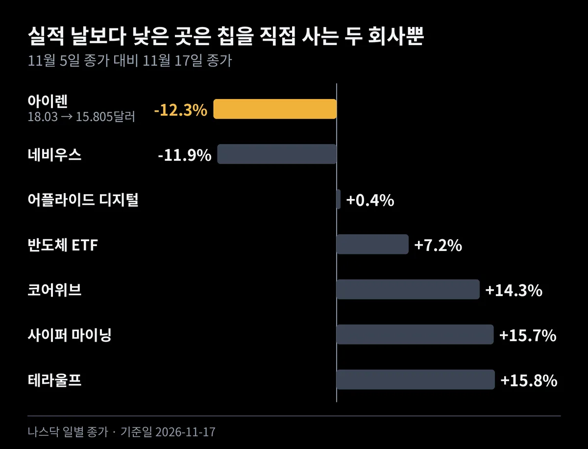
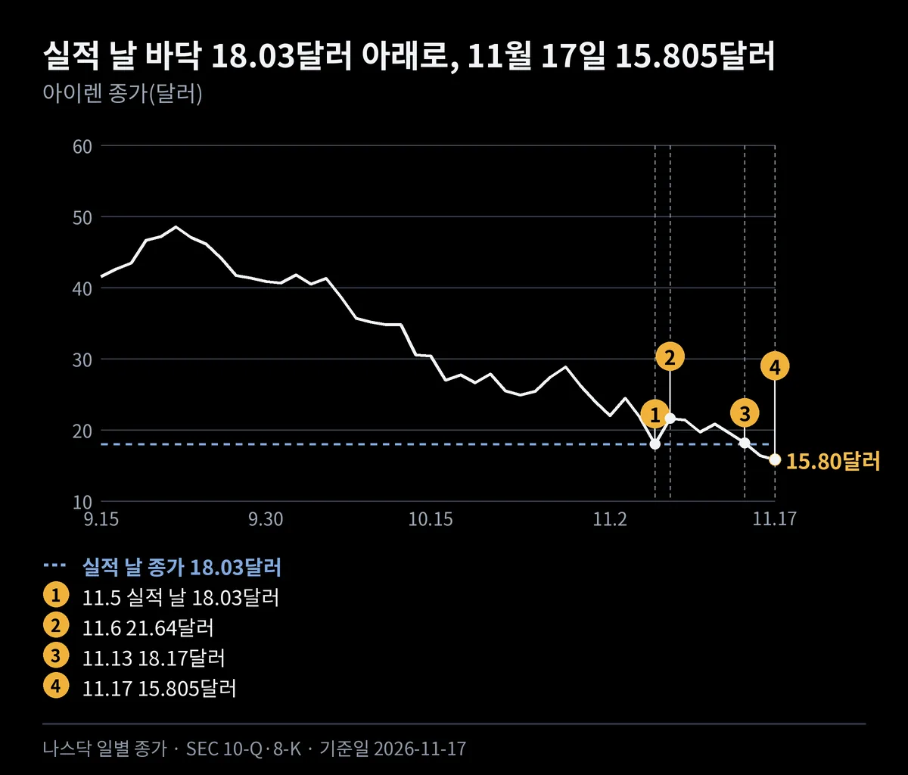
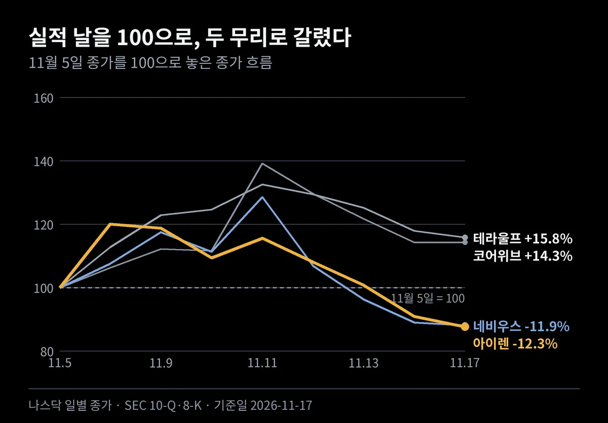
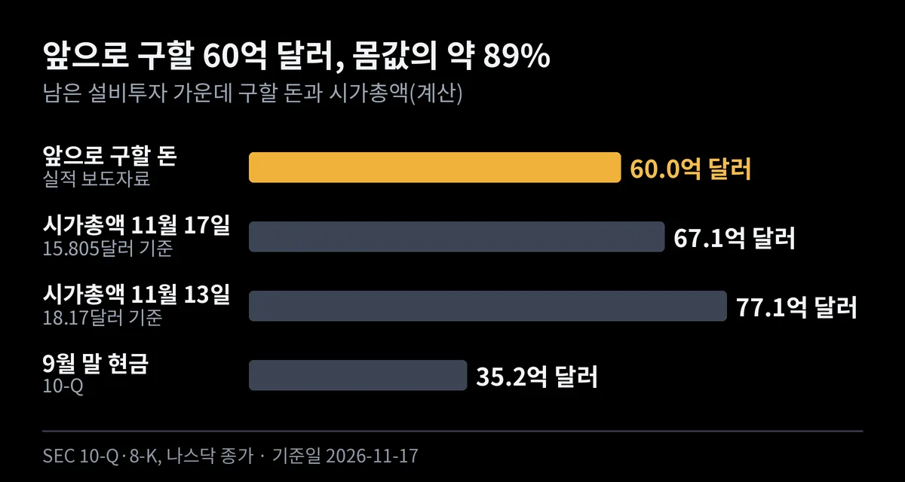
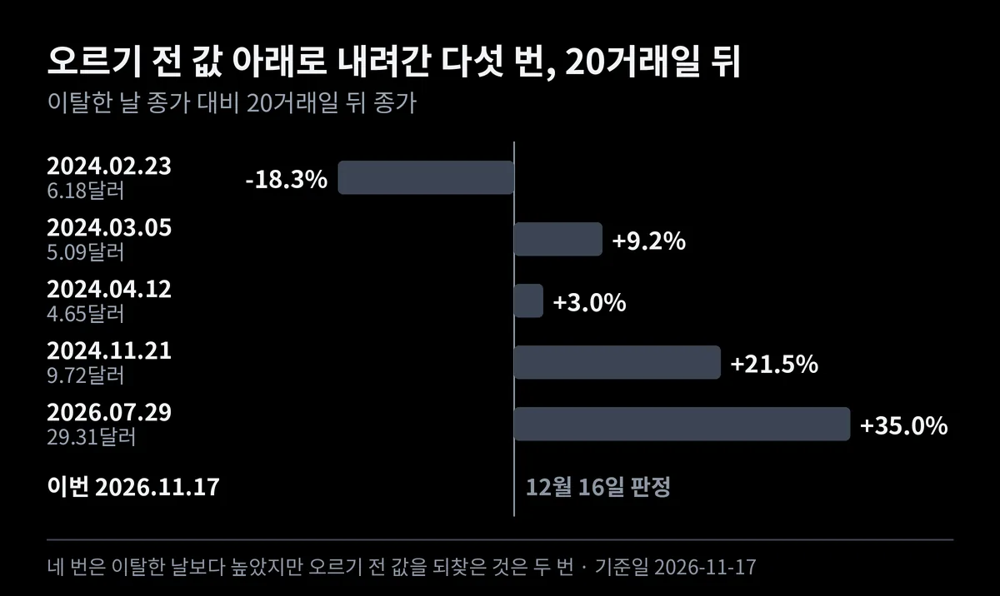
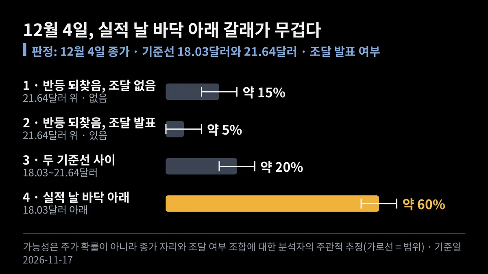

11월 5일 실적 날, 아이렌 주가는 18.03달러로 1년 중 가장 낮게 마감했습니다. 그 값이 바닥처럼 보였던 것은 7거래일뿐입니다. 11월 17일 종가는 15.805달러로, 그 바닥보다 12.3% 낮습니다. 2025년 8월 1일 뒤 가장 낮은 종가입니다. 그런데 같은 날을 출발점으로 잡으면 테라울프는 15.8%, 사이퍼 마이닝은 15.7% 올랐습니다. 같은 무리로 불리는 회사들이 반대로 간 셈인데, 둘을 가른 것은 무엇이었을까요?

> **유의사항** 저자는 금융·투자 자문가가 아닙니다. 이 글은 공개 공시와 시세를 정리한 교육용 분석이며 특정 종목의 매수·매도를 권하지 않습니다. 과거 패턴은 미래 수익을 보장하지 않고, 아이렌은 2024년 이후 하루에 15% 넘게 움직인 날이 20번인 종목입니다. 실제 투자 전에는 최신 공시를 직접 확인하세요.

이 글은 [11월 13일 기준 리포트](/r/iren-2026-11-3/)의 후속편입니다. 그 리포트는 12월 4일 종가가 어디에 있을지를 네 갈래로 나눴습니다. 실적 다음 날 종가 21.64달러 위, 실적 날 종가 18.03달러 아래, 그 사이로 나누고, 위쪽은 조달 발표 여부로 한 번 더 쪼갠 것입니다. 그중 18.03달러 아래 갈래를 약 40%로 가장 무겁게 봤습니다. 이 숫자는 주가 확률이 아니라 종가 자리에 대한 분석자의 주관적 추정이었습니다. 다음 거래일인 11월 16일, 주가는 그 선 아래로 내려갔습니다.

지난 예측 성적은 적중 하나, 빗나감 없음, 진행 중 넷입니다. 적중한 것은 '아이렌이 칩을 직접 사는 인공지능 클라우드 쪽과 함께 움직인다'는 진단입니다. 11월 16일과 17일 모두 아이렌과 네비우스는 같은 방향으로 내렸습니다. 진행 중인 넷은 12월 4일 종가 자리, 조달 방식, 11월 19일 종가, 그리고 네 갈래의 무게입니다. 11월 19일 기준선 21.71달러는 지금 값보다 37.4% 위에 있어, 2거래일 안에 넘기 어려운 거리입니다.

아이렌은 호주에서 시작한 회사로, 원래 비트코인을 캐던 데이터센터 회사입니다. 지금은 인공지능 클라우드로 옮겨 가는 중입니다. 그래픽 칩을 직접 사서 데이터센터에 설치하고, 돈을 버는 방식은 고객이 그 연산을 몇 년 단위로 빌려 쓰며 내는 사용료입니다. 1분기 매출은 2억 2,800만 달러였습니다. 그중 약 2억 달러가 인공지능 클라우드에서 나왔습니다. 이 방식은 칩값을 먼저 치러야 합니다. 회사는 남은 설비투자 약 150억 달러 가운데 60억 달러를 앞으로 구해야 한다고 밝혔습니다.

지난 리포트 뒤 2거래일을 보면 이렇습니다. 11월 16일 하루에 9.8% 내려 16.39달러가 됐고, 17일에 3.6% 더 내려 15.805달러가 됐습니다. 이 사이 회사 이름으로 SEC에 들어온 서류는 11월 16일 지분 보고 하나였습니다. 13G는 한 회사 주식을 5% 넘게 가진 투자자가 보유 현황을 알리는 서류입니다. 이번 것은 서스퀘하나 계열 증권 회사 네 곳이 9월 30일 기준 5.0%를 가졌다는 내용으로, 사업 소식이 아닙니다. 회사가 직접 낸 새 소식은 없었습니다.

이 2거래일은 아이렌만 내린 날이 아닙니다. 11월 13일 종가 대비 17일까지 어플라이드 디지털은 11.0%, 네비우스는 8.5%, 테라울프는 7.5% 내렸습니다. 반도체 상장지수펀드(ETF, 여러 종목을 묶어 거래하는 펀드)는 5.3%, 나스닥 100 ETF는 3.4% 내렸습니다. 비트코인도 4.9% 내렸습니다. 다 함께 내린 가운데 아이렌이 13.0%로 가장 많이 내렸습니다.

2거래일만 보면 업종 전체의 하락입니다. 그런데 출발점을 실적 날로 넓히면 그림이 달라집니다. 테라울프, 사이퍼 마이닝, 코어위브는 2거래일을 내리고도 실적 날보다 14~16% 높습니다. 실적 날보다 낮은 곳은 아이렌과 네비우스(11.9% 하락) 둘뿐입니다. 두 무리의 차이는 약 28%포인트로 벌어졌습니다.

갈린 두 무리는 돈을 쓰는 방식이 다릅니다. 아이렌과 네비우스는 그래픽 칩을 직접 사서 연산을 빌려줍니다. 테라울프는 10-Q에 플루이드스택에 고성능 연산용 시설을 빌려주는 임대 계약을 적었습니다. 건물과 전력을 빌려주고, 칩은 들어오는 고객이 채우는 방식입니다. 칩을 직접 사는 쪽이 먼저 구해야 하는 돈이 더 클 수 있다는 차이입니다. 테라울프의 조달 규모는 이 글에서 따로 재지 않았고, 이 연결은 시세의 모양에서 나온 해석이고, 시장이 무엇을 걱정했는지 회사가 밝힌 적은 없습니다.

구해야 하는 돈의 크기를 몸값과 나란히 놓아 보겠습니다. 11월 17일 종가에 10월 30일 주식 수 4억 2,436만 주를 곱하면 시가총액은 약 67.1억 달러입니다. 11월 13일에는 약 77.1억 달러였습니다. 앞으로 구할 60억 달러는 이제 몸값의 약 89%입니다. 회사는 나머지 90억 달러를 현금과 약정된 장비 대출, 고객 선수금으로 마련했다고 밝혔습니다. 9월 말 현금은 35.2억 달러이고, 쓰임이 정해진 제한된 현금은 따로입니다. 회사는 60억 달러를 구하는 방식을 아직 정해 밝히지 않았습니다. 일반적으로 새 주식으로 많이 구하면 기존 한 주가 차지하는 비율이 작아지고, 대출이나 선수금은 주식 수를 늘리지 않는 대신 갚거나 채워야 할 의무가 남습니다.

그렇다면 크게 오른 뒤 오르기 전 값보다 한참 아래로 내려간 일이 처음일까요? 2024년 1월부터 시세를 모두 꺼냈습니다. 하루에 15% 넘게 오른 날 뒤 15거래일 안에, 오르기 전 종가보다 10% 넘게 낮게 마감한 경우를 골랐습니다. 이 글에서는 그날을 '이탈한 날'이라고 부르겠습니다. 이번을 빼고 다섯 번이었습니다. 이번은 실적 다음 날 20.0% 오른 뒤, 오르기 전 종가인 실적 날 바닥 아래로 내려온 경우입니다.

이탈한 날 대비 20거래일 뒤, 다섯 번 중 네 번은 더 높았습니다. 다만 그중 2024년 2월과 3월 두 번은 기간이 겹쳐 실제로 따로 떨어진 사례는 넷에 가깝습니다. 2024년 2월 23일에 이탈한 경우는 18.3% 더 내렸습니다. 나머지 넷은 이탈한 날보다 높았습니다. 2024년 3월 5일은 9.2%, 4월 12일은 3.0% 올랐습니다. 2024년 11월 21일은 21.5%, 2026년 7월 29일은 35.0% 올랐습니다.

하지만 기준을 '오르기 전 값을 되찾았는가'로 바꾸면 결과가 달라집니다. 20거래일 뒤 오르기 전 종가 위로 돌아간 것은 2024년 11월과 2026년 7월 두 번뿐입니다. 나머지 세 번은 반등하고도 오르기 전 값 아래에 머물렀습니다. 다섯 번은 작은 표본이라 방향을 말할 근거로는 부족합니다. 기록이 보여 주는 것은, 이탈한 뒤 한 달 사이 위로든 아래로든 10% 넘게 움직인 경우가 5번 중 3번이었다는 점입니다.

지난 리포트는 지금을 '칩을 직접 사는 인공지능 클라우드 쪽에 끌려 움직이는 단계'로 불렀습니다. 2거래일 동안 그 진단은 맞았고, 실적 날 기준으로 보면 오히려 더 또렷해졌습니다. 바뀐 것은 자리입니다. 지난 리포트가 가장 무겁게 본 18.03달러 아래 갈래에 주가가 이미 들어와 있습니다.

12월 4일은 실적 날 뒤 20번째 거래일이고, 11월 17일에서 12거래일 뒤입니다. 네 갈래는 그대로 씁니다. 실적 다음 날 종가 위이면서 조달 발표가 없는 갈래, 같은 자리에 조달 발표가 있는 갈래, 두 기준선 사이, 그리고 실적 날 바닥 아래입니다. 바닥 아래 갈래는 약 40%에서 약 60%로 올렸습니다. 주가가 이미 그 선 아래에 있어, 위로 돌아가려면 남은 기간에 14.1% 올라야 하기 때문입니다. 과거 5번 중 2번만 이탈 뒤 13거래일째에 그만큼 올랐습니다. 두 기준선 사이 갈래와 실적 다음 날 종가 위 두 갈래는 더 먼 거리라 각각 약 20%로 낮췄습니다. 이 숫자는 주가가 오를 확률이 아니라, 12월 4일 종가 자리와 조달 여부 조합에 대한 분석자의 주관적 추정입니다.

이 판단이 틀릴 수 있는 곳도 분명합니다. 먼저 조달의 방식입니다. 60억 달러 가운데 많은 부분이 장비 대출이나 고객 선수금으로 발표되면, 칩을 직접 사는 회사에 대한 걱정이 줄 수 있습니다. 새 주식이나 전환사채가 크게 나오면 반대입니다. 다음은 업종입니다. 지난 2거래일 동안 아이렌은 네비우스보다 더 크게 움직였으니, 네비우스가 방향을 바꾸면 아이렌의 반응도 클 수 있습니다. 마지막으로 사업 일정입니다. 회사는 지금 계약 속도로 1년 매출이 40억 달러에 이를 설비를 2027년 1월까지 갖추겠다고 밝혔습니다. 이 목표가 밀리면 매출이 들어오는 날도 같이 밀립니다.

가까운 일정은 둘입니다. 11월 19일 종가로 지난 리포트의 21.71달러 기준을 채점합니다. 11월 24일 오후 4시 30분(미 동부)에는 온라인 정기 주주총회가 열립니다. 주총에서 주식 발행 한도처럼 조달과 닿는 안건이 나오는지 함께 봅니다.

아이렌이 실적 날 바닥 아래로 내려간 것은 새 회사 소식 때문이 아니었습니다. 업종 전체가 내린 2거래일에 가장 크게 내렸고, 실적 날부터 보면 칩을 직접 사는 네비우스와만 같은 자리에 있습니다. 실적 날부터 두 무리를 가른 것이 칩값을 누가 내느냐였고, 그 칩값 가운데 앞으로 구할 부분이 몸값의 약 89%입니다. 그래서 다음 판정의 열쇠는 실적보다 60억 달러를 어떤 방식으로 구하는지일 가능성이 큽니다. 12월 4일 종가가 18.03달러 위로 돌아오는지를 가장 먼저 확인하고, 다음 갱신은 11월 19일 채점 뒤에 합니다.

## 숫자로 다시 보기

### 같은 업종 비교

| 종목 | 11월 5일 → 11월 17일 | 11월 13일 → 11월 17일 |
| --- | --- | --- |
| **아이렌** | **-12.3%** 18.03 → 15.805달러 | **-13.0%** 18.17 → 15.805달러 |
| 네비우스 | -11.9% | -8.5% |
| 어플라이드 디지털 | +0.4% | -11.0% |
| 나스닥 100 ETF(QQQ) | +1.5% | -3.4% |
| 반도체 ETF(SOXX) | +7.2% | -5.3% |
| 코어위브 | +14.3% | -6.1% |
| 사이퍼 마이닝 | +15.7% | -6.4% |
| 테라울프 | +15.8% | -7.5% |
| 비트코인 | -14.6% | -4.9% |

비트코인은 크라켄 일봉 종가(협정세계시 기준)라 미국 장 마감 시각과 다릅니다. 11월 5일 7만 5,980달러, 13일 6만 8,236달러, 17일 6만 4,877달러입니다.

### 지난 리포트 뒤 아이렌 하루씩

| 날짜 · 종가 | 하루 변화 | 실적 날 종가 대비 |
| --- | --- | --- |
| **11월 13일** 18.17달러 | -6.7% | +0.8% |
| **11월 16일** 16.39달러 | -9.8% | -9.1% |
| **11월 17일** 15.805달러 | -3.6% | -12.3% |

11월 17일 종가는 2025년 8월 1일(15.40달러) 뒤 가장 낮은 종가이고, 1년 전 2025년 11월 5일 종가 76.41달러보다 79.3% 낮습니다.

### 크게 오른 뒤 오르기 전 값보다 10% 넘게 내려간 경우

**한눈에:** 2024년 1월 이후 **5번**(이번 제외) · 20거래일 뒤 이탈한 날보다 높았던 것 **4번** · 오르기 전 값을 되찾은 것 **2번**

| 오른 날 · 오르기 전 종가 | 이탈한 날 · 종가 | 13거래일 뒤 · 20거래일 뒤 |
| --- | --- | --- |
| **2024.02.12** 5.94달러 | 2024.03.05 · 5.09달러 | -0.8% · +9.2% |
| **2024.02.14** 6.92달러 | 2024.02.23 · 6.18달러 | -20.7% · -18.3% |
| **2024.04.01** 5.40달러 | 2024.04.12 · 4.65달러 | -6.9% · +3.0% |
| **2024.11.11** 10.99달러 | 2024.11.21 · 9.72달러 | +40.0% · +21.5% |
| **2026.07.20** 33.62달러 | 2026.07.29 · 29.31달러 | +53.2% · +35.0% |
| **이번 2026.11.06** 18.03달러 | 2026.11.17 · 15.805달러 | 12월 4일 · 12월 16일 판정 |

'오른 날'은 하루 15% 넘게 오른 날, '이탈한 날'은 그 뒤 15거래일 안에 오르기 전 종가보다 처음 10% 넘게 낮게 마감한 날이고, 뒤의 변화는 이탈한 날 종가 대비입니다. 2024년 2월의 두 번은 기간이 겹칩니다. 13거래일 뒤는 이번의 12월 4일 판정과 거리를 맞춘 열입니다.

### 지금의 크기(11월 17일 기준)

| 항목 | 값 · 근거 |
| --- | --- |
| 종가 | **15.805달러** 실적 날 종가 18.03달러보다 12.3% 낮음 |
| 시가총액 | **약 67.1억 달러** 15.805달러 × 4억 2,436만 주(10월 30일), 11월 13일 약 77.1억 달러 |
| 9월 말 현금 | **35억 2,200만 달러(35.2억)** 10-Q |
| 9월 말 제한된 현금 | **22억 5,600만 달러** 쓰임이 정해진 돈, 현금과 더하지 않음 |
| 앞으로 구할 돈 | **60억 달러** 남은 설비투자 약 150억 달러 가운데, 시가총액의 약 89% |

### 지난 예측 채점표

| 지난 점검 항목 · 당시 기준(11월 13일) | 판정과 실제 결과(11월 17일) |
| --- | --- |
| **진단: 칩을 직접 사는 인공지능 클라우드 쪽에 끌려 움직임** 네비우스와 같은 방향 | **[적중]** 11월 16·17일 모두 네비우스와 함께 내림 |
| **12월 4일 종가 18.03달러 아래인가** 1순위 확인 | **[진행 중]** 지금 15.805달러, 12.3% 아래 |
| **60억 달러 조달 방식** 2순위 확인 | **[진행 중]** 11월 17일까지 발표 없음 |
| **11월 19일 종가 21.71달러 위** 3순위 확인 | **[진행 중]** 지금보다 37.4% 위의 선 |
| **네 갈래 무게(18.03달러 아래 약 40%로 가장 무거움)** 12월 4일 채점 | **[진행 중]** 지금 18.03달러 아래 |

### 앞으로 일어날 수 있는 일

과거 기록: 크게 오른 뒤 오르기 전 값보다 10% 넘게 내려간 경우 5번 중 2번만 13거래일 뒤 14% 넘게 올랐습니다(+40.0%, +53.2%).

아래 가능성은 주가 상승·하락 확률이 아니라, 12월 4일 종가의 자리와 조달 발표 여부 조합에 대한 분석자의 주관적 추정입니다. 네 갈래는 겹치지 않아 더하면 100%이고, 괄호 안 범위는 더하지 않습니다.

| 시나리오(판정 12월 4일) | 종가 · 조달 | 가능성(추정) |
| --- | --- | --- |
| 1 · 반등 되찾음, 조달 없음 | 21.64달러 위 · 없음 | 낮음 약 15% (10~20%) |
| 2 · 반등 되찾음, 조달 발표 | 21.64달러 위 · 있음 | 낮음 약 5% (0~10%) |
| 3 · 두 기준선 사이 | 18.03~21.64달러 | 중간 약 20% (15~25%) |
| **4 · 실적 날 바닥 아래** | 18.03달러 아래 | 높음 약 60% (55~65%) |

지난 리포트(11월 13일 기준)는 1번 약 25%, 2번 약 5%, 3번 약 30%, 4번 약 40%였습니다.

### 핵심 확인 세 가지

| 순위 · 확인할 것 | 판정 날짜 |
| --- | --- |
| **1순위** 12월 4일 종가가 18.03달러 위로 돌아왔는가 | 12월 4일 |
| **2순위** 60억 달러 조달이 새 주식·전환사채인가, 대출·선수금인가 | 발표 때마다 |
| **3순위** 12월 16일(이탈 뒤 20거래일째) 종가가 15.805달러 위인가 | 12월 16일 |
