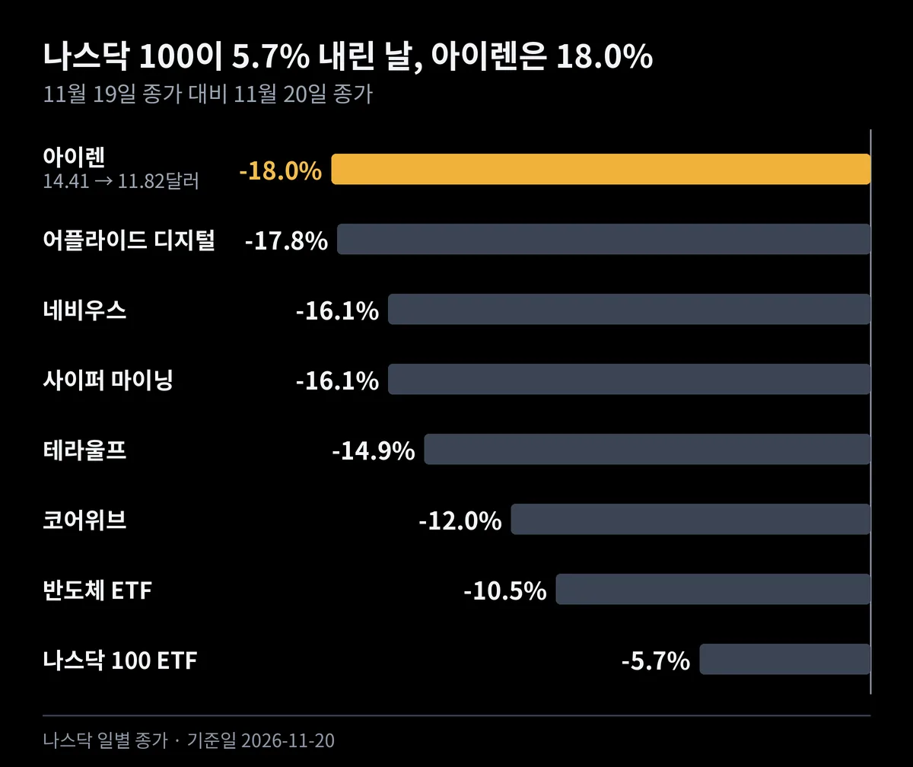
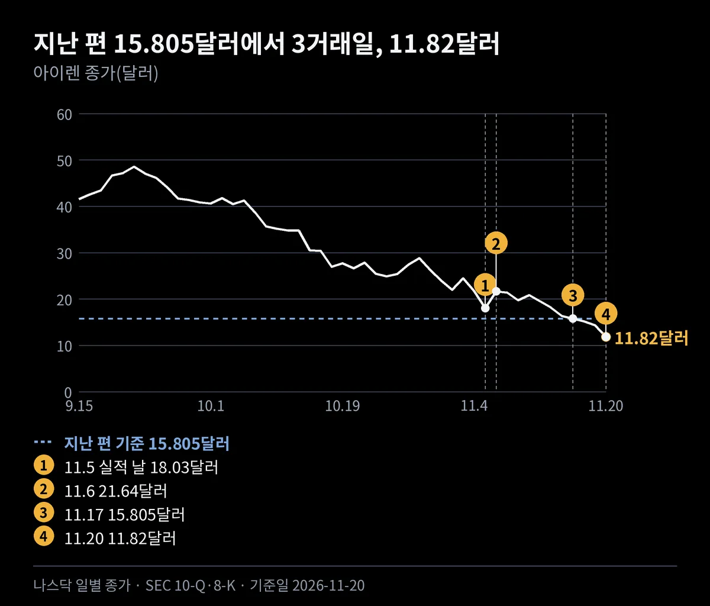
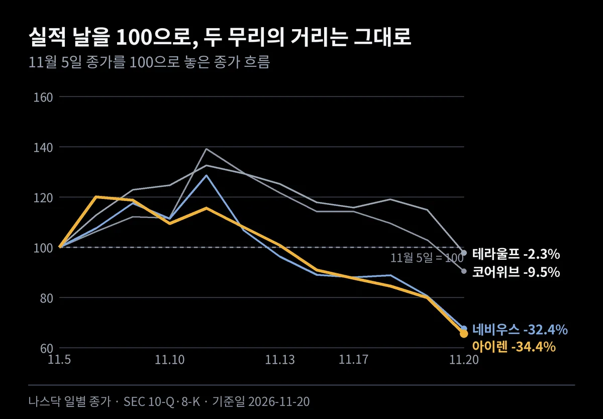
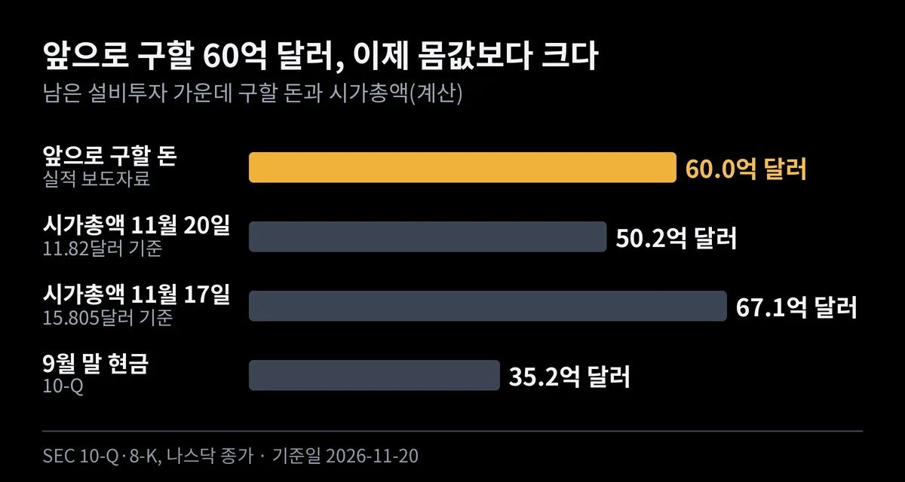
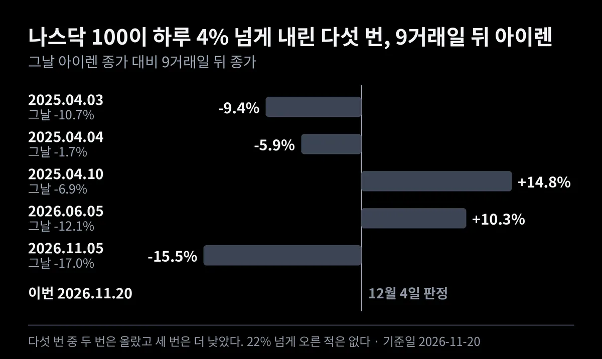
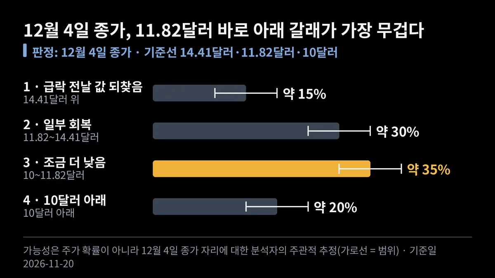

11월 20일 아이렌 주가는 14.07달러에서 출발했습니다. 그 값이 그날 가장 높은 값이었습니다. 하루 내내 밀려 11.82달러로 마감했고, 하루 하락은 18.0%입니다. 2025년 6월 24일 뒤 가장 낮은 종가입니다. 그런데 이날 회사가 낸 새 소식은 하나도 없었습니다. 소식 없는 날 하루 18%는 무엇을 따라간 움직임이었을까요?

> **유의사항** 저자는 금융·투자 자문가가 아닙니다. 이 글은 공개 공시와 시세를 정리한 교육용 분석이며 특정 종목의 매수·매도를 권하지 않습니다. 과거 패턴은 미래 수익을 보장하지 않고, 아이렌은 2024년 이후 하루에 15% 넘게 내린 날만 다섯 번인 종목입니다. 실제 투자 전에는 최신 공시를 직접 확인하세요.

이 글은 [11월 17일 기준 리포트](/r/iren-2026-11-4/)의 후속편입니다. 그 리포트는 12월 4일 종가 자리를 네 갈래로 나눴고, 실적 날 종가 아래 갈래를 가장 무겁게 봤습니다. 지난 예측 성적은 적중 0, 빗나감 0, 진행 중 7입니다. 판정 날짜가 아직 오지 않았기 때문입니다. 다만 주가는 그 갈래 안으로 더 깊이 들어왔습니다.

지난 편에서 그 갈래에 붙인 약 60%는 지금 규칙으로 보면 너무 높은 숫자였습니다. 채널의 예측 장부에서 중간보다 높게 둔 갈래는 일어난 비율이 낮았습니다. 그래서 이번 갈래는 과거 기록의 비율에서 출발하고, 가장 무거운 갈래도 40%를 넘기지 않습니다.

아이렌은 호주에서 시작한 데이터센터 회사입니다. 원래 비트코인을 캤고, 지금은 인공지능 클라우드로 옮겨 가는 중입니다. 그래픽 칩을 직접 사서 데이터센터에 설치하고, 고객이 그 연산을 몇 년 단위로 빌려 쓰며 사용료를 냅니다. 돈을 버는 방식은 이 연산 사용료이고, 1분기 매출 2억 2,800만 달러 가운데 약 2억 달러가 여기서 나왔습니다. 칩값을 먼저 치러야 하는 방식이라, 회사는 남은 설비투자 약 150억 달러 가운데 60억 달러를 앞으로 구해야 한다고 밝혔습니다.

지난 리포트 뒤 처음 2거래일은 하루 3~5%씩 내렸습니다. 11월 19일에는 장중에 반등했다가 다시 밀려 14.41달러로 마감했습니다. 20일에는 18.0%가 한꺼번에 빠졌습니다. 그날 거래량은 직전 20거래일 평균의 약 1.8배였습니다.

이 3거래일 동안 회사 이름으로 SEC에 들어온 서류는 두 건이었습니다. 제인 스트리트 계열과 시타델 계열의 13G입니다. 13G는 한 회사 주식을 5% 넘게 가진 투자자가 보유 현황을 알리는 서류입니다. 두 곳 모두 11월 12일 기준으로 6%쯤을 가졌다고 적었습니다. 둘 다 사고파는 주문을 받아 주는 시장 조성 회사여서, 이 서류는 사업 소식이 아닙니다.

회사 소식이 없던 날, 시장은 넓게 내렸습니다. 나스닥 100 상장지수펀드(ETF, 여러 종목을 묶어 거래하는 펀드)는 5.7%, 반도체 ETF는 10.5% 내렸습니다. 같은 업종 다섯 종목은 12~18% 내렸고, 비트코인도 5.0% 내렸습니다. 아이렌은 그 모두보다 조금씩 더 내렸습니다.

이 장면에 '업종 낙폭 증폭'이라는 이름을 붙이겠습니다. 업종이 내릴 때 아이렌이 업종보다 더 크게 내리는 모습입니다. 채널의 [예측 장부](/scorecard/)에서 소형주는 대개 내릴 때만 업종을 따랐습니다. 같은 날 다른 핵심 종목도 그랬습니다. [뉴스케일은 11.8%](/r/smr-2026-11-3/), 양자 보안 회사 [BTQ(BTQ 테크놀로지스)는 9.6%](/r/btq-2026-11-4/) 내렸습니다. BTQ는 같은 업종 아이온큐가 크게 오른 날 혼자 크게 내린 적도 있습니다. 아이렌은 오를 때도 업종을 따라온 예외였는데, 이번에는 내리는 쪽에서 그 성질이 크게 나타났습니다.

출발점을 실적 날로 넓혀도 지난 편에서 본 두 무리는 그대로입니다. 11월 5일 종가 대비 20일까지 아이렌은 34.4%, 네비우스는 32.4% 내렸습니다. 같은 기간 테라울프는 2.3%, 사이퍼 마이닝은 2.1%, 코어위브는 9.5% 내렸습니다. 모두 같은 날 함께 내렸지만, 칩을 직접 사는 두 회사와 건물·전력을 빌려주는 쪽의 거리는 약 30%포인트로 남았습니다.

구해야 하는 돈의 크기도 몸값과 다시 맞춰 봤습니다. 11월 20일 종가에 10월 30일 주식 수를 곱하면 시가총액은 약 50.2억 달러입니다. 3거래일 전에는 약 67.1억 달러였습니다. 앞으로 구할 60억 달러는 이제 시가총액의 약 120%입니다. 9월 말 현금은 35.2억 달러였습니다. 회사는 60억 달러를 구하는 방식을 아직 밝히지 않았습니다. 일반적으로 새 주식으로 많이 구하면 기존 한 주가 차지하는 비율이 작아지고, 대출이나 고객 선수금은 주식 수를 늘리지 않는 대신 갚거나 채워야 할 의무가 남습니다.

시장 전체가 크게 내린 날 아이렌이 휩쓸린 적은 전에도 있었습니다. 2024년 1월부터 나스닥 100 ETF가 하루 4% 넘게 내린 날을 모두 골랐습니다. 이번을 빼고 다섯 번입니다. 그날 아이렌 종가를 기준으로 9거래일 뒤를 봤습니다. 9거래일은 이번 11월 20일에서 12월 4일까지의 거리입니다.

5번 중 2번은 올랐습니다. 2025년 4월 10일 뒤 14.8%, 2026년 6월 5일 뒤 10.3%였습니다. 세 번은 더 낮았습니다. 2025년 4월 3일 뒤 9.4%, 4월 4일 뒤 5.9%, 2026년 11월 5일 뒤 15.5% 내렸습니다. 2025년 4월의 세 번은 같은 주에 몰려 있어, 따로 떨어진 사례는 셋에 가깝습니다. 다섯 번 모두 9거래일 안에 22% 넘게 오른 적은 없습니다.

아이렌 자신이 하루 15% 넘게 내린 날로 표본을 바꿔도 비슷합니다. 이번을 빼고 네 번이었고, 9거래일 뒤 오른 것은 2025년 1월 27일 뒤 23.6% 한 번입니다. 나머지 세 번은 더 낮았습니다. 두 표본은 작아서 방향을 말할 근거로는 부족합니다. 기록이 보여 주는 것은 크기입니다. 그날 종가 대비 9거래일 뒤 10% 넘게 움직인 경우가 아홉 번 중 여섯 번이었습니다.

12월 4일은 실적 날 뒤 20번째 거래일입니다. 이번 갈래는 그날 종가 자리만으로 나눴습니다. 조달 발표는 가격과 따로 확인합니다. 출발점은 2024년 이후 아이렌의 모든 9거래일 구간 717개에서 네 칸이 나온 비율입니다. 여기에 시장 급락일과 하루 15% 하락일 아홉 번의 결과를 더해 조정했습니다. 두 숫자는 아래 부록 표에 나란히 적었습니다.

급락 전날 값을 되찾는 갈래는 약 15%로 둡니다. 비슷한 급락일 가운데 그만큼 오른 것은 한 번뿐이었습니다. 일부만 되돌리는 갈래는 약 30%입니다. 지금보다 조금 더 낮은 갈래가 약 35%로 가장 무겁습니다. 9번 중 4번이 이 칸이었고, 채널 장부에서 판정선이 깨진 쪽 예측은 모두 맞았습니다. 10달러 아래 갈래는 약 20%입니다. 이 숫자는 주가가 오르거나 내릴 확률이 아니라, 12월 4일 종가 자리에 대한 분석자의 주관적 추정입니다.

가장 무거운 3번 갈래가 틀릴 수 있는 길도 분명합니다. 먼저 업종입니다. 아이렌은 업종을 크게 따라가는 종목이라, 네비우스와 반도체가 되돌리면 2번 칸으로 갈 수 있습니다. 2025년 4월 10일과 2026년 6월 5일 뒤가 그랬습니다. 반대로 60억 달러 조달이 새 주식으로 크게 발표되면 4번 칸 쪽입니다. 또 3번 칸은 폭이 19%로, 이 종목의 하루 움직임 18.0%와 거의 같습니다. 그래서 2번과의 차이를 5%포인트로 좁혔습니다.

가까운 일정은 셋입니다. 11월 24일 오후 4시 30분(미 동부)에 온라인 정기 주주총회가 열립니다. 주식 발행 한도처럼 조달과 닿는 안건이 나오는지 봅니다. 12월 4일 종가로 이번 네 갈래와 지난 편의 네 갈래를 함께 채점합니다. 12월 16일에는 지난 편 기준 15.805달러 위인지를 봅니다.

이번 하락에는 회사 소식이 없었습니다. 시장과 업종이 함께 내린 날, 아이렌은 같은 무리 누구보다 조금씩 더 내렸습니다. 업종을 크게 따라가는 종목이 내리는 쪽에서 그 성질을 보인 것입니다. 그 사이 몸값이 줄면서 앞으로 구할 돈 60억 달러가 시가총액보다 커졌습니다. 그래서 다음 판정의 열쇠는 업종의 방향과 조달 방식, 이 두 가지일 가능성이 큽니다. 김박사 월드는 종목마다 따로 보지 않고, 이렇게 반복되는 패턴을 모아 갑니다. 다음 갱신은 11월 24일 주주총회 뒤에 합니다.

## 숫자로 다시 보기

### 11월 20일 하루, 같은 업종 비교

| 종목 | 11월 19일 → 20일 | 11월 5일 → 20일 |
| --- | --- | --- |
| **아이렌** | **-18.0%** 14.41 → 11.82달러 | **-34.4%** 18.03 → 11.82달러 |
| 어플라이드 디지털 | -17.8% | -18.9% |
| 네비우스 | -16.1% | -32.4% |
| 사이퍼 마이닝 | -16.1% | -2.1% |
| 테라울프 | -14.9% | -2.3% |
| 코어위브 | -12.0% | -9.5% |
| 반도체 ETF(SOXX) | -10.5% | -6.4% |
| 나스닥 100 ETF(QQQ) | -5.7% | -6.0% |
| 비트코인 | -5.0% | -22.6% |

비트코인은 크라켄 일봉 종가(협정세계시 기준)라 미국 장 마감 시각과 다릅니다. 11월 20일 종가는 5만 8,806달러입니다. 같은 날 뉴스케일은 3.36달러, BTQ는 1.03달러로 마감했습니다.

### 지난 리포트 뒤 아이렌 하루씩

| 날짜 · 종가 | 하루 변화 | 지난 편 기준 대비 |
| --- | --- | --- |
| **11월 17일** 15.805달러 | -3.6% | 기준 |
| **11월 18일** 15.24달러 | -3.6% | -3.6% |
| **11월 19일** 14.41달러 | -5.4% | -8.8% |
| **11월 20일** 11.82달러 | -18.0% | -25.2% |

| 11월 20일 하루 | 값 |
| --- | --- |
| 시가 = 고가 | 14.07달러 |
| 저가 | 11.75달러 |
| 거래량 | 1억 3,242만 주 직전 20거래일 평균 7,485만 주의 약 1.8배 |
| 이보다 낮은 마지막 종가 | 2025년 6월 24일 11.54달러 |
| 11월 11일 종가 대비 | -43.3% 20.84 → 11.82달러 |

### 나스닥 100 ETF가 하루 4% 넘게 내린 날

**한눈에:** 2024년 1월 이후 **5번**(이번 제외) · 9거래일 뒤 아이렌이 그날보다 높았던 것 **2번** · 22% 넘게 오른 것 **0번**

| 날짜 · 나스닥 100 ETF | 그날 아이렌 | 9거래일 뒤 아이렌 |
| --- | --- | --- |
| **2025.04.03** -5.4% | -10.7% | -9.4% |
| **2025.04.04** -6.2% | -1.7% | -5.9% |
| **2025.04.10** -4.3% | -6.9% | +14.8% |
| **2026.06.05** -4.8% | -12.1% | +10.3% |
| **2026.11.05** -6.5% | -17.0% | -15.5% |
| **이번 2026.11.20** -5.7% | -18.0% | 12월 4일 판정 |

9거래일 뒤 변화는 그날 아이렌 종가 대비입니다. 2026년 11월 5일은 아이렌 실적 날이기도 합니다.

### 아이렌이 하루 15% 넘게 내린 날

| 날짜 · 하루 변화 | 9거래일 뒤 |
| --- | --- |
| **2025.01.27** -24.2% | +23.6% |
| **2025.12.02** -15.2% | -13.7% |
| **2026.02.04** -17.4% | -6.4% |
| **2026.11.05** -17.0% | -15.5% |
| **이번 2026.11.20** -18.0% | 12월 4일 판정 |

### 지금의 크기(11월 20일 기준)

| 항목 | 값 · 근거 |
| --- | --- |
| 종가 | **11.82달러** 지난 편 기준 15.805달러보다 25.2% 낮음 |
| 시가총액 | **약 50.2억 달러** 11.82달러 × 4억 2,436만 주(10월 30일), 11월 17일 약 67.1억 달러 |
| 9월 말 현금 | **35억 2,200만 달러(35.2억)** 10-Q |
| 앞으로 구할 돈 | **60억 달러** 남은 설비투자 약 150억 달러 가운데, 시가총액의 약 120% |
| 큰 지분 보고 | **제인 스트리트 6.5% · 시타델 계열 5.9%** 11월 12일 기준 13G |

### 지난 예측 채점표

| 지난 점검 항목 · 당시 기준(11월 17일) | 판정과 실제 결과(11월 20일) |
| --- | --- |
| **12월 4일 종가 18.03달러 위로 돌아왔는가** 1순위 확인 | **[진행 중]** 지금 11.82달러, 34.4% 아래 |
| **60억 달러 조달 방식** 2순위 확인 | **[진행 중]** 11월 20일까지 발표 없음 |
| **12월 16일 종가 15.805달러 위인가** 3순위 확인 | **[진행 중]** 지금 25.2% 아래 |
| **네 갈래 무게(18.03달러 아래 약 60%)** 12월 4일 채점 | **[진행 중]** 지금 18.03달러 아래 |

### 앞으로 일어날 수 있는 일

| 9거래일 뒤 칸 | 모든 구간 717개 | 급락일 아홉 번 |
| --- | --- | --- |
| 22% 넘게 상승 | 17.9% | 1번 |
| 0~22% 상승 | 34.1% | 2번 |
| 0~15% 하락 | 27.5% | 4번 |
| 15% 넘게 하락 | 20.5% | 2번 |

급락일 아홉 번 중 네 번이 0~15% 하락 칸이었습니다. 아래 가능성은 주가 상승·하락 확률이 아니라, 12월 4일 종가 자리에 대한 분석자의 주관적 추정입니다. 네 갈래는 겹치지 않아 더하면 100%이고, 괄호 안 범위는 더하지 않습니다.

| 시나리오(판정 12월 4일) | 종가 | 가능성(추정) |
| --- | --- | --- |
| 1 · 급락 전날 값 되찾음 | 14.41달러 위 | 낮음 약 15% (10~20%) |
| 2 · 일부 회복 | 11.82~14.41달러 | 중간 약 30% (25~35%) |
| **3 · 조금 더 낮음** | 10~11.82달러 | 중간 약 35% (30~40%) |
| 4 · 10달러 아래 | 10달러 아래 | 낮음 약 20% (15~25%) |

지난 리포트(11월 17일 기준)는 판정 기준이 달랐습니다. 21.64달러 위 두 갈래 약 20%, 18.03~21.64달러 약 20%, 18.03달러 아래 약 60%였습니다.

### 핵심 확인 세 가지

| 순위 · 확인할 것 | 판정 날짜 |
| --- | --- |
| **1순위** 12월 4일 종가가 11.82달러 위인가 | 12월 4일 |
| **2순위** 60억 달러 조달이 새 주식·전환사채인가, 대출·선수금인가 | 발표 때마다 |
| **3순위** 11월 24일 주주총회에 주식 발행 한도 같은 조달 안건이 있는가 | 11월 24일 |

## 함께 읽기

- [뉴스케일 현금선 리포트](/r/smr-2026-11-3/) · [영상](https://youtu.be/CpGayNCaSHU): 같은 날 11.8% 내린 원전 핵심 종목, 시가총액이 현금보다 작아진 장면(11월 17일 기준).
- [BTQ 3분기 보고서 리포트](/r/btq-2026-11-4/) · [영상](https://youtu.be/usFP6dPpDX8): 소형주가 업종 하락만 따라간 사례(아이온큐 +13.4% 날 -12.1%), 11월 20일 1.03달러.
- [아이렌 지난 리포트](/r/iren-2026-11-4/) · [영상](https://youtu.be/3c5XFLVO9sM): 실적 날 바닥 18.03달러 아래로 처음 내려간 장면(11월 17일 기준).
