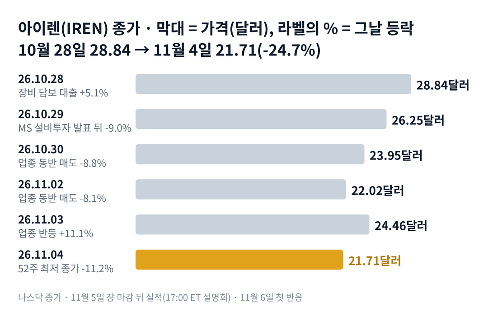

## 짧은 답

> **핵심:** 아이렌은 실적 하루 전 52주 최저 종가 21.71달러까지 내렸고, 그 5거래일 동안 회사 소식은 없었습니다. 과거 실적 9번 가운데 떨어지는 채로 실적을 맞은 4번은 다음 날 3번 올랐지만, 그 기록이 이번에도 이어진다는 보장은 없습니다.

실적을 하루 앞둔 주식이 5거래일 만에 4분의 1 가까이 빠졌습니다. 회사 소식이 하나도 없었는데, 무엇이 값을 끌어내렸을까요?

아이렌 주가는 10월 28일 종가 28.84달러에서 11월 4일 종가 21.71달러로 24.7% 내렸습니다. 다섯 거래일 가운데 4거래일은 8% 넘게 빠진 날이었습니다. 11월 4일 종가는 지난 1년 가운데 가장 낮습니다. 그 사이 회사는 새 공시도 보도자료도 내지 않았습니다.

움직임은 회사 밖에서 시작됐습니다. 10월 28일 장 마감 뒤 마이크로소프트가 설비투자(데이터센터와 장비에 쓰는 돈)를 시장 예상보다 적게 발표했습니다. 다음 날 아이렌은 9.0% 내렸습니다. 그 뒤 코어위브·네비우스 같은 인공지능 클라우드 회사들이 거의 같은 폭으로 함께 빠졌습니다.

이 글은 아이렌의 지난 실적 9번을 '발표 전 5거래일 흐름'과 '다음 날 반응'으로 나란히 놓습니다. 떨어지는 채로 실적을 맞았을 때와 오르는 채로 맞았을 때가 어떻게 달랐는지 봅니다. 그리고 11월 5일 실적 뒤 무엇으로 판정할지 정리합니다.

> **유의사항** 저자는 금융·투자 자문가가 아닙니다. 이 글은 공개 공시와 시세를 정리한 교육용 분석이며 특정 매매를 권하지 않습니다. 과거의 주가 반응이 미래에 반복된다는 보장은 없고, 아이렌은 하루 10% 넘게 움직이는 날이 잦은 종목입니다. 이 글은 11월 5일 실적 발표 전에 썼습니다. 실제 투자 전에는 최신 가격과 공시를 직접 확인하세요.

## 지난 리포트 이후

[지난 리포트](/r/iren-2026-10-4/)는 10월 28일 종가 28.84달러를 기준으로 썼습니다. 예측 성적은 적중 1 · 부분 적중 2 · 빗나감 1 · 진행 중 2입니다.

| 지난 점검 항목 · 당시 기준 | 판정 및 실제 결과(11월 4일) |
| --- | --- |
| **진단: 국면 B 유지** 조달·업종 비관·52주 최저 신호 | **[적중]** 11월 4일 종가 21.71달러, 52주 최저 |
| **시나리오 2: 실적 실망으로 되돌림** 실적 다음 날 하락 | **[부분 적중]** 되돌림은 실적 전에 왔고, 계기는 업종 매도 |
| **시나리오 4: 25.51달러 아래** 52주 최저 23.72달러 재시험 | **[부분 적중]** 실적·조달 없이 두 선 모두 깨짐 |
| **점검: 23.72달러 방어** 10월 26일 장중 최저 | **[빗나감]** 10월 30일 장중 23.06달러 |
| **시나리오 1·3** 반등 지속 · 실적 뒤 조달 | **[진행 중]** 11월 19일 판정, 지금 25.51달러보다 14.9% 낮음 |

빗나간 부분은 순서입니다. 지난 리포트는 실적이 되돌림의 계기가 될 것으로 봤습니다. 실제로는 실적 일주일 전 마이크로소프트 발표와 업종 매도가 먼저 값을 끌어내렸습니다.

## 1부. 아이렌은 어떤 회사이고, 무엇으로 돈을 버는가

> **핵심:** 아이렌은 그래픽 처리 장치 연산을 빌려주는 인공지능 클라우드로 옮겨 가는 회사입니다. 계약은 이미 크지만, 그 돈은 데이터센터 용량을 완성해 넘긴 뒤에야 매출로 들어옵니다.

아이렌은 오스트레일리아 시드니에 본사를 둔 데이터센터 회사입니다. 처음에는 비트코인 채굴로 돈을 벌었습니다. 지금은 같은 전력과 건물에 인공지능 연산 장비를 들여, 그 연산을 빌려주는 사업으로 옮겨 가고 있습니다.

돈을 버는 방식은 임대에 가깝습니다. 아이렌이 그래픽 처리 장치 서버를 사서 데이터센터에 설치하면, 고객이 그 연산을 몇 년 단위로 빌려 쓰고 사용료를 냅니다. 이런 회사를 흔히 '네오클라우드'라고 부릅니다. 거대 클라우드 회사 대신 장비를 대량으로 사서 빌려주는 신생 인공지능 클라우드라는 뜻입니다. 코어위브, 네비우스가 같은 무리입니다.

마이크로소프트가 중요한 이유는 가장 큰 손님이기 때문입니다. 아이렌은 2025년 11월 마이크로소프트와 5년 97억 달러, 2026년 5월 엔비디아와 5년 34억 달러 계약을 맺었습니다. 다만 계약을 맺었다고 바로 매출이 생기지는 않습니다. 먼저 데이터센터를 짓고, 장비를 들이고, 그 용량을 고객이 실제로 쓸 수 있게 넘겨야(인도) 사용료가 들어옵니다. 그래서 마이크로소프트가 외부 용량을 늦게 받는다고 말하면, 아이렌의 매출이 들어오는 날짜도 함께 밀릴 수 있다는 걱정이 생깁니다.

지금 몸값은 계약 규모에 비해 많이 내려와 있습니다. 회사가 밝힌 계약 연환산 매출은 약 40억 달러입니다. 계약이 모두 돌아갈 때 1년에 들어올 매출이라는 뜻입니다. 반면 증권사들이 예상한 이번 1분기 매출은 약 2억 2,800만 달러입니다. 네 분기를 더해도 약 9억 달러로, 40억 달러의 4분의 1에 못 미칩니다. 그 차이가 아직 인도되지 않은 용량입니다.

### 숫자로 본 지금의 크기(11월 4일 기준)

| 항목 | 값 · 계산 근거 |
| --- | --- |
| 11월 4일 종가 | **21.71달러** 52주 최저 종가, 장중 최저 21.05달러 |
| 시가총액 | **약 86억 5,000만 달러** 21.71달러 × 3억 9,856만 주(9월 18일 기준) |
| 52주 최고 종가 | **76.41달러** 2025년 11월 5일, 지금은 그 대비 -71.6% |
| 계약 연환산 매출 | **약 40억 달러** 계약이 모두 돌아갈 때 1년치, 회사 발표 |
| 1분기 매출 예상 | **약 2억 2,800만 달러** 지금 한 분기 실제 규모, 증권사 평균(MarketBeat 집계) |

시가총액은 계약 연환산 매출의 약 2배 남짓까지 내려왔습니다. 다만 그 40억 달러는 용량이 일정대로 갖춰져야 들어오는 돈입니다. 이번 실적에서 숫자보다 일정이 중요한 것은 그래서입니다.

위 그림처럼 하락은 하루에 몰리지 않았습니다. 10월 29일부터 다섯 거래일 동안 4거래일은 8% 넘게 빠졌고, 하루는 11.1% 올랐습니다. 그렇다면 그 다섯 거래일 동안 값을 끌어내린 것은 정확히 무엇이었을까요?

## 2부. 다섯 거래일에 겹친 세 가지 사건

> **핵심:** 이번 하락에는 성격이 다른 세 가지 사건이 겹쳤습니다. 큰손 고객의 사업 전망, 업종 전체의 매도, 아직 현실이 되지 않은 규제 걱정입니다.

첫 번째는 사업 전망에 관한 사건입니다. 10월 28일 장 마감 뒤 마이크로소프트는 분기 설비투자를 452억 달러로 발표했습니다. 보도로 전해진 시장 예상 507억 달러보다 적었습니다. 최고재무책임자는 외부 업체가 맡은 데이터센터 용량의 인도가 늦어졌다고 설명했습니다. 외부 업체 데이터센터는 아이렌·코어위브 같은 회사가 빌려주는 용량입니다. 다음 날 아이렌은 9.0% 내렸습니다.

두 번째는 업종 전체의 매도입니다. 그 뒤 3거래일 동안 아이렌은 회사 소식이 없었습니다. 그런데도 코어위브·네비우스와 거의 같은 날, 같은 폭으로 움직였습니다. 10월 30일에는 반도체 업종도 함께 흔들렸습니다.

세 번째는 규제 걱정입니다. 11월 4일, 데이터센터 신설 제한을 공약한 후보가 텍사스 주지사 선거에서 이겼다는 보도가 나왔습니다. 아이렌의 큰 데이터센터 두 곳은 텍사스에 있습니다. 그날 아이렌은 11.2% 내렸습니다. 다만 이것은 보도 단계일 뿐, 실제 규제는 아직 없습니다.

### 다섯 거래일, 아이렌과 같은 업종

| 날짜 · 그날 함께 있던 일 | **아이렌** | 코어위브 · 네비우스 |
| --- | --- | --- |
| **2026.10.29** 마이크로소프트 설비투자 발표 다음 날 | **-9.0%** | -5.0% · -5.7% |
| **2026.10.30** 업종 동반 매도 반도체 상장지수펀드(ETF) -8.2% | **-8.8%** | -9.7% · -10.4% |
| **2026.11.02** 업종 동반 매도 | **-8.1%** | -8.6% · -8.3% |
| **2026.11.03** 업종 일제 반등 | **+11.1%** | +7.2% · +7.2% |
| **2026.11.04** 텍사스 선거 결과 보도 기간 최대 거래량 | **-11.2%** | -9.9% · -6.7% |

10월 28일 종가에서 11월 4일 종가까지로 보면 아이렌 -24.7%, 코어위브 -24.3%, 네비우스 -22.4%였습니다. 비트코인은 같은 기간 -1.0%로 거의 그대로였습니다. 시장이 아이렌을 채굴 회사가 아니라 인공지능 클라우드 회사로 보고 팔았다는 흔적입니다.

세 사건을 나란히 놓으면 공통점이 하나 보입니다. 모두 아이렌의 새로운 실적 악화나 계약 취소에서 비롯된 것은 아니라는 점입니다. 그렇다면 이렇게 회사 숫자 없이 떨어지는 채로 실적을 맞은 적이 전에도 있었을까요?

## 3부. 과거 실적 9번, 떨어진 채로 맞았을 때

> **핵심:** 2024년 8월 이후 실적 9번 가운데 발표 전 5거래일이 마이너스였던 것은 4번이고, 그중 3번은 다음 날 올랐습니다. 다만 이번처럼 20% 넘게 빠진 채로 맞은 것은 2026년 2월 한 번뿐입니다.

이 기록을 보는 이유는 지금 상황이 '실적 직전에 크게 빠진 상태'이기 때문입니다. 과거에도 비슷한 조건이었던 실적이 다음 날 어떻게 움직였는지 보면, 이번 실적을 읽을 출발점이 생깁니다.

고른 기준은 하나입니다. 아이렌이 미국 공시(8-K·6-K)로 분기 실적을 낸 날 가운데, 시세를 이어서 확인할 수 있는 2024년 8월 이후의 9번입니다. 9번 모두 장 마감 뒤에 나왔습니다. 그래서 발표 날 종가를 기준점으로 삼았습니다.

'발표 전 5거래일'은 발표 날 종가를 다섯 거래일 전 종가와 비교한 값입니다. 예를 들어 이번에는 11월 4일 종가 21.71달러를 다섯 거래일 전인 10월 28일 종가 28.84달러와 비교해 -24.7%가 나옵니다. '다음 날'은 발표 다음 거래일 종가, '20거래일 뒤'는 20번째 거래일 종가를 발표 날 종가와 비교한 값입니다.

### 아이렌 실적 9번, 발표 전 흐름과 그 뒤

| 발표일 · 발표 전 5거래일 | 다음 날 | 20거래일 뒤 |
| --- | --- | --- |
| **2024.08.28** 결산 발표 전 -14.5% | +14.8% | +23.0% |
| **2024.11.26** 1분기 발표 전 -8.2% | +29.7% | +18.6% |
| 2025.02.12 2분기 발표 전 +17.5% | +0.5% | -48.1% |
| 2025.05.14 3분기 발표 전 +21.3% | -2.8% | +27.6% |
| 2025.08.28 결산 발표 전 +17.6% | +14.9% | +81.7% |
| 2025.11.06 1분기 발표 전 +15.0% | -6.8% | -33.2% |
| **2026.02.05** 2분기 발표 전 -33.5% | +5.1% | -7.8% |
| 2026.05.07 3분기 발표 전 +24.9% | +7.7% | -4.4% |
| **2026.08.27** 결산 발표 전 -4.9% | -12.5% | +8.9% |

굵게 쓴 네 줄이 떨어진 채로 실적을 맞은 경우입니다. 분기 이름은 아이렌의 회계연도 기준이고, 회계연도는 7월에 시작합니다.

> **이번(미확정):** 2026.11.05 2027 회계연도 1분기 · 발표 전 -24.7%(11월 4일 종가 기준, 11월 5일 종가가 나오면 바뀜) · 다음 날은 11월 6일, 20거래일 뒤는 12월 4일 판정

여기서 기억할 사실은 두 가지입니다. 떨어진 채로 맞은 4번 가운데 3번은 다음 날 올랐고, 한 번은 12.5% 내렸습니다. 오르는 채로 맞은 5번은 다음 날 3번 오르고 2번 내렸습니다.

이번과 가장 가까운 사례는 2026년 2월입니다. 그때도 발표 전 5거래일에 30% 넘게 빠진 채로 실적을 맞았습니다. 다음 날은 5.1% 올랐지만, 20거래일 뒤에는 발표 날보다 7.8% 낮았습니다.

기록이 보여 주는 것은 여기까지입니다. 많이 빠진 채로 맞은 실적은 첫날 반등이 잦았습니다. 하지만 첫날 반등이 한 달 뒤까지 이어진다는 증거는 없습니다. 그렇다면 왜 첫날과 한 달 뒤의 방향이 달라졌을까요?

## 4부. 다음 날과 한 달 뒤가 달랐던 이유

> **핵심:** 다음 날은 실적이 '걱정했던 것보다 나은가'에 반응했고, 한 달 뒤는 실적 뒤에 새로 나온 소식, 특히 돈을 어떻게 구하는지가 방향을 정했습니다.

두 시점은 묻는 질문이 다릅니다. 다음 날의 질문은 '이 숫자가 기대보다 나은가'입니다. 그래서 그 전에 얼마나 올랐거나 빠졌는지가 크게 작용합니다. 한 달 뒤의 질문은 '이 회사가 계획대로 갈 수 있는가'입니다. 그 답은 실적 뒤 몇 주 동안 나온 조달 발표와 업종 분위기에서 나왔습니다.

첫날을 가른 것은 기대의 높이였습니다. 발표 전에 많이 오른 날은 좋은 숫자도 '이미 아는 이야기'로 받아들여졌습니다. 2025년 11월 실적이 그랬습니다. 마이크로소프트 계약 3거래일 뒤였고, 오른 채로 실적을 맞았는데 다음 날 6.8% 내렸습니다. 반대로 많이 빠진 채로 맞은 날은 실망할 여지가 이미 줄어 있었습니다.

한 달 뒤를 가른 것은 돈의 값이었습니다. 아이렌은 장비를 살 돈을 새 주식과 전환사채(나중에 주식으로 바꿀 수 있는 회사채)로 마련해 왔습니다. 지난 리포트들에서 본 것처럼, 그런 발표가 나온 다음 정규장에서는 2.6~15.2% 내렸습니다. 2026년 2월이 좋은 예입니다. 첫날은 '생각보다 괜찮다'는 안도로 올랐지만, 그 뒤 한 달은 업종 전체의 부채 걱정이 값을 정했습니다.

이번에는 출발점도 다릅니다. 마이크로소프트가 외부 데이터센터 인도 지연을 직접 말했기 때문에, 관심은 숫자보다 일정에 쏠려 있습니다. 회사는 마이크로소프트용 2~4단계 인도 목표를 2026년 4분기로 밝혀 왔습니다. 이 목표가 그대로인지가 이번 실적에서 가장 먼저 볼 문장입니다.

과거 기록이 알려 주는 것은 분명합니다. 떨어진 채로 맞은 실적은 첫날 반등이 잦았지만, 한 달 뒤 방향은 실적 뒤의 조달이 정했습니다. 결국 앞으로 확인할 것은 두 가지입니다. 하나는 11월 6일 첫 반응이 오르는가, 다른 하나는 11월 19일까지 신주·전환사채 발표 없이 21.71달러 위를 지키는가입니다. 이 두 조건으로 다음 2주를 나누면 어떤 갈림길이 나올까요?

## 5부. 실적 뒤 2주, 네 가지 시나리오

> **핵심:** 지금은 업종 매도에 끌려 내려온 단계이고, 11월 6일 첫 반응과 11월 19일까지의 조달 여부가 다음 단계를 가릅니다.

> **국면 정의(아이렌 시리즈 공통):** 국면 A(재평가 확장) — 대형 계약과 인도가 이어지며 업종보다 크게 오르는 때. 국면 B(업종 매도) — 회사 소식 없이 업종 매도와 조달 걱정에 끌려 내려가는 때. 국면 C(실행 확인) — 인도가 일정대로 나오고 석 달 넘게 대규모 조달이 없는 때.

**2026년 11월 4일 진단: 국면 B(업종 매도에 끌려 내려가는 단계) 유지(지난 리포트 진단 유지).** 지난 리포트의 다섯 신호 가운데 '52주 최저 경신'과 '업종 비관 발언과 동반 매도' 두 개가 새로 확인됐습니다. 한 달 안의 조달 발표는 10월 28일 장비 담보 대출 하나뿐입니다.

**판정 기준 두 가지:** 첫째, 11월 6일 첫 반응입니다. 11월 6일 종가가 11월 5일 종가보다 높으면 '상승'으로 봅니다. 둘째, 11월 19일의 자리입니다. 그날 종가가 11월 4일 종가 21.71달러보다 높은지, 그때까지 신주·전환사채 발표가 있었는지를 봅니다. 11월 19일은 10월 22일 급락 묶음 뒤 20번째 거래일이기도 합니다.

### 앞으로 일어날 수 있는 일

**확인된 사실:** 11월 4일 종가는 52주 최저 종가이고, 5거래일 동안 회사 공시는 없었습니다. 같은 업종은 비슷한 폭으로 함께 내렸습니다. **과거 기록:** 3부 기록표에서 떨어진 채로 맞은 실적 4번 중 3번은 다음 날 올랐습니다. 그중 가장 가까운 2026년 2월은 한 달 뒤 더 낮았습니다. **추정:** 아래 가능성은 '회사와 시장에서 이 일이 일어날' 확률을 분석자가 주관적으로 매긴 값입니다. 주가가 오를 확률이 아닙니다. 네 경우는 서로 겹치지 않으므로 표에 적은 '약 N%'는 더해서 100%가 되도록 맞췄습니다. 괄호 안 구간은 그 값이 얼마나 흔들릴 수 있는지를 보여 주는 폭이라, 구간끼리 더해서 읽지 않습니다.

| 시나리오(판정 11월 6일·19일) | 첫날 · 19일 | 가능성(추정) |
| --- | --- | --- |
| **1 · 안도 반등이 이어짐** | 상승 · 21.71달러 위 | 중간 약 35% (30~40%) |
| 2 · 첫날만 반등 | 상승 · 21.71달러 아래 | 낮음 약 20% (15~25%) |
| 3 · 실적 실망 추가 하락 | 하락 · 조달 없음 | 중간 약 30% (25~35%) |
| 4 · 실적과 조달이 겹친 하락 | 하락 · 신주·전환사채 발표 | 낮음 약 15% (10~20%) |

첫날과 2주 뒤는 따로 읽어야 합니다. 첫날 오르는 경우는 1과 2를 더한 약 55%로 봤습니다. 그러나 첫날 오른 뒤 11월 19일까지 21.71달러 위를 지키는 경우는 1의 약 35%뿐입니다. 첫날 반등과 중기 회복은 다른 질문이라는 뜻입니다.

시나리오 1을 가장 높게 본 이유는 떨어진 채로 맞은 실적 4번 중 3번이 다음 날 올랐고, 그중 두 번은 20거래일 뒤에도 높았기 때문입니다. 이 값은 과거 빈도에서 나온 추정이지, 이번 실적이 좋을 것이라는 판단이 아닙니다.

시나리오 3을 그다음으로 둔 근거는 마이크로소프트가 외부 용량 인도 지연을 직접 언급했다는 점입니다. 아이렌의 인도 일정에 같은 말이 나오면, 숫자와 상관없이 실망으로 받아들여질 수 있습니다. 그렇다면 이 진단이 틀릴 수 있는 지점은 어디일까요?

## 6부. 세 갈래 위험과 체크리스트

> **핵심:** 위험은 사업 실행, 자금 조달, 외부 환경 세 갈래입니다. 실적 9번은 작은 표본이고, 이 글은 실적 발표 전에 썼습니다.

먼저 이 분석의 한계입니다. 3부 표는 '떨어진 채로 맞으면 오른다'는 규칙이 아닙니다. 9번은 작은 표본이고, 그중 마이크로소프트 계약 뒤의 실적은 4번뿐입니다. 그 사이 회사의 사업도 채굴에서 인공지능 클라우드로 바뀌었습니다.

첫째 갈래는 사업 실행입니다. 마이크로소프트용 용량 인도가 늦어지면 계약 매출이 들어오는 시점도 밀립니다. 계약 금액은 그대로여도, 올해 들어올 돈이 내년으로 넘어갈 수 있습니다.

둘째 갈래는 자금 조달입니다. 장비를 살 돈을 새 주식이나 전환사채로 구하면 희석이 생깁니다. 희석은 주식 수가 늘어 기존 주주 한 주가 회사에서 차지하는 비율이 작아지는 것입니다. 3부와 4부에서 본 것처럼, 한 달 뒤 방향을 가장 자주 바꾼 것이 이 갈래였습니다.

셋째 갈래는 외부 환경입니다. 마이크로소프트 같은 큰손 고객의 투자 속도, 인공지능 클라우드 업종 전체의 분위기, 텍사스의 데이터센터 규제 논의가 여기에 들어갑니다. 텍사스 건은 아직 보도 단계라 실제 규제로 이어질지 알 수 없습니다.

마이크로소프트 설비투자의 시장 예상치와 텍사스 선거 관련 내용은 회사 공시가 아니라 보도로 확인했습니다. 11월 4일 시간 외 거래는 이 글의 숫자에 넣지 않았습니다.

- ☐ 11월 5일 실적에서 1분기 매출이 증권사 예상 약 2억 2,800만 달러를 넘었나
- ☐ 11월 5일 실적에서 마이크로소프트용 2~4단계 인도 목표가 2026년 4분기 그대로인가
- ☐ 11월 6일 첫 반응이 실적 9번의 범위(-12.5~+29.7%) 안인가
- ☐ 11월 19일 종가가 11월 4일 종가 21.71달러보다 높은가
- ☐ 11월 19일까지 신주·전환사채 발표가 없는가
- ☐ 11월 24일 정기 주주총회의 자사주 매입 승인 안건이 통과되는가

**기억할 판단 기준 세 가지:** 첫째, 이번 하락은 회사 소식이 아니라 큰손 고객의 투자 계획과 업종 매도에서 나왔습니다. 둘째, 떨어진 채로 맞은 실적은 첫날 반등이 잦았지만 한 달 뒤는 그렇지 않았던 적이 있습니다. 셋째, 실적 뒤 2주 동안의 조달 여부가 한 달 방향을 가르는 가장 빠른 신호입니다.

다음 갱신은 11월 5일 실적과 11월 6일 첫 반응을 본 뒤에 합니다.
