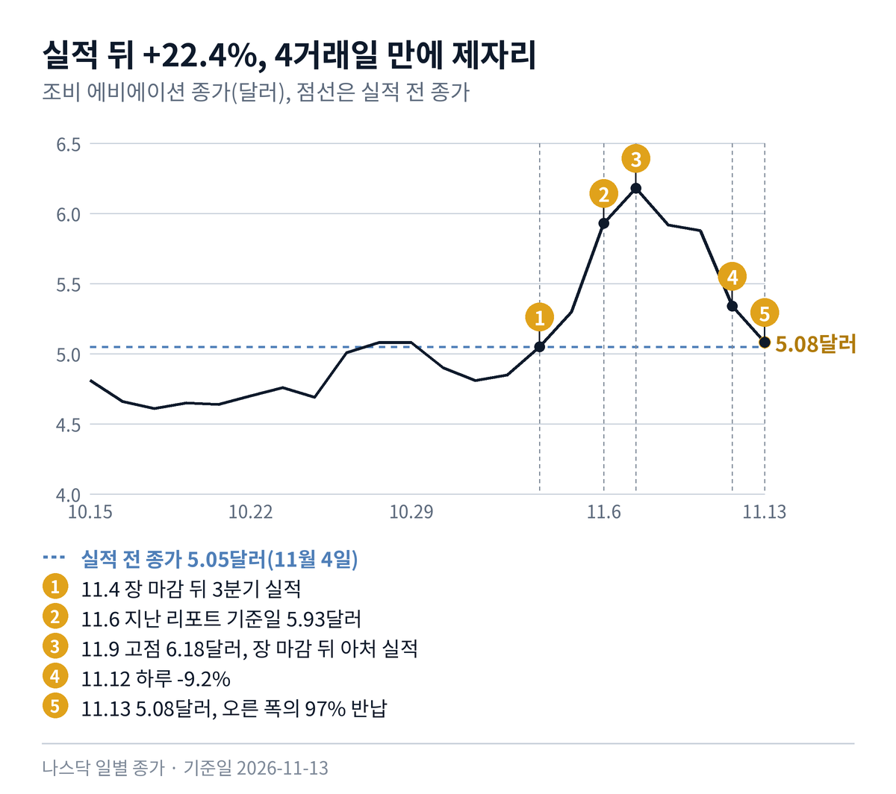
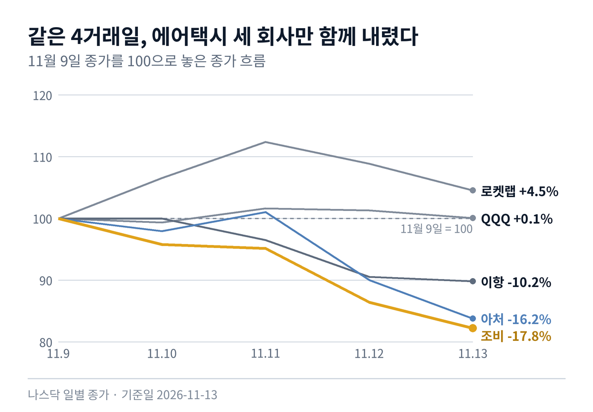
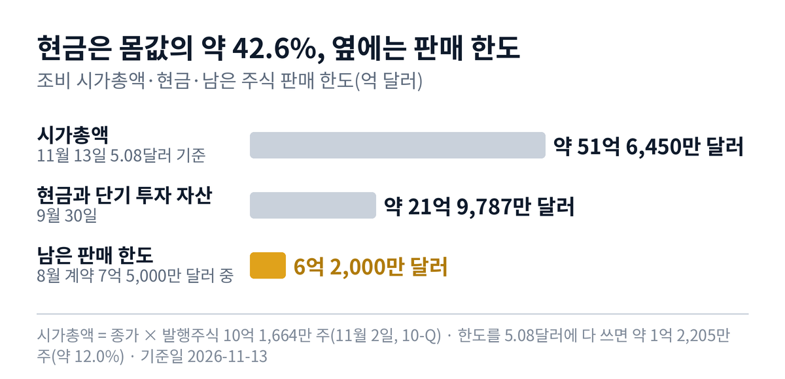
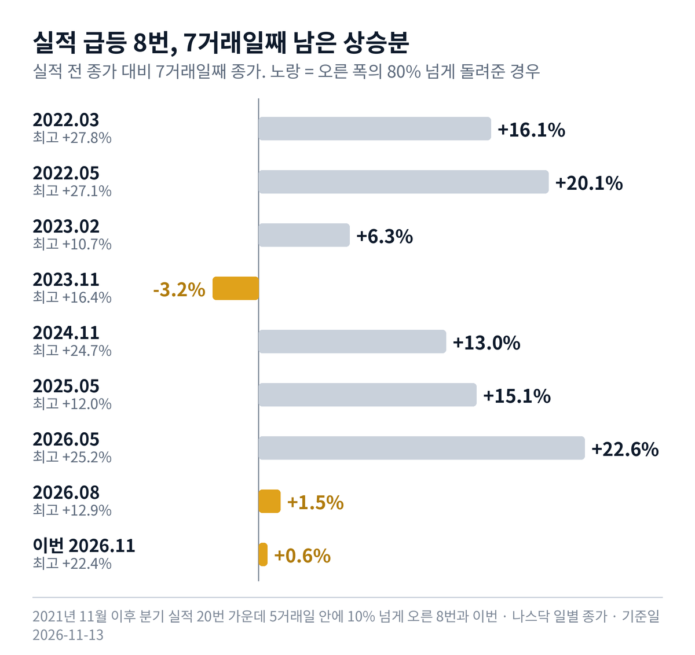
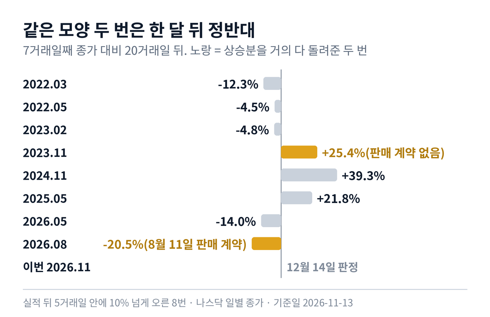
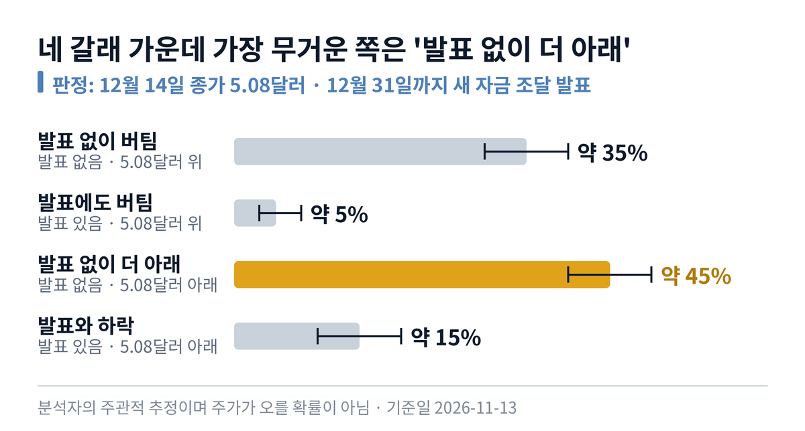

조비 에비에이션 주가는 실적 전 11월 4일 종가 대비 3거래일 만에 22.4% 올라, 11월 9일 6.18달러가 됐습니다. 그런데 다음 4거래일 동안 거의 그만큼 내려, 11월 13일 5.08달러로 마쳤습니다. 실적 전 종가 5.05달러와 겨우 0.6% 차이입니다. 오른 폭의 97%를 돌려준 셈입니다. 그 4거래일 동안 회사는 공시를 하나도 내지 않았습니다. 좋았던 실적은 그대로인데, 주가는 왜 제자리로 돌아왔을까요?

> **유의사항** 저자는 금융·투자 자문가가 아닙니다. 이 글은 공개 공시와 시세를 정리한 교육용 분석이며 특정 종목의 매수·매도를 권하지 않습니다. 과거 패턴은 미래 수익을 보장하지 않고, 조비 에비에이션은 실적 날 하루에 두 자릿수로 움직인 적이 여러 번 있는 종목입니다. 실제 투자 전에는 최신 공시를 직접 확인하세요.

이 글은 [11월 9일 리포트](/r/joby-2026-11/)를 잇는 후속편입니다. 그 리포트는 실적 전 종가 대비 2거래일 만에 17.4% 오른 장면을 다뤘습니다. 그리고 과거 같은 급등 네 번 가운데 2거래일째 가격까지 지킨 것은 한 번뿐이었다고 적었습니다. 일주일이 지난 지금 지난 예측 성적은 적중 하나, 빗나감 없음, 진행 중 넷입니다.

지난 리포트는 '5거래일째인 11월 11일 종가가 실적 첫날 종가보다 높은가'를 보조 확인 항목으로 뒀습니다. 이것은 맞았습니다. 11월 11일 종가 5.88달러는 실적 첫날 종가 5.30달러보다 높았습니다. 나머지는 아직 판정 전입니다. 다만 방향은 보입니다. 지난 리포트가 '지키기 어렵다'고 본 2거래일째 가격 5.93달러는 이미 14.3% 아래에 있습니다. 12월 3일 판정선인 실적 전 종가 5.05달러와는 3센트 차이입니다.

조비가 어떤 회사인지 짧게 짚겠습니다. 조비는 헬리콥터처럼 떠서 비행기처럼 나는 전기 에어택시를 만드는 미국 회사입니다. 최대 주주는 토요타입니다. 돈을 버는 방식은 결국 에어택시 운임이지만, 아직 에어택시로 손님을 태우지는 못합니다. 미국 연방항공청의 최종 인증을 받아야 요금을 받을 수 있기 때문입니다. 그래서 지금 매출은 대부분 2025년에 인수한 헬리콥터 승객 사업 '블레이드'에서 나옵니다.

11월 4일 장 마감 뒤 나온 3분기 실적은 좋았습니다. 매출은 5,509만 달러로, 시장 예상 약 4,040만 달러를 크게 넘었습니다. 회사는 올해 매출 전망도 올렸습니다. 다음 날 기술주가 크게 빠졌는데도 조비는 올랐고, 11월 9일까지 3거래일 연속 올랐습니다. 날짜별 종가는 끝의 첫 표에 있습니다.

방향이 바뀐 것은 11월 9일 장 마감 뒤입니다. 그날 저녁 경쟁사 아처 에비에이션이 3분기 실적을 냈습니다. 다음 날 조비와 아처는 함께 조금 내렸습니다. 하루 쉬어 간 뒤 11월 12일에는 크게 빠졌습니다. 조비는 9.2%, 아처는 10.9% 내렸고, 중국 무인 에어택시 회사 이항도 6.2% 내렸습니다. 같은 날 나스닥 100 펀드(QQQ)는 0.3% 내리는 데 그쳤습니다. 다음 날 조비는 더 내려 5.08달러가 됐습니다.

업종을 나란히 보면 장면이 분명해집니다. 11월 9일 종가 대비 13일까지 조비는 17.8%, 아처는 16.2%, 이항은 10.2% 내렸습니다. 반면 지난 리포트에서 함께 본 로켓랩은 4.5% 올랐고, QQQ는 0.1% 올랐습니다. 소형주 펀드(IWM)는 1.8% 내렸습니다. 시장 전체가 아니라 에어택시 업종만 따로 내린 4거래일이었습니다.

조비 쪽 서류를 확인해 봤습니다. 11월 5일 분기 보고서(10-Q) 뒤 11월 13일까지 미국 증권거래위원회에 낸 서류가 없었습니다. 하락 이유를 밝힌 보도도 찾지 못했습니다. 실적 숫자가 바뀐 것도, 인증 일정이 밀린 것도 아닙니다. 그렇다면 무엇이 오른 폭을 지웠을까요? 공시가 직접 답하지는 않습니다. 다만 숫자로 보면 시장이 반영했을 법한 점이 둘 있습니다.

첫째는 실적의 내용입니다. 매출 서프라이즈의 대부분은 헬리콥터 사업에서 나왔습니다. 에어택시 사업의 일정은 이번에 하나도 바뀌지 않았습니다. 조비만의 새 숫자가 없는 상태에서 경쟁사 아처가 실적을 냈고, 그 뒤 두 회사는 거의 같은 폭으로 내렸습니다. 4거래일 하락 폭 차이는 1.6%포인트였습니다. 업종이 함께 묶여 움직였다고 볼 만한 숫자입니다.

둘째는 주식 판매 창구입니다. 조비는 8월 11일 7억 5,000만 달러 규모의 시장 판매 계약(ATM)을 맺었습니다. ATM은 회사가 증권사에 맡겨 시장에서 새 주식을 조금씩 파는 방식입니다. 10-Q에 따르면 9월 말까지 2,017만 주를 팔았습니다. 남은 한도는 6억 2,000만 달러입니다. 이 창구는 새 발표 없이도 열려 있습니다. 언제, 얼마나 팔지는 회사가 정합니다. 이번 4거래일에 실제로 팔았는지는 아직 알 수 없습니다.

그 크기를 지금 주가로 재 보겠습니다. 9월 말 현금은 11월 13일 시가총액의 약 42.6%입니다. 남은 판매 한도를 5.08달러에 모두 쓰면, 지금 발행주식의 약 12.0%만큼 새 주식이 나옵니다. 반대로 지금 주가는 3분기에 판 평균 가격 약 6.44달러보다 21% 낮습니다. 싼값에 팔기 싫다면 판매 속도를 늦출 이유도 됩니다.

이제 숨은 기록으로 가 보겠습니다. 이번 장면의 모양은 '실적 뒤 크게 올랐다가 일주일 남짓 만에 거의 다 돌려준 것'입니다. 그래서 같은 모양을 조비의 과거 실적에서 찾았습니다. 2021년 11월 이후 분기 실적 발표는 이번 전까지 20번이었습니다. 그중 실적 뒤 5거래일 안에 종가가 실적 전보다 10% 넘게 오른 것은 8번입니다.

8번 가운데 6번은 7거래일째에도 실적 전보다 6% 넘게 높았습니다. 오른 폭의 절반 이상을 지킨 경우입니다. 이번처럼 7거래일째 오른 폭의 80% 넘게 돌려준 것은 두 번뿐이었습니다. 2023년 11월과 2026년 8월입니다. 이번 11월 13일이 실적 뒤 7거래일째이니, 같은 자리에서 비교할 수 있습니다.

두 번은 출발이 닮았습니다. 2023년 11월에는 실적 전 종가 대비 2거래일 만에 16.4% 올랐다가, 7거래일째 그보다 3.2% 낮았습니다. 2026년 8월에는 실적 전 종가 대비 3거래일 만에 12.9% 올랐습니다. 그리고 7거래일째에는 1.5% 높은 데 그쳤습니다. 그런데 그 뒤 20거래일은 정반대였습니다.

2023년 11월은 7거래일째 종가 대비 20거래일 뒤 25.4% 올랐습니다. 그 사이 회사가 새 주식을 판다고 밝힌 서류는 없었습니다. 2026년 8월은 같은 자리에서 20.5% 내렸습니다. 이때는 고점 다음 날인 8월 11일, 지금 남아 있는 바로 그 7억 5,000만 달러 시장 판매 계약이 발표됐습니다. 판매 계약 발표와 그 뒤 하락이 같은 시기에 겹쳤습니다. 다만 두 번뿐인 기록이라 계약이 하락의 원인이었다고 단정할 수는 없습니다.

나머지 6번도 함께 보면 그림이 조금 넓어집니다. 이 6번에서 한 달 뒤가 7거래일째보다 높았던 것은 2번이었습니다. 8번 전체로는 3번입니다. 실적 급등 뒤 한 달은 아래쪽이 더 많았습니다. 2023년 11월의 3분기 보고서에는 시장 판매 계약이 아예 없었습니다.

이번은 두 번 가운데 어디에 가까울까요? 2023년 11월처럼 새 발표는 없습니다. 2026년 8월과 다른 점이기도 합니다. 다만 그때 맺은 판매 계약이 6억 2,000만 달러 남은 채 열려 있어, 앞으로의 변수로 남아 있습니다. 새 주식이 실제로 팔렸는지는 2027년 2월 연간 보고서에서야 확인됩니다. 그 전에는 발행주식 수가 바뀌는 것으로만 짐작할 수 있습니다.

지금 위치를 짚겠습니다. 11월 13일 종가는 실적 전 자리로 돌아왔고, 2025년 마지막 거래일 13.20달러보다는 61.5% 낮습니다. 당장 돈이 모자란 회사는 아닙니다. 9월 말 현금은 회사가 밝힌 하반기 현금 사용 전망의 다섯 배가 넘습니다. 두 숫자는 끝의 '돈과 주식으로 본 지금' 표에 나란히 적었습니다.

과거 기록부터 다시 세 보겠습니다. 실적 급등 8번 가운데 한 달 뒤가 7거래일째보다 높았던 것은 3번입니다. 같은 모양 2번에서는 1번이었습니다. 앞날은 이 기록 위에서 두 질문으로 나눴습니다. 하나는 12월 14일 종가가 지금 5.08달러 위인가입니다. 12월 14일은 11월 13일에서 20거래일째로, 과거 기록과 같은 자리입니다. 다른 하나는 12월 31일까지 새 자금 조달이 발표되는가입니다. 두 답이 각각 둘로 갈리니 네 갈래가 나옵니다. '발표 없이 버팀', '발표에도 버팀', '발표 없이 더 아래', '발표와 하락'입니다.

'발표 없이 5.08달러 아래'를 가장 무겁게 본 이유는 둘입니다. 같은 모양 두 번 가운데 판매 창구가 열려 있던 쪽이 아래로 갔습니다. 8번 중 5번은 한 달 뒤 7거래일째보다 낮았습니다. 다만 표본이 작고, 업종 전체가 반등하면 함께 오를 수 있어 그 비율보다 낮췄습니다. 새 발표가 있는 두 갈래는 합쳐 약 20%로 봤습니다. 이번 판정 기간은 6주 남짓으로 짧고, 이미 열린 판매 창구는 새 발표 없이도 쓸 수 있습니다. 반대로 현금은 분기마다 약 2억 달러씩 줄어 근거가 약한 갈래라, 범위를 넓게 잡았습니다. 갈래별 숫자는 끝의 시나리오 표에 있습니다. 이 숫자들은 주가가 오를 확률이 아니라 과거 빈도와 지금 신호를 보고 분석자가 주관적으로 매긴 추정입니다.

가장 큰 한계는 표본입니다. 같은 모양은 두 번뿐이고, 이번 4거래일 하락의 이유는 공시로도 보도로도 확인하지 못했습니다. 남은 판매 한도가 쓰이면 주식 수가 늘어 기존 주주 한 주의 비중이 작아지고, 2032년 만기 전환사채 6억 9,000만 달러도 남아 있습니다. 사업 쪽 위험은 일정입니다. 인증 비행 시험이 2027년 상반기보다 늦어지면 에어택시 매출도 함께 밀립니다. 에어로소닉 소송의 1억 1,690만 달러 배상 평결에 대한 항소도 진행 중입니다.

조비의 실적 숫자는 일주일 전과 같고, 주가만 실적 전 자리로 돌아왔습니다. 에어택시 업종이 함께 팔렸고, 그 아래에는 열려 있는 주식 판매 창구가 있었습니다. 과거 같은 모양 두 번 가운데 아래로 간 쪽에서 그 창구가 처음 열렸습니다. 다음 갱신은 12월 3일과 12월 14일 종가를 본 뒤에 하고, 그 전에 새 자금 조달 소식이 나오면 앞당깁니다.

## 숫자로 다시 보기

### 실적 뒤 7거래일

| 날짜 · 장면 | 조비 종가 | 실적 전 종가 대비 |
| --- | --- | --- |
| **11.04 장 마감 뒤 3분기 실적** | **5.05달러** | 기준 |
| 11.05 QQQ -6.5%인 날 | 5.30달러 | +5.0% |
| 11.06 지난 리포트 기준일 | 5.93달러 | +17.4% |
| **11.09 고점, 장 마감 뒤 아처 실적** | **6.18달러** | **+22.4%** |
| 11.10 | 5.92달러 | +17.2% |
| 11.11 5거래일째 | 5.88달러 | +16.4% |
| 11.12 아처 -10.9%인 날 | 5.34달러 | +5.7% |
| **11.13 7거래일째** | **5.08달러** | **+0.6%** |

### 같은 날 에어택시·기술주 성적

| 종목 · 11.09→11.13 | 11.10 하루 | 11.12 하루 |
| --- | --- | --- |
| **조비(JOBY) -17.8%** | **-4.2%** | **-9.2%** |
| 아처(ACHR) -16.2% | -2.1% | -10.9% |
| 이항(EH) -10.2% | 0.0% | -6.2% |
| 로켓랩(RKLB) +4.5% | +6.5% | -3.1% |
| QQQ +0.1% | -0.7% | -0.3% |

IWM은 같은 4거래일 -1.8%였습니다.

### 돈과 주식으로 본 지금(11월 13일 기준)

| 항목 | 값 · 근거 |
| --- | --- |
| 시가총액 | **약 51억 6,450만 달러** 5.08달러 × 10억 1,664만 주(11월 2일) |
| 현금과 단기 투자 자산 | **약 21억 9,787만 달러** 9월 30일 · 한 주에 약 2.16달러 |
| 남은 판매 한도 | **6억 2,000만 달러** 8월 계약 7억 5,000만 달러 중 |
| 한도를 지금 주가에 다 쓰면 | **약 1억 2,205만 주** 발행주식의 약 12.0% |
| 3분기 판매 | **2,017만 주** 평균 약 6.44달러 |
| 하반기 현금 사용 전망 | **3억 8,500만~4억 1,500만 달러** 3분기에 1억 9,500만 달러 사용 |
| 연간 매출 전망 | **1억 3,500만~1억 4,000만 달러** 11월 4일 상향 |

### 실적 뒤 5거래일 안에 10% 넘게 오른 8번

가운데 열은 실적 전 종가와 비교했고, 마지막 열은 7거래일째 종가와 비교했습니다.

| 실적 발표 · 5거래일 안 최고 | 7거래일째 | 그 뒤 20거래일 |
| --- | --- | --- |
| 2022.03 +27.8% | +16.1% | -12.3% |
| 2022.05 +27.1% | +20.1% | -4.5% |
| 2023.02 +10.7% | +6.3% | -4.8% |
| **2023.11 · 판매 계약 없음 +16.4%** | **-3.2%** | **+25.4%** |
| 2024.11 +24.7% | +13.0% | +39.3% |
| 2025.05 +12.0% | +15.1% | +21.8% |
| 2026.05 +25.2% | +22.6% | -14.0% |
| **2026.08 · 판매 계약 +12.9%** | **+1.5%** | **-20.5%** |
| **이번 2026.11 +22.4%** | **+0.6%** | 12월 14일 판정 |

굵게 쓴 두 번이 7거래일째 오른 폭의 80% 넘게 돌려준 경우입니다. 2026년 8월 판매 계약은 8월 11일 발표됐습니다. 2021년 11월 이후 분기 실적 20번에서 골랐고, 나스닥 일별 종가로 계산했습니다.

### 지난 예측 채점표

| 지난 점검 항목 · 당시 기준 | 판정과 실제 결과(11월 13일) |
| --- | --- |
| **5거래일째 첫날 종가 5.30달러 위** 보조 확인 | **[적중]** 11월 11일 5.88달러 |
| **12월 3일 실적 전 5.05달러 위** 급등 4번 중 3번 한 달 뒤 위 | **[진행 중]** 지금 5.08달러, 3센트 차이 |
| **12월 3일 2거래일째 5.93달러 위** 4번 중 1번만 지킴 | **[진행 중]** 지금 14.3% 아래 |
| **진단: 희석 국면 후반** 판매 한도 남음 | **[진행 중]** 새 공시 없음, 한도 6억 2,000만 달러 |
| **가장 높게 본 시나리오 2(약 40%)** 판매 지속 · 전망 달성 | **[진행 중]** 2027년 2월 4분기 실적 판정 |

### 앞으로 일어날 수 있는 일

실적 급등 8번 중 3번만 한 달 뒤 7거래일째보다 높았습니다. 아래 가능성은 분석자가 과거 빈도와 지금 신호를 보고 주관적으로 매긴 추정이며, 주가가 오를 확률이 아닙니다. 네 갈래는 겹치지 않아 더하면 100%입니다.

| 갈래(판정 12월 14일·31일) | 판정 조건 | 가능성(추정) |
| --- | --- | --- |
| 1 · 발표 없이 버팀 | 발표 없음 · 5.08달러 위 | 중간 약 35% (30~40%) |
| 2 · 발표에도 버팀 | 발표 있음 · 5.08달러 위 | 낮음 약 5% (3~8%) |
| **3 · 발표 없이 더 아래** | 발표 없음 · 5.08달러 아래 | 높음 약 45% (40~50%) |
| 4 · 발표와 하락 | 발표 있음 · 5.08달러 아래 | 낮음 약 15% (10~20%) |

'발표 있음'은 12월 31일까지 새 주식 공모, 판매 한도 증액, 새 전환사채 가운데 하나가 발표되는 경우입니다. 종가 기준은 12월 14일입니다.

### 핵심 확인 세 가지

| 순위 · 확인할 것 | 판정 날짜 |
| --- | --- |
| **1순위** 종가가 5.08달러 위인가 | 12월 14일 |
| **2순위** 종가가 실적 전 5.05달러 위인가(지난 리포트 판정) | 12월 3일 |
| **3순위** 새 자금 조달 발표나 발행주식 수 증가가 있는가 | 12월 31일 |

공시는 [조비 에비에이션 SEC 공시 목록](https://www.sec.gov/cgi-bin/browse-edgar?action=getcompany&CIK=0001819848&type=&dateb=&owner=include&count=40)에서 확인할 수 있습니다.
