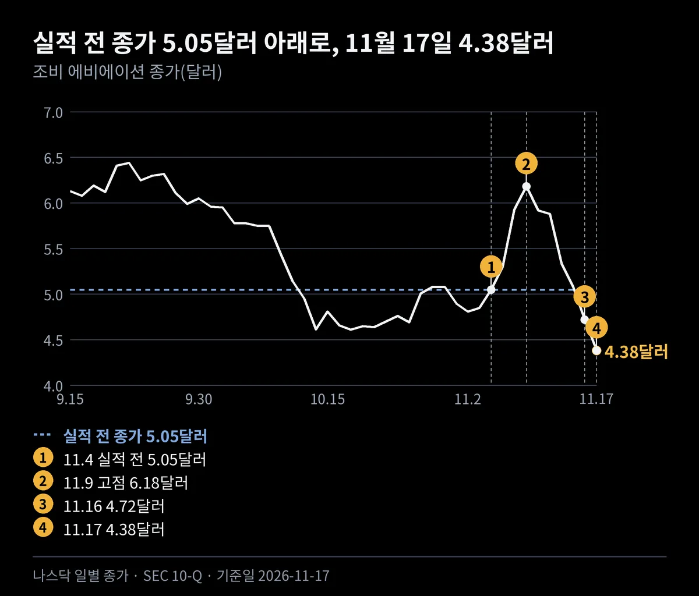
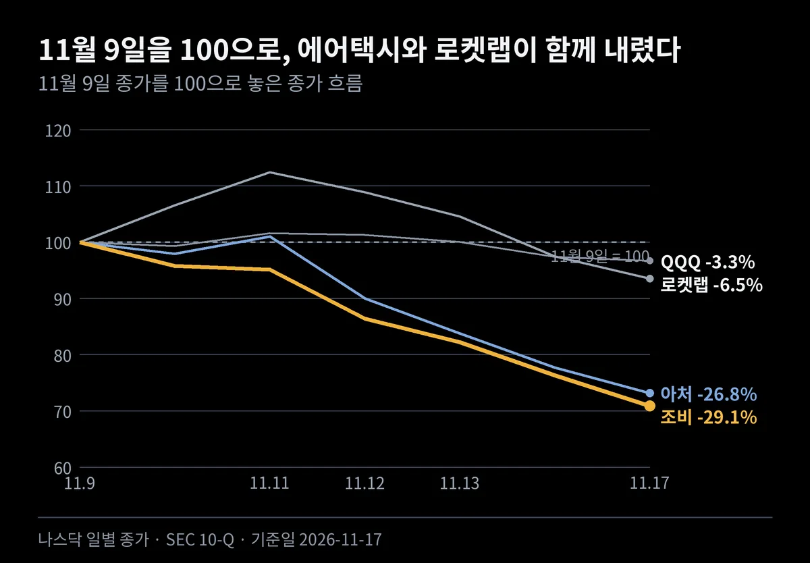
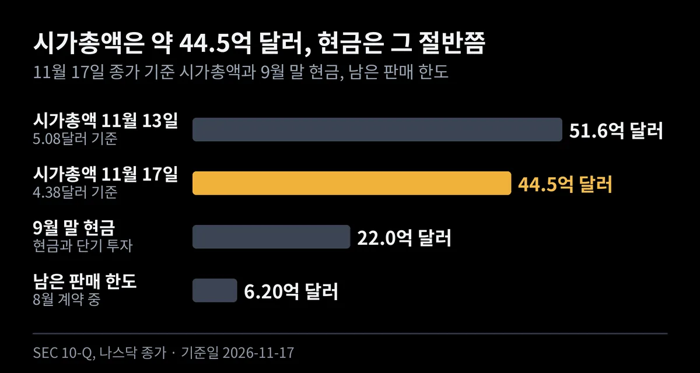
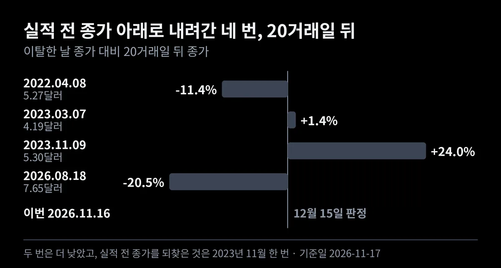
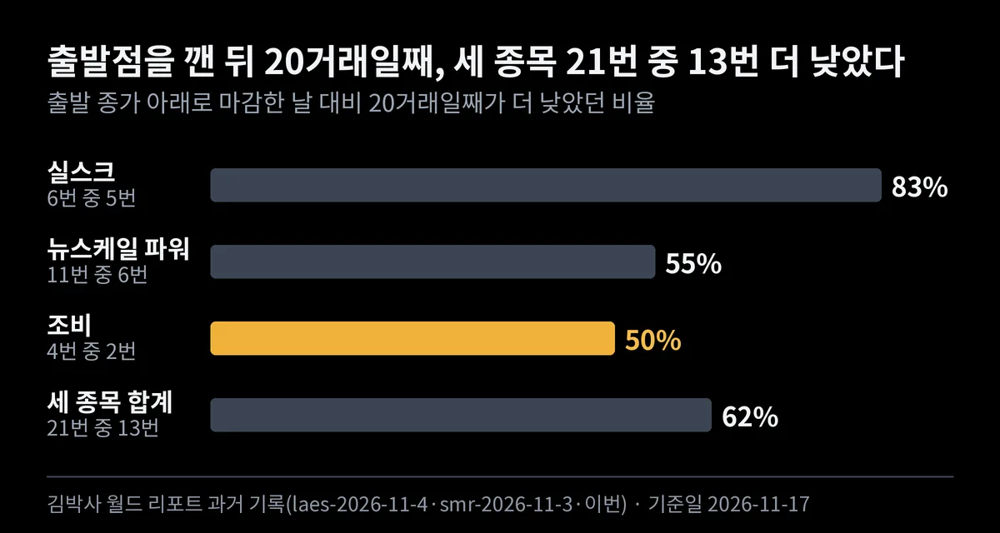
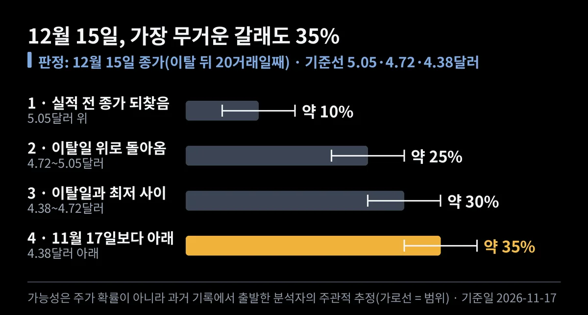

조비 에비에이션 주가는 11월 17일 4.38달러로 마감했습니다. 2023년 5월 8일 뒤 가장 낮은 종가입니다. 실적 뒤 5거래일째인 11월 9일에는 6.18달러까지 올랐던 주식입니다. 그 오른 폭을 다 돌려준 데서 멈추지 않고, 실적 전 종가 5.05달러보다 13.3% 더 내려왔습니다. 그사이 회사가 미국 증권거래위원회에 낸 서류는 하나도 없습니다. 급등이 시작된 자리, 곧 실적 전 종가를 이 글에서는 출발점이라 부릅니다. 실적은 그대로인데, 주가는 왜 출발점 아래로 내려갔을까요?

> **유의사항** 저자는 금융·투자 자문가가 아닙니다. 이 글은 공개 공시와 시세를 정리한 교육용 분석이며 특정 종목의 매수·매도를 권하지 않습니다. 과거 패턴은 미래 수익을 보장하지 않고, 조비 에비에이션은 하루에 두 자릿수로 움직인 적이 여러 번 있는 종목입니다. 실제 투자 전에는 최신 공시를 직접 확인하세요.

이 글은 [11월 16일 리포트](/r/joby-2026-11-2/)를 잇는 후속편입니다. 그 리포트는 실적 뒤 오른 폭을 4거래일 만에 거의 다 돌려준 장면을 다뤘습니다. 그리고 앞으로를 일곱 가지로 걸어 두었습니다. 셋은 확인 항목입니다. 12월 3일 종가가 실적 전 종가 위인지, 12월 14일 종가가 11월 13일 종가 위인지, 연말까지 새 자금 조달 발표가 있는지입니다. 나머지 넷은 11월 13일 종가 위아래와 조달 발표 여부를 엮은 네 갈래입니다.

판정 날짜가 모두 12월이라, 지난 예측 성적은 적중 0, 빗나감 0, 진행 중 7입니다. 다만 방향은 보입니다. 두 기준선, 실적 전 종가 5.05달러와 11월 13일 종가 5.08달러를 모두 아래로 지나왔습니다. 네 갈래 가운데 가장 높은 약 45%를 준 '발표 없이 5.08달러 아래' 쪽에 지금 서 있는 셈입니다.

조비가 어떤 회사인지 짧게 짚겠습니다. 조비는 헬리콥터처럼 떠서 비행기처럼 나는 전기 에어택시를 만드는 미국 회사입니다. 아직 에어택시로 요금을 받지는 못합니다. 미국 연방항공청의 최종 인증이 먼저 필요하기 때문입니다. 돈을 버는 방식은 결국 에어택시 운임이지만, 지금 매출은 대부분 2025년에 인수한 헬리콥터 승객 사업 '블레이드'에서 나옵니다. 모자란 돈은 주로 새 주식을 팔아 채웁니다.

이제 2거래일을 차례대로 보겠습니다. 11월 16일 조비는 7.1% 내려 4.72달러로 마감했습니다. 실적 전 종가 5.05달러 아래로 마감한 첫날입니다. 같은 날 경쟁사 아처는 7.2%, 중국 무인 에어택시 회사 이항은 8.1% 내렸습니다. 우주 발사 회사 로켓랩도 6.8% 내렸습니다. 나스닥 100 펀드(QQQ)는 2.7% 내리는 데 그쳤습니다.

다음 날인 17일에도 조비는 같은 만큼 더 내려 4.38달러가 됐습니다. 아처와 로켓랩도 따라 내렸지만 낙폭은 조비보다 작았습니다. 하루 6.5% 넘는 하락이 연달아 나온 것은 2025년 1월 뒤 처음입니다. 2거래일을 합치면 조비 -13.8%, 아처 -12.7%입니다. 날짜별 숫자는 끝의 업종 표에 있습니다.

조금 멀리서 보면 모양이 더 분명해집니다. 11월 9일 고점부터 17일까지 조비는 29.1%, 아처는 26.8% 내렸습니다. 두 회사 차이는 2.3%포인트입니다. 지난주에는 버티던 로켓랩도 이번 주에는 함께 내렸습니다. 에어택시만의 일이 아니라, 아직 매출이 작은 항공 우주 종목이 함께 팔린 2거래일입니다. 다만 그 가운데서도 조비가 가장 많이 내렸습니다.

조비 쪽 서류를 다시 확인했습니다. 11월 5일 분기 보고서(10-Q) 뒤 17일까지 미국 증권거래위원회에 낸 서류는 없습니다. 임원 주식 거래 보고도 없었습니다. 하락 이유를 밝힌 보도도 찾지 못했습니다. 실적 숫자도, 인증 일정도 바뀌지 않았습니다. 공시로 설명되지 않는 하락이라는 점은 지난주와 같습니다. 달라진 것은 크기입니다. 이제는 실적 전 자리마저 내줬습니다.

그렇다면 지금 주가에 돈과 주식을 대 보겠습니다. 11월 17일 종가로 시가총액은 약 44억 5,288만 달러입니다. 9월 말 현금과 단기 투자 자산 약 21억 9,787만 달러는 그 약 49.4%입니다. 한 주로 나누면 약 2.16달러입니다. 지난주 5.08달러 때는 42.6%였으니, 주가가 내린 만큼 현금 비중이 커졌습니다.

반대쪽 숫자도 있습니다. 8월에 맺은 시장 판매 계약(ATM)의 남은 한도는 6억 2,000만 달러입니다. ATM은 회사가 증권사에 맡겨 시장에서 새 주식을 조금씩 파는 방식입니다. 이 한도를 4.38달러에 모두 쓰면 발행주식의 약 13.9%만큼 새 주식이 나옵니다. 5.08달러일 때는 12.0%였습니다. 주가가 낮아질수록 같은 돈을 구하는 데 더 많은 주식이 필요합니다. 3분기에 판 평균 가격 약 6.44달러보다 지금 주가는 32.0% 낮습니다.

이제 과거 기록으로 가 보겠습니다. 이번 장면에 '출발점 이탈'이라는 이름을 붙이겠습니다. 급등을 다 돌려준 데서 멈추지 않고, 급등이 시작된 종가 아래로 마감한 경우를 말합니다. 조비의 과거 실적에서 같은 모양을 찾았습니다. 2021년 11월 이후 실적 뒤 5거래일 안에 10% 넘게 오른 것은 8번입니다. 그 가운데 20거래일 안에 실적 전 종가 아래로 다시 마감한 것은 이번 전까지 네 번이었습니다.

네 번의 20거래일 뒤를 이탈한 날 종가와 비교했습니다. 2022년 4월은 11.4% 낮았고, 2026년 8월은 20.5% 낮았습니다. 2023년 3월은 1.4% 높았지만 실적 전 종가에는 못 미쳤습니다. 2023년 11월만 24.0% 올라 실적 전 종가를 되찾았습니다. 네 번 모두 20거래일 안에 이탈한 날보다 낮은 종가가 한 번 이상 나왔습니다. 이탈한 날 종가가 그 뒤 20거래일 가운데 가장 낮은 종가였던 적은 네 번 중 한 번도 없었습니다.

이 기록은 조비만의 것이 아닙니다. 같은 모양을 다른 종목 리포트에서도 셌습니다. 보안 반도체 회사 실스크는 반등의 출발점을 깬 여섯 번 가운데 다섯 번이 20거래일 뒤 더 낮았습니다([실스크 리포트](/r/laes-2026-11-4/)).

원전 회사 뉴스케일 파워도 오늘 같은 자리에 섰고, 과거 기록은 절반 남짓이 더 낮았습니다([뉴스케일 파워 리포트](/r/smr-2026-11-3/)). 세 종목을 합치면 21번 가운데 13번, 약 62%입니다.

거꾸로 보면 21번 중 8번은 20거래일 뒤 깬 날보다 높았습니다. 출발점 이탈이 곧 끝이라는 뜻은 아닙니다. 조비의 2023년 11월처럼 한 달 만에 실적 전 자리를 되찾은 경우도 있습니다. 다만 더 낮은 쪽이 실스크와 뉴스케일에서는 절반을 넘었고, 조비는 4번 중 2번으로 딱 절반이었습니다. 김박사 월드는 종목마다 따로 보지 않고, 이렇게 반복되는 모양을 모아 함께 셉니다.

이제 앞날을 나눠 보겠습니다. 이 글의 예측이 맞았는지는 정해 둔 날의 종가로 채점하고, 그날을 판정일이라 부릅니다. 이번 판정일은 이탈한 11월 16일에서 20거래일째인 12월 15일입니다. 그날 종가가 어디에 있는지로 네 갈래를 나눴습니다. 실적 전 종가 5.05달러 위, 이탈일 종가 4.72달러와 5.05달러 사이, 4.72달러와 11월 17일 종가 4.38달러 사이, 그리고 4.38달러 아래입니다.

출발점은 세 종목 기록인 약 62%입니다. 지금 주가가 이미 이탈일보다 낮다는 점을 보태, 아래쪽 두 갈래를 합쳐 약 65%로 봤습니다. 그 가운데 '4.38달러 아래'를 조금 더 크게 둔 것은, 조비가 아래로 간 두 번이 모두 지금보다 깊었기 때문입니다. 다만 세 종목 기록은 반등의 출발점과 실적 급등의 출발점을 섞은 것이라, 조비에 그대로 들어맞는다고 할 수는 없습니다. 65%는 그 위에 분석자가 얹은 주관적 추정입니다. 실적 전 종가를 되찾는 갈래는 가장 낮게 뒀습니다. 기록에서는 네 번 중 한 번이었지만, 지금 자리에서 15.3%를 올라야 닿는 거리입니다.

새 자금 조달 발표는 갈래에 섞지 않았습니다. 판매 한도가 남아 있다는 것은 팔 수 있다는 뜻이지, 판다는 뜻은 아닙니다. 그래서 12월 31일까지 새 공모나 한도 증액, 전환사채 발표가 있는지는 따로 확인할 항목으로만 둡니다. 이 갈래 숫자들은 주가가 오를 확률이 아니라, 과거 빈도에서 출발해 분석자가 주관적으로 매긴 추정입니다.

이 추정이 틀릴 이유도 적어 둡니다. 이번 하락은 업종 전체가 함께 내린 것이라, 업종이 돌아서면 조비도 함께 돌아설 수 있습니다. 4.38달러는 3년 반 만의 최저라 파는 쪽이 지칠 자리이기도 합니다. 그래서 가장 무거운 갈래도 35%에 묶어 두었습니다.

위험도 짚겠습니다. 가장 큰 한계는 표본입니다. 조비의 같은 모양은 네 번뿐이고, 세 종목을 합쳐도 21번입니다. 이번 2거래일 하락의 이유는 공시로도 보도로도 확인하지 못했습니다. 남은 판매 한도가 쓰이면 주식 수가 늘어 기존 주주 한 주의 비중이 작아집니다. 2032년 만기 전환사채 6억 9,000만 달러도 남아 있습니다. 사업 쪽에서는 인증 비행 시험이 2027년 상반기보다 늦어지면 에어택시 매출도 함께 밀립니다.

새 공시가 없으니 실적 숫자와 인증 일정에 새로 알려진 변화도 없습니다. 바뀐 것은 주가가 실적 전 자리 아래로 내려왔다는 점 하나입니다. 업종이 함께 팔렸고, 조비가 그 가운데 가장 많이 내렸습니다. 과거 출발점을 깬 경우는 이탈한 날이 바닥이 아니었습니다. 다음 갱신은 12월 3일과 15일 종가를 본 뒤에 하고, 그 전에 새 자금 조달 소식이 나오면 앞당깁니다.

## 숫자로 다시 보기

### 실적 전부터 11월 17일까지

| 날짜 · 장면 | 조비 종가 | 실적 전 종가 대비 |
| --- | --- | --- |
| **11.04 장 마감 뒤 3분기 실적** | **5.05달러** | 기준 |
| 11.06 | 5.93달러 | +17.4% |
| **11.09 고점** | **6.18달러** | **+22.4%** |
| 11.11 | 5.88달러 | +16.4% |
| 11.13 지난 리포트 기준 | 5.08달러 | +0.6% |
| **11.16 실적 전 아래 첫 마감** | **4.72달러** | **-6.5%** |
| **11.17 2023년 5월 뒤 최저** | **4.38달러** | **-13.3%** |

### 같은 2거래일 업종 성적

| 종목 · 11.13→11.17 | 11.16 하루 | 11.17 하루 |
| --- | --- | --- |
| **조비(JOBY) -13.8%** | **-7.1%** | **-7.2%** |
| 아처(ACHR) -12.7% | -7.2% | -5.9% |
| 로켓랩(RKLB) -10.5% | -6.8% | -4.0% |
| 이항(EH) -9.7% | -8.1% | -1.8% |
| QQQ -3.4% | -2.7% | -0.7% |

소형주 펀드(IWM)는 같은 2거래일 -3.1%였습니다. 11월 9일 대비 17일은 조비 -29.1%, 아처 -26.8%, 로켓랩 -6.5%, QQQ -3.3%입니다.

### 돈과 주식으로 본 지금(11월 17일 기준)

| 항목 | 값 · 근거 |
| --- | --- |
| 시가총액 | **약 44억 5,288만 달러** 4.38달러 × 10억 1,664만 주(11월 2일) |
| 현금과 단기 투자 자산 | **약 21억 9,787만 달러** 9월 30일 · 시가총액의 약 49.4% · 한 주에 약 2.16달러 |
| 남은 판매 한도 | **6억 2,000만 달러** 8월 계약 7억 5,000만 달러 중 |
| 한도를 지금 주가에 다 쓰면 | **약 1억 4,155만 주** 발행주식의 약 13.9%(5.08달러 때 12.0%) |
| 3분기 판매 평균 가격 | **약 6.44달러** 지금 주가는 그보다 32.0% 낮음 |

### 실적 전 종가 아래로 내려간 네 번

실적 뒤 5거래일 안에 10% 넘게 오른 8번 가운데, 20거래일 안에 실적 전 종가 아래로 마감한 경우입니다. 첫 열의 가격은 달러이고, 이탈한 날은 종가가 실적 전 종가 아래로 처음 마감한 날입니다. 마지막 두 열은 이탈한 날 종가와 비교했습니다.

| 실적 발표 · 이탈한 날 | 20거래일 뒤 | 20거래일 안 최저 |
| --- | --- | --- |
| 2022.03 실적 전 5.33 4월 8일 이탈 5.27 | -11.4% | -11.4% |
| 2023.02 실적 전 4.29 3월 7일 이탈 4.19 | +1.4% | -9.5% |
| **2023.11 실적 전 5.36 11월 9일 이탈 5.30** | **+24.0% 실적 전 종가 회복** | -2.1% |
| 2026.08 실적 전 7.80 8월 18일 이탈 7.65 | -20.5% | -20.5% |
| **2026.11 실적 전 5.05 11월 16일 이탈 4.72** | **12월 15일 판정** | 11월 17일 -7.2% |

2021년 11월 이후 분기 실적 8-K로 날짜를 골랐고, 나스닥 일별 종가로 계산했습니다.

### 세 종목의 출발점 이탈 기록

| 종목 · 기록 | 20거래일째 이탈일보다 낮음 |
| --- | --- |
| 실스크(LAES) 반등 출발점 이탈 6번 | 5번(약 83%) |
| 뉴스케일 파워(SMR) 실적 급등 출발점 이탈 11번 | 6번(약 55%) |
| **조비(JOBY) 실적 급등 출발점 이탈 4번** | **2번(50%)** |
| **세 종목 합계 21번** | **13번(약 62%)** |

### 지난 예측 채점표

| 지난 점검 항목 · 당시 기준 | 판정과 지금 자리(11월 17일) |
| --- | --- |
| **12월 3일 실적 전 5.05달러 위** 11월 9일 리포트 판정 | **[진행 중]** 지금 4.38달러, 13.3% 아래 |
| **12월 14일 5.08달러 위** 1순위 확인 | **[진행 중]** 지금 13.8% 아래 |
| **12월 31일까지 새 자금 조달 발표** 3순위 확인 | **[진행 중]** 새 공시 없음 |
| **가장 높게 본 갈래 3(약 45%)** 발표 없이 5.08달러 아래 | **[진행 중]** 지금 이 자리 |
| 갈래 1·2·4(35%·5%·15%) | **[진행 중]** 12월 14일·31일 판정 |

지난 예측 성적은 적중 0 · 빗나감 0 · 진행 중 7입니다.

### 앞으로 일어날 수 있는 일

출발점을 깬 뒤 20거래일째가 이탈일보다 낮았던 것은 세 종목 21번 중 13번입니다. 아래 가능성은 그 기록에서 출발해 분석자가 주관적으로 매긴 추정이며, 주가가 오를 확률이 아닙니다. 네 갈래는 겹치지 않아 더하면 100%입니다.

| 갈래(판정 12월 15일) | 판정 조건 | 가능성(추정) |
| --- | --- | --- |
| 1 · 실적 전 종가 되찾음 | 12월 15일 종가 5.05달러 위 | 낮음 약 10% (5~15%) |
| 2 · 이탈일 위로 돌아옴 | 12월 15일 종가 4.72~5.05달러 | 중간 약 25% (20~30%) |
| 3 · 이탈일과 최저 사이 | 12월 15일 종가 4.38~4.72달러 | 중간 약 30% (25~35%) |
| **4 · 11월 17일보다 아래** | 12월 15일 종가 4.38달러 아래 | 중간 약 35% (30~40%) |

### 핵심 확인 세 가지

| 순위 · 확인할 것 | 판정 날짜 |
| --- | --- |
| **1순위** 종가가 4.72달러와 4.38달러 가운데 어디인가 | 12월 15일 |
| **2순위** 종가가 실적 전 5.05달러 위인가(지난 리포트 판정) | 12월 3일 |
| **3순위** 새 자금 조달 발표나 발행주식 수 증가가 있는가 | 12월 31일 |

공시는 [조비 에비에이션 SEC 공시 목록](https://www.sec.gov/cgi-bin/browse-edgar?action=getcompany&CIK=0001819848&type=&dateb=&owner=include&count=40)에서 확인할 수 있습니다.

## 함께 읽기

- [실스크 리포트](/r/laes-2026-11-4/) · [영상](https://youtu.be/W3vcgET5izw): 반등 출발점을 깬 여섯 번 가운데 다섯 번이 20거래일 뒤 더 낮았습니다(11월 16일 기준).
- [뉴스케일 파워 리포트](/r/smr-2026-11-3/) · [영상](https://youtu.be/CpGayNCaSHU): 실적 급등 출발점을 깬 11번 가운데 6번이 20거래일 뒤 더 낮았습니다(11월 17일 기준).
- [조비 지난 리포트](/r/joby-2026-11-2/) · [영상](https://youtu.be/VImYbWn0t9U): 실적 뒤 +22.4%의 97%를 4거래일 만에 돌려준 장면(11월 13일 기준).
