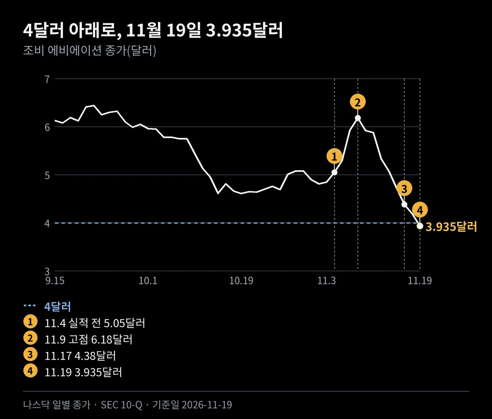
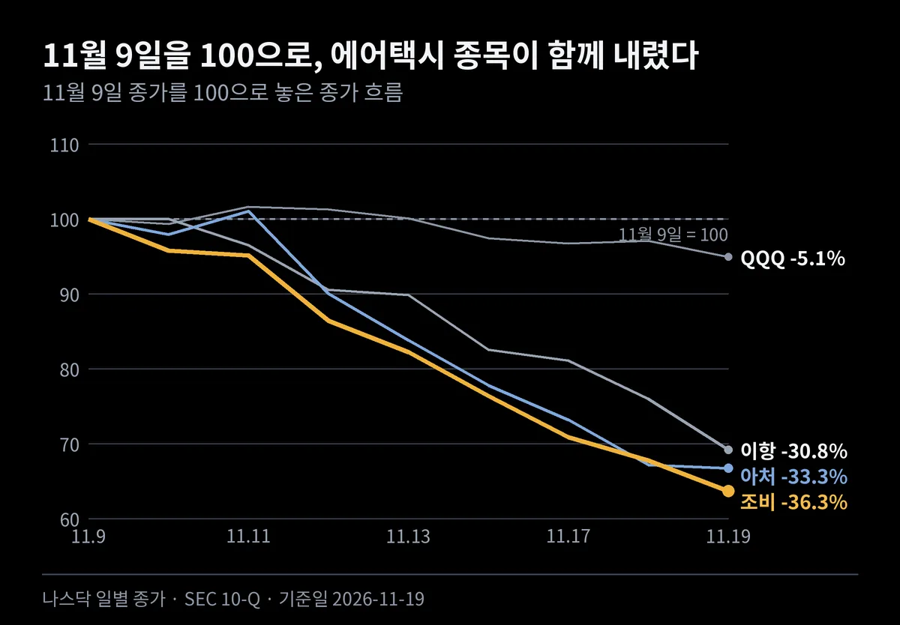
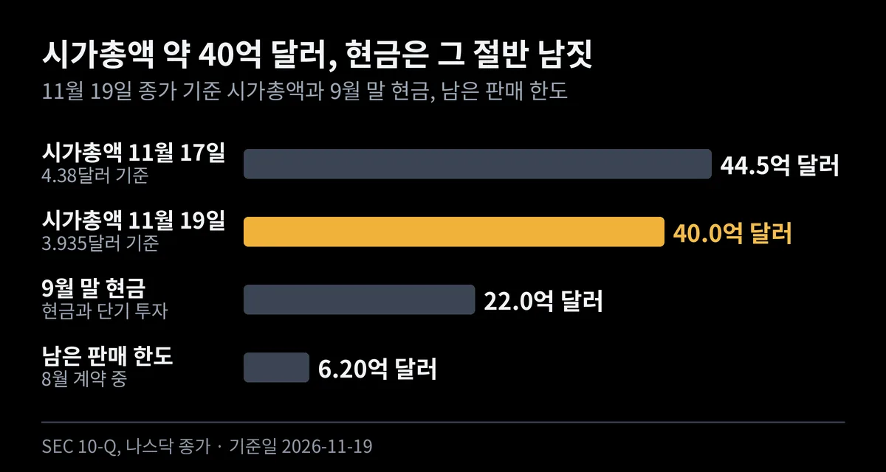
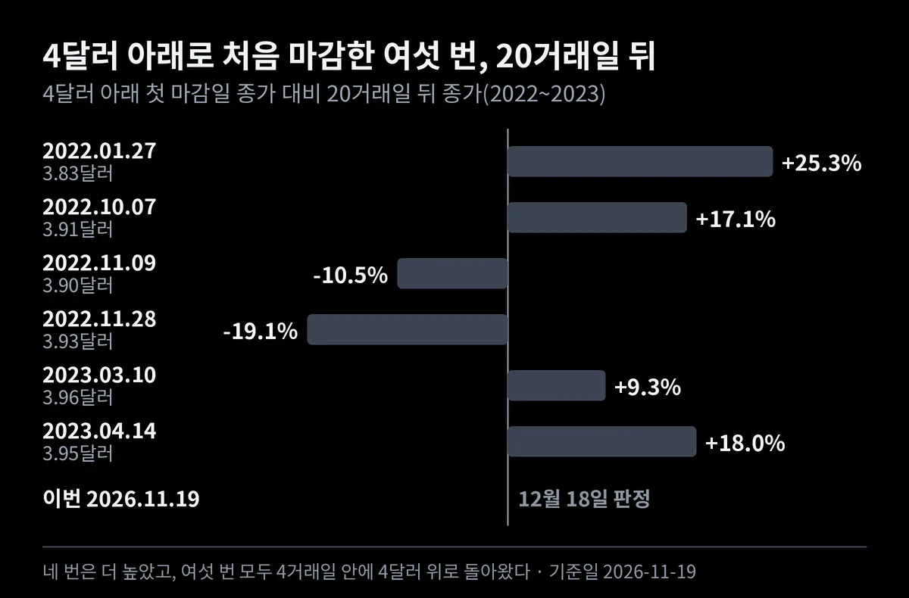
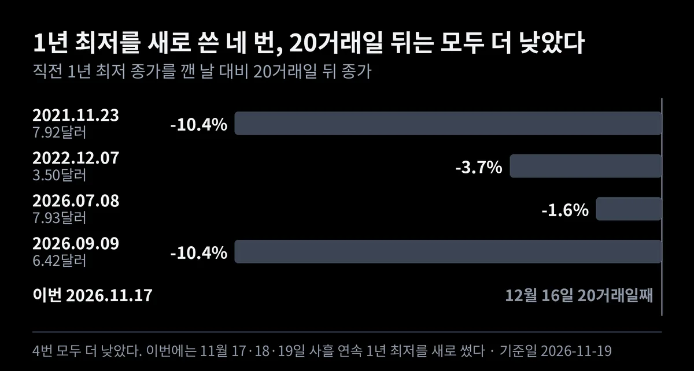
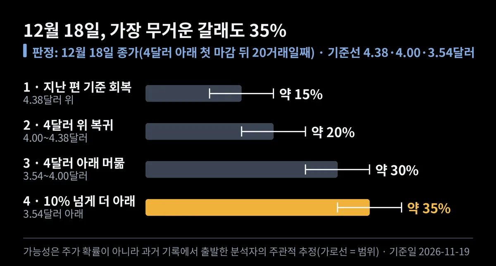

조비 에비에이션 주가는 11월 19일 3.935달러로 마감했습니다. 2023년 4월 27일 뒤 처음으로 4달러 아래에서 끝난 날입니다. 6거래일 전인 11월 9일에는 실적이 좋다며 6.18달러까지 올랐던 주식입니다. 그 사이 36.3%가 빠졌고, 회사가 미국 증권거래위원회에 낸 서류는 하나도 없습니다. 조비의 과거 기록을 펼치면 두 가지 답이 나옵니다. 4달러 아래로 처음 마감한 여섯 번은 모두 며칠 만에 돌아왔습니다. 그런데 1년 최저를 새로 쓴 네 번은 모두 더 내려갔습니다. 4달러는 바닥일까요, 지나가는 숫자일까요?

> **유의사항** 저자는 금융·투자 자문가가 아닙니다. 이 글은 공개 공시와 시세를 정리한 교육용 분석이며 특정 종목의 매수·매도를 권하지 않습니다. 과거 패턴은 미래 수익을 보장하지 않고, 조비 에비에이션은 하루에 두 자릿수로 움직인 적이 여러 번 있는 종목입니다. 실제 투자 전에는 최신 공시를 직접 확인하세요.

이 글은 [11월 18일 리포트](/r/joby-2026-11-3/)를 잇는 후속편입니다. 그 리포트는 11월 17일 종가 4.38달러가 실적 전 종가 5.05달러 아래로 내려간 장면을 다뤘습니다. 그리고 12월 15일 종가를 네 칸으로 나눠 걸었습니다. 가장 무겁게 본 칸은 '4.38달러 아래'로, 약 35%였습니다. 네 칸 전체는 끝의 채점표에 있습니다.

판정일은 예측이 맞았는지 종가로 채점하기로 정해 둔 날을 말합니다. 지난 리포트가 걸어 둔 예측은 이 네 칸에 확인 항목 셋을 더해 일곱 개입니다. 판정일이 모두 12월이라 성적은 적중 0, 빗나감 0, 진행 중 7입니다. 다만 주가는 2거래일 만에 가장 무겁게 본 '4.38달러 아래' 칸으로 들어왔습니다.

조비가 어떤 회사인지 짧게 짚겠습니다. 조비는 헬리콥터처럼 떠서 비행기처럼 나는 전기 에어택시를 만드는 미국 회사입니다. 아직 에어택시로 요금을 받지는 못합니다. 미국 연방항공청의 최종 인증이 먼저 필요하기 때문입니다. 돈을 버는 방식은 결국 에어택시 운임이지만, 지금 매출은 대부분 2025년에 인수한 헬리콥터 승객 사업 '블레이드'에서 나옵니다. 모자란 돈은 주로 새 주식을 팔아 채웁니다.

이제 2거래일을 차례대로 보겠습니다. 11월 18일 조비는 4.3% 내려 4.19달러로 마감했습니다. 같은 날 경쟁사 아처는 8.2%, 중국 무인 에어택시 회사 이항은 6.3% 내렸습니다. 나스닥 100 펀드(QQQ)는 오히려 0.4% 올랐습니다. 시장은 쉬었는데 에어택시 종목만 계속 팔렸습니다.

19일에는 조비가 6.1% 더 내려 3.935달러가 됐습니다. 이날은 QQQ도 2.2% 내렸습니다. 2거래일을 합치면 조비는 10.2%, 이항은 14.7% 내렸습니다. 지난주와 달리 이번에는 조비가 가장 많이 내린 종목이 아닙니다. 날짜별 숫자는 끝의 업종 표에 있습니다.

조금 멀리서 보면 모양이 더 분명합니다. 11월 9일부터 19일까지 조비는 36.3%, 아처는 33.3%, 이항은 30.8% 내렸습니다. 같은 기간 QQQ는 5.1% 내렸습니다. 세 에어택시 회사가 30%대에서 나란히 움직였습니다. 업종이 함께 움직였다는 것까지는 시세로 확인됩니다. 다만 업종 전체가 왜 팔렸는지는 확인하지 못했습니다.

조비 쪽 서류를 다시 확인했습니다. 11월 5일 분기 보고서(10-Q) 뒤 19일까지 미국 증권거래위원회에 낸 서류는 없습니다. 임원 주식 거래 보고도 없었습니다. 11월 16일 하락을 다룬 분석 기사도 회사 발표는 없었다고 적었습니다. 18일과 19일 하락 이유를 밝힌 보도는 찾지 못했습니다. 실적 숫자도, 인증 일정도 새로 바뀐 것은 없습니다.

같은 주에 4달러 아래로 내려간 핵심 종목이 하나 더 있습니다. 원전 회사 뉴스케일 파워는 11월 18일 3.91달러로 4달러 아래에서 마감했습니다([뉴스케일 파워 리포트](/r/smr-2026-11-3/)). 반대로 보안 반도체 회사 실스크는 새 최저를 쓴 다음 날 인수 의향서 발표로 두 자릿수 올랐습니다([실스크 리포트](/r/laes-2026-11-5/)). 회사 소식이 있던 쪽은 돌아섰고, 없던 쪽은 계속 내려갔습니다.

이제 지금 주가에 돈과 주식을 대 보겠습니다. 11월 19일 종가로 시가총액은 약 40억 48만 달러입니다. 9월 말 현금과 단기 투자 자산 약 21억 9,787만 달러는 그 약 54.9%입니다. 한 주로 나누면 약 2.16달러입니다. 17일 4.38달러 때는 49.4%였으니, 주가가 내린 만큼 현금 비중이 더 커졌습니다.

반대쪽 숫자도 있습니다. 8월에 맺은 시장 판매 계약(ATM)의 남은 한도는 6억 2,000만 달러입니다. ATM은 회사가 증권사에 맡겨 시장에서 새 주식을 조금씩 파는 방식입니다. 이 한도를 3.935달러에 모두 쓴다고 가정하면, 새 주식은 최대 발행주식의 약 15.5%입니다. 4.38달러일 때는 13.9%였습니다. 실제로 얼마를 팔지는 회사가 고릅니다. 3분기에 판 평균 가격 약 6.44달러보다 지금 주가는 38.9% 낮습니다.

이제 과거 기록으로 가 보겠습니다. 이번 장면에 '4달러 선 이탈'이라는 이름을 붙이겠습니다. 이 글에서 '4달러 아래 첫 마감'과 같은 뜻입니다. 직전 10거래일 동안 4달러 위에서 마감하다가 처음 4달러 아래로 마감한 날을 말합니다. 조비 상장 뒤 이런 날은 이번 전까지 여섯 번이었고, 모두 2022년과 2023년에 있었습니다.

여섯 번의 20거래일 뒤를 첫 마감일 종가와 비교했습니다. 네 번은 더 높았고, 가장 크게는 2022년 1월의 25.3%였습니다. 더 낮았던 두 번은 모두 2022년 11월이었습니다. 그리고 여섯 번 모두 4거래일 안에 다시 4달러 위로 마감했습니다. 이 기록만 보면 4달러 아래는 오래 머문 자리가 아니었습니다.

그런데 같은 시세표를 다른 질문으로 읽으면 답이 뒤집힙니다. 이번에는 '직전 1년 동안 가장 낮은 종가를 깬 날'을 셌습니다. 같은 날이 겹치지 않게 20거래일 넘게 떨어진 경우만 셌더니, 이번 전까지 네 번이었습니다. 네 번 모두 20거래일 뒤가 그날보다 낮았습니다. 2021년 11월과 2026년 9월은 10.4%, 2022년 12월은 3.7%, 2026년 7월은 1.6% 낮았습니다.

이번에는 11월 17일 4.38달러가 직전 1년 최저 4.61달러를 깼습니다. 그리고 18일과 19일에도 하루씩 더 낮은 종가를 썼습니다. 17일의 20거래일째는 12월 16일입니다. 4달러 기록은 '돌아온다', 1년 최저 기록은 '더 내려간다'를 가리킵니다. 같은 주식, 같은 자리인데 두 기록이 반대 방향입니다.

두 기록이 갈린 이유로 시기를 꼽을 수 있습니다. 2022년 5월부터 1년 가까이, 종가의 약 3분의 2가 3달러와 5달러 사이였습니다. 그때 4달러는 그 범위의 한가운데였습니다.

그 박스 아래로 잠시 빠졌던 2022년 12월 27일에는 상장 뒤 최저 종가 3.18달러까지 갔습니다. 지금 4달러는 6.18달러에서 내려오는 길 위에 있습니다. 그래서 박스 안의 4달러 기록을 지금에 그대로 대기는 어렵습니다.

다른 종목 기록도 참고할 만합니다. 김박사 월드가 11월 핵심 종목 리포트들에서 걸어 둔 가격 기준선 가운데, '아래로 깬다' 쪽 예측은 네 번 모두 맞았고 '지킨다' 쪽은 네 번 모두 빗나갔습니다. 다만 네 번은 아주 작은 표본이라, 조비의 앞날을 정하는 근거라기보다 함께 놓고 보는 참고입니다. 김박사 월드는 종목마다 따로 보지 않고, 이렇게 반복되는 모양을 모아 함께 셉니다.

이제 앞날을 나눠 보겠습니다. 이번 판정일은 4달러 아래 첫 마감일에서 20거래일째인 12월 18일입니다. 그날 종가가 어디에 있는지로 네 갈래를 나눴습니다. 기준선은 지난 편 기준 4.38달러, 4달러, 그리고 3.54달러입니다. 3.54달러는 지금 종가에서 10% 더 내린 값입니다.

출발점은 두 기록을 합친 10번입니다. 10번 중 4번이 20거래일 뒤 3.54달러 아래 칸에 들어갔습니다.

칸에 넣는 방법은 이렇습니다. 4달러 기록은 20거래일 뒤 가격을 그대로 썼습니다. 1년 최저 기록은 20거래일 뒤 변화율을 지금 종가에 곱했습니다. 4달러 기록 여섯 번 가운데 절반은 가장 위 칸에 들어갔습니다. 1년 최저 기록 네 번은 아래 두 칸에 절반씩 나뉘었습니다. 두 기록의 날짜별 숫자는 끝의 표에 있습니다.

여기에 지금 사정을 15%포인트 안에서 얹었습니다. 4.38달러 위 칸은 박스 안 기록이라 약 15%로 낮췄습니다. 4달러 위로 돌아오는 칸은 여섯 번 모두 며칠 만에 돌아온 기록을 보고 약 20%로 올렸습니다. 가장 무거운 3.54달러 아래 칸도 약 35%에 묶었습니다.

이 숫자는 주가가 오를 확률이 아니라, 과거 빈도에서 출발해 분석자가 주관적으로 매긴 추정입니다. 4달러 아래 두 칸을 합치면 약 65%입니다. 새 자금 조달 발표는 갈래에 섞지 않았습니다. 판매 한도가 남아 있다는 것은 팔 수 있다는 뜻이지, 판다는 뜻은 아니기 때문입니다. 12월 31일까지 새 공모나 한도 증액, 전환사채 발표가 있는지는 따로 확인합니다.

이 추정이 틀릴 이유도 적어 둡니다. 과거 4달러 아래 첫 마감 여섯 번은 모두 4거래일 안에 돌아왔습니다. 이번 하락은 업종 전체가 함께 내린 것이고, 회사 고유의 나쁜 소식은 없습니다. 업종이 돌아서면 조비도 함께 돌아설 수 있습니다. 1년 최저 기록에서 10%를 넘게 내린 두 번도 -10.4%로 칸 경계에 붙어 있었습니다. 그래서 가장 무거운 갈래도 35%에 묶었습니다.

위험도 짚겠습니다. 가장 큰 한계는 표본입니다. 4달러 기록은 여섯 번, 1년 최저 기록은 네 번뿐입니다. 이번 2거래일 하락의 이유는 공시로도 보도로도 확인하지 못했습니다. 남은 판매 한도가 쓰이면 주식 수가 늘어 기존 주주 한 주의 비중이 작아집니다. 정해진 가격에 주식으로 바뀔 수 있는 채권인 2032년 만기 전환사채 6억 9,000만 달러도 남아 있습니다(10-Q 기준). 주식으로 바뀌면 그만큼 주식 수가 늘어납니다. 사업 쪽에서는 인증 비행 시험이 2027년 상반기보다 늦어지면 에어택시 매출도 함께 밀립니다.

정리하면 바뀐 것은 가격 하나입니다. 새 공시도, 새 실적도 없이 주가가 3년 반 만에 4달러 아래로 내려왔습니다. 4달러를 사람들이 사는 자리로 볼 근거와 지나가는 숫자로 볼 근거가 함께 있습니다. 다음 갱신은 12월 3일, 15일, 18일 종가를 본 뒤에 하고, 그 전에 새 자금 조달 소식이 나오면 앞당깁니다.

## 숫자로 다시 보기

### 지난 리포트 기준부터 11월 19일까지

| 날짜 · 장면 | 조비 종가 | 11월 9일 고점 대비 |
| --- | --- | --- |
| **11.04 장 마감 뒤 3분기 실적** | **5.05달러** | -18.3% |
| **11.09 고점** | **6.18달러** | 기준 |
| 11.13 | 5.08달러 | -17.8% |
| 11.17 지난 리포트 기준 | 4.38달러 | -29.1% |
| 11.18 | 4.19달러 | -32.2% |
| **11.19 3년 반 만에 4달러 아래** | **3.935달러** | **-36.3%** |

11월 19일 종가 3.935달러는 2023년 4월 26일(3.82달러) 뒤 가장 낮은 종가입니다. 실적 전 종가 5.05달러보다 22.1%, 11월 13일 종가 5.08달러보다 22.5% 낮습니다.

### 같은 2거래일 업종 성적

| 종목 · 11.17→11.19 | 11.18 하루 | 11.19 하루 |
| --- | --- | --- |
| **조비(JOBY) -10.2%** | **-4.3%** | **-6.1%** |
| 이항(EH) -14.7% | -6.3% | -8.9% |
| 아처(ACHR) -8.8% | -8.2% | -0.6% |
| 로켓랩(RKLB) -7.4% | -3.6% | -3.9% |
| QQQ -1.8% | +0.4% | -2.2% |

소형주 펀드(IWM)도 같은 2거래일 -1.8%였습니다. 11월 9일 대비 19일은 조비 -36.3%, 아처 -33.3%, 이항 -30.8%, QQQ -5.1%입니다. 아처 종가는 4.81달러에서 3.21달러가 됐습니다.

### 돈과 주식으로 본 지금(11월 19일 기준)

| 항목 | 값 · 근거 |
| --- | --- |
| 시가총액 | **약 40억 48만 달러** 3.935달러 × 10억 1,664만 주(11월 2일) |
| 현금과 단기 투자 자산 | **약 21억 9,787만 달러** 9월 30일 · 시가총액의 약 54.9% · 한 주에 약 2.16달러 |
| 남은 판매 한도 | **6억 2,000만 달러** 8월 계약 7억 5,000만 달러 중 |
| 한도를 지금 주가에 다 쓰면 | **약 1억 5,756만 주** 발행주식의 약 15.5%(4.38달러 때 13.9%) |
| 3분기 판매 평균 가격 | **약 6.44달러** 지금 주가는 그보다 38.9% 낮음 |

### 4달러 아래로 처음 마감한 여섯 번

직전 10거래일 동안 모두 4달러 위에서 마감하다가 처음 4달러 아래로 마감한 날입니다. 변화는 그날 종가 대비 20거래일 뒤 종가입니다.

| 첫 마감일 · 종가 | 20거래일 뒤 | 4달러 위 복귀 |
| --- | --- | --- |
| 2022.01.27 3.83달러 | 4.80달러 +25.3% | 2거래일 |
| 2022.10.07 3.91달러 | 4.58달러 +17.1% | 2거래일 |
| 2022.11.09 3.90달러 | 3.49달러 -10.5% | 1거래일 |
| 2022.11.28 3.93달러 | 3.18달러 -19.1% | 2거래일 |
| 2023.03.10 3.96달러 | 4.33달러 +9.3% | 4거래일 |
| 2023.04.14 3.95달러 | 4.66달러 +18.0% | 1거래일 |
| **2026.11.19 3.935달러** | **12월 18일 판정** | - |

### 1년 최저를 새로 쓴 네 번

직전 252거래일의 가장 낮은 종가를 깬 날이며, 같은 흐름이 겹치지 않게 20거래일 넘게 떨어진 경우만 셌습니다.

| 날짜 · 종가 | 20거래일 뒤 |
| --- | --- |
| 2021.11.23 7.92달러 | -10.4% |
| 2022.12.07 3.50달러 | -3.7% |
| 2026.07.08 7.93달러 | -1.6% |
| 2026.09.09 6.42달러 | -10.4% |
| **2026.11.17 · 4.38달러** | **12월 16일 20거래일째** |

이번에는 직전 1년 최저 4.61달러(10월 14일·19일)를 17일에 깼고, 18일과 19일에도 최저를 새로 썼습니다. 두 표 모두 나스닥 일별 종가로 계산했습니다.

### 지난 예측 채점표

| 지난 점검 항목 · 당시 기준 | 판정과 지금 자리(11월 19일) |
| --- | --- |
| **12월 3일 실적 전 5.05달러 위** 11월 9일 리포트 판정 | **[진행 중]** 지금 3.935달러, 22.1% 아래 |
| **12월 14일 5.08달러 위** 11월 16일 리포트 확인 | **[진행 중]** 지금 22.5% 아래 |
| **12월 31일까지 새 자금 조달 발표** | **[진행 중]** 새 공시 없음 |
| **12월 15일 4.38달러 아래(약 35%)** 11월 18일 리포트 가장 무거운 갈래 | **[진행 중]** 지금 이 자리 |
| 12월 15일 나머지 세 갈래(10%·25%·30%) | **[진행 중]** 12월 15일 판정 |

지난 예측 성적은 적중 0 · 빗나감 0 · 진행 중 7입니다.

### 앞으로 일어날 수 있는 일

4달러 기록 여섯 번과 1년 최저 기록 네 번, 모두 10번의 20거래일 뒤에서 출발했습니다. 10번 중 4번이 20거래일 뒤 3.54달러 아래였습니다. 아래 가능성은 분석자가 주관적으로 매긴 추정이며, 주가가 오를 확률이 아닙니다. 네 갈래는 겹치지 않아 더하면 100%입니다.

| 갈래(판정 12월 18일) | 판정 조건 | 가능성(추정) |
| --- | --- | --- |
| 1 · 지난 편 기준 회복 | 12월 18일 종가 4.38달러 위 | 낮음 약 15% (10~20%) |
| 2 · 4달러 위 복귀 | 12월 18일 종가 4.00~4.38달러 | 낮음 약 20% (15~25%) |
| 3 · 4달러 아래 머묾 | 12월 18일 종가 3.54~4.00달러 | 중간 약 30% (25~35%) |
| **4 · 10% 넘게 더 아래** | 12월 18일 종가 3.54달러 아래 | 중간 약 35% (30~40%) |

### 핵심 확인 세 가지

| 순위 · 확인할 것 | 판정 날짜 |
| --- | --- |
| **1순위** 종가가 4달러 위로 돌아왔는가 | 12월 18일 |
| **2순위** 종가가 4.38달러 아래인가(지난 리포트 판정) | 12월 15일 |
| **3순위** 새 자금 조달 발표나 발행주식 수 증가가 있는가 | 12월 31일 |

공시는 [조비 에비에이션 SEC 공시 목록](https://www.sec.gov/cgi-bin/browse-edgar?action=getcompany&CIK=0001819848&type=&dateb=&owner=include&count=40)에서 확인할 수 있습니다.

## 함께 읽기

- [뉴스케일 파워 리포트](/r/smr-2026-11-3/) · [영상](https://youtu.be/CpGayNCaSHU): 같은 주 11월 18일 3.91달러로 4달러 아래에 마감한 원전 회사의 앞선 이야기(11월 17일 기준).
- [실스크 리포트](/r/laes-2026-11-5/) · [영상](https://youtu.be/2LuMR4kBlmA): 11월 17일 새 최저 다음 날 인수 의향서로 10.6% 오른 장면(11월 18일 기준).
- [조비 지난 리포트](/r/joby-2026-11-3/) · [영상](https://youtu.be/WBTk2DeqVjA): 실적 전 종가 5.05달러 아래로 내려간 4.38달러 장면(11월 17일 기준).
