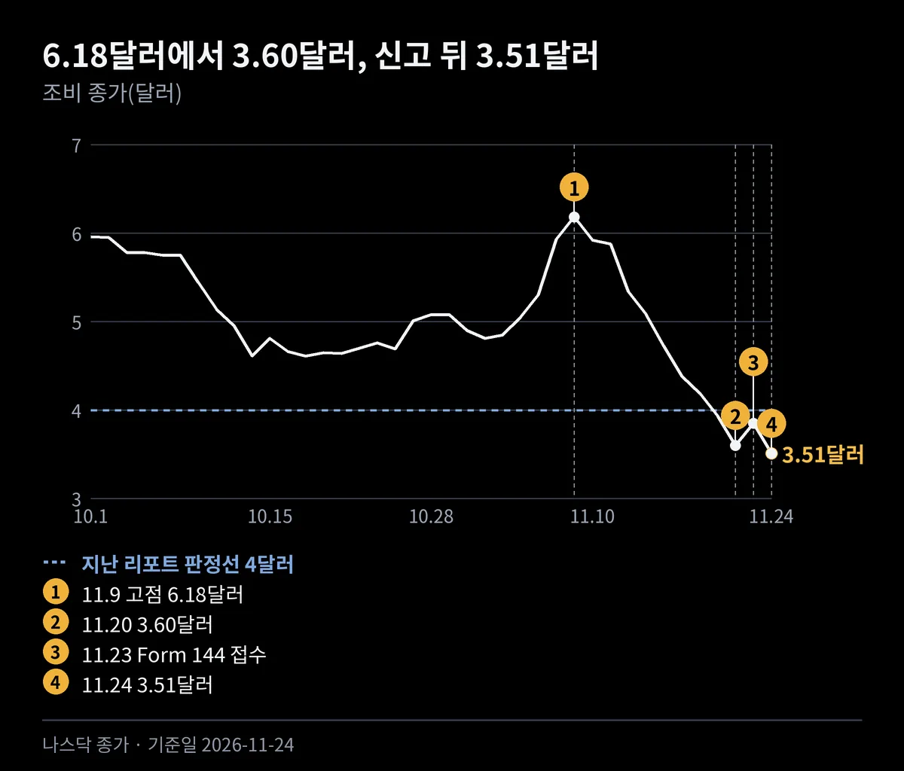
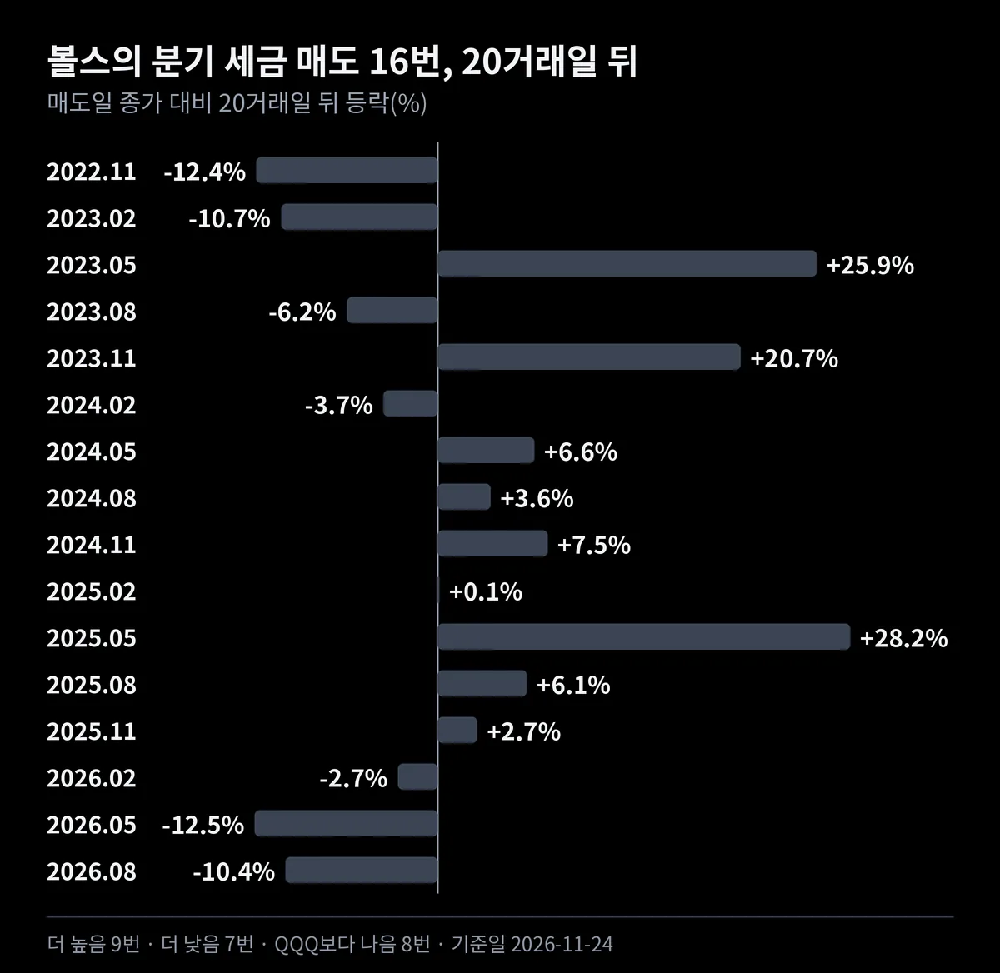
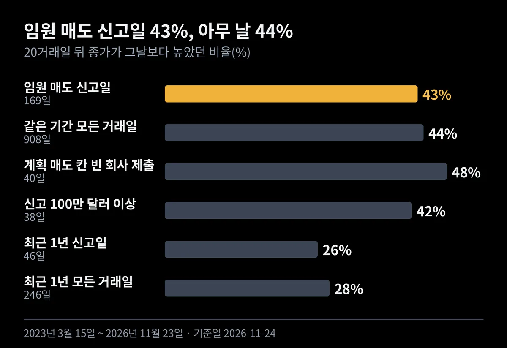
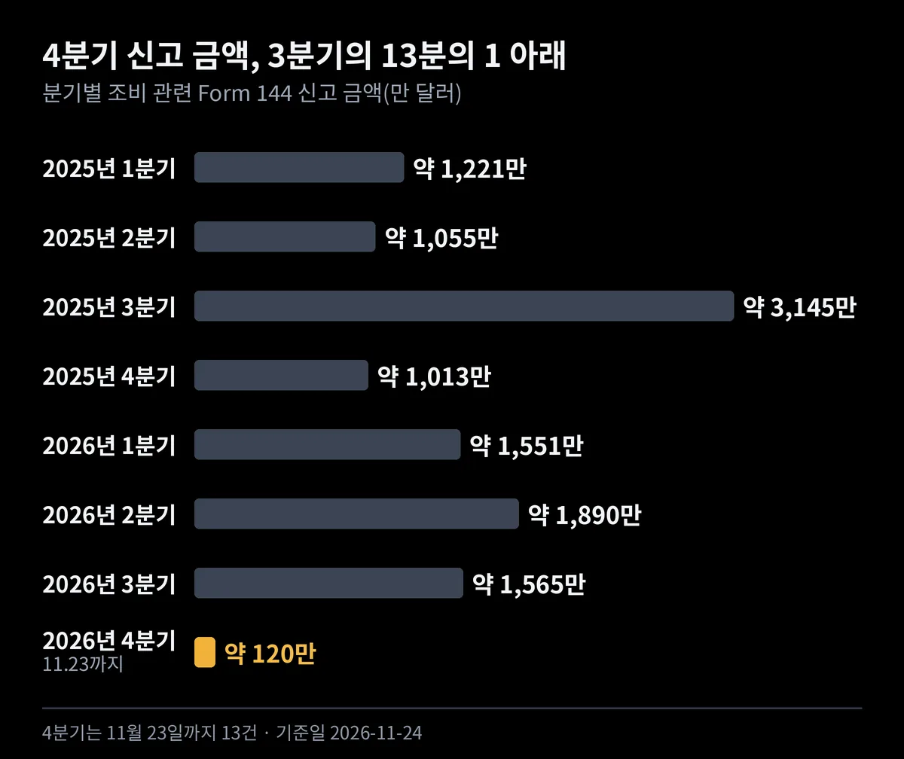
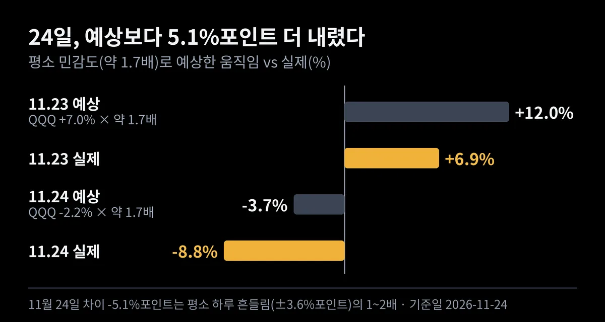
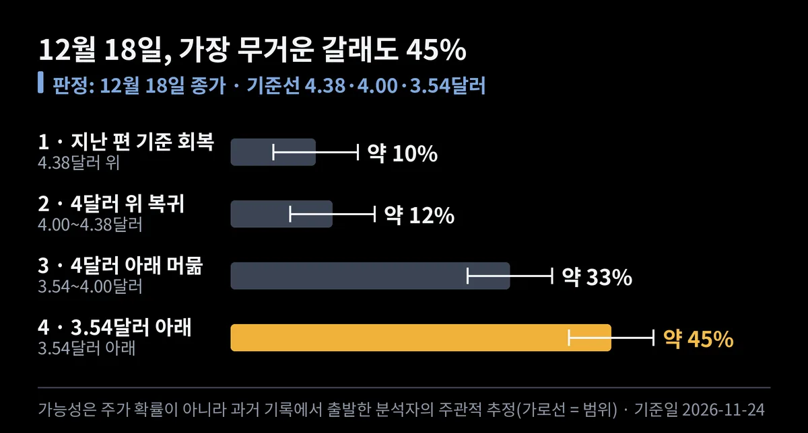

11월 23일 오후 6시 13분, 장이 끝나고 두 시간쯤 뒤였습니다. 조비 에비에이션 이름으로 미국 증권거래위원회에 서류 한 장이 접수됐습니다. 정책 총괄 임원 그레고리 볼스가 주식 5,183주를 팔 예정이라는 신고(Form 144)입니다. 그날 조비는 6.9% 올라 3.85달러로 마감했지만, 지난 리포트가 12월 18일 종가를 가르는 기준선(판정선)으로 둔 4달러는 넘지 못했습니다. 신고가 알려진 뒤 첫 거래일인 24일에는 8.8% 내려 3.51달러로 마감했습니다. 2023년 1월 6일 뒤 가장 낮은 종가입니다. 이 주식을 가진 사람이라면 질문은 하나입니다. 임원이 판다는데, 나도 팔아야 될까요?

> **유의사항** 저자는 금융·투자 자문가가 아닙니다. 이 글은 공개 공시와 시세를 정리한 교육용 분석이며 특정 종목의 매수·매도를 권하지 않습니다. Form 144는 매도 예정 신고이고 실제 매도는 Form 4로 확인됩니다. 과거 기록은 같은 일이 반복된다는 보장이 아닙니다. 실제 투자 전에는 최신 가격과 공시를 직접 확인하세요.

이 글은 [11월 19일 리포트](/r/joby-2026-11-4/)의 후속편입니다. 그 리포트는 조비가 2023년 4월 뒤 처음으로 4달러 아래, 3.935달러에 마감한 장면을 다뤘습니다. 그리고 12월 18일 종가를 네 칸으로 나눴습니다. 칸을 가르는 기준선은 4.38달러, 4달러, 3.54달러입니다.

가장 무겁게 본 칸은 '3.54달러 아래'로 약 35%였습니다. 예측을 채점하기로 정한 날(판정일)이 모두 12월이라, 지난 리포트가 건 네 칸과 확인 항목 셋, 모두 7개의 성적은 적중 0, 빗나감 0, 진행 중 7입니다. 지금 주가 3.51달러는 '3.54달러 아래' 칸에 있습니다. 11월 20일 3.60달러를 거쳐, 24일에는 그보다 더 내려왔습니다.

조비가 어떤 회사인지 짧게 짚겠습니다. 조비는 헬리콥터처럼 떠서 비행기처럼 나는 전기 에어택시를 만듭니다. 미국 연방항공청의 최종 인증을 받기 전이라 에어택시 요금은 아직 받지 못합니다. 돈을 버는 방식은 결국 에어택시 운임이지만, 지금 매출은 대부분 2025년에 인수한 헬리콥터 승객 사업 '블레이드'에서 나옵니다. 모자란 돈은 주로 새 주식을 팔아 채웁니다.

먼저 Form 144가 무엇인지부터 보겠습니다. 회사 임원처럼 내부 사정을 아는 사람은 주식을 팔 때 신고 의무가 있습니다. 3개월 동안 5,000주나 5만 달러를 넘게 팔려면, 증권사에 매도 주문을 내면서 이 신고서를 함께 냅니다. 주문은 다 체결되지 않거나 일부만 팔릴 수도 있습니다. 그래서 Form 144는 '팔았다'가 아니라 '팔려고 주문을 냈다'는 신고입니다.

실제로 몇 주를 얼마에 팔았는지는 거래 뒤 2영업일 안에 내는 주식 거래 보고서(Form 4)에 나옵니다. 이번 신고의 판매 예정일은 11월 23일이니, Form 4는 11월 25일까지 나와야 합니다. 24일 장 마감 때까지 이 매도의 Form 4는 아직 접수되지 않았습니다.

이제 신고서 원문을 펼쳐 보겠습니다. 팔 사람은 그레고리 볼스, 회사와의 관계는 '임원'입니다. 그의 과거 Form 4에 적힌 직위는 정책 총괄(Chief Policy Officer)입니다. 팔 주식은 5,183주이고, 신고서에 적힌 시장 가치는 약 2만 768달러입니다. 증권사는 모건 스탠리, 판매 예정일은 11월 23일입니다.

이 주식을 어떻게 받았는지도 적혀 있습니다. 11월 21일 회사가 주식 보상(RSU)으로 준 5,183주이고, 대가 칸에는 '보상'이라고 적었습니다. RSU는 보통 회사에 계속 다니면 정해진 날 주식으로 바뀌는 보상입니다. 볼스의 Form 4 각주도 계속 근무를 조건으로 분기마다 나눠 지급한다고 적었습니다. 미리 정해 둔 계획에 따른 매도(10b5-1)라면 그 계획을 채택한 날을 적는 칸이 있는데, 이번 신고서에서는 비어 있습니다.

그럼 이 매도는 어떤 성격일까요? 볼스의 과거 Form 4를 2022년부터 모두 읽었습니다. 같은 모양이 3개월마다 되풀이됩니다. 석 달마다 21일 무렵 주식 보상 1만 1,156주가 들어옵니다. 그리고 바로 다음 거래일에 그중 3,400~4,600주 정도를 팝니다.

이 매도에 대해 Form 4 각주는 같은 말을 씁니다. 원문은 'shares sold … to cover taxes due upon the release and settlement of the RSUs, as required by the terms of the RSU award'입니다. 주식 보상이 지급될 때 생긴 세금을 내려고 판 주식이고, 보상 조건에 따른 매도라는 뜻입니다. 10월 2일 7,663주 매도에도 그렇게 적혀 있습니다. 이번 신고도 11월 21일에 받은 주식을 2거래일 뒤인 23일에 팔 예정이라 같은 모양입니다. 다만 세금용인지는 Form 4 각주가 나와야 확정됩니다.

볼스에게는 다른 종류의 매도도 있습니다. 세금 매도 며칠 뒤에 미리 정해 둔 계획 매도(10b5-1)로 더 팔아 왔습니다. 계획 매도는 정해 둔 규칙대로 증권사가 파는 방식이라, 그날의 판단이 끼어들기 어렵습니다. 지금 계획은 2026년 5월 19일에 채택했고, 9월 21일과 10월 5일에 이 계획으로 팔았습니다. 분기 세금 매도 16번 가운데 12번은 10일 안에 계획 매도가 뒤따랐습니다.

크기를 대 보겠습니다. 볼스는 10월 5일 Form 4에 19만 3,704주를 가졌다고 적었습니다. 이번 신고 주식은 그 약 2.7%입니다. 회사 전체 주식과 비교하면 0.001%도 되지 않습니다.

회사 쪽 숫자와도 견줘 봤습니다. 회사는 8월에 증권사에 맡겨 시장에서 새 주식을 조금씩 파는 계약(ATM)을 7억 5,000만 달러 규모로 맺었습니다. 9월 말까지 일부를 팔고 남은 판매 한도는 6억 2,000만 달러입니다. 이번 신고 금액은 그 약 3만분의 1입니다.

그렇다면 과거 이런 신고 뒤 주가는 어땠을까요? 볼스의 분기 세금 매도 16번을 매도일 종가와 20거래일 뒤 종가로 비교했습니다. 9번은 더 높았고 7번은 더 낮았습니다. 나스닥 100 펀드(QQQ)보다 나았던 것은 16번 중 8번으로 꼭 절반입니다.

이번 장면에 이름을 붙이겠습니다. '임원 매도 신고일'입니다. 조비 임원이나 이사가 Form 144를 낸 날을 말합니다. 2023년 3월 첫 전자 신고부터 11월 23일까지 조비 관련 Form 144는 437건이었습니다. 장 마감 뒤 접수는 그날, 장중 접수는 그 전날 종가를 기준으로 날짜를 묶었더니 171일이 나왔습니다.

171일 가운데 20거래일 뒤가 비교할 수 있는 169일을 셌습니다. 더 높았던 날은 72일로 43%입니다. 같은 기간 아무 거래일이나 골라 20거래일 뒤를 보면 44%였습니다. 신고 금액이 100만 달러를 넘은 날만 골라도 42%, 이번처럼 계획 매도 칸이 빈 회사 제출 신고만 골라도 48%였습니다.

최근 1년만 보면 숫자가 낮아집니다. 임원 매도 신고일 46번 가운데 20거래일 뒤 더 높았던 것은 12번, 26%입니다. 하지만 같은 1년의 모든 거래일도 28%였습니다. 이 1년 동안 조비 주가가 약 70% 내렸기 때문에, 어느 날을 골라도 낮게 나옵니다. 신고가 있던 날이라서 낮았던 것은 아닙니다.

조비의 기록에서 임원 매도 신고는 주가 방향에 대해 거의 아무것도 말해 주지 않았습니다. 다른 회사 이야기로도 비슷한 장면을 본 적이 있습니다. [실스크 리포트](/r/laes-2026-11-6/)에서 11월 19일 임원 Form 4 두 건은 옵션을 행사하고 세금을 낸 기록이었고, 시장에서 판 주식은 없었습니다. 서류의 이름보다 각주가 더 많은 것을 말해 줍니다.

회사 전체의 흐름도 봤습니다. 최근 12개월 조비 관련 Form 144는 124건, 신고 금액 합계 약 5,192만 달러입니다. 가장 큰 쪽은 창업자이자 최고경영자인 조벤 비버트와 그와 관련된 신탁으로 21건, 약 3,365만 달러입니다. 임원 여럿이 해마다 꾸준히 팔아 온 회사라는 것은 숫자로 확인됩니다.

다만 최근 흐름은 오히려 줄었습니다. 2026년 3분기 신고 금액은 약 1,565만 달러였는데, 4분기는 11월 23일까지 약 120만 달러입니다. 최근 30일 동안 낸 신고는 이사 폴 시아라의 11월 2일 신고와 이번 볼스의 신고, 두 건뿐입니다. 4분기는 아직 5주 남았으니, 이 숫자는 진행 중인 값입니다.

이제 신고 전날과 다음 날 시장을 보겠습니다. 11월 23일은 나스닥 100 펀드(QQQ)가 7.0% 오른 날입니다. 조비는 6.9% 올랐습니다. 시장이 1% 움직일 때 조비가 평소 몇 % 움직였는지를 평소 민감도라고 하는데, 약 1.7배입니다. 그대로라면 약 12.0% 올랐어야 하니, 실제는 예상의 절반 남짓입니다. 차이는 평소 하루 흔들림의 1~2배 사이였습니다.

신고가 알려진 뒤 첫 거래일인 11월 24일에는 시장이 반대로 움직였습니다. QQQ는 2.2% 내렸고, 조비는 8.8% 내려 3.51달러로 마감했습니다. 평소 민감도로 예상한 하락은 약 3.7%였으니, 예상보다 5.1%포인트 더 내렸습니다. 평소 하루 흔들림(±3.6%포인트)의 1~2배입니다.

같은 날 에어택시 경쟁사 아처도 6.2% 내렸습니다. 조비는 11월 20일의 3.60달러 아래로 내려가 1년 최저를 다시 썼습니다. 더 내린 부분이 Form 144 때문인지는 확인할 방법이 없습니다. 같은 날 오후 4시까지 조비 이름으로 새로 접수된 서류는 없었습니다. 조비의 지난 기록에서는 이런 신고가 주가 방향을 거의 말해 주지 않았지만, 이번 하락의 원인은 열어 둡니다.

시장 쪽 배경도 짚어 두겠습니다. 11월 23일 변동성 지수(VIX)는 26.62로, 5거래일 전보다 3.71포인트 높았습니다. 미국 10년 국채 금리는 4.92%로 5거래일 전보다 0.20%포인트 낮았습니다. 11월 25일에는 물가 지표인 개인소비지출(PCE)이, 12월 9일에는 연준 금리 회의 결과가 나옵니다. 이 일정과 조비 주가를 잇는 근거는 아직 없어, 같은 날 함께 움직이는지만 봅니다.

팔아야 한다는 쪽 근거부터 정리하겠습니다. 가장 먼저 가격입니다. 조비는 1년 전보다 약 75% 낮고, 지난 리포트 판정선 4달러를 아직 넘지 못했습니다. 지난 리포트가 센 '1년 최저를 새로 쓴 네 번'은 모두 20거래일 뒤 더 낮았습니다.

주식 수가 늘어날 여지도 팔자는 쪽 근거입니다. 남은 판매 한도 6억 2,000만 달러를 3.51달러에 모두 쓰면 새 주식은 발행주식의 약 17.4%입니다. 2032년 만기 전환사채 6억 9,000만 달러도 남아 있습니다. 전환사채는 정해진 가격에 주식으로 바뀔 수 있는 채권입니다.

내부자 전체로 보면 파는 사람만 있었다는 점도 있습니다. 최근 12개월 신고 금액은 약 5,192만 달러이고, 그 사이 Form 4에 적힌 임원·이사의 시장 매수는 한 번뿐입니다. 2025년 12월 31일 이사 한 명이 자녀 두 명의 계좌로 1,100주, 약 1만 4,564달러어치를 13.24달러에 샀습니다. 회사 사정을 가장 잘 아는 사람들이 최근 1년 동안 주가가 내려오는 사이에는 사들이지 않았다는 뜻입니다.

버틸 수 있다는 쪽 근거도 셋입니다. 가장 먼저, 이번 신고 자체는 정보가 적습니다. 3개월마다 받는 주식 보상의 일부를 세금용으로 파는 모양이고, 본인 보유의 2.7%입니다. 임원 매도 신고일과 아무 날의 20거래일 뒤 비율도 43%와 44%로 거의 같았습니다.

내부자 매도의 속도도 느려졌습니다. 4분기 신고 금액은 11월 23일까지 약 120만 달러로, 3분기 약 1,565만 달러보다 훨씬 작습니다. 최근 30일 신고는 두 건입니다.

마지막은 돈의 크기입니다. 9월 말 현금과 단기 투자 자산 약 21억 9,787만 달러는 24일 종가 기준 시가총액 약 35억 7,000만 달러의 약 61.6%입니다. 11월 5일 분기 보고서 뒤 조비 이름으로 접수된 서류는 이번 Form 144가 처음이고, 회사 고유의 나쁜 소식은 확인되지 않았습니다. 다만 현금이 많다는 것이 주가의 바닥을 보장하지는 않습니다.

판단을 바꿀 신호는 날짜로 정해져 있습니다. 11월 25일까지는 이번 매도의 Form 4가 나와야 합니다. 실제 수량과 가격, 그리고 각주에 세금용이라는 말이 있는지 봅니다. 볼스의 지난 세금 매도 16번 가운데 12번은 10일 안에 계획 매도가 뒤따랐습니다. 이번에도 그런 신고가 나오는지, 나온다면 어떤 계획에 따른 것인지는 신고가 나온 뒤 확인합니다.

그다음은 지난 리포트들의 판정일입니다. 12월 15일에는 4.38달러, 12월 16일에는 1년 최저 경신 뒤 20거래일째 자리를 봅니다. 12월 18일에는 네 칸을 채점합니다. 12월 31일까지 새 공모나 판매 한도 증액, 전환사채 발표가 있는지도 따로 확인합니다.

새 예측은 지난 리포트와 같은 날, 같은 네 칸으로 걸었습니다. 출발점은 임원 매도 신고일 169번의 기록입니다. 신고일 종가에서 17거래일 뒤의 변화를 24일 종가 3.51달러에 곱해 네 칸에 넣었습니다. '3.54달러 아래' 칸이 58%로 가장 많았고, 아무 날이나 고른 결과도 56%로 비슷했습니다. 칸별 숫자는 끝의 표에 있습니다.

여기에 지금 사정을 15%포인트 안에서 얹었습니다. 24일 종가는 3.54달러 경계 바로 아래라, 작은 움직임에도 칸이 바뀝니다. 그래서 바로 위 칸을 올리고, 가장 무거운 '3.54달러 아래'는 약 45%로 낮췄습니다. 이 숫자는 김박사 월드가 평소 가장 무거운 갈래에 두는 상한 40%보다 높습니다. 신고일 기록과 아무 날 기록은 같은 종목·같은 기간이라 서로 독립된 근거는 아니지만, 지금 값이 이미 이 칸 안에 있다는 점까지 함께 봤습니다. 이 숫자는 주가가 오를 확률이 아니라, 과거 빈도에서 출발해 분석자가 주관적으로 매긴 추정입니다. 이번 Form 144는 갈래를 움직이는 재료로 쓰지 않았습니다. 기록이 그럴 근거를 주지 않았기 때문입니다.

이 추정이 틀릴 이유도 적어 둡니다. 11월 23일처럼 시장이 크게 오르는 날이 이어지고 조비가 평소 민감도만큼 따라가면, 4달러 위 칸으로 올라갈 수 있습니다. 반대로 회사가 남은 판매 한도를 빠르게 쓰면 아래 칸이 더 무거워집니다. 둘 다 지금 기록으로는 미리 알 수 없어, 가장 무거운 갈래도 45%에 묶었습니다.

위험도 짚겠습니다. 이번 매도의 실제 수량과 가격은 Form 4가 나오기 전까지 확정되지 않습니다. 임원 매도 신고 기록은 조비 한 종목, 3년 8개월의 기록이고, 신고일이 몰린 시기가 있어 171일이 모두 따로 떨어진 사례는 아닙니다. 남은 판매 한도와 전환사채가 주식으로 바뀌면 기존 주주 한 주의 비중은 작아집니다. 인증 비행 시험이 늦어지면 에어택시 매출도 함께 밀립니다.

정리하면, 임원이 판다는 소식은 이번에는 새로운 정보가 거의 없는 신고였습니다. 3개월마다 받는 주식 보상의 일부를 정해진 대로 파는 모양이고, 같은 신고 뒤 주가는 과거에 오른 날과 내린 날이 반반이었습니다. 그래서 지금 주가를 가르는 숫자는 이 신고가 아니라 4달러와 회사의 남은 판매 한도입니다. 12월 18일 종가가 4달러 위로 돌아오면 버티는 쪽 근거가, 3.54달러 아래로 내려가면 파는 쪽 근거가 강해집니다. 다음 갱신은 12월 15일과 18일 종가를 본 뒤에 하고, 그 전에 새 자금 조달 소식이 나오면 앞당깁니다.

## 숫자로 다시 보기

### 11월 23일 Form 144 원문

| 칸 | 신고서에 적힌 값 |
| --- | --- |
| 팔 사람 · 관계 | **그레고리 볼스 · 임원** Form 4 직위: 정책 총괄(Chief Policy Officer) |
| 팔 주식 · 시장 가치 | **5,183주 · 약 2만 768달러** 발행주식 10억 1,664만 2,259주 기준 |
| 받은 날 · 받은 방법 | **2026.11.21 · 주식 보상(RSU)** 2016년 주식 보상 계획, 대가 '보상' |
| 판매 예정일 · 증권사 | **2026.11.23 · 모건 스탠리** |
| 계획 매도(10b5-1) 채택일 | **적힌 날 없음** |
| 접수 시각 | 11월 23일 오후 6시 13분(미국 동부) |

### 볼스가 신고서에 적은 최근 3개월 매도

| 매도일 | 주식 수 | 금액 |
| --- | --- | --- |
| 2026.08.24 | 3,531주 | 약 2만 5,924달러 |
| 2026.08.25 | 4,575주 | 약 3만 3,065달러 |
| 2026.09.21 | 6,138주 | 약 3만 8,976달러 |
| 2026.10.02 | 7,663주 | 약 4만 5,592달러 |
| 2026.10.05 | 5,302주 | 약 3만 651달러 |

Form 4로 보면 8월 24일과 10월 2일은 세금용 매도입니다. 8월 25일은 2025년 5월 13일 계획, 9월 21일(옵션 행사 뒤)과 10월 5일은 2026년 5월 19일 계획에 따른 매도였습니다. 10월 5일 뒤 보유는 19만 3,704주입니다.

### 볼스의 분기 세금 매도 16번, 20거래일 뒤

주식 보상 1만 1,156주가 들어온 뒤 첫 세금 매도일의 종가 대비입니다.

| 매도일 · 종가 | 20거래일 뒤 | 같은 기간 QQQ |
| --- | --- | --- |
| 2022.11.22 4.04달러 | -12.4% | -4.4% |
| 2023.02.22 4.29달러 | -10.7% | +4.0% |
| 2023.05.22 5.45달러 | +25.9% | +7.2% |
| 2023.08.22 7.06달러 | -6.2% | +0.3% |
| 2023.11.22 5.74달러 | +20.7% | +4.5% |
| 2024.02.22 5.46달러 | -3.7% | +1.8% |
| 2024.05.22 4.87달러 | +6.6% | +5.4% |
| 2024.08.22 4.98달러 | +3.6% | +1.6% |
| 2024.11.22 7.09달러 | +7.5% | +3.4% |
| 2025.02.24 6.76달러 | +0.1% | -5.6% |
| 2025.05.22 6.64달러 | +28.2% | +3.4% |
| 2025.08.22 14.95달러 | +6.1% | +5.3% |
| 2025.11.24 13.89달러 | +2.7% | +2.8% |
| 2026.02.23 9.54달러 | -2.7% | -2.2% |
| 2026.05.22 10.92달러 | -12.5% | -0.5% |
| 2026.08.24 7.19달러 | -10.4% | +5.8% |
| **2026.11.23 3.85달러** | **12월 22일 20거래일째** | - |

**한눈에:** 더 높음 **9/16** · QQQ보다 나음 **8/16**. 16번 가운데 12번은 10일 안에 계획 매도가 뒤따랐습니다.

### 임원 매도 신고일과 아무 날

2023년 3월 15일부터 11월 23일까지, 20거래일 뒤 종가가 그날 종가보다 높았던 비율입니다.

| 묶음 | 사례 | 20거래일 뒤 더 높음 |
| --- | --- | --- |
| **임원 매도 신고일 전체** | 169일 | **43%** |
| 같은 기간 모든 거래일 | 908일 | 44% |
| 계획 매도 칸이 빈 회사 제출 신고만(이번과 같은 모양) | 40일 | 48% |
| 신고 금액 100만 달러 이상 | 38일 | 42% |
| 최근 1년 임원 매도 신고일 | 46일 | 26% |
| 최근 1년 모든 거래일 | 246일 | 28% |

20거래일 뒤가 아직 오지 않은 최근 2일은 셈에서 뺐습니다. 신고 금액은 Form 144에 적힌 예정 금액입니다.

### 분기별 조비 관련 Form 144

| 분기 | 건수 | 신고 금액 |
| --- | --- | --- |
| 2025년 1분기 | 65건 | 약 1,221만 달러 |
| 2025년 2분기 | 32건 | 약 1,055만 달러 |
| 2025년 3분기 | 22건 | 약 3,145만 달러 |
| 2025년 4분기 | 18건 | 약 1,013만 달러 |
| 2026년 1분기 | 47건 | 약 1,551만 달러 |
| 2026년 2분기 | 35건 | 약 1,890만 달러 |
| 2026년 3분기 | 24건 | 약 1,565만 달러 |
| **2026년 4분기(11.23까지)** | **13건** | **약 120만 달러** |

최근 12개월(2025년 11월 24일~2026년 11월 23일) 124건, 약 5,192만 달러 가운데 창업자 겸 최고경영자 조벤 비버트와 관련 신탁이 21건, 약 3,365만 달러입니다.

### 신고 전후 시세

| 날짜 · 장면 | 조비 종가 · 하루 | QQQ 하루 |
| --- | --- | --- |
| 11.19 지난 리포트 기준 | 3.935달러 -6.1% | -2.2% |
| 11.20 | 3.60달러 -8.5% | -5.7% |
| **11.23 Form 144 접수** | **3.85달러 +6.9%** | **+7.0%** |
| **11.24 신고 뒤 첫 거래일** | **3.51달러 -8.8%** | **-2.2%** |

11월 23일 평소 민감도(약 1.7배)로 예상한 조비 오름폭은 약 +12.0%, 실제 +6.9%였습니다. 11월 24일 평소 민감도로 예상한 하락은 약 -3.7%, 실제 -8.8%였습니다(차이 -5.1%포인트).

### 팔자는 쪽과 버티는 쪽 근거

| 쪽 · 근거 | 숫자와 출처 |
| --- | --- |
| **팔자는 쪽** 판정선 아래 | 1년 약 -75%, 4달러 아래 1년 최저 경신 4번 모두 20거래일 뒤 더 낮음 |
| **팔자는 쪽** 주식 수 증가 여지 | 남은 판매 한도 6억 2,000만 달러 전환사채 6억 9,000만 달러 |
| **팔자는 쪽** 내부자는 파는 쪽뿐 | 최근 12개월 신고 약 5,192만 달러 시장 매수는 이사 1명 1,100주(자녀 계좌)뿐 |
| **버티는 쪽** 이번 신고는 정보가 적음 | 보상 일부 세금용 모양, 보유의 2.7% 신고일 43% vs 아무 날 44% |
| **버티는 쪽** 내부자 매도 속도 둔화 | 4분기 약 120만 달러 3분기 약 1,565만 달러 |
| **버티는 쪽** 현금 | 약 21억 9,787만 달러 시가총액의 약 61.6% |

### 돈과 주식으로 본 지금(11월 24일 기준)

| 항목 | 값 · 근거 |
| --- | --- |
| 시가총액 | **약 35.7억 달러** 3.51달러 × 10억 1,664만 주 |
| 현금과 단기 투자 자산 | **약 22.0억 달러** 9월 30일 21억 9,787만 달러 · 시가총액의 약 61.6% |
| 남은 주식 판매 한도 | **6.2억 달러** 8월 계약 7억 5,000만 달러 중 |
| 한도를 지금 주가에 다 쓰면 | **약 177백만 주** 발행주식 1,017백만 주의 약 17.4% |

### 시장·거시·정책 배경

| 항목 | 값 · 기준 |
| --- | --- |
| QQQ 하루 | **+7.0%**(11월 23일) · **-2.2%**(11월 24일) |
| 조비 평소 민감도 | 약 1.7배 앞선 250거래일 하루 수익률 기준 |
| 변동성 지수(VIX) | 26.62(11월 23일) 5거래일 전보다 +3.71포인트 |
| 미국 10년 국채 금리 | 4.92%(11월 23일) 5거래일 전보다 -0.20%포인트 |
| 다음 일정 | 11월 25일 개인소비지출(PCE) 12월 9일 연준 금리 회의 결과 |
| 정책 | 직접 연결 확인 안 됨 10-K 위험 요인(인증·관세)과 대조 |

11월 19일부터 23일까지 2거래일 동안 김박사 월드 핵심 종목 7개 가운데 4개는 평소 시장 민감도로 예상한 범위 안에서 움직였습니다. 조비도 그 안이었고, [실스크](/r/laes-2026-11-6/)는 예상보다 10.4%포인트 덜 올라 범위 밖이었습니다.

### 가진 사람이 먼저 확인할 것

| 확인할 것 | 어디서 |
| --- | --- |
| 처음 산 이유(인증 일정·에어택시 사업)가 아직 맞는가 | 10-Q·회사 발표 |
| 4달러 판정선 위로 돌아왔는가 | 12월 18일 종가 |
| 남은 판매 한도·전환사채로 주식 수가 늘었는가 | 다음 분기 보고서·424B |
| 이번 매도 Form 4의 수량·가격·각주 | 11월 25일까지 |
| 금리 회의 뒤 시장을 평소만큼 따라가는가 | 12월 9일 뒤 |

한 종목 비중이 지나치지 않은지는 일반 원칙으로만 적어 둡니다. 개인의 비중은 각자 판단할 일입니다.

### 지난 예측 채점표

| 지난 점검 항목 · 당시 기준 | 판정과 지금 자리(11월 24일) |
| --- | --- |
| **12월 18일 3.54달러 아래(약 35%)** 11월 19일 리포트 가장 무거운 갈래 | **[진행 중]** 지금 3.51달러 |
| **12월 18일 3.54~4달러(약 30%)** | **[진행 중]** 11월 24일 3.51달러로 이 칸 바로 아래 |
| 12월 18일 4~4.38달러(약 20%) · 4.38달러 위(약 15%) | **[진행 중]** 12월 18일 판정 |
| **4달러 위로 돌아왔는가** | **[진행 중]** 11월 23일 장중 최고 4.05달러, 종가는 아래 |
| **4.38달러 아래인가(11월 18일 리포트 판정)** | **[진행 중]** 12월 15일 판정 |
| **새 자금 조달 발표** | **[진행 중]** 11월 24일까지 없음 |

지난 예측 성적은 적중 0 · 빗나감 0 · 진행 중 7입니다.

### 앞으로 일어날 수 있는 일

임원 매도 신고일 169번의 17거래일 뒤 변화를 24일 종가에 곱해 출발했습니다. 가장 아래 칸이 신고일 기록 58%, 모든 거래일 기록 56%로 가장 많았습니다. 아래 가능성은 분석자가 주관적으로 매긴 추정이며, 주가가 오를 확률이 아닙니다. 네 갈래는 겹치지 않아 더하면 100%입니다.

| 갈래(판정 12월 18일) | 판정 조건 | 가능성(추정) |
| --- | --- | --- |
| 1 · 지난 편 기준 회복 | 12월 18일 종가 4.38달러 위 | 낮음 약 10% (5~15%) |
| 2 · 4달러 위 복귀 | 12월 18일 종가 4.00~4.38달러 | 낮음 약 12% (7~17%) |
| 3 · 4달러 아래 머묾 | 12월 18일 종가 3.54~4.00달러 | 중간 약 33% (28~38%) |
| **4 · 3.54달러 아래** | 12월 18일 종가 3.54달러 아래 | 중간 약 45% (40~50%) |

### 핵심 확인 세 가지

| 순위 · 확인할 것 | 판정 날짜 |
| --- | --- |
| **1순위** 종가가 4달러 위로 돌아왔는가 | 12월 18일 |
| **2순위** 이번 매도의 Form 4가 세금용 매도로 나왔는가 | 11월 25일 |
| **3순위** 새 자금 조달 발표나 발행주식 수 증가가 있는가 | 12월 31일 |

공시는 [조비 에비에이션 SEC 공시 목록](https://www.sec.gov/cgi-bin/browse-edgar?action=getcompany&CIK=0001819848&type=&dateb=&owner=include&count=40)에서 확인할 수 있습니다.

## 함께 읽기

- [조비 지난 리포트](/r/joby-2026-11-4/) · [영상](https://youtu.be/m2eALHEvv8c): 3년 반 만에 4달러 아래 3.935달러, 네 갈래를 처음 건 장면(11월 19일 기준).
- [실스크 리포트](/r/laes-2026-11-6/) · [영상](https://youtu.be/zbq6gLjyeVI): 임원 Form 4 두 건이 옵션 행사 세금 처리였던 주, 시장 반등을 3분의 1만 따라간 장면(11월 23일 기준).
- [아처 에비에이션 리포트](/r/achr-2026-11/) · [영상](https://youtu.be/76JW6fhIjEw): 같은 에어택시 무리, 7거래일 연속 하락 뒤 지금 사도 될지 다룬 장면(11월 20일 기준).
