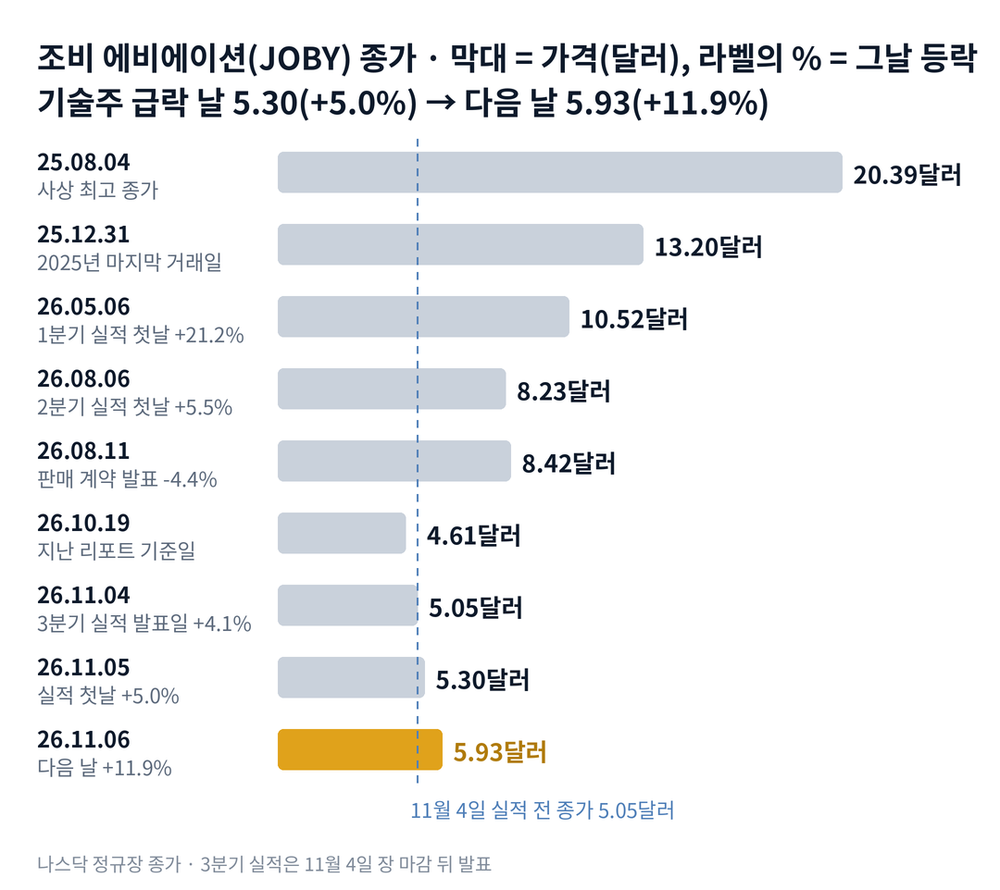

## 짧은 답

기술주가 무너진 날, 조비 에비에이션 주가는 왜 올랐을까요? 그리고 같은 보고서에 새 주식을 판 기록이 있는데도 왜 다음 날 더 올랐을까요?

결론부터 말하면, 첫날은 예상을 크게 넘은 매출이 시장의 매도를 이겼고, 둘째 날은 업종 전체의 반등이 그 위에 더해졌기 때문입니다. 지난주와 달라진 점은 주가를 누르던 '업종 동반 하락'이 실적 숫자로 한 번 끊겼다는 것입니다. 다만 그 매출은 대부분 헬리콥터 승객 사업에서 나왔고, 회사는 지난 분기 현금 사용의 약 3분의 2를 새 주식 판매로 채웠습니다. **2026.11.06 진단: 희석 국면 후반 유지 — 근거는 5부.**

그렇다고 현금 약 22억 달러가 주가의 바닥을 보장하지는 않습니다. 현금은 분기마다 줄고, 남은 주식 판매 한도는 그대로 남아 있기 때문입니다. 그렇다면 과거에 실적 뒤 이렇게 급하게 올랐을 때, 그 가격은 한 달 뒤에도 남았을까요? 답은 3부 기록표('실적 뒤 2거래일 10% 넘게 오른 4번, 20거래일 뒤는?')에 있습니다.

> **유의사항** 저자는 금융·투자 자문가가 아닙니다. 이 글은 공개 공시와 시세를 정리한 교육용 분석이며 특정 종목의 매수·매도를 권하지 않습니다. 과거의 주가 반응이 미래에 반복된다는 보장은 없고, 조비 에비에이션은 실적 날 하루에 두 자릿수로 움직인 적이 여러 번 있는 종목입니다. 실제 투자 전에는 최신 가격과 공시를 직접 확인하세요.

## 지난 리포트 이후

[10월 19일 기준 리포트](/r/joby-2026-10-2/)는 조비를 '희석 국면 후반'으로 보고, 업종과 함께 빠지는 흐름에 주목했습니다. 그 뒤 주가는 4.61달러에서 28.6% 올랐습니다. 지난 예측 성적은 다섯 항목 가운데 부분 적중 하나, 빗나감 둘, 진행 중 둘이고 적중은 없습니다. 가장 큰 빗나감은 '새 증자 발표' 시나리오입니다. 새 발표는 없었지만, 지난 리포트는 8월 11일 맺은 7억 5,000만 달러 시장 판매 계약을 놓쳤고, 그 계약으로 3분기에 새 주식이 이미 팔리고 있었습니다. 항목별 채점표는 6부 끝에 있습니다. 이번 리포트가 새로 답할 질문은 '실적 뒤 급등은 한 달 뒤에도 남는가'입니다.

## 1부. 조비 에비에이션은 어떤 회사이고, 무엇으로 돈을 버는가

> **핵심:** 조비는 전기 에어택시를 만드는 회사지만, 지금 매출의 대부분은 인수한 헬리콥터 승객 사업에서 나옵니다.

조비 에비에이션은 전기 수직이착륙기(eVTOL), 즉 헬리콥터처럼 떠서 비행기처럼 나는 전기 에어택시를 직접 만들고 운항하려는 미국 회사입니다. 캘리포니아 산타크루즈에 본사가 있고, 뉴욕증권거래소에 상장돼 있습니다. 최대 주주는 토요타입니다. 2025년 8월에는 헬리콥터로 공항과 도심을 잇는 블레이드의 승객 사업을 인수했습니다.

돈을 버는 방식은 아직 둘로 나뉩니다. 지금 매출은 블레이드 승객 운임이 대부분이고, 정부 비행 용역이 일부를 더합니다. 에어택시는 미국 연방항공청의 형식 증명(새 기체 설계가 안전 기준을 모두 충족한다는 최종 인증)을 받아야 승객을 태우고 요금을 받을 수 있습니다. 그래서 매출이 늘어도, 에어택시 사업이 돈을 버는 날이 그만큼 가까워진 것은 아닙니다.

이 구조가 중요한 이유는 이번 실적이 정확히 그 모습이었기 때문입니다. 3분기 매출은 아래 표처럼 1년 전의 두 배를 넘었고, 블레이드는 분기 최대인 4만 4,000명 넘는 승객을 태웠습니다. 회사는 올해 매출 전망도 약 15% 올렸습니다. 그런데 이미 번 9개월 매출을 빼면, 4분기에 필요한 매출은 약 1,700만~2,200만 달러뿐입니다. 이 상향은 앞으로의 기대보다 이미 끝난 여름 장사를 반영한 것에 가깝습니다.

지금 몸값은 아래 표의 시가총액이고, 그중 약 36.5%가 현금과 단기 투자 자산입니다. 한 주로 나누면 약 2.16달러입니다. 시가총액에서 현금을 빼고 전환사채·담보 대출을 더한 단순 차감값은 약 45억 5,200만 달러입니다. 이 비교가 주가의 하한선은 아닙니다. 회사는 3분기에 쓴 현금의 약 3분의 2를 새 주식 판매로 채웠기 때문입니다.

### 숫자로 본 지금의 크기(11월 6일 기준)

| 항목 | 값 · 계산 근거 |
| --- | --- |
| 종가 | **5.93달러** 2025년 마지막 거래일 13.20달러보다 55.1% 낮음 |
| 시가총액 | **약 60억 2,900만 달러** 5.93달러 × 10억 1,664만 주(11월 2일) |
| 연간 매출 전망 | **1억 3,500만~1억 4,000만 달러** 종전 1억 1,500만~1억 2,500만 · 9개월 1억 1,797만 |
| 현금과 단기 투자 자산 | **21억 9,787만 달러** 9월 말 · 3분기 사용 1억 9,500만 달러 |
| 3분기 매출 | **5,509만 달러** 1년 전보다 144% 증가, 예상 약 4,040만 달러 |
| 3분기 새 주식 판매 | **2,017만 주** 총 1억 3,000만 달러, 평균 약 6.44달러 |
| 남은 판매 한도 | **6억 2,000만 달러** 9월 말 · 8월 계약 7억 5,000만 달러 중 |

남은 판매 한도를 11월 6일 종가에 모두 쓰면 약 1억 455만 주가 새로 나옵니다. 이 숫자를 세 가지 분모로 보는 것은 5부에서 합니다. 그렇다면 이런 숫자 앞에서, 실적 첫날 주가는 무엇에 반응했을까요?

## 2부. 실적 뒤 2거래일에 겹친 세 가지

> **핵심:** 첫날은 회사 숫자가 시장의 매도를 이겼고, 둘째 날은 업종 전체의 반등이 더해졌으며, 같은 서류에는 새 주식 판매가 들어 있었습니다.

첫 번째는 매출 서프라이즈라는 회사 사건입니다. 실적은 11월 4일 오후 4시 5분(미국 동부 시각), 장 마감 뒤에 나왔습니다. 그래서 첫 반응일은 11월 5일입니다. 그날 주가는 14.3% 높게 출발했다가 장중 실적 전 종가보다 4.6% 아래까지 밀렸고, 결국 5.0% 오른 5.30달러로 마쳤습니다. 매출이 예상보다 많으면 → 올해 전망이 올라가고 → 현금을 쓰는 속도에 대한 걱정이 잠시 뒤로 밀립니다.

### 실적 전후, 에어택시·기술주 성적

| 종목 · 성격 | 11.05 하루 | 11.06 하루 |
| --- | --- | --- |
| **조비(JOBY)** 전기 에어택시 | **+5.0%** | **+11.9%** |
| 나스닥 100 ETF(QQQ) | -6.5% | +1.4% |
| 아처(ACHR) 전기 에어택시 | -6.1% | +14.7% |
| 이항(EH) 중국 무인 에어택시 | -10.0% | +8.2% |
| 로켓랩(RKLB) 발사·위성 | -12.2% | +15.4% |

두 번째는 업종 반등이라는 시장 사건입니다. 11월 5일 조비는 나스닥 100 지수를 따르는 상장지수펀드(ETF)보다 11.5%포인트 더 좋았고, 거래량도 평소의 약 2.7배였습니다. 하지만 11월 6일에는 아처와 로켓랩이 조비보다 더 크게 올랐습니다. 실적 전 종가(11월 4일)부터 11월 6일까지 합치면 조비는 아처보다 9.6%포인트, 로켓랩보다 16.1%포인트 더 올랐습니다. 이 차이가 회사 숫자의 영향으로 볼 수 있는 부분입니다.

세 번째는 새 주식 판매라는 수급 사건입니다. 같은 날 밤 나온 분기 보고서(10-Q)에는 8월 11일 맺은 시장 판매 계약(ATM: 회사가 증권사를 통해 시장에서 새 주식을 조금씩 파는 방식)의 실적이 있었습니다. 9월 말까지 2,017만 주를 팔아 약 1억 3,000만 달러를 받았습니다. 주식이 늘어나면 → 기존 주주 한 주의 비중이 작아지고(희석) → 같은 사업 가치에 더 낮은 주당 값이 매겨질 수 있습니다.

세 사건을 나란히 놓으면 공통점이 하나 보입니다. 에어택시 사업 자체의 매출이나 승객 운항 일정은 이번에 바뀌지 않았다는 점입니다. 결국 이번 상승은 헬리콥터 사업의 매출과 업종의 반등이 만든 것이고, 그 아래에는 새 주식 판매가 계속되고 있었습니다. 그렇다면 과거에 실적 뒤 이렇게 급등했을 때, 그 뒤 한 달은 어땠을까요?

## 3부. 실적 뒤 2거래일 만에 10% 넘게 오른 네 번

> **핵심:** 실적 뒤 2거래일 만에 10% 넘게 오른 네 번 가운데 세 번은 20거래일 뒤에도 실적 전 종가보다 높았지만, 2거래일째 가격을 지킨 것은 그보다 적었습니다.

이 기록을 보는 이유는 이번이 '실적 뒤 2거래일 급등'이기 때문입니다. 2021년 11월부터 이번까지 조비의 분기 실적 발표는 21번이었습니다. 이번을 뺀 20번 가운데 첫날 오른 것은 14번이었지만, 20거래일 뒤 실적 전 종가보다 높았던 것은 7번이었습니다. 그중 실적 전 종가 대비 2거래일째 종가가 10% 넘게 오른 네 번만 골랐습니다.

표의 세 칸은 세 질문에 답합니다. 첫 칸은 그때 무엇이 나왔나, 둘째 칸은 2거래일 동안 얼마나 올랐나, 셋째 칸은 한 달 뒤까지 남았나입니다. 실적이 장 마감 뒤 나오면 다음 거래일을 첫날로 셉니다. 2거래일째와 20거래일 뒤는 모두 실적 전 종가와 비교했습니다.

예를 들어 이번에는 11월 4일 실적 전 종가 5.05달러가 11월 6일 5.93달러가 됐습니다. 20번째 거래일은 12월 3일입니다.

**한눈에:** 네 번 중 세 번은 한 달 뒤에도 실적 전 종가 위 · 가운데 값(중앙값) +11.7%. 다만 2거래일째 종가보다 높았던 것은 한 번뿐이었습니다.

### 실적 뒤 2거래일 10% 넘게 오른 4번, 20거래일 뒤는?

| 첫날 · 그날 나온 내용 | 2거래일째 | 20거래일 뒤 |
| --- | --- | --- |
| **2022.05.13** 2022년 1분기 실적 *(첫날 +20.3%)* | +23.9% | +12.2% |
| **2023.11.02** 2023년 3분기 실적 *(첫날 +13.1%)* | +16.4% | +11.2% |
| **2026.05.06** 1분기 매출 예상 상회 *(첫날 +21.2%)* | +15.3% | +31.7% |
| **2026.08.06** 2분기 실적 *(첫날 +5.5%)* | +10.8% | -12.6% |

네 번은 분기마다 따로 일어나 20거래일 측정 기간이 서로 겹치지 않습니다. 다만 그때와 지금은 주가 수준, 주식 수, 사업 구성이 크게 다르므로 이 표는 확률이 아니라 과거 움직임의 참고 자료입니다. 2026년 8월에는 2거래일째 다음 거래일 아침에 시장 판매 계약이 발표됐습니다. 8월 11일 그날 주가는 8.81달러에서 8.42달러로 4.4% 내렸습니다.

> **이번(미확정):** 2026.11.05 · 매출 예상 약 36% 상회, 연간 전망 15% 상향, 3분기 새 주식 2,017만 주 판매 · 첫날 +5.0%(QQQ -6.5%) · 2거래일째 +17.4% · 5거래일째 11월 11일, 20거래일째 12월 3일 판정

여기서 기억할 사실은 하나입니다. 20거래일 뒤 실적 전 종가 위에 남은 것은 네 번 중 세 번이었지만, 2거래일째에 오른 가격까지 지킨 것은 2026년 5월 한 번뿐이었습니다. 2022년 5월과 2023년 11월은 실적 전보다는 높았지만, 2거래일째 종가보다는 낮았습니다. 그렇다면 한 번뿐인 5월과 나머지는 무엇이 달랐을까요?

## 4부. 5월과 8월, 같은 급등 뒤 정반대였던 이유

> **핵심:** 같은 급등이라도 그 뒤에 새 주식 판매가 나왔는지가 한 달 뒤를 갈랐고, 이번에는 판매 한도가 이미 열려 있습니다.

두 시점은 묻는 질문이 달랐습니다. 2거래일의 질문은 '숫자가 기대보다 나은가'였고, 한 달 뒤의 질문은 '그 숫자를 근거로 새 주식이 나오는가'였습니다. 2026년 5월에는 1분기 매출이 예상을 넘은 뒤 한 달 동안 새 주식 판매 발표가 없었고, 주가는 20거래일 뒤 실적 전보다 31.7% 높았습니다. 2026년 8월에는 급등 바로 뒤에 판매 계약과 레조넌트 사이언시스 인수(약 5억 달러, 대부분 현금)가 함께 나왔습니다. 한 달 뒤 주가는 실적 전보다 낮았습니다.

이번에는 세 가지가 다릅니다. 첫째, 판매 계약은 이미 맺어져 있고 9월 말 기준 6억 2,000만 달러가 남아 있습니다. 새 발표 없이도 판매가 이어질 수 있다는 뜻입니다. 둘째, 3분기에 판매한 평균 가격 약 6.44달러는 지금 주가 5.93달러보다 높습니다. 셋째, 인수 대금 대부분을 현금으로 내야 하는 레조넌트 인수가 2027년 초 마무리를 앞두고 있습니다.

같은 점도 있습니다. 매출 상향의 대부분은 블레이드에서 나왔고, 전기 에어택시의 인증 일정은 바뀌지 않았습니다. 생산 라인에서는 17대가 만들어지고 있고, 미국 공군 자율비행 계약은 약 3,700만 달러로 늘었습니다. 회사는 연방항공청 인증 5단계 가운데 세 단계를 끝냈고, 네 번째 단계는 10월 30일 기준 조비 쪽 83%, 연방항공청 쪽 78%라고 밝혔습니다. 그러나 연방항공청 조종사가 직접 모는 인증 비행 시험(TIA)은 2027년 상반기 시작 예정입니다. 승인은 팔 수 있는 자격이지, 주문과 매출을 뜻하지 않습니다.

과거 기록이 알려 주는 것은 2거래일의 상승이 한 달 뒤를 정하지 않았다는 점입니다. 결국 앞으로 확인할 것은 두 가지입니다. 하나는 4분기에 시장 판매 계약으로 새 주식이 다시 팔리는가입니다. 다른 하나는 회사가 올린 연간 매출 전망 1억 3,500만 달러를 지키는가입니다. 이 두 가지로 다음 몇 달을 나누면 어떤 갈림길이 나올까요?

## 5부. 판매 지속과 전망 달성, 네 가지 시나리오

> **핵심:** 지금은 지난 리포트의 '희석 국면 후반'이 이어지는 단계이고, 4부에서 본 두 가지가 시나리오를 가르는 축입니다.

> **국면 정의(조비 에비에이션 시리즈 공통):** 기대 국면 — 인증·정책·제휴 소식에 하루 10% 넘게 오르고 아직 대규모 증자가 없을 때. 희석 국면 — 증자·전환사채·시장 판매로 주식이 늘고 호재에도 오름세가 오래가지 않을 때. 증명 국면 — 승객 상업 운항이나 최종 인증이 나오고 새 주식 없이 자금이 들어올 때.

**2026년 11월 6일 진단: 희석 국면 후반 유지, 지난 리포트 진단 유지.** 실적 뒤 급등이라는 기대 국면의 신호가 나왔지만, 3분기에 주식 수는 2.7% 늘었고 판매 한도는 남아 있습니다. 증명 국면의 신호인 승객 운항과 최종 인증은 아직입니다.

남은 판매 한도를 11월 6일 종가에 모두 쓰면 약 1억 455만 주입니다. 이 물량을 세 분모로 보면 다음과 같습니다. 11월 2일 전체 발행주식 10억 1,664만 주의 약 10.3%입니다. 유통주식(거래되는 주식)은 회사가 따로 밝히지 않아 같은 날 발행주식을 대신 썼으므로, 실제 유통주식 대비 비율은 이보다 클 수 있습니다. 직전 20거래일 평균 거래량(약 2,151만 주)으로는 약 4.9거래일치입니다.

하반기 현금 사용 전망은 3억 8,500만~4억 1,500만 달러로 유지됐습니다. 3분기에 1억 9,500만 달러를 썼으니, 4분기에도 약 2억 달러 안팎이 나간다는 뜻입니다.

**판정 기준 두 가지:** 첫째, 판매 지속입니다. 4분기 보고서(2027년 2월 예상)에서 시장 판매 계약으로 판 주식이 있으면 '지속'으로 봅니다. 둘째, 전망 달성입니다. 올해 매출이 1억 3,500만 달러 이상이면 '달성'으로 봅니다.

### 앞으로 일어날 수 있는 일

3부 기록에서 실적 뒤 급등은 4번 중 3번 한 달 뒤에도 실적 전 종가 위에 있었지만, 2거래일째 가격을 지킨 것은 4번 중 1번이었습니다. 시장 판매는 2025년 1~3분기와 올해 3분기에 있었고, 대형 공모가 있었던 올해 상반기에는 없었습니다.

**확인된 사실:** 3분기 매출은 예상보다 약 36% 많았고, 회사는 전망을 올렸으며, 같은 분기에 새 주식 2,017만 주를 팔았습니다. **과거 기록:** 2거래일 급등 뒤 판매 계약이 나온 2026년 8월은 한 달 뒤 실적 전보다 낮았습니다(3부). **추정:** 아래 가능성은 분석자의 주관적 추정이며, 주가가 오를 확률이 아니라 회사 숫자 조합의 가능성입니다. 네 경우는 겹치지 않아 '약 N%'를 더하면 100%이고, 괄호 안 구간은 흔들림의 폭이라 서로 더하지 않습니다.

| 시나리오(판정 4분기 실적 발표) | 판매 · 달성 | 가능성(추정) |
| --- | --- | --- |
| 1 · 판매 멈춤, 전망 달성 | 없음 · ○ | 중간 약 25% (20~30%) |
| **2 · 판매 지속, 전망 달성** | 지속 · ○ | 높음 약 40% (35~45%) |
| 3 · 판매 멈춤, 전망 미달 | 없음 · × | 낮음 약 15% (10~20%) |
| 4 · 판매 지속, 전망 미달 | 지속 · × | 낮음 약 20% (10~20%) |

**한눈에:** 연간 전망 달성은 1과 2를 더한 약 65%, 판매 지속은 2와 4를 더한 약 60%입니다. 분석자의 주관적 추정을 더한 값이며, 실제 확률이나 통계 예측값은 아닙니다. 회사 숫자가 맞아도 주가 방향은 따로 읽어야 합니다.

시나리오 2를 가장 높게 본 이유는 두 가지입니다. 전망 하단을 지키는 데 필요한 4분기 매출은 1부에서 본 것처럼 낮습니다. 반면 하반기 전망으로 계산한 4분기 현금 사용은 약 2억 달러 안팎입니다. 하지만 같은 무게로 반대쪽 요인도 있습니다. 블레이드 승객 사업은 3분기가 가장 바빴고, 4분기 매출이 얼마나 줄지는 회사가 숫자로 밝히지 않았습니다.

시나리오 1과 3을 낮게 본 이유는 판매를 멈출 동기가 약하기 때문입니다. 레조넌트 인수 대금과 4분기 현금 사용을 더하면 연말까지 나갈 돈이 크고, 토요타의 남은 2억 5,000만 달러는 아직 조건이 채워지지 않았습니다. 다만 3분기 평균 판매 가격 약 6.44달러보다 주가가 낮은 동안에는 판매 속도를 늦출 수도 있습니다. 그렇다면 이 진단을 가장 빨리 뒤집을 수 있는 위험은 무엇일까요?

## 6부. 세 갈래 위험과 체크리스트

> **핵심:** 위험은 사업 실행, 자금 조달, 외부 환경 세 갈래이고, 가장 빨리 판을 바꿀 수 있는 것은 판매 한도의 사용 속도입니다.

먼저 이 분석의 한계입니다. 3부 표는 네 번뿐인 작은 표본이고, 2022년과 지금은 주가 수준과 사업 구성이 크게 다릅니다. 시장 예상치는 보도 집계라 회사가 확인한 숫자가 아닙니다. 11월 5~6일 상승 가운데 회사 숫자와 업종 반등의 영향을 정확히 나누는 방법은 없습니다.

첫째 갈래는 사업 실행입니다. 인증 비행 시험이 2027년 상반기보다 늦어지면 승객 운항도 함께 밀립니다. 두바이에서는 두 번째 이착륙장이 완공됐고 조종사가 탄 운항 시험을 올해 안에 시작할 계획이지만, 날짜는 아직 나오지 않았습니다. 레조넌트 인수는 규제·안보 승인이 남아 있습니다.

둘째 갈래는 자금 조달입니다. 3분기에 쓴 현금의 약 66%를 새 주식 판매로 채웠습니다. 남은 한도를 쓰면 주식 수가 늘어 기존 주주 한 주의 비중이 작아지는 희석이 생깁니다. 2032년 만기 전환사채 6억 9,000만 달러(전환 가격 약 14.19달러)도 남아 있습니다. 전환사채는 나중에 주식으로 바꿀 수 있는 회사채입니다.

셋째 갈래는 외부 환경입니다. 에어로소닉 소송에서 10월 2일 배심원이 1억 1,690만 달러 배상 평결을 냈고, 회사는 항소할 방침입니다. 상대측은 11월 2일 금지 명령도 신청했습니다. 11월 5일처럼 기술주 전체가 팔리는 날, 다음 실적에서는 같은 결과가 나오리라는 보장이 없습니다.

**핵심 확인 세 가지:**

- ☐ 12월 3일 종가가 실적 전 종가 5.05달러보다 높은가(3부 20거래일째)
- ☐ 12월 3일 종가가 2거래일째 종가 5.93달러보다 높은가(3부 숨긴 질문)
- ☐ 2027년 2월 4분기 보고서에서 시장 판매 계약 판매가 0주인가

**보조 확인:**

- ☐ 11월 11일 종가가 첫날 종가 5.30달러보다 높은가(5거래일째)
- ☐ 2027년 6월 30일까지 연방항공청 인증 비행 시험 시작이 발표됐나

**지난 리포트 점검(따로 판정):**

- ☐ 12월 31일까지 두바이 조종사 탑승 운항 시험 시작이 발표됐나(지난 리포트 시나리오 1)
- ☐ 12월 31일까지 토요타 남은 2억 5,000만 달러 투자 마무리가 발표됐나(지난 리포트 시나리오 3)

**기억할 판단 기준 세 가지:** 첫째, 이번 매출 서프라이즈는 에어택시가 아니라 헬리콥터 승객 사업에서 나왔습니다. 둘째, 같은 분기에 현금 사용의 약 3분의 2를 새 주식 판매로 채웠고 한도는 남아 있습니다. 셋째, 과거 실적 뒤 급등은 한 달 뒤 실적 전보다 높은 경우가 많았지만, 2거래일째 가격까지 지킨 경우는 드물었습니다.

다음 갱신은 12월 3일 20거래일째 반응을 본 뒤에 합니다. 공시는 [조비 에비에이션 SEC 공시 목록](https://www.sec.gov/cgi-bin/browse-edgar?action=getcompany&CIK=0001819848&type=&dateb=&owner=include&count=40)과 [조비 에비에이션 투자자 정보](https://ir.jobyaviation.com/)에서 확인할 수 있습니다.

### 지난 예측 채점표

10월 20일 리포트(10월 19일 기준)의 진단과 시나리오를 11월 6일 기준으로 채점한 결과입니다. 지난 리포트에는 시나리오별 가능성 숫자가 없었습니다.

| 지난 점검 항목 · 당시 기준 | 판정 및 실제 결과(11월 6일) |
| --- | --- |
| **진단: 희석 국면 후반** 새 증자·내부자 매도·호재에도 약세 | **[부분 적중]** 3분기 새 주식 2,017만 주 판매, 다만 실적 뒤 +17.4% |
| **시나리오 1: 증명 국면 진입** 두바이 첫 승객 운항·시험 비행 확인 | **[진행 중]** 두바이 시험 올해 안 계획, 인증 비행 2027년 상반기 |
| **시나리오 2: 추가 증자** 새 주식·전환사채 발표, 다음 날 하락 | **[빗나감]** 새 발표 없음, 8월 계약으로 판매는 진행 중이었음 |
| **시나리오 3: 희석 없는 자금** 토요타 남은 2억 5,000만 달러 | **[진행 중]** 9월 말 미집행 |
| **시나리오 4: 외부 악재 지속** 4.80달러 지지 여부 | **[빗나감]** 10월 21일 4.64달러가 최저, 11월 6일 5.93달러 |
