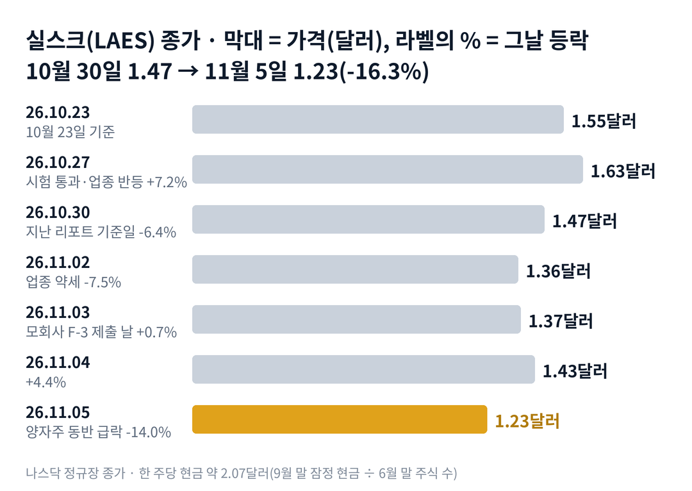

## 짧은 답

실스크 주가는 11월 5일 하루 14.0% 내려 1.23달러로 마감했습니다. 그날 회사는 새 공시를 내지 않았습니다. 그렇다면 왜 이렇게 크게 빠졌을까요?

이번 하락은 회사 하나의 일이 아니었습니다. 같은 날 아이온큐가 10.5%, 디웨이브가 12.8%, 리게티가 12.1% 내렸습니다. 양자 관련주가 한꺼번에 팔린 날이었습니다.

주가는 이제 9월 말 주당 현금 약 2.07달러의 약 59%입니다. 그렇다고 이 현금이 주가의 바닥을 보장하지는 않습니다. 현금은 매 분기 쓰이고, 회사는 필요하면 새 주식을 팔 수 있기 때문입니다.

과거에도 실스크가 아이온큐와 함께 크게 빠진 날이 있었습니다. 그런 날 뒤 첫날은 대체로 올랐습니다. 그렇다면 한 달 뒤에도 그 반등은 남아 있었을까요?

## 지난 리포트 이후

[10월 30일 기준 리포트](/r/laes-2026-11/)는 지금을 '현금 아래에서 방치된 단계'로 봤고, 이 진단은 맞았습니다. 주가는 주당 현금의 약 71%에서 약 59%로 더 내려왔습니다. 나머지 다섯 항목은 11월 20~30일에 판정합니다. 다만 가장 높게 본 '1.42~1.63달러 사이에서 머문다'는 지금 벗어나 있고, '새 최저로 간다' 쪽에 가 있습니다. 지난 예측 성적은 적중 1 · 진행 중 5이고, 항목별 채점표는 6부 끝에 있습니다. 이번 리포트가 새로 답할 질문은 '업종과 함께 급락한 뒤 한 달'입니다.

## 1부. 실스크는 어떤 회사이고, 무엇으로 돈을 버는가

> **핵심:** 실스크는 보안 칩을 파는 회사이고, 지금 주가는 회사가 가진 현금보다 낮은 값에 거래되고 있습니다.

실스크(SEALSQ)는 스위스 제네바에 본사를 둔 보안 반도체 회사입니다. 모회사는 위즈키(WISeQey, 옛 WISeKey)입니다. 해킹을 막는 보안 칩을 만들고, 양자컴퓨터로도 풀기 어려운 암호를 넣은 칩(양자내성 칩)을 새 제품으로 내세웁니다.

돈을 버는 방식은 칩 판매입니다. 전력 계량기, 자동차, 공장 장비 같은 기기에 들어가는 보안 칩을 팔고 대가를 받습니다. 10월 15일 잠정 발표로 올해 9개월 매출은 1,630만 달러였습니다.

양자내성 칩이 중요한 이유는 새 매출의 출발점이기 때문입니다. 첫 칩 QS7001(양자내성 보안 칩 제품 이름)은 10월 27일 유럽 보안 시험의 기술 평가를 통과했습니다. 하지만 정식 인증은 2027년 1월 현장 감사 뒤에 나옵니다. 시험 통과는 팔 수 있는 자격에 가까워졌다는 뜻이지, 주문과 매출을 뜻하지는 않습니다.

지금 몸값은 현금보다 낮습니다. 시가총액에서 현금을 뺀 단순 차감값은 약 -1억 8,800만 달러입니다. 시장이 칩 사업에 값을 매기지 않고, 현금의 일부도 덜 쳐 주고 있다는 계산입니다. 다만 이 비교가 주가의 하한선은 아닙니다.

### 숫자로 본 지금의 크기(11월 5일 기준)

| 항목 | 값 · 계산 근거 |
| --- | --- |
| 종가 | **1.23달러** 2024년 12월 11일 이후 최저 종가 |
| 9월 말 현금 | **약 4억 6,300만 달러** 10월 15일 잠정 발표, 부채 차감 전 |
| 주당 현금 | **약 2.07달러** 6월 말 주식 2억 2,343만 주 기준 |
| 시가총액 | **약 2억 7,480만 달러** 1.23달러 × 2억 2,343만 주 |
| 9개월 매출 | **1,630만 달러** 10월 15일 잠정 발표 |

표의 단순 차감값은 부채와 투자 약정을 빼지 않은 숫자라 기업가치 계산은 아닙니다. 그렇다면 11월 첫 주에 무엇이 값을 더 끌어내렸을까요?

## 2부. 일주일 동안 겹친 세 가지 일

> **핵심:** 업종 전체의 매도, 모회사의 자금 조달 서류, 작은 내부자 매도가 겹쳤지만, 실스크 자신의 새 악재는 없었습니다.

첫 번째는 업종 전체의 매도입니다. 11월 5일 양자 관련주 다섯 종목이 모두 10% 넘게 내렸습니다. 투자자가 업종 전체에서 돈을 빼면, 회사 소식과 상관없이 같은 날 같은 방향으로 움직입니다. 아이온큐는 그날 장 마감 뒤 실적을 냈으니, 정규장 하락은 실적 발표 전이었습니다.

### 같은 일주일, 양자주 성적

| 종목 · 성격 | 10.30 → 11.05 | 11.05 하루 |
| --- | --- | --- |
| **실스크(LAES)** · 보안 반도체 | **-16.3%** | **-14.0%** |
| 아르킷(ARQQ) · 양자 보안 | -21.9% | -11.5% |
| BTQ · 양자 보안 | -15.7% | -13.9% |
| 디웨이브(QBTS) 양자 어닐링 | -15.0% | -12.8% |
| 리게티(RGTI) · 초전도 양자 | -12.4% | -12.1% |
| 아이온큐(IONQ) · 업종 대표 | -12.0% | -10.5% |

두 번째는 모회사의 자금 조달 서류입니다. 위즈키는 11월 3일 장 마감 뒤 최대 1억 달러의 증권을 팔 수 있게 하는 신고서(F-3)를 냈습니다. 이 서류는 매도 주주가 가진 증권을 팔 수 있는 길도 열어 둡니다. 서류가 나오면 시장은 '앞으로 주식이 더 나올 수 있다'를 값에 먼저 넣습니다. 다만 아직 효력이 없고, 실스크 자신의 증자 설명서(424B)는 10월 30일 이후 나오지 않았습니다.

세 번째는 작은 내부자 매도입니다. 연구개발 부사장이 11월 2일 스톡옵션 3만 5,000주를 행사해 11월 3일 평균 1.3808달러에 모두 팔았습니다. 미리 정해 둔 매도 계획(10b5-1)에 따른 것이고, 금액은 약 4만 8,000달러로 작습니다.

같은 11월 3일 위즈키는 좋은 숫자도 냈습니다. 그룹 9개월 매출 1,700만 달러(55% 증가)와 그룹 현금 약 4억 7,100만 달러입니다. 그런데 다음 날 실스크는 4.4% 오른 뒤, 11월 5일 업종과 함께 다시 무너졌습니다.

세 가지를 나란히 놓으면 공통점이 하나 보입니다. 모두 실스크의 매출이 줄었다는 소식은 아니었다는 점입니다. 결국 이번 하락은 양자주 전체의 매도에 '주식이 더 나올 수 있다'는 걱정이 겹친 결과였습니다. 그렇다면 과거 이렇게 업종과 함께 크게 빠진 뒤에는 어떻게 움직였을까요?

## 3부. 업종과 함께 크게 빠진 날 11번, 다음 날과 20거래일 뒤

> **핵심:** 11번 가운데 다음 날 오른 것은 8번이었지만, 20거래일 뒤 더 높았던 것은 4번이었습니다.

이 기록을 보는 이유는 11월 5일과 비슷한 조건이기 때문입니다. 실스크가 10% 넘게, 아이온큐가 8% 넘게 같은 날 함께 빠진 날만 골랐습니다. 상장 첫 주(2023년 5월)는 주가가 지금과 전혀 다른 수준이라 뺐습니다.

표의 세 칸은 세 가지 질문에 답합니다. 첫 칸은 그날 얼마나 빠졌는가, 둘째 칸은 다음 날 반등했는가, 셋째 칸은 한 달 뒤에도 그날보다 높았는가입니다.

'다음 날'은 다음 거래일 종가를, '20거래일 뒤'는 다음 날을 첫날로 센 20번째 거래일 종가를 그날 종가와 비교했습니다.

예를 들어 2026년 2월 5일에는 실스크가 12.0%, 아이온큐가 13.9% 내렸고 종가는 3.52달러였습니다. 다음 날 4.00달러로 +13.6%, 20번째 거래일인 3월 6일 3.99달러로 +13.4%였습니다.

### 함께 빠진 날 11번, 그 뒤는?

| 이벤트일 · 그날 하락 | 다음 날 | 20거래일 뒤 |
| --- | --- | --- |
| 2024.12.18 실스크 -21.5%, 아이온큐 -14.5% | -14.1% | +114.5% |
| **2025.01.08** 실스크 -26.2%, 아이온큐 -39.0% | +8.6% | **-23.6%** |
| 2025.01.13 실스크 -41.5%, 아이온큐 -13.8% | +9.3% | +11.6% |
| **2025.02.11** 실스크 -13.6%, 아이온큐 -8.2% | +2.0% | **-25.4%** |
| **2025.03.10** 실스크 -11.3%, 아이온큐 -11.1% | 0.0% | **-6.5%** |
| **2025.03.18** 실스크 -11.2%, 아이온큐 -9.0% | +3.3% | **-24.6%** |
| **2025.03.20** 실스크 -10.1%, 아이온큐 -9.3% | -3.9% | **-24.8%** |
| 2025.10.10 실스크 -11.2%, 아이온큐 -8.8% | +13.3% | +13.9% |
| **2025.10.16** 실스크 -15.1%, 아이온큐 -9.4% | +4.9% | **-23.4%** |
| 2026.02.05 실스크 -12.0%, 아이온큐 -13.9% | +13.6% | +13.4% |
| **2026.06.05** 실스크 -12.3%, 아이온큐 -13.5% | +0.6% | **-12.5%** |

굵게 쓴 일곱 줄이 20거래일 뒤 그날보다 낮았던 경우입니다.

이번 11월 5일의 하락 폭은 지난 리포트 기준일(10월 30일 1.47달러)과 비교하면 -16.3%이고, 하루만 보면 -14.0%입니다. 이 표는 하루 하락을 기준으로 골랐습니다.

> **이번(미확정):** 2026.11.05 · 실스크 -14.0%, 아이온큐 -10.5% · 종가 1.23달러 · 다음 날은 11월 6일, 20거래일 뒤는 12월 4일 판정

11번 전체로 보면 다음 날은 8번 오르고 2번 내렸고 1번은 그대로였습니다. 반면 20거래일 뒤 그날보다 높았던 것은 11번 중 4번이고, 가운데 값(중앙값)은 -12.5%였습니다.

최근 네 번(2025년 10월 이후)은 2번 높고 2번 낮아 반반이었습니다. 기록이 보여 주는 것은 여기까지입니다. 첫날의 반등은 흔했지만, 한 달 뒤까지 남은 경우는 적었습니다. 그렇다면 첫날과 한 달 뒤는 왜 이렇게 달랐을까요?

## 4부. 첫날과 한 달 뒤가 달랐던 이유

> **핵심:** 첫날은 업종 반등을 따라갔지만, 한 달 뒤는 업종이 회복해도 실스크가 따라가지 못한 때가 많았습니다.

두 시점은 묻는 질문이 다릅니다. 다음 날의 질문은 '업종이 다음 거래일에 숨을 돌리는가'입니다. 아이온큐가 다음 날 오른 날에는 실스크도 대체로 함께 올랐습니다. 한 달 뒤의 질문은 '업종의 회복이 실스크의 회복으로 이어지는가'입니다.

여기서 차이가 드러납니다. 2025년 3월의 세 번(3월 10일, 18일, 20일)은 20거래일 뒤 아이온큐가 12~25% 올라 있었습니다. 같은 때 실스크는 6.5%, 24.6%, 24.8% 낮았습니다. 업종이 살아나도 실스크가 따라가지 못한 흔적입니다.

반대로 한 달 뒤 높았던 네 번 가운데 세 번(2024년 12월, 2025년 1월 13일, 2026년 2월)은 아이온큐도 17~35% 올라 있던 때였습니다. 그런 때만 실스크의 반등이 오래 남았습니다.

이번에는 출발점이 세 가지 다릅니다. 첫째, 아이온큐가 11월 5일 장 마감 뒤 3분기 매출 1억 7,380만 달러(336% 증가)와 연간 전망 상향을 냈습니다. 업종 대표의 숫자가 좋았던 상태로 첫날을 맞습니다. 둘째, 실스크 주가는 이미 주당 현금의 약 59%입니다. 셋째, 모회사의 1억 달러 신고서라는 새 부담이 생겼습니다.

결국 앞으로 확인할 것은 두 가지입니다. 하나는 11월 6일 첫 반응이 1.23달러 위에서 끝나는가, 다른 하나는 12월 4일 종가가 1.23달러 위에 있는가입니다. 이 두 조건으로 다음 한 달을 나누면 어떤 갈림길이 나올까요?

## 5부. 실적 뒤 한 달, 네 가지 시나리오

> **핵심:** 지금은 주가가 현금 아래로 더 내려온 방치 단계이고, 첫날 반등보다 한 달 뒤의 자리가 다음 단계를 가릅니다.

> **국면 정의(실스크 시리즈 공통):** 광풍 — 양자 테마로 거래량이 평소의 5배를 넘으며 급등하는 때. 조달 — 증자 설명서(424B)가 나오고 주가가 그 가격 근처로 눌리는 때. 방치 — 주가가 현금보다 낮은 채 업종을 따라서만 움직이는 때.

**2026년 11월 5일 진단: 방치 단계의 심화(지난 리포트 진단 유지).** 주가는 주당 현금의 약 71%에서 약 59%로 더 내려왔습니다. 11월 5일 거래량 652만 주는 최근 두 주의 약 1.5~2.5배로, 광풍 단계의 신호(평소의 5배)는 아닙니다. 조달 단계의 첫 신호인 실스크의 424B도 아직 없습니다.

**판정 기준 두 가지:** 첫째, 11월 6일 첫 반응입니다. 11월 6일 종가가 11월 5일 종가 1.23달러보다 높으면 '상승'으로 봅니다. 둘째, 한 달 뒤의 자리입니다. 11월 6일을 첫날로 센 20번째 거래일인 12월 4일 종가가 1.23달러보다 높은지를 봅니다.

### 앞으로 일어날 수 있는 일

과거 기록은 11번 중 8번 다음 날 올랐지만, 20거래일 뒤 더 높았던 것은 11번 중 4번입니다.

**확인된 사실:** 11월 5일 종가는 2024년 12월 이후 최저이고, 실스크의 424B는 없습니다. **과거 기록:** 업종이 회복할 때만 실스크의 반등이 한 달 넘게 남았습니다(4부). **추정:** 아래 가능성은 분석자가 주관적으로 매긴 값이며, 주가가 오를 확률이 아닙니다. 네 경우는 겹치지 않아 '약 N%'를 더해서 100%가 되게 맞췄고, 괄호 안 구간은 흔들림의 폭이라 서로 더하지 않습니다.

| 시나리오(판정 11월 6일·12월 4일) | 첫날·20일째 | 가능성(추정) |
| --- | --- | --- |
| 1 · 업종과 함께 회복 | 상승 · 1.23달러 위 | 낮음 약 25% (20~30%) |
| **2 · 첫날만 반등** | 상승 · 1.23달러 아래 | 중간 약 35% (30~40%) |
| 3 · 첫날 하락 뒤 회복 | 하락 · 1.23달러 위 | 낮음 약 10% (5~15%) |
| 4 · 하락이 이어짐 | 하락 · 1.23달러 아래 | 중간 약 30% (25~35%) |

첫날과 한 달 뒤는 따로 읽어야 합니다. 첫날 오르는 경우는 1과 2를 더한 약 60%로 봤습니다. 그러나 12월 4일에 1.23달러 위에 있는 경우는 1과 3을 더한 약 35%입니다.

4부에서 본 차이가 시나리오를 가르는 축입니다. 시나리오 2를 가장 높게 본 이유는 두 가지입니다. 과거 11번 중 8번은 다음 날 올랐고, 아이온큐의 실적이 좋았습니다. 그러나 한 달 뒤까지 남은 경우는 4번뿐이었습니다. 이 값은 과거 빈도와 지금 신호에서 나온 추정이지, 주가가 오르거나 내린다는 판단이 아닙니다.

시나리오 1을 받치는 근거는 업종 대표의 좋은 실적과 현금보다 낮은 주가입니다. 하지만 같은 무게로 반대쪽 요인도 있습니다. 모회사의 1억 달러 신고서가 새로 생겼고, 2025년 3월처럼 업종이 회복해도 실스크가 따라가지 못한 때가 많았습니다. 그렇다면 이 진단을 가장 빨리 뒤집을 수 있는 위험은 무엇일까요?

## 6부. 세 갈래 위험과 체크리스트

> **핵심:** 위험은 사업 실행, 자금 조달, 외부 환경 세 갈래이고, 가장 빨리 판을 바꿀 수 있는 것은 주식 판매 서류입니다.

먼저 이 분석의 한계입니다. 3부 표는 '함께 빠지면 한 달 뒤 내린다'는 규칙이 아닙니다. 11번은 작은 표본이고, 2024년과 지금은 주가 수준과 현금이 전혀 다릅니다. 주당 현금은 6월 말 주식 수로 계산했고, 9월 말 주식 수와 3분기 정식 숫자는 아직 공개되지 않았습니다.

첫째 갈래는 사업 실행입니다. 위즈샛 위성 의향서(약 1,500만 달러)는 아직 정식 계약이 아닙니다. 보안 칩 QS7001의 정식 인증은 2027년 1월 현장 감사 뒤입니다. 계약과 인증이 늦어지면 새 매출의 출발점도 밀립니다.

둘째 갈래는 자금 조달입니다. 실스크가 증자 설명서(424B)를 내고 시장에서 주식을 팔기 시작하면 희석이 생깁니다. 희석은 주식 수가 늘어 기존 주주 한 주가 회사에서 차지하는 비율이 작아지는 것입니다. 모회사의 F-3이 효력을 얻고 매도 주주의 판매가 시작돼도 비슷한 부담이 생깁니다.

셋째 갈래는 외부 환경입니다. 11월 5일처럼 양자주가 함께 10% 넘게 빠지는 날에는 회사 소식과 상관없이 함께 내렸습니다. 11월 10일 전후 리게티·디웨이브의 실적도 업종을 움직일 수 있습니다.

업종 하락의 배경 기사는 확인하지 못했고, 아이온큐 실적 뒤 시간 외 거래는 이 글의 숫자에 넣지 않았습니다.

**핵심 확인 세 가지:**

- ☐ 11월 6일 주가가 1.23달러 위에서 마감하는가
- ☐ 12월 4일까지 실스크의 증자 설명서(424B)나 모회사 F-3의 효력 발생이 있는가
- ☐ 12월 4일까지 위즈샛 위성 의향서가 1,500만 달러 정식 계약이 되는가

**보조 확인:**

- ☐ 11월 13일 뮌헨 박람회 기조연설에서 고객 이름이나 주문 금액이 나오는가
- ☐ 12월 4일 종가가 11월 5일 종가 1.23달러보다 높은가(이번 시나리오 판정)

**지난 리포트 점검(따로 판정):**

- ☐ 11월 20일 종가가 10월 23일 종가 1.55달러보다 높은가
- ☐ 11월 30일 판정: 11월 27일 종가가 1.42달러 아래인가(지난 리포트 시나리오 4)

**기억할 판단 기준 세 가지:** 첫째, 이번 하락은 회사의 새 악재보다 양자주 전체의 매도와 모회사 서류에서 나왔습니다. 둘째, 주가가 현금보다 낮다는 것은 바닥의 근거가 아니라, 시장이 주식 판매를 걱정한다는 신호일 수 있습니다. 셋째, 한 달 뒤 반등이 남은 때는 업종이 함께 살아난 때였습니다.

다음 갱신은 11월 박람회와 증자 서류 여부를 본 뒤에 합니다.

### 지난 예측 채점표

10월 30일 리포트의 진단과 시나리오를 11월 5일 기준으로 채점한 결과입니다.

| 지난 점검 항목 · 당시 기준 | 판정 및 실제 결과(11월 5일) |
| --- | --- |
| **진단: 방치 단계의 연장** 주가가 주당 현금의 약 71% | **[적중]** 약 59%로 더 내려옴 |
| **시나리오 3: 현금 아래에서 머문다** 1.42~1.63달러 사이 · 가능성 35~45% | **[진행 중]** 11월 5일 1.23달러로 범위 아래 (11월 30일 판정) |
| **시나리오 4: 새 최저로 간다** 1.42달러 아래 종가 · 가능성 15~25% | **[진행 중]** 11월 2일부터 1.42달러 아래 (11월 30일 판정) |
| **점검: 11월 30일까지 424B** 증자 설명서 여부 | **[진행 중]** 11월 5일까지 없음, 모회사 F-3만 제출 |
| **점검: 위성 의향서의 정식 계약** 약 1,500만 달러 | **[진행 중]** 11월 5일까지 정식 계약 공시 없음 |
| **점검: 11월 20일 1.55달러 회복** 나 홀로 하락 20거래일째 | **[진행 중]** 11월 5일 1.23달러 (11월 20일 판정) |
