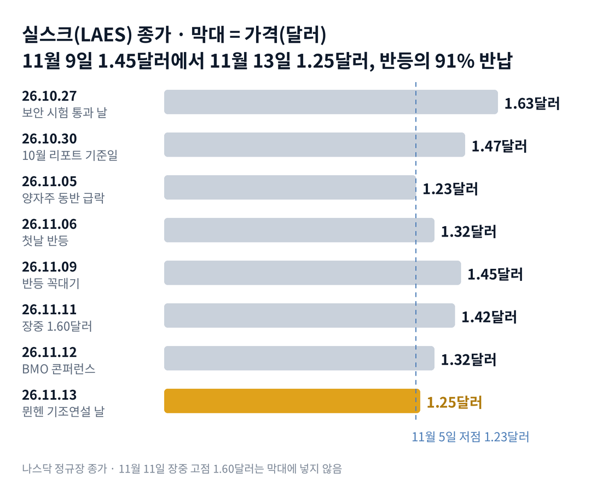

## 짧은 답

> **핵심:** 기조연설 날에도 새 주문 숫자는 나오지 않았고, 주가는 양자주와 함께 반등의 91%를 돌려줬습니다.

뮌헨 박람회에서 기조연설을 한 날, 실스크 주가는 왜 오르지 못하고 5.3% 내렸을까요? 11월 13일 종가는 1.25달러로, 11월 5일 저점 1.23달러보다 2센트 높을 뿐입니다.

11월 5일부터 9일까지 주가는 17.9% 올라 1.45달러가 됐습니다. 그런데 그 뒤 네 거래일 동안 그 상승의 91%를 돌려줬습니다. 같은 기간 아이온큐도 18.3% 내렸습니다.

일주일 동안 회사는 보도자료를 6건 냈습니다. 그러나 고객 이름이 붙은 새 주문이나 금액은 없었고, SEC 새 공시도 없었습니다. 기조연설 날 거래량은 292만 주로 이번 주 가장 적었습니다.

**2026.11.13 진단: 방치 단계 유지 — 주가가 현금보다 낮은 채 양자주 흐름만 따라가는 단계, 근거는 5부.** 현금이 시가총액보다 많다고 해서 그 현금이 주가의 바닥을 보장하지는 않습니다. 현금은 매 분기 쓰이고, 회사는 새 주식을 팔 수 있기 때문입니다. 판정은 20번째 거래일인 12월 14일 종가와 그때까지 1.23달러 아래 종가가 나오는지로 합니다.

> **유의사항** 저자는 금융·투자 자문가가 아닙니다. 이 글은 공개 공시와 시세를 정리한 교육용 분석이며 특정 종목의 매수·매도를 권하지 않습니다. 과거 기록은 여섯 번뿐이고, 같은 일이 반복된다는 보장은 없습니다. 실제 투자 전에는 최신 가격과 공시를 직접 확인하세요.

이 리포트는 사이트 요청 종목입니다. 사이트의 업데이트 요청 버튼으로 들어온 요청을 반영했습니다.

## 지난 리포트 이후

[11월 5일 기준 리포트](/r/laes-2026-11-2/)는 양자주 동반 급락 뒤 첫날은 오를 가능성이 높다고 봤습니다. 첫날 상승 쪽(시나리오 1·2)을 합쳐 약 60%로 매겼고, 11월 6일 종가는 1.32달러로 7.3% 올랐습니다.

**지난 예측 성적(11월 6일 리포트): 적중 1 · 빗나감 0 · 진행 중 4** — 첫날 반등은 맞았고, 한 달 뒤 자리(12월 4일)는 아직 판정 전입니다.

지난 리포트가 함께 지켜보자고 한 기조연설의 고객 이름·주문 금액은 나오지 않았습니다. 증자 설명서(424B)와 위성 의향서의 정식 계약도 11월 13일까지 없었습니다. 항목별 채점표는 6부 끝에 있습니다.

## 1부. 실스크는 어떤 회사이고, 지금 몸값은 얼마인가

> **핵심:** 실스크는 해킹을 막는 보안 칩을 파는 회사이고, 주가는 여전히 회사가 가진 현금의 약 60% 수준입니다.

실스크(SEALSQ)는 스위스 제네바에 본사를 둔 보안 반도체 회사입니다. 모회사는 위즈키(WISeQey)입니다. 양자컴퓨터로도 풀기 어려운 암호를 넣은 칩, 곧 양자내성 칩을 새 제품으로 내세웁니다.

돈을 버는 방식은 칩 판매입니다. 전력 계량기, 자동차, 공장 장비, 의료기기에 들어가는 보안 칩을 팔고 대가를 받습니다. 10월 15일 잠정 발표로 올해 9개월 매출은 1,630만 달러였습니다.

뮌헨 박람회가 중요한 이유는 칩을 살 회사들이 모이는 자리이기 때문입니다. 실스크는 11월 10~13일 전시장에서 양자내성 칩을 시연했고, 마지막 날 '인증받은 보안 하드웨어로 양자내성 전환을 쉽게'라는 기조연설을 했습니다. 시연은 팔 준비를 보여 주지만, 주문과 매출은 따로 확인해야 합니다.

몸값은 현금보다 낮습니다. 시가총액은 9월 말 현금의 약 60%입니다. 시장이 칩 사업에 값을 거의 매기지 않고, 현금의 일부도 덜 쳐 주는 셈입니다. 이 말은 곧 시장이 '현금이 앞으로 줄거나 주식이 늘 수 있다'를 먼저 값에 넣고 있다는 뜻입니다.

### 숫자로 본 지금의 크기(11월 13일 기준)

| 항목 | 값 · 계산 근거 |
| --- | --- |
| 종가 | **1.25달러** 11월 5일 종가 1.23달러보다 2센트 위 |
| 9월 말 현금 | **약 4억 6,300만 달러** 10월 15일 잠정 발표, 부채 차감 전 |
| 주당 현금 | **약 2.07달러** 잠정 계산(최신 주식 수 미반영): 9월 말 현금 ÷ 6월 말 주식 2억 2,343만 주 |
| 시가총액 | **약 2억 7,930만 달러** 1.25달러 × 2억 2,343만 주 |
| 9개월 매출 | **1,630만 달러** 10월 15일 잠정 발표 |

주당 현금은 9월 말 현금을 6월 말 주식 수로 나눈 잠정 계산이라, 3분기 정식 숫자가 나오면 달라질 수 있습니다. 그림처럼 주가는 10월 27일 1.63달러에서 11월 5일 1.23달러까지 내려왔다가 한 번 튀어 올랐습니다. 그 반등은 왜 오래가지 못했을까요?

## 2부. 반등 네 거래일, 되돌림 네 거래일

> **핵심:** 반등도 되돌림도 양자주 흐름과 같은 쪽이었고, 그 사이 회사 쪽에서는 주가를 붙잡을 새 숫자가 나오지 않았습니다.

반등은 11월 6일에 시작됐습니다. 전날 장 마감 뒤 아이온큐가 좋은 3분기 실적을 냈고, 아이온큐는 그날 23.4% 올랐습니다. 실스크는 7.3% 올랐습니다. 같은 날 실스크는 테크에이전시와 양자내성 전환 지원 제휴를 발표했지만, 금액은 없었습니다.

11월 9일에는 실스크가 9.8% 올라 반등의 꼭대기 1.45달러를 찍었습니다. 그날 보도자료는 세 건이었습니다. 투자자 콘퍼런스 참석 예고, 스위스 자회사의 수상, 의료기기용 보안 칩 소개입니다. 주문 금액이 붙은 소식은 없었습니다.

### 반등과 되돌림, 실스크와 아이온큐(하루 등락)

| 날짜 · 그날 있던 일 | **실스크** | 아이온큐 |
| --- | --- | --- |
| **2026.11.06** 아이온큐 실적 다음 날 | **+7.3%** | +23.4% |
| **2026.11.09** 보도자료 3건 · 반등 꼭대기 | **+9.8%** | +8.3% |
| **2026.11.10** 박람회 개막 · 투자 전략 발표 | **-2.1%** | -1.0% |
| **2026.11.11** 박람회 토론 · 장중 1.60달러 | **0.0%** | -2.7% |
| **2026.11.12** 뉴욕 BMO 투자 콘퍼런스 | **-7.0%** | -9.4% |
| **2026.11.13** 뮌헨 기조연설 | **-5.3%** | -6.4% |

여섯 거래일 가운데 다섯 번은 실스크와 아이온큐가 같은 쪽으로 움직였습니다. 크기는 달랐습니다. 11월 5일에서 9일까지 아이온큐는 33.7% 올랐지만 실스크는 17.9%였습니다. 11월 9일에서 13일까지는 아이온큐 -18.3%, 실스크 -13.8%였습니다.

11월 11일은 눈여겨볼 하루였습니다. 장이 열리자 주가는 장중 1.60달러까지, 전날 종가보다 12.7% 올랐습니다. 하지만 1.42달러로 제자리에서 마감했습니다. 장중 고점에서 11.3% 밀린 것입니다. 그날도 새 주문 소식은 없었습니다.

기조연설 날 나온 보도자료는 하루 전 뉴욕 BMO(캐나다 몬트리올 은행 계열 증권사) 콘퍼런스 토론 소식이었습니다. 최고경영자는 '고객 인증, 양산 채택, 반복 주문'으로 성장하겠다고 말했지만, 숫자는 내놓지 않았습니다. 11월 13일까지 실스크의 SEC 새 공시는 11월 3일 내부자 매도 신고가 마지막이었습니다.

여섯 거래일을 나란히 놓으면 공통점이 보입니다. 주가를 움직인 것은 양자주 전체의 흐름이었고, 회사 소식은 그 흐름을 바꾸지 못했습니다. 과거에도 이렇게 반등을 거의 다 돌려준 때가 있었을까요?

## 3부. 반등의 80% 넘게 돌려준 여섯 번, 그 뒤 20거래일

> **핵심:** 여섯 번 모두 20거래일 안에 출발 저점 아래 종가가 나왔지만, 20거래일 뒤 그날보다 높았던 경우도 두 번 있었습니다.

이 기록을 보는 이유는 지금과 조건이 같기 때문입니다. 직전 열 거래일 가운데 가장 낮은 종가에서 다섯 거래일 안에 15% 넘게 오른 뒤, 다시 다섯 거래일 안에 그 상승의 80% 넘게 돌려준 날만 골랐습니다. 상장 첫 주(2023년 5월)는 뺐고, 같은 반등에서는 첫 반납일 하나만 셌습니다.

'다음 날'은 반납일 다음 거래일 종가를, '20거래일 뒤'는 반납일에서 20거래일을 넘긴 날의 종가를 반납일 종가와 비교했습니다. '저점'은 반등이 출발한 날의 종가입니다.

예를 들어 2023년 11월 27일 종가 1.04달러에서 두 거래일 만에 1.238달러로 19.0% 올랐습니다. 다음 날인 11월 30일 1.05달러로 상승분의 95%를 돌려줬습니다. 바로 다음 날 1.04달러 아래로 내려갔지만, 20거래일 뒤인 12월 29일에는 1.05달러보다 21.9% 높았습니다.

**한눈에:** **6/6** 20거래일 안에 출발 저점 아래 종가 · **2/6** 20거래일 뒤 반납일보다 높음 · **-10.8%** 20거래일 뒤 가운데 값(중앙값, 여섯 개를 줄 세운 한가운데). 저점을 다시 깨는 일은 흔했지만, 깬 뒤의 길은 갈렸습니다.

### 반등을 돌려준 여섯 번, 그 뒤는?

| 반납일 · 반등과 저점 이탈 | 다음 날 | 20거래일 뒤 |
| --- | --- | --- |
| 2023.08.09 10.28→12.00달러 +16.8% 뒤 93% 반납 다음 날 저점 아래 | -9.8% | -51.0% |
| 2023.10.11 1.66→1.96달러 +18.1% 뒤 90% 반납 다음 날 저점 아래 | -14.2% | -17.5% |
| **2023.11.30** 1.04→1.238달러 +19.0% 뒤 95% 반납 다음 날 저점 아래 | -1.9% | **+21.9%** |
| 2024.06.04 1.06→1.255달러 +18.4% 뒤 85% 반납 8거래일째 저점 아래 | +5.5% | -33.9% |
| 2024.09.30 0.44→0.525달러 +19.5% 뒤 100% 반납 다음 날 저점 아래 | -3.0% | -4.0% |
| **2025.02.18** 2.99→4.33달러 +44.8% 뒤 98% 반납 8거래일째 저점 아래 | +11.9% | **+10.6%** |

> **이번 사례(결과 미확정):** 2026.11.13 · 1.23→1.45달러, +17.9% 뒤 91% 반납 · 종가 1.25달러 · 20거래일째 판정은 12월 14일

굵게 쓴 두 줄이 20거래일 뒤 반납일보다 높았던 경우입니다. 두 번 모두 먼저 저점 아래로 내려갔다가 되돌아왔습니다. 2025년 2월에는 저점을 깬 뒤 20거래일 안 최저 종가가 2.27달러로 저점보다 24.1% 낮았습니다.

나머지 네 번은 20거래일 뒤에도 반납일보다 낮았습니다. 2023년 8월은 상장 석 달째로 주가 수준이 지금과 전혀 달랐습니다. 여섯 번은 작은 표본이라, 이 표는 확률이 아니라 과거 움직임의 참고 자료입니다. 같은 반납 뒤에도 길이 갈린 까닭은 무엇이었을까요?

## 4부. 왜 반등은 붙잡히지 않았나

> **핵심:** 실스크의 반등은 업종의 바람에 실린 것이었고, 바람이 멎었을 때 주가를 붙잡을 회사 숫자가 없었습니다.

반등의 출발점부터 보면, 11월 6일 반등은 아이온큐 실적이 만든 업종 반등이었습니다. 실스크는 아이온큐 상승의 3분의 1쯤만 따라갔습니다. 회사 자신의 이유로 오른 날이 아니었으니, 업종이 식으면 함께 식는 구조였습니다.

박람회 주간에 시장이 기다린 것은 숫자였습니다. 지난 리포트가 짚은 고객 이름과 주문 금액입니다. 보도자료 6건은 제휴, 수상, 칩 소개, 투자 전략, 콘퍼런스 토론이었습니다. 모두 방향을 말했지만, 매출로 이어질 크기는 말하지 않았습니다.

3부에서 되돌아온 두 번은 업종 덕만은 아니었습니다. 2023년 11월 반납일 뒤 20거래일 동안 아이온큐는 11월 30일 종가 대비 1.3% 오르는 데 그쳤습니다. 2025년 2월에는 아이온큐가 2월 18일 종가 대비 33.2% 내렸는데도, 실스크는 저점을 깬 뒤 되돌아왔습니다. 업종만으로 다 설명되지는 않는다는 반례입니다.

반론도 있습니다. 주가는 현금보다 한참 낮고, 11월 13일 거래량은 이번 주 가장 적었습니다. 파는 힘이 크지 않았다는 신호로 읽을 수도 있습니다. 다만 거래가 적은 하락은 사려는 쪽도 적다는 뜻일 수 있어, 한 방향으로 단정하기 어렵습니다.

그래서 앞으로 확인할 조건은 두 가지입니다. 하나는 12월 14일까지 1.23달러 아래 종가가 나오는지, 다른 하나는 12월 14일 종가가 11월 13일 1.25달러 위인지입니다. 두 조건을 엮으면 어떤 갈림길이 나올까요?

## 5부. 지금 어느 단계이고, 네 가지 시나리오

> **핵심:** 방치 단계가 이어지고 있고, 1.23달러 저점을 지키는지와 한 달 뒤 자리가 다음 단계를 가릅니다.

> **국면 정의(실스크 시리즈 공통):** 광풍 — 양자 테마로 거래량이 평소의 5배를 넘으며 급등하는 때. 조달 — 증자 설명서(424B)가 나오고 주가가 그 가격 근처로 눌리는 때. 방치 — 주가가 현금보다 낮은 채 업종을 따라서만 움직이는 때.

**2026년 11월 13일 진단: 방치 단계 유지(지난 리포트 진단 유지).** 주가는 여전히 현금 아래에 있습니다. 박람회 주간 거래량은 하루 292만~545만 주로, 광풍 단계의 신호(평소의 5배)는 없었습니다. 조달 단계의 첫 신호인 424B도 없습니다.

**판정 기준 두 가지(12월 14일, 20거래일째):** 첫째, 12월 14일까지 11월 5일 종가 1.23달러 아래 종가가 한 번이라도 나오면 '저점 이탈'로 봅니다. 둘째, 12월 14일 종가가 11월 13일 종가 1.25달러보다 높으면 '위'로 봅니다.

### 앞으로 일어날 수 있는 일

3부 기록에서 6번 중 6번은 20거래일 안에 저점 아래 종가가 나왔고, 6번 중 2번은 20거래일 뒤 더 높았습니다.

**확인된 사실:** 반등의 91%를 돌려줬고, 그동안 새 주문 금액·424B·위성 정식 계약은 나오지 않았습니다.

**과거 기록:** 표본은 여섯 번뿐입니다. 여섯 번 모두 20거래일 안에 출발 저점 아래 종가가 나왔고, 20거래일 뒤 높았던 것은 두 번입니다.

**추정:** 아래 가능성은 분석자의 주관적 추정이며, 주가가 오를 확률이 아닙니다. '저점 이탈 여부'와 '12월 14일 자리'의 조합을 나눈 것입니다. 네 경우는 겹치지 않아 '약 N%'를 더하면 100%이고, 괄호 안 구간은 흔들림의 폭이라 서로 더하지 않습니다.

| 시나리오(판정 2026년 12월 14일) | 저점·자리 | 가능성(추정) |
| --- | --- | --- |
| 1 · 저점을 지키며 다시 오름 | 지킴 · 1.25달러 위 | 낮음 약 25% (15~35%) |
| 2 · 저점은 지켰지만 제자리 아래 | 지킴 · 1.25달러 아래 | 낮음 약 5% (0~10%) |
| 3 · 저점을 깬 뒤 되돌아옴 | 이탈 · 1.25달러 위 | 낮음 약 20% (10~30%) |
| **4 · 저점을 깨고 아래에 머묾** | 이탈 · 1.25달러 아래 | 중간 약 50% (40~60%) |

시나리오 4를 가장 높게 본 이유는 3부 기록입니다. 여섯 번 중 네 번이 저점을 깬 뒤 20거래일 뒤에도 낮았습니다. 지금도 주가는 저점에서 2센트 위에 있습니다.

그래도 저점을 지키는 쪽(1·2)을 약 30% 남긴 근거는 현금입니다. 과거 여섯 번과 달리 지금은 주가가 주당 현금보다 크게 낮습니다. 하지만 같은 무게로 반대 요인도 있습니다. 현금은 매 분기 줄고, 새 주문 계약은 아직 없으며, 모회사의 1억 달러 신고서도 남아 있습니다. 2를 약 5%로 둔 것은 1.23~1.25달러라는 좁은 폭에 머물러야 하기 때문입니다.

시나리오 1이면 다음에 볼 것은 11월 17~19일 프랑스 칸 양자 행사에서 고객 이름이나 주문 금액이 나오는지입니다. 4면 424B 같은 주식 판매 서류가 함께 나오는지를 봅니다. 이 진단을 가장 빨리 뒤집을 위험은 어디에 있을까요?

## 6부. 위험과 체크리스트

> **핵심:** 가장 가까운 위험은 저점 이탈이 주식 판매 서류와 겹치는 것이고, 그다음은 양자주 전체의 큰 흔들림입니다.

먼저 이 분석의 한계입니다. 3부 표는 여섯 번뿐이고, 2023~2025년과 지금은 주가 수준과 현금이 다릅니다. 주당 현금은 6월 말 주식 수로 계산했고, 3분기 정식 숫자는 아직 공개되지 않았습니다. 기조연설의 발표 자료와 현장 질문은 확인하지 못했고, 이 글은 회사 보도자료와 SEC 공시만 썼습니다.

사업 실행 쪽 위험부터 보면, 위즈샛 위성 의향서(약 1,500만 달러)는 아직 정식 계약이 아닙니다. 첫 양자내성 보안 칩 QS7001(제품 이름)의 정식 인증은 2027년 1월 현장 감사 뒤이고, 새 칩 VaultIC409의 엔지니어링 샘플은 2027년 2분기로 예고됐습니다. 매출로 이어지는 시점이 더 밀릴 수 있습니다.

자금 조달 쪽에서는 실스크가 424B를 내고 시장에서 주식을 팔기 시작하면 희석이 생깁니다. 희석은 주식 수가 늘어 기존 한 주가 회사에서 차지하는 비율이 작아지는 것입니다. 모회사 위즈키의 1억 달러 신고서(F-3)도 11월 13일까지 효력이 생기지 않았습니다.

외부 환경은 양자주의 흐름입니다. 11월 12일처럼 아이온큐가 하루 9% 넘게 빠진 날에는 실스크도 함께 7% 내렸습니다.

**핵심 확인 세 가지:**

- ☐ 1순위 · 12월 14일까지 11월 5일 종가 1.23달러 아래 종가가 나오는가
- ☐ 2순위 · 12월 4일 종가가 1.23달러 위인가(지난 리포트 시나리오 판정)
- ☐ 3순위 · 12월 14일까지 424B·F-3 효력·위성 정식 계약 가운데 무엇이 나오는가

**보조 확인:** 11월 17~19일 칸 세계 양자 축제와 실스크 퀀텀 데이즈에서 고객 이름이나 주문 금액이 나오는지 봅니다.

**기억할 판단 기준 세 가지:** 이번 반등과 되돌림은 회사 소식보다 양자주 흐름을 따라갔습니다. 반등을 거의 다 돌려준 과거 여섯 번은 모두 저점을 다시 깼습니다. 다만 깬 뒤 되돌아온 두 번이 있었기에, 저점 이탈 자체보다 그 뒤 20거래일의 자리가 중요합니다.

지난 업종 급락 기록은 [11월 5일 기준 리포트](/r/laes-2026-11-2/)에 있습니다. 다음 갱신은 12월 4일 지난 시나리오 판정과 칸 행사 결과를 본 뒤에 합니다. 공시는 [실스크 SEC 공시 목록](https://www.sec.gov/cgi-bin/browse-edgar?action=getcompany&CIK=0001951222&type=&dateb=&owner=include&count=40)에서 확인할 수 있습니다.

### 지난 예측 채점표

**지난 리포트 점검(따로 판정):** 아래는 11월 6일 리포트의 예측을 채점한 것이고, 이번 회차의 시나리오 판정과는 따로 셉니다.

| 지난 점검 항목 · 당시 기준 | 판정 및 실제 결과(11월 13일) |
| --- | --- |
| **첫날 상승(시나리오 1·2)** 11월 6일 · 합쳐 약 60% | **[적중]** 1.32달러, +7.3% |
| **시나리오 1·2·3·4 · 한 달 뒤 자리** 12월 4일 1.23달러 위인가 | **[진행 중]** 11.13 1.25달러 (12월 4일 판정) |
| **점검: 424B·F-3 효력** 12월 4일까지 | **[진행 중]** 11.13까지 없음 |
| **점검: 위성 의향서 정식 계약** 약 1,500만 달러 | **[진행 중]** 11.13까지 공시 없음 |
| **보조: 기조연설 고객 이름·주문 금액** 11월 13일 | **[나오지 않음]** 보도자료·공시에 없음 |
| **10월 30일 리포트: 11월 20일·30일 판정** 1.55달러 회복 · 1.42달러 아래 | **[진행 중]** 11.13 1.25달러 |
