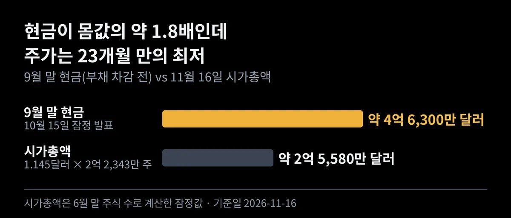
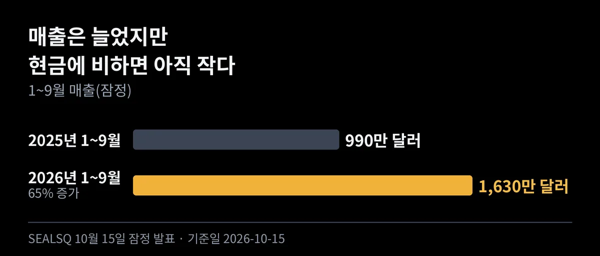
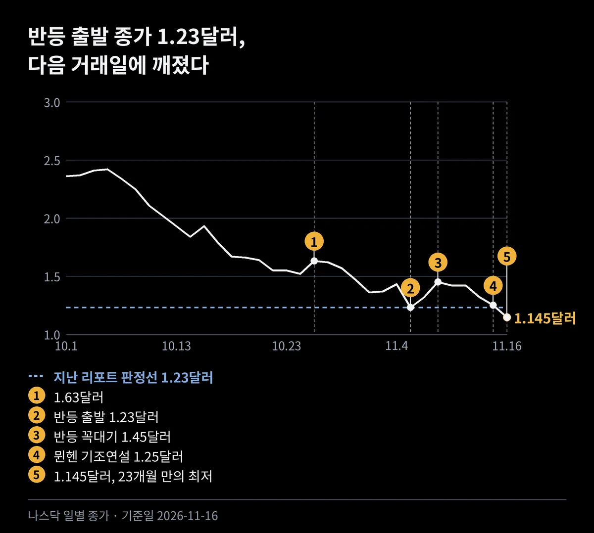
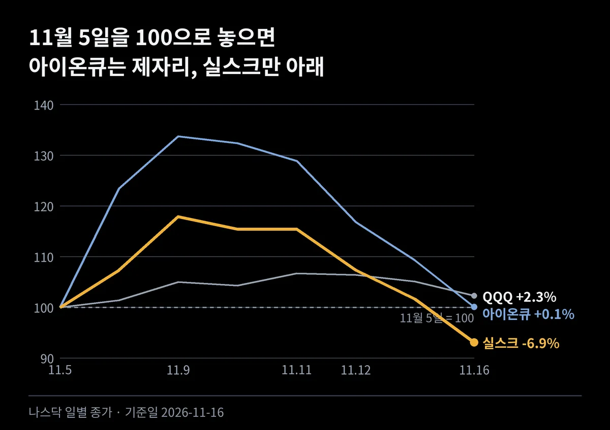
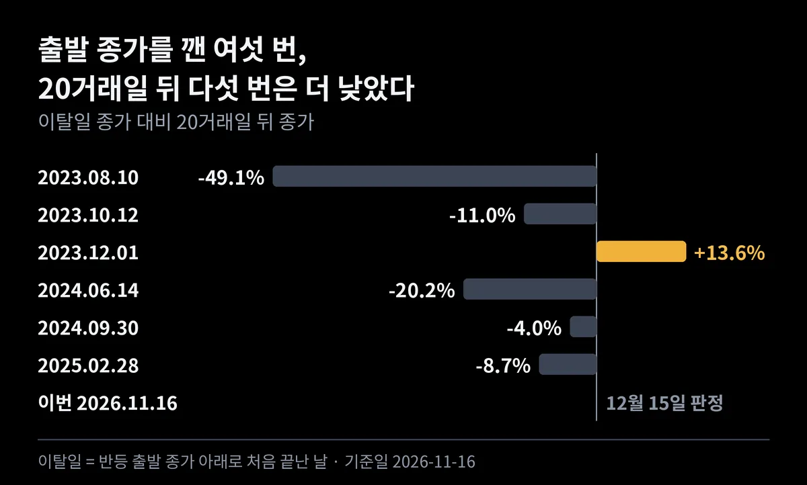
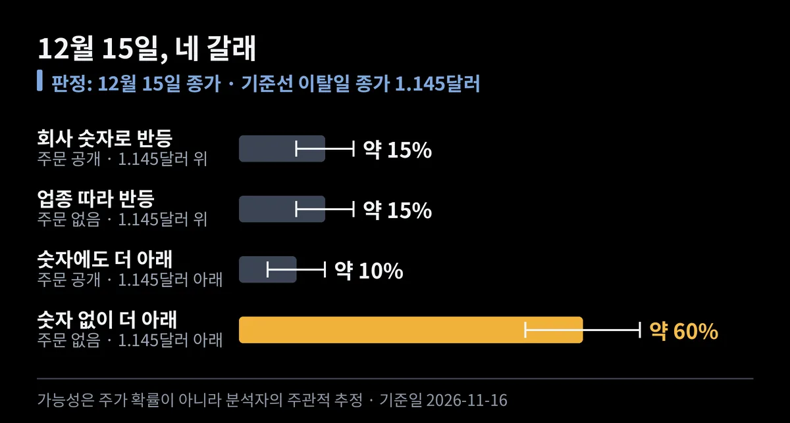

실스크 주가는 11월 16일 1.145달러로 마감했습니다. 2024년 12월 10일 뒤 약 23개월 만에 가장 낮은 종가입니다. 그런데 이 회사가 9월 말에 가진 현금은 약 4억 6,300만 달러입니다. 같은 날 시가총액 약 2억 5,580만 달러의 약 1.8배입니다. 현금이 몸값보다 훨씬 많은데, 주가는 왜 바닥을 찾지 못하고 있을까요?

> **유의사항** 저자는 금융·투자 자문가가 아닙니다. 이 글은 공개 공시와 시세를 정리한 교육용 분석이며 특정 종목의 매수·매도를 권하지 않습니다. 과거 기록은 여섯 번뿐이고, 같은 일이 반복된다는 보장은 없습니다. 실제 투자 전에는 최신 가격과 공시를 직접 확인하세요.

그림처럼 현금 막대가 시가총액 막대보다 훨씬 깁니다. 다만 이 현금은 부채를 빼기 전 금액이고, 쓰임이 정해진 제한된 현금도 들어 있습니다. 시가총액은 1.145달러에 6월 말 주식 수 2억 2,343만 주를 곱한 잠정값입니다. 최신 주식 수가 나오면 조금 달라질 수 있습니다.

이 글은 [11월 13일 기준 리포트](/r/laes-2026-11-3/)의 후속편입니다. 그 리포트는 11월 5일 반등 출발 종가 1.23달러를 판정선으로 걸었습니다. 12월 14일까지 그 아래 종가가 한 번이라도 나올지 물었고, 나올 쪽 두 갈래를 합쳐 약 70%로 봤습니다. 답은 바로 다음 거래일에 나왔습니다. 11월 16일 종가 1.145달러는 1.23달러보다 6.9% 낮습니다.

지난 예측 성적은 적중 하나, 빗나감 없음, 진행 중 넷입니다. 맞은 하나가 바로 이 저점 이탈입니다. 진행 중인 넷 가운데 셋은 주가 자리를 묻습니다. 12월 14일 종가가 1.25달러 위인지, 12월 4일 종가가 1.23달러 위인지, 11월 20일 종가가 1.55달러를 되찾는지입니다. 지금 값으로는 셋 모두 불리합니다. 나머지 하나인 증자 설명서와 위성 정식 계약은 11월 16일까지 둘 다 나오지 않았습니다.

실스크(SEALSQ)는 스위스 제네바의 보안 반도체 회사입니다. 돈을 버는 방식은 칩 판매입니다. 전력 계량기, 자동차, 공장 장비, 의료기기에 들어가는 보안 칩을 팔고 대가를 받습니다. 요즘 앞세우는 제품은 양자내성 칩, 곧 양자컴퓨터로도 풀기 어려운 암호를 넣은 칩입니다. 그래서 시장은 이 회사를 양자 관련주와 한 무리로 묶어 거래합니다.

10월 15일 잠정 발표로 올해 1~9월 매출은 1,630만 달러였습니다. 1년 전 같은 기간 990만 달러보다 65% 늘었습니다. 회사는 올해 연간 매출 목표 약 2,700만~3,600만 달러를 그대로 유지했습니다.

그림처럼 매출은 빠르게 늘고 있지만 크기는 아직 작습니다. 1~9월 매출은 9월 말 현금의 약 3.5%입니다(계산). 그래서 시장은 매출보다 현금이 얼마나 오래가는지, 새 주식이 얼마나 나오는지를 더 보는 것으로 보입니다. 이 부분은 분석자의 해석입니다.

사건은 짧은 기간에 일어났습니다. 10월 27일 1.63달러였던 주가는 11월 5일 1.23달러까지 내려왔습니다. 11월 9일에는 11월 5일 종가 대비 17.9% 반등했습니다. 그러나 11월 13일 뮌헨 박람회 기조연설 날까지 그 상승분의 91%를 돌려줬습니다. 다음 거래일인 11월 16일, 주가는 8.4% 더 내렸습니다.

11월 16일에는 회사 소식이 없었습니다. 보도자료는 11월 13일 BMO(캐나다 몬트리올 은행 계열 증권사) 콘퍼런스 토론 소식이 마지막이었습니다. 미국 증권거래위원회(SEC)에 새로 들어온 서류는 증권사 서스퀘하나의 지분 보고 하나였습니다. 9월 30일 기준으로 3.1%를 가졌다는 내용이고, 회사가 낸 공시는 아닙니다. 거래량은 421만 주로 11월 13일 292만 주보다 많았습니다.

같은 날 양자 관련주는 함께 내렸습니다. 아이온큐가 8.4%, 디웨이브 퀀텀이 9.3%, 리게티가 5.8% 내렸습니다. QQQ(나스닥 100 지수를 따르는 상장지수펀드)도 2.7% 내렸습니다. 실스크의 하루 하락 폭은 아이온큐와 똑같았습니다. 그날 하루만 보면 회사 탓보다 업종 탓에 가깝습니다.

그런데 반등이 시작된 11월 5일을 출발점으로 잡으면 모습이 달라집니다.

그림처럼 11월 16일 아이온큐는 11월 5일보다 0.1% 높은 곳에 있습니다. QQQ는 2.3% 높습니다. 실스크만 6.9% 아래입니다. 오를 때는 아이온큐의 절반쯤 오르고, 내릴 때는 비슷하게 내렸기 때문입니다. 11월 5일에서 9일까지 아이온큐는 33.7%, 실스크는 17.9% 올랐습니다. 9일에서 16일까지는 아이온큐가 25.2%, 실스크가 21.0% 내렸습니다.

반등을 거의 다 돌려준 뒤 출발점 아래로 내려간 일은 처음이 아닙니다. 지난 리포트는 상장 뒤 반등의 80% 넘게 돌려준 여섯 번을 찾았습니다. 여섯 번 모두 20거래일 안에 반등 출발 종가 아래로 내려갔습니다. 이번에는 그다음을 봤습니다. 출발 종가 아래로 처음 끝난 날을 '이탈일'로 부르고, 그날 종가와 20거래일 뒤 종가를 비교했습니다.

결과는 한쪽으로 기울었습니다. 여섯 번 가운데 다섯 번은 20거래일 뒤가 이탈일보다 낮았습니다. 가운데 값(중앙값)은 -9.9%입니다. 여섯 개를 줄 세운 한가운데 두 값의 평균입니다(계산). 더 높았던 것은 2023년 12월 한 번뿐이고, 그때는 13.6% 올랐습니다.

눈에 띄는 점은 업종과의 관계입니다. 여섯 번 가운데 세 번은 같은 20거래일 동안 아이온큐가 올랐습니다. 그 세 번 모두 실스크는 내렸습니다. 2024년 9월에는 아이온큐가 103.8% 올랐는데도 실스크는 4.0% 내렸습니다. 이탈 뒤에는 업종이 올라도 따라 오르지 못했다는 기록입니다.

예를 들어 2024년 6월 14일에는 1.04달러로 마감해 출발 종가 1.06달러를 깼습니다. 20거래일 뒤 종가는 0.83달러로 20.2% 낮았습니다. 그사이 아이온큐는 17.3% 올랐습니다. 여섯 번 가운데 세 번은 20거래일 안에 잠깐 출발 종가 위로 돌아왔습니다. 하지만 20거래일째까지 그 위에 머문 것은 한 번입니다.

이 기록에는 한계가 있습니다. 여섯 번은 작은 표본입니다. 2023년 8월은 상장 석 달째라 주가 수준이 지금과 전혀 달랐습니다. 과거 여섯 번 때의 현금과 몸값 비율은 이 글에서 따로 맞춰 보지 않았습니다.

지금은 지난 리포트가 '방치 단계'라고 부른 자리 그대로입니다. 방치 단계는 주가가 현금보다 낮은 채 양자주 흐름을 주로 따라가는 때를 부르는 이 시리즈의 이름입니다. 11월 16일 하루는 업종과 똑같이 움직였으니 진단은 유지합니다. 다만 11월 5일 뒤로 보면 업종보다 약하다는 점이 새로 보입니다.

다음 판정은 12월 15일입니다. 11월 16일 다음 날부터 센 20번째 거래일입니다. 두 가지를 엮어 네 갈래를 나눴습니다. 하나는 그날 종가가 이탈일 종가 1.145달러 위인지 아래인지입니다. 다른 하나는 그때까지 회사가 고객 이름이 붙은 주문 금액을 밝히는지입니다. 앞은 과거 기록이 답하는 질문이고, 뒤는 이번에 기록과 다른 길이 열릴 수 있는 조건입니다.

주문 없이 1.145달러 아래에 머무는 넷째 갈래를 가장 무겁게 봤습니다. 과거 6번 중 5번이 20거래일 뒤 이탈일보다 낮았기 때문입니다. 그중 세 번은 10% 넘게 더 내려갔는데, 지금 값으로 치면 1.03달러(계산) 아래입니다. 위로 가는 두 갈래는 과거 기록보다 조금 높게 뒀습니다. 현금이 몸값보다 많다는 점을 감안했습니다. 이 숫자는 주가가 오를 확률이 아니라, 12월 15일 종가 자리와 주문 공개 여부의 조합에 대한 분석자의 주관적 추정입니다.

이 판단이 틀릴 수 있는 곳도 분명합니다. 첫째는 현금입니다. 지금 주가는 주당 현금 약 2.07달러의 절반 남짓입니다. 회사가 현금의 쓰임새를 숫자로 밝히면 과거 기록과 다른 길이 열릴 수 있습니다. 둘째는 가까운 일정입니다. 11월 17~18일 프랑스 칸에서 세계 양자 축제가 열리고, 11월 19일에는 실스크의 퀀텀 데이즈 행사가 이어집니다. 여기서 고객 이름이나 주문 금액이 나오면 회사 쪽 이유가 처음 생깁니다.

자금 조달도 위험입니다. 증자 설명서(424B, 회사가 새 주식을 시장에 팔 때 내는 서류)가 나오면 주식 수가 늘어 기존 한 주가 회사에서 차지하는 비율이 작아집니다. 그러면 아래쪽 갈래가 더 무거워집니다. 사업 일정도 봐야 합니다. 첫 양자내성 칩 QS7001(제품 이름)의 정식 인증은 2027년 1월 현장 감사 뒤로 예고돼 있습니다. 마지막은 업종입니다. 아이온큐가 하루 8% 넘게 움직이는 날에는 실스크도 함께 크게 흔들립니다.

현금이 몸값의 1.8배인데도 바닥이 깨진 것은, 시장이 현금의 크기보다 그 현금이 매출로 바뀌는 속도를 보고 있기 때문으로 봅니다. 1~9월 매출은 현금의 약 3.5%였고, 박람회 주간에도 주문 금액은 나오지 않았습니다. 그래서 다음 판정의 열쇠는 업종 반등보다 칸 행사와 그 뒤 공시에서 나올 회사 숫자입니다. 12월 15일 종가가 1.145달러 아래인지를 가장 먼저 확인하고, 아래라면 1.03달러까지 내려갔는지도 봅니다. 다음 갱신은 11월 19일 퀀텀 데이즈를 본 뒤에 합니다.

## 숫자로 다시 보기

### 11월 16일 하루, 양자 관련주와 시장

| 종목 | 11월 16일 하루 | 11월 5일 종가 대비 |
| --- | --- | --- |
| **실스크** | **-8.4%** 1.25 → 1.145달러 | **-6.9%** |
| 아이온큐 | -8.4% | +0.1% |
| 디웨이브 퀀텀 | -9.3% | -4.2% |
| 리게티 | -5.8% | -8.0% |
| 아킷 퀀텀 | -8.9% | +9.5% |
| BTQ 테크놀로지스 | -8.4% | -21.6% |
| QQQ | -2.7% | +2.3% |
| IWM(미국 소형주) | -1.7% | +0.7% |

### 반등을 돌려준 뒤 출발 종가를 깬 여섯 번

**한눈에:** 20거래일 뒤 이탈일보다 낮음 **5/6** · 가운데 값 **-9.9%** · 그사이 아이온큐가 오른 세 번에도 실스크는 **3/3** 내림

| 이탈일 · 출발 종가 → 이탈일 종가 | 20거래일 뒤 | 같은 기간 아이온큐 |
| --- | --- | --- |
| **2023.08.10** 10.28 → 9.385달러 | -49.1% | +36.3% |
| **2023.10.12** 1.66 → 1.45달러 | -11.0% | -26.2% |
| **2023.12.01** 1.04 → 1.03달러 | **+13.6%** | -10.7% |
| **2024.06.14** 1.06 → 1.04달러 | -20.2% | +17.3% |
| **2024.09.30** 0.44 → 0.4399달러 | -4.0% | +103.8% |
| **2025.02.28** 2.99 → 2.88달러 | -8.7% | -7.0% |
| **이번 2026.11.16** 1.23 → 1.145달러 | 12월 15일 판정 | - |

'이탈일'은 반등 출발 종가 아래로 처음 끝난 날이고, '20거래일 뒤'는 그날 종가 대비입니다. 여섯 번은 지난 리포트의 '반등을 돌려준 여섯 번' 표와 같은 사례입니다.

### 지금의 크기(11월 16일 기준)

| 항목 | 값 · 근거 |
| --- | --- |
| 종가 | **1.145달러** 2024년 12월 10일 0.571달러 뒤 가장 낮은 종가 |
| 9월 말 현금 | **약 4억 6,300만 달러** 10월 15일 잠정 발표, 부채 차감 전, 제한된 현금 포함 |
| 시가총액 | **약 2억 5,580만 달러** 1.145달러 × 6월 말 2억 2,343만 주 |
| 주당 현금 | **약 2.07달러** 잠정 계산: 9월 말 현금 ÷ 6월 말 주식 수 |
| 1~9월 매출 | **1,630만 달러** 1년 전 990만 달러, 65% 증가 |
| 연간 매출 목표 | **약 2,700만~3,600만 달러** 10월 15일 유지 |

### 지난 예측 채점표

| 지난 점검 항목 · 당시 기준 | 판정과 실제 결과(11월 16일) |
| --- | --- |
| **12월 14일까지 1.23달러 아래 종가** 11월 13일 리포트 · 이탈 두 갈래 합 약 70% | **[적중]** 11월 16일 1.145달러 |
| **12월 14일 종가 1.25달러 위** 11월 13일 리포트 | **[진행 중]** 지금 8.4% 아래 |
| **424B · F-3 효력 · 위성 정식 계약** 11월 13일 리포트 | **[진행 중]** 11월 16일까지 없음 |
| **12월 4일 종가 1.23달러 위** 11월 6일 리포트 | **[진행 중]** 지금 6.9% 아래 |
| **11월 20일 1.55달러 회복** 10월 30일 리포트 | **[진행 중]** 지금 1.145달러 |

### 앞으로 일어날 수 있는 일

과거 기록: 출발 종가를 깬 6번 중 5번은 20거래일 뒤 종가가 이탈일보다 낮았습니다. 6번 중 3번은 10% 넘게 더 내렸고, 이탈일보다 높았던 것은 6번 중 1번입니다.

'주문 공개'는 11월 17일부터 12월 15일까지 회사가 고객 이름이 붙은 주문 금액을 보도자료나 공시로 밝히는 것입니다. 아래 가능성은 주가 상승·하락 확률이 아니라, 12월 15일 종가 자리와 주문 공개 여부의 조합에 대한 분석자의 주관적 추정입니다. 네 갈래는 겹치지 않아 더하면 100%이고, 괄호 안 범위는 더하지 않습니다.

| 시나리오(판정 12월 15일) | 주문 · 종가 | 가능성(추정) |
| --- | --- | --- |
| 시나리오 1 · 회사 숫자로 반등 | 주문 공개 · 1.145달러 위 | 낮음 약 15% (10~20%) |
| 시나리오 2 · 업종 따라 반등 | 주문 없음 · 1.145달러 위 | 낮음 약 15% (10~20%) |
| 시나리오 3 · 숫자에도 더 아래 | 주문 공개 · 1.145달러 아래 | 낮음 약 10% (5~15%) |
| **시나리오 4 · 숫자 없이 더 아래** | 주문 없음 · 1.145달러 아래 | 높음 약 60% (50~70%) |

시나리오 4 안에서도 과거 세 번처럼 10% 넘게, 곧 1.03달러(계산) 아래까지 내려갔는지를 함께 적습니다. 지난 리포트(11월 13일 기준)의 12월 14일 네 갈래 가운데 저점을 지키는 두 갈래(합 약 30%)는 11월 16일로 끝났고, 남은 두 갈래는 12월 14일 종가가 1.25달러 위인지로 판정합니다.

### 핵심 확인 세 가지

| 순위 · 확인할 것 | 판정 날짜 |
| --- | --- |
| **1순위** 12월 15일 종가가 1.145달러 아래인가 | 12월 15일 |
| **2순위** 고객 이름이 붙은 주문 금액이 나오는가 | 칸 행사(11월 17~19일)부터 12월 15일까지 |
| **3순위** 424B 같은 새 주식 판매 서류가 나오는가 | 12월 15일까지 |
