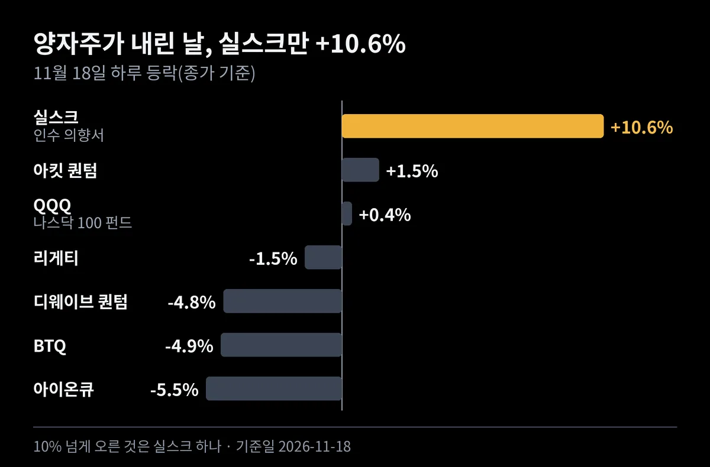
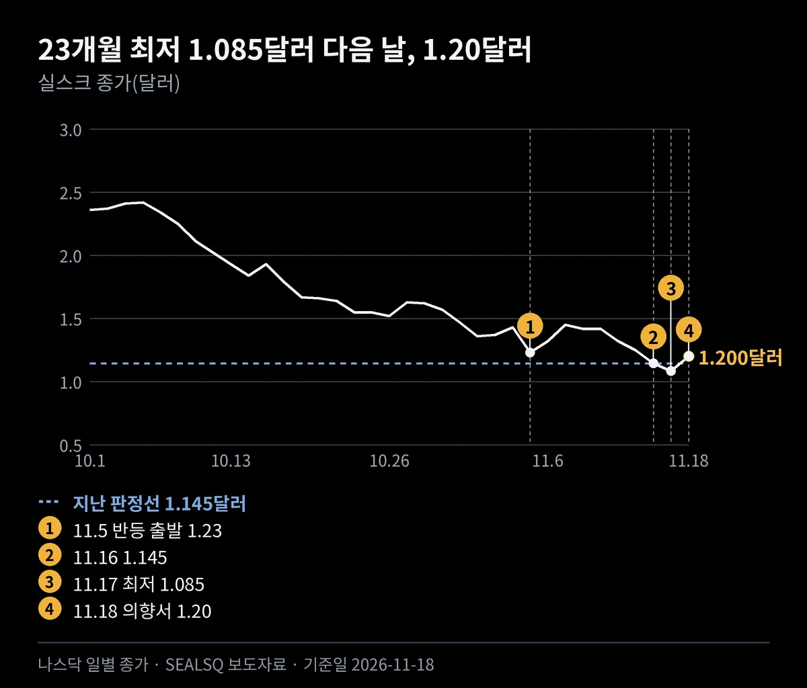
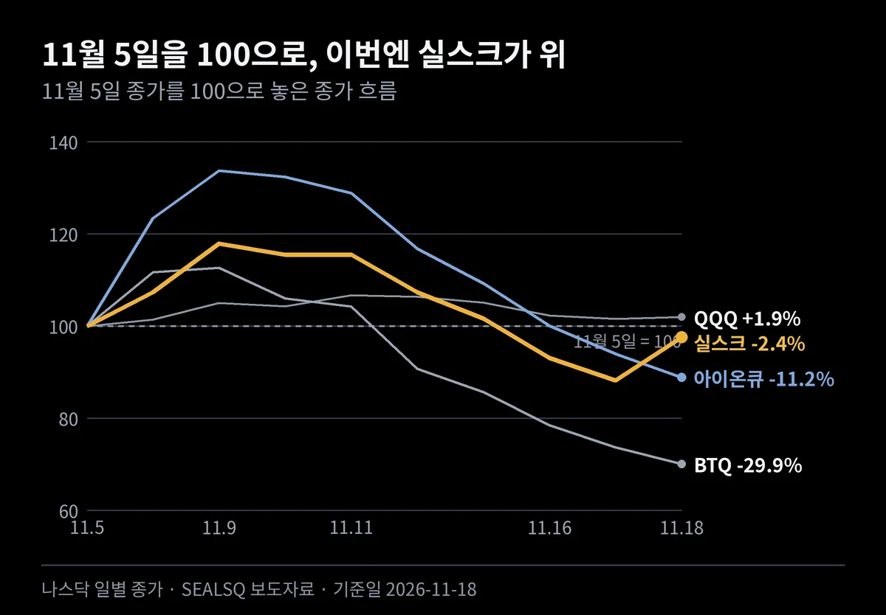
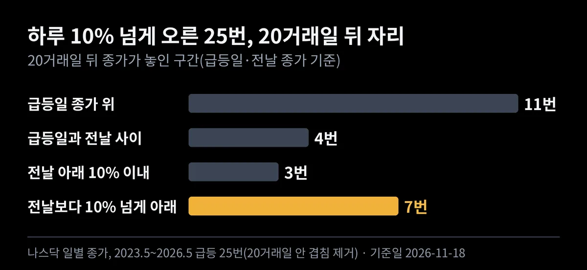
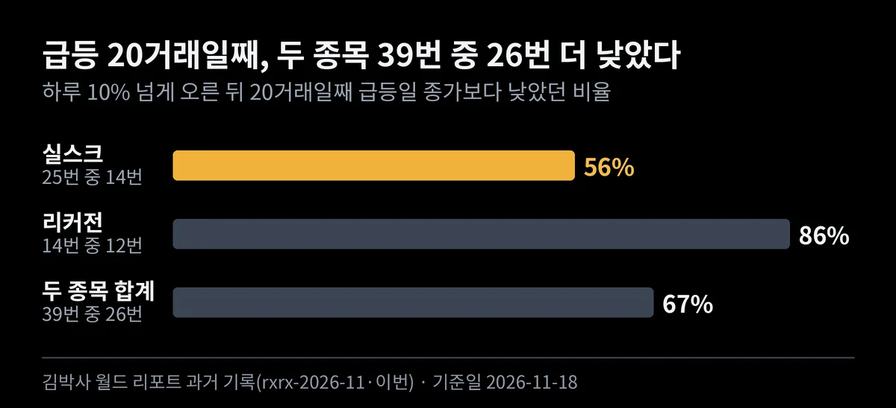
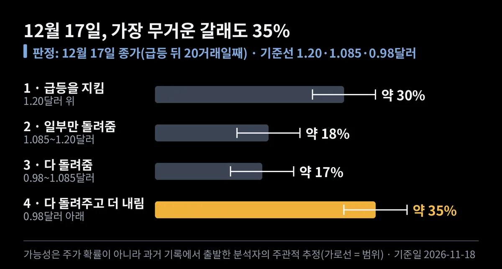

11월 18일 실스크 주가는 10.6% 올라 1.20달러로 마감했습니다. 같은 날 양자 관련주의 대표 아이온큐는 5.5% 내렸습니다. 디웨이브 퀀텀과 캐나다 양자 보안 회사 BTQ(BTQ 테크놀로지스)도 5% 가까이 내렸습니다. 이날 실스크가 낸 소식은 다른 회사를 사겠다는 의향서였습니다. 대금 일부는 실스크의 새 주식으로 내겠다고 했습니다. 주식이 늘면 기존 주주 한 주가 회사에서 차지하는 비율은 작아집니다. 그런데도 주가는 왜 하루에 10% 넘게 올랐을까요?

> **유의사항** 저자는 금융·투자 자문가가 아닙니다. 이 글은 공개 공시와 시세를 정리한 교육용 분석이며 특정 종목의 매수·매도를 권하지 않습니다. 과거 기록은 25번뿐이고, 같은 일이 반복된다는 보장은 없습니다. 실제 투자 전에는 최신 가격과 공시를 직접 확인하세요.

그림처럼 이날 10% 넘게 오른 것은 실스크 하나입니다. 영국 양자 보안 회사 아킷 퀀텀이 1.5% 오른 정도였습니다. QQQ(나스닥 100 지수를 따르는 펀드)는 0.4% 올라 시장 전체는 조용했습니다. 업종이 함께 오른 날이 아니라, 회사 소식 하나에 혼자 움직인 하루입니다.

이 글은 [11월 17일 리포트](/r/laes-2026-11-4/)의 후속편입니다. 그 리포트는 11월 5일 반등이 시작된 가격 1.23달러 아래로 내려온 11월 16일 종가 1.145달러를 기준선으로 삼았습니다. 앞으로 주가가 그 위인지 아래인지로 예측을 채점하는 선이라, 판정선이라 부릅니다. 12월 15일 종가가 그 아래일지를 물었고, 아래쪽 갈래를 가장 무겁게 봤습니다. 채점할 날짜가 모두 12월이라 지난 예측 성적은 적중 0, 빗나감 0, 진행 중 7입니다. 다만 지금 자리는 불리합니다. 18일 종가가 그 판정선 위로 올라와, 가장 무겁게 본 갈래와 반대편에 서 있습니다.

실스크(SEALSQ)는 스위스 제네바의 보안 반도체 회사입니다. 돈을 버는 방식은 칩 판매입니다. 전력 계량기, 자동차, 공장 장비, 의료기기에 들어가는 보안 칩을 팔고 대가를 받습니다. 요즘 앞세우는 제품은 양자컴퓨터로도 풀기 어려운 암호를 넣은 칩입니다. 그래서 시장은 이 회사를 양자 관련주와 한 무리로 묶어 거래합니다. 10월 잠정 발표로 올해 1~9월 매출은 1,630만 달러였고, 9월 말 현금은 약 4억 6,300만 달러였습니다.

사건은 3거래일 사이에 일어났습니다. 11월 16일 1.145달러로 23개월 만의 최저를 찍은 주가는 17일 5.2% 더 내려 1.085달러가 됐습니다. 2024년 12월 10일 뒤 가장 낮은 종가입니다. 그날 회사는 스위스 회사 미라엑스(Miraex)를 인수해 들인 광 연결 기술을 소개했지만, 양자 관련주와 함께 내렸습니다. 아이온큐도 그날 6.1% 내렸습니다.

18일 아침, 회사는 호주의 양자 보안 회사 퀸테센스랩스(QuintessenceLabs)를 사기 위한 의향서에 서명했다고 발표했습니다. 지분 100%를 사는 것이 목표입니다. 퀸테센스랩스는 양자 현상으로 예측할 수 없는 난수를 만들고, 기업의 암호 열쇠를 관리하는 제품을 팝니다. 실스크는 칩 안의 보안과 기업 전체의 열쇠 관리를 잇겠다고 설명했습니다.

조건은 아직 느슨합니다. 의향서는 구속력이 없고, 앞으로 60일 동안 두 회사가 다른 상대 없이 협상합니다. 그 기간에 실사를 하고 정식 인수 계약을 맺어야 합니다. 대금 금액은 밝히지 않았습니다. 현금과 실스크 새 주식을 섞어 내고, 새 주식은 최근 주가보다 높은 값으로 발행한다고 했습니다. 성과에 따라 주식을 더 줄 수 있는 조건도 있습니다. 완료 목표는 2027년 상반기입니다.

회사는 보도자료에 새 주식이 기존 주주의 지분을 희석한다고 직접 적었습니다. 희석은 주식 수가 늘어 한 주가 회사에서 차지하는 비율이 작아지는 일입니다. 그런데도 주가가 오른 이유를 회사가 밝힌 적은 없습니다. 추정할 수 있는 근거는 두 가지입니다. 하나는 새 주식 값을 최근 주가보다 높게 잡겠다는 조건입니다. 다른 하나는 매출 1,630만 달러짜리 회사에 새 매출원이 붙는다는 기대입니다. 둘 다 금액이 나오기 전이라 분석자의 해석입니다.

같은 날 미국 증권거래위원회에는 임원 주식 거래 보고서(Form 4)도 들어왔습니다. 17일과 18일에 세 건입니다. 최고경영자 카를로스 모레이라는 11월 13일 옵션 1,606,226주를 행사했습니다. 그중 856,514주는 세금을 내려고 회사가 주식으로 가져갔고, 749,712주를 받았습니다. 최고재무책임자와 최고혁신책임자도 16일에 같은 방식으로 행사했습니다. 이번 보고서 세 건에는 시장 매도가 없습니다. 세금만큼을 회사가 주식으로 가져간 것이라, 이 서류만으로 내부자 매도라고 읽을 수는 없습니다.

업종과 나란히 놓으면 달라진 점이 보입니다. 지난 리포트는 11월 5일 반등 출발점을 기준으로 실스크만 약하다고 적었습니다. 그때는 아이온큐가 제자리였고 실스크만 6.9% 아래였습니다. 2거래일 만에 순서가 뒤집혔습니다.

11월 18일 실스크는 11월 5일보다 2.4% 아래입니다. 같은 기간 아이온큐는 11.2%, BTQ 테크놀로지스는 29.9% 내렸습니다. 같은 양자 무리의 BTQ는 같은 날 4.9% 내렸습니다. 그 이야기는 [BTQ 리포트](/r/btq-2026-11-4/)에서 다뤘습니다. 업종 하락에는 같이 빠지고 반등은 못 따라간다는 것이 지난 편까지의 실스크 기록이었습니다. 이번 하루는 그 반대였습니다.

업종이 내린 날 회사 소식으로 혼자 10% 넘게 오른 하루를, 이 글에서는 '나 홀로 급등'이라 부릅니다. 그다음이 궁금해 실스크의 과거를 셌습니다. 먼저 업종과 상관없이 하루 10% 넘게 오른 날을 모두 봤습니다. 2023년 5월 상장 뒤 하루 10% 넘게 오른 날은 이번 전까지 68번입니다. 급등은 며칠씩 몰려 나오므로, 앞 급등에서 20거래일 안에 나온 것은 뺐습니다. 그렇게 남은 25번의 20거래일 뒤 종가를 급등일 종가와 비교했습니다.

25번 가운데 11번은 20거래일 뒤에도 급등일 종가 위에 있었습니다. 나머지 14번은 그 아래였습니다. 그 14번의 대부분은 급등 전날 종가보다도 낮아, 오른 폭을 다 돌려주고 더 내려간 경우였습니다. 구간별 숫자는 끝의 표에 있습니다.

20거래일째가 아니라 그사이도 봤습니다. 25번 중 17번은 20거래일 안에 한 번은 급등 전날 종가 아래로 마감했습니다.

이번과 더 닮은 '나 홀로 급등'만 따로 봤습니다. 25번 가운데 아이온큐가 내린 날 실스크만 오른 것은 9번입니다. 그중 20거래일 뒤 급등일 종가 위에 있던 것은 2번이고, 4번은 전날 종가보다 10% 넘게 아래였습니다. 다만 나 홀로 급등 가운데에도 2024년 11월처럼 한 달 뒤 몇 배가 된 경우가 있습니다. 9번은 규칙을 말하기에 작은 표본입니다.

이 모양은 실스크만의 것이 아닙니다. 신약 개발 회사 리커전도 하루 10% 넘게 오른 14번 가운데 12번이 20번째 거래일에 급등일 종가보다 낮았습니다([리커전 리포트](/r/rxrx-2026-11/)). 두 종목을 합치면 39번 중 26번, 약 67%입니다.

두 리포트 모두 급등일 종가와 20번째 거래일 종가를 비교했습니다. 같은 방향이었지만 두 종목뿐이라, 다른 종목에 그대로 적용할 수는 없습니다.

거꾸로 보면 39번 중 13번은 20거래일 뒤에도 급등일 종가 위에 있었습니다. 급등 하루가 곧 꼭대기라는 뜻은 아닙니다. 김박사 월드는 종목마다 따로 보지 않고, 이렇게 반복되는 모양을 모아 함께 셉니다. 이번 하루가 어느 쪽에 들어갈지는 정해 둔 날의 종가로 채점합니다.

이번 예측은 정해 둔 날의 종가로 채점하고, 그날을 판정일이라 부릅니다. 판정일은 11월 18일에서 20거래일째인 12월 17일입니다. 그보다 2거래일 앞선 12월 15일은 지난 리포트의 판정일입니다.

12월 17일 종가가 어디에 있는지로 네 갈래를 나눴습니다. 급등일 종가 1.20달러 위, 1.20달러와 급등 전날 종가 1.085달러 사이, 1.085달러와 그보다 10% 낮은 0.98달러 사이, 그리고 0.98달러 아래입니다.

출발점은 실스크 25번의 기록입니다. 급등을 지키는 첫 갈래는 기록보다 낮췄습니다. 나 홀로 급등 9번과 리커전 기록에서는 그 비율이 더 낮았고, 인수 대금 일부가 새 주식이라 주식 수가 늘 예정이기 때문입니다. 0.98달러 아래는 기록보다 조금 올렸습니다. 나 홀로 급등 9번 가운데 4번이 그 자리였습니다. 이 숫자들은 주가가 오를 확률이 아니라, 과거 빈도에서 출발해 분석자가 주관적으로 매긴 추정입니다.

이 추정이 틀릴 이유도 적어 둡니다. 이번 급등에는 인수 의향서라는 회사 공시가 붙어 있습니다. 과거 25번에는 소식 없이 업종과 함께 오른 날이 섞여 있습니다. 9월 말 현금은 18일 시가총액 약 2억 6,810만 달러의 약 1.7배이기도 합니다. 그래서 가장 무거운 갈래도 35%에 묶어 두었습니다.

정식 인수 계약과 새 주식 판매는 갈래에 섞지 않았습니다. 정식 계약은 60일 배타 협상이 끝나는 2027년 1월 중순 무렵에야 나올 수 있습니다. 12월 17일까지 새 주식을 시장에 팔 때 미국 증권거래위원회에 내는 설명서(424B)가 나오는지는 따로 확인할 항목으로 둡니다. 12월 15일 종가와 1.145달러 비교도 그대로 이어서 봅니다.

가장 큰 위험은 아직 대금이 없다는 점입니다. 금액이 크면 새 주식도 그만큼 많아집니다. 의향서 자체도 깨질 수 있어서, 실사에서 문제가 나오면 정식 계약 없이 끝납니다. 실스크는 하루 10% 넘게 오른 날만 상장 뒤 68번이었을 만큼 흔들림이 큰 종목입니다. 아이온큐가 크게 움직이는 날 함께 흔들리는 것도 그대로입니다.

정리하면, 18일의 10.6%는 업종이 아니라 인수 의향서에 붙은 움직임이었습니다. 회사는 오른 이유를 밝히지 않았습니다. 새 주식을 최근 주가보다 비싸게 내겠다는 조건과 새 매출원에 대한 기대가 희석 걱정보다 먼저 값에 들어갔을 수 있다고 봅니다. 다만 과거 25번의 기록은 급등 하루의 값이 20거래일 뒤까지 남은 경우가 절반이 안 된다고 말합니다. 기록과 다른 길을 열 수 있는 것은 새 정보입니다. 인수 금액이 크면 새 주식이 늘어 희석이 커지고, 작으면 그 걱정이 줄어듭니다. 그래서 다음 판정의 열쇠는 인수 금액과 새 주식 수가 숫자로 나오는지입니다. 다음 갱신은 12월 15일과 17일 종가를 본 뒤에 하고, 그 전에 정식 계약이나 증자 서류가 나오면 앞당깁니다.

## 숫자로 다시 보기

### 11월 16일부터 18일까지

| 날짜 · 장면 | 실스크 종가 | 하루 등락 |
| --- | --- | --- |
| **11.16 지난 리포트 기준 23개월 최저** | **1.145달러** | -8.4% |
| 11.17 미라엑스 기술 소개 2024.12.10 뒤 최저 | 1.085달러 | -5.2% |
| **11.18 퀸테센스랩스 인수 의향서** | **1.20달러** | **+10.6%** |

11월 18일 거래량은 539만 주로 11월 17일 552만 주와 비슷했습니다. 장중 가격은 1.12~1.24달러였습니다.

### 같은 날 양자 관련주와 시장

| 종목 | 11월 18일 하루 | 11월 5일 종가 대비 |
| --- | --- | --- |
| **실스크** | **+10.6%** | **-2.4%** |
| 아킷 퀀텀 | +1.5% | +2.0% |
| 퀀텀 컴퓨팅(QUBT) | -0.6% | -9.4% |
| 리게티 | -1.5% | -15.4% |
| 디웨이브 퀀텀 | -4.8% | -15.0% |
| BTQ 테크놀로지스 | -4.9% | -29.9% |
| 아이온큐 | -5.5% | -11.2% |
| QQQ | +0.4% | +1.9% |
| IWM(미국 소형주) | +0.4% | -0.3% |

### 인수 의향서의 조건(11월 18일 보도자료)

| 항목 | 내용 |
| --- | --- |
| 상대 | **퀸테센스랩스** 호주 양자 보안 회사, 지분 100% |
| 구속력 | **없음** 60일 배타 협상만 구속력 있음 |
| 대금 | **금액 미공개** 현금과 실스크 새 주식, 성과 조건부 추가 주식 가능 |
| 새 주식 값 | **최근 주가보다 높게** 완료 뒤 조정 가능 |
| 완료 목표 | **2027년 상반기** 실사·규제·이사회 승인 필요 |

### 임원 주식 거래 보고서(Form 4) 세 건

| 임원 · 행사일 | 행사 · 세금으로 회사가 가져간 주식 |
| --- | --- |
| **최고경영자 카를로스 모레이라** 11월 13일 | 1,606,226주 행사 856,514주(1.25달러) |
| 최고재무책임자 존 오하라 11월 16일 | 160,624주 행사 66,631주(1.15달러) |
| 최고혁신책임자 안드레아스 푀아르당 모레이라 11월 16일 | 40,157주 행사 12,309주(1.15달러) |

행사 가격은 모두 한 주에 0.01달러입니다. 시장에서 판 주식은 없습니다. 최고경영자는 같은 날 옵션 1,606,225주씩 두 묶음을 더 받았고, 2026년 12월 31일과 2027년 12월 31일부터 행사할 수 있습니다.

### 하루 10% 넘게 오른 25번, 20거래일 뒤

**한눈에:** 급등일 종가 위 **11/25** · 아래 **14/25** · 20거래일 안에 급등 전날 종가 아래로 한 번은 마감 **17/25**

| 20거래일 뒤 종가 자리 | 25번 | 나 홀로 급등 9번 |
| --- | --- | --- |
| 급등일 종가 위 | 11번(44%) | 2번 |
| 급등일과 전날 종가 사이 | 4번(16%) | 1번 |
| 전날 종가 아래, 10% 이내 | 3번(12%) | 2번 |
| **전날 종가보다 10% 넘게 아래** | **7번(28%)** | **4번** |

2023년 5월 상장 뒤 하루 10% 넘게 오른 68번 가운데, 앞 급등에서 20거래일 안에 나온 것을 뺀 25번입니다. 나스닥 일별 종가로 계산했습니다.

### 두 종목의 하루 급등 기록

| 종목 · 기록 | 20거래일째 급등일 종가보다 낮음 |
| --- | --- |
| **실스크(LAES) 하루 10% 넘게 오른 25번** | **14번(56%)** |
| 리커전(RXRX) 하루 10% 넘게 오른 14번 | 12번(약 86%) |
| **두 종목 합계 39번** | **26번(약 67%)** |

### 지금의 크기(11월 18일 기준)

| 항목 | 값 · 근거 |
| --- | --- |
| 종가 | **1.20달러** 지난 판정선 1.145달러보다 4.8% 위 |
| 시가총액 | **약 2억 6,810만 달러** 1.20달러 × 6월 말 2억 2,343만 주 |
| 9월 말 현금 | **약 4억 6,300만 달러** 시가총액의 약 1.7배, 부채 차감 전 |
| 1~9월 매출 | **1,630만 달러** 1년 전보다 65% 증가 |

### 지난 예측 채점표

| 지난 점검 항목 · 당시 기준 | 판정과 지금 자리(11월 18일) |
| --- | --- |
| **12월 15일 1.145달러 아래·주문 없음(약 60%)** 11월 17일 리포트 가장 무거운 갈래 | **[진행 중]** 지금 1.20달러, 4.8% 위 |
| **12월 15일 1.03달러 아래 여부** 11월 17일 리포트 | **[진행 중]** 11월 17일 최저 종가 1.085달러 |
| **고객 이름이 붙은 주문 금액 공개** 11월 17일 리포트 | **[진행 중]** 인수 의향서는 주문이 아님 |
| **12월 14일 종가 1.25달러 위** 11월 13일 리포트 | **[진행 중]** 지금 4.0% 아래 |
| **12월 4일 종가 1.23달러 위** 11월 6일 리포트 | **[진행 중]** 지금 2.4% 아래 |
| **11월 20일 1.55달러 회복** 10월 30일 리포트 | **[진행 중]** 지금 1.20달러 |
| **424B · F-3 효력 · 위성 정식 계약** 11월 13일 리포트 | **[진행 중]** 11월 18일까지 없음 |

지난 예측 성적은 적중 0 · 빗나감 0 · 진행 중 7입니다.

### 앞으로 일어날 수 있는 일

하루 10% 넘게 오른 25번 가운데 20거래일 뒤 급등일 종가보다 낮았던 것은 14번이고, 리커전과 합치면 39번 중 26번입니다. 아래 가능성은 그 기록에서 출발해 분석자가 주관적으로 매긴 추정이며, 주가가 오를 확률이 아닙니다. 네 갈래는 겹치지 않아 더하면 100%입니다.

| 갈래(판정 12월 17일) | 판정 조건 | 가능성(추정) |
| --- | --- | --- |
| 1 · 급등을 지킴 | 12월 17일 종가 1.20달러 위 | 중간 약 30% (25~35%) |
| 2 · 일부만 돌려줌 | 12월 17일 종가 1.085~1.20달러 | 낮음 약 18% (13~23%) |
| 3 · 다 돌려줌 | 12월 17일 종가 0.98~1.085달러 | 낮음 약 17% (12~22%) |
| **4 · 다 돌려주고 더 내림** | 12월 17일 종가 0.98달러 아래 | 중간 약 35% (30~40%) |

0.98달러는 11월 17일 종가 1.085달러보다 약 10% 낮은 값입니다(계산 0.9765달러).

### 핵심 확인 세 가지

| 순위 · 확인할 것 | 판정 날짜 |
| --- | --- |
| **1순위** 종가가 1.20달러·1.085달러·0.98달러 가운데 어디인가 | 12월 17일 |
| **2순위** 종가가 지난 판정선 1.145달러 아래인가 | 12월 15일 |
| **3순위** 정식 인수 계약과 대금, 424B 같은 새 주식 판매 서류가 나오는가 | 2027년 1월 중순(배타 협상 끝)까지 |

공시는 [실스크 SEC 공시 목록](https://www.sec.gov/cgi-bin/browse-edgar?action=getcompany&CIK=0001951222&type=&dateb=&owner=include&count=40)에서 확인할 수 있습니다.

## 함께 읽기

- [실스크 지난 리포트](/r/laes-2026-11-4/) · [영상](https://youtu.be/W3vcgET5izw): 반등 출발점을 깬 여섯 번 가운데 다섯 번이 20거래일 뒤 더 낮았습니다(11월 16일 기준).
- [BTQ 테크놀로지스 리포트](/r/btq-2026-11-4/) · [영상](https://youtu.be/usFP6dPpDX8): 같은 양자 무리, 11월 18일 하루 -4.9%이고 11월 5일 대비 -29.9%입니다(11월 18일 종가 기준).
- [리커전 리포트](/r/rxrx-2026-11/) · [영상](https://youtu.be/bBye6yTQX90): 하루 10% 넘게 오른 14번 가운데 12번이 20번째 거래일에 급등일 종가보다 낮았습니다.
