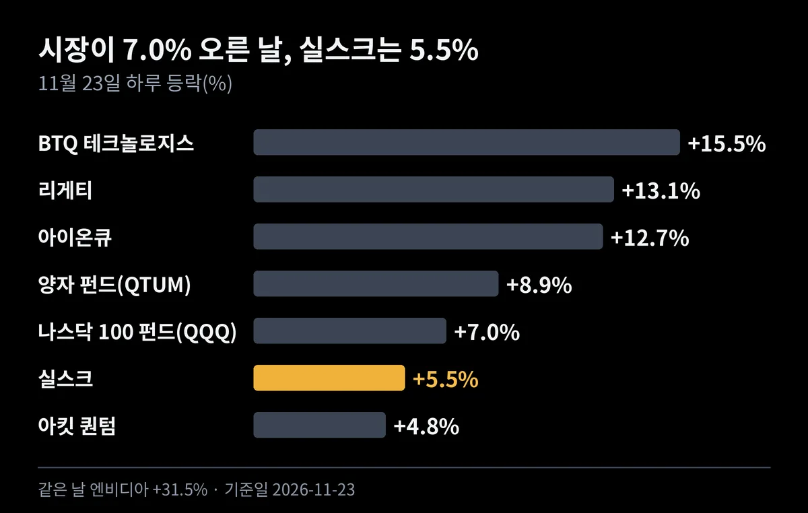
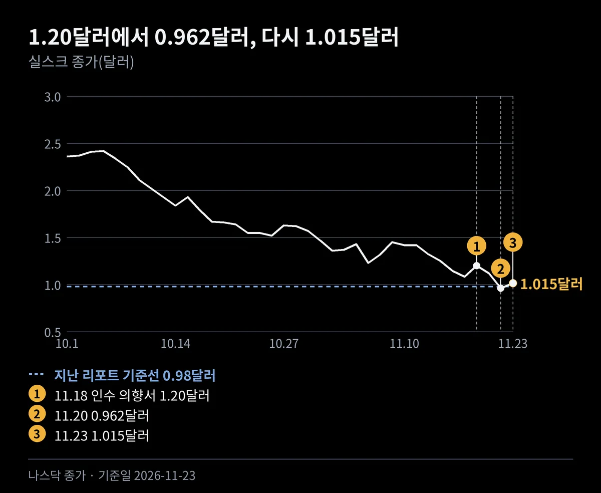
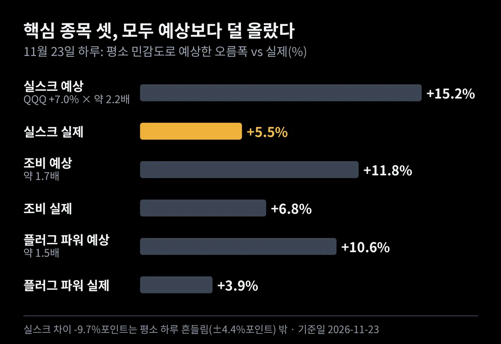
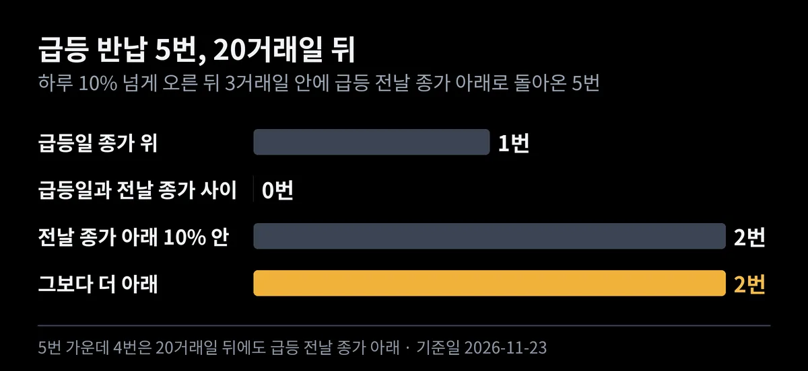
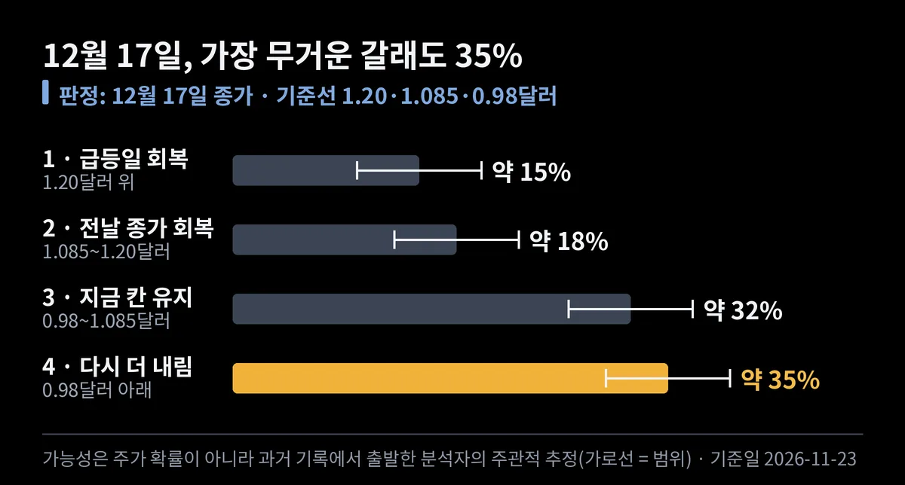

11월 23일 나스닥 100 지수를 따르는 펀드(QQQ)는 하루에 7.0% 올랐습니다. 같은 양자 관련주인 아이온큐는 12.7%, 리게티는 13.1% 올랐습니다. 캐나다 양자 보안 회사 BTQ(BTQ 테크놀로지스)는 15.5% 올랐습니다. 그런데 실스크는 5.5% 오르는 데 그쳐 1.015달러로 마감했습니다. 3거래일 전 인수 의향서 하나로 1.20달러까지 올랐던 주식입니다. 이 주식을 들고 있는 사람이라면 질문은 하나입니다. 12월 판정일까지 버텨야 할까요?

> **유의사항** 저자는 금융·투자 자문가가 아닙니다. 이 글은 공개 공시와 시세를 정리한 교육용 분석이며 특정 종목의 매수·매도를 권하지 않습니다. 과거 기록은 5번뿐이고, 같은 일이 반복된다는 보장은 없습니다. 실제 투자 전에는 최신 가격과 공시를 직접 확인하세요.

그림처럼 이날 실스크보다 덜 오른 곳은 영국 양자 보안 회사 아킷 퀀텀(4.8%) 정도였습니다. 양자 관련 기업을 묶은 펀드(QTUM)도 8.9% 올랐습니다. 시장 전체와 업종이 함께 크게 오른 날, 실스크는 그 가운데 아래쪽에 있었습니다.

이 글은 [11월 19일 리포트](/r/laes-2026-11-5/)의 후속편입니다. 그 리포트는 11월 18일 하루 10.6% 급등 뒤 12월 17일 종가를 네 칸으로 나눴습니다. 기준은 급등일 종가, 급등 전날 종가, 그리고 그보다 10% 낮은 값입니다. 가장 무겁게 본 칸은 0.98달러 아래로, 약 35%였습니다. 판정일이 오지 않아 지난 예측 성적은 적중 0, 빗나감 0, 모두 진행 중입니다.

다만 주가는 그 사이 두 칸을 오갔습니다. 11월 20일에는 가장 무겁게 본 칸에 들어갔습니다. 23일에는 0.98달러 위로 돌아와 '다 돌려줌' 칸에 있습니다.

실스크(SEALSQ)는 스위스 제네바의 보안 반도체 회사입니다. 돈을 버는 방식은 칩 판매입니다. 전력 계량기, 자동차, 공장 장비에 들어가는 보안 칩을 팔고 대가를 받습니다. 요즘 앞세우는 제품은 양자컴퓨터로도 풀기 어려운 암호를 넣은 칩이라, 시장은 이 회사를 양자 관련주와 한 무리로 묶어 거래합니다. 10월 잠정 발표로 올해 1~9월 매출은 1,630만 달러였습니다. 9월 말 현금은 약 4억 6,300만 달러였습니다.

네 거래일 동안의 일을 차례로 보겠습니다. 11월 18일 회사는 호주 양자 보안 회사 퀸테센스랩스를 사겠다는 의향서를 냈고, 주가는 10.6% 올라 1.20달러가 됐습니다. 의향서는 구속력이 없고, 대금 금액도 밝히지 않았습니다. 다음 날 주가는 6.7% 내려 1.12달러가 됐습니다.

11월 19일 회사는 미국 증권거래위원회에 서류를 냈습니다. 하나는 18일 보도자료를 외국 회사 보고서(6-K)로 다시 제출한 것입니다. 같은 서류에 본사를 제네바 안의 새 사무실로 옮겼다는 내용도 있었습니다. 나머지는 임원 두 명의 주식 거래 보고서(Form 4)였습니다. 한 명은 옵션 6만 235주를 행사했고, 그중 2만 2,596주는 세금을 내려고 회사가 주식으로 가져갔습니다. 다른 한 명도 옵션 5만 주를 행사했습니다. 두 보고서에 시장에서 판 주식은 없습니다.

그리고 11월 20일 주가는 14.1% 내려 0.962달러가 됐습니다. 2024년 12월 10일 뒤 가장 낮은 종가입니다. 이날은 QQQ도 5.7% 내린 날이었습니다. 그 뒤 23일까지 실스크가 낸 서류는 없습니다.

23일 아침에는 다른 회사의 공시가 시장을 움직였습니다. 엔비디아가 이사회 결정으로 젠슨 황을 최고경영자로 다시 세웠다고 8-K로 알렸습니다. 엔비디아 주가는 하루에 31.5% 올랐고, 주요 언론은 이 소식을 그날 반등의 계기로 보도했습니다. 같은 날 소형주 펀드(IWM)도 3.6% 올랐습니다. 실스크의 5.5%는 회사 소식 없이, 시장 전체가 오른 날에 나온 숫자입니다.

그럼 5.5%는 시장에 비해 얼마나 작은 숫자일까요? 평소 민감도로 재 봤습니다. 시장이 1% 움직일 때 이 종목이 평균 몇 % 움직였는지를 말합니다. 실스크는 약 2.2배였습니다. 평소 민감도로 예상한 움직임은 약 +15.2%였고, 실제는 +5.5%였습니다. 차이는 -9.7%포인트로, 평소 하루 흔들림(±4.4%포인트) 밖입니다.

이날 덜 오른 것은 실스크만이 아니었습니다. 김박사 월드 핵심 종목 8개 가운데 5개가 평소 민감도로 예상한 오름폭보다 덜 올랐습니다. [조비 에비에이션](/r/joby-2026-11-4/)과 [플러그 파워](/r/plug-2026-11-4/)도 그 안에 있습니다. 종목별 숫자는 끝의 배경 표에 있습니다. 반대로 같은 보안 무리의 BTQ는 예상 범위 안에서 15.5% 올랐습니다.

그래서 실스크의 덜 오른 하루를 회사 하나의 문제로만 읽기는 어렵습니다. 다만 같은 양자 무리 안에서 실스크가 아래쪽이었다는 점은 지난 리포트들의 기록과 같습니다.

김박사 월드 장부에는 실스크에 대한 규칙이 하나 있습니다. 업종 하락일에는 같이 빠지고, 업종 반등은 못 따라간다는 기록입니다. 11월 5일 반등 출발점과 비교했을 때 아이온큐는 제자리였는데 실스크만 6.9% 아래였던 일이 그 근거였습니다. 11월 18일은 그 반대인 '나 홀로 급등'이었지만, 23일은 다시 원래 기록 쪽이었습니다.

이번 장면을 '급등 반납'이라 부르겠습니다. 하루 10% 넘게 오른 뒤 3거래일 안에 급등 전날 종가 아래로 돌아온 경우입니다. 11월 18일 1.20달러로 오른 주가는 3거래일째인 23일 1.015달러로, 급등 전날 종가 1.085달러 아래입니다.

지난 리포트는 상장 뒤 하루 10% 넘게 오른 날을 겹치지 않게 25번 셌습니다. 그 가운데 급등 반납은 이번 전까지 5번이었습니다. 2023년 8월과 10월, 2023년 11월, 2024년 9월, 2025년 2월입니다.

5번의 20거래일 뒤 종가를 지난 리포트와 같은 네 칸에 넣었습니다. 급등일 종가 위로 돌아온 것은 2023년 11월 한 번입니다. 급등일과 전날 종가 사이는 없었습니다. 급등 전날 종가 아래 10% 안이 2번, 그보다 더 아래가 2번이었습니다. 5번 가운데 4번은 20거래일 뒤에도 급등 전날 종가 아래였습니다.

다만 5번은 아주 작은 표본입니다. 2023년 11월처럼 반납 뒤 20거래일 만에 급등일 종가보다 13% 높아진 경우도 있습니다. 그래서 이 기록은 방향을 정하는 근거라기보다, 다른 근거와 함께 놓고 보는 참고입니다. 김박사 월드는 종목마다 따로 보지 않고, 이렇게 반복되는 모양을 모아 함께 셉니다.

버티는 쪽 근거부터 정리하겠습니다. 가장 먼저, 회사 고유의 나쁜 소식은 확인되지 않았습니다. 11월 20일의 14.1% 하락은 시장 전체가 내린 날에 나왔고, 임원 보고서도 세금 처리였습니다.

돈의 크기도 버티는 쪽 근거입니다. 9월 말 현금 약 4억 6,300만 달러는 23일 종가 기준 시가총액 약 2억 2,680만 달러의 약 2.0배입니다. 다만 실스크에서는 현금이 많아도 주가의 바닥이 되지 못했습니다. 그래서 이 숫자는 회사가 시간을 벌 수 있다는 뜻으로만 읽습니다.

인수 협상도 아직 열려 있습니다. 의향서에 따른 60일 배타 협상 기간이고, 정식 계약과 금액이 나오면 새 정보가 됩니다. 회사는 새 주식을 최근 주가보다 높은 값으로 발행하겠다고 밝혔습니다.

파는 쪽 근거도 셋입니다. 가장 먼저 23일의 모습 자체입니다. 시장이 7.0%, 같은 무리가 12~15% 오른 날 실스크는 예상의 3분의 1 정도만 따라왔습니다. 이 모양은 지난 리포트들에 쌓인 실스크의 기록과 같은 방향입니다.

과거 기록도 같은 쪽입니다. 급등 반납 5번 가운데 4번은 20거래일 뒤에도 급등 전날 종가 아래였습니다. 그래서 23일의 덜 오른 하루를 이렇게 읽습니다. 의향서로 오른 상승분을 다 돌려준 뒤에는, 시장이 오른 날에도 그 의향서에 다시 값이 붙지 않았습니다. 이것은 분석자의 해석이고, 회사가 밝힌 이유는 없습니다.

마지막은 주식 수가 늘 수 있다는 점입니다. 인수 대금 일부는 실스크 새 주식으로 냅니다. 11월 19일 6-K는 회사가 주식을 팔 때 쓰는 증권 신고서(F-3)에 편입됐습니다. 금액이 크면 주식 수가 늘어, 한 주가 회사에서 차지하는 비율이 작아집니다.

다음 판정은 날짜로 정해져 있습니다. 12월 15일에는 그 전 리포트의 기준선 1.145달러를 봅니다. 12월 17일에는 지난 리포트의 네 칸을 채점합니다. 그 사이 12월 9일 연준 금리 회의(FOMC)가 있습니다. 회의 뒤 시장이 움직일 때 실스크가 같은 무리만큼 따라가는지가 첫 신호입니다.

새 예측도 지난 리포트와 같은 날, 같은 네 칸으로 걸었습니다. 출발점은 25번 전체와 급등 반납 5번의 기록을 반씩 섞은 값입니다. 0.98달러 아래 칸은 25번 중 7번, 5번 중 2번이라 약 34%에서 출발했습니다.

23일처럼 시장 반등을 못 따라간 모습을 보고 가장 위 칸은 15%로 낮췄습니다. 5번 기록에서 비어 있던 바로 아래 칸은 표본이 작아 18%로 올렸습니다. 이 숫자들은 주가가 오를 확률이 아니라, 과거 빈도에서 출발해 분석자가 주관적으로 매긴 추정입니다.

이 추정이 틀릴 이유도 적어 둡니다. 실스크는 평소 민감도가 약 2.2배인 종목입니다. 12월 9일 금리 회의 뒤 시장이 다시 크게 오르고 실스크가 평소만큼만 따라가도, 0.98달러 아래 칸에서 멀어집니다. 정식 인수 계약이 좋은 조건으로 나오면 이 기록과 다른 길이 열릴 수 있습니다. 그래서 가장 무거운 갈래도 35%에 묶었습니다.

위험도 짚겠습니다. 가장 큰 한계는 표본입니다. 급등 반납 기록은 5번뿐이고, 23일 덜 오른 이유는 공시로도 보도로도 확인하지 못했습니다. 인수 대금이 크면 새 주식이 그만큼 늘고, 실사에서 문제가 나오면 의향서는 정식 계약 없이 끝납니다. 실스크는 하루 두 자릿수로 움직인 날이 많은 종목이고, 시장이 흔들리면 그 약 2.2배로 흔들려 왔습니다.

실스크는 시가총액의 약 2배인 현금과 열려 있는 인수 협상을 가졌습니다. 하지만 시장이 7.0% 오른 날에도 같은 무리의 절반도 따라가지 못했습니다. 그래서 지금 가장 중요한 숫자는 현금이 아니라, 12월 9일 뒤 시장을 따라가는 폭과 인수 금액입니다. 12월 17일 종가가 1.085달러 위로 돌아오면 버티는 쪽 근거가, 0.98달러 아래로 내려가면 파는 쪽 근거가 강해집니다. 다음 갱신은 12월 15일과 17일 종가를 본 뒤에 하고, 그 전에 정식 계약이나 증자 서류가 나오면 앞당깁니다.

## 숫자로 다시 보기

### 11월 18일부터 23일까지

| 날짜 · 장면 | 실스크 종가 | 하루 등락 |
| --- | --- | --- |
| 11.17 급등 전날 | 1.085달러 | -5.2% |
| **11.18 퀸테센스랩스 인수 의향서** | **1.20달러** | **+10.6%** |
| 11.19 6-K·Form 4 두 건 | 1.12달러 | -6.7% |
| **11.20 2024.12.10 뒤 최저 종가** | **0.962달러** | **-14.1%** |
| **11.23 시장 반등일** | **1.015달러** | **+5.5%** |

11월 23일 종가 1.015달러는 급등일 종가 1.20달러보다 15.4% 낮고, 급등 전날 종가 1.085달러보다 6.5% 낮습니다.

### 11월 23일 하루, 양자 관련주와 시장

| 종목 | 11월 23일 하루 |
| --- | --- |
| BTQ 테크놀로지스 | +15.5% |
| 리게티 | +13.1% |
| 아이온큐 | +12.7% |
| 디웨이브 퀀텀 | +12.1% |
| 양자 펀드(QTUM) | +8.9% |
| 퀀텀 컴퓨팅(QUBT) | +7.4% |
| QQQ | +7.0% |
| **실스크** | **+5.5%** |
| 아킷 퀀텀 | +4.8% |
| IWM(미국 소형주) | +3.6% |

같은 날 엔비디아는 +31.5%였습니다.

### 버티는 쪽과 파는 쪽 근거

| 쪽 · 근거 | 숫자와 출처 |
| --- | --- |
| **버티는 쪽** 회사 고유 악재 확인 안 됨 | 11월 19일 6-K·Form 4 두 건 뒤 제출 없음 Form 4는 옵션 행사 세금 처리 |
| **버티는 쪽** 현금이 몸값보다 큼 | 현금 약 4억 6,300만 달러 시가총액의 약 2.0배 |
| **버티는 쪽** 인수 협상 진행 중 | 60일 배타 협상 새 주식은 최근 주가보다 높게 |
| **파는 쪽** 시장 반등을 못 따라감 | 예상 약 +15.2%, 실제 +5.5% 같은 무리 +12~15% |
| **파는 쪽** 급등 반납 기록 | 5번 중 4번이 20거래일 뒤 급등 전날 종가 아래 |
| **파는 쪽** 주식 수 증가 가능 | 인수 대금 일부 새 주식 6-K가 F-3 신고서에 편입 |

### 급등 반납 5번, 20거래일 뒤

하루 10% 넘게 오른 25번 가운데 3거래일 안에 급등 전날 종가 아래로 마감한 경우입니다.

| 급등일 · 전날 → 급등일 종가 | 20거래일 뒤 종가 자리 |
| --- | --- |
| 2023.08.02 10.84 → 12.00달러 | 5.32달러 전날 종가보다 10% 넘게 아래 |
| 2023.10.09 1.67 → 1.96달러 | 1.4783달러 전날 종가보다 10% 넘게 아래 |
| 2023.11.29 1.07 → 1.238달러 | 1.40달러 급등일 종가 위 |
| 2024.09.25 0.452 → 0.525달러 | 0.4192달러 전날 종가 아래 10% 안 |
| 2025.02.20 3.38 → 3.73달러 | 3.10달러 전날 종가 아래 10% 안 |
| **2026.11.18 1.085 → 1.20달러** | **12월 17일 판정** |

**한눈에:** 급등일 종가 위 **1/5** · 급등일과 전날 종가 사이 **0/5** · 전날 종가 아래 10% 안 **2/5** · 그보다 아래 **2/5**. 나스닥 일별 종가로 계산했습니다.

### 시장·거시·정책 배경

| 항목 | 값 · 기준 |
| --- | --- |
| QQQ 하루 | **+7.0%** 11월 23일 |
| 평소 민감도(QQQ 기준) | **약 2.2배** 앞선 250거래일 하루 수익률 회귀 |
| 실스크 예상 vs 실제 | **약 +15.2% vs +5.5%** 차이 -9.7%포인트, 평소 하루 흔들림 ±4.4%포인트 밖 |
| 다음 거시 일정 | **12월 9일 FOMC** 연준 공식 일정 |

| 조비 에비에이션 예상 vs 실제 | **약 +11.8% vs +6.8%** 평소 민감도 약 1.7배 |
| 플러그 파워 예상 vs 실제 | **약 +10.6% vs +3.9%** 평소 민감도 약 1.5배 |
| 핵심 종목 8개 | **5개가 예상보다 덜 오름** 실스크·조비·플러그 파워·솔리드파워·뉴스케일 파워, 평소 흔들림 밖 |

같은 날 덜 오른 핵심 종목 이야기는 [조비 에비에이션](/r/joby-2026-11-4/)과 [플러그 파워](/r/plug-2026-11-4/) 리포트에 있습니다. 시장 반등은 엔비디아 8-K(젠슨 황 복귀) 보도와 같은 날이었습니다.

정책: 직접 연결 확인 안 됨(실스크 연차 보고서 위험 요인과 이어지는 11월 정책 발표를 찾지 못함).

### 버티기 전에 확인할 것

| 순서 · 확인할 것 | 볼 곳 |
| --- | --- |
| **1** 처음 산 이유(보안 칩 매출)가 아직 늘고 있나 | 회사 매출 발표 |
| **2** 12월 9일 FOMC 뒤 같은 무리만큼 따라가나 | 실스크·아이온큐·QQQ 종가 |
| **3** 시장이 흔들릴 때 약 2.2배 흔들림을 감당할 수 있나 | 평소 민감도 |
| **4** 정식 인수 계약 금액과 새 주식 판매 서류(424B) | SEC 제출 목록 |
| **5** 12월 15일·17일 종가 | 나스닥 종가 |

### 지금의 크기(11월 23일 기준)

| 항목 | 값 · 근거 |
| --- | --- |
| 종가 | **1.015달러** 지난 기준선 0.98달러보다 약 3.6% 위 |
| 시가총액 | **약 2억 2,680만 달러** 1.015달러 × 6월 말 2억 2,343만 주 |
| 9월 말 현금 | **약 4억 6,300만 달러** 시가총액의 약 2.0배, 부채 차감 전 |
| 1~9월 매출 | **1,630만 달러** 1년 전보다 65% 증가 |

### 지난 예측 채점표

| 지난 점검 항목 · 당시 기준 | 판정과 지금 자리(11월 23일) |
| --- | --- |
| **12월 17일 0.98달러 아래(약 35%)** 11월 19일 리포트 가장 무거운 갈래 | **[진행 중]** 11월 20일 들어갔다가 23일 1.015달러로 나옴 |
| **12월 17일 0.98~1.085달러(약 17%)** | **[진행 중]** 지금 이 자리 |
| **12월 17일 1.085~1.20달러(약 18%)·1.20달러 위(약 30%)** | **[진행 중]** 지금 6.5%·15.4% 아래 |
| **12월 15일 1.145달러 아래** 11월 17일 리포트 판정선 | **[진행 중]** 지금 11.4% 아래 |
| **정식 인수 계약·대금·424B** | **[진행 중]** 11월 23일까지 없음 |

지난 예측 성적은 적중 0 · 빗나감 0 · 모두 진행 중입니다.

### 앞으로 일어날 수 있는 일

하루 10% 넘게 오른 25번 전체와 급등 반납 5번의 20거래일 뒤 자리를 반씩 섞어 출발했습니다. 아래 가능성은 그 기록에서 출발해 분석자가 주관적으로 매긴 추정이며, 주가가 오를 확률이 아닙니다. 네 갈래는 겹치지 않아 더하면 100%입니다.

| 갈래(판정 12월 17일) | 판정 조건 | 가능성(추정) |
| --- | --- | --- |
| 1 · 급등일 회복 | 12월 17일 종가 1.20달러 위 | 낮음 약 15% (10~20%) |
| 2 · 전날 종가 회복 | 12월 17일 종가 1.085~1.20달러 | 낮음 약 18% (13~23%) |
| 3 · 지금 칸 유지 | 12월 17일 종가 0.98~1.085달러 | 중간 약 32% (27~37%) |
| **4 · 다시 더 내림** | 12월 17일 종가 0.98달러 아래 | 중간 약 35% (30~40%) |

### 핵심 확인 세 가지

| 순위 · 확인할 것 | 판정 날짜 |
| --- | --- |
| **1순위** 종가가 1.20달러·1.085달러·0.98달러 가운데 어디인가 | 12월 17일 |
| **2순위** 12월 9일 FOMC 뒤 같은 무리만큼 따라가는가 | 12월 10일 |
| **3순위** 정식 인수 계약과 대금, 424B 같은 새 주식 판매 서류가 나오는가 | 2027년 1월 중순(배타 협상 끝)까지 |

공시는 [실스크 SEC 공시 목록](https://www.sec.gov/cgi-bin/browse-edgar?action=getcompany&CIK=0001951222&type=&dateb=&owner=include&count=40)에서 확인할 수 있습니다.

## 함께 읽기

- [실스크 지난 리포트](/r/laes-2026-11-5/) · [영상](https://youtu.be/2LuMR4kBlmA): 인수 의향서로 하루 10.6% 오른 날과 하루 10% 급등 25번의 기록(11월 18일 기준).
- [BTQ 테크놀로지스 리포트](/r/btq-2026-11-5/) · [영상](https://youtu.be/oIrfim1wfyY): 같은 양자 보안 무리, 1달러 선 근처에서 다룬 '지금 사도 될까?'(11월 20일 기준).
- [조비 에비에이션 리포트](/r/joby-2026-11-4/) · [영상](https://youtu.be/m2eALHEvv8c): 같은 날 예상보다 덜 오른 핵심 종목의 4달러 이야기(11월 19일 기준).
