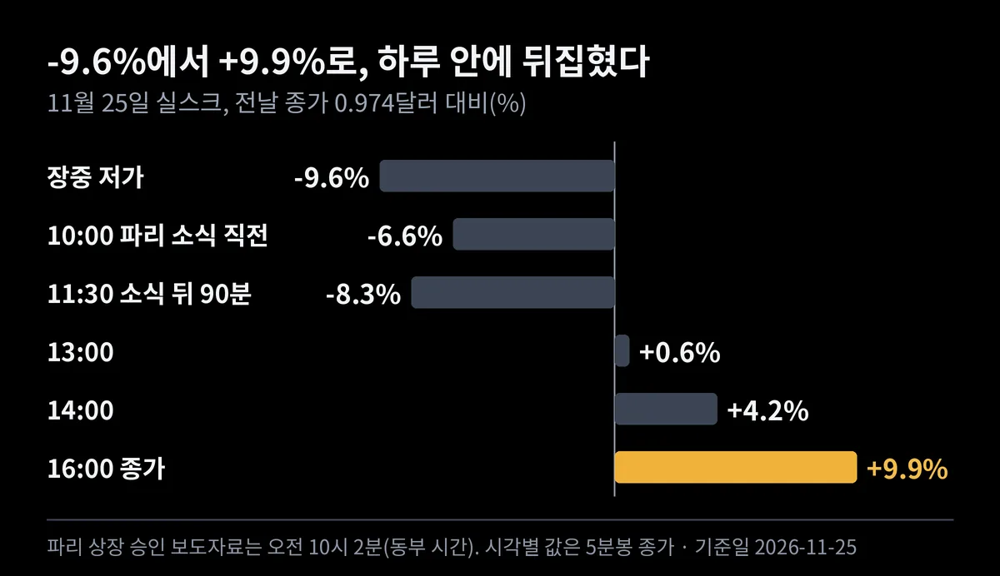
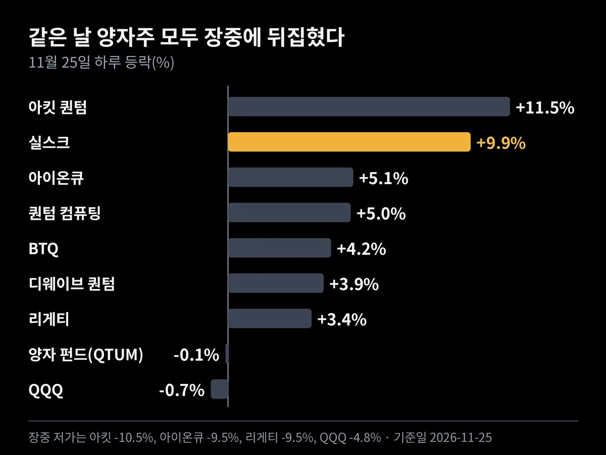
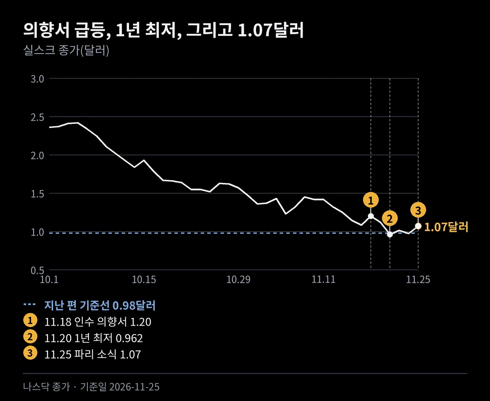
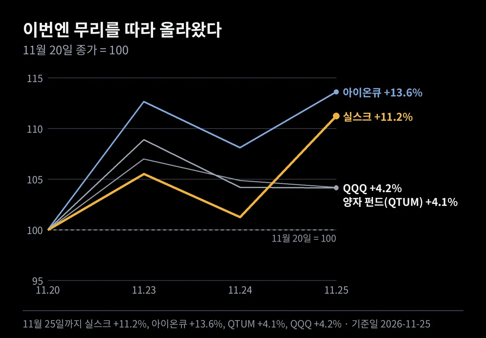
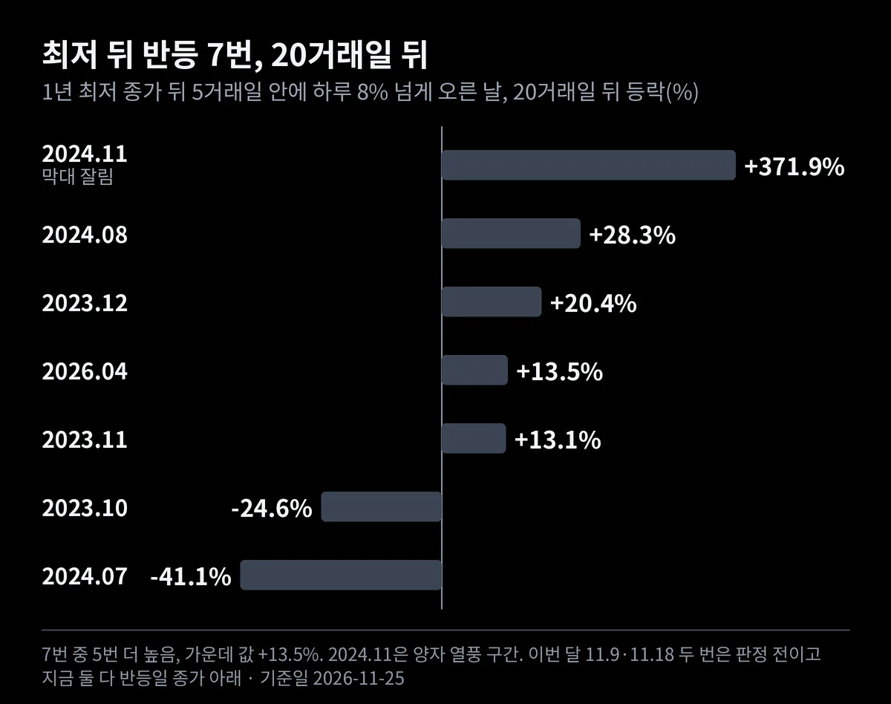
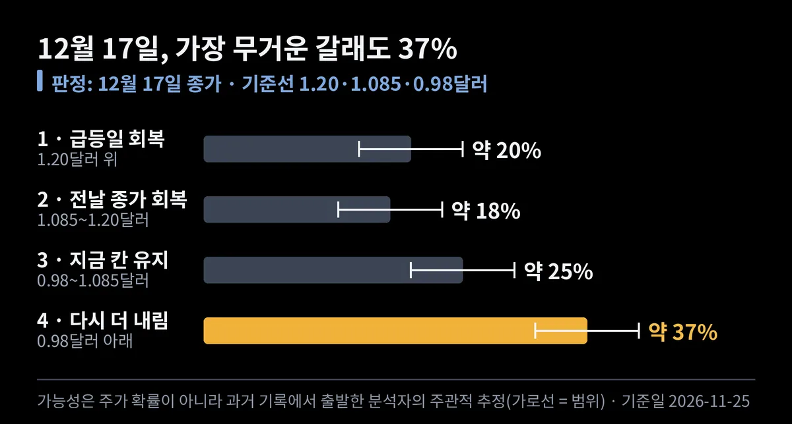

11월 25일 오전, 실스크 주가는 전날 종가보다 9.6% 낮은 0.8809달러까지 내려갔습니다. 그런데 장이 끝날 때는 9.9% 오른 1.07달러였습니다. 하루 안에 아래위가 완전히 뒤집힌 셈입니다. 같은 날 오전 10시 2분, 회사는 프랑스 파리 증권시장에도 주식을 올린다는 소식을 냈습니다. 그런데 소식이 나온 뒤 90분 동안 주가는 0.89~0.91달러에서 거의 움직이지 않았습니다. 그렇다면 이 반등은 무엇이 만든 걸까요? 그리고 바닥을 찍고 돌아서는 신호일까요?

> **유의사항** 저자는 금융·투자 자문가가 아닙니다. 이 글은 공개 공시와 시세를 정리한 교육용 분석이며 특정 종목의 매수·매도를 권하지 않습니다. 과거 기록은 7번뿐이고, 같은 일이 반복된다는 보장은 없습니다. 실제 투자 전에는 최신 가격과 공시를 직접 확인하세요.

그림처럼 반등은 오전이 아니라 정오 무렵부터 시작됐습니다. 오후 1시에 전날 종가를 넘었고, 그 뒤로 계속 올라 마감했습니다. 마감 가격 1.07달러는 그날 가장 높은 가격이기도 했습니다.

이 글은 [11월 23일 리포트](/r/laes-2026-11-6/)의 후속편입니다. 그 리포트는 12월 17일 종가를 네 칸으로 나눴고, 가장 무겁게 본 칸은 0.98달러 아래(약 35%)였습니다. 네 칸의 기준선은 끝의 채점표에 있습니다.

판정일이 오지 않아 지난 예측 성적은 적중 0, 빗나감 0, 진행 중 5입니다. 지금 1.07달러는 위에서 세 번째 칸에 있습니다. 가장 무겁게 본 칸에서는 조금 멀어진 자리입니다.

실스크(SEALSQ)는 스위스 제네바의 보안 반도체 회사입니다. 돈을 버는 방식은 칩 판매입니다. 전력 계량기, 자동차, 공장 장비에 들어가는 보안 칩을 팔고 대가를 받습니다. 요즘 앞세우는 제품은 양자컴퓨터로도 풀기 어려운 암호를 넣은 칩입니다. 그래서 시장은 이 회사를 양자 관련주와 한 무리로 묶어 거래합니다. 10월 잠정 발표로 올해 1~9월 매출은 1,630만 달러였습니다. 9월 말 현금은 약 4억 6,300만 달러였습니다.

먼저 파리 소식이 무엇인지 보겠습니다. 회사는 미국 증권거래위원회에 외국 회사 보고서(6-K)를 냈습니다. 유로넥스트 파리가 실스크의 기존 주식 전부를 유로넥스트 그로스 파리에 올리도록 승인했다는 내용입니다. 거래는 12월 2일 시작될 예정이고, 그곳 이름도 LAES입니다. 이런 방식을 2차 상장이라 부릅니다. 이미 나스닥에서 거래되는 같은 주식을 다른 나라 시장에서도 사고팔 수 있게 하는 것입니다.

공시가 분명히 적은 것이 셋 있습니다. 새 주식을 발행하지 않고, 주식을 팔지 않으며, 회사로 들어오는 돈도 없습니다. 나스닥 상장은 그대로입니다. 회사가 든 이유도 셋입니다. 본사와 연구 인력이 있는 유럽 가까이 가겠다는 것, 유럽 투자자가 유로로 유럽 시간에 거래하게 하겠다는 것, 투자자층을 넓히겠다는 것입니다. 보도자료는 유로넥스트 그로스가 정규 시장과 같은 규칙을 적용받지 않는다는 경고 문장도 함께 실었습니다.

그럼 무엇이 주가를 올렸을까요? 이번 장면을 '장중 뒤집기'라 부르겠습니다. 장중에 전날보다 크게 내렸다가, 크게 올라 마감한 날입니다. 이날은 실스크만 그런 것이 아니었습니다.

같은 날 영국 양자 보안 회사 아킷 퀀텀은 장중 10.5% 내렸다가 11.5% 올라 마감했습니다. 아이온큐와 리게티도 장중에는 9% 넘게 내렸다가 오른 채 끝났습니다. 나스닥 100 지수를 따르는 펀드(QQQ)도 장중 4.8%까지 내렸다가 거의 다 되찾았습니다.

30분 단위 가격을 보면 QQQ와 아이온큐는 오전 10시 무렵 가장 낮았습니다. 그 뒤 오후 2시까지 함께 올라왔습니다. 실스크가 올라온 시간대와 같습니다.

그래서 이렇게 나눠 읽어야 합니다. 회사 소식은 장중에 나왔지만, 소식 뒤 90분 동안 주가는 움직이지 않았습니다. 주가가 오른 시간은 무리와 시장이 함께 회복한 시간이었습니다. 파리 소식이 반등에 얼마나 보탰는지는 이 자료로 가를 수 없습니다. 다만 실스크의 +9.9%는 무리 가운데 아킷 퀀텀 다음으로 컸습니다.

한 주 전부터 차례로 보면 이렇습니다. 11월 18일 회사는 호주 양자 보안 회사 퀸테센스랩스를 사겠다는 의향서를 냈습니다. 주가는 10.6% 올라 1.20달러가 됐습니다. 의향서는 구속력이 없고, 60일 동안 단독으로 협상하는 단계입니다.

11월 20일에는 QQQ가 5.7% 내린 날 14.1% 내려 0.962달러로 마감했습니다. 1년 동안 가장 낮은 종가였습니다. 그 뒤 1달러를 사이에 두고 오르내리다 25일 1.07달러로 올라섰습니다. 1달러 아래 종가는 2거래일뿐이라, 나스닥이 30영업일 연속을 보는 최저 가격 규칙과는 거리가 있습니다.

그럼 지난 리포트의 기록과 무엇이 달라졌을까요? 김박사 월드 장부에는 실스크에 대한 규칙이 있습니다. 업종이 내릴 때는 같이 빠지고, 업종이 오를 때는 못 따라간다는 기록입니다. 23일에도 시장이 7.0% 오른 날 5.5%만 올라 그 기록 쪽이었습니다.

그런데 11월 20일부터 25일까지는 달랐습니다. 실스크는 11.2% 올라, 같은 기간 13.6% 오른 아이온큐와 비슷하게 따라왔습니다. 양자 펀드(QTUM)와 QQQ는 4% 남짓 올랐습니다.

평소 민감도로도 재 봤습니다. 시장이 1% 움직일 때 이 종목이 평균 몇 % 움직였는지를 말하고, 실스크는 약 2.0배입니다. 11월 23일 종가 대비 25일까지 QQQ가 내린 2거래일 동안, 예상은 -5.3%, 실제는 +5.4%였습니다. 차이 +10.7%포인트는 평소 흔들림(±6.2%포인트) 밖입니다.

이번에는 과거 기록을 보겠습니다. 이번 모양을 '최저 뒤 반등'이라 부르겠습니다. 1년 최저 종가를 찍고 5거래일 안에 하루 8% 넘게 오른 날입니다. 11월 20일 1년 최저 뒤 3거래일째인 25일이 여기에 들어갑니다. 상장 뒤 이런 날은 이번 전까지 9번 있었습니다.

20거래일이 지난 7번 중 5번은 반등일 종가보다 높았습니다. 가운데 값(중앙값)은 +13.5%입니다. 가장 큰 +371.9%는 2024년 11월 양자 관련주 열풍 때여서 따로 봐야 합니다. 반대로 2023년 10월은 -24.6%, 2024년 7월은 -41.1%였습니다.

걸리는 것은 나머지 2번입니다. 이번 달에 이미 같은 모양이 두 번 나왔습니다. 11월 9일 1.45달러, 11월 18일 1.20달러입니다. 둘 다 아직 판정 전이지만, 지금 가격은 두 반등일 종가보다 모두 아래입니다. 같은 모양이 한 달에 세 번 나왔다는 것은 앞의 두 번이 버티지 못했다는 뜻이기도 합니다.

사는 쪽 근거부터 정리하겠습니다. 첫째, 과거 기록입니다. 최저 뒤 반등 7번 가운데 5번은 20거래일 뒤 더 높았습니다. 둘째, 이번에는 무리 반등을 따라왔습니다. 업종 반등을 못 따라간다는 지난 기록과 반대 방향의 신호입니다. 셋째, 돈의 크기입니다. 9월 말 현금은 25일 종가 기준 시가총액(약 2억 3,910만 달러)의 약 1.94배입니다. 시가총액은 6월 말 주식 수로, 현금은 부채를 빼기 전 값으로 계산했습니다.

사지 않는 쪽 근거도 셋입니다. 첫째, 이번 달 같은 모양 두 번이 이미 반등일 종가 아래로 돌아왔습니다. 둘째, 파리 상장은 회사에 들어오는 돈도, 매출도 바꾸지 않습니다. 소식 뒤 90분 동안 주가가 움직이지 않은 것도 이 소식에 바로 값이 붙지 않았다는 뜻으로 읽을 수 있습니다. 셋째, 주식 수가 늘 수 있습니다. 인수 의향서는 대금 일부를 실스크 새 주식으로 낸다고 적었습니다. 실제 판매는 판매 설명서(424B)가 나와야 확인되지만, 그 가능성은 열려 있습니다.

그래서 판단을 바꿀 확인 신호를 날짜로 적어 둡니다. 첫 신호는 11월 27일, 추수감사절 다음 날의 짧은 장입니다. 25일의 반등이 다음 거래일에도 남는지 봅니다. 두 번째는 12월 2일 파리 첫 거래일입니다. 유럽 시간에 거래가 붙는지, 그날 나스닥 가격이 어떻게 반응하는지 봅니다. 세 번째는 12월 9일 연준 금리 회의(FOMC)입니다. 회의 뒤 시장이 움직일 때 실스크가 무리만큼 따라가는지가 신호입니다.

새 예측은 지난 리포트와 같은 날, 같은 네 칸으로 걸었습니다. 출발점은 최저 뒤 반등 7번과 최근 1년 모든 날의 15거래일 뒤 자리를 반씩 섞은 값입니다. 0.98달러 아래 칸은 두 기록을 섞어 약 43%에서 출발했습니다.

이번에 무리 반등을 따라온 점을 보고 이 칸을 37%로 낮췄습니다. 이번 달 두 번의 반납을 보고 가장 위 칸은 28%에서 20%로 낮췄습니다. 7번 기록에서 비어 있던 두 번째 칸은 표본이 작아 18%로 올렸습니다. 이 숫자들은 주가가 오를 확률이 아니라, 과거 빈도에서 출발해 분석자가 주관적으로 매긴 추정입니다.

이 추정이 틀릴 이유도 적어 둡니다. 최저 뒤 반등 7번 가운데 5번은 20거래일 뒤 더 높았습니다. 12월 9일 뒤 시장이 오르고 실스크가 평소 민감도만큼 따라가면 0.98달러 아래 칸에서 멀어집니다. 정식 인수 계약이 좋은 조건으로 나오면 이 기록과 다른 길이 열릴 수 있습니다. 그래서 가장 무거운 갈래도 37%에 묶었습니다.

위험도 짚겠습니다. 가장 큰 한계는 표본입니다. 최저 뒤 반등 기록은 판정된 것이 7번뿐이고, 25일 반등에서 회사 소식이 보탠 부분과 시장 회복이 보탠 부분을 가를 자료가 없습니다. 실스크는 최근 20거래일 하루 평균 6.6%씩 움직였고, 시장이 흔들리면 그 약 2.0배로 흔들려 왔습니다. 인수 대금이 크면 새 주식이 늘고, 실사에서 문제가 나오면 의향서는 정식 계약 없이 끝납니다.

정리하겠습니다. 25일의 반등은 파리 소식이 나온 날이었지만, 주가가 오른 시간은 무리와 시장이 함께 오른 시간이었습니다. 과거 최저 뒤 반등은 대체로 더 올랐지만, 이번 달 두 번은 버티지 못했습니다. 그래서 지금 확인할 것은 소식의 크기보다 다음 반응입니다. 11월 27일과 12월 2일에 1.07달러 위를 지키고 FOMC 뒤 무리만큼 따라가면 사는 쪽 근거가 강해집니다. 0.98달러 아래로 다시 내려가면 사지 않는 쪽 근거가 강해집니다. 결정은 각자의 몫이며, 이 글은 판단 근거를 정리한 교육용 자료입니다. 다음 갱신은 12월 17일 종가를 본 뒤에 하고, 그 전에 정식 계약이나 증자 서류가 나오면 앞당깁니다.

## 숫자로 다시 보기

### 11월 25일 하루

| 시각 · 장면 | 실스크 가격 | 전날 종가 대비 |
| --- | --- | --- |
| 11.24 종가 | 0.974달러 | 기준 |
| 장중 저가 | 0.8809달러 | -9.6% |
| **10:02 파리 상장 승인 보도자료** | 10:00 0.910달러 | -6.6% |
| 11:30 소식 뒤 90분 | 0.8935달러 | -8.3% |
| 13:00 | 0.9794달러 | +0.6% |
| 14:00 | 1.015달러 | +4.2% |
| **16:00 종가** | **1.07달러** | **+9.9%** |

거래량은 605만 주로, 최근 20거래일 평균의 약 1.25배였습니다. 시각별 가격은 야후 5분봉 종가입니다.

### 11월 25일 하루, 양자 관련주와 시장

| 종목 | 장중 저가(전날 대비) | 하루 등락 |
| --- | --- | --- |
| 아킷 퀀텀 | -10.5% | +11.5% |
| **실스크** | **-9.6%** | **+9.9%** |
| 아이온큐 | -9.5% | +5.1% |
| 퀀텀 컴퓨팅(QUBT) | -8.9% | +5.0% |
| BTQ 테크놀로지스 | -6.5% | +4.2% |
| 디웨이브 퀀텀 | -9.9% | +3.9% |
| 리게티 | -9.5% | +3.4% |
| IWM(미국 소형주) | -2.4% | +0.6% |
| 양자 펀드(QTUM) | -5.8% | -0.1% |
| QQQ | -4.8% | -0.7% |

### 11월 18일부터 25일까지

| 날짜 · 장면 | 실스크 종가 | 하루 등락 |
| --- | --- | --- |
| 11.17 급등 전날 | 1.085달러 | -5.2% |
| **11.18 퀸테센스랩스 인수 의향서** | **1.20달러** | **+10.6%** |
| 11.19 | 1.12달러 | -6.7% |
| **11.20 1년 최저 종가** | **0.962달러** | **-14.1%** |
| 11.23 | 1.015달러 | +5.5% |
| 11.24 | 0.974달러 | -4.0% |
| **11.25 파리 상장 승인** | **1.07달러** | **+9.9%** |

### 최저 뒤 반등 9번

1년 최저 종가를 찍고 5거래일 안에 하루 8% 넘게 오른 날입니다. 나스닥 일별 종가로 계산했습니다.

| 반등일 · 종가 | 20거래일 뒤 |
| --- | --- |
| 2023.10.09 1.96달러 | -24.6% |
| 2023.11.29 1.238달러 | +13.1% |
| 2023.12.07 1.08달러 | +20.4% |
| 2024.07.08 0.8146달러 | -41.1% |
| 2024.08.13 0.4082달러 | +28.3% |
| 2024.11.13 0.392달러 | +371.9%(양자 열풍) |
| 2026.04.14 2.59달러 | +13.5% |
| 2026.11.09 1.45달러 | 판정 전, 지금 -26.2% |
| 2026.11.18 1.20달러 | 판정 전, 지금 -10.8% |
| **2026.11.25 1.07달러** | **12월 24일 판정** |

**한눈에:** 판정된 일곱 번 가운데 더 높음 **5번**, 가운데 값 **+13.5%**.

'장중 뒤집기'는 장중 저가가 전날보다 5% 넘게 낮았다가 8% 넘게 올라 마감한 날입니다. 이런 날 열 번 가운데 20거래일 뒤 그날 종가 위는 일곱 번이었습니다.

### 사는 쪽과 사지 않는 쪽 근거

| 쪽 · 근거 | 숫자와 출처 |
| --- | --- |
| **사는 쪽** 최저 뒤 반등 기록 | 반등일 종가 대비 20거래일 뒤 7번 중 5번 더 높음, 가운데 값 +13.5% |
| **사는 쪽** 이번엔 무리를 따라옴 | 11.20→11.25 실스크 +11.2% 아이온큐 +13.6%, QTUM +4.1% |
| **사는 쪽** 현금이 몸값보다 큼 | 현금 약 4억 6,300만 달러 시가총액의 약 1.94배 |
| **사지 않는 쪽** 이번 달 반등 두 번 반납 | 11.9 1.45달러, 11.18 1.20달러 지금 -26.2%, -10.8% |
| **사지 않는 쪽** 파리 상장은 돈을 바꾸지 않음 | 새 주식·판매·대금 없음(6-K) 소식 뒤 90분 0.89~0.91달러 |
| **사지 않는 쪽** 주식 수 증가 가능 | 인수 대금 일부 새 주식(의향서) 424B 나오면 확인 |

### 시장·거시·정책 배경

| 항목 | 값 · 기준 |
| --- | --- |
| QQQ 하루 | **-0.7%** 11월 25일, 장중 저가 -4.8% |
| 평소 민감도(QQQ 기준) | **약 2.0배** 앞선 250거래일 하루 수익률 회귀 |
| QQQ 2거래일 | **-2.6%** 11월 23일 종가 → 25일 |
| 실스크 예상 vs 실제 | **약 -5.3% vs +5.4%** 11월 23일→25일, 차이 +10.7%포인트, 평소 흔들림 ±6.2%포인트 밖 |
| 미 국채 10년 금리 | **4.85%** 11월 25일, 5거래일 전보다 0.22%포인트 낮음 |
| 변동성 지수(VIX) | **28.29** 11월 25일 |
| 다음 거시 일정 | **12월 9일 FOMC** 연준 공식 일정 |

같은 2거래일 동안 [플러그 파워](/r/plug-2026-11-5/)도 예상보다 크게 올랐습니다. 캐나다 양자 보안 회사 [BTQ(BTQ 테크놀로지스)](/r/btq-2026-11-5/)는 예상 범위 안에서 움직였습니다.

정책: 직접 연결 확인 안 됨(실스크 연차 보고서 위험 요인과 이어지는 11월 정책 발표를 찾지 못함).

### 사기 전에 확인할 것

| 순서 · 확인할 것 | 볼 곳 |
| --- | --- |
| **1** 11월 27일 짧은 장에서 1.07달러 위를 지키나 | 나스닥 종가 |
| **2** 12월 2일 파리 첫 거래와 그날 나스닥 반응 | 회사 보도자료·나스닥 종가 |
| **3** 12월 9일 FOMC 뒤 같은 무리만큼 따라가나 | 실스크·아이온큐·QQQ 종가 |
| **4** 하루 평균 6.6% 흔들림을 감당할 수 있나 | 최근 20거래일 |
| **5** 정식 인수 계약 금액과 새 주식 판매 서류(424B) | SEC 제출 목록 |

### 지금의 크기(11월 25일 기준)

| 항목 | 값 · 근거 |
| --- | --- |
| 종가 | **1.07달러** 1년 최고 종가 5.18달러(1월 22일)보다 79.3% 낮음 |
| 시가총액 | **약 2억 3,910만 달러** 1.07달러 × 6월 말 2억 2,343만 주 |
| 9월 말 현금 | **약 4억 6,300만 달러** 시가총액의 약 1.94배, 부채 차감 전 |
| 1~9월 매출 | **1,630만 달러** 1년 전보다 65% 증가 |

### 지난 예측 채점표

| 지난 점검 항목 · 당시 기준 | 판정과 지금 자리(11월 25일) |
| --- | --- |
| **12월 17일 0.98달러 아래(약 35%)** 11월 23일 리포트 가장 무거운 갈래 | **[진행 중]** 지금 9.2% 위 |
| **12월 17일 0.98~1.085달러(약 32%)** | **[진행 중]** 지금 이 자리 |
| **12월 17일 1.085~1.20달러(약 18%)·1.20달러 위(약 15%)** | **[진행 중]** 지금 1.4%·10.8% 아래 |
| **12월 15일 1.145달러 아래** 11월 17일 리포트 판정선 | **[진행 중]** 지금 6.6% 아래 |
| **정식 인수 계약·대금·424B** | **[진행 중]** 11월 25일까지 없음 |

지난 예측 성적은 적중 0 · 빗나감 0 · 진행 중 5입니다.

### 앞으로 일어날 수 있는 일

최저 뒤 반등 7번과 최근 1년 모든 날의 15거래일 뒤 자리를 반씩 섞어 출발했습니다. 아래 가능성은 그 기록에서 출발해 분석자가 주관적으로 매긴 추정이며, 주가가 오를 확률이 아닙니다. 네 갈래는 겹치지 않아 더하면 100%입니다.

| 갈래(판정 12월 17일) | 판정 조건 | 가능성(추정) |
| --- | --- | --- |
| 1 · 급등일 회복 | 12월 17일 종가 1.20달러 위 | 낮음 약 20% (15~25%) |
| 2 · 전날 종가 회복 | 12월 17일 종가 1.085~1.20달러 | 낮음 약 18% (13~23%) |
| 3 · 지금 칸 유지 | 12월 17일 종가 0.98~1.085달러 | 중간 약 25% (20~30%) |
| **4 · 다시 더 내림** | 12월 17일 종가 0.98달러 아래 | 중간 약 37% (32~42%) |

### 핵심 확인 세 가지

| 순위 · 확인할 것 | 판정 날짜 |
| --- | --- |
| **1순위** 종가가 1.20달러·1.085달러·0.98달러 가운데 어디인가 | 12월 17일 |
| **2순위** 12월 2일 파리 첫 거래 뒤 1.07달러 위를 지키는가 | 12월 2일 |
| **3순위** 12월 9일 FOMC 뒤 같은 무리만큼 따라가는가 | 12월 10일 |

공시는 [실스크 SEC 공시 목록](https://www.sec.gov/cgi-bin/browse-edgar?action=getcompany&CIK=0001951222&type=&dateb=&owner=include&count=40)에서 확인할 수 있습니다.

## 함께 읽기

- [실스크 지난 리포트](/r/laes-2026-11-6/) · [영상](https://youtu.be/zbq6gLjyeVI): 시장이 7.0% 오른 날 5.5%만 오른 하루와 급등 반납 5번의 기록(11월 23일 기준).
- [BTQ 테크놀로지스 리포트](/r/btq-2026-11-5/) · [영상](https://youtu.be/oIrfim1wfyY): 같은 양자 보안 무리, 1달러 선 근처에서 다룬 '지금 사도 될까?'(11월 20일 기준).
- [플러그 파워 리포트](/r/plug-2026-11-5/) · [영상](https://youtu.be/vO2GZt0GbnE): 같은 날 1달러를 되찾은 핵심 종목의 1달러 아래 3거래일 이야기(11월 24일 기준).
