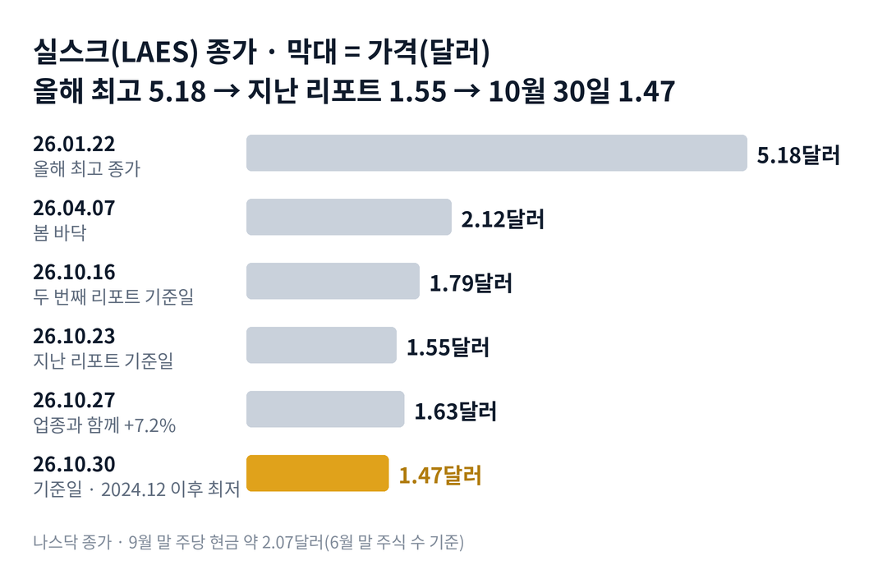

## 짧은 답

> **핵심:** 기다리던 보안 칩 시험 결과가 나온 주였지만, 주가는 회사 소식보다 양자 업종을 따라 움직였고, 업종과 함께 얻은 상승분을 지키지 못했습니다.

실스크의 10월 30일 종가는 1.47달러입니다. 2024년 12월 11일 이후 가장 낮은 종가이고, 이날 장중에는 1.42달러까지 내려갔습니다. 10월 27일 장 마감 뒤 회사는 첫 양자내성 보안 칩이 유럽 보안 시험의 기술 평가를 통과했다고 밝혔지만, 다음 날 주가는 0.6% 내렸습니다.

> **국면 정의(실스크 시리즈 공통):** 광풍 단계 — 양자 소식에 업종이 함께 10% 넘게 오르고 거래량이 평소의 5배를 넘는 때. 조달 단계 — 증자 설명서(424B)나 신주인수권 행사가 나오고 종가가 증자 가격 아래로 내려가는 때. 방치 단계 — 주가가 주당 현금보다 낮고, 회사 발표에도 반응이 작거나 반대인 때.

**지금 진단: 방치 단계가 이어지고 있습니다.** 근거는 5부에, 업종과 나란히 본 일주일은 2부 표에, 함께 오른 상승분을 바로 내준 뒤의 기록은 3부 표에 있습니다.

> **유의사항** 저자는 금융·투자 자문가가 아닙니다. 이 글은 공개 공시와 시세를 정리한 교육용 분석이며 특정 종목의 매수·매도를 권하지 않습니다. 과거 패턴은 미래 수익을 보장하지 않습니다. 실제 투자 전에는 최신 공시를 직접 확인하세요.

## 지난 리포트 이후

[지난 리포트](/r/laes-2026-10-3/)는 2026년 10월 23일 종가 1.55달러를 기준으로 나왔습니다. 그 리포트는 지금을 방치 단계로 보고, 보안 칩 시험 보고서와 그룹 회사로 나가는 돈을 지켜보자고 적었습니다. 지난 예측 성적은 적중 하나, 부분 적중 둘, 빗나감 없음, 진행 중 둘입니다.

| 지난 점검 항목 · 당시 기준 | 실제 결과(10월 30일) | 판정 |
| --- | --- | --- |
| 진단: 방치(심화) 주가가 주당 현금의 약 75% | 약 71%로 더 내려옴, 인증 발표에도 반등 없음 | 적중 |
| 시나리오 3 · 제품·인증 계기 QS7001 보안 시험 보고서 | 10.27 기술 평가 통과, 다음 날 -0.6% | 부분 적중(계기만) |
| 시나리오 4 · 그룹 거래 확대 위즈샛·퀀티시모 추가 자금 공시 | 위즈샛 위성 의향서 약 1,500만 달러, 첫 거래일은 업종과 함께 +7.2% | 부분 적중(약세는 아님) |
| 시나리오 1·2 · 서류가 증자로 이어지나 11월 중순까지 424B 여부 | 10.30까지 424B 없음 | 진행 중(11월 중순 판정) |
| 나 홀로 하락 뒤 20거래일 10.23 1.55달러 회복 여부 | 10.30 1.47달러(-5.2%) | 진행 중(11월 20일 판정) |

이번 회차가 새로 답하는 질문은 하나입니다. 양자주와 함께 크게 오른 상승분을 4거래일 만에 다 내준 뒤, 과거의 실스크는 20거래일 안에 어떻게 움직였을까요?

## 1부. 실스크는 어떤 회사인가

> **핵심:** 사물인터넷 기기용 보안 칩을 팔고 양자내성 보안 칩을 다음 주력으로 준비하는 회사로, 현금은 회사 전체 주식 가치보다 많습니다.

실스크(SEALSQ)는 스위스 제네바에 본사를 둔 보안 반도체 회사입니다. 2023년 5월 모회사 위즈키에서 떨어져 나와 나스닥에 상장했습니다. 모회사는 지금 위즈큐이(WISeQey)라는 이름을 씁니다. 같은 그룹에는 위성 회사 위즈샛이 있고, 세 회사의 최고경영자는 카를로스 모레이라 한 사람입니다.

회사는 1~9월 잠정 매출 1,630만 달러로 1년 전보다 65% 늘었다고 10월 15일 밝혔습니다. 2026년 매출 전망 2,700만~3,600만 달러도 그대로 두었습니다. 다만 손실이 매출보다 커서, 주가는 실적보다 현금의 쓰임새와 양자 업종의 분위기에 더 크게 움직여 왔습니다.

### 숫자로 본 지금의 크기(10월 30일 기준)

| 항목 | 값 · 근거 |
| --- | --- |
| 종가 | **1.47달러** 2024년 12월 11일 이후 최저 종가 |
| 9월 말 현금 | **약 4억 6,300만 달러** 10월 15일 잠정 발표, 부채 차감 전 |
| 주당 현금 | **약 2.07달러** 6월 말 주식 2억 2,343만 주 기준 |
| 시가총액 | **약 3억 2,800만 달러** 현금보다 약 1억 3,500만 달러 적음 |
| 올해 최고 종가 대비 | **-71.6%** 1월 22일 5.18달러 |
| 신주인수권(Class E) | **약 6,083만 주** 행사가 5.50달러 |

이 말은 곧 시장이 실스크의 현금을 액면 그대로 쳐 주지 않는다는 뜻입니다. 현금이 투자·그룹 거래로 나갈 수 있고, 증자로 주식 수가 늘 수 있다는 걱정이 가격에 들어가 있습니다.

위 그림처럼 4월 7일 2.12달러가 봄의 바닥이었습니다. 10월에 들어 그 아래로 내려왔고, 지난 리포트 뒤 일주일 동안 1.55달러에서 1.47달러로 한 번 더 내려왔습니다.

## 2부. 10월 26~30일, 공시 두 건과 업종

> **핵심:** 위성 의향서와 보안 칩 시험 통과가 같은 주에 나왔지만, 주가의 큰 움직임은 모두 양자주 전체가 같은 방향으로 움직인 날에 나왔습니다.

10월 26일 일요일, 회사는 위즈샛과 맺은 의향서를 공개했습니다. 위성 12기의 용량과 관제·지상국 서비스를 앞으로 18개월 동안 약 1,500만 달러에 사는 내용입니다. 회사는 이 거래를 특수관계자 거래라고 적었습니다. 정식 계약과 이사회 승인이 남아 있고, 성사도 보장되지 않았습니다.

이 돈이 그룹 회사로 가는 첫 돈은 아닙니다. 10월 초 실스크는 위즈샛 상장에 맞춰 주당 10.79달러에 92만 6,784주, 약 1,000만 달러를 투자했습니다. 위즈샛의 10월 30일 종가는 5.49달러로, 투자한 주식의 가치가 절반 가까이 줄었습니다. 이 투자에는 60일째 가격이 매입가보다 낮으면 주식을 더 받는 조항이 붙어 있습니다.

10월 27일 실스크는 7.2% 올라 1.63달러로 마감했습니다. 이날 아침 최고경영자가 뉴욕 양자 행사(IQT)에서 기조연설을 했지만, 새 실적 숫자는 없었습니다. 같은 날 양자주가 모두 올라, 아이온큐는 7.1%, 리게티는 8.7%, 아르킷은 10.7% 올랐습니다.

같은 날 장 마감 뒤 오후 5시 반쯤, 회사는 첫 양자내성 보안 칩 QS7001(회사 제품 이름)의 첫 버전(V1)이 프랑스 시험기관 SERMA(세르마, 보안 시험 전문 기관)에서 유럽 공통평가기준(EAL5+)의 기술 평가를 모두 통과했다고 밝혔습니다. 물리 공격·기능 보안 시험이 모두 합격이었습니다. 남은 단계는 2027년 1월 현장 감사와 두 번째 버전 평가, 그리고 2027년 목표인 프랑스 정보보호청(ANSSI)의 정식 인증입니다. 평가 중인 잠재 고객·협력사는 9월 말 42곳으로, 6월 말 30곳보다 늘었습니다.

첫 반응일인 10월 28일 실스크는 0.6% 내렸고, 아이온큐는 1.6% 내렸습니다. 29일에는 3.1%, 30일에는 6.4% 내렸습니다. 30일에는 양자주가 다시 함께 빠졌고(아이온큐 -5.3%, 아르킷 -10.6%), 실스크 거래량은 약 447만 주로 이 주 가장 많았습니다. 10월 27일에 얻은 7.2%는 30일 종가로 모두 사라졌습니다.

### 같은 일주일, 양자주 성적

| 종목 · 성격 | 10.23 → 10.30 | 10.27 하루 |
| --- | --- | --- |
| **실스크(LAES)** · 보안 반도체 | -5.2% | +7.2% |
| 디웨이브(QBTS) · 양자 어닐링 | -8.7% | +5.1% |
| 아르킷(ARQQ) · 양자 보안 | -4.1% | +10.7% |
| 아이온큐(IONQ) · 업종 대표 | -3.9% | +7.1% |
| 리게티(RGTI) · 초전도 양자 | -2.3% | +8.7% |

이 말은 곧 지난주처럼 실스크만 혼자 빠진 주는 아니었다는 뜻입니다. 업종과 함께 오르고 함께 내렸습니다. 그러나 시험 통과라는 회사 고유의 소식이 업종 위로 더한 상승분은 보이지 않았습니다.

## 3부. 함께 오른 상승분을 바로 내준 뒤의 기록

> **핵심:** 상장 뒤 아이온큐와 함께 하루 5% 넘게 오른 64번 가운데 4거래일째 상승분을 다 내준 것은 11번이었고, 그 뒤 20번째 거래일까지는 5번 오르고 6번 내렸습니다.

2023년 5월 상장부터 2026년 10월까지, 아이온큐와 실스크가 같은 날 함께 5% 넘게 오른 날을 모두 모았습니다. 이번 10월 27일을 빼면 64번입니다. 그중 53번은 4거래일째 종가가 오르기 전날 종가보다 높았습니다. 이번처럼 4거래일째에 상승분을 다 내준 경우는 11번이었습니다.

표의 '4거래일째'는 사건일을 첫날로 센 네 번째 거래일 종가를 사건 전날 종가와 비교한 값입니다. '20거래일째'는 사건일을 첫날로 센 20번째 거래일 종가를 4거래일째 종가와 비교한 값입니다.

### 4거래일째 상승분을 다 내준 11번, 그 뒤는?

| 이벤트일 · 그날 나온 내용 | 4거래일째 | 20거래일째 |
| --- | --- | --- |
| **2023.08.11** 아이온큐 +10.7%, 실스크 +7.5% | -11.1% | -42.7% |
| **2023.08.29** 아이온큐 +8.1%, 실스크 +7.0% | -3.6% | -62.8% |
| **2024.09.13** 아이온큐 +5.1%, 실스크 +8.4% | -3.0% | -18.1% |
| **2024.10.28** 아이온큐 +5.0%, 실스크 +5.8% | -5.3% | +19.4% |
| **2025.01.10** 아이온큐 +6.9%, 실스크 +8.6% | -13.6% | -11.6% |
| **2025.03.24** 아이온큐 +17.3%, 실스크 +6.0% | -4.4% | -21.4% |
| **2025.04.01** 아이온큐 +5.1%, 실스크 +5.0% | -9.6% | +9.8% |
| **2025.05.02** 아이온큐 +12.9%, 실스크 +15.3% | -6.0% | +43.2% |
| **2025.05.27** 아이온큐 +5.1%, 실스크 +5.2% | -3.7% | +14.3% |
| **2025.12.22** 아이온큐 +11.1%, 실스크 +5.2% | -4.5% | +15.7% |
| **2026.08.27** 아이온큐 +6.1%, 실스크 +5.2% | -3.6% | -2.9% |

이 말은 곧 바로 내준 뒤의 결과가 거의 반반이었다는 뜻입니다. 20거래일째 가운데 값(중앙값)은 -2.9%였습니다. 다만 크게 내린 세 번(-62.8%, -42.7%, -21.4%)은 2023년과 2025년 3월로, 상장 첫해나 업종이 식던 때였습니다. 2025년 4월 이후 다섯 번 가운데 네 번은 그 뒤 올랐습니다.

이번 10월 27일 상승의 4거래일째는 -3.3%였습니다. 20번째 거래일은 11월 23일입니다.

## 4부. 되풀이된 이야기

> **핵심:** 실스크의 주가는 회사 소식보다 업종과 현금의 쓰임새에 더 민감했고, 제품 소식은 숫자가 붙기 전까지 주가를 떠받치지 못했습니다.

첫째, 업종과의 연결입니다. 이번 주 큰 움직임 두 번(10월 27일, 30일)은 모두 양자주 전체가 같은 방향이던 날이었습니다. 지난 리포트의 '나 홀로 하락'과 달리, 이번에는 업종이 주가의 방향을 정했습니다.

둘째, 제품 소식의 힘입니다. 10월 15일 9개월 매출 65% 증가 발표 다음 날에도, 10월 27일 시험 통과 발표 다음 날에도 주가는 내렸습니다. 시험 통과는 인증으로 가는 중간 단계이고, 실제 주문 금액은 아직 나오지 않았습니다.

셋째, 그룹 거래입니다. 지난 리포트들이 모은 그룹·투자 발표 날(2026년 6월 5일 -12.3%, 10월 9일 -6.2%)은 약했습니다. 이번 위성 의향서는 첫 거래일이 업종 상승과 겹쳐 그 패턴이 드러나지 않았습니다. 그래도 10월에 그룹 회사와 관련해 나온 금액은 약 2,500만 달러(집행된 투자 약 1,000만 달러와 아직 확정되지 않은 의향서 약 1,500만 달러)입니다.

## 5부. 지금 어느 단계이고, 무엇을 볼까

> **핵심:** 주가가 주당 현금 아래로 더 내려온 방치 단계이고, 11월의 박람회·증자 서류·위성 계약이 다음 국면을 가를 것입니다.

**2026년 10월 30일 진단: 방치 단계의 연장.** 근거는 세 가지입니다. 주가는 주당 현금의 약 71%로 지난 리포트의 약 75%보다 더 내려왔습니다. 보안 칩 시험 통과 다음 날 반응이 업종과 비슷했습니다. 거래량은 하루 약 353만~447만 주로 평소 수준이라, 광풍 단계의 신호(평소의 5배)는 없었습니다. 조달 단계의 첫 신호인 424B도 10월 30일까지 나오지 않았습니다.

### 앞으로 일어날 수 있는 일

과거 기록부터 보겠습니다. 함께 오른 상승분을 4거래일째에 다 내준 경우는 64번 중 11번이었고, 그 11번 중 5번은 20거래일째에 더 높았고 6번은 더 낮았습니다. 아래 가능성은 이 빈도와 지금 신호를 함께 본 추정입니다.

| 시나리오 · 예상 반응(판정 11월 30일) | 업종·무증자 | 가능성(추정) |
| --- | --- | --- |
| 1 · 업종을 따라 회복한다 11월 27일 종가 1.63달러 위 | ○ / ○ | 중간 (25~35%) |
| 2 · 업종은 오르지만 판매가 누른다 반등이 짧고 1.55달러 근처 | ○ / × | 낮음 (10~20%) |
| **3 · 현금 아래에서 머문다** 1.42~1.63달러 사이 | × / ○ | 높음 (35~45%) |
| 4 · 새 최저로 간다 1.42달러 아래 종가 | × / × | 중간 (15~25%) |

표의 '업종'은 11월 27일 아이온큐 종가가 10월 30일 종가 30.04달러보다 높은 경우(업종 반등), '무증자'는 11월 30일까지 424B 같은 증자 설명서가 나오지 않는 경우입니다. 11월 27일은 11월 30일 판정 직전의 마지막 거래일입니다.

시나리오 3을 가장 높게 본 이유는 두 가지입니다. 10월 30일까지 증자 설명서가 없었고, 바로 내준 11번의 가운데 값이 -2.9%로 크게 움직이지 않는 쪽이었습니다. 1.42달러는 10월 30일 장중 저점입니다.

시나리오 1의 근거는 2025년 4월 이후의 기록입니다. 바로 내준 다섯 번 가운데 네 번은 20거래일째에 더 높았고, 모두 양자주가 다시 오르던 때였습니다. 11월 10~13일 뮌헨 전자 박람회(electronica)에서 회사는 차세대 보안 칩 VaultIC409와 양자내성 모듈 QVault TPM(신뢰 플랫폼 모듈, 기기 안의 보안 부품) 등을 보여 주고, 13일 기조연설을 합니다.

## 6부. 조심할 점과 체크리스트

> **핵심:** 기록표는 11번의 작은 표본이고, 9월 말 주식 수와 3분기 정식 숫자는 아직 공개되지 않았습니다.

3부 표는 '바로 내주면 반드시 내린다'는 규칙이 아닙니다. 11번은 작은 표본이고, 상장 첫해와 지금은 현금·주식 수가 전혀 다릅니다. 주당 현금은 6월 말 주식 수로 계산했고, 9월 말 주식 수는 아직 공개되지 않았습니다. 현금 4억 6,300만 달러는 잠정치이며 부채와 투자 약정을 빼지 않은 총액입니다.

10월 30일 양자주가 함께 빠진 이유를 다룬 기사는 확인하지 못했습니다. 위성 의향서의 지급 조건과 일정은 정식 계약에서 정해집니다.

- ☐ 11월 30일까지 424B 같은 증자 설명서가 나오는가
- ☐ 11월 30일까지 위성 의향서가 정식 계약이 되고 금액이 1,500만 달러 그대로인가
- ☐ 11월 13일 박람회 기조연설에서 고객 이름이나 주문 금액이 나오는가
- ☐ 11월 20일(지난 리포트의 나 홀로 하락 20거래일째) 종가가 1.55달러 위인가
- ☐ 11월 23일(10월 27일 상승의 20거래일째) 종가가 1.47달러 위인가
- ☐ 11월 30일까지 1.42달러 아래 종가가 나오는가

다음 갱신은 11월 박람회와 증자 서류 여부를 본 뒤에 합니다.
