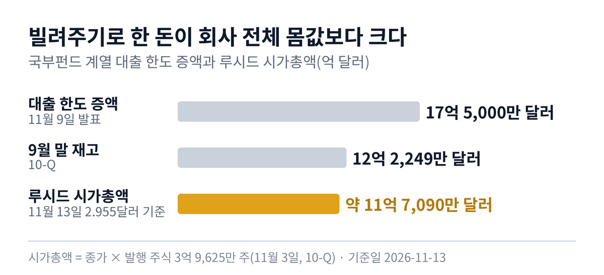
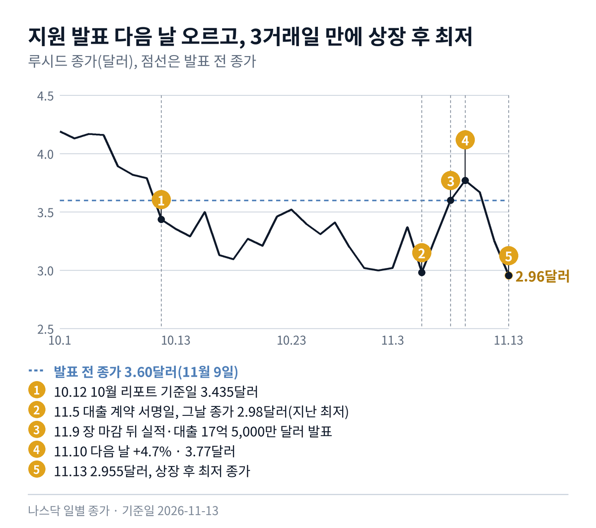
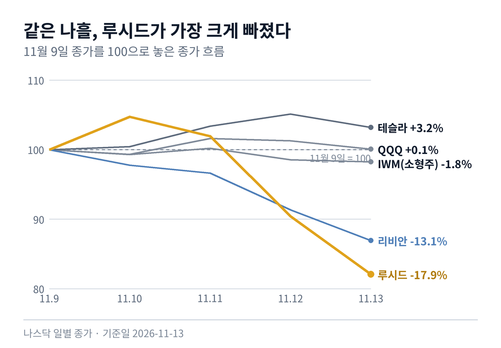
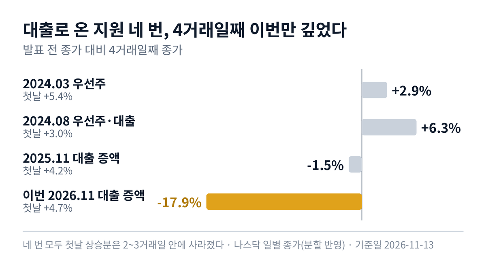
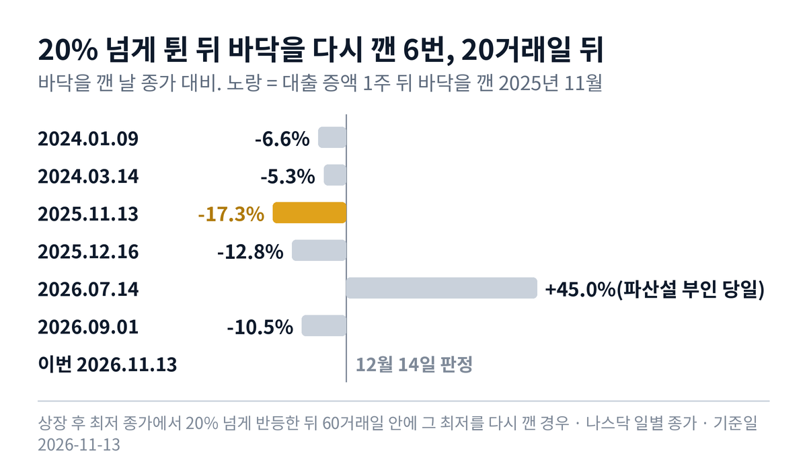
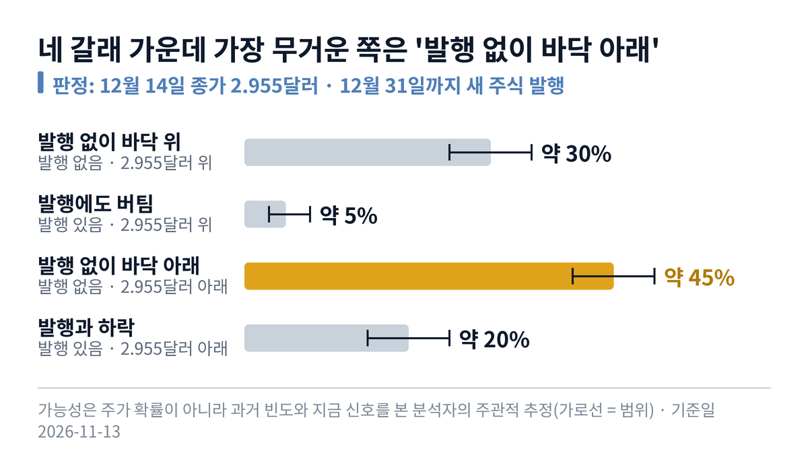

사우디 국부펀드 계열이 루시드에 빌려주기로 한 돈을 17억 5,000만 달러 더 늘렸습니다. 발표 다음 날 주가는 4.7% 올랐습니다. 그런데 그 뒤 3거래일 동안 21.6% 내려, 11월 13일 2.955달러로 상장 후 가장 낮은 종가를 찍었습니다. 아직 다 빌린 돈은 아니지만, 늘어난 한도만으로도 회사 전체 몸값보다 큽니다. 든든한 최대주주가 돈을 더 열어 줬는데, 주가는 왜 바닥을 뚫었을까요?

> **유의사항** 저자는 금융·투자 자문가가 아닙니다. 이 글은 공개 공시와 시세를 정리한 교육용 분석이며 특정 종목의 매수·매도를 권하지 않습니다. 과거 패턴은 미래 수익을 보장하지 않고, 루시드 그룹은 상장 후 최고가 대비 99% 넘게 내린 변동성이 매우 큰 종목입니다. 실제 투자 전에는 최신 공시를 직접 확인하세요.

이 글은 [11월 10일 리포트](/r/lcid-2026-11/)를 잇는 후속편입니다. 그 리포트는 발표 전 종가 3.60달러를 기준선으로 잡았습니다. 그리고 첫날 반응과 한 달 뒤 종가로 앞날을 나눴습니다. 4거래일이 지난 지금 지난 예측 성적은 적중 하나, 빗나감 없음, 진행 중 셋입니다.

맞은 것은 첫날입니다. 과거 대출이나 우선주로 온 지원 세 번은 첫날 모두 올랐고, 이번에도 11월 10일 3.77달러로 4.7% 올랐습니다. 지난 리포트는 12월 8일 종가가 3.60달러 아래일 가능성을 약 70%로 봤습니다. 지금 주가는 그보다 17.9% 낮지만, 판정은 12월 8일입니다.

하나는 바로잡습니다. 지난 리포트는 12월 15일 만기 전환사채를 회사가 현금이나 주식으로 갚을 수 있다고 적었습니다. 10-Q에 따르면 회사가 현금·주식을 고르는 것은 투자자가 전환을 청구했을 때입니다. 전환 가격이 한 주에 약 547.80달러라 지금 주가로는 청구 가능성이 낮습니다. 전환되지 않은 원금 2억 430만 달러는 만기에 갚아야 하므로, 현금 상환 가능성이 높다고 봅니다.

루시드가 어떤 회사인지 짧게 짚겠습니다. 돈을 버는 방식은 차를 만들어 파는 것입니다. 미국 애리조나 공장에서 고급 전기 세단 '에어'와 스포츠유틸리티차 '그래비티'를 만듭니다. 최대주주는 사우디아라비아 국부펀드(PIF)의 계열사 아야르입니다. 문제는 차를 팔수록 손실이 난다는 점입니다. 3분기 매출은 3억 5,032만 달러였는데, 매출원가는 그보다 2억 5,830만 달러 많았습니다.

손실을 메울 돈은 9월 말 현금 9억 4,850만 달러만으로는 모자라, 회사는 차입금으로 버팁니다. 이번에 늘어난 것은 필요할 때 나눠 꺼내 쓰는 대출의 한도입니다. 빌려주는 쪽은 최대주주 계열 아야르 한 곳입니다. 10-Q를 보면 한도를 늘린 계약서는 11월 5일에 서명됐습니다. 그날 주가는 2.98달러로, 당시 상장 후 가장 낮은 종가였습니다.

사건은 그 바닥에서 시작됩니다. 서명 다음 두 거래일 동안 주가는 20.8% 올라 3.60달러가 됐습니다. 그 사이 회사가 낸 8-K는 없었습니다. 11월 9일 장 마감 뒤에야 3분기 실적과 함께 대출 한도 증액이 발표됐습니다. 이 증액으로 대출 잔액과 남은 한도를 합한 규모는 약 42억 3,000만 달러가 됐습니다. 회사는 이 돈으로 2027년 4분기까지 운영할 수 있다고 밝혔습니다.

다음 날 주가는 3.77달러로 올랐습니다. 하지만 11월 11일 3.67달러, 12일 3.255달러, 13일 2.955달러로 3거래일 내리 내렸습니다. 11월 13일 거래량은 약 2,064만 주로, 전날의 1.7배였습니다. 그 3거래일 동안 회사가 낸 서류는 새 최고회계책임자의 취임과 주식 보상 신고뿐이었습니다. 하락 이유를 밝힌 보도도 찾지 못했습니다.

업종을 함께 보면 그림이 조금 보입니다. 11월 10일 종가 대비 13일까지 리비안도 11.1% 내렸습니다. 반면 테슬라는 2.7% 올랐고, 나스닥 100 펀드(QQQ)는 0.8% 올랐습니다. 소형주 펀드(IWM)는 1.1% 내렸습니다. 적자를 내는 전기차 회사들이 함께 약했고, 루시드는 그 가운데서도 두 배 가까이 더 빠졌습니다.

그렇다면 국부펀드의 돈은 왜 주가를 받치지 못했을까요? 공시가 답을 직접 주지는 않습니다. 다만 숫자로 보면 시장이 반영했을 법한 점이 셋 있습니다.

이번 돈의 형태부터 보겠습니다. 이번 돈은 주식이 아니라 차입금입니다. 3분기 이자 비용은 6,987만 달러였고, 그중 4,500만 달러가 최대주주 계열에 낸 이자였습니다. 한도를 늘리는 데 든 비용만 2,630만 달러입니다. 주식을 새로 찍지 않아 지분이 바로 줄지는 않습니다. 대신 회사가 갚아야 할 돈이 보통주 주주보다 앞줄에 쌓입니다.

그런데 그 앞줄이 이미 깁니다. 우선주는 보통주보다 먼저 돈을 돌려받는 주식으로, 루시드의 시리즈 A·B 우선주는 최대주주 계열이 갖고 있습니다. 회사가 정리될 때 이 우선주가 먼저 돌려받는 금액은 9월 말 약 26억 1,280만 달러였습니다. 11월 13일 시가총액 약 11억 7,090만 달러의 두 배가 넘습니다. 시가총액은 다시 9월 말 재고 12억 2,249만 달러보다 작아졌습니다. 지난 리포트가 '재고보다 싼 모순이 뒤집혔다'고 쓴 지 4거래일 만에, 모순이 다시 돌아왔습니다.

시점도 나빴습니다. 발표 전에 이미 올라 있었습니다. 서명일 2.98달러에서 발표 전까지 20.8% 오른 상태였습니다. 기대가 먼저 가격에 들어갔다면, 발표 뒤에는 새로 살 이유가 줄어듭니다.

과거 기록과 나란히 놓으면 이번이 얼마나 다른지 보입니다. 대출이나 우선주로 온 지원은 2024년 3월, 2024년 8월, 2025년 11월에도 있었습니다. 세 번 모두 첫날 올랐고, 첫날 상승분은 2~3거래일 안에 사라졌습니다. 여기까지는 이번과 같습니다. 그러나 4거래일째 발표 전 종가보다 2% 넘게 낮았던 적은 한 번도 없었습니다. 이번은 17.9% 낮습니다.

공교롭게도 -17.9%는 지난 리포트의 숫자와 같습니다. 국부펀드 지원 7번 뒤 20거래일째 수익률의 가운데 값(중앙값)이 -17.9%였습니다. 과거라면 한 달에 걸쳐 내려간 폭을 이번에는 4거래일 만에 내려간 셈입니다.

이제 숨은 기록으로 가 보겠습니다. 이번 장면의 모양은 '바닥에서 크게 튄 뒤 그 바닥을 다시 깬 것'입니다. 11월 5일 2.98달러에서 3.77달러까지 26.5% 튀었다가, 6거래일 만에 그 아래로 내려왔습니다. 그래서 같은 모양을 과거에서 찾았습니다.

기준은 이렇습니다. 상장 후 최저 종가에서 20% 넘게 반등한 뒤 60거래일 안에 그 최저를 다시 깬 날입니다. 그리고 바닥을 깬 날 종가와 20거래일 뒤 종가를 비교했습니다.

2024년 이후 이 기준에 맞는 경우는 6번이었습니다. 그중 5번은 20거래일 뒤 바닥을 깬 날보다 낮았고, 하락 폭은 5.3%에서 17.3% 사이였습니다. 표본이 작아 앞날을 단정하긴 이르지만, 기록의 방향은 아래쪽이었습니다.

지금과 가장 닮은 예는 정확히 1년 전입니다. 2025년 11월 회사는 국부펀드 계열 대출 한도를 약 20억 달러로 늘렸다고 밝혔습니다. 첫 거래일인 11월 6일 주가는 4.2% 올랐습니다. 그러나 일주일 뒤인 11월 13일, 주가는 15.17달러로 당시 상장 후 최저 종가를 깼습니다(분할 반영 가격). 그로부터 20거래일 뒤 종가는 그날보다 17.3% 낮았습니다.

예외 한 번도 들여다볼 만합니다. 2026년 7월 14일 주가는 파산 검토설이 돌며 16.2% 내렸고, 거래량은 약 1억 5,580만 주였습니다. 회사는 그날 장중에 8-K를 내 소문이 '완전히 거짓'이라고 밝혔습니다. 7월 14일 종가 대비 5거래일 뒤 58.4% 높았고, 20거래일 뒤에도 45.0% 높았습니다. 바닥을 깬 이유가 회사가 바로 반박할 수 있는 소문이었던 경우입니다.

이번은 그 예외와 다릅니다. 반박할 소문이 없고, 이미 발표된 지원이 주가를 받치지 못했습니다. 대신 2025년 11월과는 닮은 점이 둘 더 있습니다. 둘 다 대출 한도 증액 뒤 1~2주 안에 바닥을 깼고, 첫날 반응도 +4.2%와 +4.7%로 비슷했습니다. 다만 6번은 작은 표본이고, 그 사이 주가는 30달러대에서 3달러 아래로 바뀌었습니다. 기록은 결론이 아니라 방향을 가늠하는 단서입니다.

지금 위치를 정리하겠습니다. 11월 13일 종가 2.955달러는 상장 후 최저 종가이고, 발표 전 종가보다 17.9% 낮습니다. 당장 돈이 모자란 회사는 아닙니다. 9월 말 현금과 투자 자산에 남은 대출 한도를 더하면, 12월 15일에 갚을 전환사채 원금의 열 배가 넘습니다. 자세한 숫자는 끝의 '돈과 주식으로 본 지금' 표에 있습니다.

앞날은 두 질문으로 나눴습니다. 하나는 12월 14일 종가가 바닥 2.955달러 위인가입니다. 12월 14일은 바닥을 깬 11월 13일에서 20거래일째 되는 날입니다. 다른 하나는 12월 31일까지 새 주식이 나오는가입니다. 새 주식 판매, 전환사채의 주식 상환, 새 주식 매입 약정 가운데 하나가 발표되면 '발행 있음'으로 봅니다. 두 질문의 답이 각각 둘로 갈리니, 네 갈래가 나옵니다.

'발행 없이 바닥 아래'를 가장 무겁게 본 이유는 둘입니다. 같은 모양 6번 중 5번이 20거래일 뒤 더 낮았고, 가장 닮은 1년 전 대출 증액 뒤에도 그랬습니다. 기록의 비율을 그대로 옮기지 않고, 표본이 작고 발행 여부로 다시 나뉘는 점을 감안해 낮췄습니다. '발행 없이 바닥 위'는 그다음으로 봤습니다. 업종 전체가 반등하면 바닥 근처에서 버틸 수 있습니다. 발행이 있는 두 갈래는 합쳐 약 25%로 낮게 봤습니다. 남은 대출 한도가 넉넉해 새 주식을 서둘러 찍을 필요가 크지 않기 때문입니다. 갈래별 숫자는 끝의 시나리오 표에 있습니다. 이 숫자들은 주가가 오를 확률이 아니라 과거 빈도와 지금 신호를 보고 분석자가 주관적으로 매긴 추정입니다.

위험은 세 갈래로 봅니다. 먼저 분석의 한계입니다. 바닥을 다시 깬 기록은 6번뿐이고, 이번 3거래일 하락의 이유는 공시로도 보도로도 확인하지 못했습니다. 다음은 자금 조달입니다. 대출과 우선주는 보통주보다 앞줄에 쌓입니다. 주가가 낮을수록 새 주식으로 돈을 마련하려면 더 많은 주식이 필요합니다. 마지막은 사업 실행입니다. 회사는 중형 신차 생산을 2027년 하반기로 잡았고, 공개 날짜는 2027년 1분기에 밝히기로 했습니다. 그 사이에는 원가를 매출 아래로 끌어내리는 것만이 손실을 줄일 방법입니다.

새 대출 한도는 2027년 4분기까지 쓸 돈을 마련해 줬지만, 11월 13일 종가는 발표 전 종가 아래에 있습니다. 앞줄에 쌓인 차입금과 우선주, 발표 전에 먼저 오른 가격, 약한 전기차 업종이 함께 겹쳤습니다. 다음 갱신은 12월 8일과 12월 14일 종가, 12월 15일 전환사채 상환을 본 뒤에 하고, 그 전에 새 자금 조달 소식이 나오면 앞당깁니다.

## 숫자로 다시 보기

### 발표 전후 4거래일

| 날짜 · 장면 | 루시드 종가 | 발표 전 종가 대비 |
| --- | --- | --- |
| 11.05 대출 계약 서명일 | 2.98달러 | -17.2% |
| **11.09 장 마감 뒤 발표** | **3.60달러** | 기준 |
| 11.10 다음 날 | 3.77달러 | +4.7% |
| 11.11 | 3.67달러 | +1.9% |
| 11.12 | 3.255달러 | -9.6% |
| **11.13 상장 후 최저 종가** | **2.955달러** | **-17.9%** |

같은 11월 10일~13일 3거래일 변화는 루시드 -21.6%, 리비안 -11.1%, 테슬라 +2.7%, QQQ +0.8%, IWM -1.1%였습니다.

### 돈과 주식으로 본 지금(11월 13일 기준)

| 항목 | 값 · 근거 |
| --- | --- |
| 시가총액 | **약 11억 7,090만 달러** 2.955달러 × 3억 9,625만 주(11월 3일) |
| 대출 한도 증액 | **17억 5,000만 달러** 증액 비용 2,630만 달러 |
| 대출 이용 가능액 | **약 21억 3,000만 달러** 10-Q 제출일 기준 |
| 현금과 투자 자산 | **9억 4,850만 달러** 9월 30일 |
| 우선주 청산 우선권 | **약 26억 1,280만 달러** 시리즈 A·B, 9월 30일 |
| 2026년 전환사채 | **2억 430만 달러** 12월 15일 만기, 전환 가격 약 547.80달러 |

### 대출·우선주로 온 지원 네 번

| 발표 · 형태 | 첫날 | 4거래일째 |
| --- | --- | --- |
| 2024.03 전환우선주 10억 달러 | +5.4% | +2.9% |
| 2024.08 우선주·대출 각 7억 5,000만 달러 | +3.0% | +6.3% |
| 2025.11 대출 한도 약 20억 달러로 | +4.2% | -1.5% |
| **이번 2026.11 대출 한도 +17억 5,000만 달러** | **+4.7%** | **-17.9%** |

두 열 모두 발표 전 종가와 비교했습니다. 네 번 모두 첫날 상승분은 2~3거래일 안에 사라졌습니다.

### 20% 넘게 튄 뒤 바닥을 다시 깬 6번 기록표

상장 후 최저 종가에서 20% 넘게 반등한 뒤 60거래일 안에 그 최저를 다시 깬 경우입니다. 두 열은 바닥을 깬 날 종가와 비교했습니다(분할 반영 가격).

| 바닥을 깬 날 · 직전 반등 | 5거래일 뒤 | 20거래일 뒤 |
| --- | --- | --- |
| 2024.01.09 +36.9% | -23.2% | -6.6% |
| 2024.03.14 +40.0% | +8.7% | -5.3% |
| **2025.11.13 +53.3%** | **-22.7%** | **-17.3%** |
| 2025.12.16 +20.7% | +1.0% | -12.8% |
| 2026.07.14 +42.3% | +58.4% | +45.0% |
| 2026.09.01 +75.8% | -6.2% | -10.5% |
| **이번 2026.11.13 +26.5%** | 11월 20일 | 12월 14일 판정 |

굵게 쓴 2025년 11월은 대출 한도 증액 일주일 뒤 바닥을 깬 경우입니다. 2026년 7월 14일은 회사가 파산설을 부인한 날입니다.

### 지난 예측 채점표

| 지난 점검 항목 · 당시 기준 | 판정과 실제 결과(11월 13일) |
| --- | --- |
| **첫날 종가가 3.60달러 위** 대출·우선주 지원 3번 첫날 모두 상승 | **[적중]** 11월 10일 3.77달러(+4.7%) |
| **12월 8일 3.60달러 아래 약 70%** 지원 7번 중 6번 한 달 뒤 하락 | **[진행 중]** 지금 2.955달러 |
| **가장 무겁게 본 갈래(약 45%)** 발행 없음 · 3.60달러 아래 | **[진행 중]** 발행 없음, 3.60달러 아래 |
| **12월 15일 전환사채 현금 상환** 원금 2억 430만 달러 | **[진행 중]** 전환 가격 약 547.80달러로 정정 |

### 앞으로 일어날 수 있는 일

아래 가능성은 분석자가 과거 빈도와 지금 신호를 보고 주관적으로 매긴 추정이며, 주가가 오를 확률이 아닙니다. 네 갈래는 겹치지 않아 더하면 100%입니다.

| 갈래(판정 12월 14일·31일) | 판정 조건 | 가능성(추정) |
| --- | --- | --- |
| 1 · 발행 없이 바닥 위 | 발행 없음 · 2.955달러 위 | 중간 약 30% (25~35%) |
| 2 · 발행에도 버팀 | 발행 있음 · 2.955달러 위 | 낮음 약 5% (3~8%) |
| **3 · 발행 없이 바닥 아래** | 발행 없음 · 2.955달러 아래 | 높음 약 45% (40~50%) |
| 4 · 발행과 하락 | 발행 있음 · 2.955달러 아래 | 낮음 약 20% (15~25%) |

'발행 있음'은 12월 31일까지 새 주식 판매, 전환사채의 주식 상환, 새 주식 매입 약정 가운데 하나가 발표되는 경우입니다. 종가 기준은 12월 14일입니다.

### 핵심 확인 세 가지

| 순위 · 확인할 것 | 판정 날짜 |
| --- | --- |
| **1순위** 종가가 바닥 2.955달러 위인가 | 12월 14일 |
| **2순위** 종가가 발표 전 3.60달러 위인가(지난 리포트 판정) | 12월 8일 |
| **3순위** 전환사채를 현금으로 갚았는가 새 주식 발행이 없는가 | 12월 15일 12월 31일 |
