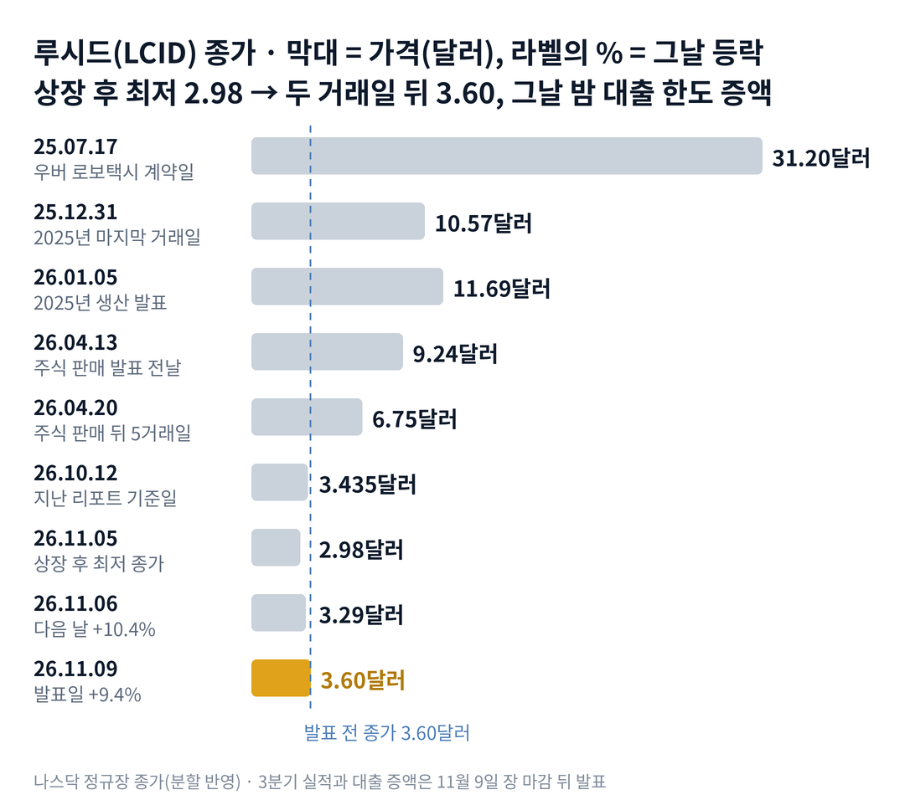

## 짧은 답

상장 후 가장 낮은 종가를 찍은 지 두 거래일 만에, 루시드 주가는 20.8% 올랐습니다. 그날 장 마감 뒤 사우디 국부펀드는 대출 한도를 17억 5,000만 달러 늘렸습니다. 그런데 왜 과거의 국부펀드 지원은 한 달 뒤 주가를 지키지 못했을까요?

결론부터 말하면, 지원은 시간을 벌어 줬지만 손실을 멈추지는 못했습니다. 회사는 이 돈으로 2027년 4분기까지 버틸 수 있다고 밝혔습니다. 하지만 차 한 대를 팔 때마다 받은 돈보다 많은 원가가 드는 구조는 그대로입니다.

과거 기록도 같은 방향입니다. 국부펀드가 새 돈을 넣은 발표 7번 가운데 6번은 20거래일 뒤 주가가 발표 전보다 낮았습니다. 대출로 온 이번이 어느 쪽에 가까운지는 3부 기록표와 4부 비교에 정리했습니다.

> **지금 국면:** 축소와 연명 국면(생산을 줄이며 지원으로 버티는 때)이 이어지고 있습니다. 근거는 생산이 인도보다 적었던 3분기와 대출 한도 증액입니다. 판정 근거는 5부에 있습니다.

> **유의사항** 저자는 금융·투자 자문가가 아닙니다. 이 글은 공개 공시와 시세를 정리한 교육용 분석이며 특정 종목의 매수·매도를 권하지 않습니다. 과거의 주가 반응이 미래에 반복된다는 보장은 없고, 루시드 그룹은 상장 후 최고가 대비 99% 넘게 내린 변동성이 매우 큰 종목입니다. 실제 투자 전에는 최신 가격과 공시를 직접 확인하세요.

## 지난 리포트 이후

[10월 13일 리포트](/r/lcid-2026-10/)는 루시드를 '축소와 연명' 국면으로 진단했습니다. 지난 예측 성적: 5개 중 적중 2 · 부분 적중 1 · 빗나감 1 · 확인 전 1입니다. 국면 진단과 '국부펀드 추가 지원'은 맞았고, '지원 지연'은 빗나갔습니다. 주가는 지난 기준일보다 더 내렸다가 발표 직전 되돌아왔습니다. 항목별 채점은 6부 끝 채점표에 있습니다.

## 1부. 루시드는 어떤 회사이고, 3분기에 무엇이 바뀌었나

> **핵심:** 루시드는 생산을 줄여 재고를 팔고 원가를 낮췄지만, 차 한 대를 팔 때마다 여전히 받은 돈보다 많은 원가가 듭니다.

루시드 그룹은 미국 캘리포니아주 뉴어크에 본사를 둔 고급 전기차 회사입니다. 애리조나주 공장에서 세단 '에어'와 스포츠유틸리티차 '그래비티'를 만듭니다. 최대주주는 사우디아라비아 국부펀드(PIF)의 계열사 아야르입니다.

돈을 버는 방식은 단순합니다. 차를 만들어 팔고, 우버 같은 협력사와 로보택시용 차를 함께 개발합니다. 3분기 매출 가운데 약 7,943만 달러는 특수관계자(최대주주 계열 등)에게서 나왔습니다.

이번 분기 회사는 만든 차보다 많은 차를 넘겼습니다. 생산은 2,954대, 인도는 3,806대였습니다. 쌓아 둔 재고를 먼저 팔았다는 뜻입니다. 그 결과 재고는 6월 말보다 11.3% 줄었습니다.

지금 몸값은 시가총액(주가 × 주식 수) 약 14억 2,650만 달러입니다. 9월 말 재고보다 약간 큰 수준입니다. 회사가 정리될 때 보통주보다 먼저 돌려받는 우선주 금액은 이보다 큽니다(5부).

### 숫자로 본 지금의 크기(11월 9일 기준)

| 항목 | 값 · 근거 |
| --- | --- |
| 종가 | **3.60달러** 11월 9일, 11월 5일 상장 후 최저 종가 2.98달러 |
| 3분기 매출 | **3억 5,032만 달러** 1년 전 3억 3,658만 달러보다 4% 증가 |
| 3분기 인도·생산 | **3,806대 · 2,954대** 생산보다 인도가 852대 많음 |
| 매출원가 | **6억 862만 달러** 매출보다 2억 5,830만 달러 많음 |
| 현금 소비(잉여현금흐름) | **-10억 3,971만 달러** 전 분기보다 30% 감소 |
| 재고 | **12억 2,249만 달러** 6월 말 13억 7,870만 달러에서 11.3% 감소 |
| 자본총계 | **-20억 9,500만 달러** 6월 말 -10억 5,800만 달러 |

※ 현금 소비는 영업현금흐름에 설비 투자를 더한 회사 기준 값입니다.

이 표에서 가장 중요한 칸은 매출원가입니다. 매출원가가 매출보다 약 2억 5,830만 달러 많았습니다. 이 말은 곧, 원가를 낮췄어도 차를 팔수록 손실이 나는 구조라는 뜻입니다.

차 한 대로 단순하게 나누면, 한 대당 원가는 약 15만 9,900달러로 2분기의 약 21만 500달러보다 크게 내려왔습니다. 하지만 한 대당 매출은 약 9만 2,000달러였습니다. 원가가 내려온 데에는 재고 평가손실(팔 수 없게 된 재고의 가치를 깎은 금액)이 줄어든 영향이 큽니다. 그렇다면 이 숫자가 나오기 전, 주가는 왜 먼저 움직였을까요?

## 2부. 사상 최저에서 두 거래일 20.8%, 그리고 장 마감 뒤의 지원

> **핵심:** 주가는 공시가 없던 두 거래일에 20.8% 올랐고, 실적과 지원 소식은 그 뒤 장 마감 뒤에야 나왔습니다.

첫 번째 장면은 상장 후 최저가입니다. 지난 기준일 10월 12일 3.435달러였던 주가는 11월 5일 2.98달러까지 내렸습니다. 2021년 상장 뒤 가장 낮은 종가로, 지난 기준일보다 13.2% 낮습니다. 그날 최고경영자 실비오 나폴리와 최고재무책임자 알렉산더 드 보크는 회사에서 주식 보상을 받았다고 신고했습니다. 받은 주식은 각각 약 60만 주와 약 84만 주입니다.

두 번째 장면은 공시 없는 반등입니다. 11월 6일 주가는 10.4% 올라 3.29달러로 마쳤습니다. 11월 9일에는 9.4% 더 올라 3.60달러가 됐습니다. SEC 공시 목록을 보면 이 두 거래일에 회사가 낸 8-K(주요 사건 보고서)는 없었습니다. 반등의 이유를 회사 발표로 설명할 수 없다는 뜻입니다.

세 번째 장면은 장 마감 뒤의 실적과 지원입니다. 11월 9일 오후 4시 8분(미국 동부시간) 회사는 3분기 실적을 냈습니다. 같은 자료에서 국부펀드 계열 대출(DDTL, 정해진 한도 안에서 나눠 빌리는 대출) 한도를 17억 5,000만 달러 늘렸다고 밝혔습니다.

이 증액으로 9월 말 약 20억 달러였던 유동성은 약 37억 5,000만 달러가 됩니다. 회사는 이 돈으로 2027년 4분기까지 운영과 핵심 투자를 이어 갈 수 있다고 밝혔습니다. 중형 신차 생산이 시작될 때까지 다리를 놓은 셈입니다.

세 장면을 나란히 놓으면 공통점이 하나 보입니다. 주가가 회사 발표보다 먼저 움직였다는 점입니다.

대신 지원과 함께 부채의 무게는 커졌습니다. 3분기 이자 비용은 6,987만 달러입니다. 1년 전의 2.7배입니다. 국부펀드 대출과 남은 한도를 더한 합계는 약 42억 3,000만 달러가 됐습니다. 그렇다면 과거 국부펀드의 돈이 들어온 뒤 주가는 어떻게 움직였을까요?

## 3부. 국부펀드 돈이 들어온 일곱 번

> **핵심:** 국부펀드가 새 돈을 넣은 발표 7번 가운데 6번은 20거래일 뒤 주가가 발표 전 종가보다 낮았습니다.

이 기록을 보는 이유는 이번 소식이 '국부펀드의 새 돈'이기 때문입니다. 2022년 11월부터 2026년 4월까지 국부펀드 계열이 주식·우선주·대출로 새 돈을 약속한 8-K를 모두 골랐습니다. 장 마감 뒤 발표는 다음 거래일을 첫날로 셉니다.

표는 세 질문에 답합니다. 첫 칸은 무엇이 나왔나, 둘째 칸은 첫날 얼마나 움직였나, 셋째 칸은 20거래일 뒤 발표 전 종가와 비교해 어땠나입니다. 20거래일은 첫날을 1일로 센 20번째 거래일 종가입니다.

예를 들어 2024년 10월 16일 장 마감 뒤 발표는 다음 날인 10월 17일이 첫날입니다. 발표 전 종가 32.80달러가 첫날 26.90달러가 됐습니다(분할 반영 가격). 2026년 4월 14일에는 첫날 4.8% 내린 뒤, 5거래일째 26.9% 낮아졌습니다.

**한눈에:** 7번 중 6번은 20거래일 뒤 발표 전 종가 아래 · 가운데 값(중앙값) -17.9%. 지원이 와도 한 달 뒤에는 더 낮은 경우가 많았다는 뜻입니다.

### 국부펀드 지원 발표 7번, 20거래일 뒤는?

| 이벤트일 · 공시 내용 | 당일 | 20거래일 뒤 |
| --- | --- | --- |
| **2022.11.09** 국부펀드 계열 주식 매입 약정 새 주식 | **-17.0%** | -36.2% |
| **2023.06.01** 약 18억 달러 주식 매입 새 주식 | **-16.2%** | -11.3% |
| **2024.03.25** 전환우선주 10억 달러 우선주 | **+5.4%** | -14.1% |
| **2024.08.06** 우선주 7억 5,000만 달러 대출 한도 7억 5,000만 달러 | **+3.0%** | +27.3% |
| **2024.10.17** 약 9억 7,100만 달러 주식 매입 · 새 주식 | **-18.0%** | -33.5% |
| **2025.11.06** 대출 한도 약 20억 달러로 증액 대출 | **+4.2%** | -17.9% |
| **2026.04.14** 우선주 5억 5,000만 달러 할인 주식 판매 동반 | **-4.8%** | -34.7% |

※ 2023년 6월은 5월 31일 장 마감 뒤 발표를 기준으로 했습니다. 2022년 11월·2024년 8월·2025년 11월은 같은 날 실적이 함께 나왔습니다.

일곱 번은 서로 다른 해에 따로 일어나 20거래일 기간이 겹치지 않습니다. 다만 그때와 지금은 주가 수준과 주식 수가 크게 다릅니다. 일곱 번은 확률을 정하는 숫자가 아니라 과거의 흐름을 보여 주는 기록입니다.

> **이번 사례:** 2026.11.09 장 마감 뒤 · 대출 한도 17억 5,000만 달러 증액, 3분기 실적 동시 발표 · 발표 전 종가 3.60달러 · 첫날은 11월 10일, 20거래일째는 12월 8일입니다.

표를 돈의 형태로 나누면 첫날이 정확히 갈립니다. 새 주식과 함께 온 4번은 첫날 모두 내렸고, 우선주나 대출로 온 3번은 첫날 모두 올랐습니다. 새 주식은 기존 주주의 지분 비중을 바로 줄이기 때문입니다.

그렇다면 대출·우선주로 온 3번은 한 달 뒤에도 달랐을까요? 3번 가운데 20거래일 뒤 발표 전 종가 위에 있었던 것은 2024년 8월 한 번뿐이었습니다. 첫날의 차이가 한 달 뒤까지 이어지지는 않았다는 뜻입니다. 그렇다면 이번 대출은 과거 대출과 무엇이 같고 무엇이 다를까요?

## 4부. 대출로 온 세 번과 지금, 무엇이 같고 다른가

> **핵심:** 돈의 형태는 첫날만 갈랐고, 한 달 뒤를 가른 것은 그 뒤에 이어진 사건이었습니다.

**과거 vs 이번(같은 항목 비교)**

| 항목 | 대출·우선주 3번 | 이번(2026.11) |
| --- | --- | --- |
| 첫날 반응 | +3.0~+5.4% | 11월 10일 확인 |
| 발표 전 흐름 | 확인 못 함 | 두 거래일 +20.8% |
| 같은 날 실적 | 2번 | 있음 |
| 20거래일 뒤 | 1번만 발표 전 위 | 12월 8일 판정 |
| 다음 자금 행사 | 다음 지원까지 수개월 | 12월 15일 전환사채 만기 |

공통점은 돈의 형태입니다. 이번에도 새 주식 없이 대출 한도만 늘었습니다. 과거 같은 형태 3번은 첫날 모두 올랐습니다.

차이는 발표 전 흐름입니다. 이번에는 발표 전 두 거래일에 이미 20% 넘게 올랐습니다. 지원에 대한 기대가 발표 전에 상당 부분 가격에 들어갔을 수 있다는 뜻입니다. 다만 이 기대를 뒷받침하는 공개 자료는 확인하지 못했습니다.

또 하나의 차이는 가까운 일정입니다. 2021년에 낸 2026년 만기 전환사채 원금 2억 430만 달러가 12월 15일 만기입니다. 회사는 현금, 주식, 또는 둘을 섞어 갚을 수 있습니다. 주식으로 갚으면 주식 수가 다시 늘어납니다.

결국 확인할 것은 두 가지입니다. 하나는 20거래일째 주가가 발표 전 종가를 지키는가이고, 다른 하나는 12월까지 새 주식이 나오는가입니다. 두 질문을 엮으면 어떤 갈래가 생길까요?

## 5부. 지원과 발행, 네 갈래 시나리오

> **핵심:** 4부의 두 질문, 즉 12월 8일 종가가 3.60달러를 지키는지와 새 주식이 나오는지가 시나리오를 가르는 두 축입니다.

> **국면 정의(루시드 시리즈 공통):** 이야기 상승 — 큰 이야기에 하루 20% 넘게 오를 때. 약속의 붕괴 — 목표 하향·할인 주식 판매가 이어질 때. 축소와 연명 — 생산을 줄이고 인력을 감축하며, 대출 인출로 버틸 때.

**2026년 11월 9일 진단: 축소와 연명 국면.** 3분기 생산은 인도보다 852대 적었고, 10월에 대출 4억 달러를 인출했습니다. 자본총계는 -20억 9,500만 달러로 석 달 사이 거의 두 배 깊어졌습니다. 대출 한도 증액은 이 국면이 2027년까지 이어질 수 있게 한 사건입니다.

**돈과 주식으로 본 지금(11월 9일 기준)**

| 항목 | 값 · 근거 |
| --- | --- |
| 시가총액 | **약 14억 2,650만 달러** 3.60달러 × 3억 9,625만 주(11월 3일) |
| 유동성(증액 반영) | **약 37억 5,000만 달러** 9월 말 약 20억 달러 + 증액 17억 5,000만 달러 |
| 국부펀드 대출 합계 | **약 42억 3,000만 달러** 인출액과 남은 한도의 합 |
| 전환우선주 청산 우선권 | **약 26억 1,280만 달러** 시리즈 A·B, 9월 30일 |
| 2026년 전환사채 | **2억 430만 달러** 12월 15일 만기 |

※ 청산 우선권은 회사가 정리될 때 보통주보다 먼저 돌려받는 금액으로, 시리즈 A와 시리즈 B 우선주의 합입니다.

시가총액은 이제 9월 말 재고 12억 2,249만 달러보다 큽니다. 지난 리포트의 '재고보다 싼 회사'라는 모순은 다시 뒤집혔습니다. 다만 보통주보다 먼저 돌려받는 우선주 금액이 시가총액보다 큽니다.

### 앞으로 일어날 수 있는 일

시나리오를 나누기 전에 두 가지를 묻습니다. 12월 8일 종가가 발표 전 3.60달러보다 높을까요? 그리고 12월 31일까지 새 주식이 나올까요?

**판정 기준 두 가지:** 첫째, 주가입니다. 20거래일째인 12월 8일 종가가 3.60달러 이상이면 '위'로 봅니다. 둘째, 발행입니다. 12월 31일까지 새 주식 판매, 전환사채의 주식 상환, 새 주식 매입 약정이 나오면 '발행 있음'으로 봅니다.

**확인된 사실:** 회사의 유동성은 약 37억 5,000만 달러로, 12월 만기 전환사채 2억 430만 달러의 18배가 넘습니다.

**과거 기록:** 국부펀드 지원 7번 중 6번은 20거래일 뒤 발표 전 종가 아래였습니다(3부). 대출·우선주 3번 중에서는 2번이 아래였습니다.

**추정:** 아래 가능성은 분석자의 주관적 추정이며, 주가가 오를 확률이 아니라 주가와 발행 조합의 가능성입니다. 네 경우는 겹치지 않아 '약 N%'를 더하면 100%이고, 괄호 구간은 서로 더하지 않습니다. 판정 날짜는 12월 31일입니다.

| 시나리오(판정 12월 31일) | 발행 · 종가 | 가능성(추정) |
| --- | --- | --- |
| 1 · 가장 좋은 경우 지원 효과 지속 | 발행 없음 · 3.60달러 위 | 낮음 약 20% (15~25%) |
| **2 · 과거 패턴 반복** | 발행 없음 · 3.60달러 아래 | 높음 약 45% (40~50%) |
| 3 · 발행에도 버팀 | 발행 있음 · 3.60달러 위 | 낮음 약 10% (5~15%) |
| 4 · 가장 나쁜 경우 발행과 하락 | 발행 있음 · 3.60달러 아래 | 중간 약 25% (20~30%) |

※ '발행 있음'은 12월 31일까지 새 주식 판매, 전환사채의 주식 상환, 새 주식 매입 약정 가운데 하나가 발표되는 경우입니다.

**한눈에:** 12월 8일 종가가 3.60달러 아래일 가능성은 2와 4를 더한 약 70%, 발행이 있을 가능성은 3과 4를 더한 약 35%입니다. 분석자의 주관적 추정을 더한 값이며, 실제 확률이나 통계 예측값은 아닙니다.

시나리오 2를 가장 높게 본 이유는 두 가지입니다. 과거 같은 대출·우선주 지원 3번 중 2번이 한 달 뒤 아래였습니다. 그리고 이번에는 발표 전 두 거래일에 이미 크게 올라, 지원 기대가 먼저 가격에 들어갔을 수 있습니다. 반면 넉넉한 유동성 때문에 전환사채를 주식으로 갚을 필요는 크지 않다고 봤습니다. 그렇다면 이 판단을 뒤집을 위험은 무엇일까요?

## 6부. 위험과 체크리스트

> **핵심:** 이 판단을 가장 빨리 뒤집을 수 있는 것은 전환사채 상환 방식과, 내년 초 나올 중기 계획입니다.

먼저 이 분석의 한계입니다. 3부 표는 일곱 번뿐인 작은 표본이고, 그중 세 번은 같은 날 실적이 함께 나왔습니다. 11월 6일과 9일의 반등 이유는 회사 공시로 확인할 수 없습니다. 2023년 6월 발표의 첫날은 발표 시각을 장 마감 뒤로 보고 셌습니다.

첫째 갈래는 사업 실행입니다. 회사는 올해 14억 달러 현금 흐름 개선 목표 가운데 8억 달러를 이뤘다고 밝혔습니다. 남은 6억 달러를 4분기에 채우지 못하면 현금 소비 감소 흐름이 꺾입니다. 중형 신차의 공개와 생산 날짜는 2027년 1분기에 발표할 예정입니다.

둘째 갈래는 자금 조달입니다. 대출과 우선주는 보통주보다 먼저 돌려받는 금액을 키웁니다. 시리즈 A·B 우선주의 청산 우선권은 9월 말 약 26억 1,280만 달러로, 2025년 말보다 약 3억 1,311만 달러 늘었습니다. 12월 15일 전환사채를 주식으로 갚으면 주식 수도 늘어납니다.

셋째 갈래는 외부 환경입니다. 회사는 미국 전기차 시장이 1년 사이 41% 줄었다는 S&P 모빌리티 집계를 인용했습니다. 우버·누로와의 로보택시 시험 차량은 8월에 100대를 넘었지만, 볼트와의 2만 5,000대 협력과 함께 아직 대량 생산 전입니다. 5만 달러 아래를 목표로 한 중형 신차도 2027년 하반기 생산 계획입니다.

**핵심 확인 세 가지:**

- ☐ 12월 8일 종가가 발표 전 종가 3.60달러보다 높은가(3부 20거래일째)
- ☐ 12월 15일 전환사채 2억 430만 달러를 현금으로 갚았는가(5부 발행 축)
- ☐ 12월 31일까지 새 주식 판매나 새 주식 매입 약정이 없는가(5부 발행 축)

**보조 확인:**

- ☐ 11월 10일 첫날 종가가 3.60달러보다 높은가(3부 대출·우선주 첫날 기록)
- ☐ 2027년 1분기 중형 신차 공개·생산 날짜가 2027년 하반기 안인가

**기억할 판단 기준 세 가지:** 첫째, 지원은 2027년 4분기까지 시간을 벌어 줬지만 차를 팔수록 손실이 나는 구조는 그대로입니다. 둘째, 과거 지원 7번 중 6번은 한 달 뒤 더 낮았고, 첫날 반응은 돈의 형태가 갈랐습니다. 셋째, 보통주보다 먼저 돌려받는 우선주 금액이 시가총액보다 큽니다.

다음 갱신은 12월 8일 20거래일째 반응을 본 뒤에 합니다. 공시는 [루시드 그룹 SEC 공시 목록](https://www.sec.gov/cgi-bin/browse-edgar?action=getcompany&CIK=0001811210&type=&dateb=&owner=include&count=40)에서 확인할 수 있습니다.

### 지난 예측 채점표

10월 13일 리포트(10월 12일 기준)의 진단과 시나리오를 11월 9일 기준으로 채점한 결과입니다. 지난 리포트에는 시나리오별 가능성 숫자가 없었습니다.

| 지난 점검 항목 · 당시 기준 | 판정 및 실제 결과(11월 9일) |
| --- | --- |
| **진단: 축소와 연명 국면** 생산 감축, 대출 인출, 자본총계 마이너스 | **[적중]** 생산 2,954대, 10월 대출 4억 달러 인출, 자본총계 -20억 9,500만 달러 |
| **시나리오 1: 재고 감축과 원가 하락** 재고 감소 폭, 평가손실, 매출총이익률 | **[부분 적중]** 재고 1억 5,621만 달러 감소, 평가손실 9,450만 달러, 매출총손실 지속 |
| **시나리오 2: 국부펀드의 추가 지원** 새 대출이나 우선주 | **[적중]** 대출 한도 17억 5,000만 달러 증액 |
| **시나리오 3: 지원 지연** 12월 15일 전환사채 상환 방식 | **[빗나감]** 지원이 11월 9일 실적과 함께 나옴, 상환 방식은 미정 |
| **시나리오 4: 중형 신차와 로보택시** 2027년 하반기 일정 변경 여부 | **[확인 전]** 생산 계획 유지, 날짜 발표는 2027년 1분기 |

지난 리포트가 시험대로 꼽은 대출 남은 한도 약 4억 달러는 이번 증액으로 크게 늘었습니다. 재고 감소 폭은 회사가 밝힌 하반기 재고 개선 계획 하단 6억 달러의 약 4분의 1입니다.
