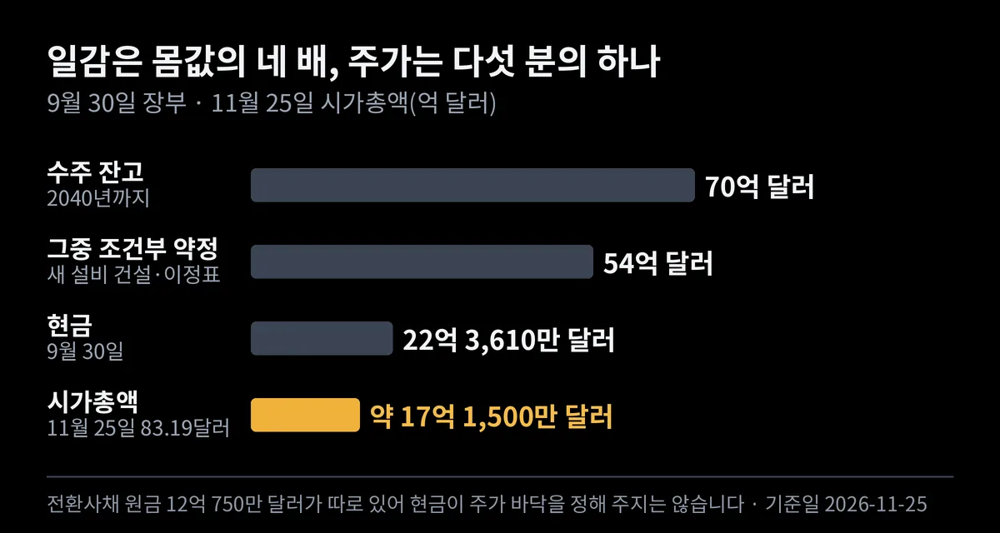
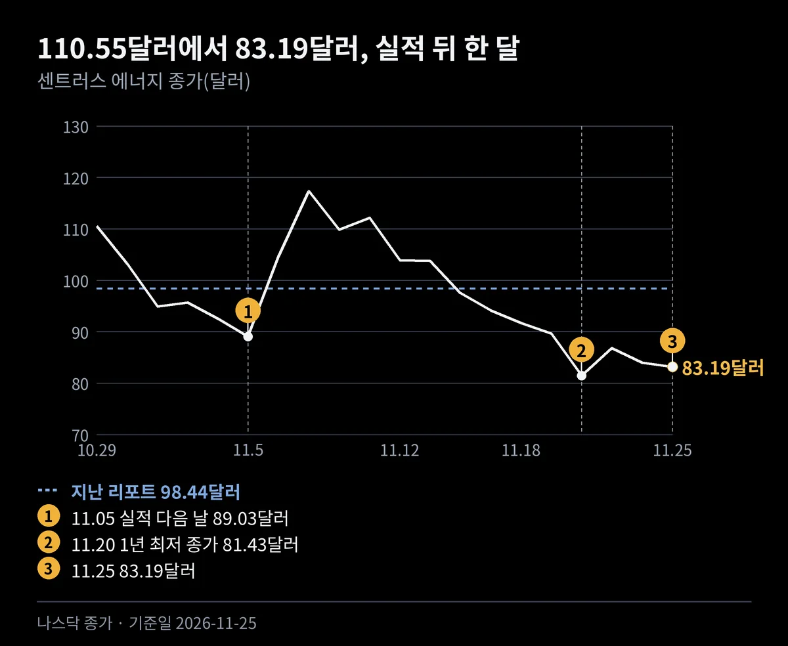
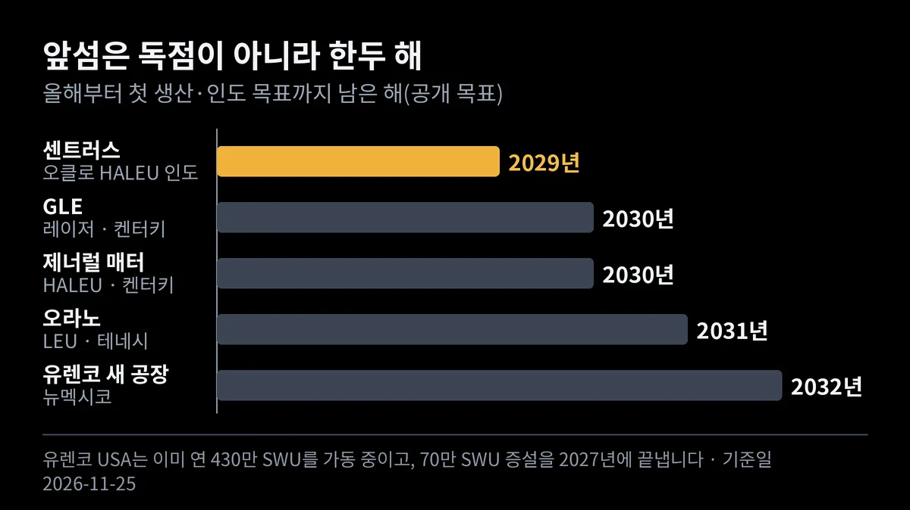
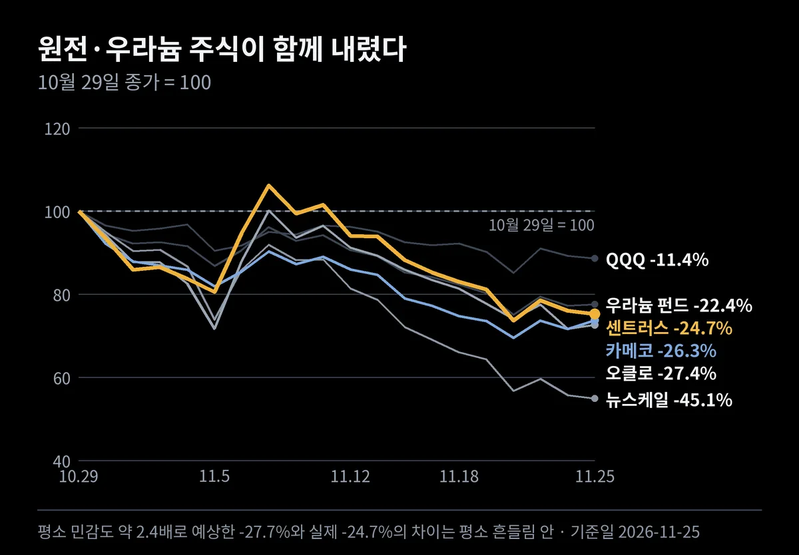
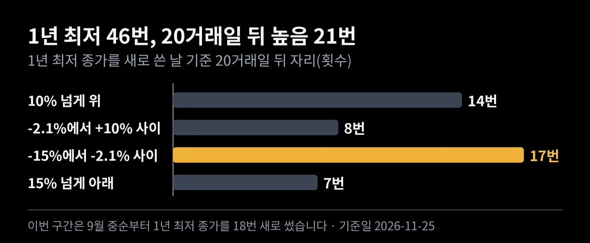
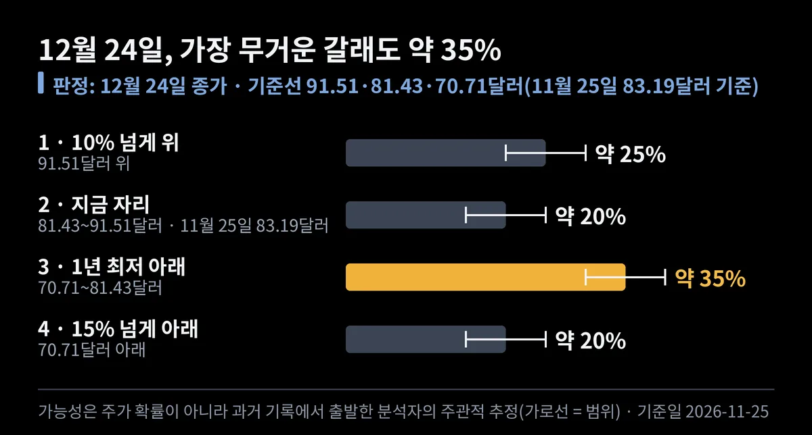

> **유의사항** 이 글은 공시와 시세 기록을 정리한 교육용 자료이며, 특정 종목의 매수·매도를 권하지 않습니다. 가능성 숫자는 과거 기록에 조건을 더한 주관적 추정입니다.

11월 25일, 센트러스 에너지 주가는 83.19달러로 마감했습니다. 2025년 10월 최고 종가 436달러의 약 19%입니다. 그런데 9월 말 회사 장부에는 앞으로 받을 일감이 70억 달러, 현금이 22억 3,610만 달러 적혀 있습니다. 같은 날 주식 전체의 몸값(시가총액)은 약 17억 달러였습니다. 일감은 몸값의 네 배인데 주가는 다섯 분의 하나가 된 셈입니다. 이 주식을 들고 있다면, 오래 들고 가도 될까요?

이 글은 시청자 요청으로 썼습니다. 요청하신 분은 '우라늄 독점 공급'을 해자로 보고 샀는데 주가가 3분의 1이 됐다며, 그 경쟁력이 아직 유효한지 물으셨습니다. 해자는 성 둘레에 판 물웅덩이처럼, 경쟁자가 쉽게 넘어오지 못하게 막아 주는 회사의 강점을 말합니다. 센트러스의 해자를 기술, 계약, 시간 세 겹으로 나눠 하나씩 확인하겠습니다.

[지난 리포트](/r/leu-2026-10-2/)는 10월 29일 종가 110.55달러를 기준으로 썼습니다. 그 뒤 주가는 24.7% 더 내렸습니다. 지난 예측 성적은 적중 하나, 빗나감 없음입니다. 지난 리포트는 네 가지 시나리오(갈래)를 적었습니다. 가장 높게 본 갈래는 '실적이 실망스러우면 반등을 돌려주고 98.44달러(10월 26일 기간 최저 종가)를 다시 시험한다'였습니다. 11월 5일 89.03달러로 마감해 그 갈래가 맞았고, 주가는 그 아래로 더 내려갔습니다.

센트러스가 돈을 버는 방식은 두 가지입니다. 하나는 원전 연료인 저농축 우라늄(LEU, 우라늄-235를 5% 안팎으로 농축한 기존 원전 연료)을 전력 회사에 파는 일입니다. 다른 하나는 미국 에너지부 일을 맡는 기술 서비스입니다. 3분기 매출은 5,550만 달러로 1년 전보다 26% 줄었습니다. 순이익 3,160만 달러는 대부분 워런트(정해진 가격에 주식을 살 수 있는 권리) 평가 이익 4,640만 달러에서 나왔습니다. 그 효과를 뺀 회사 기준 조정 순손실은 940만 달러입니다.

피케턴 공장부터 보겠습니다. 해자의 첫 겹인 기술이 여기 있습니다. 센트러스는 오하이오 피케턴 공장에서 원심분리기 16대로 고순도 저농축 우라늄(HALEU)을 만들어 왔습니다. HALEU는 우라늄-235를 5~20%로 농축한 연료로, 소형·차세대 원자로가 씁니다. 2025년 6월에는 HALEU 900kg을 에너지부에 넘겼습니다. 미국 회사, 미국 기술로 이 일을 해낸 곳은 지금 센트러스 하나입니다. 10월 29일에는 상업 규모 증설에 쓸 첫 신형 원심분리기를 연말 목표보다 먼저 보냈습니다.

그런데 '미국 유일 공급'이라는 말은 절반만 맞습니다. 미국 땅에서 상업용 농축 공장을 돌리는 곳은 유렌코 USA(유럽 농축 회사 유렌코의 미국 법인)입니다. 뉴멕시코 공장에서 한 해 430만 SWU(분리작업단위, 우라늄을 농축하는 일의 양을 재는 단위)를 만듭니다. 센트러스가 파는 저농축 우라늄은 대부분 직접 만든 것이 아닙니다. 10-Q는 2027년까지 고객에게 넘길 물량의 절반을 훨씬 넘게 러시아 테넥스(TENEX)에서 받는다고 적었습니다.

이번에는 장부 속 계약입니다. 9월 말 수주 잔고는 70억 달러이고 2040년까지 이어집니다. 그중 약 54억 달러는 피케턴에 새 농축 설비를 지어야 효력이 생기는 조건부 판매 약정입니다. 그 가운데 51억 달러는 본계약으로 맺었지만, 이것도 공장 건설과 운영 이정표를 지나야 효력이 생깁니다. 11월 12일에는 오클로가 HALEU 본계약을 맺었다고 발표했습니다. 선급금을 넣는 계약이고, 연료 인도는 2029년 시작 예정입니다. 에너지부와는 1월에 9억 달러 과제를 따냈습니다. 2032년 7월까지 HALEU 1톤을 넘기는 고정가 계약이고, 돈은 이정표를 지날 때마다 나옵니다.

같은 서류에는 반대쪽 문장도 있습니다. 에너지부 2027 회계연도 예산안에 지금의 HALEU 운영 계약 추가 자금이 없습니다. 기술 서비스 잔고 약 8억 달러가 여기에 해당하고, 에너지부는 추가 옵션을 쓰지 않겠다고 알려 왔습니다. 1월 과제에서는 기존 원전용 저농축 우라늄 생산 과제를 받지 못했습니다. 그 9억 달러는 프랑스계 오라노에 갔습니다. 일감은 쌓였지만, 대부분이 '지으면 받는' 약속이라는 뜻입니다.

이 대목은 김박사 월드가 여러 종목에서 본 패턴과 닮았습니다. 이름을 붙이면 '할 수 있다는 했다가 아니다'입니다. 서류로 열린 길과 실제로 일어난 일을 구분하자는 뜻입니다. 주식 판매 한도가 열린 일곱 종목 가운데 실제로 판 곳은 셋이었습니다. 표본은 작습니다. [뉴스케일 파워](/r/smr-2026-11-4/)도 판매 한도만 보고 판다고 본 예측이 빗나갔습니다. 성격은 다르지만 조건부 약정 54억 달러도 같은 눈으로 볼 수 있습니다. 공장이 일정대로 지어질 때 비로소 매출이 되는 숫자입니다.

남은 겹은 시간입니다. 경쟁사들의 공개 목표를 나란히 놓으면 이렇습니다. 레이저 방식의 글로벌 레이저 엔리치먼트(GLE)와 제너럴 매터는 켄터키 퍼듀카에서 2030년 생산을 목표로 합니다. GLE는 10월에 최종 환경영향평가가 나왔고, 허가는 2027년으로 예상합니다. 제너럴 매터는 9월에 허가를 신청했고, 농축 기술은 공개하지 않았습니다. 오라노는 테네시 오크리지에서 2031년 농축 시작을 목표로 합니다. 원자력규제위원회 심사 완료 목표는 2027년 4월에서 6월로 늦춰졌습니다. 유렌코는 지금 짓는 70만 SWU를 2027년에 끝내고, 210만 SWU 새 공장은 2032년 첫 생산이 목표입니다.

센트러스 새 설비의 상업 생산 시작 날짜는 공시에서 확인하지 못했습니다. 확인되는 가장 가까운 날짜는 오클로 인도 시작인 2029년입니다. 그래서 실물은 앞서 있어도, 그 차이는 영원한 독점이 아니라 한두 해 정도로 보는 편이 맞습니다. 경쟁사 목표가 늦어지면 그 차이는 벌어지고, 센트러스 공장이 늦어지면 좁혀집니다. 그래서 이 해자는 앞으로 나올 공장 일정 숫자로 계속 다시 재야 하는 해자입니다.

그러면 주가는 왜 이렇게 내렸을까요. 지난 리포트 뒤 19거래일만 보면 회사보다 업종 이야기가 큽니다. 같은 기간 우라늄 펀드(URA)는 22.4%, 광산 회사 카메코는 26.3% 내렸습니다. 센트러스는 평소 나스닥 100 펀드(QQQ)보다 약 2.4배 크게 움직였습니다(평소 민감도). 그 민감도로 예상한 하락과 실제 하락 24.7%의 차이는 평소 흔들림 안입니다. 업종과 비슷하게 움직였다는 뜻이고, 회사 고유 요인이 얼마인지는 이 계산으로 가려지지 않습니다.

최고 종가에서부터 세면 그림이 조금 다릅니다. 2025년 10월 15일 뒤 센트러스는 80.9% 내렸습니다. 같은 기간 오클로는 88.7%, 뉴스케일은 93.9% 내렸고, 카메코는 34.1% 내렸습니다. 낙폭은 카메코보다 오클로·뉴스케일에 가까웠습니다. 시장 분위기는 여전히 거칩니다. 11월 25일 변동성 지수(VIX)는 28.29였고, 미 국채 10년 금리는 4.85%였습니다.

이런 자리는 처음이 아닙니다. 1년 최저 종가는 직전 1년(약 252거래일) 가운데 가장 낮은 종가를 말합니다. 2018년부터 센트러스가 이 값을 새로 쓴 날 46번을 셌습니다. 20거래일 뒤 그날보다 높았던 경우는 21번으로, 절반에 조금 못 미칩니다. 이번 하락 구간은 9월 중순부터 1년 최저 종가를 18번 새로 쓸 만큼 길었습니다. 2018년 여름에도 비슷하게 긴 구간이 있었고, 그때는 마지막 최저 뒤 석 달쯤 지나 더 높은 자리에 있었습니다.

이제 오래 들고 가는 쪽과 아닌 쪽의 근거를 나란히 놓겠습니다. 들고 가는 쪽에는 먼저 현금이 있습니다. 9월 말 현금 22억 3,610만 달러는 몸값보다 큽니다. 다만 갚아야 할 전환사채(정해진 가격에 주식으로 바꿀 수 있는 채권) 원금 12억 750만 달러가 있어서, 현금이 주가 바닥을 정해 주지는 않습니다. 둘째, 공급망 계약을 모두 맺고 첫 원심분리기를 보내 경쟁사보다 실물이 앞서 있습니다. 셋째, 오클로처럼 선급금을 내는 고객이 생겼습니다.

아닌 쪽에도 근거 셋이 있습니다. 첫째, 일감의 대부분이 공장을 지어야 받는 조건부 약정입니다. 둘째, 에너지부의 HALEU 운영 자금이 끊기고, 저농축 우라늄 과제는 경쟁사에 갔습니다. 셋째, 지금 매출의 상당 부분이 러시아 공급에 기대 있습니다. 10-Q는 2026·2027년 추가 수입 허가 신청 결과가 정해지지 않았고, 다른 공급원으로는 테넥스 물량을 대신하기에 부족하다고 적었습니다. 11월 2일에는 자동 효력 일괄 신고서 S-3ASR(큰 회사가 내면 바로 효력이 생기는 일괄 신고서)도 냈습니다. 금액을 정하지 않고 앞으로 증권을 팔 수 있게 창구를 여는 서류입니다. 11월 25일까지 실제 판매 서류는 없었습니다.

그래서 요청하신 질문에는 이렇게 답할 수 있습니다. 기술 해자는 아직 유효합니다. 미국 기술로 HALEU를 만든 곳은 여전히 센트러스 하나입니다. 계약 해자는 일감이 쌓였지만 대부분 조건부입니다. 시간 해자는 한두 해 차이이고 경쟁사가 넷입니다. 결국 오래 들고 가는 판단은 '독점'보다 '피케턴 공장이 경쟁사보다 먼저, 정해진 돈으로 지어지는가'에 걸려 있습니다.

그 답이 나오는 첫 날짜는 12월 7일입니다. 센트러스는 그날 피케턴 공장에서 투자자의 날을 엽니다. 증설 일정과 비용, 생산 계획 숫자가 나오는지가 첫 확인 신호입니다. 같은 주 12월 9일에는 FOMC(미국 연방공개시장위원회, 금리 회의)가 있습니다. 이 판단의 무게를 숫자로 나누려고 12월 24일 종가(11월 25일에서 20거래일째)에 네 갈래를 걸었습니다. 11월 25일 종가 83.19달러는 1년 최저 종가 81.43달러 바로 위, 두 번째 갈래 '지금 자리'에 있습니다.

가능성은 주가 확률이 아니라, 과거 기록에 이번 조건을 더한 주관적 추정입니다. 가장 무거운 갈래는 70.71~81.43달러, 1년 최저 아래로 한 번 더 내려가는 자리(약 35%)입니다. 1년 최저 종가 기록에서 이 칸이 46번 중 17번으로 가장 많았고, 여기서 출발했습니다. 칸마다 출발한 빈도와 조정한 폭은 끝 부록 네 갈래 표 아래에 적었습니다. 이 추정이 틀린다면 가장 큰 이유는 투자자의 날입니다. 공장 일정이나 새 계약 숫자가 나오면 크게 오를 수 있습니다. 11월 6일에도 오클로·뉴스케일과 함께 하루 17.5% 오른 적이 있습니다.

가장 큰 위험은 셋입니다. 하나는 러시아 공급입니다. 허가가 늦거나 막히면 2027년까지의 판매가 흔들립니다. 둘은 공장 비용입니다. 올해 설비 투자 전망만 3억 5,000만~5억 달러이고, 판매 창구가 열려 있습니다. 셋은 정부 자금입니다. HALEU 운영 자금은 이미 예산안에서 빠졌고, 새 과제는 의회 예산이 있어야 나옵니다.

경쟁사들의 목표가 2030~2032년에 몰려 있기 때문에, 오래 들고 가는 판단은 그 전에 센트러스 공장이 계획대로 돌아가는지에 기대게 됩니다. 그 첫 숫자는 12월 7일, 첫 채점은 12월 24일입니다. 결정은 각자의 몫이며, 이 영상과 리포트는 판단 근거를 정리한 교육용 자료입니다. 다음 갱신은 12월 7일 투자자의 날 숫자가 나온 뒤, 늦어도 12월 24일 판정 뒤입니다.

## 숫자로 다시 보기

### 해자 세 겹 점검(9월 30일 장부·11월 25일까지 공시)
| 겹 | 확인된 것 | 흔들리는 것 |
|---|---|---|
| 기술 | 미국 기술 HALEU, 2025년 6월 900kg 인도 | 지금 저농축 우라늄은 절반 넘게 러시아 공급 |
| 계약 | 수주 잔고 70억 달러, 오클로 본계약 | 54억 달러는 조건부, HALEU 운영 자금 없음 |
| 시간 | 첫 신형 원심분리기 10월 29일 출하 | 경쟁사 넷이 2030~2032년 생산 목표 |

### 3분기 실적과 장부(9월 30일)
| 항목 | 금액 | 메모 |
|---|---|---|
| 매출 | 5,550만 달러 | 1년 전 7,490만 달러(-26%) |
| 순이익 | 3,160만 달러 | 워런트 평가 이익 4,640만 달러 포함 |
| 조정 순손실(회사 기준) | 940만 달러 | 워런트 효과 제외 |
| 현금 | 22억 3,610만 달러 | 연말 19억 5,720만 달러 |
| 전환사채 원금 | 12억 750만 달러 | 2030년 4억 250만 · 2032년 8억 500만 |
| 주식 수 | 2,061만 8,450주 | 11월 1일, 보통주 A·B 합 |
| 시가총액 | 약 17억 1,500만 달러 | 11월 25일 종가로 계산 |
| 2026 매출 전망 | 4억 5,000만~5억 달러 | 회사 발표 |
| 2026 설비 투자 전망 | 3억 5,000만~5억 달러 | 회사 발표 |

- 별도로 행사가 0.10달러 사전 납입 워런트 200만 5,513주(9월 공모, 약 5억 달러)

### 수주 잔고 나눠 보기(9월 30일)
| 묶음 | 금액 | 조건 |
|---|---|---|
| 전체 | 70억 달러 | 2040년까지 |
| LEU 부문 | 약 62억 달러 | 확정 인도 + 조건부 |
| 그중 조건부 판매 약정 | 약 54억 달러 | 새 설비 건설·이정표, 본계약 51억 |
| 기술 서비스 | 약 8억 달러 | HALEU 운영 계약, 2027 예산안 자금 없음 |

### 에너지부 과제(2026년 1월 5일)
| 받은 곳 | 금액 | 내용 |
|---|---|---|
| 센트러스(ACO) | 9억 달러 | HALEU, 2032년 7월까지 1톤 |
| 제너럴 매터 | 9억 달러 | HALEU |
| 오라노 | 9억 달러 | 저농축 우라늄(LEU) |
| GLE | 2,800만 달러 | 차세대 농축 기술 |

- 센트러스 과제 옵션: HALEU 5톤씩 두 번, 톤당 1,700만 달러(에너지부 재량)

### 경쟁사 일정(공개 목표)
| 회사(곳) | 지금 | 첫 생산 목표 |
|---|---|---|
| 센트러스(오하이오) | 첫 신형 원심분리기 출하 | 오클로 인도 2029년 |
| 유렌코 USA(뉴멕시코) | 연 430만 SWU 가동, 70만 증설 | 새 공장 2032년 |
| GLE(켄터키) | 최종 환경영향평가(10월) | 2030년 |
| 제너럴 매터(켄터키) | 9월 허가 신청 | 2030년 |
| 오라노(테네시) | 심사 완료 목표 2027년 6월 | 2031년 |

### 1년 최저 종가 46번 뒤 20거래일(2018~2026년)
| 20거래일 뒤 | 횟수 |
|---|---|
| 10% 넘게 위 | 14 |
| -2.1%에서 +10% 사이 | 8 |
| -15%에서 -2.1% 사이 | 17 |
| 15% 넘게 아래 | 7 |

- 그날보다 높음 21/46, 60거래일 뒤 높음 17/32

### 시장·거시·정책 배경
| 대상 | 10월 29일→11월 25일 | 2025년 10월 15일→11월 25일 |
|---|---|---|
| 센트러스 | -24.7% | -80.9% |
| 카메코 | -26.3% | -34.1% |
| 오클로 | -27.4% | -88.7% |
| 뉴스케일 | -45.1% | -93.9% |
| 우라늄 펀드(URA) | -22.4% | -52.3% |
| QQQ | -11.4% | +5.3% |

| 예상 vs 실제(QQQ 기준) | 값 | 메모 |
| --- | --- | --- |
| 평소 민감도 | 약 2.4배 | 구간 전 250거래일 |
| 예상 | -27.7% | 민감도 × QQQ |
| 실제 | -24.7% | 차이 +2.9%p |
| 평소 흔들림 | ±19.5%p | 차이는 이 안 |
| 미 국채 10년 | 4.85% | 11월 25일 |
| VIX(시장 변동성 지수) | 28.29 | 11월 25일 |

- 다음 거시 일정: 12월 9일 FOMC · 12월 23일 PCE(개인소비지출 물가, 11월분). 소비자물가(CPI)·고용 일정은 확인 안 됨
정책: 러시아 우라늄 수입 금지법(2024년 5월 13일 제정, 8월 11일 시행)은 에너지부 허가가 있어야 수입할 수 있게 했습니다. 10-Q는 2027년까지 인도 물량의 절반을 훨씬 넘게 테넥스에서 받는다고 적었습니다.
- 통섭: 같은 19거래일 동안 핵심 종목 8개 가운데 8개가 평소 시장 민감도로 예상한 범위 안에서 움직였습니다([뉴스케일 파워](/r/smr-2026-11-4/) · [오클로](/r/oklo-2026-10-2/))

### 판단 전에 확인할 것

| 순서 · 확인할 것 | 볼 곳 |
| --- | --- |
| **1** 처음 산 이유가 HALEU 기술이었나, 기존 원전 연료 판매였나 | 10-Q 사업 부문 |
| **2** 12월 7일 투자자의 날에 증설 일정·비용 숫자가 나오나 | 회사 발표 |
| **3** 러시아 수입 허가(2026·2027년 신청분) 결과가 나오나 | 8-K·10-K |
| **4** 12월 24일까지 판매 서류(424B)가 나오나 | SEC 제출 목록 |
| **5** 12월 9일 FOMC 뒤에도 원전주와 함께 움직이나 | 센트러스·URA 종가 |

### 지난 예측 채점표

지난 예측 성적: 적중 1 · 빗나감 0

| 지난 시나리오 · 당시 기준 | 판정과 지금 자리(11월 24일) |
| --- | --- |
| **2 · 실적 실망으로 반등을 반납** 11월 5일 하락, 98.44달러 재시험 | **[적중]** 11월 5일 89.03달러(-3.8%) |
| **1 · 실적이 반등을 잇는다** 11월 24일 109.42달러 위 | **[안 일어남]** 11월 24일 84.04달러 |
| **3 · 조달이 상쇄** 발표 뒤 5거래일 15% 안팎 하락 | **[안 일어남]** 판매 서류 없음 |
| **4 · 98.44달러 아래로** 11월 24일 | **[일어남]** 84.04달러 |

- 11월 25일 종가 83.19달러는 98.44달러보다 15.5% 낮고, 1년 최저 종가 81.43달러는 98.44달러보다 17.3% 낮습니다

### 앞으로 일어날 수 있는 일

1년 최저 종가 46번 중 17번은 20거래일 뒤 70.71~81.43달러에 해당하는 자리(-15%에서 -2.1% 사이)였고, 이 기록에서 출발했습니다. 아래 가능성은 그 기록에서 출발해 분석자가 주관적으로 매긴 추정이며, 주가가 오를 확률이 아닙니다. 네 갈래는 겹치지 않아 더하면 100%입니다(기준 11월 25일 종가 83.19달러).

| 갈래(판정 12월 24일) | 판정 조건 | 가능성(추정) |
| --- | --- | --- |
| 1 · 10% 넘게 위 | 12월 24일 종가 91.51달러 위 | 중간 약 25% (20~30%) |
| 2 · 지금 자리 | 12월 24일 종가 81.43~91.51달러 | 낮음 약 20% (15~25%) |
| **3 · 1년 최저 아래** | 12월 24일 종가 70.71~81.43달러 | 높음 약 35% (30~40%) |
| 4 · 15% 넘게 아래 | 12월 24일 종가 70.71달러 아래 | 낮음 약 20% (15~25%) |

- 출발 빈도(46번 기준): 1칸 14번 · 2칸 8번 · 3칸 17번 · 4칸 7번
- 조정: '가격선을 지킨다' 예측 네 번이 모두 빗나간 기록으로 4칸 +5%p · 1칸 -5%p, 투자자의 날로 2칸 +3%p · 3칸 -2%p

### 핵심 확인 세 가지
- 1순위: 12월 7일 투자자의 날 — 증설 일정·비용·생산 계획 숫자
- 2순위: 러시아 수입 허가 결과 — 8-K나 다음 연간 보고서
- 3순위: 판매 서류(424B) — 12월 24일까지 나오는지

## 함께 읽기
- [센트러스 에너지, 원심분리기를 앞당겨 보냈는데 왜 3주 -22%?(10월 29일 기준)](/r/leu-2026-10-2/)
- [뉴스케일 파워 지금 사도 될까?(11월 20일 기준)](/r/smr-2026-11-4/)
- [오클로, 원자력에 돈이 몰린 달에 혼자 24% 빠졌다(10월 기준)](/r/oklo-2026-10-2/)
