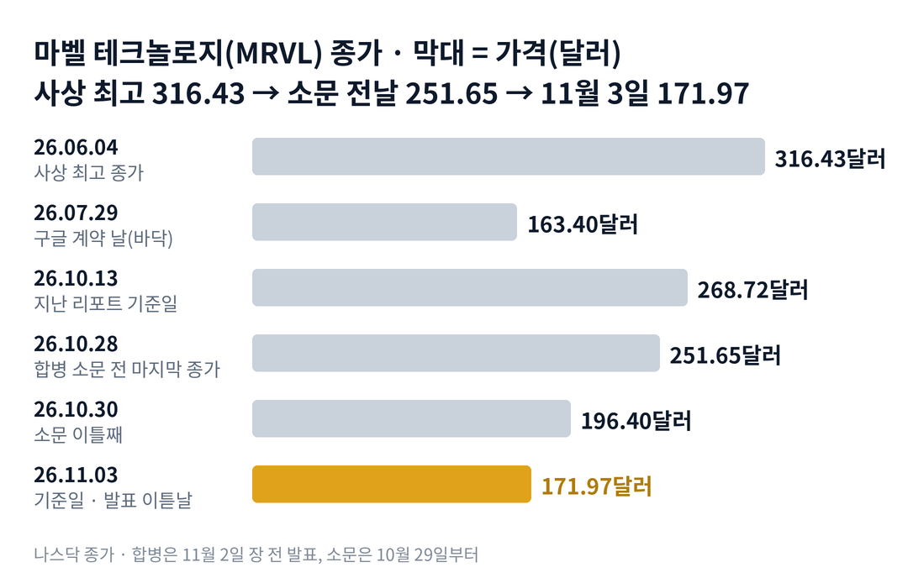

## 짧은 답

> **핵심:** 마벨은 루멘텀을 주식만으로 사들이며 기존 주주 지분의 약 3분의 1을 내주기로 했고, 시장은 그 값을 3거래일 만에 깎았습니다. 과거 인수 때와 달리 첫날부터 크게 내린 것은 이번이 처음입니다.

마벨은 인수를 발표할 때마다 대체로 올랐습니다. 그런데 이번에는 왜 31.7%나 빠졌을까요?

마벨 테크놀로지는 11월 2일 장 전, 광 부품 회사 루멘텀을 사들이는 합병 계약을 발표했습니다. 루멘텀 1주당 마벨 4.5주를 주는 조건입니다. 회사가 밝힌 루멘텀의 내재 기업가치는 1,150억 달러이고, 소문 전 주가보다 약 23.9% 웃돈을 얹은 값입니다.

주가는 발표 전부터 움직였습니다. 소문이 돈 10월 29일 하루 13.2% 내렸고, 발표 날에도 12.7% 내렸습니다. 소문 전날 251.65달러였던 주가는 11월 3일 171.97달러가 됐습니다. 3거래일 동안 시가총액 약 700억 달러가 사라진 셈입니다.

과거 기록과 비교하면 더 이상합니다. 마벨이 지난 9년 동안 대형 인수를 발표한 4번 가운데 3번은 발표 날 올랐고, 20거래일 뒤에도 3번은 발표 전보다 높았습니다. 이 글은 그 4번과 이번을 나란히 놓고 무엇이 달랐는지, 그리고 12월 실적까지 무엇을 볼지 정리합니다.

> **유의사항** 저자는 금융·투자 자문가가 아닙니다. 이 글은 공개 공시와 시세를 정리한 교육용 분석이며 특정 매매를 권하지 않습니다. 과거의 주가 반응이 미래에 반복된다는 보장은 없고, 마벨은 하루 10% 넘게 움직이는 날이 잦은 종목입니다. 실제 투자 전에는 최신 가격과 공시를 직접 확인하세요.

## 지난 리포트 이후

[지난 리포트](/r/mrvl-2026-10/)(10월 13일 종가 268.72달러 기준)의 예측 성적은 4개 중 적중 0 · 부분 적중 1 · 빗나감 2 · 진행 중 1입니다.

| 지난 점검 항목 · 당시 기준 | 판정 및 실제 결과(11월 3일) |
| --- | --- |
| **진단: 재평가 대기 단계 후반** 업종 반등에 더 크게 오르는 때 | **[빗나감]** 업종보다 더 크게 내림, 171.97달러 |
| **시나리오 1: 기대 재확장** 12월 실적에서 목표 상향 | **[진행 중]** 실적은 12월 초, 3분기 예비 매출은 목표 중간값 |
| **시나리오 2: 높은 몸값의 박스권** 지금 가격 근처에서 오르내림 | **[빗나감]** 36.0% 내려 범위를 벗어남 |
| **시나리오 3: 업종 충격 재발** 반도체 지수보다 크게 하락 | **[부분 적중]** 방향은 맞았지만 계기는 합병 발표 |

빗나간 두 줄은 같은 이유입니다. 지난 리포트는 업종 분위기와 12월 실적만 변수로 봤고, 회사가 직접 몸값을 바꾸는 대형 합병은 시나리오에 없었습니다.

## 1부. 마벨과 루멘텀은 어떤 회사인가

> **핵심:** 마벨은 데이터센터용 칩을 설계하는 회사이고, 루멘텀은 그 칩 사이를 빛으로 잇는 레이저와 광 부품을 만드는 회사입니다. 두 회사를 합치면 전기와 빛 양쪽의 연결 부품을 한 회사가 갖게 됩니다.

마벨은 미국 캘리포니아주 샌타클래라에 본사를 둔 반도체 회사입니다. 구글·아마존 같은 빅테크가 쓰는 맞춤형 인공지능 칩을 대신 설계하고, 칩과 칩 사이를 잇는 연결 칩과 네트워크 스위치 칩을 팝니다. 직접 공장을 두지 않고 설계만 하는 회사입니다.

루멘텀은 같은 주 새너제이에 있는 광 부품 회사입니다. 데이터센터 안에서 전기 신호를 빛으로 바꿔 보내는 레이저와 광 트랜시버(빛으로 데이터를 주고받는 부품)를 만듭니다. 인화인듐이라는 특수 반도체를 직접 만드는 공장도 갖고 있습니다.

두 회사가 밝힌 합병 이유는 하나입니다. 인공지능 데이터센터가 커질수록 구리선으로는 속도와 전력에 한계가 와서, 빛으로 잇는 부품이 더 많이 필요해진다는 것입니다. 회사는 합친 뒤 노릴 수 있는 시장을 5,500억 달러로 제시했습니다.

### 숫자로 본 합병 조건(11월 2일 발표)

| 항목 | 값 · 근거 |
| --- | --- |
| 교환 비율 | **루멘텀 1주 = 마벨 4.5주** 현금 없이 주식만 주는 거래 |
| 루멘텀 내재 기업가치 | **1,150억 달러** 1주 약 1,132달러, 10월 28일 대비 약 23.9% 웃돈 |
| 합병 뒤 지분 | **마벨 기존 주주 약 67%** 루멘텀 주주 약 33%(완전 희석 기준) |
| 완료 예상 | **2028년 상반기** 양사 주주 승인·규제 승인 필요 |
| 마벨이 무는 위약금 | **최대 58억 달러** 규제 문제로 깨지면 32억 달러 |
| 3분기 예비 매출 | **목표 중간값 유지** 범위를 ±5%에서 ±2%로 좁힘 |

이 말은 곧 마벨 주주가 회사의 약 3분의 1을 루멘텀 주주에게 내주고, 그 대가로 광 부품 사업을 얻는다는 뜻입니다. 돈이 아니라 주식으로 값을 치르므로, 마벨 주가가 내리면 루멘텀 주주가 받는 값도 함께 줄어듭니다.

위 그림처럼 마벨은 6월 4일 316.43달러로 사상 최고 종가를 찍었고, 7월 29일 163.40달러까지 내렸다가 10월 중순 260달러대로 돌아왔습니다. 합병 소문 뒤 3거래일 만에 다시 7월 바닥 근처로 내려왔습니다. 그렇다면 그 3거래일 동안 정확히 무슨 일이 있었을까요?

## 2부. 소문부터 발표까지, 3거래일의 기록

> **핵심:** 마벨 주가는 합병 조건이 나오기 전, 소문만으로 하루 13.2% 내렸습니다. 같은 기간 반도체 업종과 광 부품 회사도 내렸지만 마벨의 낙폭이 가장 컸습니다.

회사는 10월 28일을 '합병 소문이 돌기 전 마지막 거래일'로 밝혔습니다. 그날 마벨 종가는 251.65달러, 루멘텀은 913.95달러였습니다. 루멘텀 1주의 내재 가격 1,132달러는 이날 마벨 종가에 4.5를 곱한 값과 같습니다.

다음 날인 10월 29일, 거래량이 평소의 2배가 넘는 4,203만 주로 늘며 마벨은 하루 13.2% 내렸습니다. 루멘텀은 오히려 0.6% 올랐습니다. 10월 30일에는 둘 다 내렸고, 발표 날인 11월 2일 마벨은 12.7%, 루멘텀은 18.6% 내렸습니다.

### 소문 전날(10월 28일)부터 11월 3일까지

| 종목 · 성격 | 10월 28일 → 11월 3일 | 변화 |
| --- | --- | --- |
| **마벨(MRVL)** 인수하는 회사 | 251.65 → 171.97달러 | -31.7% |
| **루멘텀(LITE)** 인수되는 회사 | 913.95 → 680.16달러 | -25.6% |
| **코히런트(COHR)** 같은 업종 광 부품 | 239.59 → 207.49달러 | -13.4% |
| **반도체 ETF(SOXX)** 업종 전체 상장지수펀드 | 521.94 → 465.00 | -10.9% |

이 말은 곧 업종 전체의 낙폭보다 마벨이 훨씬 더 내렸다는 뜻입니다. 같은 광 부품 회사 코히런트보다 마벨과 루멘텀이 두 배 안팎 더 내린 것은 합병 자체를 시장이 낮게 평가했다는 신호로 읽을 수 있습니다. 그렇다면 과거 마벨이 인수를 발표했을 때는 어땠을까요?

## 3부. 마벨이 대형 인수를 발표한 날 4번의 기록

> **핵심:** 과거 대형 인수 4번 가운데 발표 날 오른 것은 3번, 20거래일 뒤 발표 전보다 높았던 것도 3번이었습니다. 발표 날 10% 넘게 내린 것은 이번이 처음입니다.

이번과 비슷한 조건인 '마벨이 회사를 통째로 사들인다고 발표한 날'만 골랐습니다. 매트 머피 최고경영자 취임 뒤 거래 규모가 10억 달러를 넘은 인수 4번입니다. 발표 날 반응은 전 거래일 종가와 비교했고, 셀레스티얼 AI는 장 마감 뒤 실적과 함께 발표돼 다음 날을 첫 반응일로 잡았습니다. '20거래일 뒤'도 발표 전 거래일 종가와 비교했습니다.

### 마벨의 대형 인수 발표 4번과 이번

| 발표일 · 인수 대상 · 대가 | 발표 날 | 20거래일 뒤 |
| --- | --- | --- |
| **2017.11.20** 캐비엄 · 현금+주식 | +6.4% | +9.2% |
| **2020.10.29** 인파이 · 현금+주식 | -3.3% | +12.8% |
| **2021.08.03** 이노비움 · 주식 | +1.3% | +2.3% |
| **2025.12.03** 셀레스티얼 AI · 실적과 함께 | +7.9% | -8.5% |
| **2026.11.02** 루멘텀 · 주식만 | -12.7% | 11월 30일 판정 |

여기서 기억할 사실은 하나입니다. 마벨의 인수 발표는 그동안 대체로 반겨졌지만, 이번만은 발표 전 소문 단계부터 크게 내렸습니다. 소문 첫날 -13.2%와 발표 날 -12.7%는 과거 4번의 어떤 발표 날보다 큽니다.

가장 가까운 사례는 인파이입니다. 그때도 발표 날 3.3% 내렸지만, 20거래일 뒤에는 12.8% 높았습니다. 다만 그때는 반도체 업종도 같은 기간 17.1% 올랐습니다. 그렇다면 이번 거래는 과거와 무엇이 달랐을까요?

## 4부. 과거 4번과 이번이 다른 세 가지

> **핵심:** 이번 거래는 과거보다 훨씬 크고, 주식만으로 값을 치르며, 완료까지 1년 반이 넘게 남았습니다. 루멘텀 가격이 합병 가치보다 12.1% 낮다는 점은 시장이 완료를 확신하지 않는다는 뜻입니다.

첫째, 크기가 다릅니다. 루멘텀의 내재 기업가치 1,150억 달러는 소문 전 마벨 시가총액 약 2,207억 달러의 절반이 넘습니다. 마벨 기존 주주는 회사의 약 3분의 1을 넘겨줍니다.

둘째, 값을 치르는 방식이 다릅니다. 캐비엄과 인파이 때는 현금과 주식을 섞었지만, 이번에는 주식만 줍니다. 새 주식이 대량으로 나오면 기존 주주의 한 주당 가치가 줄어드는 희석이 생깁니다. 회사는 첫해부터 조정 주당순이익이 늘고 연 10억 달러 넘는 비용을 줄일 수 있다고 밝혔지만, 시장은 그 약속을 아직 값에 넣지 않았습니다.

셋째, 기다리는 시간이 깁니다. 완료 예상은 2028년 상반기이고, 그 사이 두 회사 주주 승인과 미국 등 여러 나라의 규제 승인을 받아야 합니다. 규제 문제로 거래가 깨지면 마벨이 루멘텀에 32억 달러를 줍니다.

11월 3일 루멘텀 가격으로 시장의 합병 신뢰를 잴 수 있습니다. 마벨 종가 171.97달러에 4.5를 곱하면 773.87달러인데, 루멘텀 종가는 680.16달러로 그보다 12.1% 낮습니다.

이 말은 곧 시장이 '합병이 그대로 끝난다'는 데 확신을 주지 않고 있다는 뜻입니다. 완료가 확실해 보일수록 이 할인은 좁아지고, 의심이 커질수록 넓어집니다.

과거 기록이 알려 주는 것은 분명합니다. 인수 발표 자체가 마벨 주가를 끌어내린 적은 없었지만, 이번에는 크기와 방식이 달랐습니다. 결국 앞으로 확인할 것은 두 가지입니다. 하나는 12월 실적에서 회사의 본업 숫자가 흔들리지 않는가, 다른 하나는 시장이 합병 완료를 믿기 시작하는가입니다. 이 두 조건으로 다음 한 달을 나누면 어떤 갈림길이 나올까요?

## 5부. 12월 실적까지, 네 가지 시나리오

> **핵심:** 지금은 합병 충격으로 몸값이 다시 매겨지는 단계이고, 12월 실적의 4분기 목표와 루멘텀의 합병 할인 폭이 다음 단계를 가릅니다.

> **국면 정의(마벨 시리즈 공통):** 국면 A(기대 확장) — 실적 날 다음 분기 목표가 예상을 크게 넘고 빅테크 계약이 이어지는 때. 국면 B(충격 하락) — 회사 실적과 무관한 충격으로 한 달에 20% 넘게 내리는 때. 국면 C(재평가 대기) — 업종 반등에 더 크게 오르며 다음 계기를 기다리는 때.

**2026년 11월 3일 진단: 국면 B(충격 하락).** 이번 충격은 업종이 아니라 회사의 합병 결정에서 나왔습니다. 소문 전날보다 31.7% 내렸고, 반도체 업종 낙폭의 약 3배입니다. 3분기 예비 매출이 목표 중간값을 지켜 본업 숫자의 악재는 아직 없습니다.

### 앞으로 일어날 수 있는 일

**확인된 사실:** 3분기 예비 매출은 목표 중간값을 지켰고, 합병 조건과 위약금은 1부 표와 같으며, 11월 3일 루멘텀은 합병 가치보다 12.1% 낮습니다. **과거 기록:** 3부의 대형 인수 4번 중 3번은 20거래일 뒤 발표 전보다 높았지만, 이번처럼 발표 날 크게 내린 사례는 없었습니다. **추정:** 아래 가능성은 '회사와 시장에서 이 일이 일어날' 확률을 분석자가 주관적으로 매긴 값입니다. 주가가 오를 확률이 아닙니다. 네 경우는 서로 겹치지 않으므로 더하면 100%여야 하지만, 하나의 숫자 대신 구간으로 적어 불확실성을 남겼습니다.

| 시나리오(판정 12월 11일) | 목표·할인 | 가능성(추정) |
| --- | --- | --- |
| 1 · 실적 견조 + 합병 신뢰 회복 | 상향 · 축소 | 중간 (25~35%) |
| **2 · 실적 견조 + 의심 지속** | 상향 · 유지 | 높음 (35~45%) |
| 3 · 실적 실망 + 합병 신뢰 회복 | 유지 · 축소 | 낮음 (5~10%) |
| 4 · 실적 실망 + 의심 지속 | 유지 · 유지 | 낮음 (15~25%) |

'상향'은 12월 초 3분기 실적에서 4분기 매출 목표가 3분기 목표 31억 5,000만 달러보다 높은 경우입니다. '축소'는 12월 11일 루멘텀 종가가 마벨 4.5주 값보다 8% 이내로 좁혀진 경우입니다. 실적 날짜는 아직 회사 공지 전이고, 지난 두 해는 12월 첫 주였습니다.

시나리오 2를 가장 높게 본 이유는 3분기 예비 매출이 이미 목표 중간값을 지켜 본업 숫자는 안정적일 가능성이 높지만, 완료까지 1년 반이 넘는 거래의 할인이 한 달 만에 크게 좁혀지기는 어렵기 때문입니다. 여기서 둘을 나눠 봐야 합니다. 회사 숫자가 안정적이라는 것이 주가가 오를 것이라는 뜻은 아닙니다.

시나리오 1을 중간으로 둔 근거는 과거 인수 4번 중 3번이 한 달 안에 발표 전보다 높아졌다는 기록입니다. 다만 그때는 이번만큼 크게 내린 출발점이 없었습니다. 그렇다면 이 진단이 틀릴 수 있는 지점은 어디일까요?

## 6부. 조심할 점과 체크리스트

> **핵심:** 과거 인수 기록은 4번뿐인 작은 표본이고, 이번 거래는 크기와 방식이 달라 그대로 견주기 어렵습니다. 합병 조건은 앞으로 나올 증권신고서(S-4)에서 더 자세히 확인해야 합니다.

3부 표는 '마벨이 인수하면 오른다'는 규칙이 아닙니다. 4번은 작은 표본이고, 셀레스티얼 AI는 실적과 같은 날이라 인수만의 반응으로 보기 어렵습니다. 시가총액 감소는 8월 말 보통주 약 8억 7,690만 주로 계산했습니다.

회사 쪽 위험도 세 가지입니다. 첫째, 주식으로만 값을 치러 마벨 주가가 내릴수록 루멘텀 주주의 불만이 커질 수 있습니다. 둘째, 규제 승인이 늦어지면 완료가 2028년 상반기보다 미뤄질 수 있습니다. 셋째, 합병 준비로 경영진의 시간이 나뉘면 맞춤형 칩 본업의 일정이 흔들릴 수 있습니다.

11월 4일 장중 움직임은 이 글에 반영하지 않았습니다. 첫 판정은 11월 30일(발표 뒤 20거래일)에 3부 표로, 시나리오 판정은 12월 11일에 합니다.

- ☐ 11월 30일 종가가 발표 전(10월 30일) 196.40달러 위인가
- ☐ 11월 중 증권신고서(S-4)가 제출되고 조건이 바뀌지 않는가
- ☐ 12월 실적에서 4분기 매출 목표가 31억 5,000만 달러를 넘는가
- ☐ 12월 11일 루멘텀이 합병 가치보다 8% 이내로 좁혀지는가
- ☐ 12월 11일까지 두 회사 주주·규제 기관의 반대 표명이 0건인가
- ☐ 12월 11일까지 반도체 ETF(SOXX)가 10월 28일 521.94 위로 돌아오는가

다음 갱신은 12월 초 3분기 실적을 본 뒤에 합니다.
