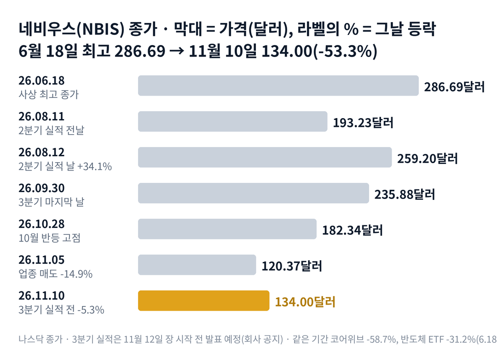

## 짧은 답

> **핵심:** 사업 숫자는 크게 늘었지만, 6월 뒤 인공지능 데이터센터 주식이 함께 무너졌고 네비우스는 그 무리 안에서 덜 내린 편이었습니다.

매출은 1년 전보다 454% 늘었습니다. 그런데 네비우스 주가는 왜 석 달 전 실적 날 값의 절반 수준까지 내려왔을까요?

결론부터 말하면, 하락의 큰 줄기는 업종 전체였습니다. 6월 고점 뒤 코어위브와 아이렌은 네비우스보다 더 많이 내렸습니다. 회사 안에서는 설비투자와 그 돈을 구하는 방식이 커졌습니다. 그래서 이번 3분기 실적은 '매출이 늘었나'보다 '연말 목표까지 가는 길이 보이나'를 묻는 자리가 됐습니다. **2026.11.10 진단: 국면 B(숫자 검증기) 직전 — 근거는 5부.**

그렇다고 지금 가격이 싸다는 뜻은 아닙니다. 주가가 고점에서 내려온 것과 회사 가치가 바뀐 것은 다른 이야기이고, 그 답은 실적 숫자에 달려 있습니다. 과거 실적 8번 가운데 첫날 방향과 한 달 뒤 방향이 갈린 단 한 번은 3부 '실적 8번, 첫날과 20거래일 뒤' 표에 있습니다.

> **유의사항** 저자는 금융·투자 자문가가 아닙니다. 이 글은 공개 공시와 시세를 정리한 교육용 분석이며 특정 종목의 매수·매도를 권하지 않습니다. 과거 패턴은 미래 수익을 보장하지 않고, 네비우스는 실적 날 하루에 30% 넘게 움직인 적이 있는 종목입니다. 실제 투자 전에는 최신 공시를 직접 확인하세요.

이 리포트는 실시간 인기 종목 순위(11월 10일 밤, 9위)에서 고른 종목입니다.

## 1부. 네비우스는 어떤 회사이고, 무엇으로 돈을 버는가

> **핵심:** 네비우스는 그래픽 처리 장치를 가득 채운 데이터센터를 짓고, 그 연산 능력을 인공지능 회사에 빌려주는 클라우드 회사입니다.

네비우스 그룹은 네덜란드 암스테르담에 본사를 둔 나스닥 상장 회사입니다. 옛 이름은 얀덱스(Yandex N.V.)였고, 러시아 사업을 떼어 낸 뒤 2024년 10월 21일 나스닥 거래를 다시 시작했습니다. 그날 종가는 20.00달러였습니다.

돈을 버는 방식은 단순합니다. 엔비디아 그래픽 처리 장치(GPU, 인공지능 계산에 쓰는 칩)를 대량으로 사서 → 전기와 냉각을 갖춘 데이터센터에 넣고 → 인공지능 회사가 그 연산 능력을 빌려 쓰는 만큼 돈을 받습니다. 모델을 훈련하는 일과, 완성된 모델을 실제 서비스에 돌리는 추론 일을 모두 맡습니다. 2분기 그룹 매출의 약 98%가 이 인공지능 클라우드에서 나왔습니다.

큰 손님도 있습니다. 2026년 3월 메타와 5년짜리 계약을 맺었는데, 전용 설비 120억 달러에 추가 구매 약속까지 더하면 최대 약 270억 달러입니다. 이 설비는 2027년 초부터 넘어갑니다. 9월에는 팔란티어가 네비우스를 소버린 인공지능(나라·기관이 자기 땅에서 돌리는 인공지능) 기반 협력사로 정했습니다.

회사가 가장 앞세우는 숫자는 연환산 매출(ARR, 분기 마지막 달 클라우드 매출에 12를 곱한 값)입니다. 6월 말 30억 달러였고, 회사는 2026년 말 70억~90억 달러를 목표로 내걸었습니다. 1년 안에 계약된 매출이 아니라 '지금 속도로 1년을 달리면'이라는 계산이라는 점은 기억해 둘 만합니다.

### 숫자로 본 지금의 크기(11월 10일 기준)

| 항목 | 값 · 계산 근거 |
| --- | --- |
| 종가 | **134.00달러** 사상 최고 종가 286.69달러(2026.06.18)보다 53.3% 낮음 |
| 시가총액 | **약 364억 달러** 134.00달러 × 2억 7,186만 주(6월 말, 잠정 계산) |
| 2분기 매출 | **5억 8,230만 달러** 1년 전보다 454%, 1분기보다 46% 증가 |
| 인공지능 클라우드 매출 | **5억 7,490만 달러** 1년 전보다 514% 증가 |
| 연환산 매출(ARR) | **30억 달러** 6월 말, 3월 말 19억 2천만 달러 |
| 2분기 조정 EBITDA | **2억 3,620만 달러** 이자·세금·감가상각 전 이익, 1분기 1억 2,950만 |
| 2분기 순손실 | **1억 9,040만 달러** 계속 사업 기준 |
| 2026년 회사 목표 | **매출 30억~34억 달러** 연말 ARR 70억~90억 · 조정 EBITDA 마진 약 40% |

주식 수는 6월 말 기준이라, 그 뒤 주식 판매 프로그램으로 늘었다면 시가총액은 이보다 조금 큽니다. 회사는 2분기 주주서한에서 연간 목표를 모두 유지한다고 밝혔습니다. 그렇다면 이렇게 커지는 회사의 주가는 언제부터 꺾였을까요?

## 2부. 6월 고점 뒤 무엇이 주가를 끌어내렸나

> **핵심:** 하락의 큰 줄기는 인공지능 데이터센터 업종 전체였고, 회사 안에서는 커진 설비투자와 조달이 겹쳤습니다.

위 차트에서 본 것처럼, 네비우스는 2025년 말 83.71달러에서 2026년 6월 18일 286.69달러까지 약 3.4배가 됐습니다. 그 뒤 다섯 달 만에 134.00달러로 내려왔습니다. 올해 첫날과 견주면 아직 60.1% 높은 자리입니다.

첫 번째 줄기는 업종입니다. 같은 기간 비슷한 회사들의 낙폭을 나란히 놓으면 네비우스만의 일이 아니었다는 것이 보입니다.

### 인공지능 데이터센터 주식과 반도체 상장지수펀드(ETF)

| 종목 · 성격 | 고점 뒤(6.18 → 11.10) | 2분기 실적 뒤(8.12 → 11.10) |
| --- | --- | --- |
| **네비우스(NBIS)** 인공지능 클라우드 | **-53.3%** | **-48.3%** |
| 코어위브(CRWV) 인공지능 클라우드 | -58.7% | -54.8% |
| 아이렌(IREN) 채굴 출신 데이터센터 | -67.1% | -54.8% |
| 반도체 ETF(SOXX) | -31.2% | -19.5% |

네비우스는 비슷한 클라우드 회사들보다 덜 내렸고, 반도체 전체보다는 더 내렸습니다. 11월 5일 하루에도 반도체 ETF가 12.1% 내릴 때 네비우스는 14.9% 내렸습니다. 이 무리는 같은 소식에 함께 오르고 함께 내리는 일이 잦았습니다.

두 번째 줄기는 돈의 크기입니다. 상반기 설비투자는 81억 3,030만 달러였고, 그중 2분기만 약 57억 달러였습니다. 이 돈의 상당 부분은 손님이 미리 낸 돈에서 왔습니다. 6월 말 장부에 적힌 선수금(이연 매출)은 약 59억 7,520만 달러였습니다. 회사는 올해 선수금이 90억 달러를 넘을 것으로 내다봤습니다.

나머지는 시장에서 구했습니다. 6월 말까지 주식 판매 프로그램(ATM, 시장 가격으로 조금씩 새 주식을 파는 방식)으로 1,270만 주를 평균 223.6달러에 팔아 약 28억 달러를 모았습니다. 8월에는 전환사채(나중에 주식으로 바꿀 수 있는 채권) 57억 5천만 달러를 냈습니다. 10월 22일에는 시티와 35억 달러 담보 대출 시설을 맺었는데, 만기는 364일입니다.

전환사채가 언제 주식이 되는지도 볼 만합니다. 2030년 만기분의 전환가는 약 313.46달러, 2034년 만기분은 약 324.65달러입니다. 지금 주가의 두 배를 넘는 값이라, 주가가 그 위로 오르기 전에는 주식으로 바뀌지 않습니다. 이 사채를 판 8월 19일 주가는 223.90달러였습니다.

결국 이번 하락은 업종 전체의 매도 위에, 커진 설비투자와 잦은 조달 소식이 겹친 결과로 읽힙니다. 다만 무엇이 더 컸는지 하나로 가를 자료는 없습니다. 그렇다면 과거 실적 날마다 주가는 실제로 어떻게 움직였을까요?

## 3부. 실적 8번, 첫날과 20거래일 뒤

> **핵심:** 실적 8번 가운데 첫날 오른 것은 6번이고, 첫날 방향과 20거래일 뒤 방향은 8번 중 7번 같았습니다.

이 기록을 보는 이유는 이번 실적이 업종이 크게 흔들린 직후에 나오기 때문입니다. 네비우스는 2024년 10월 거래 재개 뒤 실적을 8번 냈습니다. 8번 모두 장 시작 전 무렵에 나왔고, 발표일 거래량이 앞뒤보다 컸습니다. 그래서 발표 전날 종가를 기준으로, 발표일 종가와 발표일을 첫날로 센 20번째 거래일 종가를 비교했습니다.

표의 세 칸은 세 질문에 답합니다. 첫 칸은 그날 무엇이 나왔나, 둘째 칸은 첫날 어떻게 반응했나, 셋째 칸은 한 달 동안 유지됐나입니다. 예를 들어 2026년 8월 12일은 전날 종가 193.23달러가 그날 259.20달러로 +34.1%였습니다. 20번째 거래일인 9월 9일에도 발표 전보다 24.4% 높았습니다.

**한눈에:** 첫날 상승 6번 · 20거래일 뒤 상승 5번 · 20거래일 뒤 가운데 값(중앙값) +18.0%. 첫날 방향과 한 달 뒤 방향이 같았던 것은 8번 중 7번이었습니다.

### 실적 8번, 첫날과 20거래일 뒤

| 발표일 · 그날 나온 내용 | 첫날 | 20거래일 뒤 |
| --- | --- | --- |
| **2024.10.31** 3분기 실적 ARR 1억 2천만 넘음 | **-3.1%** | **-2.9%** |
| 2025.02.20 4분기 실적 12월 ARR 목표 미달 | +3.2% | -38.5% |
| 2025.05.20 1분기 실적 매출 +385% | +4.2% | +28.7% |
| 2025.08.07 2분기 실적 연말 ARR 목표 상향 | +18.6% | +17.8% |
| **2025.11.11** 3분기 실적 메타 계약·주식 판매 계획 | **-7.0%** | **-12.3%** |
| 2026.02.12 4분기 실적 연말 ARR 목표 위 | +1.3% | +21.9% |
| 2026.05.13 1분기 실적 ARR 19억 2천만 | +15.7% | +18.2% |
| 2026.08.12 2분기 실적 매출 +454% | +34.1% | +24.4% |

굵게 쓴 두 줄이 첫날 내린 경우이고, 두 번 모두 한 달 뒤에도 발표 전보다 낮았습니다. 첫날 오른 여섯 번 가운데 다섯 번은 한 달 뒤에도 위에 있었습니다. 예외는 2025년 2월 한 번입니다. 첫날은 3.2% 올랐지만, 20번째 거래일에는 발표 전보다 38.5% 낮았습니다. 그때 회사는 2024년 12월 ARR이 이전 목표에 못 미쳤다고 밝혔습니다.

> **이번 사례(첫날·20거래일 결과 미확정):** 2026.11.12 장 시작 전 · 3분기 실적 · 기준은 11월 11일 종가 · 5거래일째 11월 18일, 20거래일째 12월 10일 판정

출발점도 다릅니다. 11월 10일 종가는 20거래일 전인 10월 13일보다 35.2% 낮습니다. 8번의 발표 전 20거래일 가운데 가장 깊었던 것은 2025년 11월의 -18.8%였습니다. 이번은 그보다 훨씬 깊게 내려온 채로 실적을 맞습니다.

여기서 기억할 사실은 하나입니다. 이 종목에서는 첫날의 방향이 대체로 한 달을 이끌었지만, 8번은 작은 표본이고 그때와 지금은 주가 수준과 회사 크기가 다릅니다. 그렇다고 이것이 이번 결과를 정해 주는 규칙은 아닙니다. 그렇다면 첫날 방향을 가른 것은 무엇이었을까요?

## 4부. 첫날을 가른 것은 '목표와 실제의 거리'

> **핵심:** 첫날 크게 오른 날에는 목표를 넘거나 올렸고, 내린 날에는 목표 미달이나 새 주식 계획이 함께 나왔습니다.

기록표의 '그날 나온 내용'을 다시 보면 한 가지가 겹칩니다. 첫날 두 자릿수로 오른 세 번은 모두 목표에 관한 좋은 소식이 있던 날입니다. 2025년 8월에는 연말 ARR 목표를 9억~11억 달러로 올렸고, 2026년 5월과 8월에는 ARR이 석 달마다 크게 뛰었습니다.

반대로 첫날 내린 날에는 결이 다른 소식이 붙어 있었습니다. 2025년 11월에는 메타와 30억 달러 계약을 발표했지만, 같은 자료에 새 주식 2,500만 주를 시장에 팔 계획도 함께 적었습니다. 그날 주가는 7.0% 내렸습니다. 2025년 2월의 유일한 예외도 ARR이 목표에 못 미쳤다는 문장이 있던 날이었습니다.

이번 실적에서 그 '목표와 실제의 거리'를 재는 숫자는 두 개입니다. 첫째는 연간 매출입니다. 회사 목표에서 상반기 매출을 빼면 하반기에 필요한 매출이 나오고, 그 값은 5부 표에 있습니다. 2분기 매출을 두 번 더한 값의 약 1.7~2.1배입니다.

둘째는 연말 ARR입니다. 1부 표의 목표에 닿으려면 6월 말 값이 여섯 달 만에 2.3~3배가 돼야 합니다. 회사는 2분기 계약 대부분이 연말 무렵 들어오는 설비에 묶여 있고, 주로 2027년 매출을 만든다고 적었습니다. 그러니 3분기 숫자 자체보다, 회사가 연간 목표를 그대로 두는지가 더 큰 신호가 될 수 있습니다.

과거 기록이 알려 주는 것은, 이 회사의 첫날은 매출 크기보다 목표에 대한 문장에 더 크게 움직였다는 점입니다. 결국 앞으로 확인할 것은 두 가지입니다. 하나는 연간 목표를 지키는가, 다른 하나는 다음 조달이 새 주식이나 전환사채로 나오는가입니다. 이 두 가지로 다음 한 달을 나누면 어떤 갈림길이 나올까요?

## 5부. 목표 유지와 새 조달, 네 가지 시나리오

> **핵심:** 지금은 국면 B(숫자 검증기) 직전이고, 4부에서 본 두 가지가 시나리오를 가르는 축입니다.

> **국면 정의(네비우스 시리즈 공통):** 국면 A 기대 확장기 — 대형 계약과 목표 상향에 급등. 국면 B 숫자 검증기 — 목표까지의 거리를 실적마다 확인받는 단계. 국면 C 자금 자립기 — 선수금과 영업현금으로 설비투자를 대부분 감당하는 단계.

**2026년 11월 10일 진단: 국면 B(숫자 검증기) 직전.** 8월까지는 목표를 넘고 올리는 소식에 주가가 크게 반응했습니다. 지금은 하반기 문턱이 높고, 조달 소식이 잦아졌습니다. 국면 C로 넘어가는 신호는 '선수금만으로 설비투자 대부분 충당'과 '새 주식 없이 두 분기'인데, 2분기 선수금은 새 계약 설비투자의 50~60%를 덮었습니다.

### 돈의 흐름으로 본 지금의 자리

| 항목 | 값 · 계산 근거 |
| --- | --- |
| 현금 | **80억 4,210만 달러** 6월 말, 제한 현금 10억 5,600만 별도 |
| 6월 뒤 새 조달 | **약 100억 달러** 전환사채 57억 5천만 + 시티 시설 35억 + 담보 대출 7억 7,500만 |
| 장부상 장기 차입 | **84억 9,900만 달러** 6월 말, 8월 전환사채 전 |
| 선수금(이연 매출) | **약 59억 7,520만 달러** 6월 말 유동 9억 7,940만 + 비유동 49억 9,580만 |
| 상반기 설비투자 | **81억 3,030만 달러** 2분기 약 57억 |
| 주식 판매 남은 한도 | **1,230만 주** 6월 말 기준 |
| 하반기 필요 매출 | **약 20억 1,870만~24억 1,870만 달러** 연간 목표 30억~34억 − 상반기 9억 8,130만 |

현금과 새 조달을 더하면 약 180억 달러이고, 시가총액의 절반 가까운 크기입니다. 그렇다고 이 현금이 주가의 바닥을 보장하지는 않습니다. 대부분은 이미 계획된 설비투자에 들어갈 돈이고, 시장은 앞으로의 조달과 희석까지 값에 넣기 때문입니다.

**판정 기준 두 가지:** 첫째, 목표 유지입니다. 3분기 실적에서 2026년 매출 30억~34억 달러와 연말 ARR 70억~90억 달러를 그대로 두거나 올리면 '유지'로 봅니다. 둘째, 새 조달입니다. 11월 12일부터 12월 10일까지 새 주식이나 주식으로 바뀌는 증권을 낸다는 공시가 있으면 '발행'으로 봅니다.

### 앞으로 일어날 수 있는 일

**확인된 사실:** 회사는 1분기와 2분기 주주서한에서 올해 목표를 두 번 모두 유지했습니다. 2분기 서한에는 내년 설비를 지금 조건으로 모두 팔 수 있지만 일부러 남겨 둔다는 문장이 있습니다.

**과거 기록:** 연말 ARR 목표는 2번 중 1번 지켰습니다. 첫 해 12월은 목표에 못 미쳤고, 둘째 해 말 값은 목표 범위를 넘었습니다. 주식과 이어진 조달은 지난 12개월 동안 3번 있었습니다. 작년 11월 주식 판매 계획과 올해 3월·8월 전환사채입니다.

**추정:** 아래 가능성은 분석자의 주관적 추정이며, 주가가 오를 확률이 아니라 회사 숫자 조합의 가능성입니다. 네 경우는 겹치지 않아 '약 N%'를 더하면 100%이고, 괄호 안 구간은 흔들림의 폭이라 서로 더하지 않습니다.

| 시나리오(판정 2026년 12월 10일) | 목표 · 조달 | 가능성(추정) |
| --- | --- | --- |
| **1 · 목표 유지, 새 조달 없음** | 유지 · 발행 없음 | 높음 약 40% (35~45%) |
| 2 · 목표 유지, 새 조달 발표 | 유지 · 발행 | 중간 약 25% (20~30%) |
| 3 · 목표 하향, 새 조달 없음 | 하향 · 발행 없음 | 중간 약 20% (20~30%) |
| 4 · 목표 하향, 새 조달 발표 | 하향 · 발행 | 낮음 약 15% (10~20%) |

**한눈에:** 첫날 상승 약 55% · 판정일 11월 11일 종가 위 약 50% — 주관적 추정을 더한 값입니다. 목표 유지 약 65%(1+2) · 새 조달 없이 판정일 통과 약 60%(1+3)입니다. 실제 확률이나 통계 예측값은 아니고, 회사 숫자가 맞아도 주가 방향은 따로 읽어야 합니다.

시나리오 1을 가장 높게 본 이유는 두 가지입니다. 회사가 두 분기 연속 목표를 유지했고, 10월에 이미 시티 시설로 당장의 자금을 마련했기 때문입니다. 첫날 상승을 약 55%로 둔 것은 8번 중 6번 올랐던 기록에, 하반기 문턱이 높다는 점을 깎은 값입니다.

하지만 같은 무게로 반대쪽 요인도 있습니다. 하반기 필요 매출은 상반기의 두 배를 넘고, 그 사이 들어올 설비 일정이 조금만 밀려도 연말 ARR이 목표 아래로 내려갈 수 있습니다. 이 회사는 지난 12개월 동안 약 넉 달에 한 번꼴로 주식과 이어진 조달을 했습니다.

시나리오 1이 되면 '숫자 검증기'를 한 번 통과하는 셈입니다. 시나리오 4는 2025년 2월처럼 목표 미달 문장이 나오고 희석 걱정이 겹친다는 뜻입니다. 이 값은 과거 빈도와 지금 신호에서 나온 추정이지, 주가가 오르거나 내린다는 판단이 아닙니다. 그렇다면 이 진단을 가장 빨리 뒤집을 수 있는 위험은 무엇일까요?

## 6부. 세 갈래 위험과 체크리스트

> **핵심:** 위험은 사업 실행, 자금 조달, 외부 환경 세 갈래이고, 가장 빨리 판을 바꿀 수 있는 것은 11월 12일 실적의 연간 목표 문장입니다.

먼저 이 분석의 한계입니다. 3부 표는 8번뿐인 작은 표본이고, 2024년의 두 번은 회사가 지금보다 훨씬 작을 때였습니다. 6월 고점 뒤 하락에서 업종과 회사 요인이 각각 얼마였는지는 가를 수 없습니다. 3분기 시장 예상 가운데 확인한 것은 나스닥 사이트의 잭스 집계 주당순이익 -0.61달러뿐이고, 회사가 낸 숫자가 아닙니다.

첫째 갈래는 사업 실행, 곧 설비 일정입니다. 연말 ARR 목표는 연말 무렵 들어오는 설비가 제때 돌아간다는 전제 위에 있습니다. 메타 전용 설비는 2027년 초부터라, 이번 목표와는 따로 봐야 합니다.

둘째 갈래는 자금 조달입니다. 시티 시설은 만기가 364일이라, 내년에는 더 긴 조달로 바꿔야 합니다. 다음 조달이 새 주식이라면 주식 수가 늘어 기존 주주 한 주가 차지하는 비율이 작아지는 희석이 생깁니다. 전환사채는 전환가가 지금 주가의 두 배를 넘어 당장 주식으로 바뀌지는 않습니다.

셋째 갈래는 외부 환경, 곧 업종 흐름입니다. 2부 표처럼 이 무리는 함께 움직였고, 11월 10일에도 네비우스 -5.3%, 아이렌 -7.8%였습니다. 실적이 좋아도 업종이 같은 날 크게 흔들리면 첫날 반응이 가려질 수 있습니다.

**핵심 확인 세 가지:**

- ☐ 11월 12일 실적에서 2026년 매출 30억~34억 달러와 연말 ARR 70억~90억 달러 목표를 유지했나
- ☐ 12월 10일 종가가 11월 11일 종가보다 높은가(3부 20거래일째)
- ☐ 12월 10일까지 새 주식·전환사채 발행 공시가 없는가

**보조 확인:**

- ☐ 11월 12일 실적에서 9월 말 ARR이 6월 말 30억 달러보다 얼마나 늘었나
- ☐ 11월 18일 종가가 11월 11일 종가보다 높은가(5거래일째)
- ☐ 11월 12일 실적에서 9월 말 선수금(이연 매출)이 6월 말 약 59억 7,520만 달러보다 늘었나

**기억할 판단 기준 세 가지:** 첫째, 6월 고점 뒤 하락은 업종 전체와 함께였고 네비우스는 그 안에서 덜 내린 편이었습니다. 둘째, 이 종목의 첫날은 매출 크기보다 목표에 관한 문장에 크게 움직였습니다. 셋째, 지난 실적 8번 중 7번은 첫날 방향이 한 달 뒤까지 이어졌습니다.

다음 갱신은 3분기 실적 뒤에 합니다. 공시는 [네비우스 그룹 SEC 공시 목록](https://www.sec.gov/cgi-bin/browse-edgar?action=getcompany&CIK=0001513845&type=&dateb=&owner=include&count=40)에서 확인할 수 있습니다.
