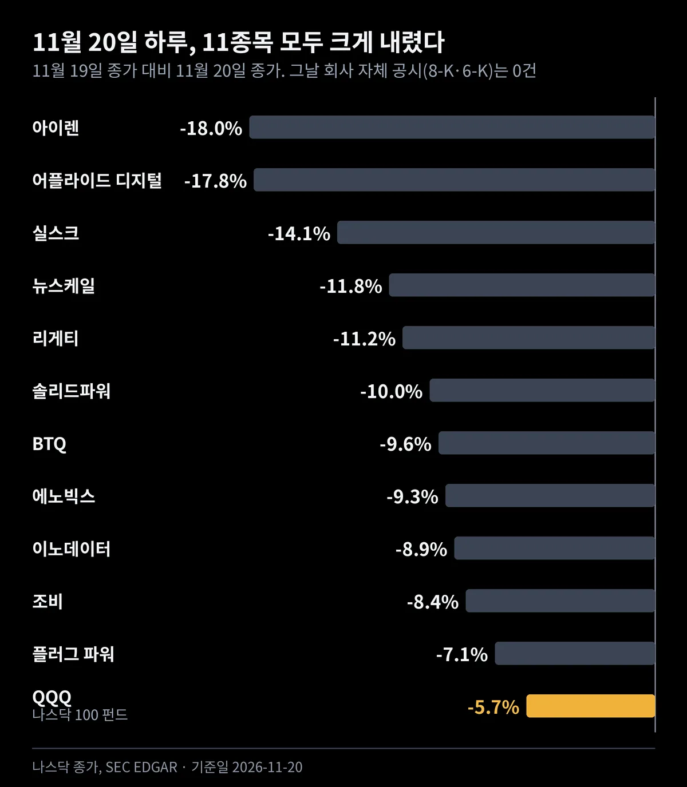
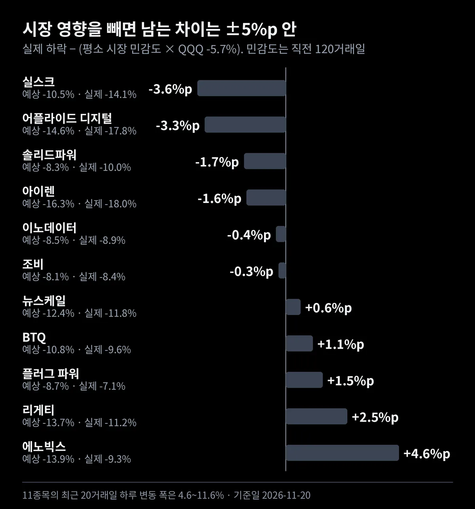
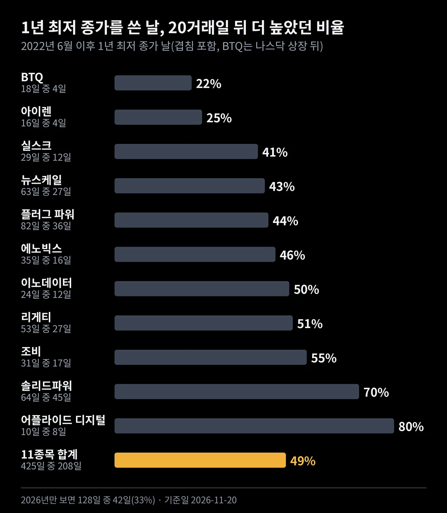
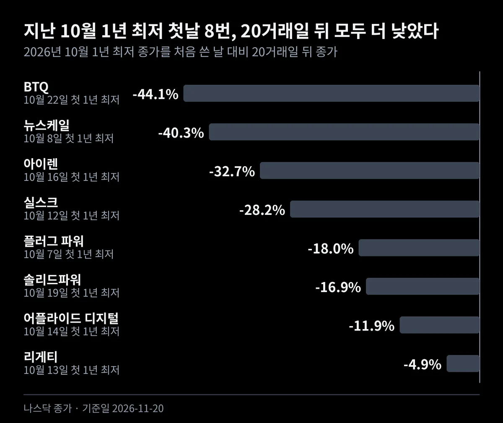
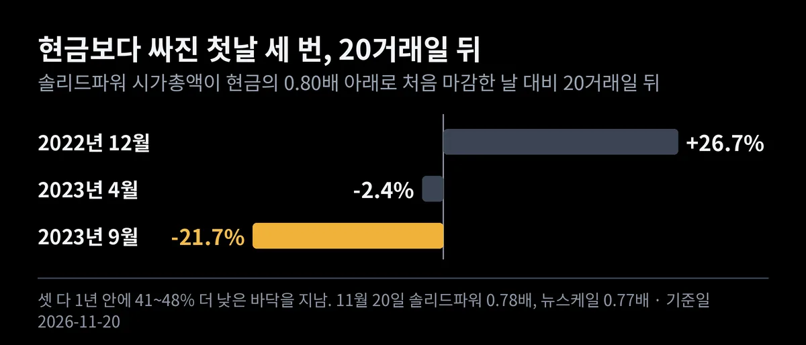
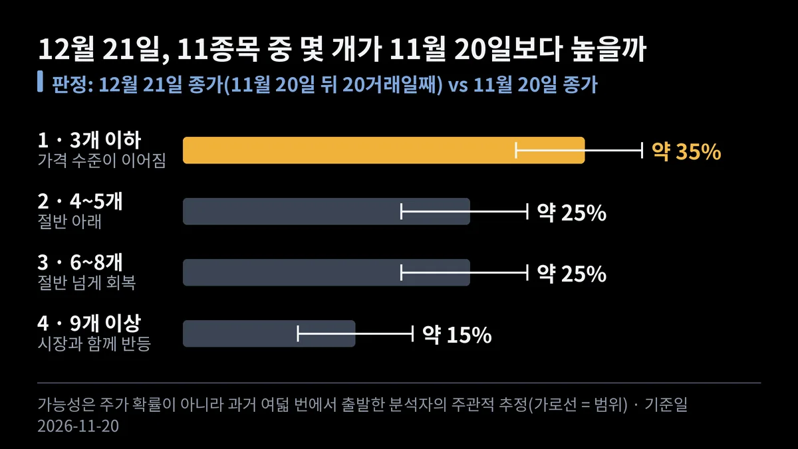

이번 주 내 종목, 지금 사도 될까? 이번 주 김박사 월드 영상마다 가장 많이 붙은 질문입니다. 11월 20일 금요일, 나스닥 100 펀드(QQQ)가 하루 5.7% 내렸습니다. 이번 주 다룬 11종목은 그날 7.1%에서 18.0%까지 함께 내렸습니다. 그리고 11종목 모두 1년 사이 가장 낮은 종가에 섰습니다. 회사가 스스로 낸 8-K나 6-K 같은 사건 공시는 그날 하나도 없었습니다.

> **유의사항** 저자는 금융·투자 자문가가 아닙니다. 이 글은 공개 공시와 시세를 정리한 교육용 분석이며 특정 종목의 매수·매도를 권하지 않습니다. 과거 패턴은 미래 수익을 보장하지 않습니다. 이 글의 11종목은 하루 5% 넘게 움직이는 날이 잦은 소형 성장주입니다. 실제 투자 전에는 최신 공시를 직접 확인하세요.

일요일 결산은 한 주 동안 다룬 종목을 하나의 질문으로 묶는 자리입니다. 이번 주 롱폼과 리포트는 플러그 파워, 조비 에비에이션, 실스크, 솔리드파워, 뉴스케일 파워, 아이렌, 이노데이터, BTQ(BTQ 테크놀로지스, 양자 보안 칩을 만드는 캐나다 회사)를 다뤘습니다. 여기에 탐색 편으로 에노빅스, 어플라이드 디지털, 리게티 컴퓨팅을 더했습니다. 열한 회사가 돈을 버는 방식은 수소 연료전지, 에어택시, 양자 보안 칩, 전고체 배터리, 소형 원자로, AI 데이터센터, AI 데이터 라벨링으로 제각각입니다. 아직 매출이 작거나 없는 회사가 많아, 주가가 실적보다 시장 분위기에 크게 흔들린다는 점은 같습니다. 종목은 달라도 질문은 하나로 모였습니다. 그래서 오늘은 이 질문을 가르는 기준 다섯 가지를 차례로 세워 보겠습니다. 이 글은 사라, 팔라를 말하지 않습니다.

가장 먼저 가를 것은 그 하락이 회사 사건인지, 시장을 따라 함께 내린 것인지입니다. 이것이 첫 기준입니다. 이번 주 리포트 대부분이 같은 문장을 적었습니다. 뉴스케일은 11월 5일 분기 보고서 뒤 새 SEC 서류 0건, 솔리드파워는 11월 4일 뒤 0건이었습니다. 아이렌은 대형 주주의 지분 보고 두 건뿐이었습니다. 그렇다고 모두 똑같이 시장 탓이라고 말하려면 숫자 하나가 더 필요합니다. 종목마다 시장에 반응하는 크기가 다르기 때문입니다.

그래서 평소 민감도를 썼습니다. QQQ가 하루 1% 움직일 때 그 종목이 평균 얼마나 움직였는지입니다. 11월 19일까지 약 반년치 하루 변화로 계산했습니다. 아이렌은 약 2.9%, 조비는 약 1.4%였습니다. 이 민감도에 그날 QQQ -5.7%를 곱하면 '시장 영향'으로 예상되는 하락이 나옵니다. 아이렌의 예상은 -16.3%였고 실제는 -18.0%였습니다. 차이는 -1.6%p로, 아이렌이 평소 하루에 움직이는 폭(약 8.9%)보다 훨씬 작습니다.

11종목 모두 이 차이가 ±4.6%p 안이었습니다. 가장 많이 더 내린 쪽은 실스크 -3.6%p, 어플라이드 디지털 -3.3%p입니다. 가장 덜 내린 쪽은 에노빅스 +4.6%p였습니다. 11월 20일 하루만 보면 회사 영향은 거의 보이지 않습니다. 이 기준으로 보면 '이 회사에 무슨 일이 생겼나'를 걱정할 근거는 약합니다. 대신 시장이 다시 흔들리면 같은 크기로 또 흔들릴 종목들이라는 점이 남습니다.

다만 한 주를 통째로 보면 이야기가 다른 종목도 있었습니다. [에노빅스](/r/envx-2026-11/)는 11월 11일부터 19일까지 49.0% 내려, 같은 기간 솔리드파워는 -24.2%, 소형주 펀드(IWM)는 -6.7%였습니다. 그사이 실적 발표에서 스마트폰 배터리 현장 시험을 멈춘다고 밝힌 회사 사건이 있었습니다. 어플라이드 디지털도 11월 18일 자회사 계약 공시가 있었고, 그날은 올랐습니다. 하루 단위로 나눠 봐야 회사 영향과 시장 영향이 섞이지 않습니다.

1년 최저라는 자리가 두 번째 기준입니다. 이 말은 주가를 싸 보이게 만듭니다. 그래서 이번 주 11종목의 과거 기록을 같은 방법으로 다시 셌습니다. 2022년 6월 뒤로 종가가 1년 최저를 새로 쓴 날을 모두 모았습니다. BTQ는 2025년 9월 나스닥 상장 뒤만 넣었습니다. 그런 날은 425일이었고, 20거래일 뒤 종가가 더 높았던 날은 208일이었습니다. 49%로, 동전 던지기와 거의 같습니다.

종목마다는 차이가 컸습니다. 어플라이드 디지털은 10일 중 8일(80%), 솔리드파워는 64일 중 45일(70%)이 더 높았습니다. 아이렌은 16일 중 4일(25%), BTQ는 18일 중 4일(22%)뿐이었습니다. 그런데 기간을 2026년으로 좁히면 128일 중 42일, 33%로 내려갑니다. 올해는 1년 최저가 바닥이 되기보다 한 번 더 내려가는 중간 지점인 경우가 많았습니다.

가장 최근 기록은 더 분명합니다. 지난 10월, 이번 주 종목 가운데 여덟 개가 1년 최저를 처음 썼습니다. 그 여덟 번은 20거래일 뒤 모두 더 낮았습니다. BTQ는 44.1%, 뉴스케일은 40.3% 더 내렸고, 가장 덜 내린 리게티도 4.9% 낮았습니다. 김박사 월드 예측 장부에 적힌 통찰 '가격 수준은 이어진다'와 같은 방향입니다. 판정선을 지킨다는 쪽 예측은 장부에서 네 번 모두 빗나갔습니다.

그렇다고 1년 최저가 늘 더 내려간다는 뜻은 아닙니다. 11종목이 여럿 함께 1년 최저 근처로 내려온 때는 2022년 6월 뒤로 여덟 번 있었습니다. 2024년 1월과 2026년 7월에는 20거래일 뒤 거의 모든 종목이 더 높았습니다. 2022년 12월과 2026년 10월에는 대부분 더 낮았습니다. 이 기준이 말해 주는 것은 방향이 아니라, 1년 최저라는 사실만으로는 어느 쪽도 정해지지 않는다는 점입니다.

몸값과 현금을 견주는 것이 세 번째 기준입니다. 11월 20일 [솔리드파워](/r/sldp-2026-11-4/)의 시가총액은 9월 말 현금과 증권의 약 0.78배였습니다. [뉴스케일](/r/smr-2026-11-4/)은 현금과 투자 자산의 약 0.77배였습니다. 두 회사 모두 회사를 통째로 사는 값보다 회사가 쥔 현금이 더 많은 셈입니다. 정확한 금액은 부록 표에 적었습니다.

이 숫자는 사는 쪽 근거로 자주 쓰입니다. 하지만 솔리드파워의 과거 기록은 조심하라고 말합니다. 시가총액이 현금의 0.80배 아래로 처음 마감한 날은 2022년 12월, 2023년 4월, 2023년 9월 세 번 있었습니다. 20거래일 뒤 더 높았던 것은 한 번(+26.7%)이었습니다. 나머지는 -2.4%, -21.7%였고, 셋 다 그 뒤 1년 안에 41~48% 더 낮은 바닥을 지났습니다.

현금이 어디서 왔는지도 같이 봐야 합니다. 솔리드파워는 올해 시장에서 판 새 주식이 없었습니다. 뉴스케일은 새 주식을 팔 수 있는 한도가 크게 남아 있습니다. [BTQ](/r/btq-2026-11-5/)의 현금은 6월 말의 두 배가 됐지만 거의 다 새 주식을 판 돈이었습니다. 플러그 파워도 남은 판매 한도가 발행주식의 3분의 2 가까이 됩니다. 같은 '현금 많음'이라도, 앞으로 새 주식이 나올 창구가 열려 있는지에 따라 무게가 달라집니다.

내부자 거래는 네 번째 기준입니다. 같은 주에 Form 4 두 장이 정반대 신호처럼 보였습니다. Form 4는 임원과 이사가 자기 회사 주식을 사고판 뒤 SEC에 내는 보고서입니다. [이노데이터](/r/inod-2026-11-2/)의 이사 스튜어트 매시는 11월 19일 장내에서 1만 주를 평균 32.09달러에 샀습니다. 자기 돈으로 시장에서 산 거래입니다. 다음 날 종가는 28.12달러로, 이 이사의 매수가보다 12.4% 낮습니다.

[리게티 컴퓨팅](/r/rgti-2026-11/)은 11월 20일 임원 셋이 약 32만 달러어치를 팔았다고 신고했습니다. 연속 하락 끝에 1년 최저인 날이라 나쁘게 읽히기 쉽습니다. 그런데 이 매도는 주식 보상이 나올 때 붙는 세금을 내려고 정해진 만큼 파는 의무 매도였습니다. 그 날짜는 여름 공시 주석에 이미 적혀 있었습니다. [실스크](/r/laes-2026-11-5/) 리포트가 확인한 임원 Form 4 세 건도 옵션 행사 때 세금으로 회사가 가져간 주식이었고, 시장 매도가 아니었습니다.

이 기준은 서류 한 칸으로 가릅니다. Form 4 표의 거래 코드가 P면 장내 매수, S면 매도, F면 세금으로 회사가 가져간 주식입니다. 같은 매도라도 주석에 세금 원천징수, 미리 정한 매도 계획이 적혀 있으면 임원의 판단이 담긴 거래로 보기 어렵습니다. 반대로 이사의 장내 매수 하나가 주가 방향을 정해 주지도 않습니다. 이노데이터는 매수 다음 날에도 시장과 같은 폭으로 내렸습니다.

판단을 바꿀 날짜와 선이 정해져 있는지가 마지막 기준입니다. 김박사 월드는 리포트마다 판정 날짜와 그날 넘어야 할 종가, 곧 판정선을 적어 두고 나중에 채점합니다. 이번 주에는 12월 21일, 곧 11월 20일 뒤 20번째 거래일이 여러 종목의 판정 날짜가 됐습니다. 솔리드파워 1.73달러, 뉴스케일 4.34달러, 이노데이터 32.09달러, BTQ 1.31달러가 그날의 위쪽 선입니다. 이 선 위로 돌아오면 사는 쪽 근거가 강해지고, 아래쪽 선을 깨면 사지 않는 쪽 근거가 강해집니다.

날짜를 정해 두는 이유는 기억이 맞힌 것만 남기기 때문입니다. 11월 22일 기준 예측 장부에서 판정이 끝난 것은 48개입니다. 가장 기운 쪽을 고른 13번 가운데 5번(38%)이 맞았습니다. 가능성 숫자의 정확도를 재는 브라이어 점수는 0.155로, 모두 50%라고 했을 때의 0.250보다 낮아 더 나은 쪽입니다. 숫자 전체는 [예측 성적표](/scorecard/)에 그대로 공개돼 있습니다.

마지막으로 11종목을 한 바구니로 놓고 12월 21일을 네 갈래로 나눴습니다. 출발점은 여러 종목이 함께 1년 최저 근처로 내려온 과거 여덟 번입니다. 그때 20거래일 뒤 결과는 절반 넘게 회복한 때와 대부분 더 내린 때로 크게 갈렸습니다. 올해 기록과 10월 여덟 번을 반영해 '3개 이하'를 약 35%로 가장 무겁게 봤습니다.

나머지 세 갈래는 부록 표에 있고, 가장 가벼운 '9개 이상'도 약 15%입니다. 이 숫자는 주가가 오를 확률이 아니라, 과거 빈도에서 출발한 분석자의 주관적 추정입니다. 틀릴 수 있는 곳도 분명합니다. 11종목은 시장보다 1.4배에서 2.9배 크게 반응합니다. 11월 20일 하락이 시장 영향이었던 만큼, 시장이 20거래일 안에 되돌리면 대부분이 함께 오를 수 있습니다. 표본이 여덟 번뿐이라는 점도 한계입니다.

정리하면 이렇습니다. 하락이 시장 영향이었는지, 1년 최저 자리가 그 종목에서 어떻게 끝났는지, 현금이 몸값보다 많은지와 새 주식 창구가 열려 있는지를 먼저 봅니다. 그다음 내부자 거래가 자기 돈의 매수인지 세금 매도인지, 판정 날짜와 선이 있는지를 봅니다. 시장 영향의 하락에, 판매 창구가 닫혀 있고, 내부자 매수가 있고, 12월 21일 위쪽 선으로 돌아온다면 사는 쪽 근거가 강해집니다. 반대 조건이 겹치면 사지 않는 쪽 근거가 강해집니다. 결정은 각자의 몫이며, 이 영상과 리포트는 판단 근거를 정리한 교육용 자료입니다.

## 숫자로 다시 보기

### 11월 20일 하루, 시장 영향과 회사 영향

| 종목 · 11월 20일 종가 | 실제 하루 변화 | 민감도로 예상 · 차이 |
| --- | --- | --- |
| **아이렌** 11.82달러 | -18.0% | -16.3% · -1.6%p |
| **어플라이드 디지털** 11.49달러 | -17.8% | -14.6% · -3.3%p |
| **실스크** 0.962달러 | -14.1% | -10.5% · -3.6%p |
| **뉴스케일** 3.36달러 | -11.8% | -12.4% · +0.6%p |
| **리게티** 7.16달러 | -11.2% | -13.7% · +2.5%p |
| **솔리드파워** 1.35달러 | -10.0% | -8.3% · -1.7%p |
| **BTQ** 1.03달러 | -9.6% | -10.8% · +1.1%p |
| **에노빅스** 1.17달러 | -9.3% | -13.9% · +4.6%p |
| **이노데이터** 28.12달러 | -8.9% | -8.5% · -0.4%p |
| **조비** 3.60달러 | -8.4% | -8.1% · -0.3%p |
| **플러그 파워** 0.9565달러 | -7.1% | -8.7% · +1.5%p |

QQQ는 645.04에서 608.45로 -5.7%였습니다. 민감도는 직전 120거래일 하루 변화로 계산했습니다. 11종목의 최근 20거래일 하루 변동 폭은 4.6~11.6%입니다. 11종목 모두 11월 20일 종가가 1년 최저였습니다.

### 1년 최저 종가 날, 20거래일 뒤 더 높았던 비율

| 종목 | 1년 최저 날 · 20거래일 뒤 더 높음 |
| --- | --- |
| **어플라이드 디지털** | 10일 중 8일 · 80% |
| **솔리드파워** | 64일 중 45일 · 70% |
| **조비** | 31일 중 17일 · 55% |
| **리게티** | 53일 중 27일 · 51% |
| **이노데이터** | 24일 중 12일 · 50% |
| **에노빅스** | 35일 중 16일 · 46% |
| **플러그 파워** | 82일 중 36일 · 44% |
| **뉴스케일** | 63일 중 27일 · 43% |
| **실스크** | 29일 중 12일 · 41% |
| **아이렌** | 16일 중 4일 · 25% |
| **BTQ** | 18일 중 4일 · 22% |
| **11종목 합계** | **425일 중 208일 · 49%** 2026년만 128일 중 42일 · 33% |

2022년 6월 이후 겹치는 날을 모두 센 값입니다. BTQ는 2025년 9월 26일 나스닥 상장 뒤만 넣었습니다.

### 지난 10월, 1년 최저 첫날 뒤 20거래일

| 종목 · 첫날 | 20거래일 뒤 |
| --- | --- |
| **BTQ** · 10월 22일 | -44.1% |
| **뉴스케일** · 10월 8일 | -40.3% |
| **아이렌** · 10월 16일 | -32.7% |
| **실스크** · 10월 12일 | -28.2% |
| **플러그 파워** · 10월 7일 | -18.0% |
| **솔리드파워** · 10월 19일 | -16.9% |
| **어플라이드 디지털** · 10월 14일 | -11.9% |
| **리게티** · 10월 13일 | -4.9% |

### 현금 대비 몸값과 새 주식 창구(11월 20일 기준)

| 종목 | 현금 대비 시가총액 · 새 주식 창구 |
| --- | --- |
| **솔리드파워** | **약 0.78배** 시가총액 약 3억 940만 · 현금과 증권 3억 9,756만 달러, 올해 시장 매각 0주 |
| **뉴스케일** | **약 0.77배** 시가총액 약 14억 4,446만 · 현금과 투자 자산 18억 6,408만 달러, 판매 한도 7억 5,000만 달러 |
| **BTQ** | 현금은 거의 새 주식 판 돈 남은 판매 한도 약 1억 1,500만 캐나다달러 |
| **플러그 파워** | 남은 판매 한도 1.03달러 기준 발행주식의 약 65.5% |

솔리드파워가 현금의 0.80배 아래로 처음 마감한 세 번(2022년 12월, 2023년 4월, 2023년 9월)의 20거래일 뒤는 +26.7%, -2.4%, -21.7%였고, 셋 다 1년 안에 41~48% 더 낮은 바닥을 지났습니다.

### 내부자 거래 가르기

| 거래 · 날짜 | 무엇인가 |
| --- | --- |
| **이노데이터 이사 매수** 11월 19일 1만 주 · 평균 32.09달러 | 장내 매수(자기 돈) · 다음 날 종가 28.12달러 |
| **리게티 임원 3명 매도** 11월 20일 41,492주 · 약 32만 달러 | RSU 세금 의무 매도 · 날짜는 8월 공시에 적혀 있음 |
| **실스크 임원 Form 4 세 건** 11월 18~19일 | 옵션 행사 때 세금으로 회사가 가져간 주식 · 시장 매도 아님 |

### 종목별 판정 날짜와 선

| 종목 | 판정 날짜 · 선 |
| --- | --- |
| **솔리드파워** | 12월 15일 · 12월 21일 · 1.73달러 위인가 |
| **뉴스케일** | 12월 21일 · 4.34달러 위 / 2.69달러 아래 |
| **이노데이터** | 12월 21일 · 32.09달러 위 / 22.50달러 아래 |
| **BTQ** | 12월 21일 · 1.31달러 위 / 0.82달러 아래 |
| **어플라이드 디지털** | 12월 21일 · 13.98 · 11.49 · 10.03달러 |
| **리게티** | 12월 21일 · 7.16달러 위인가 |
| **조비** | 12월 18일 · 4달러 위로 돌아왔나 |
| **플러그 파워** | 12월 18일 · 1.11달러 위인가 |
| **에노빅스** | 12월 18일 · 1.29달러 위인가 |
| **실스크** | 12월 17일 · 1.20 · 1.085 · 0.98달러 |
| **아이렌** | 12월 4일 · 11.82달러 위인가 |

11월 20일 종가는 12월 21일 위쪽 선의 솔리드파워 78%, 뉴스케일 77%, 이노데이터 88% 자리입니다.

### 예측 성적표(11월 22일 기준)

| 항목 | 값 |
| --- | --- |
| 장부 예측 · 판정 끝 | 387개 · 48개 |
| 가장 기운 쪽 적중 | 13번 중 5번 · 38% |
| 브라이어 점수 | 0.155(n=43) · 모두 50%면 0.250 |
| 20~40%라고 한 것 | 실제 25%(20개 중 5개) |
| 판정선 이탈 쪽 · 지킨다 쪽 | 4/4 적중 · 0/4 |

### 앞으로 일어날 수 있는 일

과거 빈도: 2022년 6월 뒤 이번 주 종목 여럿이 함께 1년 최저 근처로 내려온 여덟 번의 첫날, 20거래일 뒤 더 높은 종목이 3개 이하(11종목 환산) 두 번, 4~5개 한 번, 6~8개 세 번, 9개 이상 두 번이었습니다.

| 날짜 · 첫날 1년 최저 종목 | 20거래일 뒤 더 높은 비율 |
| --- | --- |
| 2022년 12월 7일 · 9종목 중 4 | 22% |
| 2023년 3월 17일 · 9종목 중 3 | 67% |
| 2023년 5월 3일 · 9종목 중 3 | 67% |
| 2023년 10월 20일 · 9종목 중 3 | 44% |
| 2024년 1월 17일 · 9종목 중 3 | 89% |
| 2024년 4월 25일 · 9종목 중 3 | 67% |
| 2026년 7월 29일 · 11종목 중 4 | 91% |
| 2026년 10월 8일 · 11종목 중 4 | 0% |

아래 가능성은 주가 상승·하락 확률이 아니라, 12월 21일 종가가 11월 20일 종가보다 높은 종목 수에 대한 분석자의 주관적 추정입니다. 네 갈래는 겹치지 않아 더하면 100%이고, 괄호 안 범위는 더하지 않습니다.

| 시나리오(판정 12월 21일) | 높은 종목 수 | 가능성(추정) |
| --- | --- | --- |
| **1 · 가격 수준이 이어짐** | 3개 이하 | 중간 약 35% (29~40%) |
| 2 · 절반 아래 | 4~5개 | 중간 약 25% (19~30%) |
| 3 · 절반 넘게 회복 | 6~8개 | 중간 약 25% (19~30%) |
| 4 · 시장과 함께 반등 | 9개 이상 | 낮음 약 15% (10~20%) |

### 핵심 확인 세 가지

| 순위 · 확인할 것 | 판정 날짜 |
| --- | --- |
| **1순위** 11종목 가운데 11월 20일 종가보다 높은 종목이 몇 개인가 | 12월 21일 |
| **2순위** 새 주식 판매·조달 공시가 나오는가(BTQ·뉴스케일·플러그 파워·이노데이터·리게티) | 12월 21일까지 |
| **3순위** QQQ가 11월 20일 608.45 위로 돌아오는가 | 12월 21일 |

## 함께 읽기

- [솔리드파워 지금 사도 될까?](/r/sldp-2026-11-4/) · [영상](https://youtu.be/JusnxXSiIVQ): 현금의 약 0.78배, 1년 최저 1.35달러.
- [뉴스케일 파워 지금 사도 될까?](/r/smr-2026-11-4/) · [영상](https://youtu.be/LtzNialqBF8): 현금의 0.77배, 판매 한도 7억 5,000만 달러.
- [이노데이터 지금 사도 될까?](/r/inod-2026-11-2/) · [영상](https://youtu.be/fzbU46COnbk): 이사 장내 매수 32.09달러.
- [BTQ 지금 사도 될까?](/r/btq-2026-11-5/): 1.03달러, 1달러 선까지 3%.
- [리게티 컴퓨팅](/r/rgti-2026-11/) · [영상](https://youtu.be/c-8RHgUfHv8): 임원 셋의 세금 의무 매도.
- [아이렌](/r/iren-2026-11-5/) · [쇼츠](https://youtu.be/uyQzyqq33_s): 회사 소식 없는 하루 -18.0%.
- [어플라이드 디지털](/r/apld-2026-11/) · [영상](https://youtu.be/1TKhp0NOkYU): 계약 날은 오르고 시장 급락 날 -17.8%.
- [플러그 파워](/r/plug-2026-11-4/) · [영상](https://youtu.be/G4LwNPV5bB8): 판매 한도 발행주식의 약 65.5%.
- [조비 에비에이션](/r/joby-2026-11-4/) · [영상](https://youtu.be/m2eALHEvv8c): 3년 반 만에 4달러 아래.
- [실스크](/r/laes-2026-11-5/) · [영상](https://youtu.be/2LuMR4kBlmA): 임원 Form 4는 세금으로 가져간 주식.
- [에노빅스](/r/envx-2026-11/) · [영상](https://youtu.be/9XvR-qdcTUE): 한 주 -49.0%, 회사 사건이 있던 주.
