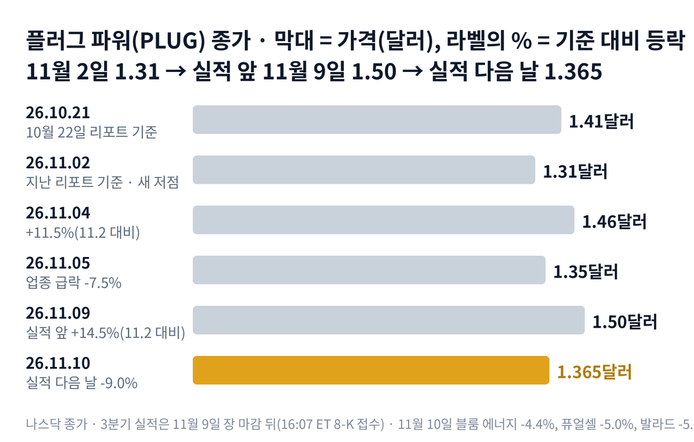

## 짧은 답

> **핵심:** 3분기 숫자는 10월 15일 예비 발표 그대로였습니다. 주가는 실적 전에 이미 14.5% 올라 있었고, 회사는 4분기 현금 사용 전망을 한 단계 낮췄습니다.

주식을 한 주도 팔지 않았고, 석 달 동안 쓴 현금은 2분기의 절반 아래로 줄었습니다. 그런데 플러그 파워 주가는 왜 실적 다음 날 9.0% 내렸을까요?

회사가 이유를 밝힌 자료는 없습니다. 다만 주가는 실적 앞 5거래일 동안 업종보다 크게 올라 있었고, 실적 숫자는 25일 전 예비 발표와 같았습니다. 바뀐 것은 한 문장입니다. 10월에는 4분기 현금 사용이 '계속 나아진다'고 했는데, 이번에는 '비슷할 수 있다'로 적었습니다.

**2026.11.10 진단: 국면 C(매수세가 서서히 사라지는 단계) 유지 — 근거는 5부.** 실적 첫날 5% 넘게 내린 과거 여섯 번의 한 달 뒤는 3부 '첫날 5% 넘게 내린 여섯 번' 표에 있습니다.

> **유의사항** 저자는 금융·투자 자문가가 아닙니다. 이 글은 공개 공시와 시세를 정리한 교육용 분석이며 특정 종목의 매수·매도를 권하지 않습니다. 과거 패턴은 미래 수익을 보장하지 않고, 플러그 파워는 실적 날 하루에 40% 넘게 내린 적이 있는 종목입니다. 실제 투자 전에는 최신 공시를 직접 확인하세요.

## 지난 리포트 이후

[지난 리포트](/r/plug-2026-11/)는 11월 2일 종가를 기준으로 나왔습니다. 2025년 6월 이후 가장 낮은 종가였습니다. 그때 지금을 국면 C(매수세가 서서히 사라지는 단계)로 진단했고, 실적 보고서가 예비 숫자를 확인할지를 첫 시나리오의 전제로 두었습니다. 지난 예측 성적: 적중 2 · 빗나감 1 · 확인 전 1이고, 항목별 채점표는 6부 끝에 있습니다.

빗나간 진단은 방향보다 시점의 문제였습니다. 주가는 실적 앞에서 올랐다가 다음 날 대부분을 돌려줘, 11월 10일 종가는 지난 기준보다 4.2% 높습니다. 지난 리포트가 시나리오 2를 낮게 본 근거 하나도 바뀌었습니다. 회사가 4분기 현금 사용이 더 줄 것이라던 말을 '비슷할 수 있다'로 고쳤기 때문입니다.

## 1부. 플러그 파워는 어떤 회사이고, 3분기에 무엇을 냈나

> **핵심:** 수소를 만들고 연료전지로 바꿔 쓰게 하는 회사이고, 3분기에는 매출과 현금 사용이 모두 좋아졌지만 이익을 흑자로 만든 것은 장부상 평가이익이었습니다.

플러그 파워는 뉴욕주에 본사를 둔 수소 회사입니다. 수소를 만드는 장비와 쓰는 장비를 함께 팝니다.

돈을 버는 방식은 세 갈래입니다. 물류창고 지게차에 들어가는 수소 연료전지를 팔고 정비해 줍니다. 물을 전기로 갈라 수소를 만드는 장치인 전해조를 팝니다. 그리고 연료전지 손님에게 수소 자체를 팝니다. 3분기 수소 판매 매출은 약 3,800만 달러였는데, 아직 원가보다 싸게 팔고 있습니다.

이 회사 주가에서 중요한 변수는 매출보다 현금입니다. 아직 매출총이익이 적자라, 쓰는 현금을 무엇으로 메우느냐에 따라 주식 수가 달라지기 때문입니다.

3분기 실적은 11월 9일 장 마감 뒤에 나왔습니다. SEC에 서류가 접수된 시각은 미국 동부 기준 오후 4시 7분이라, 주가의 첫 반응일은 11월 10일입니다. 회사는 그보다 25일 앞선 10월 15일에 현금 숫자를 미리 알렸습니다. 지금 몸값은 아래 표의 시가총액 약 19억 달러입니다.

### 숫자로 본 3분기(11월 10일 기준)

| 항목 | 값 · 계산 근거 |
| --- | --- |
| 종가 | **1.365달러** 실적 전날 1.50달러보다 9.0% 낮음 |
| 시가총액 | **약 19억 900만 달러** 1.365달러 × 13억 9,887만 주(11월 4일) |
| 3분기 매출 | **2억 60만 달러** 1년 전 1억 7,706만보다 13.3% 증가 |
| 매출총이익률 | **약 -3%** 1년 전 약 -68%, 여전히 원가가 매출보다 큼 |
| 분기 현금 사용 | **2,800만 달러** 2분기 6,100만, 묶인 돈(제한 현금) 뺀 순감소 |
| 순이익 | **9,977만 달러 흑자** 비현금 평가이익 1억 9,200만 포함 |
| 3분기 시장 판매 | **0주** 주식 수는 8월 6일보다 0.12% 증가 |

순이익 흑자는 영업이 남긴 돈이 아닙니다. 회사가 발행한 증권의 값을 다시 매기면서 장부에 생긴 1억 9,200만 달러의 평가이익이 들어갔습니다. 회사도 이것이 흑자의 주된 이유라고 보도자료에 적었습니다. 시장 예상과의 비교는 따로 봐야 합니다. 나스닥 사이트에 실린 잭스 집계로는 조정 주당순이익이 -0.12달러로, 예상 -0.07달러보다 나빴습니다.

현금 사용에도 들여다볼 점이 있습니다. 같은 3분기에 회사는 고압 전기 설비를 팔아 4,000만 달러를 받았고, 현금 사용은 이 대금까지 더한 뒤의 순변화입니다. 그러니 영업만의 개선이라고 보기는 어렵습니다. 숫자가 이렇게 나왔는데, 다른 수소 회사들과 견주면 주가는 어떻게 움직였을까요?

## 2부. 실적 앞 5거래일과 실적 다음 날, 업종과 나란히

> **핵심:** 플러그 파워는 실적 앞 5거래일 동안 11월 2일 종가 대비 업종보다 10%p 넘게 더 올랐고, 실적 다음 날에는 업종보다 두 배 가까이 내렸습니다.

위 차트처럼 주가는 지난 리포트 기준일인 11월 2일 1.31달러에서 실적 전날 1.50달러까지 올랐습니다. 그사이 회사가 SEC에 낸 서류는 없었습니다. 같은 기간 다른 수소 회사들과 견주면 플러그 파워만 유독 많이 올랐습니다.

아래 표는 모두 같은 날짜의 종가끼리 비교했습니다. 기준일은 플러그 파워의 지난 리포트 기준일(11월 2일)과 실적 전날(11월 9일)이라, 다른 종목에는 각자의 실적 일정이 반영되지 않았습니다.

### 수소·청정에너지 종목, 같은 날짜 종가 기준

| 종목 · 성격 | 실적 앞 5거래일(11.2 → 11.9) | 실적 다음 날(11.10) |
| --- | --- | --- |
| **플러그 파워(PLUG)** 연료전지·전해조 | **+14.5%** | **-9.0%** |
| 블룸 에너지(BE) 연료전지 발전 | -1.2% | -4.4% |
| 퓨얼셀 에너지(FCEL) 연료전지 발전 | +3.0% | -5.0% |
| 발라드 파워(BLDP) 연료전지 | +4.7% | -5.7% |
| 청정에너지 ICLN 상장지수펀드(ETF) | +5.6% | -2.8% |

11월 10일은 업종 전체가 내린 날이었습니다. 다만 플러그 파워의 낙폭은 다른 연료전지 회사들의 1.6~2.0배였습니다. 실적 앞에서 더 많이 오른 종목이 실적 다음 날 더 많이 내린 모양입니다.

네 종목을 나란히 놓으면 공통점이 하나 보입니다. 11월 10일의 하락이 플러그 파워 한 회사에서만 비롯된 것은 아니라는 점입니다. 업종 매도와, 그 전에 더 오른 가격이 겹쳤습니다. 둘이 각각 얼마였는지 가를 자료는 없습니다. 그러면 첫날 이렇게 내린 뒤, 과거의 한 달은 어땠을까요?

## 3부. 실적 첫날 5% 넘게 내린 여섯 번

> **핵심:** 2022년 이후 실적 20번 가운데 첫날 5% 넘게 내린 것은 이번 전에 여섯 번이고, 20거래일 뒤 실적 전 가격을 되찾은 것은 두 번뿐이었습니다.

첫날 5% 넘게 내린 실적만 고른 이유는 지금과 비슷한 조건이기 때문입니다. 이번 첫날 -9.0%가 회복의 출발점이었는지, 더 긴 하락의 첫날이었는지를 과거에 비춰 보려는 것입니다. 2022년 3월부터 2026년 8월까지 정기 실적 19번을 모았습니다. 예비 발표는 뺐습니다.

발표 시점은 SEC에 실적 공시(8-K)가 접수된 시각으로 가렸습니다. 장 마감 뒤 발표는 다음 거래일을, 장 전 발표는 그날을 첫날로 잡았습니다. '20거래일 뒤'는 첫날을 1로 센 20번째 거래일 종가를 실적 전날 종가와 비교한 값입니다. 예를 들어 이번에는 11월 9일 종가 1.50달러가 기준이고, 첫날인 11월 10일 1.365달러는 -9.0%입니다.

**한눈에:** **2/6** 20거래일 뒤 실적 전 가격 회복 · **4/6** 20거래일 뒤 첫날 종가보다 높음 · **6/6** 5거래일째 실적 전 가격보다 낮음. 여섯 번은 모두 실적 전날 종가를 기준으로 쟀습니다.

### 실적 첫날 5% 넘게 내린 여섯 번, 첫날과 20거래일 뒤

| 발표일 · 그날 나온 내용 | 첫날 | 20거래일 뒤 |
| --- | --- | --- |
| **2022.05.09** 1분기 매출 +96% 연간 목표 유지 | -5.5% | +13.3% |
| **2023.03.01** 연간 매출 사상 최대 2023년 목표 유지 | -6.2% | -22.4% |
| **2023.05.09** 1분기 매출 +49% 장 전 발표, 목표 유지 | -13.8% | -2.7% |
| **2023.08.09** 분기 매출 사상 최대 연간 목표 유지 | -15.8% | -23.1% |
| **2023.11.09** 수소 공급 차질 계속기업 의문 문구 | -40.5% | -32.4% |
| **2025.05.12** 1분기 매출 +11% 현금 흐름 개선 | -10.2% | +41.7% |

여섯 번 모두 5번째 거래일에는 실적 전보다 낮았습니다. 첫 주에는 대개 더 밀렸다는 뜻입니다. 그런데 20번째 거래일을 첫날 종가와 견주면 그림이 달라집니다. 네 번은 첫날 종가보다 높았고, 가운데 값(중앙값)은 +13.3%였습니다. 반면 실적 전 가격 위로 돌아간 것은 2022년 5월과 2025년 5월 두 번뿐입니다.

> **이번 사례(5거래일·20거래일 결과 미확정):** 2026.11.09 장 마감 뒤 · 3분기 실적 · 첫날 11월 10일 -9.0% · 5거래일째 11월 16일, 20거래일째 12월 8일 판정

한계도 분명합니다. 한 번만 달랐어도 '여섯 번 중 네 번'은 '여섯 번 중 세 번'이 됩니다. 여섯 번 중 네 번이 2023년에 몰려 있어, 이 표는 규칙이 아니라 첫날 이후를 읽는 참고 자료입니다. 그런데 이 여섯 번의 실적 자료에는 무엇이 적혀 있었을까요?

## 4부. 목표를 지킨다는 말은 첫날을 막지 못했다

> **핵심:** 첫날 5% 넘게 내린 여섯 번 가운데 다섯 번은 보도자료 첫머리가 사상 최대 매출이나 연간 목표 유지였고, 존속 의문 문구가 나온 한 번만 낙폭이 유독 컸습니다.

3부 표의 '그날 나온 내용'을 다시 보면 뜻밖의 공통점이 있습니다. 나쁜 소식이 나온 날만 내린 것이 아니었습니다. 2023년 8월에는 분기 매출 2억 6,020만 달러로 사상 최대였고, 연간 목표도 유지했습니다. 그런데 첫날 주가는 15.8% 내렸습니다.

예외는 2023년 11월 한 번입니다. 그때는 분기 보고서(10-Q)에 회사의 존속을 의심하는 문구(계속기업 의문)가 들어갔고, 첫날 40.5% 내렸습니다. 이번 10-Q에는 그런 문구가 없습니다. 회사는 지금 현금과 앞으로 풀릴 제한 현금으로 최소 12개월 운영 자금이 충분하다고 판단했습니다. 이번은 나머지 다섯 번 쪽에 가깝습니다.

한 달 뒤 회복을 가른 공통 원인은 공시 목록만으로는 찾지 못했습니다. 여섯 번 모두 첫날 뒤 20거래일 안에 회사가 새 주식을 판다는 공시는 없었습니다. 회복한 2022년 5월과 2025년 5월은 둘 다 1분기 실적이었지만, 두 번으로 규칙을 말하기는 어렵습니다.

그렇다면 이번에 시장이 숫자 대신 무엇을 읽었는지가 남습니다. 회사는 올해 매출을 작년보다 15~16% 늘린다는 목표를 유지했습니다. 이 목표를 맞추려면 4분기 매출이 3분기의 약 1.4배가 돼야 합니다. 금액은 5부 표에 있습니다. 1년 전 4분기와 견주면 20% 넘게 많아야 하는 문턱입니다.

현금 쪽 문장도 바뀌었습니다. 10월 15일에는 3분기의 개선이 4분기에도 이어질 것이라고 썼습니다. 11월 9일에는 4분기 현금 사용이 비슷할 수 있다고 적었습니다. 같은 분기에 들어온 설비 매각 대금 4,000만 달러가 4분기에도 반복된다는 말은 없었습니다.

정리하면, 과거 여섯 번은 '목표 유지'라는 말이 첫날을 지켜 주지 못했다는 기록입니다. 이번에도 목표는 유지됐지만 문턱은 높고 현금 문장은 약해졌습니다. 그래서 확인할 것은 새 주식 공급이 다시 시작되는지와 목표를 끝까지 지키는지입니다. 이 둘로 12월 8일까지를 나누면 어떤 갈림길이 나올까요?

## 5부. 주식 공급과 목표 유지, 네 가지 시나리오

> **핵심:** 지금도 국면 C(매수세가 서서히 사라지는 단계)이고, 새 주식 공급 여부와 연간 목표 유지 여부가 다음 국면을 가르는 두 축입니다.

> **국면 정의(플러그 파워 시리즈 공통):** 국면 A · 생존 반등 — 1~2달러에서 파산 걱정이 가격에 들어간 뒤 자금 조달·정책 소식에 하루 20% 넘게 오르는 때. 국면 B · 공급이 따라오는 때 — 급등 직후 공모·전환사채·판매 계약이 나오는 때. 국면 C · 조용한 소진 — 하루 큰 하락 없이 한 달에 20~30%씩 내려가는 때.

**2026년 11월 10일 진단: 국면 C 유지.** 실적 앞 5거래일의 +14.5%는 하루 20% 넘는 상승이 아니었고, 실적 다음 날 그 대부분을 돌려줬습니다. 11월 10일 종가는 20거래일 전인 10월 13일보다 12.5% 낮습니다. 국면 A로 넘어가는 신호는 하루 20% 넘는 상승과 거래량 급증인데, 아직 나오지 않았습니다.

돈의 흐름을 표 하나로 모으면 지금의 자리가 보입니다.

| 항목 | 값 · 계산 근거 |
| --- | --- |
| 현금(실제 보유) | **1억 3,413만 달러** 9월 30일, 쓰임 제한 없음 |
| 제한 현금(실제 보유) | **4억 6,886만 달러** 담보·보증으로 묶인 돈, 일부씩 풀림 |
| 주식 판매 한도(미사용) | **9억 4,410만 달러** 시장에서 새 주식을 팔 수 있는 한도 |
| 전환사채 | **4억 7,069만 달러** 장부 가치, 12개월 안 만기 없음 |
| 4분기 필요 매출 | **2억 7,400만~2억 8,110만 달러** 작년 7억 992만 × 1.15~1.16 − 3분기까지 5억 4,241만 |

표의 돈은 성격이 달라 서로 더하지 않습니다. 현금과 제한 현금은 실제로 가진 돈이지만, 제한 현금은 담보로 묶여 마음대로 쓸 수 없습니다. 판매 한도는 앞으로 새 주식을 팔면 들어올 수 있는 최대치일 뿐, 가진 돈이 아닙니다. 9월 말 현금이 지금 얼마 남았는지는 4분기 실적에서 확인해야 합니다.

**판정 기준 두 가지:** 첫째, 새 주식 공급입니다. 11월 10일부터 12월 8일까지 시장 판매·공모·전환사채 공시가 있으면 '공급 있음'으로 봅니다. 둘째, 목표 유지입니다. 같은 기간 회사가 연간 매출 15~16% 성장과 4분기 조정 이익(EBITDAS, 이자·세금·감가상각·주식 보상 비용을 빼기 전 이익) 흑자 목표를 낮추지 않으면 '유지'로 봅니다.

### 앞으로 일어날 수 있는 일

**확인된 사실:** 3분기까지 9개월 동안 시장 판매는 0주였습니다. 회사는 11월 9일 두 목표를 모두 유지한다고 적었습니다.

**과거 기록:** 2025년에는 11월 실적 9일 뒤인 11월 19일에 전환사채가 나왔습니다. 첫날 5% 넘게 내린 실적은 6번 중 2번만 20거래일 뒤 실적 전 가격을 되찾았습니다. 여섯 번 모두 그 20거래일 안에 회사의 새 주식 판매 공시는 없었습니다.

**추정:** 아래 확률은 주가 상승·하락 가능성이 아니라, 12월 8일까지의 새 주식 공급 여부와 연간 목표 유지 여부에 대한 분석자의 주관적 추정입니다. 분모는 겹치지 않는 네 경우 전체라 '약 N%'를 더하면 100%이고, 괄호 안 구간은 흔들림의 폭이라 더하지 않습니다.

| 시나리오(판정 2026년 12월 8일) | 공급 · 목표 | 가능성(추정) |
| --- | --- | --- |
| **1 · 공급 없이 목표 유지** | 발행 없음 · 유지 | 높음 약 45% (40~50%) |
| 2 · 목표는 유지, 공급 재개 | 발행 · 유지 | 중간 약 30% (25~35%) |
| 3 · 공급은 없지만 목표 하향 | 발행 없음 · 하향 | 낮음 약 10% (5~15%) |
| 4 · 공급 재개와 목표 하향 | 발행 · 하향 | 낮음 약 15% (10~20%) |

**한눈에:** 목표 유지 약 75%(1+2) · 공급 없이 판정일 통과 약 55%(1+3) — 위 표를 더한 값입니다. 주가 쪽은 다른 질문이라 따로 적습니다. 12월 8일 종가가 첫날 종가 위일 가능성은 절반을 조금 넘게, 실적 전 종가 위일 가능성은 약 30%로 봤습니다. 모두 주관적 추정이지 실제 확률이나 통계 예측값이 아닙니다.

- **시나리오 1이면:** 판매 없이 버틴 분기가 하나 더 늘어납니다. 다음은 4분기 현금 사용이 정말 3분기와 비슷한지입니다.
- **시나리오 2이면:** 목표는 지켰지만 주식 수가 늘 수 있습니다. 판매 규모와 가격을 확인할 차례입니다.
- **시나리오 3이면:** 희석 걱정은 덜하지만 4분기 매출 문턱이 높았다는 뜻이 됩니다. 하향 폭과 이유를 봐야 합니다.
- **시나리오 4이면:** 2023년처럼 실적 실망과 자금 걱정이 겹치는 조합입니다. 두 가지를 모두 다시 따져야 합니다.

시나리오 1을 가장 높게 본 근거는 두 가지입니다. 공급 없음 쪽은 9개월 동안 판매 0주였던 기록에서, 작년 실적 9일 뒤의 전환사채 전례를 깎은 값입니다. 목표 유지 약 75%는 회사가 11월 9일 두 목표를 모두 유지한 뒤 한 달 안에 바꾼 적이 드물다는 점에서 나왔습니다. 다만 4분기 매출 문턱이 3분기의 1.4배 가까이 돼, 유지를 더 높게 두지는 않았습니다.

하지만 같은 무게로 반대쪽 요인도 있습니다. 쓸 수 있는 현금은 1억 3,413만 달러로, 4분기에도 분기 2,800만 달러 안팎을 쓰면 그 폭만큼 줄어듭니다. 판매 한도 9억 4,410만 달러는 그대로 남아 있고, 작년에는 실적 9일 뒤 전환사채가 나왔습니다. 전해조 계약도 금액과 매출 시점이 공개되지 않았습니다.

주가 쪽 추정은 3부의 여섯 번 중 네 번에서, 표본이 작다는 점을 깎은 값입니다. 주가가 오르거나 내린다는 판단은 아닙니다. 그렇다면 이 진단을 가장 빨리 뒤집을 수 있는 위험은 무엇일까요?

## 6부. 세 갈래 위험과 체크리스트

> **핵심:** 위험은 사업 실행, 자금 조달, 외부 환경 세 갈래이고, 가장 빨리 판을 바꿀 수 있는 것은 새 주식 공급 공시입니다.

먼저 이 분석의 한계입니다. 3부 표는 여섯 번뿐이고, 그중 네 번이 2023년입니다. 11월 10일 하락에서 업종과 회사 요인이 각각 얼마였는지는 가를 수 없습니다. 회사 목표와 시장 예상도 구분해야 합니다. 회사 목표는 연간 매출 성장률과 4분기 흑자 목표이고, 4분기 매출의 시장 예상은 확인하지 못했습니다.

첫째 갈래는 사업 실행, 곧 4분기 매출입니다. 4분기 매출은 3분기의 약 1.4배가 필요합니다. 회사는 덴마크 280메가와트 전해조 공급 계약과 호주 50메가와트 주문을 3분기 성과로 꼽았지만, 이 매출이 4분기에 얼마나 잡히는지는 밝히지 않았습니다.

둘째 갈래는 자금 조달입니다. 9억 4,410만 달러의 판매 한도는 언제든 쓸 수 있는 수단입니다. 주가가 1.365달러인 지금 한도를 모두 쓰면 새 주식이 수억 주 늘 수 있습니다. 판매가 시작되면 2부의 하락보다 그 공시가 더 큰 신호가 됩니다.

셋째 갈래는 외부 환경, 곧 업종 흐름입니다. 2부 표처럼 수소 회사들은 같은 날 함께 내리는 일이 잦았습니다. 11월 5일에도 블룸 에너지 -16.4%, 플러그 파워 -7.5%였습니다.

**핵심 확인 세 가지:** 위에서부터 판정을 바꾸는 힘이 큰 순서입니다.

- ☐ 1순위 · 11월 10일부터 12월 8일까지 시장 판매·공모·전환사채 공시가 0건인가
- ☐ 2순위 · 11월 19일 심포지엄과 그 뒤 공시에서 연간 매출 15~16% 성장과 4분기 흑자 목표를 유지하나
- ☐ 3순위 · 11월 16일(5거래일째)과 12월 8일(20거래일째) 종가가 첫날 종가 1.365달러보다 높은가

**보조 확인:** 11월 19일 심포지엄에서 금액이 붙은 새 전해조 수주가 나오는지, 뉴욕주 부지 매각 마감 공시가 나오는지입니다.

**기억할 판단 기준 세 가지:** 첫째, 3분기 숫자는 예비 발표 그대로였고 바뀐 것은 4분기 현금 문장이었습니다. 둘째, 첫날 5% 넘게 내린 여섯 번은 모두 첫 주에 더 밀렸습니다. 셋째, '목표 유지'라는 말만으로는 첫날 하락을 막지 못했습니다.

실적 앞 흐름은 [지난 플러그 파워 리포트](/r/plug-2026-11/)에, 업종 동반 매도 패턴은 [10월 리포트](/r/plug-2026-10-2/)에 있습니다. 다음 플러그 파워 갱신은 12월 8일 판정 뒤에 하고, 공시는 [플러그 파워 SEC 공시 목록](https://www.sec.gov/cgi-bin/browse-edgar?action=getcompany&CIK=0001093691&type=&dateb=&owner=include&count=40)에서 확인할 수 있습니다.

### 지난 예측 채점표

| 지난 점검 항목 · 당시 기준 | 판정 및 실제 결과(11월 10일) |
| --- | --- |
| **진단: 국면 C가 실적 앞까지 지속** 하루 큰 하락 없이 서서히 하락 | **[빗나감]** 11.2 1.31 → 11.9 1.50(+14.5%) |
| **시나리오 1 전제: 예비 숫자 확인** 판매 0, 현금 약 1억 3,400만 달러 | **[적중]** 판매 0주, 현금 1억 3,413만 달러 |
| **기록: 11월 실적 첫날은 모두 하락** 2021~2025년 5번 모두 | **[적중]** 6번째도 하락, 11.10 -9.0% |
| **시나리오 1: 판매 없이 흑자 목표 유지** 12월 8일까지 새 주식 공급 0건 | **[진행 중]** 11.10까지 공시 0건, 12월 8일 판정 |
